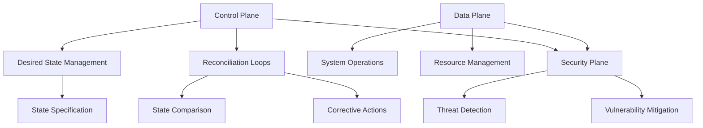

# Lesson 1: Foundations & System Invariants

## Curriculum Roadmap
This masterclass curriculum on '02 Agentic Workflows And Tools' is designed to provide a deep, unshakeable theoretical grounding in the principles and architecture of modern computing systems. The curriculum is structured to build a comprehensive understanding of the foundational technologies and invariants that underpin agentic workflows and tools. The modules are as follows:

1. **Foundations & System Invariants**: Establishing the core principles and invariants that govern agentic workflows and tools.
2. **Kernel-Level Abstractions**: Delving into the kernel-level mechanisms that enable agentic workflows, including scheduling, memory management, and device drivers.
3. **Containerization & Orchestration**: Understanding container runtimes and orchestration systems like Kubernetes, and their role in agentic workflows.
4. **eBPF & Extended Capabilities**: Exploring the capabilities of eBPF and its role in extending the functionality of the Linux kernel for agentic workflows.
5. **Security & Exploitation**: Analyzing the security implications of agentic workflows and tools, including modern hardware and kernel mitigations.
6. **Advanced Systems Programming**: Mastering the intricacies of systems programming in C and Rust, with a focus on memory safety and performance optimization.
7. **Practical Applications & Case Studies**: Applying the theoretical knowledge to real-world scenarios and case studies.

## 1. First-Principles Mental Model & Problem Space
The concept of agentic workflows and tools is rooted in the need for systems to operate autonomously, adapting to dynamic environments and making decisions with minimal human intervention. This paradigm shift is driven by the increasing complexity of modern computing systems, where traditional manual management is no longer feasible. The rise of cloud-native architectures, distributed systems, and the Internet of Things (IoT) has necessitated the development of systems that can self-heal, scale, and optimize themselves in real-time.

At the heart of agentic workflows is the idea of a system that can perceive its environment, reason about its state, and take appropriate actions to achieve its objectives. This requires a deep understanding of the underlying principles of computing, including operating systems, distributed systems, and security. The problem space is further complicated by the need to balance performance, reliability, and security in a highly dynamic and often adversarial environment.

The physics and systems trade-offs that agentic workflows address are multifaceted. On one hand, they must be able to operate efficiently and reliably in the face of resource constraints and failures. On the other hand, they must be able to adapt to changing conditions and respond to threats in real-time. This requires a sophisticated understanding of the trade-offs between centralized and decentralized control, the use of declarative state machines, and the role of continuous reconciliation loops in maintaining system integrity.

## 2. Fundamental System Guarantees & Non-Negotiable Invariants
To build a robust foundation for agentic workflows, it is essential to establish a set of fundamental system guarantees and non-negotiable invariants. These guarantees and invariants provide the necessary constraints and assurances that enable systems to operate autonomously and reliably.

### System Guarantees
1. **Declarative State Machines**: Agentic workflows are built on the concept of declarative state machines, where the desired state of the system is specified, and the system is responsible for achieving and maintaining that state. This approach ensures that the system is always moving towards its objective, even in the face of disruptions.
2. **Continuous Reconciliation Loops**: Continuous reconciliation loops are a key mechanism for maintaining system integrity. These loops continuously compare the current state of the system with the desired state and take corrective actions as needed. This ensures that the system remains in a consistent and predictable state.
3. **Fault Tolerance**: Agentic workflows must be able to tolerate faults and recover from failures. This requires a robust fault-tolerance mechanism that can detect and isolate faults, and take appropriate actions to restore system functionality.

### Non-Negotiable Invariants
1. **Consistency**: Consistency is a fundamental invariant that ensures the system remains in a valid and consistent state. This is achieved through the use of mechanisms such as consensus protocols (e.g., Raft) and Multi-Version Concurrency Control (MVCC).
2. **Isolation**: Isolation is another critical invariant that ensures that different components of the system do not interfere with each other. This is achieved through the use of namespaces (e.g., Mount, PID, Net, IPC, UTS, User) and container runtimes.
3. **Security**: Security is a non-negotiable invariant that ensures the system is protected against threats and vulnerabilities. This is achieved through a combination of hardware and software mechanisms, including ASLR, KASLR, Stack Canaries, NX/DEP, SMEP/SMAP, Shadow Stacks, and Control Flow Integrity (CFI).

## 3. High-Level Process & Component Architecture
The high-level architecture of agentic workflows and tools is designed to provide a robust and flexible framework for building autonomous systems. The architecture is composed of several key components, including the control plane, data plane, and security plane. The control plane is responsible for managing the desired state of the system, while the data plane is responsible for executing the system's operations. The security plane is responsible for protecting the system against threats and vulnerabilities.

In this architecture, the control plane is responsible for specifying the desired state of the system and continuously reconciling the current state with the desired state. The data plane is responsible for executing the system's operations and managing resources. The security plane is responsible for protecting the system against threats and vulnerabilities, and it interacts with both the control plane and the data plane to ensure that the system remains secure.

The control plane is built on the concept of declarative state machines, where the desired state of the system is specified, and the system is responsible for achieving and maintaining that state. The reconciliation loops continuously compare the current state of the system with the desired state and take corrective actions as needed. This ensures that the system remains in a consistent and predictable state.

The data plane is responsible for executing the system's operations and managing resources. This includes tasks such as scheduling, memory management, and device driver operations. The data plane is built on the principles of efficiency and reliability, and it is designed to operate in a highly dynamic and often adversarial environment.

The security plane is responsible for protecting the system against threats and vulnerabilities. This includes mechanisms such as threat detection, vulnerability mitigation, and access control. The security plane interacts with both the control plane and the data plane to ensure that the system remains secure.

In summary, the high-level architecture of agentic workflows and tools is designed to provide a robust and flexible framework for building autonomous systems. The architecture is composed of several key components, including the control plane, data plane, and security plane, and it is built on the principles of consistency, isolation, and security.
