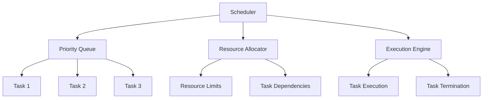

# Lesson 2: Automated Task Management

## 1. First-Principles Intuition & Invariants

Automated task management stands as a cornerstone of modern computing, facilitating the efficient orchestration of workflows across distributed systems. At its core, task management involves scheduling, prioritization, and execution of tasks to optimize resource utilization and meet system objectives. This domain spans from simple batch processing to complex, real-time systems. To grasp automated task management, we must explore the underlying principles that govern scheduling and prioritization.

Scheduling is the process of allocating resources to tasks over time, with resources typically comprising CPU time, memory, and I/O bandwidth. The goal is to ensure timely and efficient task execution, minimizing latency and maximizing throughput. Prioritization, conversely, involves determining the order of task execution based on their importance and urgency. Prioritization is crucial in systems where tasks have varying deadlines or resource requirements.

Mathematically, scheduling can be modeled as a resource allocation problem over time. The objective is to find an optimal schedule that minimizes a cost function, such as total execution time or resource utilization. In practice, this involves balancing competing objectives, such as minimizing latency for real-time tasks while maximizing throughput for batch processing tasks. The challenge lies in designing algorithms that efficiently find near-optimal solutions amidst dynamic workloads and resource constraints.

A key invariant in task management is fairness, ensuring that all tasks receive a fair share of resources, preventing any single task from monopolizing resources at the expense of others. Fairness is particularly important in shared systems where multiple users or applications compete for resources. Another invariant is responsiveness, ensuring tasks are executed in a timely manner, meeting their deadlines and providing a responsive user experience.

## 2. Core Architecture & Mechanics

The architecture of an automated task management system revolves around a central scheduler that manages task execution. The scheduler allocates resources, determines task execution order, and handles task dependencies. It interacts with various components, including task queues, resource allocators, and execution engines, to manage the workflow.

At the heart of the scheduler is a data structure representing the system's state, including tasks, their resource requirements, and current status. This data structure is typically implemented as a priority queue, where tasks are ordered by priority. The priority queue is dynamically updated as tasks are added, removed, or modified. The scheduler periodically examines the priority queue and selects the highest-priority task for execution.

The selection of the highest-priority task is determined by a scheduling algorithm. Various algorithms exist, each with unique strengths and weaknesses. One widely used algorithm is the Completely Fair Scheduler (CFS), employed in the Linux kernel. CFS is a priority-based scheduler that uses a red-black tree to maintain a balanced set of tasks. Each task is assigned a virtual runtime (`vruntime`), representing the amount of CPU time it has received relative to its priority. The scheduler selects the task with the smallest `vruntime` for execution, ensuring that higher-priority tasks receive more CPU time.

Another critical component is the resource allocator, managing resource allocation to tasks. The resource allocator interacts with the operating system's resource management subsystem, such as the Linux Control Groups (cgroups) framework, to enforce resource limits and ensure tasks do not exceed their allocated resources. It also handles task dependencies, ensuring tasks are executed in the correct order and dependencies are resolved before execution.

The execution engine is responsible for executing tasks and managing their lifecycle. It interacts with the operating system's kernel to manage task execution, including context switching, interrupt handling, and process management. The execution engine also handles task termination, ensuring tasks are properly cleaned up and resources are released upon completion.

To illustrate the architecture of an automated task management system, consider the following Mermaid diagram:

In this diagram, the scheduler interacts with the priority queue, resource allocator, and execution engine to manage the workflow. The priority queue maintains tasks ordered by priority, the resource allocator manages resource limits and task dependencies, and the execution engine manages task execution and termination.

## 3. High-Performance Optimization & Failure Modes

Achieving high performance in an automated task management system requires optimizing the scheduler and resource allocator. Minimizing the overhead of task scheduling and resource allocation is crucial. This involves reducing the time required to update the priority queue and resolve task dependencies, as well as minimizing the overhead of context switching and interrupt handling.

Concurrency is another critical factor in high-performance task management. In multi-core systems, the scheduler must efficiently distribute tasks across multiple cores, ensuring resources are utilized efficiently and tasks are executed in a timely manner. This involves using advanced scheduling algorithms, such as load balancing and work-stealing, to distribute tasks across cores.

Resource scaling is also essential in high-performance task management. As the number of tasks and resources increases, the scheduler must scale efficiently, ensuring tasks are executed in a timely manner and resources are utilized efficiently. This involves using advanced data structures, such as hash tables and balanced trees, to manage the system's state and minimize the overhead of task scheduling and resource allocation.

Boundary edge cases and failure modes are critical considerations in automated task management. Handling task dependencies, ensuring tasks are executed in the correct order and dependencies are resolved, is a key challenge. Other failure modes include resource contention, where tasks compete for limited resources, and task starvation, where certain tasks are perpetually delayed. Addressing these issues requires robust scheduling algorithms and resource management strategies.
