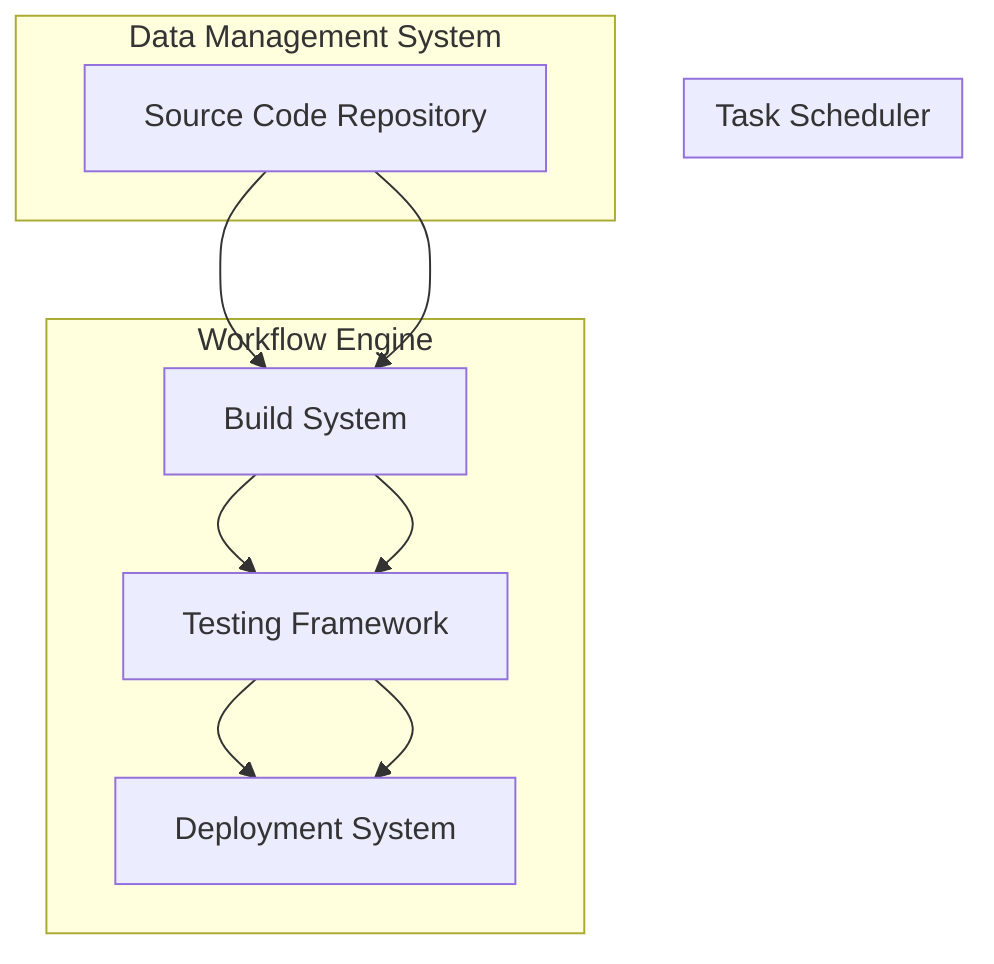

# Lesson 2: Tool Integration and Automation

## 1. First-Principles Intuition & Invariants

In the realm of software engineering and systems programming, the integration of tools and the automation of workflows are not merely conveniences but fundamental enablers of efficiency, scalability, and reliability. This domain encompasses everything from continuous integration and continuous deployment (CI/CD) pipelines to automated testing frameworks and infrastructure as code (IaC) systems. At the heart of this domain lies the need to orchestrate a multitude of tools in a manner that is both seamless and robust, ensuring that each component operates in harmony with the others.

The theoretical grounding for tool integration and automation is rooted in the principles of modularity, abstraction, and automation. Modularity allows us to break down complex systems into manageable components, each with a well-defined interface and responsibility. Abstraction enables us to hide the intricate details of these components, exposing only the necessary functionality to the rest of the system. Automation, finally, is the process of automating repetitive tasks, thereby reducing the potential for human error and increasing productivity.

From a mathematical and systems perspective, the invariants that govern tool integration and automation include the consistency of data across different tools, the reliability of the automation scripts, and the scalability of the integrated system. Consistency ensures that data remains accurate and synchronized across all tools, preventing discrepancies and errors. Reliability is crucial for ensuring that automation scripts perform their intended functions without failure, even under adverse conditions. Scalability, on the other hand, ensures that the integrated system can handle increased loads and demands without degradation in performance.

## 2. Core Architecture & Mechanics

The architecture of a tool integration and automation system is a complex interplay of various components, each designed to perform a specific function. At the core of this architecture lies the workflow engine, which orchestrates the execution of different tools and scripts in a predefined sequence. The workflow engine is responsible for managing dependencies between tools, handling errors, and ensuring that the entire pipeline runs smoothly.

One of the key components of the workflow engine is the task scheduler, which determines the order in which tasks are executed. The task scheduler can be based on a variety of algorithms, ranging from simple first-come, first-served (FCFS) scheduling to more sophisticated priority-based scheduling. In a priority-based scheduling system, tasks are assigned a priority level, and the scheduler executes tasks with higher priority first. This ensures that critical tasks are completed in a timely manner, even if other tasks are waiting in the queue.

Another critical component of the workflow engine is the data management system, which is responsible for managing the flow of data between different tools. The data management system ensures that data is consistently formatted and synchronized across all tools, preventing discrepancies and errors. This is achieved through the use of data transformation and validation mechanisms, which ensure that data is correctly formatted and valid before it is passed to the next tool in the pipeline.

To illustrate the mechanics of a tool integration and automation system, consider a CI/CD pipeline that consists of several tools, including a source code repository, a build system, a testing framework, and a deployment system. The workflow engine orchestrates the execution of these tools in a predefined sequence, starting with the source code repository and ending with the deployment system.

The task scheduler determines the order in which tasks are executed, ensuring that the build system is executed before the testing framework, and the testing framework is executed before the deployment system. The data management system ensures that data is consistently formatted and synchronized across all tools, preventing discrepancies and errors. For example, the source code repository passes the source code to the build system, which compiles the code and generates the build artifacts. The build artifacts are then passed to the testing framework, which runs the tests and generates the test results. Finally, the test results are passed to the deployment system, which deploys the build artifacts to the production environment.

To visualize the architecture of this CI/CD pipeline, we can use a Mermaid diagram:

In this diagram, the source code repository is the starting point of the pipeline, passing the source code to the build system. The build system compiles the code and generates the build artifacts, which are then passed to the testing framework. The testing framework runs the tests and generates the test results, which are passed to the deployment system. The workflow engine orchestrates the execution of these tools, the task scheduler determines the order in which tasks are executed, and the data management system ensures that data is consistently formatted and synchronized across all tools.

## 3. High-Performance Optimization & Failure Modes

To ensure that a tool integration and automation system performs efficiently and reliably, it is essential to optimize the system for high performance and to anticipate and mitigate potential failure modes. High-performance optimization involves a variety of techniques, including concurrency, resource scaling, and boundary edge cases.

Concurrency is the ability of a system to execute multiple tasks simultaneously. In a tool integration and automation system, concurrency can be achieved through the use of parallel processing, where multiple tasks are executed in parallel, or through the use of asynchronous processing, where tasks are executed independently and asynchronously. Parallel processing can significantly improve the performance of a system by allowing multiple tasks to be executed simultaneously, while asynchronous processing can improve the responsiveness of a system by allowing tasks to be executed independently and asynchronously.

Resource scaling involves the ability of a system to handle increased loads and demands without degradation in performance. In a tool integration and automation system, resource scaling can be achieved through the use of horizontal scaling, where additional resources are added to the system to handle increased loads, or through the use of vertical scaling, where the capacity of existing resources is increased. Horizontal scaling is often more flexible and can be more cost-effective, as it allows the system to scale out by adding more instances of a service. Vertical scaling, on the other hand, can be more straightforward but may hit physical limits of individual machines.

Boundary edge cases refer to the extreme conditions under which a system operates, such as peak loads or system failures. Anticipating and mitigating these edge cases is crucial for ensuring the reliability and robustness of the system. Techniques for handling boundary edge cases include implementing failover mechanisms, using load balancers to distribute traffic evenly across resources, and designing the system to gracefully degrade under stress. By addressing these challenges, a tool integration and automation system can maintain high performance and reliability even in adverse conditions.
