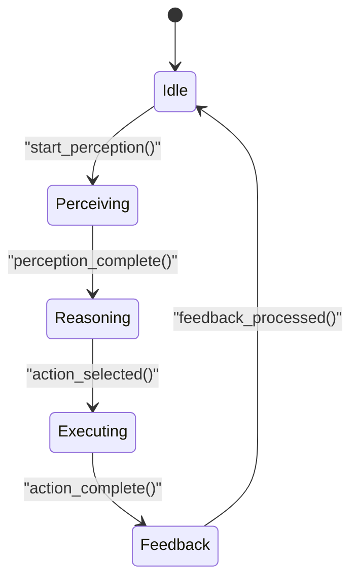

# Lesson 3: Design Patterns in Agentic Systems

## 1. First-Principles Intuition & Invariants

At the heart of agentic systems lies a fundamental tension: designing autonomous entities that operate effectively within complex, dynamic environments while maintaining predictable behavior and robustness. This tension is not merely architectural—it is deeply rooted in the mathematical invariants of state machines, concurrency models, and information theory. An agent, by definition, is a bounded rationality system that perceives its environment and acts upon it to achieve goals. The design patterns that emerge in such systems must therefore be grounded in these foundational principles.

Consider the agent's decision-making loop: perception → reasoning → action → feedback. Each stage must be modeled as a state transition system with well-defined inputs, outputs, and invariants. The agent’s state space must be finite or effectively bounded to ensure that reasoning and planning remain tractable. This constraint leads to the necessity of abstraction layers—such as the Strategy pattern—where complex decision logic is encapsulated into interchangeable modules. These modules must be composable, allowing for modular reasoning and enabling the agent to adapt its behavior without redefining its core architecture.

In systems where agents interact, the problem space expands into distributed state management. Here, the invariants of consistency, availability, and partition tolerance (CAP theorem) become paramount. The Observer pattern, for instance, enables agents to react to environmental changes without tight coupling, while the Mediator pattern allows for controlled communication among agents. These patterns are not merely syntactic conveniences—they are mathematical expressions of how information flows and is synchronized across distributed systems.

The agent’s lifecycle is another domain where first-principles thinking is essential. An agent must be able to initialize, execute, and terminate gracefully, with each phase governed by a set of invariants. The State pattern, for example, models the agent’s lifecycle states (idle, executing, paused, terminated) as distinct objects, each encapsulating behavior appropriate to that state. This ensures that transitions are explicit and that invalid operations—such as attempting to execute a terminated agent—are prevented at compile time or runtime.

Finally, the agent’s interaction with its environment must be modeled with a clear understanding of causality and feedback. The Command pattern, which encapsulates a request as an object, allows for deferred execution and undo mechanisms, which are essential for agents that must reason about future actions or revert to previous states. This pattern aligns with the principle of reactive systems, where agents must respond to asynchronous events without blocking or losing state.

## 2. Core Architecture & Mechanics

The architecture of an agentic system is best understood through the lens of a layered state machine, where each layer abstracts a specific aspect of the agent’s functionality. At the base, the agent’s perception engine processes raw data from sensors or external inputs, transforming them into structured representations. The next layer, the reasoning engine, applies domain-specific logic to interpret these perceptions and determine appropriate actions. Finally, the execution layer translates these actions into concrete operations, whether that be sending a message, modifying a database, or triggering a hardware event.

The core of this architecture is the **Agent Kernel**, a central component that orchestrates the interaction between perception, reasoning, and execution. The kernel is implemented as a finite state machine (FSM) with states such as `Idle`, `Perceiving`, `Reasoning`, `Executing`, and `Feedback`. Transitions between these states are governed by events, which can be internal (e.g., timer ticks) or external (e.g., sensor data, user commands). The kernel ensures that only valid transitions occur, enforcing invariants through a transition table or state machine engine.



The perception layer is implemented using a **Pipeline Pattern**, where data flows through a series of processing stages. Each stage is a function or class that transforms the input data into a more refined form. For example, a sensor might provide raw binary data, which is then filtered, normalized, and finally interpreted as a structured event. This pipeline is implemented using a chain of responsibility, where each stage can either process the data or pass it to the next stage.

The reasoning layer employs the **Strategy Pattern** to encapsulate decision-making logic. Different strategies can be selected based on context, such as the agent’s current goal, environmental conditions, or available resources. For instance, a navigation agent might use a different strategy for urban environments versus wilderness terrain. The strategy is selected at runtime, and the agent delegates decision-making to the appropriate strategy object.

```rust
trait Strategy {
    fn decide(&self, perception: &Perception) -> Action;
}

struct UrbanNavigationStrategy;
struct WildernessNavigationStrategy;

impl Strategy for UrbanNavigationStrategy {
    fn decide(&self, perception: &Perception) -> Action {
        // Urban-specific logic
    }
}

impl Strategy for WildernessNavigationStrategy {
    fn decide(&self, perception: &Perception) -> Action {
        // Wilderness-specific logic
    }
}
```

The execution layer is governed by the **Command Pattern**, which encapsulates a request as an object. This allows for the queuing, logging, and undoing of actions. Commands are stored in a command queue, and the execution engine processes them in order. This pattern is particularly useful in systems where actions must be replayed or undone, such as in simulation or debugging environments.

```rust
trait Command {
    fn execute(&self);
    fn undo(&self);
}

struct MoveCommand {
    agent_id: u32,
    direction: Direction,
}

impl Command for MoveCommand {
    fn execute(&self) {
        // Move agent in direction
    }

    fn undo(&self) {
        // Move agent back
    }
}
```

The feedback loop is implemented using the **Observer Pattern**, where the agent’s execution engine notifies interested observers of state changes. Observers can be other agents, monitoring systems, or external services. This pattern decouples the agent from its observers, allowing for flexible and extensible monitoring and logging.

## 3. High-Performance Optimization & Failure Modes

In high-performance agentic systems, the design patterns must not only be correct but also optimized for efficiency and resilience. Performance optimizations often involve minimizing latency, maximizing throughput, and reducing resource consumption. Techniques such as parallel processing, load balancing, and caching can be employed to enhance performance. However, these optimizations must be balanced against the need for robustness and reliability.

Failure modes in agentic systems can arise from various sources, including incorrect state transitions, race conditions, and resource exhaustion. To mitigate these risks, it is crucial to implement comprehensive error handling and fault tolerance mechanisms. Techniques such as retries, circuit breakers, and fallback strategies can help ensure that the system remains operational even in the face of failures. Additionally, thorough testing and monitoring are essential to identify and address potential issues before they impact the system's performance or reliability.
