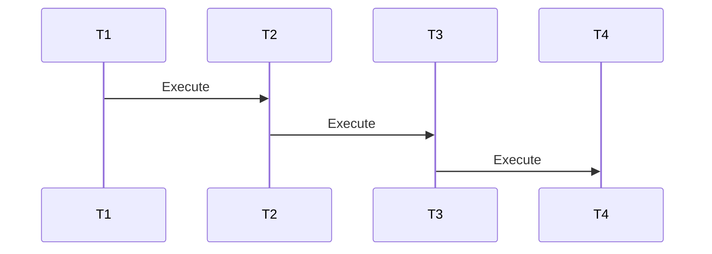
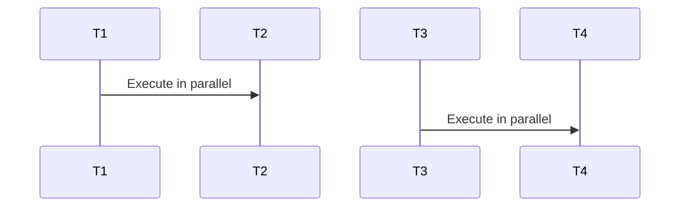
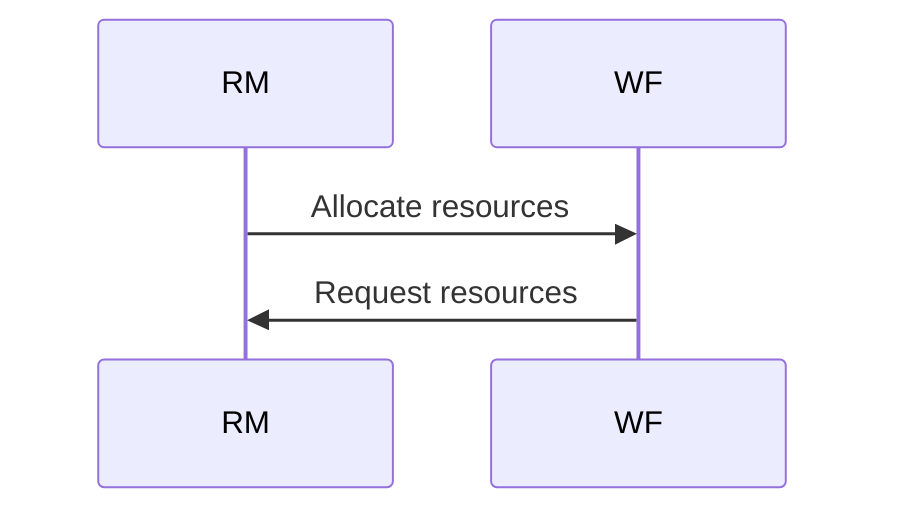
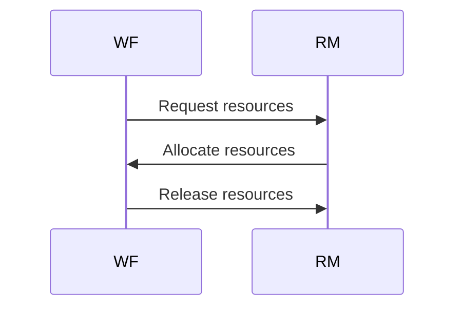

# Lesson 4: Monitoring and Optimization

## First-Principles Intuition & Invariants

Monitoring and optimization are the twin pillars of agentic workflow management. To grasp these concepts, one must first understand the underlying dynamics of workflow execution. Imagine a complex system comprising multiple interacting components, each with its own performance characteristics and failure modes. The workflow's overall behavior emerges from these interactions, making it challenging to predict and optimize.

Consider a workflow as a directed acyclic graph (DAG), where each node represents a task or operation, and edges denote data dependencies. The workflow's performance is influenced by factors such as task execution time, data transfer rates, and synchronization overhead. To monitor and optimize these workflows, a deep understanding of these dynamics is essential.

One key invariant is the concept of "workflow locality," which refers to the idea that tasks within a workflow tend to exhibit similar performance characteristics. This locality can be exploited to develop efficient monitoring and optimization strategies. For instance, if a task is experiencing high execution times, it is likely that nearby tasks in the workflow are also affected.

Another crucial invariant is the "workflow bottleneck," which represents the critical path of the workflow that determines its overall performance. Identifying and optimizing the bottleneck is essential for improving workflow efficiency. This can be achieved by analyzing task execution times, data transfer rates, and synchronization overhead to determine the most critical components of the workflow.

## Core Architecture & Mechanics

To monitor and optimize agentic workflows, it is necessary to understand the internal data structures and algorithms used to manage workflow execution. One key component is the "workflow graph," which represents the DAG of tasks and data dependencies. The workflow graph is typically implemented using a graph data structure, such as an adjacency matrix or adjacency list.

The workflow graph is used to manage task execution, data transfer, and synchronization. Each task is associated with a set of attributes, such as execution time, data transfer rates, and synchronization overhead. These attributes are used to determine the workflow's performance characteristics and identify potential bottlenecks.

Another critical component is the "workflow scheduler," which manages task execution and data transfer. The scheduler uses a variety of algorithms, such as First-Come-First-Served (FCFS) or Shortest-Remaining-Time-First (SRTF), to determine the order of task execution.

## High-Performance Optimization & Failure Modes

To optimize agentic workflows for high performance, concurrency, resource scaling, and boundary edge cases must be considered. Concurrency refers to the ability of the workflow to execute multiple tasks simultaneously, while resource scaling involves dynamically allocating resources to meet changing workflow demands.

One key optimization technique is the use of "task parallelism," which involves executing multiple tasks concurrently to improve workflow throughput. This can be achieved using parallel programming models, such as MPI or OpenMP.

However, task parallelism can also introduce synchronization overhead, which can lead to decreased workflow performance. To mitigate this, synchronization-free algorithms, such as those based on lock-free data structures, can be used.

Another critical consideration is resource scaling, which involves dynamically allocating resources to meet changing workflow demands. This can be achieved using resource allocation algorithms, such as those based on machine learning or predictive modeling.

Finally, boundary edge cases, such as workflow failures or resource exhaustion, must be considered. To mitigate these risks, failure detection and recovery mechanisms, such as checkpointing or restart protocols, can be employed.

By understanding the underlying dynamics of agentic workflows and applying high-performance optimization techniques, efficient and reliable monitoring and optimization strategies can be developed for complex workflows.
