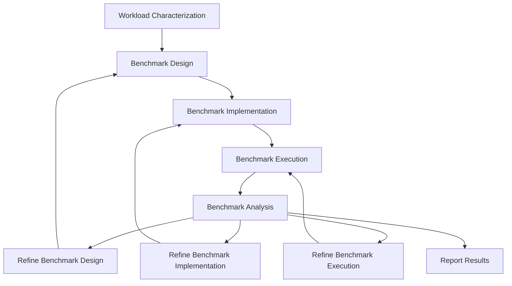

# Lesson 1: Foundations & System Invariants

## Curriculum Roadmap
This masterclass curriculum on "Evaluation Loops and Benchmarks" is designed to provide a deep, unshakeable theoretical grounding in the principles and practices of system evaluation. The course is structured to cover the foundational concepts, architectural invariants, and practical methodologies necessary for senior software engineers, systems programmers, and infrastructure architects to design, implement, and analyze high-performance systems. The curriculum is divided into several modules, each building upon the previous one to create a comprehensive understanding of evaluation loops and benchmarks.

1. **Foundations & System Invariants**: Establishing the first-principles mental model, understanding the problem space, and defining the fundamental system guarantees and non-negotiable invariants.
2. **Benchmark Design & Methodology**: Detailed exploration of benchmark design principles, including workload characterization, measurement techniques, and statistical analysis.
3. **Evaluation Loops**: In-depth analysis of continuous evaluation loops, feedback mechanisms, and their role in system optimization and performance tuning.
4. **Advanced Benchmarking Techniques**: Examination of advanced techniques such as micro-benchmarks, macro-benchmarks, and synthetic workloads.
5. **Case Studies & Best Practices**: Real-world case studies and best practices for benchmarking and performance evaluation in various domains, including cloud-native systems, distributed databases, and AI/ML workloads.
6. **Future Directions & Research**: Discussion of emerging trends, future research directions, and the evolving landscape of system evaluation and benchmarking.

## 1. First-Principles Mental Model & Problem Space

The evaluation of computing systems is a critical aspect of software engineering and systems programming. It involves the systematic assessment of a system's performance, reliability, and efficiency to ensure it meets the desired specifications and user requirements. The need for rigorous evaluation arises from the complex interplay of hardware and software components, which can lead to unpredictable behavior and performance bottlenecks. Understanding the underlying principles and problem space is essential for designing effective evaluation loops and benchmarks.

At the heart of system evaluation is the need to measure and compare the performance of different system configurations, optimizations, and workloads. This requires a deep understanding of the system's architecture, including its hardware components (CPU, memory, storage, network), operating system (kernel, scheduler, memory management), and application software (algorithms, data structures, concurrency models). The evaluation process must account for the interactions between these components and their impact on system performance.

One of the primary challenges in system evaluation is the variability and uncertainty inherent in computing environments. Factors such as hardware differences, software configurations, workload characteristics, and environmental conditions can all influence system performance. To address these challenges, evaluation loops and benchmarks must be designed to isolate and control these variables, providing a consistent and reliable basis for comparison.

Another critical aspect of system evaluation is the need to balance accuracy and precision with practicality and efficiency. While it is desirable to obtain highly accurate and precise measurements, the cost and time required to achieve this level of detail can be prohibitive. Therefore, evaluation loops and benchmarks must strike a balance between accuracy and practicality, providing meaningful insights without excessive overhead.

The problem space of system evaluation is further complicated by the need to consider multiple performance metrics, including throughput, latency, resource utilization, and energy consumption. Each of these metrics provides a different perspective on system performance, and the evaluation process must account for their interdependencies and trade-offs. For example, optimizing for throughput may come at the expense of increased latency, while reducing energy consumption may require sacrificing some level of performance.

In summary, the first-principles mental model for system evaluation involves understanding the complex interplay of hardware and software components, accounting for variability and uncertainty, balancing accuracy and practicality, and considering multiple performance metrics. This mental model provides the foundation for designing effective evaluation loops and benchmarks that can help ensure the performance and reliability of computing systems.

## 2. Fundamental System Guarantees & Non-Negotiable Invariants

To establish a robust framework for system evaluation, it is essential to define the fundamental system guarantees and non-negotiable invariants that underpin the evaluation process. These guarantees and invariants provide a set of constraints and assumptions that must be satisfied to ensure the validity and reliability of the evaluation results.

### 2.1 System Performance Guarantees

System performance guarantees are the foundational invariants that define the expected behavior and performance characteristics of a computing system. These guarantees are typically expressed in terms of performance metrics such as throughput, latency, resource utilization, and energy consumption. The following are some of the key performance guarantees that must be considered in system evaluation:

- **Throughput**: The rate at which a system can process workloads, typically measured in operations per second (OPS) or transactions per second (TPS). Throughput is a critical performance metric for systems that need to handle high volumes of workloads, such as web servers, distributed databases, and cloud-native applications.
- **Latency**: The time it takes for a system to process a workload and produce a result, typically measured in milliseconds or microseconds. Latency is a critical performance metric for systems that require low-latency responses, such as real-time systems, gaming servers, and financial trading platforms.
- **Resource Utilization**: The degree to which a system's resources (CPU, memory, storage, network) are utilized, typically measured in percentage or absolute values. Resource utilization is a critical performance metric for systems that need to optimize resource usage and minimize costs, such as cloud-native applications and data centers.
- **Energy Consumption**: The amount of energy consumed by a system, typically measured in watts or joules. Energy consumption is a critical performance metric for systems that need to minimize power consumption and reduce environmental impact, such as mobile devices, IoT devices, and data centers.

### 2.2 System Reliability Guarantees

System reliability guarantees are the foundational invariants that define the expected behavior and reliability characteristics of a computing system. These guarantees are typically expressed in terms of reliability metrics such as mean time to failure (MTTF), mean time between failures (MTBF), and mean time to repair (MTTR). The following are some of the key reliability guarantees that must be considered in system evaluation:

- **Mean Time to Failure (MTTF)**: The average time a system operates before failing, typically measured in hours or days. MTTF is a critical reliability metric for systems that need to operate continuously without downtime, such as mission-critical systems, data centers, and cloud-native applications.
- **Mean Time Between Failures (MTBF)**: The average time between system failures, typically measured in hours or days. MTBF is a critical reliability metric for systems that need to minimize downtime and maximize availability, such as web servers, distributed databases, and cloud-native applications.
- **Mean Time to Repair (MTTR)**: The average time it takes to repair a system after a failure, typically measured in hours or days. MTTR is a critical reliability metric for systems that need to minimize downtime and maximize availability, such as web servers, distributed databases, and cloud-native applications.

### 2.3 System Security Guarantees

System security guarantees are the foundational invariants that define the expected behavior and security characteristics of a computing system. These guarantees are typically expressed in terms of security metrics such as confidentiality, integrity, and availability. The following are some of the key security guarantees that must be considered in system evaluation:

- **Confidentiality**: The degree to which a system protects sensitive information from unauthorized access, disclosure, or theft. Confidentiality is a critical security metric for systems that handle sensitive data, such as financial systems, healthcare systems, and government systems.
- **Integrity**: The degree to which a system maintains the accuracy and consistency of data, preventing unauthorized modification or corruption. Integrity is a critical security metric for systems that require data accuracy and consistency, such as financial systems, healthcare systems, and government systems.
- **Availability**: The degree to which a system is accessible and operational, minimizing downtime and ensuring reliable service. Availability is a critical security metric for systems that need to operate continuously without downtime, such as mission-critical systems, data centers, and cloud-native applications.

### 2.4 System Scalability Guarantees

System scalability guarantees are the foundational invariants that define the expected behavior and scalability characteristics of a computing system. These guarantees are typically expressed in terms of scalability metrics such as horizontal scalability, vertical scalability, and elasticity. The following are some of the key scalability guarantees that must be considered in system evaluation:

- **Horizontal Scalability**: The ability of a system to scale by adding more resources (e.g., servers, nodes) to handle increased workloads. Horizontal scalability is a critical scalability metric for systems that need to handle high volumes of workloads, such as web servers, distributed databases, and cloud-native applications.
- **Vertical Scalability**: The ability of a system to scale by increasing the resources (e.g., CPU, memory) of existing resources to handle increased workloads. Vertical scalability is a critical scalability metric for systems that need to handle high workloads with limited resources, such as mobile devices, IoT devices, and embedded systems.
- **Elasticity**: The ability of a system to dynamically adjust its resources to handle varying workloads, minimizing resource usage and maximizing efficiency. Elasticity is a critical scalability metric for systems that need to handle variable workloads, such as cloud-native applications, distributed databases, and IoT systems.

### 2.5 System Efficiency Guarantees

System efficiency guarantees are the foundational invariants that define the expected behavior and efficiency characteristics of a computing system. These guarantees are typically expressed in terms of efficiency metrics such as power efficiency, resource efficiency, and cost efficiency. The following are some of the key efficiency guarantees that must be considered in system evaluation:

- **Power Efficiency**: The degree to which a system consumes power, minimizing energy consumption and reducing environmental impact. Power efficiency is a critical efficiency metric for systems that need to minimize power consumption, such as mobile devices, IoT devices, and data centers.
- **Resource Efficiency**: The degree to which a system utilizes resources (CPU, memory, storage, network), minimizing resource usage and maximizing efficiency. Resource efficiency is a critical efficiency metric for systems that need to optimize resource usage and minimize costs, such as cloud-native applications and data centers.
- **Cost Efficiency**: The degree to which a system provides value for money, minimizing costs and maximizing return on investment. Cost efficiency is a critical efficiency metric for systems that need to optimize costs and maximize value, such as cloud-native applications, distributed databases, and data centers.

## 3. High-Level Process & Component Architecture

The high-level process and component architecture of system evaluation involve the design and implementation of evaluation loops and benchmarks that can provide meaningful insights into system performance, reliability, security, scalability, and efficiency. The following sections provide an overview of the core data and control flow in the evaluation process.

### 3.1 Evaluation Loop Architecture

The evaluation loop architecture is a high-level representation of the data and control flow in the evaluation process. It involves the iterative process of designing, implementing, executing, and analyzing benchmarks to assess system performance, reliability, security, scalability, and efficiency. The evaluation loop architecture is typically composed of the following components:

- **Benchmark Design**: The process of designing benchmarks that can provide meaningful insights into system performance, reliability, security, scalability, and efficiency. Benchmark design involves defining the workload characteristics, measurement techniques, and statistical analysis methods.
- **Benchmark Implementation**: The process of implementing benchmarks that can be executed on the target system. Benchmark implementation involves writing code, configuring the system, and setting up the environment.
- **Benchmark Execution**: The process of executing benchmarks on the target system to collect performance data. Benchmark execution involves running the benchmarks, collecting data, and storing it for analysis.
- **Benchmark Analysis**: The process of analyzing benchmark data to assess system performance, reliability, security, scalability, and efficiency. Benchmark analysis involves statistical analysis, data visualization, and reporting.

The evaluation loop architecture is typically represented as a feedback loop, where the results of benchmark analysis are used to refine the benchmark design, implementation, and execution process. This feedback loop ensures that the evaluation process is iterative, continuous, and adaptive, providing a reliable basis for system optimization and performance tuning.

### 3.2 Benchmark Design & Implementation

Benchmark design and implementation are critical components of the evaluation loop architecture. They involve the process of designing and implementing benchmarks that can provide meaningful insights into system performance, reliability, security, scalability, and efficiency. The following sections provide an overview of the key considerations in benchmark design and implementation.

#### 3.2.1 Workload Characterization

Workload characterization is the process of defining the workload characteristics that will be used in the benchmark. Workload characteristics include the type of workload (e.g., CPU-bound, I/O-bound, memory-bound), the workload size (e.g., small, medium, large), the workload intensity (e.g., low, medium, high), and the workload distribution (e.g., uniform, skewed, bursty). Workload characterization is critical for designing benchmarks that can provide meaningful insights into system performance, reliability, security, scalability, and efficiency.

#### 3.2.2 Measurement Techniques

Measurement techniques are the methods used to collect performance data during benchmark execution. Measurement techniques include hardware counters, software probes, logging, and profiling. Measurement techniques are critical for collecting accurate and reliable performance data, which is essential for benchmark analysis.

#### 3.2.3 Statistical Analysis

Statistical analysis is the process of analyzing benchmark data to assess system performance, reliability, security, scalability, and efficiency. Statistical analysis includes descriptive statistics, inferential statistics, and data visualization. Statistical analysis is critical for providing meaningful insights into system performance, reliability, security, scalability, and efficiency.

### 3.3 Benchmark Execution & Analysis

Benchmark execution and analysis are critical components of the evaluation loop architecture. They involve the process of executing benchmarks on the target system to collect performance data and analyzing the benchmark data to assess system performance, reliability, security, scalability, and efficiency. The following sections provide an overview of the key considerations in benchmark execution and analysis.

#### 3.3.1 Benchmark Execution

Benchmark execution is the process of running benchmarks on the target system to collect performance data. Benchmark execution involves configuring the system, setting up the environment, and running the benchmarks. Benchmark execution is critical for collecting accurate and reliable performance data, which is essential for benchmark analysis.

#### 3.3.2 Benchmark Analysis

Benchmark analysis is the process of analyzing benchmark data to assess system performance, reliability, security, scalability, and efficiency. Benchmark analysis involves statistical analysis, data visualization, and reporting. Benchmark analysis is critical for providing meaningful insights into system performance, reliability, security, scalability, and efficiency.

### 3.4 Mermaid Diagram Representation

The following Mermaid diagram represents the core data and control flow in the evaluation loop architecture:

In this diagram, the evaluation loop architecture is represented as a feedback loop, where the results of benchmark analysis are used to refine the benchmark design, implementation, and execution process. This feedback loop ensures that the evaluation process is iterative, continuous, and adaptive, providing a reliable basis for system optimization and performance tuning.

In summary, the high-level process and component architecture of system evaluation involve the design and implementation of evaluation loops and benchmarks that can provide meaningful insights into system performance, reliability, security, scalability, and efficiency. The evaluation loop architecture is typically represented as a feedback loop, where the results of benchmark analysis are used to refine the benchmark design, implementation, and execution process. This feedback loop ensures that the evaluation process is iterative, continuous, and adaptive, providing a reliable basis for system optimization and performance tuning.
