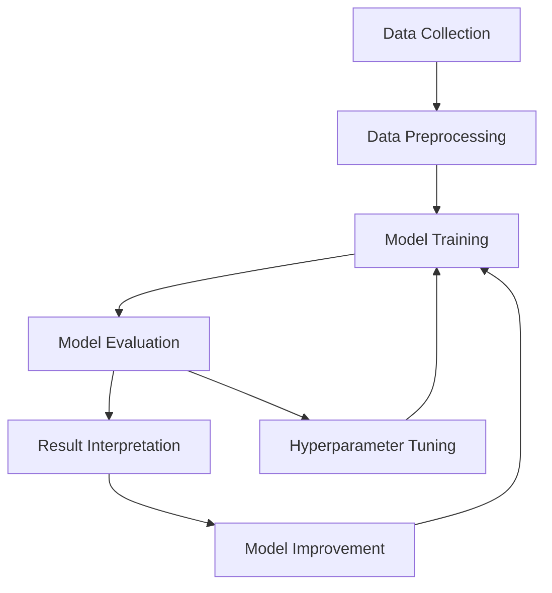

# Lesson 1: Foundations & Mathematical Formulation

## Curriculum Roadmap
This masterclass curriculum on "Evaluation Loops and Benchmarks" is designed to provide a deep, unshakeable theoretical grounding in the foundational principles and mathematical invariants that underpin the evaluation of machine learning models. The curriculum is structured to progressively build the knowledge and skills necessary for senior machine learning engineers, AI researchers, and systems architects to design, implement, and analyze robust evaluation loops. The modules are as follows:

1. **Foundations & Mathematical Formulation**: Establishing the first-principles intuition, problem space formulation, and mathematical invariants.
2. **Benchmark Design & Selection**: Understanding the criteria for selecting appropriate benchmarks and designing comprehensive evaluation frameworks.
3. **Evaluation Metrics & Statistical Analysis**: Delving into the metrics used to evaluate model performance and the statistical methods for interpreting results.
4. **Advanced Evaluation Techniques**: Exploring advanced techniques such as cross-validation, hyperparameter tuning, and model comparison.
5. **Case Studies & Practical Applications**: Applying the learned concepts through real-world case studies and practical exercises.

## 1. First-Principles Intuition & The Problem Space

The evaluation of machine learning models is a critical aspect of the model development lifecycle. It serves as the mechanism by which we assess the effectiveness and reliability of a model in solving a given problem. The primary objective of evaluation is to ensure that a model not only performs well on the training data but also generalizes effectively to unseen data. This is essential because the ultimate goal of machine learning is to build models that can make accurate predictions or decisions in real-world scenarios, where the data distribution may differ from the training data.

The problem space of model evaluation is inherently complex due to several factors. First, the performance of a model can be influenced by a multitude of factors, including the quality and quantity of the training data, the choice of model architecture, the optimization algorithm, and the evaluation metrics. Second, the evaluation process itself introduces additional complexity, as it requires careful consideration of the evaluation metrics, the evaluation dataset, and the evaluation methodology. Third, the evaluation of models in real-world applications often involves additional challenges, such as dealing with imbalanced datasets, handling missing data, and ensuring fairness and robustness.

To address these challenges, it is essential to establish a rigorous evaluation loop that systematically assesses the performance of a model across multiple dimensions. This evaluation loop should be designed to provide a comprehensive understanding of the model's strengths and weaknesses, as well as its potential limitations and biases. By doing so, we can ensure that the model is well-suited to the problem at hand and that its performance is reliable and robust.

## 2. Mathematical Formalization & Core Invariants

The mathematical formalization of model evaluation is grounded in the principles of statistical learning theory and optimization. At its core, the evaluation of a machine learning model involves assessing the model's ability to minimize a loss function, which quantifies the discrepancy between the model's predictions and the true labels. The loss function is a critical component of the evaluation process, as it provides a quantitative measure of the model's performance.

The most commonly used loss functions in machine learning include the mean squared error (MSE) for regression tasks and the cross-entropy loss for classification tasks. The MSE loss function is defined as:

\[ \text{MSE} = \frac{1}{n} \sum_{i=1}^{n} (y_i - \hat{y}_i)^2 \]

where \( n \) is the number of samples, \( y_i \) is the true label for the \( i \)-th sample, and \( \hat{y}_i \) is the predicted label for the \( i \)-th sample. The cross-entropy loss function is defined as:

\[ \text{Cross-Entropy} = -\frac{1}{n} \sum_{i=1}^{n} \sum_{j=1}^{k} y_{ij} \log(\hat{y}_{ij}) \]

where \( k \) is the number of classes, \( y_{ij} \) is the true label for the \( i \)-th sample and the \( j \)-th class, and \( \hat{y}_{ij} \) is the predicted probability for the \( i \)-th sample and the \( j \)-th class.

In addition to the loss function, the evaluation of a machine learning model also involves optimizing the model parameters to minimize the loss function. This optimization process is typically performed using gradient-based optimization algorithms, such as stochastic gradient descent (SGD) or its variants. The optimization process is subject to several constraints, including the choice of model architecture, the regularization parameters, and the learning rate.

The core invariants of model evaluation are rooted in the principles of statistical learning theory. These invariants include the bias-variance tradeoff, the generalization bound, and the no-free-lunch theorem. The bias-variance tradeoff is a fundamental concept in statistical learning theory that states that there is a tradeoff between the bias and variance of a model. A model with high bias is likely to underfit the training data, while a model with high variance is likely to overfit the training data. The generalization bound provides a theoretical guarantee on the performance of a model on unseen data, based on the complexity of the model and the size of the training dataset. The no-free-lunch theorem states that no single model architecture or evaluation methodology is universally superior for all problems, and that the choice of model and evaluation methodology should be guided by the specific characteristics of the problem at hand.

## 3. High-Level Pipeline & Architecture Dataflow

The high-level pipeline of a machine learning evaluation loop involves several key components, including data preprocessing, model training, model evaluation, and result interpretation. The data preprocessing step involves cleaning and transforming the raw data into a format that is suitable for training the model. This step may include tasks such as feature selection, feature engineering, and data normalization. The model training step involves optimizing the model parameters to minimize the loss function on the training data. The model evaluation step involves assessing the performance of the model on a separate evaluation dataset, using a set of predefined evaluation metrics. The result interpretation step involves analyzing the evaluation results to gain insights into the model's strengths and weaknesses, and to identify areas for improvement.

The architecture dataflow of a machine learning evaluation loop can be represented using a Mermaid diagram, as shown below:

In this diagram, the data collection step involves gathering the raw data from various sources. The data preprocessing step involves cleaning and transforming the raw data into a format that is suitable for training the model. The model training step involves optimizing the model parameters to minimize the loss function on the training data. The model evaluation step involves assessing the performance of the model on a separate evaluation dataset, using a set of predefined evaluation metrics. The result interpretation step involves analyzing the evaluation results to gain insights into the model's strengths and weaknesses, and to identify areas for improvement. The model improvement step involves making changes to the model architecture or training process to improve its performance. The hyperparameter tuning step involves adjusting the hyperparameters of the model to optimize its performance.

By establishing a rigorous evaluation loop that systematically assesses the performance of a machine learning model, we can ensure that the model is well-suited to the problem at hand and that its performance is reliable and robust. This evaluation loop should be designed to provide a comprehensive understanding of the model's strengths and weaknesses, as well as its potential limitations and biases. By doing so, we can build machine learning models that are not only accurate and reliable but also fair and robust.
