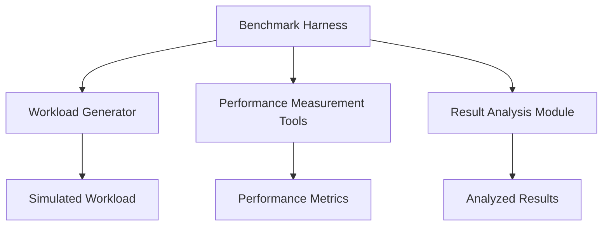

# Lesson 2: Benchmarking Techniques

## First-Principles Intuition & Invariants

Benchmarking stands as a cornerstone in software engineering and systems programming, essential for performance evaluation and optimization. At its core, benchmarking entails measuring the execution time, resource consumption, and throughput of software components to understand their behavior under various conditions. The objective is to pinpoint performance bottlenecks, validate optimizations, and ensure that software meets its performance requirements.

To establish a robust benchmarking framework, it is crucial to grasp the underlying principles and invariants that govern performance measurement. Performance is not an absolute metric but rather a relative one, influenced by a multitude of factors, including hardware architecture, operating system behavior, and application-specific characteristics. Therefore, benchmarking must account for these variables to produce meaningful and reliable results.

A key invariant in benchmarking is repeatability. A benchmark must yield consistent results across multiple runs under identical conditions. This repeatability ensures that performance improvements or regressions can be accurately detected. Another critical invariant is the isolation of variables. Benchmarking should isolate the component being measured from external factors that could introduce noise, such as network latency or disk I/O. By controlling these variables, benchmarking can provide a clear and accurate picture of the component's performance.

Benchmarking also involves understanding the trade-offs between different types of benchmarks. Micro-benchmarks focus on measuring the performance of small, isolated code snippets, while macro-benchmarks evaluate the performance of entire systems or applications. Synthetic benchmarks, on the other hand, simulate workloads that may not reflect real-world usage but are designed to stress specific aspects of the system. Each type of benchmark has its strengths and weaknesses, and choosing the appropriate benchmarking technique depends on the specific goals and context of the performance evaluation.

## Core Architecture & Mechanics

To dissect the internal data structures, algorithms, and execution models involved in benchmarking, we can explore the architecture of a typical benchmarking framework. A benchmarking framework typically consists of several key components: the benchmark harness, the workload generator, the performance measurement tools, and the result analysis module.

The benchmark harness is responsible for setting up the environment, executing the benchmark, and collecting the results. It ensures that the benchmark is run under controlled conditions and that the results are accurately recorded. The workload generator is responsible for simulating the workload that the system or component is expected to handle. This could involve generating synthetic data, simulating user interactions, or replaying recorded workloads. The performance measurement tools are used to collect various performance metrics, such as execution time, CPU usage, memory consumption, and I/O operations. These tools can range from simple timers to sophisticated profiling tools that provide detailed insights into the system's behavior.

The result analysis module is responsible for processing and interpreting the collected data. It can involve statistical analysis to identify trends and patterns, as well as visualizations to present the results in a clear and understandable manner. By analyzing the results, benchmarking can provide valuable insights into the performance characteristics of the system or component being evaluated.

To illustrate the architecture of a benchmarking framework, we can use a simple Mermaid diagram:

In this diagram, the benchmark harness orchestrates the benchmarking process by interacting with the workload generator, performance measurement tools, and result analysis module. The workload generator creates the simulated workload, which is then executed by the benchmark harness. The performance measurement tools collect various performance metrics, which are then processed and analyzed by the result analysis module to produce the final results.

## High-Performance Optimization & Failure Modes

Benchmarking plays a crucial role in high-performance optimization by providing a means to identify and address performance bottlenecks. By measuring the performance of a system or component, benchmarking can reveal areas where optimizations can be made to improve execution time, resource consumption, and throughput. However, benchmarking also introduces several challenges and failure modes that must be addressed to ensure the accuracy and reliability of the results.

One of the primary challenges in benchmarking is the presence of noise and variability. External factors such as network latency, disk I/O, and background processes can introduce noise into the benchmark results, making it difficult to identify true performance improvements or regressions. To mitigate this challenge, benchmarking should be conducted in a controlled environment with minimal external interference. This can involve using dedicated benchmarking machines, isolating the benchmark from other processes, and using performance measurement tools that can filter out noise.

Another challenge in benchmarking is the complexity of modern systems and applications. Modern systems often involve multiple layers of abstraction, including operating systems, middleware, and application frameworks. Each layer can introduce its own performance characteristics and bottlenecks, making it difficult to isolate the component being measured. To address this challenge, benchmarking should be conducted at multiple levels of abstraction, from micro-benchmarks that focus on small, isolated code snippets to macro-benchmarks that evaluate the performance of entire systems or applications.

Benchmarking also involves understanding the trade-offs between different optimization techniques. For example, optimizing for execution time may come at the cost of increased memory consumption, while optimizing for memory consumption may come at the cost of decreased execution time. To balance these trade-offs, benchmarking should be guided by a clear understanding of the system's performance requirements and constraints.

In addition to these challenges, benchmarking also involves several failure modes that can lead to inaccurate or unreliable results. One common failure mode is the presence of warm-up effects, where the performance of a system or component improves after it has been executed for a period of time. This can occur due to various factors, such as caching effects or JIT compilation. To mitigate warm-up effects, benchmarking should include a warm-up phase to stabilize performance before collecting measurements. Another failure mode is the presence of measurement overhead, where the act of measuring performance itself affects the performance being measured. To minimize measurement overhead, performance measurement tools should be chosen carefully to ensure they do not introduce significant overhead.
