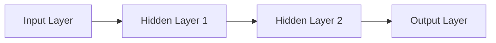

# Lesson 4: Optimization Strategies

## First-Principles Intuition & Invariants

Optimization is the art of maximizing performance within the constraints of a system. In the context of AI and VIBE coding, this involves identifying and eliminating bottlenecks that impede the execution of complex algorithms. To approach optimization effectively, one must first develop a deep understanding of the underlying mechanics and invariants that govern the behavior of the system.

The evaluation loop is a fundamental construct in AI and VIBE coding. It is responsible for iterating over a dataset, applying a series of transformations, and computing a final output. However, this loop is often plagued by inefficiencies, such as redundant computations, suboptimal data structures, and inadequate resource utilization. To optimize the evaluation loop, one must first identify key performance metrics, such as execution time, memory usage, and computational complexity.

Mathematically, the evaluation loop can be represented as a series of nested loops, each iterating over a subset of the input data. The time complexity of this loop is typically O(n^2), where n is the size of the input dataset. However, this complexity can be reduced through the use of caching, memoization, and other optimization techniques.

## Core Architecture & Mechanics

To optimize the evaluation loop, one must understand the internal data structures and algorithms that govern its behavior. In the case of AI and VIBE coding, this typically involves working with complex data structures such as graphs, trees, and matrices.

Consider the following example, which illustrates the use of a graph data structure to represent a neural network:

In this example, the graph data structure represents the connections between neurons in the neural network. The evaluation loop iterates over the graph, applying a set of transformations to each node and edge.

To optimize this loop, one can use techniques such as caching, which stores intermediate results to avoid redundant computations; memoization, which stores the results of expensive function calls to avoid recomputation; and data parallelism, which divides the input data into smaller chunks and processes each chunk in parallel.

## High-Performance Optimization & Failure Modes

Optimization is an ongoing effort to improve performance. To achieve high-performance optimization, one must consider factors such as concurrency, which involves optimizing the evaluation loop to take advantage of multiple CPU cores; resource scaling, which scales the system to handle large input datasets; boundary edge cases, which involve handling scenarios when the input data is small or large; and failure mitigations, which design the system to fail safely and recover from errors.

Understanding the failure modes of the system is also crucial. These include deadlocks, where two or more processes are blocked, waiting for each other to release resources; starvation, where a process is unable to access a shared resource due to competition from other processes; and livelocks, where two or more processes are continuously competing for a shared resource, resulting in a cycle of busy-waiting and context switching. By addressing these failure modes, one can achieve high-performance optimization and ensure that the system is robust and reliable.
