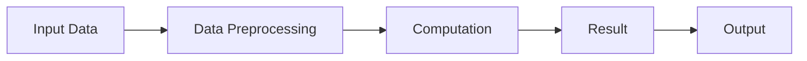

# Lesson 4: Optimization Strategies

## 1. First-Principles Intuition & Invariants

In the realm of high-performance computing, optimization strategies often hinge on a delicate balance between algorithmic enhancements and effective hardware utilization. To fully understand evaluation loops and benchmarks, a solid foundation in the underlying mathematical and system invariants is essential.

At the heart of this challenge lies the tradeoff between computation and memory access. Efforts to minimize memory accesses can inadvertently increase computational overhead, a consequence of the inherent latency associated with memory operations. This latency can be mitigated through strategic use of caching, prefetching, and parallelization.

A pivotal invariant in this domain is the principle of locality. By minimizing memory accesses, the likelihood of cache misses is reduced, which can significantly enhance performance. In the context of evaluation loops, repeated memory accesses can lead to a cascade of cache misses, severely impacting performance.

Another critical invariant is the interplay between computation and communication. Optimizing evaluation loops necessitates consideration of data transfer overhead between system components. This is particularly pertinent in distributed systems, where communication latency can be a major bottleneck.

To illustrate these concepts, consider a matrix multiplication algorithm that requires frequent memory accesses. Implementing a caching strategy can reduce cache misses, thereby improving performance. However, deeper exploration reveals more complex tradeoffs. For example, while caching can decrease memory access latency, it can also introduce additional computational overhead for cache maintenance. Similarly, parallelization can reduce computation time but may increase communication overhead due to data transfer between components.

## 2. Core Architecture & Mechanics

To gain a deeper understanding of evaluation loops and benchmarks, it is instructive to examine the internal data structures and algorithms involved in a typical implementation.

In this example, the evaluation loop comprises three primary stages: data preprocessing, computation, and result output. During the data preprocessing stage, input data is loaded into memory and transformed as necessary. The computation stage performs the core operations, such as matrix multiplication in this case. Finally, the result output stage stores the computed data.

A key observation is that the computation stage is typically the most resource-intensive part of the evaluation loop. Consequently, it is often the focus of optimization efforts. Techniques such as caching, parallelization, and algorithmic refinements can substantially reduce computation time and enhance overall performance.

## 3. High-Performance Optimization & Failure Modes

As efforts to optimize evaluation loops intensify, it is crucial to anticipate and address potential failure modes and edge cases. Key considerations include:

Concurrency: Parallelizing computation requires that the underlying hardware can support increased concurrency. This may necessitate the use of specialized hardware such as GPUs or FPGAs.

Resource scaling: Scaling computation to larger datasets demands that the system can manage higher memory and computational demands.

Boundary edge cases: Optimization must not introduce new edge cases or failure modes. Testing with diverse input datasets and scenarios is essential.

Failure mitigations: Strategies for mitigating potential failures should be developed, incorporating techniques like fault tolerance, redundancy, and error correction.

By meticulously addressing these factors, high-performance evaluation loops can be crafted that are optimized for both computation and memory access.
