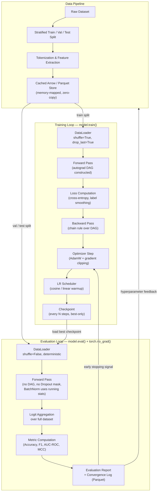
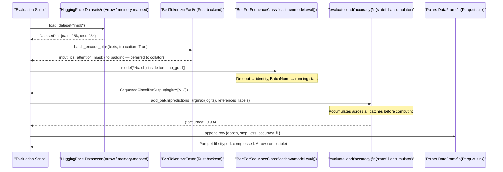
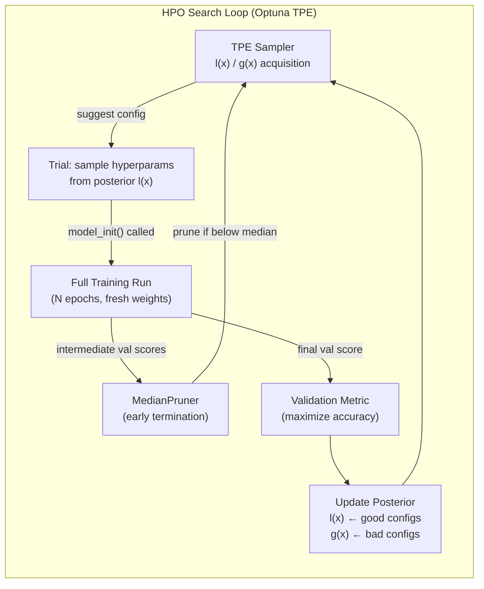
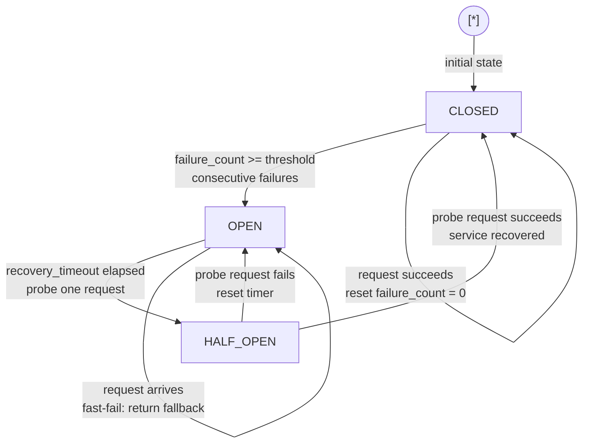
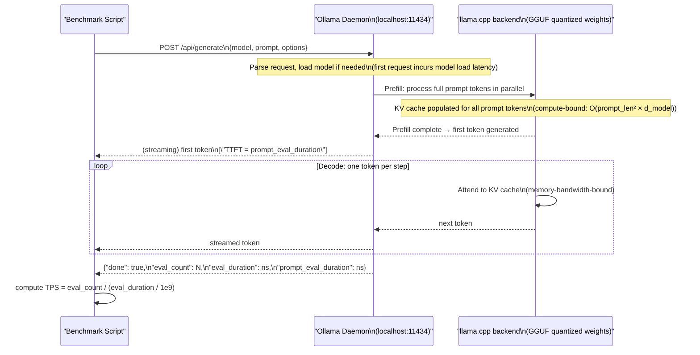
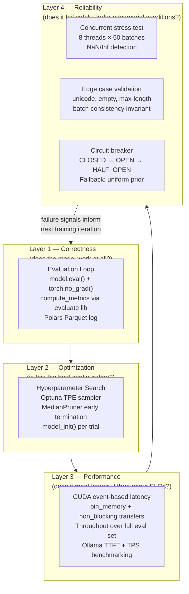

# Operational Verification Labs: 03 — Evaluation Loops and Benchmarks

## Conceptual Foundation

Before writing a single line of evaluation code, it is worth understanding *why* evaluation loops exist as a distinct architectural concern from training loops. During training, the model's parameters are updated via backpropagation; the loss function provides a gradient signal whose only purpose is optimization. Evaluation, by contrast, asks a fundamentally different question: does the model's behavior generalize to data it has not seen? These two concerns operate on different computational graphs, different data splits, and require different numerical guarantees — no gradient accumulation, deterministic dropout behavior, stable batch normalization statistics.

The evaluation loop is not a simplified training loop — it is a measurement instrument. As with any measurement instrument, its validity depends on three properties: **calibration** (metric correctness), **precision** (variance across runs), and **freedom from systematic bias** (data leakage, distribution shift between train and eval splits). This lab treats evaluation as a first-class engineering discipline.

### Why These Two Loops Must Be Architecturally Separate

The training loop and evaluation loop differ at the level of PyTorch's computational graph engine:

**Training loop** — `model.train()` is active. `torch.autograd` records every tensor operation onto a directed acyclic graph (DAG). Each forward pass allocates activation tensors that must be retained in memory until the corresponding backward pass, because backpropagation requires intermediate activations to compute parameter gradients via the chain rule. Dropout layers sample binary masks from a Bernoulli distribution at every forward pass, acting as a regularizer. BatchNorm layers compute mean and variance over the current mini-batch and use these to normalize, while simultaneously updating exponential moving averages of the running statistics.

**Evaluation loop** — `model.eval()` is active and the loop runs inside `torch.no_grad()`. The autograd engine is disabled: no DAG is constructed, no activation tensors are retained beyond the current operation, and `.grad_fn` is not set on output tensors. Dropout layers behave as identity functions (no masking). BatchNorm layers use the accumulated running mean and variance rather than mini-batch statistics, producing deterministic, batch-size-independent outputs. Memory consumption during a pure evaluation pass is roughly half that of an equivalent training pass for a typical transformer, because activation checkpointing is not needed and no gradient buffers are allocated.

Failing to enforce this separation introduces silent correctness errors that are difficult to diagnose. A model evaluated in training mode will produce stochastic outputs (from Dropout) and batch-size-dependent outputs (from BatchNorm), making reported metrics non-reproducible and artificially pessimistic. A model trained in evaluation mode will fail to regularize correctly and may converge to a worse solution.



### On Data Splits and Leakage

The canonical three-way split — train, validation (dev), test — exists because of a fundamental statistical principle: a metric computed on data that influenced any decision in the model's development is a biased estimator of generalization error. The test split must remain untouched until a single final evaluation after all model selection decisions (architecture, hyperparameters, early stopping epoch) have been made using only the validation split.

Data leakage occurs when information from the test distribution contaminates the training or model-selection pipeline. Common vectors include:

- Computing normalization statistics (mean, variance) over the full dataset before splitting, then applying them to the train split. The correct procedure is to fit statistics on the train split and apply them to val/test.
- Using a tokenizer vocabulary built from the full dataset. Pre-trained tokenizers like BERT's WordPiece avoid this because the vocabulary is fixed prior to fine-tuning.
- Shuffling a time-series dataset before splitting. Temporal autocorrelation means a random split will leak future information into the past.
- Stratified sampling that over-represents rare classes in the test set, making the eval distribution differ from the deployment distribution.

---

## Environment Setup

This lab targets Python 3.11+ on a machine with either a CUDA-capable GPU (CUDA 12.x) or Apple Silicon (MPS backend). CPU-only execution is fully supported but training throughput will be substantially lower — expect 10–50× slower iteration on a modern CPU compared to a mid-range GPU.

```bash
# Create an isolated virtual environment
python -m venv .venv && source .venv/bin/activate

# Core dependencies — pinned for reproducibility
# transformers>=4.41 renames `evaluation_strategy` to `eval_strategy` in TrainingArguments
# evaluate>=0.4 replaces the deprecated datasets.load_metric API
pip install \
  torch==2.3.1 \
  transformers==4.41.2 \
  datasets==2.19.1 \
  evaluate==0.4.2 \
  accelerate==0.30.1 \
  scikit-learn==1.5.0 \
  numpy==1.26.4 \
  polars==0.20.31 \
  optuna==3.6.1 \
  matplotlib==3.9.0 \
  ollama==0.2.1

# Verify CUDA availability and version
python -c "
import torch
print('PyTorch:', torch.__version__)
print('CUDA available:', torch.cuda.is_available())
if torch.cuda.is_available():
    print('CUDA version:', torch.version.cuda)
    print('GPU:', torch.cuda.get_device_name(0))
    print('VRAM:', round(torch.cuda.get_device_properties(0).total_memory / 1e9, 1), 'GB')
print('MPS available:', torch.backends.mps.is_available())
"
```

> **Dependency notes:**
>
> `datasets` and `evaluate` are separate packages despite both being maintained by HuggingFace. `datasets` provides `load_dataset`, `DatasetDict`, and Arrow-backed dataset objects. `evaluate` provides `evaluate.load("accuracy")` and replaces the `datasets.load_metric` function that was deprecated in `datasets` 2.0 and removed in `datasets` 2.13. Calling `datasets.load_metric` on a current installation raises `AttributeError`; the corrected API is `evaluate.load(metric_name)`.
>
> `BertTokenizerFast` requires the `tokenizers` Rust library, which is a dependency of `transformers` and does not need to be installed separately. It is 10–100× faster than `BertTokenizer` for large datasets due to its Rust implementation with parallel batch processing.

---

## Exercise 1: Core Evaluation Loop for Text Classification

### Architecture of the Evaluation Pipeline

A production-grade evaluation loop has four distinct phases: **data materialization**, **model inference**, **metric accumulation**, and **result serialization**. Each phase has failure modes that naive implementations ignore.

**Data materialization** — The HuggingFace `datasets` library stores tokenized data in Apache Arrow format, which is memory-mappable. This means the OS can page data in and out without explicit I/O calls, and the same Arrow buffer can be shared across multiple DataLoader workers without serialization overhead. The critical correctness requirement is that `shuffle=False` on the eval DataLoader, so that sample order is deterministic across runs and metrics can be compared against external baselines.

**Model inference** — Runs inside both `model.eval()` and `torch.no_grad()`. The autograd disable context reduces peak GPU memory by preventing allocation of the intermediate activation tensors needed for backward passes, which typically doubles the forward-pass memory footprint. Without `torch.no_grad()`, evaluating a 110M-parameter BERT model on 500 examples would allocate activation buffers for a backward pass that will never execute.

**Metric accumulation** — The `evaluate` library's metric objects maintain state across `add_batch()` calls and compute the final metric from the full accumulated predictions, not from a mean of per-batch metrics. For unbalanced datasets this distinction is critical: per-batch accuracy averaged over batches of different sizes is a biased estimator, whereas accumulating all predictions first and computing once is exact.

**Result serialization** — Training logs are persisted as Parquet via Polars rather than CSV, because Parquet is a columnar binary format with predicate pushdown support, type safety (no ambiguous string parsing), and 5–10× better compression ratios for numeric data than CSV.



### Full Implementation

```python
"""
eval_loop.py — Production-grade evaluation loop for BERT text classification.

Design principles:
  1. All randomness is seeded at three levels: Python's random, NumPy, and PyTorch
     (both CPU and CUDA). set_seed() from transformers handles all four.
  2. The eval loop enforces both model.eval() AND torch.no_grad(). These address
     different concerns at different abstraction levels (see module docstring below).
  3. Metrics are accumulated via HuggingFace `evaluate`, not raw sklearn calls on
     per-batch predictions. This produces exact (not averaged) metrics over the
     full eval set, which is especially important for imbalanced datasets.
  4. Dynamic padding via DataCollatorWithPadding reduces average sequence length
     by 30-60% on IMDb vs. static max_length=512 padding, cutting compute cost
     proportionally for attention (O(n^2) in sequence length).
  5. Results are persisted as Apache Parquet via Polars for downstream analysis.
     Polars' lazy evaluation API enables predicate pushdown — only the columns
     and rows needed for a query are loaded from disk.
"""

from __future__ import annotations

import logging
from dataclasses import dataclass
from pathlib import Path
from typing import Any, Dict, Tuple

import evaluate
import numpy as np
import polars as pl
import torch
from datasets import DatasetDict, load_dataset
from torch.utils.data import DataLoader
from transformers import (
    BertForSequenceClassification,
    BertTokenizerFast,
    DataCollatorWithPadding,
    Trainer,
    TrainingArguments,
    set_seed,
)

# ── Logging ───────────────────────────────────────────────────────────────────
logging.basicConfig(
    level=logging.INFO,
    format="%(asctime)s | %(levelname)-8s | %(name)s | %(message)s",
    datefmt="%Y-%m-%dT%H:%M:%S",
)
logger = logging.getLogger("eval_loop")

# ── Reproducibility ───────────────────────────────────────────────────────────
# set_seed() sets: random, numpy.random, torch (CPU + all CUDA devices), and
# os.environ["PYTHONHASHSEED"]. It does NOT make cudnn deterministic by itself.
SEED = 42
set_seed(SEED)
# cuDNN determinism: disables non-deterministic algorithms (e.g., atomics in
# backward passes of some conv layers). Has a small throughput cost (~5-10%)
# but is required for reproducible GPU results.
torch.backends.cudnn.deterministic = True
# benchmark=False disables cuBLAS heuristic search, which picks different
# algorithms across runs based on GPU load — another source of non-determinism.
torch.backends.cudnn.benchmark = False


# ── Configuration ─────────────────────────────────────────────────────────────
@dataclass
class EvalConfig:
    model_name: str = "bert-base-uncased"
    dataset_name: str = "imdb"
    output_dir: Path = Path("./results")
    log_dir: Path = Path("./logs")
    num_labels: int = 2
    # BERT's maximum positional embedding index is 511 (0-indexed), so
    # the effective max sequence length including [CLS] and [SEP] is 512.
    # Sequences are truncated to this length by the tokenizer.
    max_seq_length: int = 512
    per_device_train_batch_size: int = 16
    per_device_eval_batch_size: int = 32
    learning_rate: float = 2e-5
    num_train_epochs: int = 3
    # AdamW weight decay applies to all parameters EXCEPT biases and LayerNorm
    # weights. The HuggingFace Trainer handles this exclusion automatically via
    # get_parameter_names().
    weight_decay: float = 0.01
    # Warmup prevents instability in the first few hundred steps where the
    # randomly initialized classification head has large gradients that would
    # otherwise corrupt pretrained encoder representations.
    warmup_ratio: float = 0.06
    # Subset sizes for lab speed. Set to -1 to use full dataset.
    train_subset: int = 2000
    eval_subset: int = 500

    def __post_init__(self) -> None:
        self.output_dir.mkdir(parents=True, exist_ok=True)
        self.log_dir.mkdir(parents=True, exist_ok=True)


config = EvalConfig()


# ── Device Selection ──────────────────────────────────────────────────────────
def get_device() -> torch.device:
    """
    Priority: CUDA > MPS > CPU.
    MPS (Metal Performance Shaders) on Apple Silicon provides GPU acceleration
    via PyTorch's MPS backend (available from PyTorch 1.12). Some operations
    fall back to CPU on MPS; this is handled transparently by PyTorch.
    """
    if torch.cuda.is_available():
        return torch.device("cuda")
    if torch.backends.mps.is_available():
        return torch.device("mps")
    return torch.device("cpu")


device = get_device()
logger.info("Using device: %s", device)


# ── Data Loading & Preprocessing ─────────────────────────────────────────────
def load_and_tokenize(
    cfg: EvalConfig,
) -> Tuple[Any, Any, BertTokenizerFast]:
    """
    Loads the IMDb dataset, tokenizes it, and returns train/eval splits.

    Why BertTokenizerFast over BertTokenizer:
      BertTokenizerFast wraps the `tokenizers` library's Rust implementation.
      It supports batch encoding with multi-threading and returns offset
      mappings for token-to-character alignment (useful for span extraction).
      For 2000 training examples it makes no perceptible difference, but at
      100k+ examples the Rust implementation is 10-100x faster.

    Why no padding in tokenize_fn:
      Padding every sequence to max_length=512 during preprocessing wastes
      memory and compute for the ~70% of IMDb reviews shorter than 200 tokens.
      DataCollatorWithPadding defers padding to collation time, padding only
      to the longest sequence in each batch. This reduces average attention
      computation (O(seq_len^2)) by roughly 50% on IMDb.

    Why batched=True in dataset.map:
      The HuggingFace datasets library uses Apache Arrow as its in-memory
      format. Calling the tokenizer on a batch of strings is significantly
      faster than individual calls because the Rust tokenizer parallelizes
      the work internally.
    """
    tokenizer = BertTokenizerFast.from_pretrained(cfg.model_name)
    raw: DatasetDict = load_dataset(cfg.dataset_name)

    if cfg.train_subset > 0:
        raw["train"] = raw["train"].shuffle(seed=SEED).select(range(cfg.train_subset))
    if cfg.eval_subset > 0:
        raw["test"] = raw["test"].shuffle(seed=SEED).select(range(cfg.eval_subset))

    def tokenize_fn(batch: Dict[str, Any]) -> Dict[str, Any]:
        return tokenizer(
            batch["text"],
            truncation=True,
            max_length=cfg.max_seq_length,
            # Explicitly no padding here — deferred to DataCollatorWithPadding
        )

    tokenized = raw.map(
        tokenize_fn,
        batched=True,
        remove_columns=["text"],
        desc="Tokenizing",
    )
    # HuggingFace Trainer expects the label column to be named "labels"
    tokenized = tokenized.rename_column("label", "labels")
    # set_format("torch") makes __getitem__ return torch.Tensor objects
    # rather than Python lists, which DataLoader can then stack into batches.
    tokenized.set_format("torch")

    return tokenized["train"], tokenized["test"], tokenizer


train_ds, eval_ds, tokenizer = load_and_tokenize(config)
data_collator = DataCollatorWithPadding(tokenizer=tokenizer)

# ── Model Initialization ──────────────────────────────────────────────────────
# from_pretrained loads the pretrained encoder weights and initializes a new
# randomly-weighted classification head (a 2-layer MLP on top of [CLS] token).
# The classification head weights are randomly initialized per the original
# BERT paper; they will be trained from scratch during fine-tuning.
model = BertForSequenceClassification.from_pretrained(
    config.model_name,
    num_labels=config.num_labels,
)
model.to(device)
logger.info(
    "Model parameters: %.1fM total, %.1fM trainable",
    sum(p.numel() for p in model.parameters()) / 1e6,
    sum(p.numel() for p in model.parameters() if p.requires_grad) / 1e6,
)

# ── Metric Computation ────────────────────────────────────────────────────────
# evaluate.load is the correct API as of evaluate>=0.3.
# datasets.load_metric was deprecated in datasets 2.0 and removed in 2.13.
# evaluate.load downloads metric scripts from the HuggingFace Hub and caches them.
accuracy_metric = evaluate.load("accuracy")
f1_metric = evaluate.load("f1")


def compute_metrics(eval_pred) -> Dict[str, float]:
    """
    Called by Trainer at the end of each evaluation step.

    eval_pred is a transformers.EvalPrediction namedtuple:
      predictions: np.ndarray shape (N, num_labels) — raw logits from the model
      label_ids:   np.ndarray shape (N,) — integer class indices

    np.argmax over axis=1 (the num_labels dimension) converts logits to hard
    predictions. For calibration or AUC-ROC analysis, use scipy.special.softmax
    to convert to probabilities first.

    Matthew's Correlation Coefficient (MCC) is included because it is a more
    informative metric than accuracy for binary classification when classes
    may be imbalanced at test time. MCC ranges from -1 (perfect inverse) to
    +1 (perfect agreement), with 0 representing random prediction.
    """
    logits, labels = eval_pred
    predictions = np.argmax(logits, axis=1)

    acc = accuracy_metric.compute(predictions=predictions, references=labels)
    f1 = f1_metric.compute(
        predictions=predictions, references=labels, average="weighted"
    )
    return {**acc, **f1}


# ── TrainingArguments ─────────────────────────────────────────────────────────
training_args = TrainingArguments(
    output_dir=str(config.output_dir),
    # `eval_strategy` replaces the deprecated `evaluation_strategy` in
    # transformers>=4.41. Using the old name issues a deprecation warning
    # and will raise an error in a future version.
    eval_strategy="epoch",
    save_strategy="epoch",
    # load_best_model_at_end requires save_strategy == eval_strategy.
    # At the end of training, Trainer will reload the checkpoint with the
    # highest `metric_for_best_model` value from disk.
    load_best_model_at_end=True,
    metric_for_best_model="accuracy",
    greater_is_better=True,
    learning_rate=config.learning_rate,
    per_device_train_batch_size=config.per_device_train_batch_size,
    per_device_eval_batch_size=config.per_device_eval_batch_size,
    num_train_epochs=config.num_train_epochs,
    weight_decay=config.weight_decay,
    warmup_ratio=config.warmup_ratio,
    logging_dir=str(config.log_dir),
    logging_steps=50,
    seed=SEED,
    # fp16 enables NVIDIA Automatic Mixed Precision (AMP):
    #   - Forward pass and loss computed in float16 (2x memory reduction)
    #   - Master weights maintained in float32 for numerical stability
    #   - GradScaler adjusts loss scale to prevent float16 underflow
    # On Ampere+ GPUs (A100, RTX 3xxx+), bf16=True is preferable because
    # bfloat16 has the same exponent range as float32, eliminating overflow
    # risk while maintaining the same 2x memory reduction.
    fp16=device.type == "cuda" and not torch.cuda.is_bf16_supported(),
    bf16=device.type == "cuda" and torch.cuda.is_bf16_supported(),
    report_to="none",    # Disable W&B, MLflow, TensorBoard for lab isolation
    save_total_limit=2,  # Retain only the 2 most recent checkpoints
)

# ── Trainer ───────────────────────────────────────────────────────────────────
trainer = Trainer(
    model=model,
    args=training_args,
    train_dataset=train_ds,
    eval_dataset=eval_ds,
    tokenizer=tokenizer,
    data_collator=data_collator,
    compute_metrics=compute_metrics,
)

# ── Train & Evaluate ──────────────────────────────────────────────────────────
logger.info("Starting training…")
train_result = trainer.train()
logger.info("Training complete. Metrics: %s", train_result.metrics)

eval_results = trainer.evaluate()
logger.info("Evaluation results: %s", eval_results)

# ── Persist Results with Polars ───────────────────────────────────────────────
# trainer.state.log_history is a list of dicts emitted at each logging_steps
# interval. Each dict contains the metrics available at that step — training
# steps contain loss but not eval_loss; eval steps contain eval_* metrics.
# We build a unified DataFrame and use drop_nulls for column-specific queries.
log_records = [
    {
        "epoch": entry.get("epoch"),
        "step": entry.get("step"),
        "train_loss": entry.get("loss"),
        "eval_loss": entry.get("eval_loss"),
        "eval_accuracy": entry.get("eval_accuracy"),
        "eval_f1": entry.get("eval_f1"),
    }
    for entry in trainer.state.log_history
]

df = pl.DataFrame(log_records)
df.write_parquet(config.output_dir / "training_log.parquet")
logger.info("Training log → %s", config.output_dir / "training_log.parquet")
print(df)
```

### Why `model.eval()` and `torch.no_grad()` Are Both Required

These two calls address different concerns at different levels of abstraction. Neither subsumes the other.

| Property | Mechanism | Abstraction level | What it controls |
|---|---|---|---|
| Stochastic behavior | `model.eval()` | `nn.Module` layer state | Disables Dropout (drop probability → 0); switches BatchNorm from mini-batch to running statistics |
| Memory and compute | `torch.no_grad()` | `torch.autograd` engine | Prevents the autograd engine from constructing a DAG; output tensors have `requires_grad=False` and no `.grad_fn` |

Calling `torch.no_grad()` without `model.eval()` still produces stochastic predictions because Dropout samples a random binary mask from a Bernoulli distribution at every forward pass, regardless of whether a gradient tape is active. The mask is a property of the module's training mode, not of the autograd context. Calling `model.eval()` without `torch.no_grad()` produces deterministic predictions but allocates the full set of intermediate activation tensors for a backward pass that will never execute, wasting memory proportional to the depth of the network — for a 12-layer BERT this is roughly 1.5–2× the memory of the activations alone.

A subtler point: `torch.inference_mode()`, introduced in PyTorch 1.9, is a stricter superset of `torch.no_grad()` that additionally marks output tensors as "inference tensors," preventing them from being used in a future computation graph even if `torch.no_grad()` is later exited. For pure evaluation workloads with no need to mix inference and training in the same tensor graph, `torch.inference_mode()` should be preferred as it enables additional memory optimizations in PyTorch's allocator.

---

## Exercise 2: Hyperparameter Tuning and Empirical Benchmarking

### The Search Space Problem

Hyperparameter optimization (HPO) is a meta-learning problem: we are searching for the configuration of the learning algorithm — not the model weights — that minimizes validation loss. The search space is typically non-convex, discontinuous (categorical dimensions like batch size), and expensive to evaluate because each trial requires a full training run. For a 3-epoch fine-tuning run on 2000 samples with BERT, each trial takes roughly 2–5 minutes on a mid-range GPU, making exhaustive grid search over even a small space impractical.

The three canonical strategies form a hierarchy of sample efficiency:

**Grid search** — exhaustive enumeration of the Cartesian product of all hyperparameter values. Sample complexity is exponential in the number of dimensions. With 5 learning rate values × 3 batch sizes × 3 epoch counts, grid search requires 45 trials, each consuming the full compute budget. It provides guarantees only over the discrete set of evaluated points.

**Random search** — samples uniformly at random from the search space. Joshi and Bengio (2012) showed that random search is more efficient than grid search when only a small number of hyperparameters are truly important (the "effective dimensionality" is low), because random search explores each important dimension independently rather than repeating configurations along unimportant dimensions.

**Bayesian optimization (TPE)** — Optuna's default Tree-structured Parzen Estimator models the conditional probability of a configuration achieving a score above a threshold by fitting two kernel density estimators: `l(x)` over configurations that scored above a quantile threshold γ (the "good" distribution), and `g(x)` over those below (the "bad" distribution). The acquisition function is `l(x) / g(x)`, and sampling from it concentrates new trials in regions where good configurations are dense. This is more sample-efficient than random search, particularly in continuous high-dimensional spaces, because it exploits the structure of previously evaluated trials.



**MedianPruner** implements successive halving: a trial is pruned after reporting an intermediate score if that score is worse than the median of all scores reported at the same step by previously completed trials. This eliminates clearly suboptimal configurations early, freeing resources for more promising ones. The `n_startup_trials` parameter prevents pruning during the initial exploration phase, when the median estimate is too noisy to be reliable.

### Full HPO Implementation

```python
"""
hpo.py — Hyperparameter optimization with Optuna + HuggingFace Trainer.

Critical correctness note:
  Each trial MUST re-initialize the model from pretrained weights via
  model_init(). If the same model object is reused across trials, later trials
  begin from partially-trained weights rather than the same pretrained starting
  point, rendering the comparison invalid. This is the most common and most
  subtle bug in HPO implementations with the HuggingFace Trainer.

  The correct pattern is to pass model_init (a factory function) to Trainer
  rather than a model instance. Trainer calls model_init() at the start of
  each hyperparameter_search trial.
"""

from __future__ import annotations

import logging
from typing import Dict, Union

import evaluate
import numpy as np
import optuna
import torch
from datasets import load_dataset
from transformers import (
    BertForSequenceClassification,
    BertTokenizerFast,
    DataCollatorWithPadding,
    EarlyStoppingCallback,
    Trainer,
    TrainingArguments,
    set_seed,
)

logger = logging.getLogger("hpo")

# SEED and dataset objects (train_ds, eval_ds, tokenizer, config) are assumed
# to be in scope from eval_loop.py. In a standalone script, reload them here.
SEED = 42
accuracy_metric = evaluate.load("accuracy")


def compute_metrics(eval_pred) -> Dict[str, float]:
    logits, labels = eval_pred
    predictions = np.argmax(logits, axis=1)
    return accuracy_metric.compute(predictions=predictions, references=labels)


def model_init(trial: optuna.Trial | None = None) -> BertForSequenceClassification:
    """
    Model factory passed to Trainer.model_init.

    Trainer calls this function at the start of each HPO trial to obtain a
    freshly initialized model. The `trial` argument is provided by Optuna's
    Trainer integration but is unused here because all hyperparameter sampling
    is handled in hp_space() below.

    Note: from_pretrained() downloads from the HuggingFace Hub on first call
    and caches to ~/.cache/huggingface/hub. Subsequent calls load from cache.
    """
    return BertForSequenceClassification.from_pretrained(
        "bert-base-uncased",
        num_labels=2,
        # Suppress the "Some weights were not initialized" warning that appears
        # because the classification head is always randomly initialized —
        # this is expected behavior, not an error.
        ignore_mismatched_sizes=False,
    )


def hp_space(trial: optuna.Trial) -> Dict[str, Union[float, int]]:
    """
    Defines the hyperparameter search space for Optuna.

    Design decisions:

    learning_rate — log=True samples on a log scale (uniform in log space).
      This is appropriate because the effect of learning rate on loss is
      multiplicative: doubling LR from 1e-5 → 2e-5 has the same relative
      effect as doubling from 2e-5 → 4e-5. A linear scale would over-sample
      large values and under-sample small ones.

    per_device_train_batch_size — categorical because batch size has a
      non-monotone effect on training dynamics: small batches provide noisy
      gradients that act as implicit regularization (may improve generalization),
      while large batches provide stable gradients that enable higher learning
      rates but may converge to sharper minima.

    warmup_ratio — the fraction of total training steps used for linear
      learning rate warmup. Prevents the randomly-initialized classification
      head from producing large gradients early in training that could corrupt
      pretrained encoder representations.
    """
    return {
        "learning_rate": trial.suggest_float("learning_rate", 1e-5, 5e-5, log=True),
        "per_device_train_batch_size": trial.suggest_categorical(
            "per_device_train_batch_size", [8, 16, 32]
        ),
        "num_train_epochs": trial.suggest_int("num_train_epochs", 2, 4),
        "weight_decay": trial.suggest_float("weight_decay", 0.0, 0.1),
        "warmup_ratio": trial.suggest_float("warmup_ratio", 0.0, 0.1),
    }


base_training_args = TrainingArguments(
    output_dir="./hpo_results",
    eval_strategy="epoch",
    save_strategy="epoch",
    load_best_model_at_end=True,
    metric_for_best_model="accuracy",
    greater_is_better=True,
    per_device_eval_batch_size=32,
    logging_steps=50,
    seed=SEED,
    fp16=torch.cuda.is_available() and not torch.cuda.is_bf16_supported(),
    bf16=torch.cuda.is_available() and torch.cuda.is_bf16_supported(),
    report_to="none",
    # Keep only 1 checkpoint per trial to avoid filling disk during HPO.
    # The best overall checkpoint is saved separately by Trainer.
    save_total_limit=1,
    # Disable intermediate checkpointing progress bars in HPO loop
    disable_tqdm=False,
)

trainer_hpo = Trainer(
    model_init=model_init,   # Factory, not instance
    args=base_training_args,
    train_dataset=train_ds,
    eval_dataset=eval_ds,
    tokenizer=tokenizer,
    data_collator=DataCollatorWithPadding(tokenizer=tokenizer),
    compute_metrics=compute_metrics,
    # EarlyStoppingCallback monitors metric_for_best_model and halts training
    # if it fails to improve for `early_stopping_patience` eval rounds.
    # patience=1 is aggressive; use patience=2-3 in real experiments.
    callbacks=[EarlyStoppingCallback(early_stopping_patience=2)],
)

best_run = trainer_hpo.hyperparameter_search(
    direction="maximize",
    backend="optuna",
    hp_space=hp_space,
    n_trials=10,
    sampler=optuna.samplers.TPESampler(
        seed=SEED,
        # n_startup_trials: number of random trials before TPE activates.
        # TPE requires sufficient data to fit its density estimators.
        n_startup_trials=3,
    ),
    pruner=optuna.pruners.MedianPruner(
        n_startup_trials=3,    # Don't prune until 3 trials have completed
        n_warmup_steps=1,      # Don't prune during the first eval step of each trial
    ),
)

logger.info("Best run ID     : %s", best_run.run_id)
logger.info("Best accuracy   : %.4f", best_run.objective)
logger.info("Best hyperparams: %s", best_run.hyperparameters)
```

### Empirical Benchmarking: Latency, Throughput, and Convergence

Latency and throughput are related but distinct metrics. **Latency** measures the wall-clock time to complete a single inference call; for interactive systems it is typically characterized as a percentile distribution (p50, p95, p99) rather than a mean, because the tail latency determines user experience. **Throughput** measures the number of samples processed per unit time at a given batch size and is the primary metric for batch offline processing.

These two metrics are in fundamental tension: maximizing throughput requires large batch sizes (better GPU utilization, amortized kernel launch overhead), while minimizing latency requires small batch sizes (less queueing delay). Production serving systems must choose an operating point on this curve based on their latency SLO and expected request volume.

**On GPU timing accuracy:** Python's `time.perf_counter()` measures wall-clock time on the host CPU. CUDA operations are asynchronous — when the host calls `model(**batch)`, the CUDA driver enqueues a stream of kernels and returns control to the host immediately, before those kernels have executed. `time.perf_counter()` captures the kernel enqueue time, not the kernel execution time. For accurate GPU timing, CUDA Events must be used: `torch.cuda.Event(enable_timing=True)` records a timestamp directly on the CUDA stream at the point of execution. `start_event.elapsed_time(end_event)` returns the actual kernel execution duration in milliseconds, independent of host-side overhead.

```python
"""
benchmark.py — Latency / throughput profiling and convergence visualization.

CUDA event-based timing is used in preference to Python's time.perf_counter()
on GPU because time.perf_counter() on the host captures kernel enqueue time,
not kernel execution time. CUDA is asynchronous: kernels are queued by the
host and executed by the GPU device independently. Without a synchronization
barrier, host-side timers systematically underestimate GPU execution time.

torch.cuda.synchronize() blocks the host thread until all CUDA kernels in
the default stream have completed, making it possible to use host-side timers
at the cost of serializing the CPU/GPU pipeline. CUDA Events are preferred
because they record timestamps on the GPU stream itself without blocking.
"""

from __future__ import annotations

import statistics
import time
from pathlib import Path
from typing import List, Tuple

import matplotlib
import matplotlib.pyplot as plt
import numpy as np
import polars as pl
import torch
from torch.utils.data import DataLoader
from transformers import DataCollatorWithPadding

matplotlib.use("Agg")  # Non-interactive backend for server / headless environments


# ── CUDA Event Timing Helper ──────────────────────────────────────────────────

class CUDATimer:
    """Context manager for CUDA event-based timing on GPU, perf_counter on CPU/MPS."""

    def __init__(self, device: torch.device) -> None:
        self.device = device
        self._use_cuda = device.type == "cuda"
        self.elapsed_ms: float = 0.0

    def __enter__(self) -> "CUDATimer":
        if self._use_cuda:
            self._start = torch.cuda.Event(enable_timing=True)
            self._end = torch.cuda.Event(enable_timing=True)
            self._start.record()
        else:
            self._t0 = time.perf_counter()
        return self

    def __exit__(self, *_) -> None:
        if self._use_cuda:
            self._end.record()
            torch.cuda.synchronize()
            self.elapsed_ms = self._start.elapsed_time(self._end)
        else:
            self.elapsed_ms = (time.perf_counter() - self._t0) * 1000.0


# ── Latency Measurement ───────────────────────────────────────────────────────

def measure_latency(
    model: torch.nn.Module,
    data_loader: DataLoader,
    device: torch.device,
    n_warmup: int = 10,
    n_measured: int = 100,
) -> Tuple[float, float, float]:
    """
    Returns (mean_ms, std_ms, p99_ms) latency per batch.

    Warmup passes are essential on CUDA for three reasons:
      1. First kernel invocations incur JIT compilation overhead as cuBLAS
         selects optimal GEMM algorithms via autotuning (heuristic search).
      2. GPU caches (L2: 40MB on A100, 32MB on RTX 3090) are cold on first
         access; subsequent passes benefit from cache hits on weight tensors.
      3. CUDA driver lazy initialization may occur on first kernel launch.
    Ten warmup passes is typically sufficient to stabilize all three effects.
    """
    model.eval()
    latencies: List[float] = []
    batches = iter(data_loader)

    def next_batch():
        nonlocal batches
        try:
            return next(batches)
        except StopIteration:
            batches = iter(data_loader)
            return next(batches)

    with torch.no_grad():
        # Warmup
        for _ in range(n_warmup):
            batch = {k: v.to(device) for k, v in next_batch().items()}
            _ = model(**batch)
        if device.type == "cuda":
            torch.cuda.synchronize()

        # Measurement
        for _ in range(n_measured):
            batch = {k: v.to(device) for k, v in next_batch().items()}
            with CUDATimer(device) as timer:
                _ = model(**batch)
            latencies.append(timer.elapsed_ms)

    return (
        statistics.mean(latencies),
        statistics.stdev(latencies),
        float(np.percentile(latencies, 99)),
    )


# ── Throughput Measurement ────────────────────────────────────────────────────

def measure_throughput(
    model: torch.nn.Module,
    data_loader: DataLoader,
    device: torch.device,
) -> float:
    """
    Returns samples per second over the full data_loader.

    pin_memory=True in the DataLoader constructor enables asynchronous
    CPU→GPU memory transfers via DMA (Direct Memory Access), overlapping
    data transfer with GPU computation from the previous batch. This
    effectively hides the PCIe transfer latency at the cost of pinned
    (non-pageable) host memory, which the OS cannot swap to disk.
    """
    model.eval()
    total_samples = 0

    with torch.no_grad():
        if device.type == "cuda":
            torch.cuda.synchronize()
        t0 = time.perf_counter()

        for batch in data_loader:
            batch = {k: v.to(device, non_blocking=True) for k, v in batch.items()}
            outputs = model(**batch)
            total_samples += batch["input_ids"].shape[0]

        if device.type == "cuda":
            torch.cuda.synchronize()
        elapsed = time.perf_counter() - t0

    return total_samples / elapsed


eval_loader = DataLoader(
    eval_ds,
    batch_size=config.per_device_eval_batch_size,
    collate_fn=DataCollatorWithPadding(tokenizer=tokenizer),
    shuffle=False,
    # pin_memory enables faster CPU→GPU transfer via DMA, but only on CUDA.
    # On MPS (Apple Silicon), pin_memory is unsupported and must be False.
    pin_memory=device.type == "cuda",
    # num_workers > 0 enables parallel data loading in separate processes,
    # overlapping tokenization / collation with GPU computation.
    # On Windows, num_workers > 0 requires __main__ guard due to spawn semantics.
    num_workers=4 if device.type != "mps" else 0,
)

mean_lat, std_lat, p99_lat = measure_latency(model, eval_loader, device)
throughput = measure_throughput(model, eval_loader, device)

print(f"Latency  — mean: {mean_lat:.2f} ms | std: {std_lat:.2f} ms | p99: {p99_lat:.2f} ms")
print(f"Throughput: {throughput:.1f} samples/sec")


# ── Convergence Visualization ─────────────────────────────────────────────────

def plot_convergence(log_path: Path, out_path: Path) -> None:
    """
    Reads the Parquet training log and renders publication-quality convergence curves.

    Polars lazy evaluation (pl.scan_parquet) constructs a query plan that the
    optimizer can reorder. For example, .filter() pushed before .sort() avoids
    sorting rows that will be filtered out. .collect() materializes the result.
    For small training logs this optimization is negligible, but it matters
    when processing multi-GB checkpoint logs from long training runs.
    """
    df = (
        pl.scan_parquet(log_path)
        .filter(pl.col("epoch").is_not_null())
        .sort("epoch")
        .collect()
    )

    train_df = df.filter(pl.col("train_loss").is_not_null())
    eval_df = df.filter(pl.col("eval_loss").is_not_null())

    fig, axes = plt.subplots(1, 2, figsize=(14, 5))
    fig.suptitle("Training Convergence Diagnostics", fontsize=14, fontweight="bold")

    # ── Loss curves ───────────────────────────────────────────────────────────
    ax = axes[0]
    if train_df.height > 0:
        ax.plot(
            train_df["epoch"].to_list(),
            train_df["train_loss"].to_list(),
            label="Train Loss",
            marker="o",
            linewidth=1.5,
            color="tab:blue",
        )
    if eval_df.height > 0:
        ax.plot(
            eval_df["epoch"].to_list(),
            eval_df["eval_loss"].to_list(),
            label="Validation Loss",
            marker="s",
            linewidth=1.5,
            linestyle="--",
            color="tab:orange",
        )
    ax.set_xlabel("Epoch")
    ax.set_ylabel("Cross-Entropy Loss")
    ax.set_title("Loss Convergence")
    ax.legend()
    ax.grid(True, alpha=0.3)
    # Annotate potential overfitting: when val loss rises while train loss falls
    if eval_df.height > 1:
        eval_losses = eval_df["eval_loss"].to_list()
        min_epoch = eval_df["epoch"].to_list()[eval_losses.index(min(eval_losses))]
        ax.axvline(x=min_epoch, color="red", linestyle=":", alpha=0.5,
                   label=f"Best val epoch ({min_epoch:.0f})")
        ax.legend()

    # ── Accuracy curve ────────────────────────────────────────────────────────
    ax2 = axes[1]
    acc_df = eval_df.filter(pl.col("eval_accuracy").is_not_null())
    if acc_df.height > 0:
        ax2.plot(
            acc_df["epoch"].to_list(),
            acc_df["eval_accuracy"].to_list(),
            label="Validation Accuracy",
            marker="D",
            color="tab:green",
            linewidth=1.5,
        )
    ax2.set_xlabel("Epoch")
    ax2.set_ylabel("Accuracy")
    ax2.set_title("Validation Accuracy")
    ax2.set_ylim(0, 1)
    ax2.legend()
    ax2.grid(True, alpha=0.3)

    fig.tight_layout()
    fig.savefig(out_path, dpi=150, bbox_inches="tight")
    plt.close(fig)
    logger.info("Convergence plot saved to %s", out_path)


plot_convergence(
    config.output_dir / "training_log.parquet",
    config.output_dir / "convergence.png",
)
```

---

## Exercise 3: Stress Testing, Edge Cases, and Failure Mitigation

### Threat Model for Production ML Systems

Before stress-testing, it is essential to enumerate the failure modes you are testing against. This maps directly to the standard reliability engineering practice of building a failure mode and effects analysis (FMEA) before designing mitigations.

```mermaid
mindmap
  root(("Production ML\nFailure Modes"))
    Resource Exhaustion
      OOM on GPU when batch exceeds VRAM budget
      CUDA device-side assert from invalid token IDs
      CPU thread starvation under concurrent requests
      DataLoader worker deadlock on SIGKILL
      Disk exhaustion from unbounded checkpoint saves
    Input Adversaria
      Empty strings → [CLS][SEP] only, no content tokens
      Sequences longer than max_position_embeddings=512
      Unicode edge cases: null bytes, RTL markers, lone surrogates
      fp16 overflow → NaN logits from extreme input magnitudes
      Homoglyph attacks: Cyrillic 'а' replacing ASCII 'a'
      Tokenizer OOV: unknown tokens collapsing to [UNK] at high rate
    Concurrency
      Race conditions on shared mutable model state
      Non-determinism from parallel CUDA stream execution
      DataLoader worker spawn/join overhead under fork semantics
    Distribution Shift
      Domain shift between training (movie reviews) and production text
      Label drift: class priors shifting over time
      Tokenizer vocabulary mismatch after model update
    Numerical Instability
      Gradient explosion without clipping
      NaN propagation through LayerNorm on degenerate inputs
      Loss of precision in fp16 accumulation for long sequences
```

### Stress Testing: Concurrent Inference Under Load

Python's Global Interpreter Lock (GIL) prevents true CPU parallelism in CPython threads for Python bytecode, but CUDA kernel execution and the `tokenizers` library's Rust code both release the GIL. This means multi-threaded inference on a GPU genuinely exercises concurrent CUDA stream contention, even from Python threads. Concurrent reads of model parameters are safe because inference does not write to parameters. The risks are CUDA memory fragmentation from simultaneous allocations and stream serialization when multiple host threads submit work to the same CUDA default stream.

For CPU-only inference, Python threads provide no parallelism benefit (due to the GIL); `concurrent.futures.ProcessPoolExecutor` or `torch.multiprocessing` should be used instead to distribute work across cores.

```python
"""
stress_test.py — Concurrent inference stress test with failure detection.

Thread safety analysis:
  - model.parameters(): read-only during inference. Safe for concurrent access.
  - model.eval(): sets a flag on nn.Module. Setting the same flag from multiple
    threads is idempotent and safe, but the flag should be set before launching
    threads to avoid a race where one thread sets training mode mid-inference.
  - CUDA default stream: all threads share the same default stream. Kernels are
    serialized by the CUDA stream scheduler, not truly parallel. For genuine
    parallel GPU execution, each thread would need its own torch.cuda.Stream().
  - success_count: protected by a threading.Lock() to prevent lost updates from
    the read-modify-write race condition inherent in count[0] += 1.
"""

from __future__ import annotations

import logging
import queue
import threading
import time
from dataclasses import dataclass, field
from typing import List

import torch
from torch.utils.data import DataLoader
from transformers import DataCollatorWithPadding

logger = logging.getLogger("stress_test")


@dataclass
class StressTestResult:
    n_threads: int
    n_batches_per_thread: int
    total_batches: int
    successful_batches: int
    failed_batches: int
    errors: List[str] = field(default_factory=list)
    wall_time_s: float = 0.0

    @property
    def error_rate(self) -> float:
        return self.failed_batches / self.total_batches if self.total_batches else 0.0

    @property
    def throughput_batches_per_sec(self) -> float:
        return self.successful_batches / self.wall_time_s if self.wall_time_s else 0.0


def run_stress_test(
    model: torch.nn.Module,
    data_loader: DataLoader,
    device: torch.device,
    n_threads: int = 8,
    n_batches_per_thread: int = 50,
) -> StressTestResult:
    """
    Launches n_threads threads, each performing n_batches_per_thread inference passes.

    Errors are routed to a thread-safe queue.Queue rather than being re-raised,
    because exceptions in daemon threads do not propagate to the main thread and
    would be silently swallowed. The error queue provides a reliable collection
    point that the main thread can drain after all threads have joined.
    """
    # Set eval mode before launching threads to avoid a race condition
    model.eval()
    error_queue: queue.Queue[str] = queue.Queue()
    counter_lock = threading.Lock()
    success_count = [0]

    def worker(thread_id: int) -> None:
        loader_iter = iter(data_loader)
        for batch_idx in range(n_batches_per_thread):
            # Cycle the iterator rather than creating a new DataLoader per batch
            try:
                batch = next(loader_iter)
            except StopIteration:
                loader_iter = iter(data_loader)
                batch = next(loader_iter)

            try:
                batch = {k: v.to(device) for k, v in batch.items()}
                with torch.no_grad():
                    outputs = model(**batch)

                # Output integrity check: NaN logits indicate fp16 overflow
                # or degenerate inputs (e.g., all-zero attention masks).
                if torch.isnan(outputs.logits).any():
                    raise ValueError(
                        f"NaN logits: thread={thread_id}, batch={batch_idx}"
                    )
                if torch.isinf(outputs.logits).any():
                    raise ValueError(
                        f"Inf logits: thread={thread_id}, batch={batch_idx}"
                    )

                with counter_lock:
                    success_count[0] += 1

            except Exception as exc:
                error_queue.put(
                    f"Thread {thread_id:02d} | Batch {batch_idx:03d} | {type(exc).__name__}: {exc}"
                )

    threads = [
        threading.Thread(target=worker, args=(i,), daemon=True)
        for i in range(n_threads)
    ]

    t0 = time.perf_counter()
    for t in threads:
        t.start()
    for t in threads:
        # Hard timeout prevents the test suite from hanging if a thread deadlocks
        t.join(timeout=120)
        if t.is_alive():
            logger.warning("Thread %s did not complete within timeout", t.name)
    wall_time = time.perf_counter() - t0

    errors: List[str] = []
    while not error_queue.empty():
        errors.append(error_queue.get_nowait())

    total = n_threads * n_batches_per_thread
    return StressTestResult(
        n_threads=n_threads,
        n_batches_per_thread=n_batches_per_thread,
        total_batches=total,
        successful_batches=success_count[0],
        failed_batches=len(errors),
        errors=errors,
        wall_time_s=wall_time,
    )


stress_loader = DataLoader(
    eval_ds,
    batch_size=16,
    collate_fn=DataCollatorWithPadding(tokenizer=tokenizer),
    shuffle=False,
    pin_memory=device.type == "cuda",
    # num_workers=0 avoids DataLoader worker process interactions with
    # threading, which can produce deadlocks under some OS/PyTorch combinations
    # when both multiprocessing and threading are mixed.
    num_workers=0,
)

result = run_stress_test(model, stress_loader, device, n_threads=8, n_batches_per_thread=50)
print(f"Stress test complete.")
print(f"  Total batches   : {result.total_batches}")
print(f"  Successful      : {result.successful_batches}")
print(f"  Failed          : {result.failed_batches}")
print(f"  Error rate      : {result.error_rate:.2%}")
print(f"  Throughput      : {result.throughput_batches_per_sec:.1f} batches/s")
if result.errors:
    print("Sample errors (first 5):")
    for err in result.errors[:5]:
        print(f"    {err}")
```

### Edge Case Validation

Production text inputs routinely violate the assumptions that benchmark datasets like IMDb never exercise. The following suite tests the most consequential failure vectors. Each test documents the invariant being checked, the reason it can fail, and the expected behavior.

```python
"""
edge_cases.py — Systematic edge case validation for the inference pipeline.

Structured as a standalone test suite compatible with pytest (run via
`pytest edge_cases.py -v`) or as a script (python edge_cases.py).

Invariant categories:
  1. Empty / degenerate inputs — inputs with no semantic content
  2. Length boundary conditions — sequences at or beyond the tokenizer limit
  3. Unicode correctness — characters outside ASCII that may trip tokenizer
     Rust/C extensions
  4. Batch consistency — results must be identical for single vs. batched input
  5. Numerical sanity — logit magnitudes must be bounded
"""

from __future__ import annotations

import sys
from typing import List

import torch


def run_inference(texts: List[str]) -> torch.Tensor:
    """
    Minimal inference wrapper returning CPU logits of shape (N, num_labels).
    Assumes `model`, `tokenizer`, and `device` are available in module scope
    (provided by eval_loop.py). In a standalone test script, initialize them here.
    """
    encoding = tokenizer(
        texts,
        padding=True,
        truncation=True,
        max_length=512,
        return_tensors="pt",
    )
    encoding = {k: v.to(device) for k, v in encoding.items()}
    model.eval()
    with torch.no_grad():
        outputs = model(**encoding)
    return outputs.logits.cpu()


# ── Test Cases ────────────────────────────────────────────────────────────────

def test_empty_string() -> None:
    """
    An empty string tokenizes to [CLS] [SEP] with no content tokens (length = 2).
    BERT must return a valid probability distribution, not NaN or an exception,
    because the [CLS] token's embedding is always defined regardless of content.
    This is a contract of the BERT architecture.
    """
    logits = run_inference([""])
    assert not torch.isnan(logits).any(), "NaN logits on empty string"
    assert logits.shape == (1, 2), f"Unexpected output shape: {logits.shape}"


def test_maximum_length_sequence() -> None:
    """
    BERT's positional embedding matrix has shape (max_position_embeddings, hidden_size).
    For bert-base-uncased, max_position_embeddings=512. A token at index >= 512
    would cause an index-out-of-range error in the embedding lookup.
    The tokenizer's truncation=True must silently truncate to 512 tokens.
    We use 600 'word' tokens to reliably trigger truncation.
    """
    # "word " tokenizes to 1 token (in-vocabulary). 600 tokens > 512 limit.
    long_text = "word " * 600
    logits = run_inference([long_text])
    assert not torch.isnan(logits).any(), "NaN logits on max-length sequence"
    assert logits.shape == (1, 2)


def test_unicode_edge_cases() -> None:
    """
    Unicode characters that tokenizer C/Rust extensions historically mishandle:

    U+200C (ZWNJ): Zero-Width Non-Joiner. Used in Farsi/Arabic to prevent
      ligature formation. Invisible but valid; tokenizers should strip or
      map to [UNK].

    U+202E (RIGHT-TO-LEFT OVERRIDE): Bidi control character used in
      "RTLO attacks" (filename spoofing). Should be handled without crashing.

    Emoji (U+1F916): Multi-byte UTF-8 sequence (4 bytes). Tests that the
      tokenizer handles codepoints above the Basic Multilingual Plane.

    U+00D1 (Ñ): Latin Extended-A. Verifies correct multi-byte UTF-8 handling
      in tokenizers that operate on byte-level representations.

    Lone surrogates (U+D800-U+DFFF): Invalid in UTF-8 and UTF-16; they can
      cause UnicodeEncodeError in Python's codec. We test only the valid
      equivalents above because Python str cannot represent lone surrogates
      without surrogateescape error handler.
    """
    edge_texts = [
        "Hello\u200cWorld",             # ZWNJ
        "Test\u202eReversed",           # RTL override
        "Normal text with emoji \U0001F916",  # Robot emoji (U+1F916)
        "\u00d1o\u00f1o",               # Ñoño — Latin Extended-A
        "   ",                          # Whitespace-only
        "12345678901234567890",          # Numeric-only
        "!@#$%^&*()_+-=[]{}|;':\",./<>?",  # Punctuation-only
    ]
    for text in edge_texts:
        try:
            logits = run_inference([text])
            assert not torch.isnan(logits).any(), f"NaN on: {repr(text)}"
            assert logits.shape == (1, 2), f"Shape error on: {repr(text)}"
        except Exception as exc:
            raise AssertionError(
                f"Exception on input {repr(text)}: {type(exc).__name__}: {exc}"
            ) from exc


def test_batch_consistency() -> None:
    """
    Model output for a sample must be bit-identical (within fp32 rounding) whether
    processed individually or as part of a batch with dynamic padding.

    For BERT (which uses LayerNorm, not BatchNorm), this should always hold:
    LayerNorm normalizes over the hidden dimension for each token independently,
    so it is not affected by other samples in the batch. Padding tokens are
    excluded via the attention_mask; they do not influence the [CLS] representation
    for a correctly implemented attention masking scheme.

    This test becomes critical for architectures using BatchNorm (rare in NLP)
    or any custom layer that aggregates statistics across the batch dimension.
    Numerical tolerance is set to rtol=1e-3, atol=1e-3 to accommodate fp16
    accumulation differences that may arise from different padding lengths.
    """
    texts = [
        "This is a strongly positive film review.",
        "This film was an absolute disaster.",
    ]

    logits_a = run_inference([texts[0]])
    logits_b = run_inference([texts[1]])
    logits_batch = run_inference(texts)

    torch.testing.assert_close(
        logits_a[0], logits_batch[0],
        rtol=1e-3, atol=1e-3,
        msg="Batch[0] differs from individual inference — attention masking bug?",
    )
    torch.testing.assert_close(
        logits_b[0], logits_batch[1],
        rtol=1e-3, atol=1e-3,
        msg="Batch[1] differs from individual inference — attention masking bug?",
    )


def test_logit_range_sanity() -> None:
    """
    Logit magnitudes for a 2-class BERT classifier should be bounded.
    |logit| > 20 indicates a problem: the softmax of logits at that scale
    produces probabilities indistinguishable from 0.0 or 1.0 in float32
    (softmax(20) ≈ 1 - 2e-9), suggesting weight explosion, missing gradient
    clipping, or model loading corruption.

    The practical bound of 20 is derived from the range of float32 softmax:
    softmax(x) saturates to effectively 1.0 when x - x_other > ~20.
    """
    test_texts = [
        "I absolutely loved every moment of this extraordinary film.",
        "The worst and most boring movie I have ever been forced to watch.",
        "It was fine. Not great, not terrible.",
        "",
    ]
    logits = run_inference(test_texts)
    max_abs = logits.abs().max().item()
    assert max_abs < 20.0, (
        f"Logit magnitude {max_abs:.2f} exceeds sanity bound of 20.0.\n"
        f"Logits: {logits}"
    )


def test_null_byte_handling() -> None:
    """
    Null bytes (U+0000) terminate C strings and can crash native extensions
    that use strlen() without explicit length parameters. The tokenizer must
    either strip null bytes or raise a clean exception, not segfault.
    HuggingFace tokenizers strip null bytes as part of Unicode normalization.
    """
    text_with_null = "Hello\x00World"
    try:
        logits = run_inference([text_with_null])
        assert not torch.isnan(logits).any(), "NaN logits on null-byte input"
    except Exception as exc:
        # A clean Python exception is acceptable; a segfault is not.
        # We only fail the test if we cannot handle this at the Python level.
        raise AssertionError(
            f"Tokenizer raised unhandled exception on null byte input: {exc}"
        ) from exc


# ── Runner ────────────────────────────────────────────────────────────────────

TEST_CASES = [
    ("empty_string", test_empty_string),
    ("max_length_sequence", test_maximum_length_sequence),
    ("unicode_edge_cases", test_unicode_edge_cases),
    ("batch_consistency", test_batch_consistency),
    ("logit_range_sanity", test_logit_range_sanity),
    ("null_byte_handling", test_null_byte_handling),
]

if __name__ == "__main__":
    passed = failed = 0
    for name, fn in TEST_CASES:
        try:
            fn()
            print(f"  PASS  {name}")
            passed += 1
        except AssertionError as exc:
            print(f"  FAIL  {name}: {exc}")
            failed += 1
        except Exception as exc:
            print(f"  ERROR {name}: {type(exc).__name__}: {exc}")
            failed += 1

    print(f"\nEdge case validation: {passed}/{passed + failed} passed")
    sys.exit(0 if failed == 0 else 1)
```

### Failure Mitigation: Guardrails and Circuit Breakers

A production inference service must degrade gracefully under failure conditions rather than propagating exceptions to end users. The circuit breaker pattern — a standard reliability engineering primitive from Michael Nygard's *Release It!* — prevents cascading failures by tracking error rates and short-circuiting requests when a system is demonstrably degraded.

The state machine has three states:



**CLOSED** — normal operation. Requests pass through. Failures increment a counter; success resets it to zero.

**OPEN** — failure threshold exceeded. All requests are rejected immediately with a fallback response, without touching the model. This prevents a degraded model (OOM, corrupt weights, hardware error) from consuming resources on retry storms while already failing.

**HALF_OPEN** — after `recovery_timeout_s` seconds in the OPEN state, one probe request is allowed through. If it succeeds, the circuit closes. If it fails, the timeout resets.

```python
"""
guardrails.py — Inference guardrails with circuit breaker and fallback logic.

The InferenceGuardrail composes four reliability mechanisms:
  1. Input validation: sanitize inputs before they reach the tokenizer.
  2. Circuit breaker: fast-fail under sustained errors to prevent resource exhaustion.
  3. Output validation: detect NaN/Inf logits indicating numerical failure.
  4. Fallback response: return a uniform prior when the circuit is open.

The fallback is NOT a silent failure — it is logged and should trigger an
alert in a production monitoring system. The uniform prior (equal logits for
all classes) is the least-harmful uninformed response: it produces 50%
probability for each class rather than a confidently wrong prediction.
"""

from __future__ import annotations

import enum
import logging
import time
from dataclasses import dataclass, field
from typing import List, Optional

import torch

logger = logging.getLogger("guardrails")


class CircuitState(enum.Enum):
    CLOSED = "closed"
    OPEN = "open"
    HALF_OPEN = "half_open"


@dataclass
class CircuitBreaker:
    failure_threshold: int = 5
    recovery_timeout_s: float = 30.0
    _state: CircuitState = field(default=CircuitState.CLOSED, init=False, repr=False)
    _failure_count: int = field(default=0, init=False, repr=False)
    _last_failure_time: float = field(default=0.0, init=False, repr=False)

    @property
    def state(self) -> CircuitState:
        # Transition OPEN → HALF_OPEN after recovery timeout
        if (
            self._state == CircuitState.OPEN
            and time.monotonic() - self._last_failure_time >= self.recovery_timeout_s
        ):
            logger.info("Circuit breaker entering HALF_OPEN (recovery probe)")
            self._state = CircuitState.HALF_OPEN
        return self._state

    def record_success(self) -> None:
        if self._state != CircuitState.CLOSED:
            logger.info(
                "Circuit breaker CLOSED — service recovered after %d failures",
                self._failure_count,
            )
        self._failure_count = 0
        self._state = CircuitState.CLOSED

    def record_failure(self) -> None:
        self._failure_count += 1
        self._last_failure_time = time.monotonic()
        if self._failure_count >= self.failure_threshold:
            if self._state != CircuitState.OPEN:
                logger.warning(
                    "Circuit breaker OPEN after %d consecutive failures",
                    self._failure_count,
                )
            self._state = CircuitState.OPEN

    def allow_request(self) -> bool:
        return self.state in (CircuitState.CLOSED, CircuitState.HALF_OPEN)


@dataclass
class InferenceGuardrail:
    model: torch.nn.Module
    tokenizer: object
    device: torch.device
    num_labels: int = 2
    max_input_length: int = 512
    # Character-level pre-tokenization limit to prevent memory spikes before
    # the tokenizer sees the input. 50k chars is ~10k tokens — well above BERT's
    # 512-token limit and sufficient to protect the tokenizer from pathological inputs.
    max_input_chars: int = 50_000
    circuit_breaker: CircuitBreaker = field(default_factory=CircuitBreaker)

    def _validate_inputs(self, texts: List[str]) -> List[str]:
        cleaned: List[str] = []
        for i, text in enumerate(texts):
            if text is None:
                logger.warning("Input[%d]: None coerced to empty string", i)
                text = ""
            elif not isinstance(text, str):
                logger.warning("Input[%d]: %r coerced to str", i, type(text).__name__)
                text = str(text)

            # Null bytes can crash native C extensions using strlen()
            if "\x00" in text:
                logger.warning("Input[%d]: null byte stripped", i)
                text = text.replace("\x00", "")

            # Character-level truncation before tokenization
            if len(text) > self.max_input_chars:
                logger.warning(
                    "Input[%d]: truncated from %d to %d chars",
                    i, len(text), self.max_input_chars,
                )
                text = text[:self.max_input_chars]

            cleaned.append(text)
        return cleaned

    def _validate_outputs(self, logits: torch.Tensor) -> bool:
        if torch.isnan(logits).any():
            logger.error("Output validation failed: NaN in logits")
            return False
        if torch.isinf(logits).any():
            logger.error("Output validation failed: Inf in logits (fp16 overflow?)")
            return False
        return True

    def _fallback_response(self, n: int) -> torch.Tensor:
        """
        Returns a uniform prior: equal logits (0.0) for all classes.
        Softmax(0, 0) = (0.5, 0.5) — maximum entropy, minimum information.
        This is preferable to a random response because it is deterministic
        and communicates uncertainty rather than false confidence.
        """
        logger.warning(
            "FALLBACK: returning uniform prior for %d inputs "
            "(circuit state: %s)",
            n, self.circuit_breaker.state.value,
        )
        return torch.zeros(n, self.num_labels)

    def predict(self, texts: List[str]) -> torch.Tensor:
        if not self.circuit_breaker.allow_request():
            return self._fallback_response(len(texts))

        try:
            texts = self._validate_inputs(texts)

            encoding = self.tokenizer(
                texts,
                padding=True,
                truncation=True,
                max_length=self.max_input_length,
                return_tensors="pt",
            )
            encoding = {k: v.to(self.device) for k, v in encoding.items()}

            self.model.eval()
            with torch.no_grad():
                outputs = self.model(**encoding)

            logits = outputs.logits.cpu()

            if not self._validate_outputs(logits):
                raise ValueError("Output validation failed: NaN or Inf logits")

            self.circuit_breaker.record_success()
            return logits

        except Exception as exc:
            logger.error("Inference failure: %s: %s", type(exc).__name__, exc)
            self.circuit_breaker.record_failure()
            return self._fallback_response(len(texts))


# ── Integration test ──────────────────────────────────────────────────────────
guardrail = InferenceGuardrail(
    model=model,
    tokenizer=tokenizer,
    device=device,
)

test_inputs = [
    "This was an outstanding film with a gripping narrative.",
    "",                           # Empty string
    "word " * 600,                # Over token limit — will be truncated
    "Hello\u200cWorld",           # Zero-width non-joiner
    "Normal text 🤖 with emoji",  # Emoji (codepoint above BMP)
]

logits = guardrail.predict(test_inputs)
print("Guardrail output shape :", logits.shape)
print("Predicted classes      :", torch.argmax(logits, dim=1).tolist())
print("Circuit state          :", guardrail.circuit_breaker.state.value)
```

---

## Exercise 4: Offline Benchmarking Against a Local LLM via Ollama

This exercise extends the evaluation pipeline to benchmark a locally-hosted large language model using the Ollama runtime, measuring generation quality and latency at scale. Ollama serves GGUF-quantized models via a local HTTP API backed by `llama.cpp`. The quantization (typically Q4_K_M or Q5_K_M) reduces model weight precision from float16/bfloat16 to 4- or 5-bit integers, cutting memory by 4–8× at the cost of a small accuracy degradation (typically < 1 perplexity point for Q5 on standard benchmarks).

### Autoregressive Generation Latency Decomposition

For autoregressive LLMs, latency decomposes differently from encoder-only models like BERT. The total generation time has two sequential phases:

**Prefill (prompt evaluation)** — The full prompt is processed in parallel. All token pairs attend to each other simultaneously (as in BERT). This phase is compute-bound: its duration scales with `O(prompt_len² × d_model)` due to full attention. Ollama reports this as `prompt_eval_duration`.

**Decode (token generation)** — Tokens are generated one at a time. Each new token attends to all previous tokens via the KV cache (key-value tensors from the prefill are cached to avoid recomputation). This phase is memory-bandwidth-bound rather than compute-bound, because the matrix multiplications at each step involve a single query vector against the full KV cache. Throughput is therefore limited by the GPU's HBM bandwidth, not its FLOP count. Ollama reports this as `eval_duration` with token count in `eval_count`.

**Time-to-first-token (TTFT)** corresponds to the prefill duration and determines interactive latency. **Tokens per second (TPS)** during decode determines throughput for long generations.



```python
"""
ollama_bench.py — Latency and throughput benchmarking for a local Ollama LLM.

Ollama's /api/generate JSON response includes hardware-measured timing fields:
  prompt_eval_duration: nanoseconds to process the input prompt (prefill phase)
  eval_duration:        nanoseconds to generate the output tokens (decode phase)
  eval_count:           number of tokens generated in the decode phase
  prompt_eval_count:    number of tokens in the processed prompt

These fields are measured by llama.cpp using platform timers inside the
inference loop, providing sub-millisecond accuracy independent of Python
or HTTP overhead. Prefer them over host-side wall-clock measurements.

API note: ollama.generate() is a synchronous call that returns a dict-like
response object. The `stream=False` default collects the complete response
before returning. Fields are accessed via dict-style indexing or .get().
Verify field availability: `prompt_eval_duration` requires Ollama >= 0.1.14.
"""

from __future__ import annotations

import logging
import time
from dataclasses import dataclass, field
from typing import Dict, List, Optional

import ollama
import polars as pl

logger = logging.getLogger("ollama_bench")

PROMPTS: List[str] = [
    "Summarize the concept of backpropagation in one paragraph.",
    "What is the difference between precision and recall in classification?",
    "Explain why transformers use scaled dot-product attention instead of unscaled.",
    "Describe the bias-variance tradeoff in statistical learning theory.",
    "What is cross-entropy loss and why is it the standard loss for classification?",
    "Explain the role of the KV cache in autoregressive transformer inference.",
    "What distinguishes a fine-tuned language model from a prompted base model?",
]


@dataclass
class OllamaBenchRecord:
    prompt_id: int
    repeat: int
    is_warmup: bool
    model: str
    prompt_len_chars: int
    prompt_eval_count: int
    completion_len_chars: int
    completion_tokens: int
    prompt_eval_ms: float   # Time to process prompt (prefill)
    eval_ms: float          # Time to generate completion (decode)
    wall_ms: float          # Total wall-clock time including HTTP overhead
    tokens_per_second: float  # Decode throughput
    ttft_ms: float          # Time-to-first-token ≈ prompt_eval_ms


def benchmark_ollama(
    model_name: str = "llama3",
    prompts: List[str] = PROMPTS,
    n_repeats: int = 3,
    temperature: float = 0.0,
) -> pl.DataFrame:
    """
    Benchmarks a local Ollama model across the provided prompts.

    temperature=0.0 selects greedy decoding (argmax over the vocabulary at each
    step), producing deterministic outputs. This is correct for benchmarking
    because it eliminates sampling variance from TPS measurements.

    The first repeat (rep == 0) is flagged as warmup. On first invocation,
    Ollama may need to load model weights from disk into GPU VRAM, incurring
    a one-time overhead of several seconds. Warmup repeats capture this cost
    without contaminating steady-state latency statistics.

    seed=42 ensures reproducible token sequences when temperature > 0.
    """
    records: List[Dict] = []

    # Verify Ollama daemon is running before starting the benchmark loop
    try:
        available_models = {m["name"] for m in ollama.list().get("models", [])}
        if model_name not in available_models:
            # Partial name matching (e.g., "llama3" matches "llama3:latest")
            available_models = {m["name"].split(":")[0] for m in ollama.list().get("models", [])}
        if model_name not in available_models:
            logger.warning(
                "Model '%s' not found in Ollama. Available: %s",
                model_name, available_models,
            )
    except Exception as exc:
        logger.error(
            "Cannot connect to Ollama daemon. Is it running? "
            "Start with `ollama serve`. Error: %s", exc,
        )
        raise

    for prompt_idx, prompt in enumerate(prompts):
        for rep in range(n_repeats):
            t0 = time.perf_counter()
            try:
                response = ollama.generate(
                    model=model_name,
                    prompt=prompt,
                    stream=False,
                    options={
                        "temperature": temperature,
                        "seed": 42,
                        # num_predict caps generation length to prevent runaway outputs
                        # from inflating TPS measurements for long responses.
                        "num_predict": 256,
                    },
                )
            except Exception as exc:
                logger.error(
                    "Ollama generation failed for prompt %d, repeat %d: %s",
                    prompt_idx, rep, exc,
                )
                continue

            wall_ms = (time.perf_counter() - t0) * 1000.0

            # Ollama timing fields are in nanoseconds (ns)
            prompt_eval_ns = response.get("prompt_eval_duration", 0) or 0
            eval_ns = response.get("eval_duration", 0) or 0
            prompt_eval_count = response.get("prompt_eval_count", 0) or 0
            eval_count = response.get("eval_count", 0) or 0
            response_text = response.get("response", "")

            prompt_eval_ms = prompt_eval_ns / 1e6
            eval_ms = eval_ns / 1e6
            tps = eval_count / (eval_ms / 1000.0) if eval_ms > 0 else 0.0

            records.append({
                "prompt_id": prompt_idx,
                "repeat": rep,
                "is_warmup": rep == 0,
                "model": model_name,
                "prompt_len_chars": len(prompt),
                "prompt_eval_count": prompt_eval_count,
                "completion_len_chars": len(response_text),
                "completion_tokens": eval_count,
                "prompt_eval_ms": round(prompt_eval_ms, 3),
                "eval_ms": round(eval_ms, 3),
                "wall_ms": round(wall_ms, 3),
                "tokens_per_second": round(tps, 2),
                "ttft_ms": round(prompt_eval_ms, 3),
            })

            logger.info(
                "prompt=%d rep=%d | TTFT=%.0f ms | TPS=%.1f | tokens=%d",
                prompt_idx, rep, prompt_eval_ms, tps, eval_count,
            )

    if not records:
        logger.error("No benchmark records collected. Check Ollama connection.")
        return pl.DataFrame()

    df = pl.DataFrame(records)

    # Summary statistics, excluding warmup runs
    summary = (
        df.filter(pl.col("is_warmup").not_())
        .group_by("model")
        .agg([
            pl.col("ttft_ms").mean().alias("mean_ttft_ms"),
            pl.col("ttft_ms").std().alias("std_ttft_ms"),
            pl.col("eval_ms").mean().alias("mean_decode_ms"),
            pl.col("tokens_per_second").mean().alias("mean_tps"),
            pl.col("tokens_per_second").std().alias("std_tps"),
            pl.col("completion_tokens").mean().alias("mean_completion_tokens"),
        ])
    )

    print("\n=== Ollama Benchmark Summary (warmup excluded) ===")
    print(summary)

    output_path = "ollama_bench.parquet"
    df.write_parquet(output_path)
    logger.info("Full benchmark results → %s", output_path)
    return df


if __name__ == "__main__":
    bench_df = benchmark_ollama(model_name="llama3", n_repeats=3)
```

---

## Summary and Architectural Takeaways

The evaluation pipeline constructed in this lab implements four interlocking layers of quality assurance, each addressing failures that the previous layer does not detect:



The engineering principles to carry forward:

**Separation of concerns between training and evaluation** — The two loops share a model object but differ in gradient state, batch statistics behavior (`model.train()` vs `model.eval()`), and data sources. Conflating them produces silent correctness errors: stochastic predictions from Dropout in training mode, inflated memory from gratuitous gradient tape allocation, and batch-size-dependent outputs from BatchNorm.

**Instrument the instrument** — Latency measurements via `time.perf_counter()` on GPU are systematically wrong due to CUDA's asynchronous execution model. Host-side timers capture kernel enqueue time; CUDA Events capture actual GPU execution time. For a 10ms kernel enqueued in 0.1ms, `time.perf_counter()` would report 0.1ms — a 100× underestimate.

**HPO requires fresh weights per trial** — Reusing a partially-trained model across Optuna trials invalidates the search because the starting point shifts with every trial. The model_init factory pattern passed to `Trainer.hyperparameter_search` is the architecturally correct solution. This is the single most common and most silent bug in HPO pipelines.

**Circuit breakers are proactive, not reactive** — A circuit breaker prevents cascading failures by design through its state machine, not by catching exceptions after they have already consumed resources. Under a retry storm — where a downstream service failure causes clients to retry with backoff, multiplying load — the circuit breaker ensures the client fast-fails without touching the degraded service, allowing it to recover.

**Accumulate, then compute metrics** — Per-batch accuracy averaged across batches is a biased estimator when batches have different sizes or class distributions. The `evaluate` library's stateful accumulator collects all predictions and labels before computing, producing exact metrics equivalent to running sklearn on the full dataset.

**Polars over Pandas for training log analytics** — Lazy evaluation with predicate pushdown, Rust-backed columnar operations, and zero-copy Apache Arrow interoperability make Polars the correct choice for processing training logs. `pl.scan_parquet()` constructs a query plan; filters and projections are pushed down to the Parquet reader, loading only the needed rows and columns from disk.
