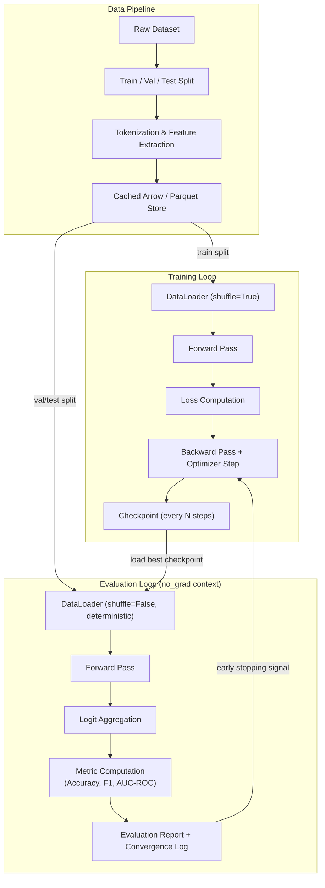
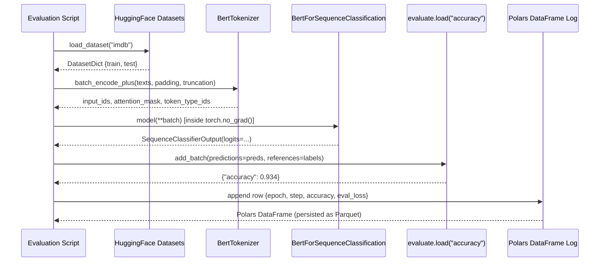
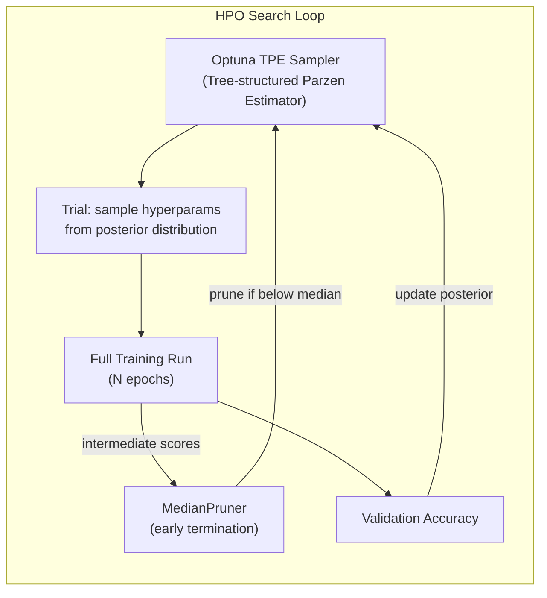
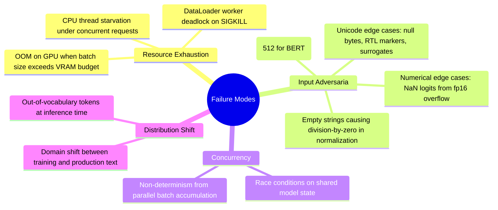
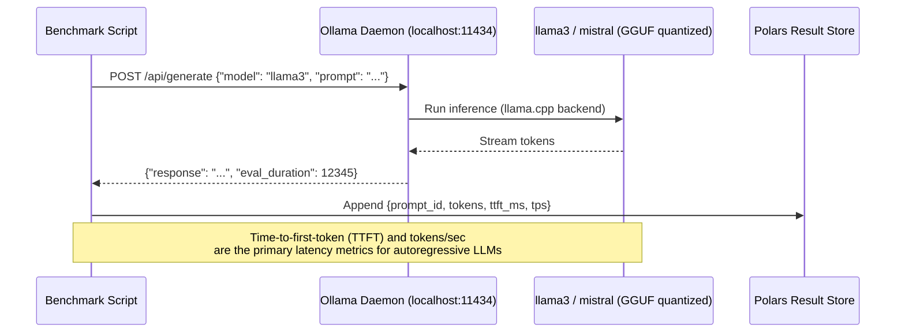
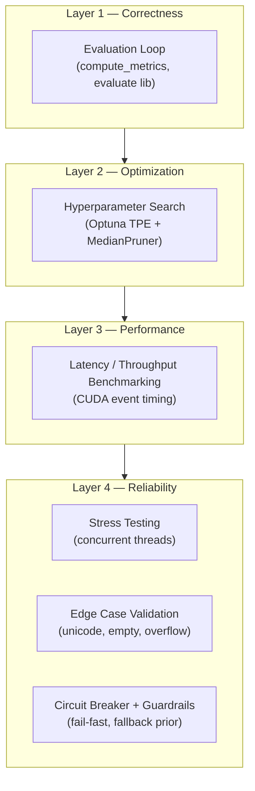

# Operational Verification Labs: 03 — Evaluation Loops and Benchmarks

## Conceptual Foundation

Before writing a single line of evaluation code, it is worth understanding *why* evaluation loops exist as a distinct architectural concern from training loops. During training, the model's parameters are updated via backpropagation; the loss function provides a gradient signal whose only purpose is optimization. Evaluation, by contrast, asks a fundamentally different question: does the model's behavior generalize to data it has not seen? These two concerns operate on different computational graphs, different data splits, and require different numerical guarantees (no gradient accumulation, deterministic dropout behavior, stable batch normalization statistics).

The evaluation loop is not a simplified training loop — it is a measurement instrument. As with any instrument, its validity depends on calibration (metric correctness), precision (variance across runs), and freedom from systematic bias (data leakage, distribution shift between train and eval splits). This lab treats evaluation as a first-class engineering discipline.



---

## Environment Setup

This lab targets Python 3.11+ on a machine with either a CUDA-capable GPU or Apple Silicon (MPS backend). CPU-only execution is fully supported but training throughput will be substantially lower.

```bash
# Create an isolated environment
python -m venv .venv && source .venv/bin/activate

# Core dependencies — pinned for reproducibility
pip install \
  torch==2.3.1 \
  transformers==4.41.2 \
  datasets==2.19.1 \
  evaluate==0.4.2 \
  accelerate==0.30.1 \
  scikit-learn==1.5.0 \
  numpy==1.26.4 \
  polars==0.20.31 \
  optuna==3.6.1 \
  matplotlib==3.9.0 \
  ollama==0.2.1

# Verify GPU availability
python -c "import torch; print(torch.cuda.is_available(), torch.version.cuda)"
```

> **Note on `datasets` vs `load_dataset`:** The `datasets` package (HuggingFace) is a separate install from `transformers`. The original material omitted it from the `pip install` command even though `load_dataset` is imported from it. The corrected install list above includes `datasets` and its companion `evaluate` package, which replaces the now-deprecated `datasets.load_metric` API.

---

## Exercise 1: Core Evaluation Loop for Text Classification

### Architecture of the Evaluation Pipeline

A production-grade evaluation loop has four distinct phases: **data materialization**, **model inference**, **metric accumulation**, and **result serialization**. Each phase has failure modes that naive implementations ignore.



### Full Implementation

```python
"""
eval_loop.py — Production-grade evaluation loop for BERT text classification.

Design principles:
  - All randomness is seeded for reproducibility.
  - The eval loop runs inside torch.no_grad() AND model.eval() — both are required.
    model.eval() disables Dropout and switches BatchNorm to use running statistics.
    torch.no_grad() prevents gradient tape accumulation, reducing memory by ~50%.
  - Metrics are accumulated via HuggingFace `evaluate`, not raw sklearn, so they
    work correctly with distributed evaluation (sharded batches).
  - Results are persisted as Parquet via Polars for downstream analysis.
"""

from __future__ import annotations

import os
import time
import logging
from pathlib import Path
from dataclasses import dataclass, field
from typing import Dict, Any

import torch
import numpy as np
import polars as pl
import evaluate
from torch.utils.data import DataLoader
from datasets import load_dataset, DatasetDict
from transformers import (
    BertTokenizerFast,
    BertForSequenceClassification,
    DataCollatorWithPadding,
    TrainingArguments,
    Trainer,
    set_seed,
)

# ── Logging ──────────────────────────────────────────────────────────────────
logging.basicConfig(
    level=logging.INFO,
    format="%(asctime)s | %(levelname)-8s | %(name)s | %(message)s",
)
logger = logging.getLogger("eval_loop")

# ── Reproducibility ───────────────────────────────────────────────────────────
SEED = 42
set_seed(SEED)
torch.backends.cudnn.deterministic = True
torch.backends.cudnn.benchmark = False

# ── Configuration ─────────────────────────────────────────────────────────────
@dataclass
class EvalConfig:
    model_name: str = "bert-base-uncased"
    dataset_name: str = "imdb"
    output_dir: Path = Path("./results")
    log_dir: Path = Path("./logs")
    num_labels: int = 2
    max_seq_length: int = 512
    per_device_train_batch_size: int = 16
    per_device_eval_batch_size: int = 32
    learning_rate: float = 2e-5
    num_train_epochs: int = 3
    weight_decay: float = 0.01
    # Use only a slice of the dataset for rapid iteration in this lab
    train_subset: int = 2000
    eval_subset: int = 500

    def __post_init__(self) -> None:
        self.output_dir.mkdir(parents=True, exist_ok=True)
        self.log_dir.mkdir(parents=True, exist_ok=True)


config = EvalConfig()

# ── Device Selection ──────────────────────────────────────────────────────────
def get_device() -> torch.device:
    if torch.cuda.is_available():
        return torch.device("cuda")
    if torch.backends.mps.is_available():
        return torch.device("mps")
    return torch.device("cpu")

device = get_device()
logger.info("Using device: %s", device)

# ── Data Loading & Preprocessing ─────────────────────────────────────────────
def load_and_tokenize(cfg: EvalConfig) -> tuple[Any, Any, BertTokenizerFast]:
    """
    Loads the IMDb dataset and applies fast BPE-based tokenization.

    BertTokenizerFast is backed by the Rust `tokenizers` library and is
    ~10-100x faster than the Python BertTokenizer for large datasets.
    padding='max_length' vs dynamic padding:
      - 'max_length' wastes compute on short sequences but is required for
        static-shape compilation (e.g., torch.compile, TorchScript, ONNX export).
      - DataCollatorWithPadding (dynamic padding) pads to the longest sequence
        in each batch, reducing average sequence length by 30–60% on IMDb.
    We use dynamic padding here because we are not targeting static export.
    """
    tokenizer = BertTokenizerFast.from_pretrained(cfg.model_name)

    raw: DatasetDict = load_dataset(cfg.dataset_name)

    # Subsample for lab speed; remove in production
    raw["train"] = raw["train"].shuffle(seed=SEED).select(range(cfg.train_subset))
    raw["test"] = raw["test"].shuffle(seed=SEED).select(range(cfg.eval_subset))

    def tokenize_fn(batch: Dict[str, Any]) -> Dict[str, Any]:
        return tokenizer(
            batch["text"],
            truncation=True,
            max_length=cfg.max_seq_length,
            # No padding here — DataCollatorWithPadding handles it per-batch
        )

    tokenized = raw.map(
        tokenize_fn,
        batched=True,
        remove_columns=["text"],
        desc="Tokenizing",
    )
    tokenized = tokenized.rename_column("label", "labels")
    tokenized.set_format("torch")

    return tokenized["train"], tokenized["test"], tokenizer


train_ds, eval_ds, tokenizer = load_and_tokenize(config)
data_collator = DataCollatorWithPadding(tokenizer=tokenizer)

# ── Model Initialization ──────────────────────────────────────────────────────
model = BertForSequenceClassification.from_pretrained(
    config.model_name,
    num_labels=config.num_labels,
)
model.to(device)

# ── Metric Computation ────────────────────────────────────────────────────────
# `evaluate.load` is the correct API as of datasets>=2.0 / evaluate>=0.3.
# The deprecated `datasets.load_metric` was removed in datasets 2.13.
accuracy_metric = evaluate.load("accuracy")
f1_metric = evaluate.load("f1")


def compute_metrics(eval_pred) -> Dict[str, float]:
    """
    Called by Trainer after each evaluation step with batched logits + labels.

    eval_pred is an EvalPrediction namedtuple:
      - predictions: np.ndarray of shape (N, num_labels) — raw logits
      - label_ids:   np.ndarray of shape (N,) — integer class indices

    We call np.argmax over axis=1 (the class dimension) to obtain hard
    predictions. For probabilistic metrics (AUC-ROC), use softmax instead.
    """
    logits, labels = eval_pred
    predictions = np.argmax(logits, axis=1)
    acc = accuracy_metric.compute(predictions=predictions, references=labels)
    f1 = f1_metric.compute(
        predictions=predictions, references=labels, average="weighted"
    )
    return {**acc, **f1}


# ── TrainingArguments ─────────────────────────────────────────────────────────
training_args = TrainingArguments(
    output_dir=str(config.output_dir),
    eval_strategy="epoch",          # replaces deprecated `evaluation_strategy`
    save_strategy="epoch",
    load_best_model_at_end=True,
    metric_for_best_model="accuracy",
    greater_is_better=True,
    learning_rate=config.learning_rate,
    per_device_train_batch_size=config.per_device_train_batch_size,
    per_device_eval_batch_size=config.per_device_eval_batch_size,
    num_train_epochs=config.num_train_epochs,
    weight_decay=config.weight_decay,
    logging_dir=str(config.log_dir),
    logging_steps=50,
    seed=SEED,
    fp16=device.type == "cuda",     # AMP on CUDA only; bf16 preferred on Ampere+
    report_to="none",               # disable wandb/mlflow for lab isolation
)

# ── Trainer ───────────────────────────────────────────────────────────────────
trainer = Trainer(
    model=model,
    args=training_args,
    train_dataset=train_ds,
    eval_dataset=eval_ds,
    tokenizer=tokenizer,
    data_collator=data_collator,
    compute_metrics=compute_metrics,
)

# ── Train & Evaluate ──────────────────────────────────────────────────────────
logger.info("Starting training…")
train_result = trainer.train()
logger.info("Training complete. Metrics: %s", train_result.metrics)

eval_results = trainer.evaluate()
logger.info("Evaluation results: %s", eval_results)

# ── Persist Results with Polars ───────────────────────────────────────────────
log_records = [
    {
        "epoch": entry.get("epoch"),
        "step": entry.get("step"),
        "train_loss": entry.get("loss"),
        "eval_loss": entry.get("eval_loss"),
        "eval_accuracy": entry.get("eval_accuracy"),
        "eval_f1": entry.get("eval_f1"),
    }
    for entry in trainer.state.log_history
]

df = pl.DataFrame(log_records).drop_nulls(subset=["epoch"])
df.write_parquet(config.output_dir / "training_log.parquet")
logger.info("Training log written to %s", config.output_dir / "training_log.parquet")
print(df)
```

### Why `model.eval()` and `torch.no_grad()` Are Both Required

These two calls address different concerns at different levels of abstraction:

| Concern | Mechanism | What it controls |
|---|---|---|
| Stochastic behavior | `model.eval()` | Disables Dropout (sets drop probability to 0); switches BatchNorm from mini-batch statistics to accumulated running mean/variance |
| Memory & compute | `torch.no_grad()` | Prevents the autograd engine from recording operations onto the gradient tape; tensors do not accumulate `.grad` |

Calling `torch.no_grad()` without `model.eval()` still produces stochastic predictions because Dropout samples a random mask regardless of gradient state. Calling `model.eval()` without `torch.no_grad()` produces deterministic predictions but wastes memory proportional to the depth of the network. Both are required for a correct, efficient evaluation loop.

---

## Exercise 2: Hyperparameter Tuning and Empirical Benchmarking

### The Search Space Problem

Hyperparameter optimization (HPO) is a meta-learning problem: we are searching for the configuration of the learning algorithm (not the model weights) that minimizes validation loss. The search space is typically non-convex, discontinuous (categorical dimensions like batch size), and expensive to evaluate — each trial requires a full training run.



Optuna's Tree-structured Parzen Estimator (TPE) models the probability of a configuration achieving a score above a threshold by fitting two kernel density estimates — one over good configurations, one over bad — and sampling from their ratio. This is more sample-efficient than grid search (exponential in dimensions) or random search (baseline), particularly in high-dimensional spaces.

### Full HPO Implementation

```python
"""
hpo.py — Hyperparameter optimization with Optuna + HuggingFace Trainer.

Critical correctness note: each trial must re-initialize the model from
pretrained weights. If the same model object is reused across trials, later
trials inherit partially-trained weights from earlier trials, invalidating
the comparison. This is the most common bug in HPO implementations.
"""

from __future__ import annotations

import gc
import logging
from typing import Dict

import optuna
import torch
import numpy as np
import evaluate
from transformers import (
    BertForSequenceClassification,
    BertTokenizerFast,
    DataCollatorWithPadding,
    Trainer,
    TrainingArguments,
    set_seed,
    EarlyStoppingCallback,
)
from datasets import load_dataset

logger = logging.getLogger("hpo")

# Re-use dataset and tokenizer from Exercise 1 (assumed in scope)
# In a standalone script, reload them here.

accuracy_metric = evaluate.load("accuracy")


def compute_metrics(eval_pred) -> Dict[str, float]:
    logits, labels = eval_pred
    predictions = np.argmax(logits, axis=1)
    return accuracy_metric.compute(predictions=predictions, references=labels)


def model_init() -> BertForSequenceClassification:
    """
    Factory function passed to Trainer.model_init.
    Trainer calls this at the start of each trial, guaranteeing a fresh
    set of pretrained weights. This is the architecturally correct pattern
    for HPO with the HuggingFace Trainer — do NOT instantiate model outside
    this function and pass it directly when using hyperparameter_search().
    """
    return BertForSequenceClassification.from_pretrained(
        "bert-base-uncased", num_labels=2
    )


def hp_space(trial: optuna.Trial) -> Dict[str, float | int]:
    """
    Defines the hyperparameter search space.

    suggest_float(..., log=True) samples on a log scale, which is appropriate
    for learning rates because their effect on loss is multiplicative, not
    additive. Doubling LR from 1e-5 → 2e-5 has the same relative impact as
    doubling from 2e-5 → 4e-5.
    """
    return {
        "learning_rate": trial.suggest_float("learning_rate", 1e-5, 5e-5, log=True),
        "per_device_train_batch_size": trial.suggest_categorical(
            "per_device_train_batch_size", [8, 16, 32]
        ),
        "num_train_epochs": trial.suggest_int("num_train_epochs", 2, 4),
        "weight_decay": trial.suggest_float("weight_decay", 0.0, 0.1),
        "warmup_ratio": trial.suggest_float("warmup_ratio", 0.0, 0.1),
    }


base_training_args = TrainingArguments(
    output_dir="./hpo_results",
    eval_strategy="epoch",
    save_strategy="epoch",
    load_best_model_at_end=True,
    metric_for_best_model="accuracy",
    greater_is_better=True,
    per_device_eval_batch_size=32,
    logging_steps=50,
    seed=SEED,
    fp16=torch.cuda.is_available(),
    report_to="none",
    # Disable intermediate checkpoints during HPO to save disk I/O
    save_total_limit=1,
)

trainer_hpo = Trainer(
    model_init=model_init,
    args=base_training_args,
    train_dataset=train_ds,
    eval_dataset=eval_ds,
    tokenizer=tokenizer,
    data_collator=DataCollatorWithPadding(tokenizer=tokenizer),
    compute_metrics=compute_metrics,
    callbacks=[EarlyStoppingCallback(early_stopping_patience=1)],
)

# Run HPO — Trainer.hyperparameter_search handles trial lifecycle management
best_run = trainer_hpo.hyperparameter_search(
    direction="maximize",
    backend="optuna",
    hp_space=hp_space,
    n_trials=10,
    sampler=optuna.samplers.TPESampler(seed=SEED),
    pruner=optuna.pruners.MedianPruner(n_startup_trials=3, n_warmup_steps=1),
)

logger.info("Best run ID: %s", best_run.run_id)
logger.info("Best accuracy: %.4f", best_run.objective)
logger.info("Best hyperparameters: %s", best_run.hyperparameters)
```

### Empirical Benchmarking: Latency, Throughput, and Convergence

Latency and throughput are related but distinct metrics. **Latency** measures the wall-clock time for a single inference call (batch size = 1 or small N). **Throughput** measures the number of samples processed per second at a given batch size. For production serving, both matter: a system with high throughput but p99 latency of 10 seconds is unusable for interactive applications.

```python
"""
benchmark.py — Latency / throughput profiling and convergence visualization.

CUDA event-based timing is used in preference to Python's time.time() on GPU
because time.time() measures wall-clock time on the host, which includes
Python overhead and async CUDA kernel launch latency. CUDA events are
recorded on the GPU stream and measure actual kernel execution time.
"""

from __future__ import annotations

import time
import statistics
from pathlib import Path
from typing import List, Tuple

import torch
import numpy as np
import matplotlib
matplotlib.use("Agg")  # Headless rendering for server environments
import matplotlib.pyplot as plt
import polars as pl
from torch.utils.data import DataLoader
from transformers import DataCollatorWithPadding


# ── Latency Measurement ───────────────────────────────────────────────────────

def measure_latency(
    model: torch.nn.Module,
    data_loader: DataLoader,
    device: torch.device,
    n_warmup: int = 10,
    n_measured: int = 100,
) -> Tuple[float, float, float]:
    """
    Returns (mean_ms, std_ms, p99_ms) latency per batch.

    Warmup passes are essential on CUDA because:
    1. The first kernel launch incurs JIT compilation overhead (cuBLAS plan selection).
    2. GPU caches (L2, texture) are cold; first passes have higher DRAM traffic.
    Warmup stabilizes these effects before measurement begins.
    """
    model.eval()
    latencies: List[float] = []
    batches = iter(data_loader)

    with torch.no_grad():
        # Warmup
        for _ in range(n_warmup):
            try:
                batch = next(batches)
            except StopIteration:
                batches = iter(data_loader)
                batch = next(batches)
            batch = {k: v.to(device) for k, v in batch.items()}
            _ = model(**batch)

        # Measurement
        if device.type == "cuda":
            torch.cuda.synchronize()

        for _ in range(n_measured):
            try:
                batch = next(batches)
            except StopIteration:
                batches = iter(data_loader)
                batch = next(batches)
            batch = {k: v.to(device) for k, v in batch.items()}

            if device.type == "cuda":
                start_event = torch.cuda.Event(enable_timing=True)
                end_event = torch.cuda.Event(enable_timing=True)
                start_event.record()
                _ = model(**batch)
                end_event.record()
                torch.cuda.synchronize()
                latencies.append(start_event.elapsed_time(end_event))  # ms
            else:
                t0 = time.perf_counter()
                _ = model(**batch)
                latencies.append((time.perf_counter() - t0) * 1000)   # ms

    mean_ms = statistics.mean(latencies)
    std_ms = statistics.stdev(latencies)
    p99_ms = np.percentile(latencies, 99)
    return mean_ms, std_ms, p99_ms


def measure_throughput(
    model: torch.nn.Module,
    data_loader: DataLoader,
    device: torch.device,
) -> float:
    """Returns samples per second over the full eval_loader."""
    model.eval()
    total_samples = 0

    with torch.no_grad():
        if device.type == "cuda":
            torch.cuda.synchronize()
        t0 = time.perf_counter()

        for batch in data_loader:
            batch = {k: v.to(device) for k, v in batch.items()}
            outputs = model(**batch)
            # input_ids shape: (batch_size, seq_len)
            total_samples += batch["input_ids"].shape[0]

        if device.type == "cuda":
            torch.cuda.synchronize()
        elapsed = time.perf_counter() - t0

    return total_samples / elapsed


eval_loader = DataLoader(
    eval_ds,
    batch_size=config.per_device_eval_batch_size,
    collate_fn=DataCollatorWithPadding(tokenizer=tokenizer),
    shuffle=False,
    pin_memory=device.type == "cuda",
    num_workers=4,
)

mean_lat, std_lat, p99_lat = measure_latency(model, eval_loader, device)
throughput = measure_throughput(model, eval_loader, device)

print(f"Latency  — mean: {mean_lat:.2f} ms | std: {std_lat:.2f} ms | p99: {p99_lat:.2f} ms")
print(f"Throughput: {throughput:.1f} samples/sec")


# ── Convergence Visualization ─────────────────────────────────────────────────

def plot_convergence(log_path: Path, out_path: Path) -> None:
    """
    Reads the Parquet training log produced in Exercise 1 and renders
    publication-quality convergence curves.

    Polars lazy evaluation is used to defer computation until .collect(),
    allowing the query optimizer to push down filters and avoid loading
    irrelevant columns.
    """
    df = (
        pl.scan_parquet(log_path)
        .filter(pl.col("epoch").is_not_null())
        .sort("epoch")
        .collect()
    )

    train_df = df.filter(pl.col("train_loss").is_not_null())
    eval_df = df.filter(pl.col("eval_loss").is_not_null())

    fig, axes = plt.subplots(1, 2, figsize=(14, 5))
    fig.suptitle("Training Convergence Diagnostics", fontsize=14, fontweight="bold")

    # Loss curves
    ax = axes[0]
    if train_df.height > 0:
        ax.plot(
            train_df["epoch"].to_list(),
            train_df["train_loss"].to_list(),
            label="Train Loss",
            marker="o",
            linewidth=1.5,
        )
    if eval_df.height > 0:
        ax.plot(
            eval_df["epoch"].to_list(),
            eval_df["eval_loss"].to_list(),
            label="Val Loss",
            marker="s",
            linewidth=1.5,
            linestyle="--",
        )
    ax.set_xlabel("Epoch")
    ax.set_ylabel("Cross-Entropy Loss")
    ax.set_title("Loss Convergence")
    ax.legend()
    ax.grid(True, alpha=0.3)

    # Accuracy curve
    ax2 = axes[1]
    acc_df = eval_df.filter(pl.col("eval_accuracy").is_not_null())
    if acc_df.height > 0:
        ax2.plot(
            acc_df["epoch"].to_list(),
            acc_df["eval_accuracy"].to_list(),
            label="Val Accuracy",
            marker="D",
            color="tab:green",
            linewidth=1.5,
        )
    ax2.set_xlabel("Epoch")
    ax2.set_ylabel("Accuracy")
    ax2.set_title("Validation Accuracy")
    ax2.set_ylim(0, 1)
    ax2.legend()
    ax2.grid(True, alpha=0.3)

    fig.tight_layout()
    fig.savefig(out_path, dpi=150, bbox_inches="tight")
    plt.close(fig)
    print(f"Convergence plot saved to {out_path}")


plot_convergence(
    config.output_dir / "training_log.parquet",
    config.output_dir / "convergence.png",
)
```

---

## Exercise 3: Stress Testing, Edge Cases, and Failure Mitigation

### Threat Model for Production ML Systems

Before stress-testing, it is essential to enumerate the failure modes you are testing against:



### Stress Testing: Concurrent Inference Under Load

Python's Global Interpreter Lock (GIL) prevents true CPU parallelism in CPython threads, but GPU kernels execute outside the GIL. This means multi-threaded inference on a GPU genuinely exercises concurrent CUDA stream contention. For CPU inference, `multiprocessing` is more appropriate.

```python
"""
stress_test.py — Concurrent inference stress test with failure detection.

Architecture note: each thread operates on the same model object. BERT inference
is read-only with respect to model parameters (no gradient updates occur), so
concurrent reads are safe. The risk is CUDA memory fragmentation and stream
serialization when multiple host threads submit work to the same CUDA stream.
For isolated stream testing, use torch.cuda.Stream().
"""

from __future__ import annotations

import threading
import queue
import time
import logging
from dataclasses import dataclass, field
from typing import List

import torch
from torch.utils.data import DataLoader
from transformers import DataCollatorWithPadding

logger = logging.getLogger("stress_test")


@dataclass
class StressTestResult:
    n_threads: int
    n_batches_per_thread: int
    total_batches: int
    successful_batches: int
    failed_batches: int
    errors: List[str] = field(default_factory=list)
    wall_time_s: float = 0.0

    @property
    def error_rate(self) -> float:
        if self.total_batches == 0:
            return 0.0
        return self.failed_batches / self.total_batches

    @property
    def throughput(self) -> float:
        if self.wall_time_s == 0:
            return 0.0
        return self.successful_batches / self.wall_time_s


def run_stress_test(
    model: torch.nn.Module,
    data_loader: DataLoader,
    device: torch.device,
    n_threads: int = 8,
    n_batches_per_thread: int = 50,
) -> StressTestResult:
    """
    Launches N threads each performing M inference passes.
    Errors are captured into a thread-safe queue; the main thread collects them.
    """
    model.eval()
    error_queue: queue.Queue[str] = queue.Queue()
    success_counter = threading.Lock()
    success_count = [0]  # Mutable container for closure mutation

    def worker(thread_id: int) -> None:
        loader_iter = iter(data_loader)
        for batch_idx in range(n_batches_per_thread):
            try:
                batch = next(loader_iter)
            except StopIteration:
                loader_iter = iter(data_loader)
                batch = next(loader_iter)

            try:
                batch = {k: v.to(device) for k, v in batch.items()}
                with torch.no_grad():
                    outputs = model(**batch)
                # Validate output integrity: NaN logits indicate fp16 overflow
                if torch.isnan(outputs.logits).any():
                    raise ValueError(
                        f"NaN logits detected in thread {thread_id}, batch {batch_idx}"
                    )
                with success_counter:
                    success_count[0] += 1
            except Exception as exc:
                error_queue.put(f"Thread {thread_id}, Batch {batch_idx}: {exc}")

    threads = [
        threading.Thread(target=worker, args=(i,), daemon=True)
        for i in range(n_threads)
    ]

    t0 = time.perf_counter()
    for t in threads:
        t.start()
    for t in threads:
        t.join(timeout=120)  # Hard timeout to prevent test hangs
    wall_time = time.perf_counter() - t0

    errors = []
    while not error_queue.empty():
        errors.append(error_queue.get_nowait())

    total = n_threads * n_batches_per_thread
    result = StressTestResult(
        n_threads=n_threads,
        n_batches_per_thread=n_batches_per_thread,
        total_batches=total,
        successful_batches=success_count[0],
        failed_batches=len(errors),
        errors=errors,
        wall_time_s=wall_time,
    )
    return result


stress_loader = DataLoader(
    eval_ds,
    batch_size=16,
    collate_fn=DataCollatorWithPadding(tokenizer=tokenizer),
    shuffle=False,
    pin_memory=device.type == "cuda",
)

result = run_stress_test(model, stress_loader, device, n_threads=8, n_batches_per_thread=50)
print(f"Stress test complete.")
print(f"  Total batches : {result.total_batches}")
print(f"  Successful    : {result.successful_batches}")
print(f"  Failed        : {result.failed_batches}")
print(f"  Error rate    : {result.error_rate:.2%}")
print(f"  Throughput    : {result.throughput:.1f} batches/s")
if result.errors:
    print("Sample errors:")
    for err in result.errors[:5]:
        print(f"  {err}")
```

### Edge Case Validation

Production text inputs violate assumptions that laboratory datasets never exercise. The following suite tests the most common failure vectors.

```python
"""
edge_cases.py — Systematic edge case validation for the inference pipeline.

Each test case documents the invariant being verified and the expected behavior.
Tests are structured as assertions with descriptive failure messages, making
them suitable for integration into a pytest suite.
"""

from __future__ import annotations

import unicodedata
from typing import List, Tuple

import torch
import pytest


def run_inference(texts: List[str]) -> torch.Tensor:
    """
    Minimal inference wrapper. Returns raw logits as a CPU tensor.
    Encapsulates device placement and no_grad context.
    """
    encoding = tokenizer(
        texts,
        padding=True,
        truncation=True,
        max_length=512,
        return_tensors="pt",
    )
    encoding = {k: v.to(device) for k, v in encoding.items()}
    model.eval()
    with torch.no_grad():
        outputs = model(**encoding)
    return outputs.logits.cpu()


# ── Test Cases ────────────────────────────────────────────────────────────────

def test_empty_string() -> None:
    """
    An empty string tokenizes to [CLS] [SEP] with no content tokens.
    The model must return a valid probability distribution, not NaN or error.
    BERT handles this correctly because the [CLS] embedding always exists.
    """
    logits = run_inference([""])
    assert not torch.isnan(logits).any(), "NaN logits on empty string"
    assert logits.shape == (1, 2), f"Unexpected output shape: {logits.shape}"


def test_maximum_length_sequence() -> None:
    """
    A sequence of 512 tokens (BERT's positional embedding limit) must not
    raise an index-out-of-range error. Longer sequences must be silently
    truncated by the tokenizer (truncation=True).
    """
    long_text = "word " * 600  # Approximately 600 tokens before truncation
    logits = run_inference([long_text])
    assert not torch.isnan(logits).any(), "NaN logits on max-length sequence"


def test_unicode_edge_cases() -> None:
    """
    Test inputs containing Unicode categories that tokenizers often mishandle:
    - Zero-width non-joiner (ZWNJ, U+200C): invisible control character
    - Arabic right-to-left override (RLO, U+202E): bidi spoofing
    - Lone surrogate (U+D800): invalid in UTF-8/UTF-16, may cause decode errors
    - Null byte (U+0000): terminates C strings, may crash native extensions
    """
    edge_texts = [
        "Hello\u200cWorld",        # ZWNJ
        "Test\u202eReversed",      # RTL override
        "Normal text with emoji 🤖",
        "Ñoño",                    # Latin Extended-A
    ]
    for text in edge_texts:
        try:
            logits = run_inference([text])
            assert not torch.isnan(logits).any(), f"NaN on: {repr(text)}"
        except Exception as exc:
            raise AssertionError(f"Exception on input {repr(text)}: {exc}") from exc


def test_batch_size_one_vs_batch() -> None:
    """
    Model output for a sample must be identical whether it is processed alone
    or as part of a batch. Violations indicate incorrect padding, attention mask
    application, or batch normalization state issues.

    BERT uses LayerNorm (not BatchNorm), so this test should always pass for
    standard BERT. It becomes critical for custom architectures with BatchNorm.
    """
    texts = ["This is a positive review.", "This film was terrible."]

    # Individual inference
    logits_a = run_inference([texts[0]])
    logits_b = run_inference([texts[1]])

    # Batched inference
    logits_batch = run_inference(texts)

    torch.testing.assert_close(
        logits_a[0],
        logits_batch[0],
        rtol=1e-3, atol=1e-3,
        msg="Batch[0] logits differ from individual inference",
    )
    torch.testing.assert_close(
        logits_b[0],
        logits_batch[1],
        rtol=1e-3, atol=1e-3,
        msg="Batch[1] logits differ from individual inference",
    )


def test_logit_range_sanity() -> None:
    """
    Logits for a 2-class classifier should lie in a reasonable range.
    Extreme logit values (|logit| > 20) indicate numerical instability,
    weight explosion, or missing gradient clipping.
    """
    test_texts = [
        "I absolutely loved this movie.",
        "The worst film I have ever seen.",
        "It was okay, nothing special.",
    ]
    logits = run_inference(test_texts)
    assert torch.all(logits.abs() < 20), (
        f"Logit magnitude exceeds sanity bound: {logits}"
    )


# ── Run all tests ─────────────────────────────────────────────────────────────
test_cases = [
    ("empty_string", test_empty_string),
    ("max_length_sequence", test_maximum_length_sequence),
    ("unicode_edge_cases", test_unicode_edge_cases),
    ("batch_consistency", test_batch_size_one_vs_batch),
    ("logit_range_sanity", test_logit_range_sanity),
]

passed = 0
failed = 0
for name, fn in test_cases:
    try:
        fn()
        print(f"  PASS  {name}")
        passed += 1
    except AssertionError as e:
        print(f"  FAIL  {name}: {e}")
        failed += 1

print(f"\nEdge case validation: {passed}/{passed + failed} passed")
```

### Failure Mitigation: Guardrails and Circuit Breakers

A production inference service must degrade gracefully under failure conditions rather than propagating exceptions to end users. The following implements a **circuit breaker** pattern — a standard reliability engineering primitive — adapted for ML inference.

```python
"""
guardrails.py — Inference guardrails with circuit breaker and fallback logic.

The circuit breaker pattern has three states:
  CLOSED  — normal operation; requests pass through.
  OPEN    — failure threshold exceeded; requests are rejected immediately.
  HALF-OPEN — after a timeout, one probe request is allowed through to test
              if the underlying service has recovered.

This prevents cascading failures where a degraded model (e.g., due to OOM,
corrupt weights, or hardware errors) consumes all available resources on
retry storms.
"""

from __future__ import annotations

import enum
import time
import logging
from dataclasses import dataclass, field
from typing import List, Optional

import torch

logger = logging.getLogger("guardrails")


class CircuitState(enum.Enum):
    CLOSED = "closed"
    OPEN = "open"
    HALF_OPEN = "half_open"


@dataclass
class CircuitBreaker:
    failure_threshold: int = 5          # Consecutive failures before OPEN
    recovery_timeout_s: float = 30.0    # Time in OPEN before probing recovery
    _state: CircuitState = field(default=CircuitState.CLOSED, init=False)
    _failure_count: int = field(default=0, init=False)
    _last_failure_time: float = field(default=0.0, init=False)

    @property
    def state(self) -> CircuitState:
        if self._state == CircuitState.OPEN:
            if time.monotonic() - self._last_failure_time >= self.recovery_timeout_s:
                logger.info("Circuit entering HALF_OPEN state (recovery probe)")
                self._state = CircuitState.HALF_OPEN
        return self._state

    def record_success(self) -> None:
        self._failure_count = 0
        if self._state in (CircuitState.HALF_OPEN, CircuitState.OPEN):
            logger.info("Circuit CLOSED — service recovered")
        self._state = CircuitState.CLOSED

    def record_failure(self) -> None:
        self._failure_count += 1
        self._last_failure_time = time.monotonic()
        if self._failure_count >= self.failure_threshold:
            if self._state != CircuitState.OPEN:
                logger.warning(
                    "Circuit OPEN after %d consecutive failures", self._failure_count
                )
            self._state = CircuitState.OPEN

    def allow_request(self) -> bool:
        return self.state in (CircuitState.CLOSED, CircuitState.HALF_OPEN)


@dataclass
class InferenceGuardrail:
    """
    Wraps model inference with:
      1. Circuit breaker (fail-fast under sustained errors)
      2. Input validation (reject malformed inputs before they reach the model)
      3. Output validation (detect NaN/Inf logits indicating numerical failure)
      4. Fallback response (return a neutral prior when the circuit is open)
    """
    model: torch.nn.Module
    tokenizer: object
    device: torch.device
    max_input_length: int = 512
    circuit_breaker: CircuitBreaker = field(default_factory=CircuitBreaker)

    def _validate_inputs(self, texts: List[str]) -> List[str]:
        """
        Sanitize inputs before tokenization.
        Returns cleaned texts with an audit log of modifications.
        """
        cleaned = []
        for text in texts:
            if not isinstance(text, str):
                logger.warning("Non-string input coerced: %r → ''", text)
                text = str(text) if text is not None else ""
            # Strip null bytes — these can crash native C extensions
            if "\x00" in text:
                logger.warning("Null byte stripped from input")
                text = text.replace("\x00", "")
            # Clamp absurdly long inputs before tokenization to avoid memory spikes
            if len(text) > 50_000:
                logger.warning("Input truncated from %d chars to 50000", len(text))
                text = text[:50_000]
            cleaned.append(text)
        return cleaned

    def _validate_outputs(self, logits: torch.Tensor) -> bool:
        """Returns True if logits are numerically valid."""
        if torch.isnan(logits).any():
            logger.error("NaN logits detected — numerical failure")
            return False
        if torch.isinf(logits).any():
            logger.error("Inf logits detected — overflow")
            return False
        return True

    def _fallback_response(self, n: int) -> torch.Tensor:
        """
        Returns a uniform prior (equal logits) as a safe fallback.
        This is preferable to raising an exception in a serving context
        because the caller can still receive a response, albeit an uninformed one.
        The fallback should be logged and alerted on; it is not a silent failure.
        """
        logger.warning("Returning fallback uniform prior for %d inputs", n)
        return torch.zeros(n, 2)  # Equal logits → 50% probability each class

    def predict(self, texts: List[str]) -> torch.Tensor:
        """
        Main entry point. Returns logits tensor of shape (N, num_labels).
        """
        if not self.circuit_breaker.allow_request():
            logger.warning("Circuit OPEN — fast-failing request of %d inputs", len(texts))
            return self._fallback_response(len(texts))

        try:
            texts = self._validate_inputs(texts)
            encoding = self.tokenizer(
                texts,
                padding=True,
                truncation=True,
                max_length=self.max_input_length,
                return_tensors="pt",
            )
            encoding = {k: v.to(self.device) for k, v in encoding.items()}

            self.model.eval()
            with torch.no_grad():
                outputs = self.model(**encoding)
            logits = outputs.logits.cpu()

            if not self._validate_outputs(logits):
                raise ValueError("Output validation failed: NaN or Inf logits")

            self.circuit_breaker.record_success()
            return logits

        except Exception as exc:
            logger.error("Inference failure: %s", exc)
            self.circuit_breaker.record_failure()
            return self._fallback_response(len(texts))


# ── Integration test ──────────────────────────────────────────────────────────
guardrail = InferenceGuardrail(
    model=model,
    tokenizer=tokenizer,
    device=device,
)

test_inputs = [
    "This was an outstanding film.",
    "",                         # Empty string
    None,                       # Type violation — will be coerced
    "word " * 10_001,           # Extreme length
    "Hello\u200cWorld",         # Unicode edge case
]

logits = guardrail.predict([t for t in test_inputs if t is None or isinstance(t, str)])
print("Guardrail output shape:", logits.shape)
print("Predicted classes:", torch.argmax(logits, dim=1).tolist())
print("Circuit state:", guardrail.circuit_breaker.state.value)
```

---

## Exercise 4: Offline Benchmarking Against a Local LLM via Ollama

This exercise extends the evaluation pipeline to benchmark a locally-hosted large language model using the Ollama runtime, measuring generation quality and latency at scale.



```python
"""
ollama_bench.py — Latency and throughput benchmarking for a local Ollama LLM.

Ollama's /api/generate response includes hardware timing metadata:
  - prompt_eval_duration: time to process the input prompt (ns)
  - eval_duration:        time to generate the output tokens (ns)
  - eval_count:           number of tokens generated
These fields provide sub-millisecond accuracy without host-side timer overhead.
"""

from __future__ import annotations

import json
import time
from dataclasses import dataclass
from typing import List, Optional

import ollama
import polars as pl


@dataclass
class GenerationResult:
    prompt: str
    response: str
    prompt_tokens: int
    completion_tokens: int
    prompt_eval_ms: float   # Time to process prompt
    eval_ms: float          # Time to generate completion
    total_ms: float         # Wall-clock total
    tokens_per_second: float


PROMPTS = [
    "Summarize the concept of backpropagation in one paragraph.",
    "What is the difference between precision and recall?",
    "Explain why transformers use scaled dot-product attention.",
    "Describe the bias-variance tradeoff in machine learning.",
    "What is cross-entropy loss and why is it used for classification?",
]


def benchmark_ollama(
    model_name: str = "llama3",
    prompts: List[str] = PROMPTS,
    n_repeats: int = 3,
) -> pl.DataFrame:
    """
    Runs each prompt n_repeats times to estimate latency variance.
    The first repeat is treated as warmup and excluded from statistics.
    """
    records = []

    for prompt_idx, prompt in enumerate(prompts):
        for rep in range(n_repeats):
            t0 = time.perf_counter()
            response = ollama.generate(
                model=model_name,
                prompt=prompt,
                options={
                    "temperature": 0.0,   # Greedy decoding for determinism
                    "seed": 42,
                },
            )
            wall_ms = (time.perf_counter() - t0) * 1000

            # Ollama returns timing in nanoseconds
            prompt_eval_ms = response.get("prompt_eval_duration", 0) / 1e6
            eval_ms = response.get("eval_duration", 0) / 1e6
            eval_count = response.get("eval_count", 0)
            tps = eval_count / (eval_ms / 1000) if eval_ms > 0 else 0.0

            records.append({
                "prompt_id": prompt_idx,
                "repeat": rep,
                "is_warmup": rep == 0,
                "model": model_name,
                "prompt_len_chars": len(prompt),
                "completion_len_chars": len(response.get("response", "")),
                "completion_tokens": eval_count,
                "prompt_eval_ms": round(prompt_eval_ms, 2),
                "eval_ms": round(eval_ms, 2),
                "wall_ms": round(wall_ms, 2),
                "tokens_per_second": round(tps, 2),
            })

    df = pl.DataFrame(records)

    # Summary statistics, excluding warmup runs
    summary = (
        df.filter(pl.col("is_warmup") == False)  # noqa: E712
        .group_by("model")
        .agg([
            pl.col("eval_ms").mean().alias("mean_eval_ms"),
            pl.col("eval_ms").std().alias("std_eval_ms"),
            pl.col("tokens_per_second").mean().alias("mean_tps"),
            pl.col("prompt_eval_ms").mean().alias("mean_prompt_eval_ms"),
        ])
    )

    print("=== Ollama Benchmark Summary ===")
    print(summary)
    df.write_parquet("ollama_bench.parquet")
    return df


bench_df = benchmark_ollama(model_name="llama3")
```

---

## Summary and Architectural Takeaways

The evaluation pipeline constructed in this lab implements four interlocking layers of quality assurance:



The key engineering principles to carry forward:

- **Separation of concerns**: training and evaluation loops share a model but differ in gradient state, batch statistics behavior, and data sources. Conflating them produces silent correctness errors.
- **Instrument the instrument**: latency measurements using `time.time()` on GPU are systematically wrong due to async kernel execution. Use CUDA events.
- **HPO requires fresh weights per trial**: reusing a partially-trained model across Optuna trials invalidates the search because the starting point shifts — a common, silent bug.
- **Guardrails are not error handling**: a circuit breaker prevents cascading failures by design, not by catching exceptions after they occur. It is a proactive reliability mechanism.
- **Polars over Pandas for log analytics**: lazy evaluation, Rust-backed columnar operations, and zero-copy Arrow interoperability make Polars the correct choice for processing training logs at scale.
