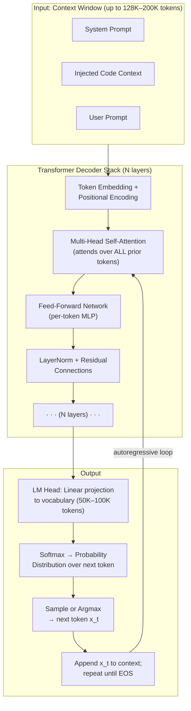
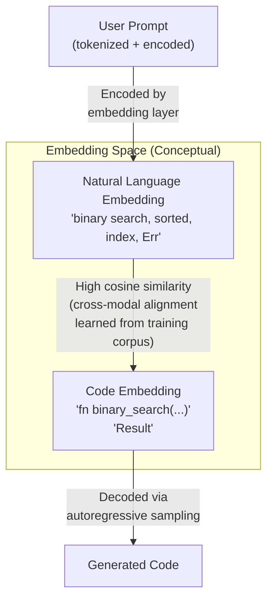
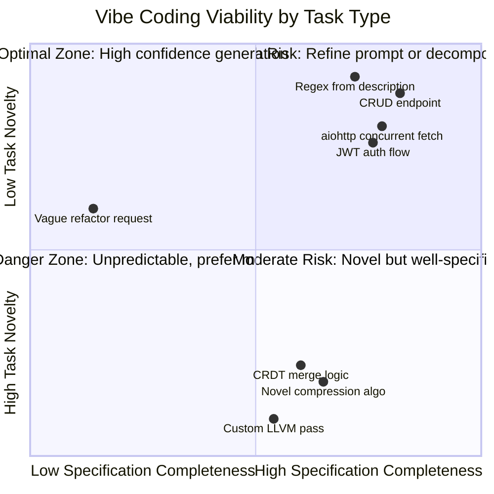
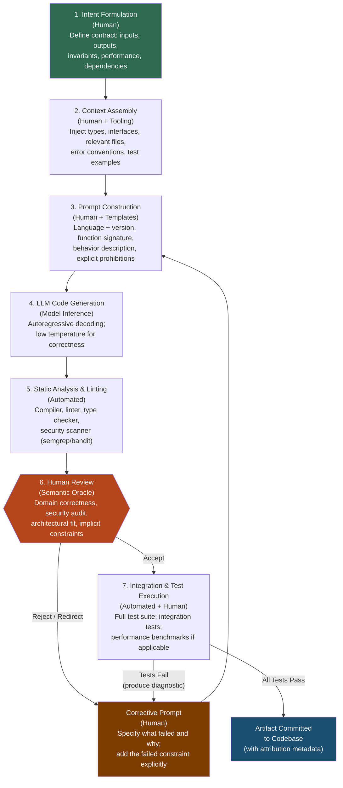
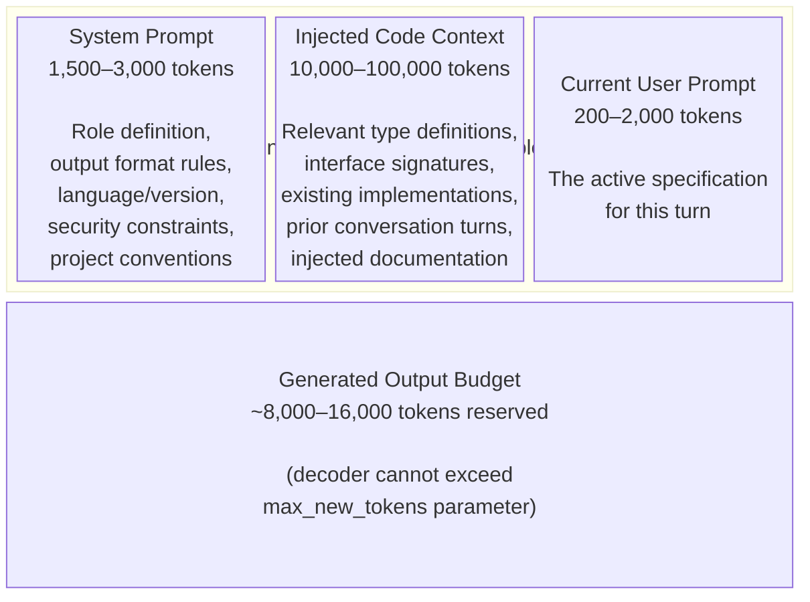
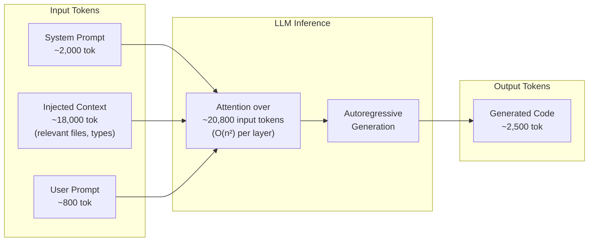
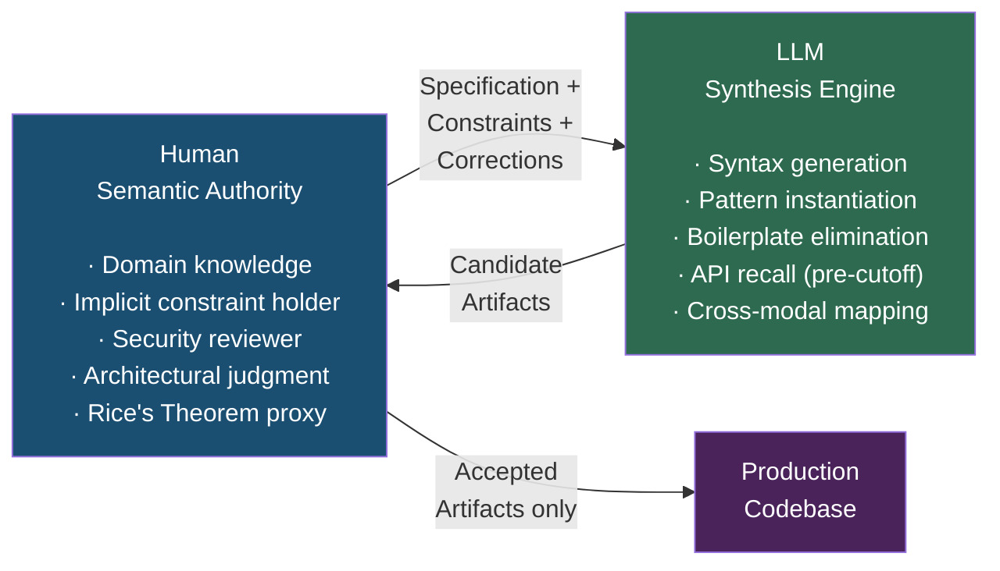

# Lesson 1: Foundations & Mathematical Formulation of Vibe Coding

---

## Curriculum Roadmap

This lesson establishes the theoretical and practical groundwork for the Vibe Coding masterclass. The term **Vibe Coding** refers to a specific, emerging software development methodology in which a human operator directs an AI large language model (LLM) — such as GPT-4o, Claude 3.5 Sonnet, or Gemini 1.5 Pro — to generate, refactor, and reason about code primarily through natural language prompts, with the human acting as an architect and intent-clarifier rather than a line-by-line author. The term was coined by Andrej Karpathy in a post on X (formerly Twitter) on February 2, 2025, describing a workflow where "you fully give in to the vibes, forget that the code even exists."

This lesson does **not** treat Vibe Coding as a vague metaphor. It treats it as a concrete sociotechnical workflow with well-defined components, failure modes, and optimization strategies. The curriculum is structured as follows:

| Lesson | Topic |
|--------|-------|
| **1** | Foundations & Mathematical Formulation *(this lesson)* |
| 2 | Prompt Engineering for Code Generation |
| 3 | Validation, Testing & Verification Strategies |
| 4 | Security, Ownership & Hallucination Mitigation |
| 5 | Integrating Vibe Coding into Production Workflows |
| 6 | Advanced Patterns: Agents, Tool Use & Multi-Step Reasoning |

By the end of this lesson, you will have a first-principles understanding of why LLMs can generate syntactically and semantically correct code, what the fundamental limits of that capability are, and how to correctly structure the human-in-the-loop pipeline.

---

## 1. First-Principles Intuition & The Problem Space

### 1.1 What Vibe Coding Actually Is

Vibe Coding is a workflow pattern, not a programming language or framework. Its defining characteristics are:

1. **Natural language as the primary interface.** The developer expresses intent in prose: "Write a Rust function that takes a `Vec<i32>` and returns a new `Vec<i32>` containing only primes, using the Sieve of Eratosthenes."
2. **LLM as the code synthesis engine.** The model generates a candidate implementation.
3. **Human as the semantic oracle.** The human evaluates correctness, security, and architectural fit — tasks the LLM cannot reliably self-certify.
4. **Iterative refinement.** Subsequent prompts correct, extend, or redirect the generated output.

This is architecturally distinct from traditional code completion (e.g., IntelliSense, early GitHub Copilot line completions) because the unit of interaction is a *specification*, not a token. The human operates at the **intent layer**, not the **syntax layer**. It is equally distinct from fully automated program synthesis research (e.g., Gulwani's FlashFill or deductive synthesis systems) because the LLM uses statistical pattern matching over learned representations rather than formal search over a space of programs defined by a logical specification.

### 1.2 Why LLMs Can Generate Code: A First-Principles View

Understanding why this works requires understanding what a transformer-based LLM actually learns during pretraining.

A transformer is trained via next-token prediction on a massive corpus that, for code-capable models, includes billions of tokens of source code from GitHub, Stack Overflow, documentation, books, and technical blogs. The training objective is to minimize the negative log-likelihood of the next token given all preceding tokens:

$$\mathcal{L}(\theta) = -\sum_{t=1}^{T} \log P_\theta(x_t \mid x_1, x_2, \ldots, x_{t-1})$$

This deceptively simple objective, applied at scale over a corpus spanning hundreds of programming languages and their natural language documentation, forces the model to learn a compressed statistical representation of:

- **Syntactic patterns**: the context-free grammar of programming languages, implicit in the training distribution.
- **Semantic patterns**: the relationship between identifiers, types, control flow, and data transformations — learned because predicting the next token in `return sum(x * y for x, y in zip(a, b))` requires understanding that `a` and `b` are iterable, `zip` produces pairs, and the comprehension accumulates a product.
- **Pragmatic patterns**: idiomatic solutions to recurring problems (sorting, pagination, authentication, serialization), which appear repeatedly across millions of repositories.
- **Cross-modal alignment**: the correspondence between English prose descriptions and their code implementations, learned from docstrings, README files, tutorials, inline comments, and Stack Overflow question-answer pairs. This alignment is the direct mechanism that makes Vibe Coding possible.

The cross-modal alignment point deserves elaboration. The model has seen millions of examples of the form:

```python
# Compute the dot product of two vectors
def dot_product(a, b):
    return sum(x * y for x, y in zip(a, b))
```

The comment and the function body co-occur in the training data, so the model learns a probabilistic mapping from the natural language description to the code body. A prompt is simply activating this learned mapping at inference time. The model does not "understand" the prompt in a philosophical sense — it is performing learned pattern interpolation over a high-dimensional embedding space. This distinction matters precisely because it explains the failure modes: the model fails when the prompt describes something genuinely outside its training distribution, when it requires precise real-world state (current API versions, live database schemas, private internal libraries), or when the required logical chain exceeds what attention mechanisms can track reliably across the generated token sequence.

### 1.3 Transformer Architecture: What Actually Happens During Code Generation

To reason about Vibe Coding's limits correctly, you need a working model of the inference mechanism. At inference time, a decoder-only transformer (the architecture underlying GPT-4, Claude, Llama, Gemini, and their kin) generates code autoregressively: one token at a time, left to right, each new token conditioned on all preceding tokens in the context window.



Each self-attention layer computes, for every token position $i$:

$$\text{Attention}(Q, K, V) = \text{softmax}\!\left(\frac{QK^\top}{\sqrt{d_k}}\right)V$$

where $Q = W_Q x_i$, $K = W_K X$, $V = W_V X$, $X$ is the matrix of all token embeddings in the context, and $d_k$ is the key dimension. The key architectural property is that this attention operation is **quadratic in context length**: computing attention over $n$ tokens requires $O(n^2)$ memory and operations per layer. This is why extending context windows to 128K or 200K tokens is a significant engineering challenge and why inference cost scales superlinearly with context length.

The feed-forward sublayer per token is a two-layer MLP applied independently at each position. Research by Geva et al. (2021) characterizes these FFN layers as functioning like key-value memories that store and retrieve factual associations — a mechanistic explanation for why the model can recall specific API signatures and function patterns from training data.

**Why this matters for Vibe Coding practice**: the autoregressive generation mechanism means the model has no ability to "go back and revise" a token it has already emitted — it can only continue forward. This is why LLMs sometimes paint themselves into logical corners in long-form code generation: an early structural decision (e.g., a function signature or a loop variable name) becomes fixed and shapes all subsequent generation. Breaking large generation tasks into small, independently committable units mitigates this structural constraint.

### 1.4 The Embedding Space and Why It Matters for Prompting

Code and natural language descriptions are mapped into the same high-dimensional vector space during training. Words like "sort," "ascending," "array," and function signatures like `std::sort`, `Array.prototype.sort`, and `sorted()` cluster near each other in this space because they co-occur in training documents describing the same operations.

A prompt activates a region of this space. The specificity, terminology, and context of your prompt determine which region is activated, and therefore which implementation pattern the model draws from.

This has a direct, practical consequence:

> Precise, domain-specific vocabulary in a prompt produces more accurate code than vague, colloquial descriptions, because it activates a narrower, more accurate region of the learned mapping.

The sentence "make a thing that finds stuff in a list" and "implement a binary search over a sorted slice returning the index or an `Err` if not found" activate very different regions of the learned representation. The second prompt is unambiguous in language, type contract, return semantics, and error handling strategy — it places far tighter constraints on the probability distribution over generated tokens.



Crucially, the cross-modal alignment is imperfect and asymmetric. Many natural language descriptions map to multiple plausible code implementations, and the model's generation is sampling from that conditional distribution — not selecting a unique deterministic answer. High-temperature sampling increases variance across that distribution; low-temperature sampling concentrates probability mass on the most statistically likely continuation given the training data, which is why low temperature is preferred for correctness-critical code generation.

### 1.5 The Problem Space: Formal Boundaries

The Vibe Coding problem space is bounded by four fundamental axes. These axes are not independent — they interact — but they provide the clearest decomposition of the sources of generation failure.

**Axis 1 — Specification Completeness.** How fully does the prompt specify the desired behavior? A complete specification includes: input types and constraints, output types and contracts, error handling semantics, performance requirements, and dependency constraints. Underspecification is the primary cause of incorrect generation, because an underspecified prompt places a broad, low-information-content distribution over the activation space, allowing the model to pattern-match to whatever common case is most represented in training data — which may not match your intent.

**Axis 2 — Task Novelty.** How far is the target implementation from the model's training distribution? Standard CRUD operations, sorting algorithms, common design patterns, and widely-used library APIs are well within distribution. Novel protocols, niche libraries with sparse public documentation, or highly domain-specific business logic are at the boundary. Note that "novel" here is relative to the training corpus, not to computer science in general: a problem that is well-known in academia but rarely implemented in public repositories may still be effectively "novel" to the model.

**Axis 3 — Context Window Fidelity.** The model reasons over a finite context window (128K tokens for GPT-4o, 200K for Claude 3.5 Sonnet, 1M for Gemini 1.5 Pro in its extended mode). Code generation that requires coherent reasoning across a codebase larger than the context window degrades significantly. The human must curate and inject the right context — the right type definitions, interface contracts, and relevant prior code. The "lost in the middle" phenomenon (Liu et al., 2023) compounds this: empirical evidence shows that information placed in the middle of a very long context receives less reliable attention than information at the beginning or end.

**Axis 4 — Verification Tractability.** How easily can the human verify correctness? A 10-line pure function with no side effects is trivially verifiable by reading. A 500-line module with side effects, database interactions, concurrent goroutines, and external service calls is not. The human's cognitive load on the verification step is a hard constraint on the viability of any single Vibe Coding session. This axis is often underestimated: generation is fast and cheap; rigorous human review is slow and expensive.



---

## 2. Mathematical Formalization & Core Invariants

### 2.1 Formalizing the Vibe Coding Workflow

We model a Vibe Coding session as a discrete dynamical system. Define:

- $\mathcal{S}$: the space of software specifications (natural language strings, formally elements of $\Sigma^*$ over a human-language alphabet)
- $\mathcal{C}$: the space of code artifacts (source files, functions, modules — formally, strings over a programming-language alphabet)
- $\mathcal{H}$: the space of human evaluations, a three-way judgment: $\{\text{Accept}, \text{Reject}, \text{Redirect}(\delta)\}$ where $\delta \in \mathcal{S}$ is a corrective follow-up prompt
- $\mathcal{M}$: a trained LLM, acting as a stochastic function $f_\mathcal{M}: \mathcal{S} \times \mathcal{C}_{ctx} \rightarrow \Delta(\mathcal{C})$

Note the correction from the naive formulation: $f_\mathcal{M}$ maps to $\Delta(\mathcal{C})$, the probability simplex over code artifacts, not to a single code artifact deterministically. The observed output at inference time is a *sample* from this distribution, parameterized by the decoding strategy (temperature, top-$p$, top-$k$).

Where $\mathcal{C}_{ctx}$ is the context window contents (existing code, prior conversation turns, injected documentation).

A single Vibe Coding **turn** produces a sample:

$$c_{t+1} \sim f_\mathcal{M}(s_t, \mathcal{C}_{ctx,t})$$

Where $s_t \in \mathcal{S}$ is the prompt at turn $t$ and $c_{t+1} \in \mathcal{C}$ is the generated code artifact. The context at turn $t$ is updated by appending the prior turn's output: $\mathcal{C}_{ctx,t+1} = \mathcal{C}_{ctx,t} \oplus c_{t+1} \oplus s_{t+1}$.

A complete Vibe Coding **session** is the trajectory:

$$\tau = \{(s_0, c_1, h_1), (s_1, c_2, h_2), \ldots, (s_{T-1}, c_T, h_T)\}$$

Where $h_t \in \mathcal{H}$ is the human judgment at turn $t$, and $s_{t+1}$ is a function of $h_t$ (the human's corrective prompt is conditioned on their evaluation of $c_{t+1}$).

The session terminates when $h_T = \text{Accept}$, i.e., the human judges the generated artifact as correct and fit for integration.

The expected number of turns $\mathbb{E}[T]$ before acceptance is a useful metric for session efficiency. Empirically, well-specified prompts for in-distribution tasks achieve $\mathbb{E}[T] \approx 1$–$3$; underspecified or out-of-distribution tasks can require $T > 10$, at which point the accumulated context history may itself begin to confuse the model and the human should consider starting a fresh session with a synthesized, complete specification.

### 2.2 The Stochasticity Problem and Temperature

$f_\mathcal{M}$ is not a deterministic function. At each decoding step, the model samples the next token from a probability distribution over its vocabulary $V$ (typically $|V| \approx 50{,}000$–$100{,}000$ tokens). This distribution is computed by applying a softmax over the LM head logits, with an optional temperature scaling parameter $\tau_{temp} \in (0, \infty)$:

$$P(x_i \mid x_{<i}) = \frac{\exp(z_i / \tau_{temp})}{\sum_{j \in V} \exp(z_j / \tau_{temp})}$$

Where $z_i$ is the raw (pre-softmax) logit for token $i$ produced by the final transformer layer.

The effect of temperature on the distribution:

- At $\tau_{temp} \rightarrow 0$: softmax converges to argmax. The distribution places all probability mass on the highest-logit token at each step. Output is deterministic and maximally "confident." For code generation where correctness is the objective and we want the model to commit to its best single answer, this is the appropriate regime.
- At $\tau_{temp} = 1$: sampling follows the raw learned distribution, preserving the entropy learned during training.
- At $\tau_{temp} > 1$: the distribution flattens; entropy increases; the model samples from lower-probability tokens more frequently. This increases output diversity but decreases reliability for code, since lower-probability tokens for a given code context are typically syntactically or semantically incorrect.

Temperature is not the only decoding parameter. Production systems also use:

- **Top-$p$ (nucleus) sampling** (Holtzman et al., 2020): at each step, restrict sampling to the smallest set of tokens whose cumulative probability mass exceeds $p$ (e.g., $p = 0.95$). This dynamically truncates the tail of the distribution, preventing sampling from very low-probability tokens while preserving diversity more naturally than top-$k$.
- **Top-$k$ sampling**: restrict sampling to the $k$ highest-probability tokens at each step. Less principled than nucleus sampling for varying entropy contexts.
- **Repetition penalty**: multiplicatively reduce the logits of tokens already present in the context, discouraging verbatim repetition. Useful for long code generation where the model might otherwise copy-paste earlier blocks.

**Practical implication**: Most production Vibe Coding tools (Cursor, GitHub Copilot, Claude's coding mode, Cline) use $\tau_{temp} \in [0.0, 0.2]$ for code generation, often combined with top-$p = 0.95$. If your tool exposes temperature, keep it at or near 0 for correctness-critical generation. For exploratory tasks — generating multiple candidate implementations to compare — a moderate temperature ($\tau_{temp} \approx 0.4$–$0.7$) can surface useful alternative approaches.

### 2.3 Specification as a Constraint Satisfaction Problem

We can formalize the prompt as inducing a constraint specification. A correct implementation $c^*$ must satisfy a set of constraints $\Phi = \{\phi_1, \phi_2, \ldots, \phi_n\}$:

$$c^* = \arg\min_{c \in \mathcal{C}} \text{Cost}(c) \quad \text{subject to} \quad \forall \phi_i \in \Phi: \phi_i(c) = \top$$

Where $\text{Cost}(c)$ is an engineering cost function that penalizes unnecessary verbosity, cyclomatic complexity, transitive dependency weight, or other quality metrics depending on the context. The constraint set $\Phi$ is partitioned by type:

- **Type constraints** $\phi_{type}$: the function signature matches the specified types and the implementation type-checks under the target language's type system.
- **Behavioral constraints** $\phi_{behav}$: the function passes a specified test suite (unit tests, property-based tests, integration tests).
- **Safety constraints** $\phi_{safe}$: the code contains no SQL injection vectors, no unchecked buffer writes (in memory-unsafe languages), no hardcoded credentials, no path traversal vulnerabilities.
- **Performance constraints** $\phi_{perf}$: the algorithm operates within a specified asymptotic complexity bound (e.g., $O(n \log n)$ time, $O(n)$ space) and within empirical latency/throughput requirements.
- **Consistency constraints** $\phi_{consist}$: the code is consistent with the existing codebase's conventions, error handling patterns, logging format, and naming conventions.

The fundamental problem of Vibe Coding is that $f_\mathcal{M}$ does not solve this constraint satisfaction problem. It *approximates* a solution by pattern matching over the learned distribution. Many constraints in $\Phi$ — particularly $\phi_{safe}$ and $\phi_{consist}$ — are not explicitly represented in the prompt and therefore cannot be enforced by the generation process. The human's role in the loop is to evaluate $\Phi(c_{t+1})$: to check whether the generated candidate actually satisfies all constraints, including those not literally stated in the prompt.

This is why the human-in-the-loop is not merely a quality gate but a **constraint completion mechanism**: the prompt can never fully express the complete constraint set for a production artifact, and the human reviewer holds the implicit constraints in their domain knowledge.

### 2.4 Hallucination as Distribution Mismatch

Code hallucination — the model generating plausible-looking but incorrect code, e.g., calling a function that does not exist in the referenced library version, referencing a parameter with an incorrect name, using an API that was removed or renamed after the training cutoff — occurs when the prompt activates a region of the learned representation that is adjacent to but not coincident with the region encoding the correct solution.

More precisely: the training corpus contains many documents where a natural language description $s$ was paired with code $c$ that is *similar* to but not identical with the target. The model's learned distribution $P(c \mid s)$ assigns probability mass to this family of similar-but-incorrect artifacts. When the model samples from this distribution, it may produce $c_{halluc}$ where:

$$c_{halluc} \approx c_{target} \quad \text{(in embedding space)}$$

but:

$$c_{halluc} \notin \{c : \forall \phi_i \in \Phi,\ \phi_i(c) = \top\}$$

The model produces something *close in the learned representation* to the right answer that nonetheless fails one or more hard constraints. This manifests most frequently in:

- **Library API drift**: the model learned from documentation for version $k$ of a library; the target codebase uses version $k+2$ where an interface changed. The model generates a call that was correct in $v_k$ but is incorrect in $v_{k+2}$. Classic examples include `aiohttp`'s session lifecycle, OpenAI's Python SDK v0.x vs. v1.x API, and Rust's async executor API evolution.
- **Private API hallucination**: the model has never seen your internal `AuthService.verifyJWT(token, secret)` method, so it invents a plausible-looking call that matches the naming convention but does not match the actual interface.
- **Edge-case omission**: the model generates code that is correct for the common case but omits handling for empty input, integer overflow, concurrent modification, or other edge cases that appear rarely in training examples.
- **Security constraint blindness**: the model generates code that is functionally correct but insecure — e.g., constructing a SQL query by string interpolation rather than parameterized query, because both patterns appear in the training data and the model has no mechanism to weight the insecure pattern as incorrect.

**Mitigation strategies** (developed fully in Lesson 4): inject authoritative, version-specific documentation and type signatures directly into the context window; provide explicit counterexample constraints ("do not use string interpolation for SQL"); use static analysis tools to flag constraint violations automatically; require the model to reason about security properties explicitly before generating code.

### 2.5 Information-Theoretic View of Prompt Quality

A prompt $s$ conveys information $I(s)$ that reduces the uncertainty of the model's output distribution over code artifacts. We can reason about prompt quality in terms of how much it constrains the generation:

$$H(C \mid S = s) = -\sum_{c \in \mathcal{C}} P(c \mid s) \log P(c \mid s)$$

A high-entropy conditional distribution $H(C \mid S = s)$ means the prompt is underspecified: many different code artifacts are roughly equally probable. A low-entropy conditional means the prompt tightly constrains the output. The goal of Vibe Coding prompt engineering (Lesson 2) is systematic entropy reduction: adding constraints that move probability mass from incorrect implementations to correct ones.

This framing has a practical corollary: each additional constraint added to a prompt should reduce $H(C \mid S)$. If adding a constraint does not change the generated output — i.e., the model already assigns negligible probability to code that violates it — the constraint is redundant. If it substantially changes the output, the constraint was necessary to reach the correct region of the learned distribution.

---

## 3. High-Level Pipeline Architecture & Dataflow

### 3.1 The Complete Vibe Coding Pipeline

The pipeline is not simply "prompt → code." A production-grade Vibe Coding workflow has seven distinct stages, each with defined inputs, outputs, failure modes, and responsible parties.



Each stage has distinct responsibilities and failure modes:

**Stage 1 — Intent Formulation.** The human must achieve internal clarity about *what is being built* before authoring a prompt. This requires identifying: the function's or module's contract (inputs with types and validity ranges, outputs with types and contracts, invariants that must hold at all times), the target language and version, the dependency budget (no new crates/packages, or specific libraries only), the performance envelope (latency, throughput, memory), and how the new code fits into the existing architecture.

A common failure mode is beginning to prompt before intent is fully formed, which leads to a session that explores design space rather than implements a decision — wasting tokens on architectural debate that belongs in a whiteboard session, not a code generation turn.

**Stage 2 — Context Assembly.** Relevant context is extracted and injected into the prompt: existing type definitions, interface signatures the new code must implement, relevant test cases showing expected behavior, error handling conventions observed in the project, and the specific file and line where the generated code will be inserted. Tools like Cursor and Cline perform automated context retrieval via embedding-based similarity search over the codebase; without tooling, this is a manual curation step requiring engineering judgment about what is relevant.

**Stage 3 — Prompt Construction.** The prompt is authored with precision. At minimum, a code generation prompt should specify: language and version, function or type signature, behavior description with concrete input/output examples, error handling strategy aligned with the project's conventions, and explicit prohibitions (e.g., "do not use `unsafe` Rust," "do not introduce new package dependencies," "do not use `panic!`").

**Stage 4 — LLM Code Generation.** The model generates a candidate. This is the only fully automated stage and the fastest. Its output is a *candidate*, not a solution.

**Stage 5 — Static Analysis.** Before human review, the generated code is passed through automated tools: the compiler or interpreter (syntax errors and type errors), a linter (`cargo clippy` for Rust, `ruff`/`mypy` for Python, `go vet`/`staticcheck` for Go, `eslint`/`tsc` for TypeScript), and optionally a static security analyzer (`semgrep`, `bandit`, `gosec`). Many Vibe Coding tools (Cursor's background agent, Cline with shell execution permissions) integrate this automatically and re-invoke the model with the error output appended if static analysis fails, closing a tight inner feedback loop without requiring human intervention for syntactic errors.

**Stage 6 — Human Review.** The human evaluates semantic correctness: whether the code *does what was intended*, not just what was literally specified. This includes checking for security constraint violations, verifying error handling completeness, assessing algorithmic correctness for edge cases, and validating architectural fit. This is the irreducible human contribution in the loop and the stage where the most critical failures are caught.

**Stage 7 — Integration & Testing.** The candidate is integrated into the codebase and the full test suite is executed. Test failures produce diagnostic output that becomes the basis for the next corrective prompt. The corrective prompt should include the specific test failure message — not a paraphrase — so the model can reason about the precise constraint that was violated.

### 3.2 Context Window Management Architecture

The context window is the most critical resource in a Vibe Coding session. Its management determines generation quality more than almost any other single factor, because the model can only reason about information that is present in the context.



The practical consequences of context window architecture on generation quality:

**Attention locality ("lost in the middle").** Liu et al. (2023) demonstrated empirically that GPT-3.5 and GPT-4 perform significantly worse at utilizing information placed in the middle of a long context compared to information at the beginning or end. For a 128K token context, the most reliable positions for critical constraints are: in the system prompt (beginning) and in the final user message (end, immediately preceding generation). Type definitions and interface contracts that the generated code must conform to should be placed at one of these positions, not buried mid-context.

**Stale context is adversarial.** If a prior conversation turn contains an incorrect function signature that was subsequently corrected in a later turn, the model may still attend to the stale version. The transformer has no notion of "this was superseded" — both the wrong version and the correct version are present in the context and compete for attention weight. When an error is corrected, the best practice is to start a new session with a clean, consolidated prompt rather than accumulating a long correction history.

**Token budget discipline.** For a 128K context window: reserve ~16K tokens for generated output (the `max_tokens` parameter), ~3K for the system prompt, and allocate the remaining ~109K across injected context and conversation history. The rule of thumb for token counting is approximately 1 token per 4 characters of English prose and 1 token per 3 characters of source code. When the available context budget is exhausted, context compression (summarization of prior turns) or context pruning (removing turns that are no longer relevant) is required. Tools like Cursor implement automated sliding window compression.

**Retrieval-Augmented Context Assembly.** For large codebases where the full source does not fit in the context window, tools use embedding-based retrieval: each file or chunk is embedded, and at query time the $k$ most semantically similar chunks are retrieved and injected. This approach (closely related to RAG for factual QA) addresses the context budget constraint but introduces a new failure mode: incorrect retrieval may inject irrelevant or misleading context that degrades generation quality.

### 3.3 A Concrete End-to-End Example

The following illustrates a complete Vibe Coding session for a specific, well-specified task, showing every stage of the pipeline with production-grade outputs.

**Intent (Stage 1)**: Write a Go function that safely reads a JSON config file from disk into a typed struct, with explicit error wrapping that preserves the error chain for `errors.Is`/`errors.As` introspection.

**Context Assembled (Stage 2)**:
- Target: Go 1.22, standard library only
- Existing `Config` struct with JSON tags
- Project convention: errors include function name and relevant path/value in message; `%w` wrapping is mandatory

**Prompt (Stage 3)**:

```
Language: Go 1.22, standard library only (no third-party dependencies).
Task: Implement function `LoadConfig` that reads a JSON file from a given path
and unmarshals it into a Config struct. Use fmt.Errorf with %w for all error
wrapping. The function must return (*Config, error). Error messages must include
the function name "LoadConfig" and the file path.

Existing type (do not redefine):
    type Config struct {
        Host     string `json:"host"`
        Port     int    `json:"port"`
        Debug    bool   `json:"debug"`
    }

Function signature: func LoadConfig(path string) (*Config, error)

Constraints:
- Do not use global state.
- Do not use os.Open + manual Read + Close (use os.ReadFile for simplicity).
- Do not use any init() function.
- The returned error must be unwrappable to os.ErrNotExist when the file is missing.
```

**Generated Output (Stage 4)**:

```go
package config

import (
    "encoding/json"
    "fmt"
    "os"
)

// LoadConfig reads the JSON-encoded configuration from the file at path
// and returns a pointer to the populated Config. If the file cannot be
// read or the JSON is malformed, a wrapped error is returned that
// preserves the original error for errors.Is / errors.As inspection.
//
// Example:
//
//   cfg, err := LoadConfig("/etc/myapp/config.json")
//   if errors.Is(err, os.ErrNotExist) {
//       // create default config
//   }
func LoadConfig(path string) (*Config, error) {
    data, err := os.ReadFile(path)
    if err != nil {
        // %w preserves os.ErrNotExist (or os.ErrPermission, etc.)
        // in the error chain for caller inspection.
        return nil, fmt.Errorf("LoadConfig: reading %q: %w", path, err)
    }

    var cfg Config
    if err := json.Unmarshal(data, &cfg); err != nil {
        return nil, fmt.Errorf("LoadConfig: unmarshaling JSON from %q: %w", path, err)
    }

    return &cfg, nil
}
```

**Static Analysis (Stage 5)**: `go build ./...` and `go vet ./...` report zero diagnostics. `staticcheck ./...` reports zero findings.

**Human Review (Stage 6)**: The reviewer validates:
- `%w` wrapping is applied at both error sites, preserving the full error chain.
- `os.ReadFile` correctly propagates `*os.PathError` wrapping `os.ErrNotExist`, enabling `errors.Is(err, os.ErrNotExist)` to work for callers.
- No global state, no `init()`, no package-level variables.
- The godoc comment includes a usage example demonstrating the `errors.Is` pattern.
- The function is pure with respect to its declared arguments (no hidden I/O beyond the specified file read).

One issue is identified: the function does not validate that mandatory fields (`Host`, `Port`) are non-zero after unmarshaling. JSON unmarshaling into a struct with no required-field validation will succeed on `{}`, leaving `Host = ""` and `Port = 0`. This is a **behavioral constraint** ($\phi_{behav}$) that was implicit in the reviewer's domain knowledge but absent from the prompt. A corrective prompt is issued:

```
Add validation after json.Unmarshal: return an error if cfg.Host is empty
or cfg.Port is not in the range [1, 65535]. Use a named error variable or
fmt.Errorf (no third-party validation library). Keep all existing behavior.
```

**Updated Generated Code (Turn 2)**:

```go
package config

import (
    "encoding/json"
    "fmt"
    "os"
)

// LoadConfig reads and validates a JSON-encoded Config from the file at path.
// Returns (*Config, nil) on success. On failure, returns a wrapped error
// preserving the original cause for errors.Is / errors.As inspection.
func LoadConfig(path string) (*Config, error) {
    data, err := os.ReadFile(path)
    if err != nil {
        return nil, fmt.Errorf("LoadConfig: reading %q: %w", path, err)
    }

    var cfg Config
    if err := json.Unmarshal(data, &cfg); err != nil {
        return nil, fmt.Errorf("LoadConfig: unmarshaling JSON from %q: %w", path, err)
    }

    if cfg.Host == "" {
        return nil, fmt.Errorf("LoadConfig: %q: config.host must not be empty", path)
    }
    if cfg.Port < 1 || cfg.Port > 65535 {
        return nil, fmt.Errorf("LoadConfig: %q: config.port %d is not in [1, 65535]", path, cfg.Port)
    }

    return &cfg, nil
}
```

**Test Integration (Stage 7)** — generated by a second session turn:

```go
package config_test

import (
    "errors"
    "os"
    "path/filepath"
    "testing"
)

func TestLoadConfig_Valid(t *testing.T) {
    path := writeTemp(t, `{"host":"localhost","port":8080,"debug":true}`)
    cfg, err := LoadConfig(path)
    if err != nil {
        t.Fatalf("unexpected error: %v", err)
    }
    if cfg.Host != "localhost" {
        t.Errorf("Host: want %q, got %q", "localhost", cfg.Host)
    }
    if cfg.Port != 8080 {
        t.Errorf("Port: want 8080, got %d", cfg.Port)
    }
    if !cfg.Debug {
        t.Error("Debug: want true, got false")
    }
}

func TestLoadConfig_MissingFile(t *testing.T) {
    _, err := LoadConfig("/nonexistent/path/config.json")
    if err == nil {
        t.Fatal("expected error for missing file, got nil")
    }
    if !errors.Is(err, os.ErrNotExist) {
        t.Errorf("expected os.ErrNotExist in chain, got: %v", err)
    }
}

func TestLoadConfig_InvalidJSON(t *testing.T) {
    path := writeTemp(t, `{invalid`)
    _, err := LoadConfig(path)
    if err == nil {
        t.Fatal("expected error for malformed JSON, got nil")
    }
}

func TestLoadConfig_MissingHost(t *testing.T) {
    path := writeTemp(t, `{"port":8080}`)
    _, err := LoadConfig(path)
    if err == nil {
        t.Fatal("expected validation error for missing host, got nil")
    }
}

func TestLoadConfig_InvalidPort(t *testing.T) {
    tests := []struct {
        name string
        port int
    }{
        {"zero", 0},
        {"negative", -1},
        {"too large", 65536},
    }
    for _, tc := range tests {
        t.Run(tc.name, func(t *testing.T) {
            content := fmt.Sprintf(`{"host":"localhost","port":%d}`, tc.port)
            path := writeTemp(t, content)
            _, err := LoadConfig(path)
            if err == nil {
                t.Errorf("port %d: expected validation error, got nil", tc.port)
            }
        })
    }
}

// writeTemp writes content to a temporary file and returns its path.
// The file is automatically cleaned up when the test ends.
func writeTemp(t *testing.T, content string) string {
    t.Helper()
    dir := t.TempDir()
    path := filepath.Join(dir, "config.json")
    if err := os.WriteFile(path, []byte(content), 0600); err != nil {
        t.Fatal(err)
    }
    return path
}
```

This two-turn session is a canonical example of the pipeline in operation: the first turn produces a correct but incomplete implementation (missing validation), the human review catches the implicit behavioral constraint, the second turn incorporates it, and the test suite exercises all critical paths including error chain integrity. The session demonstrates $T = 2$ turns to acceptance, typical for a well-specified in-distribution task with one missed implicit constraint.

### 3.4 Token Economics in a Vibe Coding Session

Understanding token economics helps teams budget cost and latency. For a mid-complexity feature (implementing a REST API endpoint with handler, service layer, and repository):



For a representative 5-turn session on a mid-complexity feature, with context accumulation:

| Turn | Input tokens | Output tokens | Cumulative input |
|------|-------------|---------------|-----------------|
| 1    | 20,800      | 2,500         | 20,800          |
| 2    | 23,500      | 1,800         | 23,500 (prior output appended) |
| 3    | 25,400      | 2,000         | 25,400          |
| 4    | 27,500      | 1,500         | 27,500          |
| 5    | 29,100      | 800           | 29,100          |
| **Total** | **126,300** | **8,600** | — |

At approximate mid-2025 GPT-4o pricing ($0.0025/1K input, $0.010/1K output), this 5-turn session costs approximately **$0.40**. At Claude 3.5 Sonnet pricing ($0.003/1K input, $0.015/1K output), approximately **$0.51**. Verify current pricing with the specific provider; these figures are illustrative and change frequently.

This cost is economically negligible compared to developer-hour cost — the correct framing for evaluating Vibe Coding ROI is not "what does the LLM API cost?" but "what is the developer-hour cost of the equivalent manual implementation, and how much does Vibe Coding reduce it?"

---

## 4. Fundamental Limits and the Human-in-the-Loop Invariant

### 4.1 What LLMs Cannot Reliably Do: Structural Limits

Several limits are not artifacts of current model scale or training methodology. They are structural consequences of what statistical pattern matching can and cannot compute.

**Semantic correctness over arbitrary specifications: Rice's Theorem.** Rice's Theorem (1953) establishes that every non-trivial semantic property of programs is undecidable. Formally: let $P$ be any property of the partial functions computable by Turing machines such that $P$ is not trivially true or false for all programs. Then there exists no algorithm that, given an arbitrary program, decides whether it has property $P$.

The implication: no computational process — not an LLM, not a formal verifier, not a hypothetical future model — can decide in general whether an arbitrary program satisfies a semantic specification. An LLM approximates this by pattern matching; a theorem prover restricts the problem to a decidable fragment of the specification language. For general natural language specifications, the problem is undecidable. The human reviewer is not a vestigial convenience — they are the only mechanism available for evaluating whether generated code satisfies a general semantic property.

**Knowledge cutoff and temporal brittleness.** Models have a training data cutoff date. APIs, security advisories, language features, standard library additions, and dependency best practices that emerged after the cutoff are either absent or potentially represented by stale information in the model's weights. This is not solvable by scaling: a larger model trained on the same cutoff data has the same temporal limitation. It requires retrieval-augmented generation (RAG) with up-to-date documentation, or explicit context injection of current API references. The practical magnitude of this problem: GPT-4o's training cutoff is April 2024; Claude 3.5 Sonnet's is approximately April 2024; models deployed in 2025 may be unaware of breaking changes in widely-used libraries that occurred in the intervening period.

**Private context.** The model has zero knowledge of your specific codebase, your team's conventions, your internal API contracts, your business domain semantics, or your infrastructure topology unless that information is explicitly present in the context window. Vibe Coding without context injection produces generic code that is correct in isolation but may be architecturally incompatible with the existing system. This is a first-order failure mode in practice.

**Long-range logical consistency.** The autoregressive generation mechanism means the model commits to tokens irrevocably as it generates. For large generation tasks, early structural decisions constrain all subsequent generation. Empirically, single-shot generation of modules exceeding approximately 300–500 lines of non-trivial logic introduces subtle logical inconsistencies even when each individual section appears plausible in isolation — variable shadowing, inconsistent error handling across code paths, type mismatches at interface boundaries. This is not a failure of "intelligence"; it is a structural consequence of the autoregressive decoding mechanism and the limits of attention over long sequences. The mitigation is decomposition: break large generation targets into composable, independently testable units of under 100–200 lines, verifying each before proceeding to the next.

**Formal verification.** An LLM cannot produce a machine-checked proof of correctness. It can produce code that *looks like* it should be correct and can produce informal arguments about why a property holds, but it cannot produce a Coq proof term, an Isabelle/HOL theorem, or a Lean 4 formalization that is machine-verified. For safety-critical domains (medical devices, cryptographic implementations, aerospace control systems), this is a disqualifying limitation.

### 4.2 Empirical Failure Rates in Practice

Academic benchmarks provide a useful reference for calibrating expectations. On HumanEval (Chen et al., 2021) — a benchmark of 164 Python programming problems — state-of-the-art models as of mid-2025 achieve pass@1 rates (probability that a single generated attempt passes all test cases) in the range of:

- GPT-4o: ~90% pass@1 on HumanEval
- Claude 3.5 Sonnet: ~92% pass@1 on HumanEval
- Gemini 1.5 Pro: ~87% pass@1 on HumanEval

However, HumanEval problems are short (median ~15 lines of target code), self-contained, and drawn from a distribution similar to competitive programming problems — a distribution well-represented in training data. Performance on more realistic benchmarks that test multi-file coherence, API-specific correctness, and security properties is substantially lower. SWE-bench (Jimenez et al., 2024), which tests models on real GitHub issues requiring multi-file edits in existing codebases, shows pass rates of 40–55% for top models as of mid-2025, depending on the scaffolding used. This is the more relevant number for production Vibe Coding practice.

The practical implication: even at 90% pass@1, 1 in 10 single-shot generations is incorrect on simple, well-specified problems. For complex, multi-constraint production tasks, the per-attempt error rate is substantially higher. This is precisely why the pipeline's Stage 6 (Human Review) and Stage 7 (Test Integration) are non-negotiable.

### 4.3 The Invariant: Human Semantic Authority

The single non-negotiable invariant of sound Vibe Coding practice is:

> A human with domain knowledge and engineering judgment must review and accept every generated artifact before it is integrated into a production codebase.

This is a structural requirement derived from Rice's Theorem (Section 4.1), from empirical failure rates (Section 4.2), and from the implicit constraint problem (Section 2.3). The LLM is a force multiplier for implementation velocity. The human is the semantic authority. Neither role is optional.

Vibe Coding practiced without this invariant — where generated code is committed without review, automated testing is treated as a sufficient substitute for human review, or the speed benefit is used to rationalize skipping the verification stages — is not an engineering methodology. It is technical debt accumulation at LLM speed.



A secondary invariant follows from the primary:

> The rigor of human review must be proportional to the verification tractability of the generated artifact (Axis 4 from Section 1.5).

A 20-line pure function with well-specified behavior and a complete test suite requires minimal human review effort: read it, check the edge cases, verify the error messages. A 400-line module with database transactions, concurrent operations, and external service calls requires the same review rigor as hand-written code — because the reviewer cannot trust that the generator has correctly handled all the implicit invariants. This proportionality principle prevents both over-review (applying the same scrutiny to boilerplate as to complex logic, which wastes time and kills the productivity benefit) and under-review (treating complex, high-risk generated code as if it were trivially verifiable).

### 4.4 Security-Specific Limits

Security deserves explicit treatment because the failure mode is asymmetric: a logic bug causes a test failure (observable, correctable); a security vulnerability causes a silent compromise (potentially unobservable until exploited).

LLMs exhibit well-documented security failure modes. Pearce et al. (2022) evaluated GitHub Copilot-generated code against the MITRE Top 25 CWEs and found that across approximately 1,700 generated code scenarios, roughly 40% contained at least one security vulnerability. The most common classes were:

- **CWE-89 (SQL Injection)**: string concatenation used for query construction.
- **CWE-22 (Path Traversal)**: user-controlled input used directly in file paths without sanitization.
- **CWE-798 (Hardcoded Credentials)**: placeholder credentials left in generated code.
- **CWE-330 (Insufficient Randomness)**: use of `rand` instead of `crypto/rand` for security-sensitive values.

These failures occur because the model learns from a training corpus that contains both secure and insecure implementations, and without an explicit security constraint in the prompt, it may generate either. The mitigation is explicit, in-prompt security constraints and mandatory security-focused review (Lesson 4).

---

## 5. The Vibe Coding Workflow in Relation to Existing Software Engineering Practices

### 5.1 Relationship to Test-Driven Development

Test-Driven Development (TDD) has a natural and productive relationship with Vibe Coding. The TDD cycle (Red → Green → Refactor) can be adapted as follows:

**Red phase**: the human writes (or prompts for) a failing test that specifies the desired behavior. This test constitutes a formal behavioral constraint $\phi_{behav}$ that is directly executable.

**Green phase**: the human prompts the LLM to implement the function that makes the test pass. The existing failing test is injected into the context window as a precise behavioral specification — far more precise than natural language alone.

**Refactor phase**: the human prompts the LLM to refactor the passing implementation for clarity, efficiency, or idiomatic style, with the passing test suite as the safety net.

This adaptation has a critical advantage: the executable test in the context window dramatically reduces $H(C \mid S)$ (Section 2.5) by providing a machine-checkable constraint that the generated code must satisfy. The model receives not just a prose description but a runnable oracle. This is one of the highest-leverage prompt engineering techniques for correctness-critical code generation.

### 5.2 Relationship to Code Review

Vibe Coding does not eliminate the need for code review — it changes its character. Traditional code review focuses on: correctness (does this do what the author intended?), style (is this consistent with our conventions?), and design (is this the right abstraction?).

In Vibe Coding, Stage 6 (Human Review) already addresses the correctness question at the individual artifact level. Code review for Vibe Coding-generated artifacts should focus on:

- **System-level coherence**: does this artifact interact correctly with adjacent components that the reviewer knows but that were not in the LLM's context window?
- **Implicit domain constraints**: does this implementation satisfy business rules or domain invariants that were not stated in the prompt?
- **Attribution and auditability**: is the generated nature of the code documented appropriately per the team's conventions, for future maintainability and legal/license compliance?

### 5.3 Relationship to Formal Methods

Formal methods — model checking (SPIN, TLA+), theorem proving (Coq, Isabelle, Lean 4), abstract interpretation (Astrée, Frama-C) — occupy a different position in the assurance hierarchy than Vibe Coding. They provide machine-checkable correctness guarantees for specified properties, within the limits of the formal model. LLMs provide statistically-likely-correct implementations with no formal guarantees.

These approaches are complementary, not competing. For high-assurance systems, a productive workflow is: use Vibe Coding to rapidly generate a candidate implementation, then verify critical properties (memory safety, absence of race conditions, protocol conformance) using formal tools. The LLM accelerates the implementation phase; the formal tool provides the assurance guarantee. This combination is beginning to appear in research contexts (e.g., using LLMs to generate proof sketches that formal provers complete) but is not yet standard in production practice.

---

## 6. Exercises

### Exercise 1: Specification Completeness Audit

Take the vague prompt: *"Write a function that processes user data."* Rewrite it as a complete specification by systematically filling in every dimension of the constraint space $\Phi$ from Section 2.3: type constraints $\phi_{type}$, behavioral constraints $\phi_{behav}$, safety constraints $\phi_{safe}$, performance constraints $\phi_{perf}$, and consistency constraints $\phi_{consist}$.

Count the number of unresolved ambiguities in the original prompt (how many different valid implementations satisfy it?). Count the number in your revision. The ratio is a rough measure of the information gain from your specification effort. As a calibration: a prompt with $k$ independent binary ambiguities has at least $2^k$ valid but potentially incompatible implementations.

### Exercise 2: Hallucination Detection Lab

Use a Vibe Coding tool of your choice (Cursor, Claude, ChatGPT) to generate a Python 3.12 function that uses `asyncio` and `aiohttp` to fetch a list of URLs concurrently and return a list of `(url, status_code, response_body)` tuples, with a configurable timeout per request and proper exception handling for `aiohttp.ClientError`.

Before running the code, perform a static audit:

1. Verify that `aiohttp.ClientSession` is created once and reused across requests (not instantiated per request).
2. Verify that the session is used as an async context manager (`async with aiohttp.ClientSession() as session`), ensuring proper cleanup.
3. Verify that `asyncio.timeout()` (Python 3.11+) or `async_timeout` is used correctly for the per-request timeout.
4. Verify that all `aiohttp.ClientError` subclasses are caught (not just `Exception`).
5. Check the `aiohttp` version assumed by the generated code against the current stable release (3.9.x as of this writing); identify any API calls that do not exist in the current version.

Then run the code against a mix of valid URLs, unreachable hosts, and URLs that return non-200 status codes. Compare your static audit findings against the actual runtime failures.

### Exercise 3: Pipeline Instrumentation

Implement the seven-stage Vibe Coding pipeline from Section 3.1 as an executable shell script (or Makefile targets) that:

1. Accepts a prompt file and a target language as arguments.
2. Calls the OpenAI Chat Completions API (or Anthropic Messages API) with the prompt, writes the extracted code block to a target file.
3. Runs the appropriate linter for the target language (`ruff check` for Python, `go vet` for Go, `cargo clippy` for Rust, `eslint` for TypeScript).
4. Exits non-zero and prints the linter output if linting fails; otherwise proceeds.
5. Runs the project's existing test suite and reports pass/fail.
6. If any stage fails, appends the failure diagnostic to the prompt and loops back to stage 2 (automated inner loop), up to a configurable maximum of 3 retries.

This exercise operationalizes the pipeline, surfaces the integration points where automation adds value, and demonstrates the inner feedback loop (Stage 5 → Stage 4) that production Vibe Coding tools implement.

### Exercise 4: Token Budget Planning

For a concrete feature — adding OAuth2 PKCE flow to an existing Go web application using the `golang.org/x/oauth2` package — plan the token budget for a complete Vibe Coding session:

1. Identify which existing files must be injected as context (session middleware, auth handler, router, config struct). List each file and estimate its token count using the rule of thumb: ~1 token per 3 characters of source code.
2. Estimate the size of the relevant `golang.org/x/oauth2` documentation that must be injected (the PKCE-related types and functions).
3. Determine how many turns you can sustain within a 128K context window before accumulated context (prior turns + generated code) requires compression. Assume each turn's generated code averages 2,500 tokens and each corrective prompt averages 400 tokens.
4. Design a context pruning strategy: which prior turns can be safely removed from the context after they are accepted, and which must be retained?

### Exercise 5: Failure Mode Classification

For each of the following hypothetical LLM-generated code artifacts, classify the failure mode using the taxonomy from Section 2.4 (API drift, private API hallucination, edge case omission, security constraint blindness) and identify which stage of the pipeline (Section 3.1) should have caught it:

1. A Python function using `openai.ChatCompletion.create(...)` (the pre-v1.0 SDK interface) in a codebase targeting `openai>=1.0.0`.
2. A Go function that constructs a SQL query as `fmt.Sprintf("SELECT * FROM users WHERE email = '%s'", email)`.
3. A Rust function implementing a parser that panics on empty input with `input[0]` without bounds checking.
4. A function calling `self.authService.validateToken(token)` where `AuthService` is an internal class the model has never seen and the actual method is `self.authService.verify(token, self.secret)`.

---

## Summary

Vibe Coding is a precisely definable sociotechnical workflow in which a human operator leverages a transformer-based LLM as a stochastic code synthesis engine, maintaining semantic authority at every integration point. Its theoretical foundation rests on the cross-modal alignment learned during next-token prediction pretraining: the model learns a probabilistic mapping from natural language descriptions to code implementations by training on billions of co-occurring (description, code) pairs. The effectiveness of any Vibe Coding session is determined by four interacting axes: specification completeness (how much the prompt constrains the generation distribution), task novelty (how far the target is from the training distribution), context window fidelity (whether the right information is in the right position in the context), and verification tractability (how much cognitive load the human review imposes).

The mathematical formalization exposes Vibe Coding as a stochastic approximation to constraint satisfaction: the model provides candidate solutions sampled from a learned conditional distribution, and the human evaluates those candidates against the full constraint set $\Phi$ — including implicit constraints that cannot be encoded in a prompt. Rice's Theorem establishes that this human evaluation is not a convenience that future models will eliminate; it is a structural necessity. The seven-stage pipeline (intent formulation, context assembly, prompt construction, LLM generation, static analysis, human review, integration testing) is the minimal sound workflow that operationalizes this invariant. Lessons 2 through 6 develop mastery of each stage in depth.

---

## References

- Karpathy, A. (2025, February 2). "There's a new kind of coding I call 'vibe coding'..." [Post]. X (formerly Twitter).
- Liu, N. F., Lin, K., Hewitt, J., Paranjape, A., Bevilacqua, M., Petroni, F., & Liang, P. (2023). Lost in the Middle: How Language Models Use Long Contexts. *Transactions of the Association for Computational Linguistics*, 12, 157–173. arXiv:2307.03172.
- Vaswani, A., Shazeer, N., Parmar, N., Uszkoreit, J., Jones, L., Gomez, A. N., Kaiser, Ł., & Polosukhin, I. (2017). Attention Is All You Need. *Advances in Neural Information Processing Systems*, 30. NeurIPS 2017.
- Rice, H. G. (1953). Classes of Recursively Enumerable Sets and Their Decision Problems. *Transactions of the American Mathematical Society*, 74(2), 358–366.
- Chen, M., Tworek, J., Jun, H., Yuan, Q., Pinto, H. P. D. O., Kaplan, J., ... & Zaremba, W. (2021). Evaluating Large Language Models Trained on Code. arXiv:2107.03374. *(HumanEval benchmark.)*
- Jimenez, C. E., Yang, J., Wettig, A., Yao, S., Pei, K., Press, O., & Narasimhan, K. (2024). SWE-bench: Can Language Models Resolve Real-world GitHub Issues? *ICLR 2024*. arXiv:2310.06770.
- Pearce, H., Ahmad, B., Tan, B., Dolan-Gavitt, B., & Karri, R. (2022). Asleep at the Keyboard? Assessing the Security of GitHub Copilot's Code Contributions. *IEEE Symposium on Security and Privacy (S&P) 2022*. arXiv:2108.09293.
- Geva, M., Schuster, R., Berant, J., & Levy, O. (2021). Transformer Feed-Forward Layers Are Key-Value Memories. *EMNLP 2021*. arXiv:2012.14913.
- Holtzman, A., Buys, J., Du, L., Forbes, M., & Choi, Y. (2020). The Curious Case of Neural Text Degeneration. *ICLR 2020*. arXiv:1904.09751.
- Gulwani, S. (2011). Automating String Processing in Spreadsheets Using Input-Output Examples. *ACM SIGPLAN-SIGACT Symposium on Principles of Programming Languages (POPL) 2011*. *(FlashFill; context for distinguishing Vibe Coding from formal program synthesis.)*
