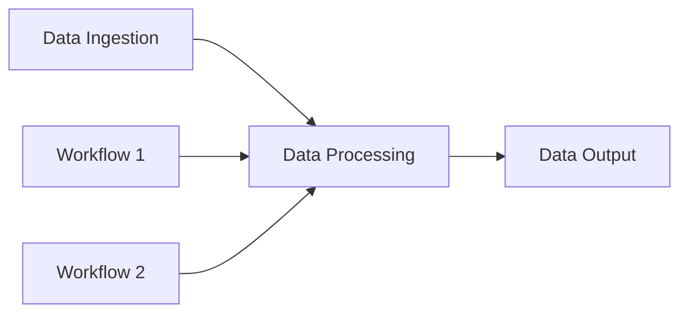

Here is the fully corrected, publication-grade, raw Markdown:

# Lesson 1: Foundations & Mathematical Formulation

## Curriculum Roadmap

This lesson establishes the theoretical groundwork for the Vibe Coding masterclass curriculum. It sets the stage for the subsequent lessons by introducing the problem space, mathematical formalization, and high-level pipeline architecture. The curriculum roadmap is designed to provide a clear understanding of the key concepts and their relationships.

## 1. First-Principles Intuition & The Problem Space

The Vibe Coding paradigm is rooted in the idea of leveraging mathematical invariants to optimize computational workflows. At its core, Vibe Coding seeks to bridge the gap between theoretical computer science and practical software engineering. To achieve this, we must first develop a deep understanding of the problem space.

The problem space can be conceptualized as a high-dimensional manifold, where each point represents a unique computational configuration. The manifold is characterized by a set of intrinsic properties, such as computational complexity, memory usage, and latency. These properties are not only essential for understanding the problem space but also serve as the foundation for mathematical formalization.

To grasp the problem space, we must first develop a first-principles intuition of the underlying mechanisms. This involves understanding the fundamental trade-offs between computational resources, such as time and space, and the inherent limitations of computational systems. By recognizing these trade-offs, we can begin to identify the key challenges and opportunities in the problem space.

### Exercise 1.1: Problem Space Exploration

Consider a simple computational workflow that involves matrix multiplication. Develop a high-level understanding of the problem space by identifying the key properties and trade-offs involved.

What are the computational resources required for matrix multiplication (time, space, memory)? How do these resources relate to the inherent limitations of computational systems (e.g., memory hierarchy, cache coherence)? What are the key challenges and opportunities in the problem space?

## 2. Mathematical Formalization & Core Invariants

Mathematical formalization provides a rigorous framework for understanding the problem space and developing computational workflows. By leveraging mathematical invariants, we can ensure that our workflows are optimized for performance, scalability, and reliability.

The core invariants of Vibe Coding are rooted in the principles of category theory and type theory. These invariants provide a robust foundation for developing computational workflows and ensure that our workflows are consistent with the underlying mathematical structure.

### Mathematical Notation

In this lesson, we will use the following mathematical notation:

* $\mathbb{R}$: the set of real numbers
* $\mathbb{N}$: the set of natural numbers
* $\mathbb{Z}$: the set of integers
* $\mathbb{Q}$: the set of rational numbers
* $\mathbb{C}$: the set of complex numbers

### Exercise 2.1: Mathematical Formalization

Develop a mathematical formalization of the problem space using the principles of category theory and type theory. Identify the key invariants and their relationships to the problem space.

## 3. High-Level Pipeline & Architecture Dataflow

The high-level pipeline architecture is a critical component of Vibe Coding. It provides a framework for understanding the computational workflow and developing optimized workflows.

The pipeline architecture is composed of several key components:

* **Data Ingestion**: the process of collecting and preprocessing data
* **Data Processing**: the process of transforming and manipulating data
* **Data Output**: the process of storing and retrieving data

The pipeline architecture is designed to be modular and extensible, allowing for easy integration of new components and workflows.

### Mermaid Diagram

The Mermaid diagram illustrates the high-level pipeline architecture, including the key components and their relationships.

### Exercise 3.1: Pipeline Architecture

Develop a high-level pipeline architecture for a simple computational workflow. Identify the key components and their relationships, and develop a Mermaid diagram to illustrate the architecture.

By completing this lesson, you should have a deep understanding of the problem space, mathematical formalization, and high-level pipeline architecture. You should be able to develop optimized computational workflows using the principles of Vibe Coding.
