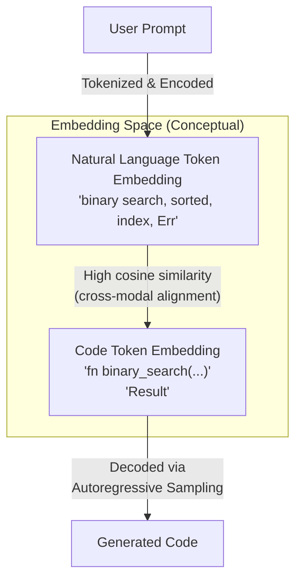
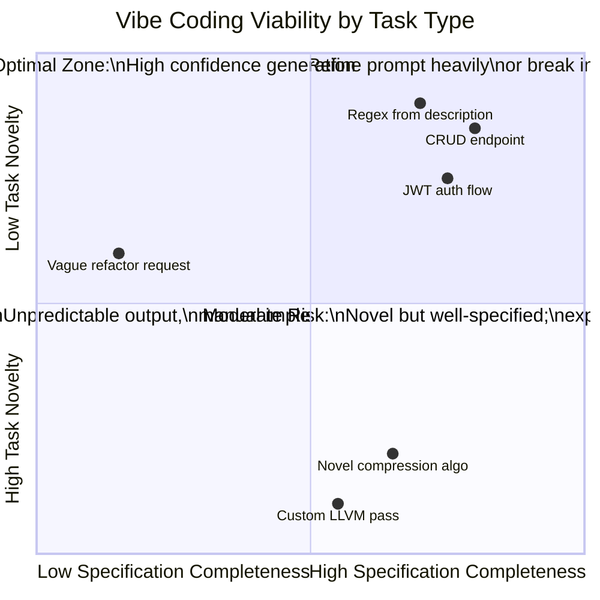
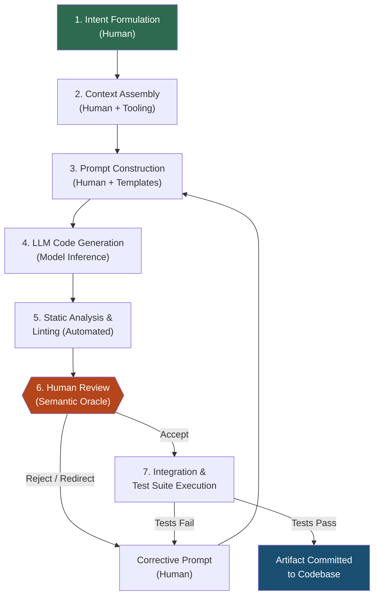
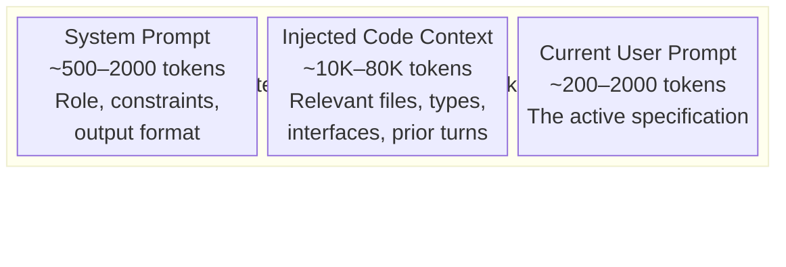
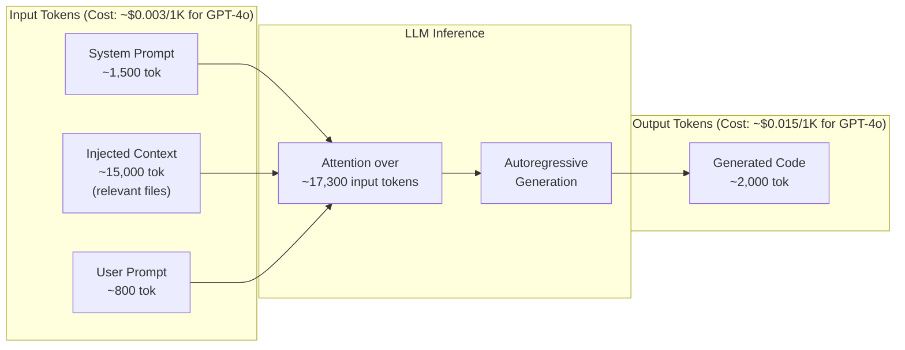
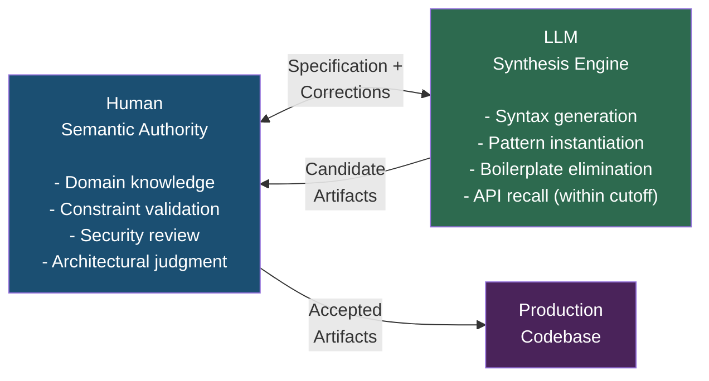

# Lesson 1: Foundations & Mathematical Formulation of Vibe Coding

---

## Curriculum Roadmap

This lesson establishes the theoretical and practical groundwork for the Vibe Coding masterclass. The term **Vibe Coding** refers to a specific, emerging software development methodology in which a human operator directs an AI large language model (LLM) — such as GPT-4o, Claude 3.5 Sonnet, or Gemini 1.5 Pro — to generate, refactor, and reason about code primarily through natural language prompts, with the human acting as an architect and intent-clarifier rather than a line-by-line author. The term was coined by Andrej Karpathy in a post on X (formerly Twitter) in February 2025, describing a workflow where "you fully give in to the vibes, forget that the code even exists."

This lesson does **not** treat Vibe Coding as a vague metaphor. It treats it as a concrete sociotechnical workflow with well-defined components, failure modes, and optimization strategies. The curriculum is structured as follows:

| Lesson | Topic |
|--------|-------|
| **1** | Foundations & Mathematical Formulation *(this lesson)* |
| 2 | Prompt Engineering for Code Generation |
| 3 | Validation, Testing & Verification Strategies |
| 4 | Security, Ownership & Hallucination Mitigation |
| 5 | Integrating Vibe Coding into Production Workflows |
| 6 | Advanced Patterns: Agents, Tool Use & Multi-Step Reasoning |

By the end of this lesson, you will have a first-principles understanding of why LLMs can generate syntactically and semantically correct code, what the fundamental limits of that capability are, and how the human-in-the-loop pipeline is correctly structured.

---

## 1. First-Principles Intuition & The Problem Space

### 1.1 What Vibe Coding Actually Is

Vibe Coding is a workflow pattern, not a programming language or framework. Its defining characteristics are:

1. **Natural language as the primary interface.** The developer expresses intent in prose: "Write a Rust function that takes a Vec of i32 and returns a new Vec containing only primes, using the Sieve of Eratosthenes."
2. **LLM as the code synthesis engine.** The model generates a candidate implementation.
3. **Human as the semantic oracle.** The human evaluates correctness, security, and architectural fit — tasks the LLM cannot reliably self-certify.
4. **Iterative refinement.** Subsequent prompts correct, extend, or redirect the generated output.

This is architecturally distinct from traditional code completion (e.g., IntelliSense, early GitHub Copilot line completions) because the unit of interaction is a *specification*, not a token. The human operates at the **intent layer**, not the **syntax layer**.

### 1.2 Why LLMs Can Generate Code: A First-Principles View

Understanding why this works requires understanding what an LLM actually learns during training.

A transformer-based LLM is trained via next-token prediction on a massive corpus that, for code-capable models, includes billions of tokens of source code from GitHub, Stack Overflow, documentation, and technical books. The model learns a compressed statistical representation of:

- **Syntactic patterns**: the grammar of programming languages.
- **Semantic patterns**: the relationship between identifiers, types, and control flow.
- **Pragmatic patterns**: idiomatic solutions to recurring problems (sorting, pagination, authentication).
- **Cross-modal alignment**: the correspondence between English prose descriptions and their code implementations (docstrings, README files, tutorials, code comments).

The last point is the key to Vibe Coding. The model has seen millions of examples of the form:

```
# Compute the dot product of two vectors
def dot_product(a, b):
    return sum(x * y for x, y in zip(a, b))
```

It has learned a probabilistic mapping from the natural language description to the code body. A prompt is simply activating this learned mapping at inference time.

This is not "understanding" in a philosophical sense. The model is performing learned pattern interpolation over a high-dimensional embedding space. This distinction matters because it directly explains the failure modes: the model fails when the prompt describes something genuinely novel (outside its training distribution), when it requires precise real-world state (current API versions, live database schemas), or when logical chains exceed what attention mechanisms can track reliably.

### 1.3 The Embedding Space and Why It Matters for Prompting

Code and natural language descriptions are mapped into the same high-dimensional vector space during training. Words like "sort," "ascending," "array," and function signatures like `std::sort`, `Array.prototype.sort`, and `sorted()` cluster near each other in this space.

A prompt activates a region of this space. The specificity, terminology, and context of your prompt determine which region is activated, and therefore which implementation pattern the model draws from.

This is not metaphorical. It has a direct, practical consequence:

> **Precise, domain-specific vocabulary in a prompt produces more accurate code than vague, colloquial descriptions.**

The sentence "make a thing that finds stuff in a list" and "implement a binary search over a sorted slice returning the index or an Err if not found" activate very different regions of the learned mapping. The second prompt is unambiguous in language, type contract, return semantics, and error handling strategy.



### 1.4 The Problem Space: Formal Boundaries

The Vibe Coding problem space is bounded by four fundamental axes:

**Axis 1 — Specification Completeness.** How fully does the prompt specify the desired behavior? A complete specification includes: input types and constraints, output types and contracts, error handling semantics, performance requirements, and dependency constraints. Underspecification is the primary cause of incorrect generation.

**Axis 2 — Task Novelty.** How far is the target implementation from the model's training distribution? Standard CRUD operations, sorting algorithms, and common design patterns are well within distribution. Novel protocols, niche libraries with sparse documentation, or highly domain-specific logic are at the boundary.

**Axis 3 — Context Window Fidelity.** The model reasons over a finite context window (measured in tokens, e.g., 128K for GPT-4o, 200K for Claude 3.5 Sonnet). Code generation that requires coherent reasoning across a codebase larger than the context window degrades significantly. The human must curate and inject the right context.

**Axis 4 — Verification Tractability.** How easily can the human verify correctness? A 10-line pure function is trivially verifiable. A 500-line module with side effects, database interactions, and concurrency is not. The human's cognitive load on the verification step is a hard constraint on the viability of any single Vibe Coding session.



---

## 2. Mathematical Formalization & Core Invariants

### 2.1 Formalizing the Vibe Coding Workflow

We model a Vibe Coding session as a discrete dynamical system. Define:

- $\mathcal{S}$: the space of software specifications (natural language strings)
- $\mathcal{C}$: the space of code artifacts (source files, functions, modules)
- $\mathcal{H}$: the space of human evaluations (a judgment: Accept, Reject, or Redirect with a corrective prompt)
- $\mathcal{M}$: a trained LLM, acting as a stochastic function $f_\mathcal{M}: \mathcal{S} \times \mathcal{C}_{ctx} \rightarrow \mathcal{C}$

Where $\mathcal{C}_{ctx}$ is the context window contents (existing code, prior conversation, injected documentation).

A single Vibe Coding **turn** is:

$$c_{t+1} = f_\mathcal{M}(s_t, \mathcal{C}_{ctx,t})$$

Where $s_t \in \mathcal{S}$ is the prompt at turn $t$ and $c_{t+1} \in \mathcal{C}$ is the generated code artifact.

A complete Vibe Coding **session** is the trajectory:

$$\tau = \{(s_0, c_1, h_1), (s_1, c_2, h_2), \ldots, (s_{T-1}, c_T, h_T)\}$$

Where $h_t \in \mathcal{H}$ is the human judgment at turn $t$, and $s_{t+1}$ is informed by $h_t$ (the human's corrective prompt is a function of their evaluation of $c_{t+1}$).

The session terminates when $h_T = \text{Accept}$, i.e., the human judges the generated artifact as correct and fit for integration.

### 2.2 The Stochasticity Problem and Temperature

$f_\mathcal{M}$ is not a deterministic function. At each decoding step, the model samples the next token from a probability distribution over its vocabulary. This distribution is parameterized by **temperature** $\tau_{temp} \in [0, \infty)$:

$$P(x_i | x_{<i}) \propto \exp\left(\frac{z_i}{\tau_{temp}}\right)$$

Where $z_i$ is the raw logit for token $i$.

- At $\tau_{temp} \rightarrow 0$: sampling becomes greedy (argmax). The output is deterministic and maximally "confident." This is appropriate for code generation where correctness is the objective.
- At $\tau_{temp} = 1$: sampling follows the raw learned distribution.
- At $\tau_{temp} > 1$: the distribution flattens; the model becomes more "creative" and less reliable for code.

**Practical implication**: Most production Vibe Coding tools (Cursor, GitHub Copilot, Claude's coding mode) use low temperature (0.0–0.2) for code generation. If your tool exposes temperature, keep it at or near 0 for correctness-critical generation.

### 2.3 Specification as a Constraint Satisfaction Problem

We can formalize the prompt as a constraint specification. A correct implementation $c^*$ must satisfy a set of constraints $\Phi = \{\phi_1, \phi_2, \ldots, \phi_n\}$:

$$c^* = \arg\min_{c \in \mathcal{C}} \text{Cost}(c) \quad \text{subject to} \quad \forall \phi_i \in \Phi: \phi_i(c) = \text{True}$$

Where the cost function penalizes verbosity, complexity, or dependency weight (depending on the engineering context).

Constraints $\Phi$ may include:

- **Type constraints**: $\phi_{type}$: the function signature matches the specified types.
- **Behavioral constraints**: $\phi_{behav}$: the function passes a specified test suite.
- **Safety constraints**: $\phi_{safe}$: the code contains no SQL injection vectors, no unchecked buffer writes.
- **Performance constraints**: $\phi_{perf}$: the algorithm operates within $O(n \log n)$ time.

The fundamental problem of Vibe Coding is that $f_\mathcal{M}$ does not solve this constraint satisfaction problem directly. It *approximates* a solution by pattern matching. The human's role in the loop is to evaluate $\Phi(c_{t+1})$ — to check whether the generated candidate actually satisfies the constraints — which the model cannot reliably self-certify.

### 2.4 Hallucination as Distribution Shift

Code hallucination (the model generating plausible-looking but incorrect code — e.g., calling a function that does not exist, referencing a parameter with the wrong name, using a deprecated API) occurs when the prompt activates a region of the embedding space that is *adjacent to but not identical with* the correct solution.

Formally: let $c_{target}$ be the ground-truth implementation and $c_{halluc}$ be the hallucinated output. The hallucination occurs because:

$$\|f_\mathcal{M}(s) - c_{halluc}\|_{\text{embedding}} < \epsilon$$

but:

$$c_{halluc} \notin \{c : \forall \phi_i \in \Phi, \phi_i(c) = \text{True}\}$$

The model produces something *close in embedding space* to the right answer but that fails one or more hard constraints. This is especially common for:

- Library APIs that changed between the model's training cutoff and today.
- Internal/private APIs the model has never seen.
- Edge cases in specifications (off-by-one errors, empty-input handling, overflow).

**Mitigation**: inject authoritative documentation, type signatures, and test cases directly into the context window. This "steers" the activation toward the correct subspace.

---

## 3. High-Level Pipeline Architecture & Dataflow

### 3.1 The Complete Vibe Coding Pipeline

The pipeline is not simply "prompt → code." A production-grade Vibe Coding workflow has seven distinct stages:



Each stage has distinct responsibilities and failure modes:

**Stage 1 — Intent Formulation.** The human must clarify *what* is being built before constructing a prompt. This involves: identifying the function's contract (inputs, outputs, invariants), the target language and version, the dependency constraints (no new dependencies, or specific libraries only), and the performance envelope.

**Stage 2 — Context Assembly.** Relevant context is injected into the prompt: existing type definitions, interface signatures the new code must implement, relevant test cases, error handling conventions from the project. Tools like Cursor and Cline perform automated context retrieval via embeddings over the codebase; without tooling, this is a manual curation step.

**Stage 3 — Prompt Construction.** The prompt is authored with precision. See Lesson 2 for prompt engineering patterns. At minimum, a code generation prompt should specify: language and version, function signature or interface, behavior description with examples, error handling strategy, and any explicit prohibitions (e.g., "do not use unsafe Rust").

**Stage 4 — LLM Code Generation.** The model generates a candidate. This is the only fully automated stage.

**Stage 5 — Static Analysis.** Before human review, the generated code is passed through automated tools: the compiler or interpreter (syntax errors), a linter (`clippy` for Rust, `pylint`/`ruff` for Python, `go vet` for Go, `eslint` for TypeScript), and optionally a static security analyzer (`semgrep`, `bandit`). Many Vibe Coding tools integrate this automatically and re-invoke the model with error output if static analysis fails.

**Stage 6 — Human Review.** The human evaluates semantic correctness — whether the code *does what was intended*, not just what was specified literally. This is the irreducible human contribution in the loop.

**Stage 7 — Integration & Testing.** The candidate is integrated and the existing test suite is executed. Test failures trigger a new corrective prompt cycle.

### 3.2 Context Window Management Architecture

The context window is the most critical resource in a Vibe Coding session. Its management determines generation quality more than almost any other factor.



The model attends over the entire context window at each generation step. The practical consequences:

- Content at the **beginning and end** of the context window receives stronger attention in most transformer implementations (a phenomenon called "lost in the middle," documented by Liu et al., 2023). Place the most critical constraints and type definitions either at the start (system prompt) or immediately before the code generation request.
- **Stale context is dangerous.** If a prior conversation turn contains an incorrect function signature that was later corrected, the model may still attend to and be influenced by the stale version. Prune irrelevant or superseded context.
- **Token budget discipline.** For a 128K context window, reserve ~10K tokens for the generated output, ~2K for the system prompt, and allocate the remainder (~116K) across injected context and conversation history. When this budget is exceeded, context compression or summarization is required.

### 3.3 A Concrete End-to-End Example

The following illustrates a complete Vibe Coding turn for a specific, well-specified task.

**Intent**: Write a Go function that safely reads a JSON config file from disk into a typed struct, with explicit error wrapping.

**Prompt (Stage 3)**:

```
Language: Go 1.22
Task: Implement a function `LoadConfig` that reads a JSON file from a given path
and unmarshals it into a `Config` struct defined below. Use `fmt.Errorf` with `%w`
for error wrapping. Do not use third-party libraries. Return a pointer to Config
and an error.

Existing type:
type Config struct {
    Host     string `json:"host"`
    Port     int    `json:"port"`
    Debug    bool   `json:"debug"`
}

Function signature: func LoadConfig(path string) (*Config, error)
```

**Generated Output (Stage 4)**:

```go
package config

import (
    "encoding/json"
    "fmt"
    "os"
)

// Config holds the application configuration loaded from a JSON file.
type Config struct {
    Host  string `json:"host"`
    Port  int    `json:"port"`
    Debug bool   `json:"debug"`
}

// LoadConfig reads a JSON-encoded Config from the file at path.
// It returns a pointer to the populated Config, or nil and a wrapped error
// if the file cannot be read or decoded.
func LoadConfig(path string) (*Config, error) {
    data, err := os.ReadFile(path)
    if err != nil {
        return nil, fmt.Errorf("LoadConfig: reading file %q: %w", path, err)
    }

    var cfg Config
    if err := json.Unmarshal(data, &cfg); err != nil {
        return nil, fmt.Errorf("LoadConfig: unmarshaling JSON from %q: %w", path, err)
    }

    return &cfg, nil
}
```

**Static Analysis (Stage 5)**: `go vet ./...` and `go build ./...` pass with zero diagnostics.

**Human Review (Stage 6)**: The reviewer verifies:
- Error messages include the function name and the path, aiding debuggability.
- `%w` wrapping is used correctly, enabling `errors.Is` / `errors.As` by callers.
- No global state is introduced.
- The function is pure with respect to its arguments (no hidden dependencies).

**Test Integration (Stage 7)**:

```go
package config_test

import (
    "errors"
    "os"
    "path/filepath"
    "testing"
)

func TestLoadConfig_Valid(t *testing.T) {
    dir := t.TempDir()
    path := filepath.Join(dir, "config.json")
    content := []byte(`{"host":"localhost","port":8080,"debug":true}`)
    if err := os.WriteFile(path, content, 0600); err != nil {
        t.Fatal(err)
    }

    cfg, err := LoadConfig(path)
    if err != nil {
        t.Fatalf("unexpected error: %v", err)
    }
    if cfg.Host != "localhost" || cfg.Port != 8080 || !cfg.Debug {
        t.Errorf("unexpected config: %+v", cfg)
    }
}

func TestLoadConfig_MissingFile(t *testing.T) {
    _, err := LoadConfig("/nonexistent/path/config.json")
    if err == nil {
        t.Fatal("expected error, got nil")
    }
    if !errors.Is(err, os.ErrNotExist) {
        t.Errorf("expected os.ErrNotExist in chain, got: %v", err)
    }
}

func TestLoadConfig_InvalidJSON(t *testing.T) {
    dir := t.TempDir()
    path := filepath.Join(dir, "bad.json")
    if err := os.WriteFile(path, []byte(`{invalid`), 0600); err != nil {
        t.Fatal(err)
    }

    _, err := LoadConfig(path)
    if err == nil {
        t.Fatal("expected error for invalid JSON, got nil")
    }
}
```

This test suite exercises the three critical paths: valid input, file I/O failure, and malformed input. The tests are generated by a *second* Vibe Coding turn where the prompt explicitly asks for table-driven tests covering error paths and use of `errors.Is` for wrapped error inspection.

### 3.4 Dataflow: Token Economics in a Vibe Coding Session

Understanding the token economics of a session helps teams budget cost and latency. For a mid-complexity feature (e.g., implementing a new REST API endpoint with handler, service layer, and repository):



*Note: Pricing figures are illustrative and change frequently. Verify current pricing with the specific provider.*

For a 5-turn session on a mid-complexity feature:
- Input tokens: ~17,300 × 5 = ~86,500 tokens
- Output tokens: ~2,000 × 5 = ~10,000 tokens
- Approximate cost (GPT-4o, mid-2025 pricing): ~$0.26–$0.41 per session

This is economically negligible compared to developer-hour cost, which is the correct framing for evaluating Vibe Coding ROI.

---

## 4. Fundamental Limits and the Human-in-the-Loop Invariant

### 4.1 What LLMs Cannot Reliably Do

This is not a limitation of current models that future models will eliminate. Some limits are structural:

**Semantic correctness over arbitrary specifications.** The halting problem and Rice's theorem establish that no algorithmic process can determine, in general, whether a program satisfies an arbitrary semantic property. An LLM is an approximator, not a theorem prover. It can generate code that *tends to be* correct for common cases but cannot guarantee correctness for all inputs.

**Knowledge cutoff.** Models have a training data cutoff. APIs, security advisories, language features, and best practices that emerged after the cutoff are either absent or potentially represented by stale (incorrect) information in the model's weights. This is not solvable by scaling; it requires retrieval-augmented generation (RAG) or explicit context injection of current documentation.

**Private context.** The model has no knowledge of your specific codebase, your team's conventions, your internal APIs, or your business domain unless that information is explicitly injected into the context window. Vibe Coding without context injection produces generic code that must be heavily adapted.

**Long-range logical consistency.** For tasks requiring coherent logic across thousands of lines of generated code, transformer attention mechanisms degrade. Empirically, single-shot generation of modules exceeding ~300–500 lines tends to introduce subtle logical inconsistencies even when each individual section looks plausible. Break large generation tasks into composable, independently verifiable units.

### 4.2 The Invariant: Human Semantic Authority

The single non-negotiable invariant of any sound Vibe Coding practice is:

> **A human with domain knowledge and engineering judgment must review and accept every generated artifact before it is integrated into a production codebase.**

This is not a conservative guideline. It is a structural requirement derived from the limits established in Section 4.1. The LLM is a force multiplier for implementation velocity. The human is the semantic authority. Neither role is optional.

Vibe Coding practiced without this invariant — where generated code is committed without review — is not an engineering methodology. It is a liability accumulation strategy.



---

## 5. Exercises

### Exercise 1: Specification Completeness Audit

Take a vague prompt: *"Write a function that processes user data."* Rewrite it as a complete specification by identifying and filling in every dimension of the constraint space $\Phi$ from Section 2.3: type constraints, behavioral constraints, safety constraints, and performance constraints. Measure the difference in specificity in terms of information content (how many ambiguities does the original leave unresolved vs. your revision?).

### Exercise 2: Hallucination Detection

Use a Vibe Coding tool of your choice to generate a Python function that uses `asyncio` and `aiohttp` to fetch a list of URLs concurrently and return a list of `(url, status_code)` tuples. Without running the code, audit it for:

- Correct `asyncio` event loop management for the Python version being used.
- Proper `aiohttp.ClientSession` lifecycle management (session created once, not per request).
- Correct exception handling for network errors.
- Any API calls that do not match the current `aiohttp` documentation.

Then run the code and compare your static audit against the actual failures.

### Exercise 3: Pipeline Instrumentation

Implement the seven-stage pipeline from Section 3.1 as a shell script or Makefile target that:

1. Accepts a prompt file as input.
2. Calls the LLM API (use the OpenAI API or Anthropic API, your choice) and writes the generated code to a file.
3. Runs the appropriate linter for the target language.
4. Reports linter output and exits non-zero if linting fails.
5. Runs the project's test suite and reports results.

This exercise operationalizes the pipeline and surfaces the integration points where automation adds the most value.

### Exercise 4: Token Budget Planning

For a hypothetical feature — adding OAuth2 PKCE flow to an existing Go web application — estimate the token budget for a complete Vibe Coding session. Identify which files from the existing codebase must be injected as context, estimate their token count (use the rule of thumb: ~1 token per 4 characters of English text, ~1 token per 3 characters of code), and determine how many turns you can sustain within a 128K context window before context compression is required.

---

## Summary

Vibe Coding is a precisely definable workflow in which a human operator leverages an LLM as a code synthesis engine, maintaining semantic authority at every integration point. Its effectiveness is determined by specification completeness, context window fidelity, and the rigor of human review. The mathematical formalization reveals it as a stochastic approximation to constraint satisfaction, where the model provides candidate solutions and the human evaluates them against the full constraint set — a task no current model can reliably self-certify. The pipeline's invariant structure — intent, context, prompt, generation, static analysis, human review, integration testing — is not an optional best practice but a consequence of the model's structural limitations. Lessons 2 through 6 build on this foundation to develop mastery of each stage.

---

*References:*
- *Karpathy, A. (2025, February 2). "There's a new kind of coding I call 'vibe coding'..." [Post]. X (formerly Twitter).*
- *Liu, N. F., et al. (2023). "Lost in the Middle: How Language Models Use Long Contexts." arXiv:2307.03172.*
- *Vaswani, A., et al. (2017). "Attention Is All You Need." NeurIPS 2017.*
- *Rice, H. G. (1953). "Classes of Recursively Enumerable Sets and Their Decision Problems." Transactions of the American Mathematical Society, 74(2), 358–366.*
