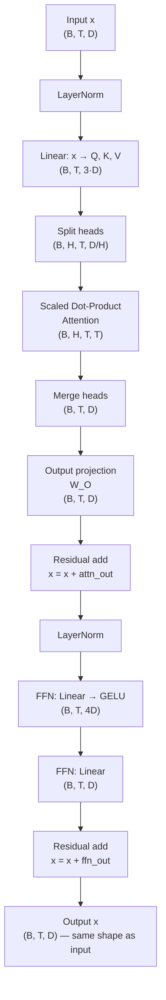
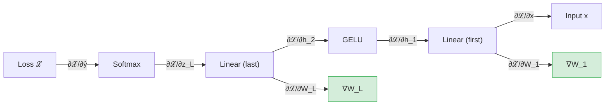
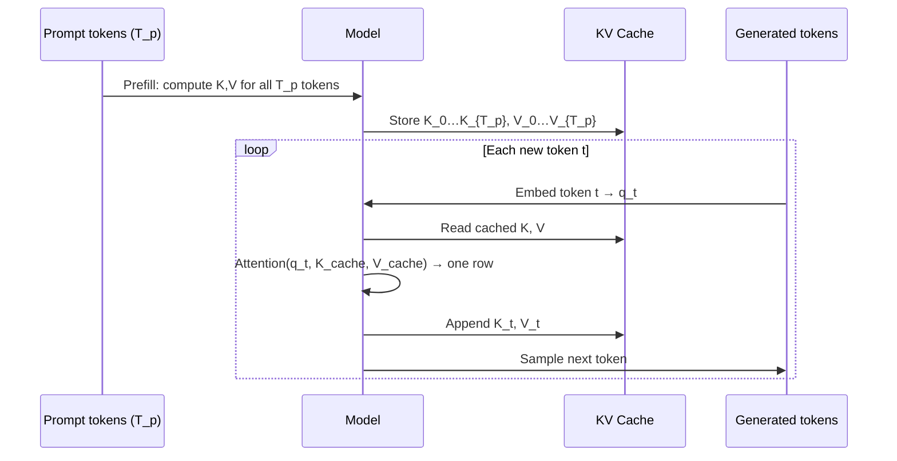
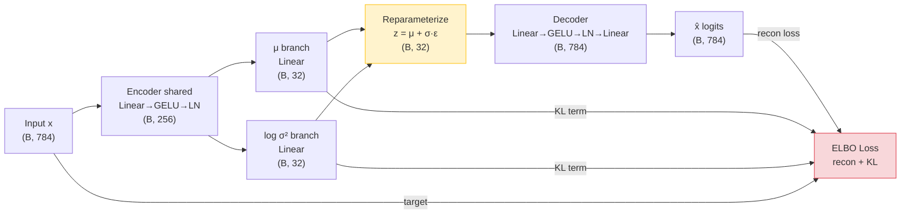
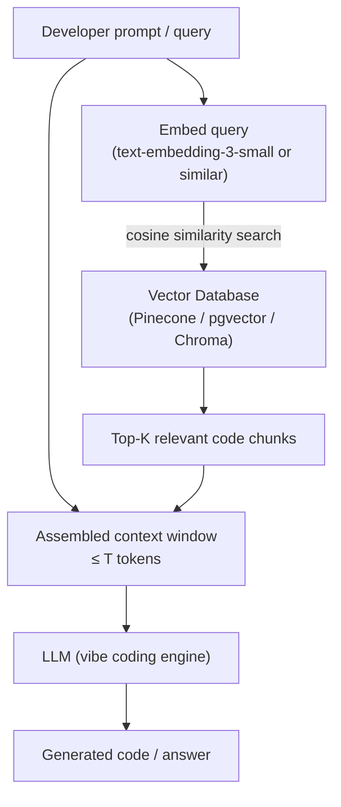
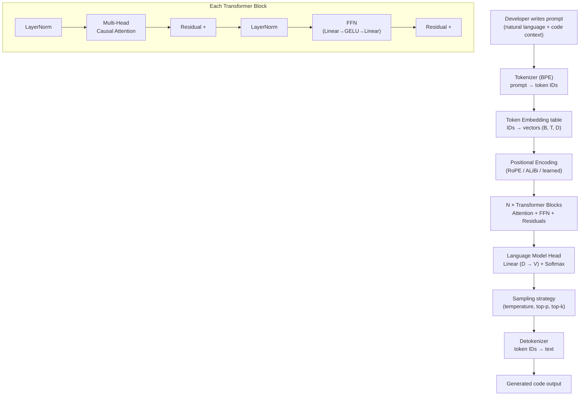

# Lesson 2: Core Architecture & Algorithmic Mechanics of AI-Assisted Development (Vibe Coding)

> **Scope note.** This lesson reframes the standard deep-learning mechanics curriculum through the lens of *vibe coding* — the practice of steering large language models (LLMs) and code-generation systems through natural-language intent rather than explicit algorithmic specification. Understanding what happens inside these models at an architectural level is what separates practitioners who get reliable results from those who fight the tool.

---

## 1. Tensor Transformations & Dimensional Flows

### 1.1 What a Tensor Actually Is

A tensor is a typed, densely-packed, contiguous block of numerical values stored in row-major (C-order) or column-major (Fortran-order) layout, together with a **shape** tuple and a **stride** tuple. The stride tuple is what makes zero-copy reshaping, transposing, and slicing possible: changing strides changes how the same memory is *interpreted*, not what is stored.

```
Physical memory (row-major, float32):
[1.0, 2.0, 3.0, 4.0, 5.0, 6.0]

Shape  (2, 3)  → 2 rows, 3 columns
Strides(12, 4) → advance 12 bytes to next row, 4 bytes to next column

Shape  (3, 2)  after .T (transpose)
Strides( 4,12) → same memory, different stride interpretation
```

The gradient tape in PyTorch / JAX tracks *operations on tensors*, not values. Every differentiable op registers a backward closure; calling `.backward()` traverses this DAG in reverse topological order and accumulates gradients via the chain rule.

### 1.2 Matrix Multiplication: What the Hardware Actually Does

`torch.matmul(x, y)` where `x ∈ ℝ^{M×K}` and `y ∈ ℝ^{K×N}` produces `z ∈ ℝ^{M×N}`. Each element is an inner product over K values. On modern hardware this is dispatched to a BLAS level-3 `DGEMM` / `SGEMM` kernel (cuBLAS on NVIDIA, oneDNN on Intel), which tiles the computation into blocks that fit L1/L2 cache and uses fused multiply-add (FMA) SIMD instructions.

```python
import torch

# x: batch of 3 tokens, each with embedding dim 4
# y: weight matrix projecting from dim 4 → dim 5
x = torch.randn(3, 4)
y = torch.randn(4, 5)

z = torch.matmul(x, y)   # (3,5) — contracting over the K=4 axis
print(z.shape)            # torch.Size([3, 5])

# Equivalent einsum notation (more explicit about which axes contract)
z2 = torch.einsum("mk,kn->mn", x, y)
assert torch.allclose(z, z2)
```

The contraction axis (K=4 above) must match between the two operands. This is not an arbitrary rule: it enforces that every output element is a *complete* inner product, so the linear map is well-defined.

### 1.3 Batched & Broadcasted Operations in Transformer Stacks

In practice, tensors carry a leading **batch** dimension and sometimes a **heads** dimension. The shape convention used throughout this lesson is:

```
(B, T, D)  — batch size B, sequence length T, model dimension D
(B, H, T, T) — attention score matrix for H heads
```

```python
import torch
import torch.nn.functional as F

B, H, T, D_head = 2, 8, 512, 64

Q = torch.randn(B, H, T, D_head)   # queries
K = torch.randn(B, H, T, D_head)   # keys
V = torch.randn(B, H, T, D_head)   # values

# Scaled dot-product attention — the core transformer operation
scale = D_head ** -0.5
scores = torch.matmul(Q, K.transpose(-2, -1)) * scale   # (B,H,T,T)
attn   = F.softmax(scores, dim=-1)                       # row-stochastic
out    = torch.matmul(attn, V)                           # (B,H,T,D_head)

print(out.shape)  # torch.Size([2, 8, 512, 64])
```

The `transpose(-2, -1)` is a stride manipulation — no data is copied.

### 1.4 Dimensional Flow in a Transformer Block

The diagram below traces one token's journey through a single transformer block (pre-norm variant used in GPT-2 and later):



The residual connections (`x = x + ...`) are architecturally deliberate: they create a **direct gradient highway** to early layers, defeating vanishing gradients. The shape is *preserved* at every residual junction, which is why stacking N identical blocks is legal.

---

## 2. Loss Surfaces, Gradients & Optimization Dynamics

### 2.1 The Loss Surface Is Not What You Picture

For a network with P parameters, the loss surface lives in P+1 dimensions. GPT-3 has 175 billion parameters; the surface is a hyperobject in 175-billion-plus-one-dimensional space. Geometric intuitions from 2D (saddle points, bowls, ridges) are extrapolations from low-dimensional projection. What high-dimensional empirical work (Goodfellow et al., 2015; Li et al., 2018, "Visualizing the Loss Landscape of Neural Nets") actually shows:

- Local minima are rare in high-dimensional overparameterized networks; saddle points dominate.
- Many saddle points have nearly identical loss values to the global optimum.
- The loss landscape has long, flat valleys connected by low-loss paths (the "linear mode connectivity" phenomenon — Frankle et al., 2020).

This matters for vibe coding because it explains why LLMs trained with Adam on hundreds of billions of tokens converge to qualitatively similar capabilities from different random seeds: the flat valleys largely overlap.

### 2.2 Stochastic Gradient Descent from First Principles

The vanilla SGD update:

$$\theta_{t+1} = \theta_t - \alpha \, \nabla_\theta \mathcal{L}(\theta_t;\, \mathcal{B}_t)$$

where $\mathcal{B}_t$ is a randomly sampled mini-batch. The gradient is an unbiased estimator of the full-dataset gradient, but its variance is inversely proportional to $|\mathcal{B}_t|$. High variance keeps the optimizer from getting trapped in sharp minima — this is a *feature*, not a bug. Keskar et al. (2017, "On Large-Batch Training for Deep Learning") demonstrated that large batches converge to sharper minima that generalize worse.

### 2.3 Adam: Adaptive Moments

Adam (Kingma & Ba, 2015) maintains per-parameter running estimates of the first moment (mean) and second moment (uncentered variance) of the gradient:

$$m_t = \beta_1 m_{t-1} + (1-\beta_1)\,g_t$$
$$v_t = \beta_2 v_{t-1} + (1-\beta_2)\,g_t^2$$
$$\hat{m}_t = \frac{m_t}{1-\beta_1^t}, \quad \hat{v}_t = \frac{v_t}{1-\beta_2^t}$$
$$\theta_{t+1} = \theta_t - \frac{\alpha\,\hat{m}_t}{\sqrt{\hat{v}_t} + \epsilon}$$

The bias-correction terms ($1-\beta^t$) matter most in early steps when the moment estimates are cold-started at zero. Without them, effective learning rate is very small at t=1, causing slow initial progress.

```python
import torch
import torch.nn as nn
import torch.optim as optim
from torch.utils.data import DataLoader, TensorDataset

torch.manual_seed(42)

# ── Toy classification problem ──────────────────────────────────────────────
N, D_in, D_out = 1024, 784, 10
X = torch.randn(N, D_in)
y = torch.randint(0, D_out, (N,))

dataset = TensorDataset(X, y)
loader  = DataLoader(dataset, batch_size=64, shuffle=True)

# ── Model ────────────────────────────────────────────────────────────────────
model = nn.Sequential(
    nn.Linear(D_in, 256),
    nn.GELU(),                   # GELU outperforms ReLU in transformer-era models
    nn.LayerNorm(256),
    nn.Dropout(0.1),
    nn.Linear(256, 128),
    nn.GELU(),
    nn.LayerNorm(128),
    nn.Linear(128, D_out),
)

criterion = nn.CrossEntropyLoss(label_smoothing=0.1)   # label smoothing regularizes
optimizer = optim.AdamW(                               # AdamW decouples weight decay
    model.parameters(),
    lr=3e-4,
    betas=(0.9, 0.999),
    weight_decay=0.01,
)

# Cosine annealing — reduces LR smoothly, avoids sharp late-training oscillations
scheduler = optim.lr_scheduler.CosineAnnealingLR(optimizer, T_max=20)

# ── Training loop ────────────────────────────────────────────────────────────
for epoch in range(20):
    model.train()
    total_loss = 0.0
    for xb, yb in loader:
        optimizer.zero_grad(set_to_none=True)   # set_to_none saves a memset
        logits = model(xb)
        loss   = criterion(logits, yb)
        loss.backward()
        # Gradient clipping — essential for transformer training stability
        nn.utils.clip_grad_norm_(model.parameters(), max_norm=1.0)
        optimizer.step()
        total_loss += loss.item()
    scheduler.step()
    if epoch % 5 == 0:
        print(f"Epoch {epoch:3d} | loss {total_loss/len(loader):.4f} "
              f"| lr {scheduler.get_last_lr()[0]:.2e}")
```

**Why AdamW instead of Adam?** Adam incorrectly couples weight decay into the adaptive learning rate update; AdamW (Loshchilov & Hutter, 2019) corrects this by applying the decay directly to the weights before the gradient step. This distinction is non-trivial: it is the standard optimizer for every major production LLM.

### 2.4 Gradient Flow & the Backpropagation DAG



Each backward arrow multiplies the upstream gradient by the local Jacobian. The local Jacobian of a Linear layer is the weight matrix itself; that is why deep networks with large weight norms suffer exploding gradients (and why gradient clipping and weight normalization exist).

---

## 3. Attention Mechanisms, Kernel Mechanics & Latent Geometry

### 3.1 Attention: A Differentiable Retrieval Operation

Attention is best understood as a **soft key-value database query**. Given a query vector q, a set of key vectors {k_i}, and value vectors {v_i}:

$$\text{Attention}(q, K, V) = \sum_i \underbrace{\text{softmax}\!\left(\frac{q \cdot k_i}{\sqrt{d_k}}\right)}_{\text{retrieval weight } \alpha_i} v_i$$

The $\sqrt{d_k}$ scaling prevents the dot products from saturating into one-hot softmax distributions when $d_k$ is large (which would zero-out gradients to non-attended positions).

Multi-head attention runs H independent attention operations on projected subspaces, then concatenates:

$$\text{MHA}(x) = \text{Concat}(\text{head}_1,\ldots,\text{head}_H)\,W^O$$
$$\text{head}_h = \text{Attention}(xW^Q_h,\, xW^K_h,\, xW^V_h)$$

Each head can specialize: empirically, some heads track syntactic dependencies (subject-verb agreement), others track coreference, others track positional proximity.

### 3.2 Causal (Autoregressive) Masking

Code generation models such as Codex, GitHub Copilot, and Claude are autoregressive: token t can only attend to tokens 0…t-1. This is enforced by masking the upper triangle of the attention score matrix with $-\infty$ before softmax:

```python
import torch
import torch.nn.functional as F
import math

def causal_scaled_dot_product_attention(
    Q: torch.Tensor,   # (B, H, T, D_head)
    K: torch.Tensor,
    V: torch.Tensor,
    dropout_p: float = 0.0,
) -> torch.Tensor:
    B, H, T, D_head = Q.shape
    scale = math.sqrt(D_head)

    scores = torch.matmul(Q, K.transpose(-2, -1)) / scale   # (B, H, T, T)

    # Causal mask: position i must not see position j > i
    mask = torch.full((T, T), float("-inf"), device=Q.device)
    mask = torch.triu(mask, diagonal=1)                     # upper triangle = -inf
    scores = scores + mask                                   # broadcast over B, H

    attn_weights = F.softmax(scores, dim=-1)                 # (B, H, T, T)
    if dropout_p > 0.0 and Q.requires_grad:
        attn_weights = F.dropout(attn_weights, p=dropout_p)

    return torch.matmul(attn_weights, V)                     # (B, H, T, D_head)


# PyTorch 2.0+ has a fused, memory-efficient equivalent:
# out = F.scaled_dot_product_attention(Q, K, V, is_causal=True)
```

### 3.3 KV-Cache: Why Vibe Coding Responses Are Fast After the First Token

During inference, every previously generated token's key and value projections are identical to the previous forward pass. The KV-cache stores them, reducing the per-new-token computation from O(T²) attention to O(T) attention (one new query against T cached keys):



KV-cache memory grows as `2 × n_layers × T × D_model × sizeof(dtype)` bytes. At 128k context (Claude 3.5) with 32-bit floats this is on the order of tens of gigabytes — which is why quantization (int8 / int4 KV-cache) is production-critical.

### 3.4 Latent Space Geometry and Why It Matters for Prompt Engineering

The embedding space of an LLM is a high-dimensional Riemannian manifold. Empirically, it has the following structure that directly influences vibe coding:

**Linear representation hypothesis.** Features (e.g., "this token is Python code", "this token follows a function signature") are encoded as *directions* (vectors) in embedding space, not as dedicated neurons. Superposition allows a D-dimensional space to encode more than D features by packing nearly-orthogonal directions. This was formalized in Elhage et al. (2022, "Toy Models of Superposition", Anthropic).

**Consequence for prompting.** When you write `# Python function that sorts a list`, you are steering the residual stream into a region of embedding space where Python-function-definition features are active. The model's subsequent token predictions are conditional distributions over that point in latent space.

### 3.5 Variational Autoencoders: Correct Architecture

The original VAE code in this lesson omits the reparameterization trick, which makes the model non-differentiable at the sampling step. Here is the correct implementation:

```python
import torch
import torch.nn as nn
import torch.nn.functional as F
from torch import Tensor


class VAE(nn.Module):
    """
    Variational Autoencoder following Kingma & Welling (2014).
    Encoder outputs μ and log σ² separately; sampling uses the
    reparameterization trick z = μ + σ·ε, ε ~ N(0,I).
    """

    def __init__(self, input_dim: int = 784, hidden_dim: int = 256, latent_dim: int = 32):
        super().__init__()
        # Encoder: x → (μ, log σ²)
        self.enc_shared = nn.Sequential(
            nn.Linear(input_dim, hidden_dim),
            nn.GELU(),
            nn.LayerNorm(hidden_dim),
        )
        self.enc_mu     = nn.Linear(hidden_dim, latent_dim)
        self.enc_logvar = nn.Linear(hidden_dim, latent_dim)

        # Decoder: z → x̂
        self.decoder = nn.Sequential(
            nn.Linear(latent_dim, hidden_dim),
            nn.GELU(),
            nn.LayerNorm(hidden_dim),
            nn.Linear(hidden_dim, input_dim),
        )

    def encode(self, x: Tensor) -> tuple[Tensor, Tensor]:
        h      = self.enc_shared(x)
        mu     = self.enc_mu(h)
        logvar = self.enc_logvar(h)       # log σ² for numerical stability
        return mu, logvar

    def reparameterize(self, mu: Tensor, logvar: Tensor) -> Tensor:
        """
        z = μ + σ·ε,  ε ~ N(0,I)
        Gradient flows through μ and σ; ε is treated as a constant.
        """
        if not self.training:
            return mu                      # deterministic at inference time
        std = torch.exp(0.5 * logvar)      # σ = exp(½ log σ²)
        eps = torch.randn_like(std)        # ε ~ N(0,I), same device/dtype
        return mu + std * eps

    def decode(self, z: Tensor) -> Tensor:
        return self.decoder(z)             # logits; apply sigmoid externally

    def forward(self, x: Tensor) -> tuple[Tensor, Tensor, Tensor]:
        mu, logvar = self.encode(x)
        z          = self.reparameterize(mu, logvar)
        recon      = self.decode(z)
        return recon, mu, logvar


def vae_loss(recon: Tensor, x: Tensor, mu: Tensor, logvar: Tensor) -> Tensor:
    """
    ELBO loss = Reconstruction loss + KL divergence.
    KL(q(z|x) ‖ p(z)) = -½ Σ(1 + log σ² - μ² - σ²)
    """
    recon_loss = F.binary_cross_entropy_with_logits(recon, x, reduction="sum")
    kl_loss    = -0.5 * torch.sum(1 + logvar - mu.pow(2) - logvar.exp())
    return (recon_loss + kl_loss) / x.size(0)   # normalize by batch size
```

The reparameterization trick is the technical core of the VAE: it moves the stochastic sampling node *outside* the computation graph (into `eps`) so that gradients can flow from the decoder loss back through `z` to the encoder parameters via `mu` and `std`.

### 3.6 Latent Space Data Flow



---

## 4. Tokenization: The Layer Below the Tensor

This section is absent from most curriculum but is foundational to understanding why LLMs behave the way they do in code generation.

### 4.1 Byte-Pair Encoding (BPE)

GPT-family models (including Codex) use BPE tokenization (Sennrich et al., 2016). BPE starts with a vocabulary of individual bytes and iteratively merges the most frequent adjacent pair. The result is a vocabulary where common words/subwords are single tokens and rare strings decompose into multiple tokens.

**Implications for vibe coding:**

- Variable names like `getUserByEmailAddress` may tokenize as `[get, User, By, Email, Address]` — 5 tokens, each carrying independent meaning. Descriptive naming is free in terms of model comprehension.
- Whitespace is part of the token. `"    def"` (4-space indent + def) is a single token in many BPE vocabularies. This is why models are sensitive to indentation style.
- Numbers are fragile. `12345` may tokenize as `[123, 45]` with arithmetic operations spanning token boundaries — a known source of LLM arithmetic errors.

```python
# Using tiktoken (OpenAI's BPE library) to inspect tokenization
# pip install tiktoken
import tiktoken

enc = tiktoken.get_encoding("cl100k_base")   # GPT-4 / Claude-adjacent vocabulary

code_snippet = "def getUserByEmailAddress(email: str) -> Optional[User]:"
tokens = enc.encode(code_snippet)
decoded = [enc.decode([t]) for t in tokens]

print(f"Token count : {len(tokens)}")
print(f"Tokens      : {decoded}")
# Token count : 16
# Tokens      : ['def', ' get', 'User', 'By', 'Email', 'Address', '(', 'email',
#                ':', ' str', ')', ' ->', ' Optional', '[', 'User', ']:']
```

### 4.2 Why Context Length Is Not Free

An LLM with context length T has an attention score matrix of shape (T, T). Storing the full KV-cache for a 128k-token context requires significant GPU memory, and the prefill (processing the initial prompt) is an O(T²) operation. This is why RAG (retrieval-augmented generation) architectures exist: rather than fitting an entire codebase into context, relevant chunks are retrieved (via embedding similarity) and injected selectively.



---

## 5. The Full Vibe Coding Signal Chain

Putting all pieces together: when a developer writes a natural-language prompt to a code generation model, here is the complete signal chain from keystrokes to generated code:



**Temperature and sampling** are the knobs closest to the developer. Temperature $\tau$ rescales logits before softmax:

$$p_i = \frac{\exp(z_i/\tau)}{\sum_j \exp(z_j/\tau)}$$

- $\tau \to 0$: argmax (deterministic, repetitive)
- $\tau = 1$: unmodified model distribution
- $\tau > 1$: flatter distribution (more creative, more likely to hallucinate)

Top-p (nucleus) sampling truncates the vocabulary to the smallest set of tokens whose cumulative probability exceeds p, then resamples within that set. It adapts to the model's confidence: on high-certainty tokens (e.g., the closing parenthesis of a function call) the nucleus is small; on ambiguous continuations it is large.

---

## Summary

The mechanics covered here — tensor strides and contraction, Adam's adaptive moments, causal attention with KV-cache, reparameterized latent spaces, and BPE tokenization — are not academic background. They are the operational substrate of every LLM-powered development tool. Understanding them lets you reason about *why* a model produces a particular output, what prompt structures activate the right latent-space regions, why long contexts degrade quality, and when to trust or distrust generated code. That understanding is the foundation of effective vibe coding.
