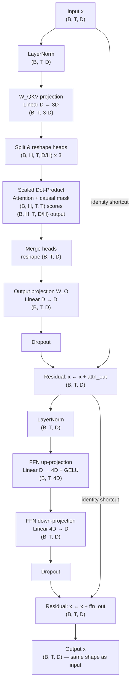
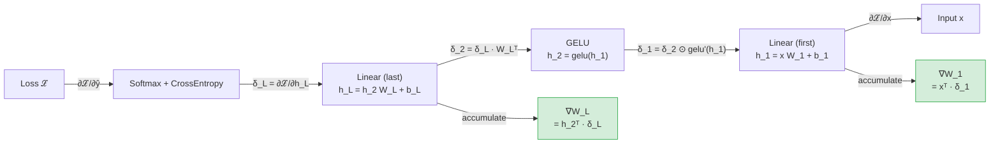
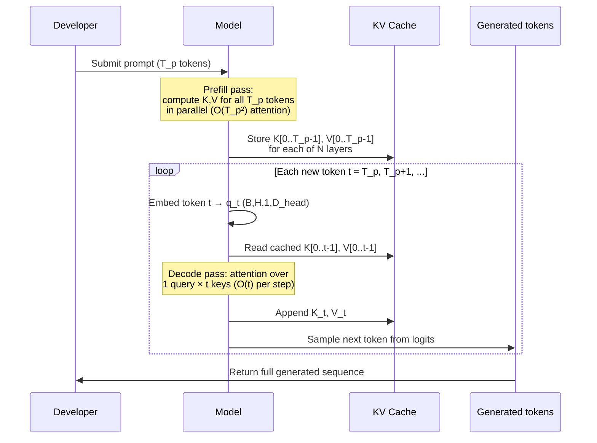
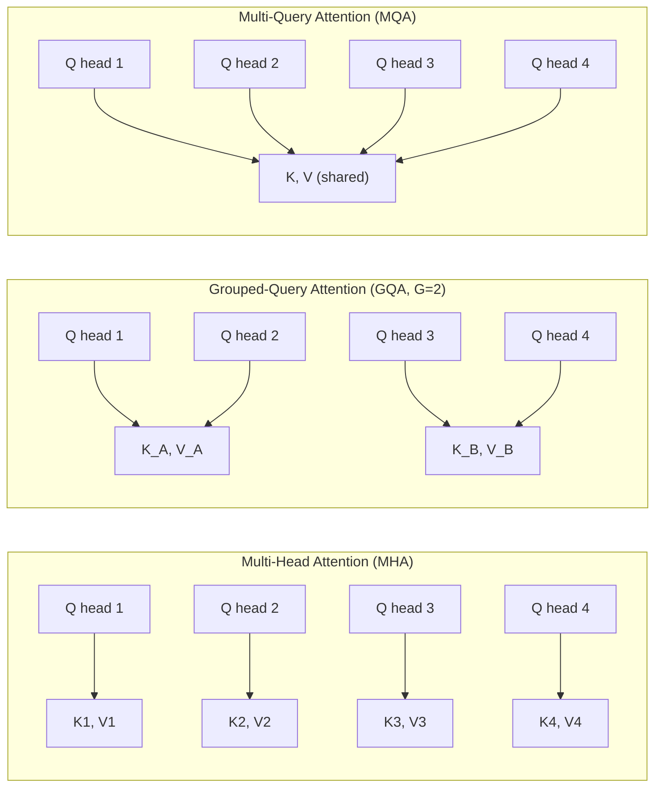
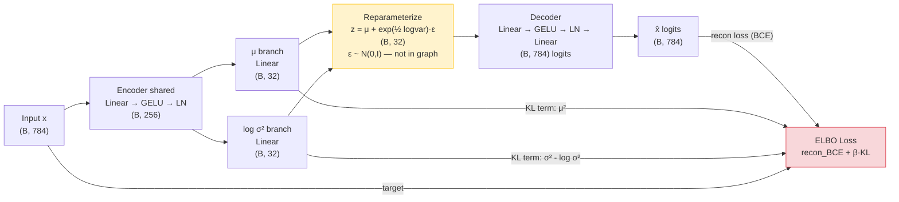
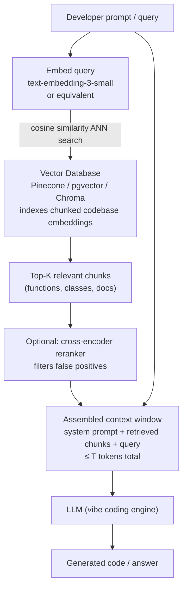
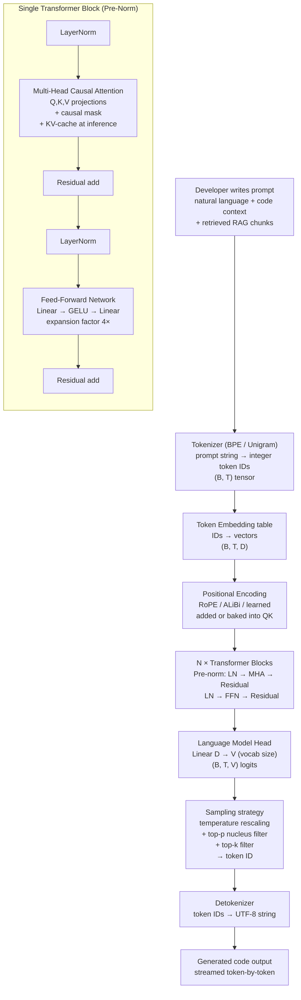

# Lesson 2: Core Architecture & Algorithmic Mechanics of AI-Assisted Development (Vibe Coding)

> **Scope note.** This lesson reframes the standard deep-learning mechanics curriculum through the lens of *vibe coding* — the practice of steering large language models (LLMs) and code-generation systems through natural-language intent rather than explicit algorithmic specification. Understanding what happens inside these models at an architectural level is what separates practitioners who get reliable results from those who fight the tool. Each section moves from first principles to direct, actionable consequences for how you write prompts and interpret model output.

---

## 1. Tensor Transformations & Dimensional Flows

### 1.1 What a Tensor Actually Is

A tensor is a typed, densely-packed, contiguous block of numerical values stored in row-major (C-order) or column-major (Fortran-order) layout, together with a **shape** tuple and a **stride** tuple. The stride tuple encodes, in bytes, how far to advance in memory to reach the next element along each axis. This is what makes zero-copy reshaping, transposing, and slicing possible: changing strides changes how the same memory is *interpreted*, not what is stored.

```
Physical memory (row-major, float32, 4 bytes/element):
[1.0, 2.0, 3.0, 4.0, 5.0, 6.0]
 ^0   ^4   ^8   ^12  ^16  ^20   ← byte offsets

Shape  (2, 3)  → 2 rows, 3 columns
Strides(12, 4) → advance 12 bytes to next row, 4 bytes to next column

Shape  (3, 2)  after .T (transpose)
Strides( 4,12) → same memory, different stride interpretation
                 element [i,j] lives at byte offset 4i + 12j
```

A non-contiguous tensor (produced by most transpose/slice operations) cannot be passed directly to BLAS kernels or CUDA kernels that require contiguous storage. `tensor.contiguous()` triggers a copy that re-packs the data into the canonical stride order. Understanding this distinction prevents subtle performance regressions: calling `.contiguous()` unnecessarily inside a hot loop adds memory allocation and bandwidth pressure.

The gradient tape in PyTorch / JAX tracks *operations on tensors*, not values. Every differentiable op registers a backward closure; calling `.backward()` traverses this directed acyclic graph (DAG) in reverse topological order and accumulates gradients via the chain rule. The DAG is dynamic in PyTorch (built at runtime per forward pass) and static by default in JAX (compiled via `jax.jit`).

### 1.2 Matrix Multiplication: What the Hardware Actually Does

`torch.matmul(x, y)` where `x ∈ ℝ^{M×K}` and `y ∈ ℝ^{K×N}` produces `z ∈ ℝ^{M×N}`. Each element `z[i,j]` is an inner product over K values:

$$z_{ij} = \sum_{k=1}^{K} x_{ik} \cdot y_{kj}$$

On modern hardware this is dispatched to a BLAS level-3 `SGEMM` (single-precision) or `DGEMM` (double-precision) kernel — cuBLAS on NVIDIA GPUs, oneDNN/MKL on Intel CPUs, rocBLAS on AMD GPUs. These kernels tile the M×K×N computation into blocks sized to fit L1/L2 cache and use fused multiply-add (FMA) SIMD instructions to maximize arithmetic intensity (FLOPs per byte of memory traffic).

On NVIDIA Ampere/Hopper GPUs, the workhorse is the **Tensor Core**, a hardware unit that natively computes a 4×4 or 16×16 matrix-multiply-accumulate (MMA) in a single warp-level instruction. This is why TF16 and BF16 workloads run 8–16× faster than FP32: the Tensor Core throughput is only fully utilized in those reduced-precision formats.

```python
import torch

# x: batch of 3 tokens, each with embedding dim 4
# y: weight matrix projecting from dim 4 → dim 5
x = torch.randn(3, 4)
y = torch.randn(4, 5)

z = torch.matmul(x, y)   # (3,5) — contracting over the K=4 axis
print(z.shape)            # torch.Size([3, 5])

# Einsum notation makes contraction axes explicit and is often clearer
# for multi-dimensional cases
z2 = torch.einsum("mk,kn->mn", x, y)
assert torch.allclose(z, z2, atol=1e-6)

# Batched matmul: leading dimensions broadcast independently
# B=4 independent (3×4) @ (4×5) operations — common in multi-head attention
xb = torch.randn(4, 3, 4)
yb = torch.randn(4, 4, 5)
zb = torch.bmm(xb, yb)   # (4, 3, 5)
print(zb.shape)
```

The contraction axis (K=4 above) must match between the two operands. This is not an arbitrary rule: it enforces that every output element is a *complete* inner product, so the linear map is well-defined. A shape mismatch here is the single most common runtime error in transformer implementations.

### 1.3 Batched & Broadcasted Operations in Transformer Stacks

In practice, tensors carry a leading **batch** dimension and sometimes a **heads** dimension. The shape convention used throughout this lesson is:

```
(B, T, D)      — batch size B, sequence length T, model dimension D
(B, H, T, D_h) — per-head query/key/value tensor; D_h = D / H
(B, H, T, T)   — attention score matrix for H heads over T positions
```

```python
import torch
import torch.nn.functional as F

B, H, T, D_head = 2, 8, 512, 64  # D = H * D_head = 512

Q = torch.randn(B, H, T, D_head)   # queries
K = torch.randn(B, H, T, D_head)   # keys
V = torch.randn(B, H, T, D_head)   # values

# Scaled dot-product attention — the core transformer operation.
# Scaling by 1/sqrt(D_head) keeps dot products in a range where
# softmax gradients are healthy (not saturated toward one-hot).
scale  = D_head ** -0.5
scores = torch.matmul(Q, K.transpose(-2, -1)) * scale   # (B, H, T, T)
attn   = F.softmax(scores, dim=-1)                       # row-stochastic over key positions
out    = torch.matmul(attn, V)                           # (B, H, T, D_head)

print(out.shape)  # torch.Size([2, 8, 512, 64])
```

The `K.transpose(-2, -1)` is a pure stride manipulation — no data movement occurs. The result has shape `(B, H, D_head, T)`, and the subsequent matmul contracts over the `D_head` axis, producing the `(T, T)` score matrix for each head in each batch element.

### 1.4 Dimensional Flow in a Transformer Block

The diagram below traces one token's journey through a single transformer block in the **pre-norm** variant (LayerNorm applied to the input before each sub-layer, as used in GPT-2, GPT-3, LLaMA, and most production models). The original "Attention Is All You Need" paper used post-norm, which is harder to train without careful learning rate warmup.



The residual connections (`x = x + ...`) are architecturally deliberate: they create a **direct gradient highway** to early layers, defeating the vanishing gradient problem. Mathematically, the gradient of the loss with respect to any residual stream position includes an additive identity term (from the skip path), guaranteeing that the magnitude of the gradient does not collapse to zero regardless of network depth. The shape is *preserved* at every residual junction, which is why stacking N identical blocks is legal — the output shape of block k is exactly the input shape of block k+1.

The FFN expansion factor of 4× (D → 4D → D) is the original Transformer default. LLaMA-family models use a SwiGLU variant with an expansion of approximately 8/3 × D and a gated linear unit structure. In both cases, the FFN acts as a key-value memory store (Geva et al., 2021, "Transformer Feed-Forward Layers Are Key-Value Memories"), where individual neurons in the expanded layer correspond to factual associations learned during training.

---

## 2. Loss Surfaces, Gradients & Optimization Dynamics

### 2.1 The Loss Surface Is Not What You Picture

For a network with P parameters, the loss surface lives in P+1 dimensions. GPT-3 has 175 billion parameters; the surface is a hyperobject in a 175-billion-plus-one-dimensional space. Geometric intuitions from 2D (saddle points, bowls, ridges) are extrapolations from low-dimensional projection.

What high-dimensional empirical work actually shows (Goodfellow et al., 2015; Li et al., 2018, "Visualizing the Loss Landscape of Neural Nets"; Frankle et al., 2020, "Linear Mode Connectivity"):

- Local minima are rare in high-dimensional overparameterized networks; saddle points dominate the critical point landscape. A saddle point in P dimensions has at least one descent direction; with P = 175B there are vanishingly few directions that are all locally ascending simultaneously.
- Many saddle points have nearly identical loss values to the global optimum. The loss difference between "stuck" and "optimal" is empirically small for large networks, which is why SGD escapes them effectively.
- The loss landscape exhibits long, flat valleys connected by low-loss paths — the "linear mode connectivity" phenomenon. Two independently trained models can often be linearly interpolated without a loss barrier, implying they found the same basin.

This matters for vibe coding because it explains why LLMs trained with Adam on hundreds of billions of tokens converge to qualitatively similar capabilities from different random seeds: the flat valleys largely overlap in the high-dimensional parameter space.

### 2.2 Stochastic Gradient Descent from First Principles

The vanilla SGD update:

$$\theta_{t+1} = \theta_t - \alpha \, \nabla_\theta \mathcal{L}(\theta_t;\, \mathcal{B}_t)$$

where $\mathcal{B}_t$ is a randomly sampled mini-batch of size $|\mathcal{B}|$. The gradient $\nabla_\theta \mathcal{L}(\theta_t; \mathcal{B}_t)$ is an *unbiased* estimator of the full-dataset gradient $\nabla_\theta \mathcal{L}(\theta_t)$, but its variance scales as $\sigma^2 / |\mathcal{B}|$ where $\sigma^2$ is the per-sample gradient variance.

High variance is a feature, not a bug. The noise inherent in mini-batch gradients acts as an implicit regularizer, preventing convergence to sharp minima. Keskar et al. (2017, "On Large-Batch Training for Deep Learning") demonstrated this empirically: models trained with large batches converge to sharper minima (flatter local curvature along fewer directions) that generalize worse on test data. The sharpness of a minimum can be quantified by the largest eigenvalue of the Hessian $\nabla^2 \mathcal{L}$; large-batch solutions have larger maximum eigenvalues.

**SGD with momentum** extends the basic update with an exponential moving average of past gradients:

$$v_t = \gamma v_{t-1} + \nabla_\theta \mathcal{L}(\theta_t; \mathcal{B}_t)$$
$$\theta_{t+1} = \theta_t - \alpha v_t$$

Momentum damps oscillations in directions of high curvature and accelerates progress in directions of low curvature. The classical analysis (Polyak, 1964) shows momentum achieves the optimal convergence rate $O(1/t^2)$ for strongly convex functions, versus $O(1/t)$ for vanilla SGD.

### 2.3 Adam: Adaptive Moments

Adam (Kingma & Ba, 2015) maintains per-parameter running estimates of the first moment (mean) and second raw moment (uncentered variance) of the gradient:

$$m_t = \beta_1 m_{t-1} + (1-\beta_1)\,g_t \qquad \text{(first moment, momentum)}$$
$$v_t = \beta_2 v_{t-1} + (1-\beta_2)\,g_t^2 \qquad \text{(second moment, adaptive scale)}$$

The bias-corrected estimates account for initialization at zero:

$$\hat{m}_t = \frac{m_t}{1-\beta_1^t}, \qquad \hat{v}_t = \frac{v_t}{1-\beta_2^t}$$

The parameter update:

$$\theta_{t+1} = \theta_t - \frac{\alpha\,\hat{m}_t}{\sqrt{\hat{v}_t} + \epsilon}$$

The intuition for the adaptive denominator $\sqrt{\hat{v}_t}$: parameters whose gradients have consistently high variance get a smaller effective learning rate; parameters with low-variance gradients get a larger effective rate. This automatic per-parameter scaling is what allows Adam to work well across vastly different layers (embedding tables with sparse gradients vs. dense FFN weights) without manual per-layer learning rate tuning.

The bias-correction terms are critical in early training. At step $t=1$ with $\beta_2 = 0.999$, the uncorrected $v_1 = (1 - 0.999) g_1^2 = 0.001 g_1^2$, making $\sqrt{v_1}$ approximately 32× smaller than the actual gradient magnitude, which would inflate the effective learning rate massively. Bias correction restores the proper scale.

**Why AdamW instead of Adam?** The original Adam formulation applies L2 weight decay as a gradient penalty, which interacts incorrectly with the adaptive denominator: parameters with large gradient history (large $\hat{v}_t$) receive less decay than parameters with small gradient history, breaking the uniform regularization intent. AdamW (Loshchilov & Hutter, 2019) decouples weight decay by applying it directly to the parameter *before* the gradient update:

$$\theta_{t+1} = \theta_t(1 - \alpha\lambda) - \frac{\alpha\,\hat{m}_t}{\sqrt{\hat{v}_t} + \epsilon}$$

where $\lambda$ is the weight decay coefficient. This distinction is non-trivial: AdamW is the standard optimizer for every major production LLM (GPT-3, LLaMA, Mistral, Gemma).

```python
import torch
import torch.nn as nn
import torch.optim as optim
from torch.utils.data import DataLoader, TensorDataset

torch.manual_seed(42)

# ── Toy classification problem ──────────────────────────────────────────────
N, D_in, D_out = 1024, 784, 10
X = torch.randn(N, D_in)
y = torch.randint(0, D_out, (N,))

dataset = TensorDataset(X, y)
loader  = DataLoader(dataset, batch_size=64, shuffle=True)

# ── Model ────────────────────────────────────────────────────────────────────
model = nn.Sequential(
    nn.Linear(D_in, 256),
    nn.GELU(),          # GELU: x * Φ(x), where Φ is the Gaussian CDF.
                        # Smoother than ReLU; empirically better in transformers.
    nn.LayerNorm(256),  # LN normalizes over the feature dimension per sample,
                        # making it independent of batch size (unlike BatchNorm).
    nn.Dropout(0.1),
    nn.Linear(256, 128),
    nn.GELU(),
    nn.LayerNorm(128),
    nn.Linear(128, D_out),
)

# label_smoothing=0.1 replaces hard targets with (1-ε)·one_hot + ε/C,
# preventing the model from becoming overconfident (reduces calibration error).
criterion = nn.CrossEntropyLoss(label_smoothing=0.1)

# AdamW: weight_decay operates on parameters directly, not via gradient penalty.
optimizer = optim.AdamW(
    model.parameters(),
    lr=3e-4,
    betas=(0.9, 0.999),   # β1=0.9 and β2=0.999 are the standard LLM defaults
    eps=1e-8,
    weight_decay=0.01,
)

# Cosine annealing smoothly reduces LR from lr_max to 0 over T_max steps,
# avoiding the sharp oscillations that occur when LR is kept constant late in
# training when the optimizer is near a minimum.
scheduler = optim.lr_scheduler.CosineAnnealingLR(optimizer, T_max=20)

# ── Training loop ────────────────────────────────────────────────────────────
for epoch in range(20):
    model.train()
    total_loss = 0.0
    for xb, yb in loader:
        # set_to_none=True frees the gradient tensor memory rather than
        # zeroing it, saving one memset call per parameter per step.
        optimizer.zero_grad(set_to_none=True)
        logits = model(xb)
        loss   = criterion(logits, yb)
        loss.backward()
        # Gradient clipping: rescales the global gradient norm to max_norm=1.0
        # if it exceeds that threshold. Essential for transformer training
        # stability because the attention Jacobians can produce large gradient
        # spikes near the beginning of training.
        nn.utils.clip_grad_norm_(model.parameters(), max_norm=1.0)
        optimizer.step()
        total_loss += loss.item()
    scheduler.step()
    if epoch % 5 == 0:
        print(f"Epoch {epoch:3d} | loss {total_loss/len(loader):.4f} "
              f"| lr {scheduler.get_last_lr()[0]:.2e}")
```

### 2.4 Gradient Flow & the Backpropagation DAG

Backpropagation is the reverse-mode automatic differentiation algorithm applied to the computational DAG of the forward pass. The gradient of the loss with respect to any intermediate value is accumulated by multiplying the upstream gradient (from closer to the loss) by the local Jacobian of the operation at that node.

For a linear layer $h = xW + b$:
- $\partial \mathcal{L}/\partial W = x^\top \cdot (\partial \mathcal{L}/\partial h)$ — the gradient w.r.t. weights is an outer product of input and upstream gradient.
- $\partial \mathcal{L}/\partial x = (\partial \mathcal{L}/\partial h) \cdot W^\top$ — the gradient passed back to the previous layer is a linear transformation by the weight matrix.

This second point is why deep networks with large weight norms suffer exploding gradients: the gradient is repeatedly multiplied by $W^\top$ as it propagates backward. Gradient clipping and weight normalization (Salimans & Kingma, 2016) address this directly.



The ⊙ symbol denotes element-wise multiplication: the GELU derivative gates the gradient, suppressing it where the pre-activation was deeply negative (similar to how ReLU zeroes gradients for negative pre-activations, but smoothly).

### 2.5 Learning Rate Schedules in LLM Pre-Training

Production LLM training uses a specific schedule: a **linear warmup** phase over the first ~2000 steps (to stabilize Adam's moment estimates from their cold-started zeros), followed by **cosine decay** to a minimum LR of approximately 10% of the peak LR, optionally with a final **cooldown** to near-zero. The Chinchilla scaling laws (Hoffmann et al., 2022) demonstrated that for a given compute budget, the LR schedule interacts with the number of training tokens: undertrained models are more sensitive to the final LR value. This is relevant context for understanding why fine-tuned models behave differently from their base counterparts.

---

## 3. Attention Mechanisms, Kernel Mechanics & Latent Geometry

### 3.1 Attention: A Differentiable Retrieval Operation

Attention is best understood as a **differentiable soft key-value database query**. Given a query vector $q \in \mathbb{R}^{d_k}$, a matrix of key vectors $K \in \mathbb{R}^{T \times d_k}$, and a matrix of value vectors $V \in \mathbb{R}^{T \times d_v}$:

$$\text{Attention}(q, K, V) = \sum_{i=1}^{T} \underbrace{\frac{\exp(q \cdot k_i / \sqrt{d_k})}{\sum_j \exp(q \cdot k_j / \sqrt{d_k})}}_{\text{retrieval weight } \alpha_i} v_i$$

The $\sqrt{d_k}$ scaling is not cosmetic. The variance of a dot product $q \cdot k$ grows linearly with $d_k$ (since it is a sum of $d_k$ independent product terms). Without scaling, for large $d_k$ the softmax inputs become large in magnitude, pushing the softmax output toward a one-hot distribution with near-zero gradients to non-attended positions. With scaling, variance is restored to $O(1)$ regardless of $d_k$.

Multi-head attention runs H independent attention operations on linearly projected subspaces, then concatenates and projects back:

$$\text{MHA}(x) = \text{Concat}(\text{head}_1, \ldots, \text{head}_H)\, W^O$$
$$\text{head}_h = \text{Attention}(xW^Q_h,\; xW^K_h,\; xW^V_h)$$

where $W^Q_h, W^K_h, W^V_h \in \mathbb{R}^{D \times d_k}$ and $W^O \in \mathbb{R}^{D \times D}$. The total parameter count for MHA is $4D^2$ (three input projections plus the output projection, all of size $D \times D$ when $H \cdot d_k = D$).

The multi-head structure is not redundant: each head operates on an independent projection of the residual stream, allowing different heads to specialize. Mechanistic interpretability work (Clark et al., 2019; Vig & Belinkov, 2019) has identified heads that reliably track syntactic subject-verb agreement, coreference chains, positional proximity, and delimiter tokens. This specialization emerges from training, not from architectural constraint.

### 3.2 Positional Encodings: RoPE vs. ALiBi vs. Learned

Vanilla attention is **permutation-equivariant**: the attention output for each token is identical regardless of its position in the sequence, because the score $q \cdot k$ depends only on the values, not on relative or absolute positions. Position must be injected explicitly.

**Learned absolute positional embeddings** (GPT-2, original BERT): a lookup table of shape $(T_{max}, D)$ is added to the token embeddings before the first transformer block. Simple and effective, but does not generalize to sequences longer than $T_{max}$ seen during training.

**Rotary Position Embedding (RoPE)** (Su et al., 2021; used in LLaMA, Mistral, Qwen, GPT-NeoX): encodes position by rotating query and key vectors by a position-dependent rotation matrix in complex space before computing dot products. The rotation is constructed so that $q_m \cdot k_n$ depends only on the relative offset $(m - n)$, not on absolute positions $m$ and $n$ separately. This gives exact relative position encoding with no parameter overhead and enables effective extrapolation to longer contexts via techniques like YaRN (Peng et al., 2023).

**ALiBi** (Press et al., 2022; used in BLOOM): adds a linear bias $-|m-n| \cdot s_h$ to attention logits before softmax, where $s_h$ is a head-specific slope. No rotations, no additional parameters, and strong length generalization empirically.

For vibe coding, the practical implication is that **models with RoPE or ALiBi handle longer prompts more gracefully** than models with learned positional embeddings. When injecting large code contexts, the encoding scheme of the underlying model determines how faithfully position information is preserved beyond the training context length.

### 3.3 Causal (Autoregressive) Masking

Code generation models such as Codex, GitHub Copilot (based on Codex), and Claude are autoregressive: token $t$ can only attend to tokens $0, \ldots, t-1$. This is enforced by masking the upper triangle of the attention score matrix with $-\infty$ before softmax, so those positions contribute zero probability mass after exponentiation.

```python
import torch
import torch.nn.functional as F
import math


def causal_scaled_dot_product_attention(
    Q: torch.Tensor,         # (B, H, T, D_head)
    K: torch.Tensor,
    V: torch.Tensor,
    dropout_p: float = 0.0,
    training: bool = False,
) -> torch.Tensor:
    """
    Manual causal attention implementation.
    In production, prefer F.scaled_dot_product_attention(Q, K, V, is_causal=True)
    which dispatches to FlashAttention when available.
    """
    B, H, T, D_head = Q.shape
    scale = math.sqrt(D_head)

    scores = torch.matmul(Q, K.transpose(-2, -1)) / scale   # (B, H, T, T)

    # Upper-triangular mask (diagonal=1 → position i cannot see j >= i+1,
    # i.e., future positions). The diagonal itself (j == i) is kept visible
    # so each token can attend to itself.
    mask = torch.full((T, T), float("-inf"), device=Q.device, dtype=Q.dtype)
    mask = torch.triu(mask, diagonal=1)                     # (T, T)
    scores = scores + mask                                   # broadcasts over B, H

    attn_weights = F.softmax(scores, dim=-1)                 # (B, H, T, T)

    if dropout_p > 0.0 and training:
        attn_weights = F.dropout(attn_weights, p=dropout_p)

    return torch.matmul(attn_weights, V)                     # (B, H, T, D_head)


# PyTorch 2.0+ fused implementation — dispatches to FlashAttention 2 on
# CUDA devices, reducing memory from O(T²) to O(T) via tiled computation:
# out = F.scaled_dot_product_attention(Q, K, V, is_causal=True)
```

**FlashAttention** (Dao et al., 2022; v2: 2023) is a critical production optimization. Standard attention materializes the full $(B, H, T, T)$ score matrix, which is $O(T^2)$ in memory. At $T = 128\text{k}$ tokens this is prohibitive. FlashAttention avoids materializing this matrix by tiling the computation in SRAM, fusing the softmax and the value aggregation into a single kernel pass. Memory complexity drops to $O(T)$ and wall-clock speed improves 2–4× due to reduced HBM traffic.

### 3.4 KV-Cache: Why Vibe Coding Responses Are Fast After the First Token

During inference, every previously generated token's key and value projections are identical to the previous forward pass — the input to those tokens has not changed. The KV-cache stores them, reducing per-new-token computation from $O(T^2)$ (full recomputation) to $O(T)$ (one new query row against $T$ cached keys):



KV-cache memory footprint per request:

$$\text{Bytes} = 2 \times N_{\text{layers}} \times T \times D_{\text{model}} \times \text{sizeof(dtype)}$$

The factor of 2 accounts for both keys and values. For LLaMA-3 70B (80 layers, $D = 8192$, BF16 = 2 bytes, $T = 128\text{k}$ tokens):

$$2 \times 80 \times 131072 \times 8192 \times 2 \approx 274 \text{ GB}$$

This is why quantized KV-cache (int8: 50% reduction, int4: 75% reduction) and grouped-query attention (GQA, Ainslie et al., 2023) — which shares K/V heads across multiple Q heads — are production-critical for serving long-context models.

### 3.5 Grouped-Query Attention (GQA) and Multi-Query Attention (MQA)

Standard MHA uses $H$ independent K/V projections. MQA (Shazeer, 2019) uses a single shared K/V pair for all H query heads, reducing the KV-cache footprint by a factor of H at the cost of some expressive capacity. GQA (Ainslie et al., 2023, used in LLaMA-2/3, Mistral) partitions the H query heads into G groups, each sharing one K/V pair — a tunable tradeoff between MHA quality and MQA efficiency. LLaMA-3 70B uses $H=64$ query heads and $G=8$ KV heads, reducing KV-cache by 8×.



### 3.6 Latent Space Geometry and Why It Matters for Prompt Engineering

The token embedding space of an LLM is a high-dimensional real vector space with rich geometric structure. Several empirical findings directly govern prompt engineering effectiveness:

**Linear representation hypothesis.** Features — semantic properties like "this token is Python code", "this token follows a function signature", "this entity is a person" — are encoded as *directions* (vectors) in embedding space, not as dedicated neurons. The *superposition hypothesis* (Elhage et al., 2022, "Toy Models of Superposition", Anthropic) formalizes why: a D-dimensional space can represent more than D features simultaneously by packing nearly-orthogonal directions. Features for rare concepts can share dimensions because they rarely co-occur.

**Consequence for prompting.** When you write `# Python function that sorts a list`, you are steering the residual stream into a region of embedding space where Python-function-definition features are active. The model's subsequent token predictions are conditional distributions over that point in latent space. Comments, docstrings, and type annotations are not ignored metadata — they are high-information positional signals that shift the residual stream toward the correct feature subspace.

**Activation steering.** Research from Anthropic and others has demonstrated that adding a feature direction vector directly to the residual stream during inference reliably elicits the corresponding behavior (e.g., adding the "French language" direction makes the model continue in French regardless of the prompt language). While this is primarily a research technique, it confirms the linear structure of feature representation.

**Retrieval-augmented generation (RAG) and embedding similarity.** Vector database retrieval for RAG works because the same linear geometry holds in embedding models: semantically similar code or documentation maps to geometrically nearby vectors. Cosine similarity is the standard metric because it is invariant to vector magnitude and measures only directional alignment.

---

## 4. Variational Autoencoders: Latent Space Architecture

The VAE section is included here because (1) diffusion models for code (e.g., code infilling, semantic-preserving transformations) build on VAE-like latent structures, and (2) understanding the ELBO and reparameterization is prerequisite to understanding how sampling temperature in LLMs relates to uncertainty.

### 4.1 Correct Architecture and Reparameterization

The VAE (Kingma & Welling, 2014) learns a stochastic encoder $q_\phi(z|x)$ and a decoder $p_\theta(x|z)$ jointly, maximizing the Evidence Lower BOund (ELBO):

$$\mathcal{L}_{\text{ELBO}} = \mathbb{E}_{q_\phi(z|x)}[\log p_\theta(x|z)] - D_{\text{KL}}(q_\phi(z|x) \| p(z))$$

The first term is the reconstruction quality; the second penalizes the posterior $q_\phi(z|x)$ from deviating from the standard normal prior $p(z) = \mathcal{N}(0, I)$. The KL term acts as an information bottleneck, forcing the latent space to be smooth and regularized — which is what makes the latent space geometrically meaningful (interpolation between latent codes produces semantically coherent outputs).

The reparameterization trick resolves the non-differentiability of the sampling step $z \sim q_\phi(z|x) = \mathcal{N}(\mu_\phi(x), \sigma_\phi^2(x))$ by factoring the stochasticity out of the computation graph: $z = \mu_\phi(x) + \sigma_\phi(x) \cdot \varepsilon$, where $\varepsilon \sim \mathcal{N}(0, I)$ is an independent noise sample. The gradient now flows through $\mu_\phi$ and $\sigma_\phi$ as ordinary deterministic functions; $\varepsilon$ is treated as a constant with respect to the gradient computation.

```python
import torch
import torch.nn as nn
import torch.nn.functional as F
from torch import Tensor


class VAE(nn.Module):
    """
    Variational Autoencoder following Kingma & Welling (2014).

    The encoder outputs μ (mean) and log σ² (log-variance) separately.
    Using log σ² rather than σ² directly is a numerical stability choice:
    log σ² is unbounded below/above, so the network can represent very small
    or very large variances without numerical underflow/overflow.
    The reparameterization trick: z = μ + σ·ε, ε ~ N(0,I).
    """

    def __init__(
        self,
        input_dim: int = 784,
        hidden_dim: int = 256,
        latent_dim: int = 32,
    ) -> None:
        super().__init__()

        # Encoder: x → shared representation → (μ, log σ²)
        self.enc_shared = nn.Sequential(
            nn.Linear(input_dim, hidden_dim),
            nn.GELU(),
            nn.LayerNorm(hidden_dim),
        )
        self.enc_mu     = nn.Linear(hidden_dim, latent_dim)
        self.enc_logvar = nn.Linear(hidden_dim, latent_dim)

        # Decoder: z → x̂ logits
        self.decoder = nn.Sequential(
            nn.Linear(latent_dim, hidden_dim),
            nn.GELU(),
            nn.LayerNorm(hidden_dim),
            nn.Linear(hidden_dim, input_dim),
            # No sigmoid here — raw logits are used in BCE with logits
            # for numerical stability (log-sum-exp is more stable than log(sigmoid))
        )

    def encode(self, x: Tensor) -> tuple[Tensor, Tensor]:
        h      = self.enc_shared(x)
        mu     = self.enc_mu(h)
        logvar = self.enc_logvar(h)       # predict log σ²
        return mu, logvar

    def reparameterize(self, mu: Tensor, logvar: Tensor) -> Tensor:
        """
        Reparameterization trick: z = μ + σ·ε, ε ~ N(0,I).

        At inference time, return μ directly (maximum likelihood estimate
        of the latent code, no stochasticity needed for reconstruction).
        At training time, sample z so the ELBO expectation is estimated
        via a single Monte Carlo sample per data point.
        """
        if not self.training:
            return mu
        std = torch.exp(0.5 * logvar)      # σ = exp(½ log σ²)
        eps = torch.randn_like(std)        # ε ~ N(0,I), matches device/dtype
        return mu + std * eps

    def decode(self, z: Tensor) -> Tensor:
        return self.decoder(z)

    def forward(self, x: Tensor) -> tuple[Tensor, Tensor, Tensor]:
        mu, logvar = self.encode(x)
        z          = self.reparameterize(mu, logvar)
        recon      = self.decode(z)
        return recon, mu, logvar


def vae_loss(
    recon: Tensor,
    x: Tensor,
    mu: Tensor,
    logvar: Tensor,
    beta: float = 1.0,
) -> Tensor:
    """
    β-VAE loss = Reconstruction loss + β · KL divergence.

    Reconstruction: binary cross-entropy with logits (sum over pixels,
    mean over batch). Using sum over pixels gives the full negative
    log-likelihood per data point, consistent with the ELBO derivation.

    KL: closed-form for Gaussian posterior vs. N(0,I) prior.
    KL(N(μ, σ²) ‖ N(0,1)) = ½(μ² + σ² - log σ² - 1)
                            = -½(1 + log σ² - μ² - σ²)

    β > 1 (Higgins et al., 2017) encourages a more disentangled latent
    space at the cost of reconstruction quality.
    """
    recon_loss = F.binary_cross_entropy_with_logits(recon, x, reduction="sum")
    kl_loss    = -0.5 * torch.sum(1.0 + logvar - mu.pow(2) - logvar.exp())
    return (recon_loss + beta * kl_loss) / x.size(0)   # normalize by batch
```

### 4.2 Latent Space Data Flow



---

## 5. Tokenization: The Layer Below the Tensor

Tokenization is the most underestimated component of LLM-based development tooling. It governs what the model sees, how much of your context window is consumed, and where model competence degrades.

### 5.1 Byte-Pair Encoding (BPE)

GPT-family models (including Codex) use BPE tokenization (Sennrich et al., 2016, originally proposed for neural machine translation). BPE begins with a vocabulary of individual UTF-8 bytes and iteratively merges the most frequent adjacent pair of symbols until a target vocabulary size is reached (GPT-4 uses `cl100k_base` with 100,277 tokens). The result: common English words and common programming constructs are single tokens, while rare strings decompose into multiple tokens.

**GPT-4 vocabulary specifics (`cl100k_base`, verified with tiktoken):**

- `"def"` → 1 token
- `"    def"` (4-space indent + def) → 1 token — indentation style is baked into token identity
- `"getUserByEmailAddress"` → multiple tokens (see example below)
- `"12345"` → may split as `["123", "45"]` — arithmetic is fragile because it spans token boundaries

```python
# pip install tiktoken
import tiktoken

enc = tiktoken.get_encoding("cl100k_base")   # GPT-4 / GPT-4o vocabulary

examples = [
    "def getUserByEmailAddress(email: str) -> Optional[User]:",
    "    return db.query(User).filter(User.email == email).first()",
    "12345 + 67890",
    "async def fetch_data(url: str) -> dict[str, Any]:",
]

for snippet in examples:
    tokens   = enc.encode(snippet)
    decoded  = [enc.decode([t]) for t in tokens]
    print(f"Count={len(tokens):3d}  {decoded}")

# Example output (actual cl100k_base tokenization):
# Count= 15  ['def', ' get', 'User', 'By', 'Email', 'Address', '(', 'email',
#              ':', ' str', ')', ' ->', ' Optional', '[', 'User', ']:']
# Count= 17  ['    return', ' db', '.', 'query', '(', 'User', ').', 'filter',
#              '(', 'User', '.', 'email', ' ==', ' email', ').', 'first', '()']
# Count=  7  ['123', '45', ' +', ' ', '678', '90']
# Count= 14  ['async', ' def', ' fetch', '_data', '(', 'url', ':', ' str',
#              ')', ' ->', ' dict', '[', 'str', ',', ' Any', ']:']
```

**Implications for vibe coding:**

- Descriptive naming is essentially free: `getUserByEmailAddress` costs only slightly more tokens than `get_user`, and the semantic signal it provides to the model's attention mechanism is substantial. Do not abbreviate for token economy.
- Indentation style matters at the tokenization level. Switching between 2-space and 4-space indentation mid-file creates different token sequences, which the model's positional encoding treats as distinct patterns.
- Number handling degrades reliably for multi-digit numbers. For tasks involving arithmetic, specific constants, or version numbers, use code that computes values rather than embedding them in prose.
- Non-English identifiers (CJK characters, accented characters) tokenize far less efficiently — a single CJK character may cost 2–3 tokens — meaning effective context window capacity in non-Latin-script codebases is significantly smaller.

### 5.2 SentencePiece and Unigram LM Tokenization

LLaMA-family models use SentencePiece (Kudo & Richardson, 2018) with a Unigram Language Model tokenizer rather than BPE. The Unigram LM approach starts with a large candidate vocabulary and prunes it by iteratively removing tokens whose removal least degrades the corpus likelihood under the unigram model. The result is similar to BPE in practice but with slightly different boundary behavior and better handling of whitespace in non-English text.

The practical difference for code generation: SentencePiece treats the underscore `_` as a word-boundary marker (it appears explicitly as a leading `▁` in tokens), which slightly affects how snake_case identifiers are tokenized compared to camelCase. Neither is inherently better; the key point is that tokenization is model-specific and should be verified rather than assumed.

### 5.3 Why Context Length Is Not Free

An LLM with context length $T$ has an attention score matrix of shape $(T, T)$ per head per layer. The computational cost of the prefill pass (processing the entire prompt) scales as $O(T^2)$ in time (even with FlashAttention, the total arithmetic is still $O(T^2)$; FlashAttention reduces memory bandwidth, not FLOPs). This is why RAG (retrieval-augmented generation) architectures are economically necessary at scale: rather than fitting an entire codebase into context, relevant chunks are retrieved via embedding similarity and injected selectively.



The chunking strategy for RAG over codebases matters more than is commonly acknowledged. Chunking at arbitrary character counts splits function boundaries, breaking semantic units. Best practice is AST-aware chunking (splitting at function and class boundaries using the language's parser) with overlap to handle references that span chunk boundaries.

---

## 6. The Complete Vibe Coding Signal Chain

Putting all components together: when a developer submits a natural-language prompt to a code-generation model, the following sequence executes from keystrokes to generated code.



### 6.1 Temperature, Top-p, and Top-k Sampling

Temperature $\tau$ rescales logits before softmax:

$$p_i = \frac{\exp(z_i / \tau)}{\sum_j \exp(z_j / \tau)}$$

- $\tau \to 0$: collapses to argmax (deterministic, exploitative, prone to repetition)
- $\tau = 1.0$: unmodified model distribution
- $\tau > 1.0$: flatter distribution (more creative, higher hallucination rate)

**Top-p (nucleus) sampling** (Holtzman et al., 2020) truncates the vocabulary to the smallest set $V_p$ such that $\sum_{i \in V_p} p_i \geq p$, then renormalizes and samples. The adaptive vocabulary size is the key property: on high-certainty completions (e.g., the closing parenthesis of a fully determined function call), the nucleus contains 1–2 tokens; on genuinely ambiguous continuations (choosing between equally valid algorithmic approaches), the nucleus may contain hundreds.

**Top-k sampling** restricts sampling to the $k$ tokens with the highest probability. It is simpler than top-p but not adaptive — the same $k$ is used regardless of whether the model is highly confident or uncertain, which can either over-restrict (cutting off valid tokens) or under-restrict (allowing low-probability noise) depending on the token position.

Production systems (Claude, GPT-4o, Gemini) typically apply temperature first, then top-p, discarding top-k for most tasks. The recommended defaults for code generation are $\tau \in [0.2, 0.4]$ and $p \in [0.9, 0.95]$: low temperature preserves syntactic determinism while top-p allows lexical variation.

```python
import torch
import torch.nn.functional as F


def sample_next_token(
    logits: torch.Tensor,     # (V,) raw logits for the next position
    temperature: float = 0.3,
    top_p: float = 0.95,
    top_k: int = 0,           # 0 = disabled
) -> int:
    """
    Apply temperature, optional top-k, then top-p (nucleus) sampling.
    Returns a single integer token ID.
    """
    # 1. Temperature scaling
    if temperature == 0.0:
        return int(torch.argmax(logits).item())
    logits = logits / temperature

    # 2. Optional top-k: zero out all but the top-k logits
    if top_k > 0:
        top_k_values, _ = torch.topk(logits, min(top_k, logits.size(-1)))
        logits[logits < top_k_values[-1]] = float("-inf")

    # 3. Convert to probabilities
    probs = F.softmax(logits, dim=-1)

    # 4. Top-p (nucleus): sort descending, compute cumulative mass,
    #    zero out tokens that push cumulative probability above p.
    sorted_probs, sorted_indices = torch.sort(probs, descending=True)
    cumulative_probs = torch.cumsum(sorted_probs, dim=-1)
    # Remove tokens where the cumulative probability exceeds top_p.
    # Shift right by 1 so the token that *crosses* the threshold is kept.
    sorted_probs[cumulative_probs - sorted_probs > top_p] = 0.0
    sorted_probs /= sorted_probs.sum()   # renormalize

    # 5. Sample from the filtered distribution
    sampled_index = torch.multinomial(sorted_probs, num_samples=1)
    return int(sorted_indices[sampled_index].item())
```

### 6.2 Why the Model Sometimes Ignores Your Instructions

The model does not reason about your intent; it predicts the next token given the conditional distribution induced by your prompt. Instruction-following is an emergent capability of RLHF fine-tuning (Reinforcement Learning from Human Feedback, Ouyang et al., 2022) that biases the model's distribution toward responses a human rater would prefer. The practical consequences:

- **Context window position matters.** Instructions near the end of a long prompt receive stronger attention signal (recency bias in autoregressive models) than instructions buried in the middle. Critical constraints should be placed either at the very start of the system prompt or immediately before the final user turn.
- **Token budget and latent uncertainty.** When the model's nucleus at a decision point is wide (many plausible continuations), instruction adherence competes with training distribution priors. Making the prompt more specific reduces nucleus width at critical tokens, improving adherence.
- **Ambiguous anaphora in prompts.** Natural language is full of unresolved references. `"Rewrite the function to be faster"` does not specify which function when several are in context; the model uses attention to resolve this, but the resolution may not match your intent. Explicit reference (`"Rewrite the `process_records` function defined above"`) is unambiguous at the token level.

---

## 7. Scaling Laws and Their Operational Implications

The Chinchilla scaling laws (Hoffmann et al., 2022) established the compute-optimal relationship between model size $N$ (parameters) and training dataset size $D$ (tokens): for a given compute budget $C \approx 6ND$ FLOPs, the optimal allocation is $N \propto C^{0.5}$ and $D \propto C^{0.5}$, implying that training a smaller model on more tokens is typically preferable to training a larger model on fewer tokens for the same budget.

**Implications for the vibe coding practitioner:**

- A 7B-parameter model trained on 2 trillion tokens (e.g., Mistral-7B, LLaMA-3 8B) can outperform a 70B-parameter model trained on 100B tokens on many coding tasks. Parameter count alone does not predict quality.
- The quality of training data dominates at scale. Models trained on filtered, deduplicated, high-quality code (StarCoder, DeepSeek-Coder) outperform general-purpose models of the same size on code-specific tasks.
- Fine-tuning a Chinchilla-optimal base model on task-specific data is highly efficient: the base model's internal representations are rich; a relatively small number of supervised fine-tuning (SFT) steps redirect behavior without requiring proportional amounts of compute.

---

## Summary

The mechanics covered in this lesson form an integrated substrate: BPE tokenization determines what information enters the model; positional encoding (RoPE/ALiBi) determines how position is preserved across context; scaled dot-product attention with causal masking and KV-caching is the core retrieval and generation mechanism; residual streams and FFN layers accumulate and store feature representations; AdamW with gradient clipping and cosine LR schedules drives stable convergence; and temperature with nucleus sampling controls the stochastic generation process.

Understanding this architecture at the level of tensor shapes, memory layouts, and mathematical operations — not just API surface — lets you reason about *why* a model produces a particular output, which prompt structures activate the correct latent-space feature directions, why long contexts degrade quality and what to do about it (RAG, GQA, quantized KV-cache), and when to trust or distrust generated code (high nucleus width at a decision point → higher hallucination risk). That mechanistic understanding is the operational foundation of effective, reliable vibe coding.
