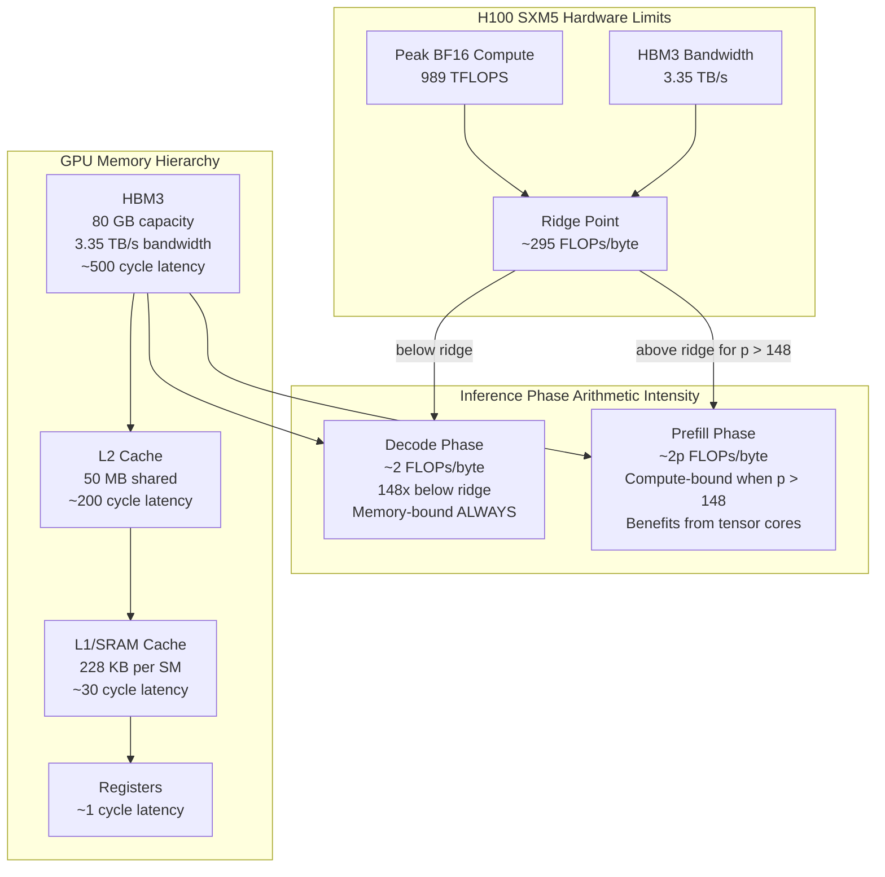
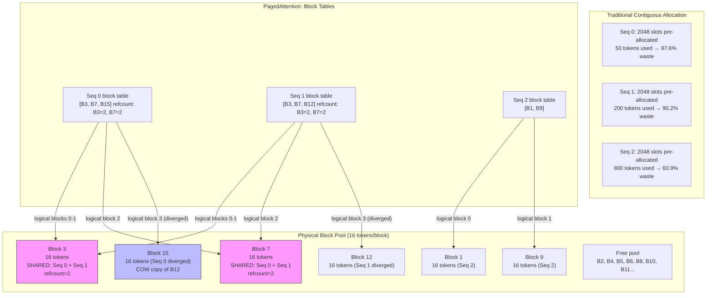
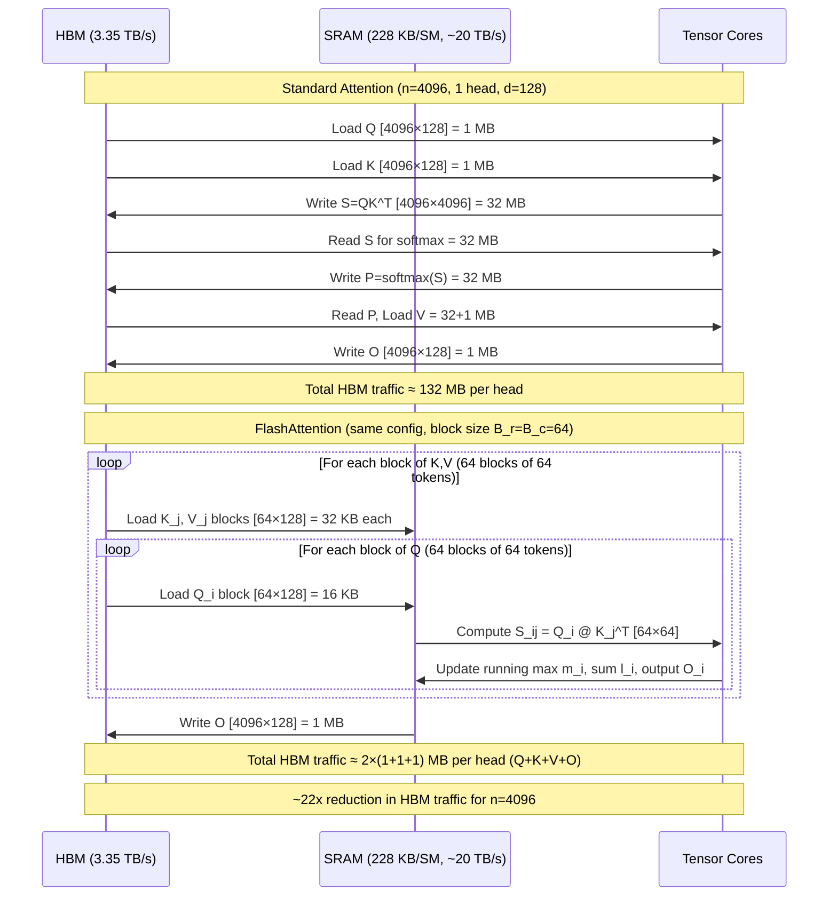
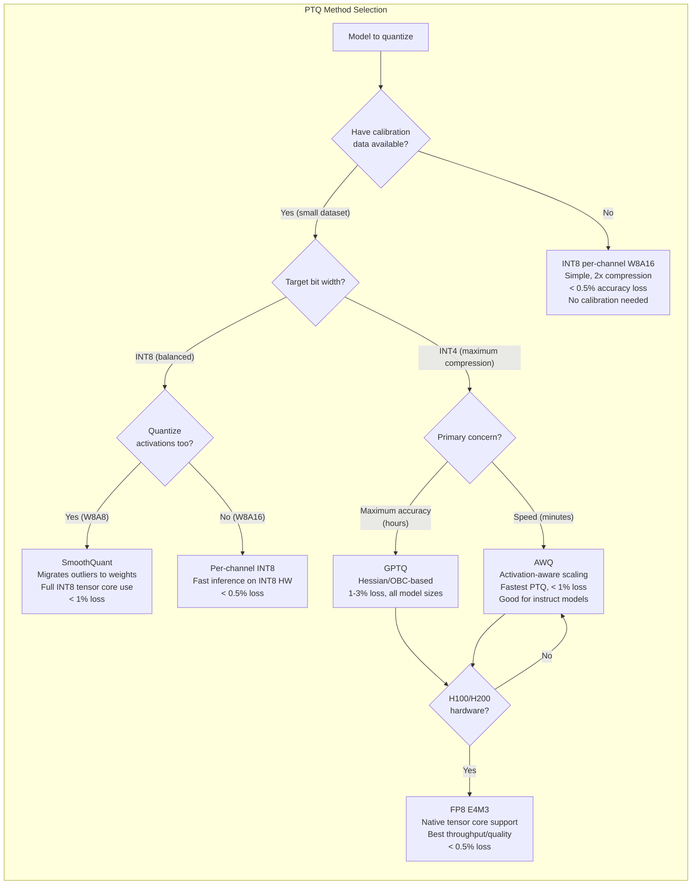
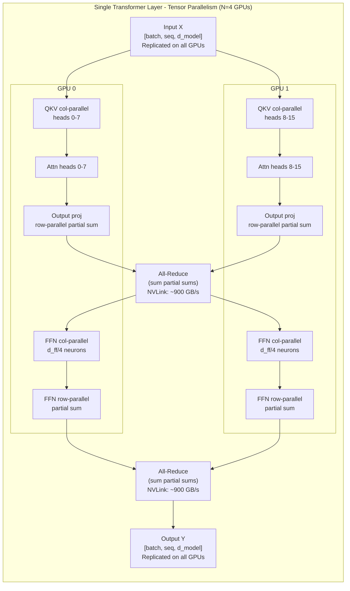
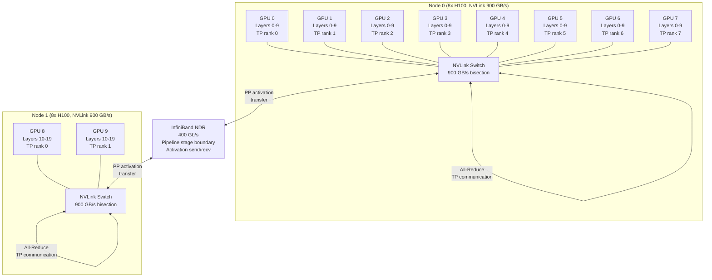
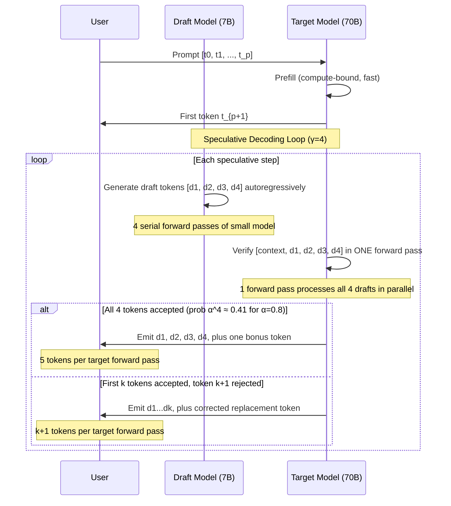
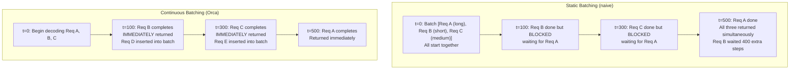
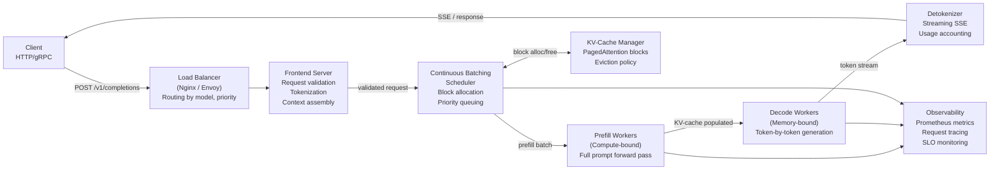
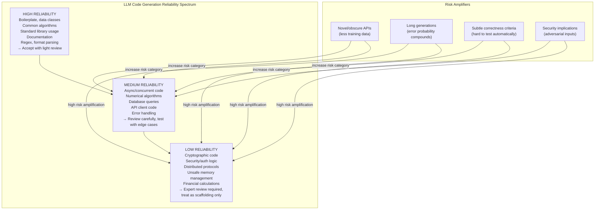

# Lesson 3: Advanced Optimization, Serving & Failure Modes

## 1. Memory Bandwidth, KV-Cache Optimization & Quantization Bounds

### 1.1 The Roofline Model: Why LLM Inference Is Memory-Bound

The dominant constraint in autoregressive LLM inference is memory bandwidth, not compute throughput. Understanding why requires the roofline model, which characterizes whether a workload is memory-bound or compute-bound by comparing its **arithmetic intensity** (FLOPs per byte of memory traffic) against the hardware's ridge point—the ratio of peak compute throughput to peak memory bandwidth.

For an NVIDIA H100 SXM5 GPU, peak BF16/FP16 tensor core throughput is approximately 989 TFLOPS and HBM3 bandwidth is 3.35 TB/s, yielding a ridge point at roughly **295 FLOPs/byte**. Any kernel whose arithmetic intensity falls below this threshold is memory-bound: the ALUs sit idle waiting for data. Any kernel above it is compute-bound: the memory bus is under-utilized.

During the **decode phase** (generating one token at a time), each weight parameter W is read from HBM once per token and contributes exactly two FLOPs—one multiply and one accumulate—in a multiply-accumulate (MAC) operation. This gives an arithmetic intensity of approximately 2 FLOPs/byte, roughly **148× below the ridge point**. The decode phase is catastrophically memory-bound. Tensor core utilization during decode is effectively zero: the GPU's 989 TFLOPS of compute sits idle because HBM cannot supply data fast enough to exercise it. The practical ceiling on token generation throughput is therefore:

```
decode_throughput (tokens/s) ≈ HBM_bandwidth / total_weight_bytes
                              = 3.35 TB/s / (70×10⁹ × 2 bytes)
                              ≈ 23.9 tokens/s   [70B model, BF16, single GPU]
```

This is a hard physical ceiling. No software optimization—kernel fusion, CUDA graph replay, operator scheduling—can exceed it, because the bottleneck is the speed of DRAM, not computation.

During the **prefill phase** (processing the entire prompt in a single forward pass), each weight is reused across all *p* prompt tokens in a batched matrix multiplication. Arithmetic intensity rises to approximately **2p FLOPs/byte**, which exceeds the ridge point when *p* > ~148. Prefill is compute-bound for any reasonably long prompt and benefits from tensor core optimization and high-performance GEMM kernels. This prefill-decode asymmetry explains why modern inference engines like vLLM and TensorRT-LLM use fundamentally different execution paths for each phase—prefill dispatches large batched GEMMs; decode uses memory-bandwidth-optimized GEMV kernels.

The practical consequence is that **optimizing inference throughput means minimizing memory traffic**, not maximizing FLOPs. Every technique in modern LLM inference—quantization, batching, speculative decoding, weight offloading—ultimately addresses this memory bandwidth constraint.



### 1.2 KV-Cache: Architecture, Memory Analysis, and Multi-Head Variants

The key-value (KV) cache eliminates redundant attention computation during autoregressive decoding. Without it, generating the *n*-th token requires recomputing keys and values for all *n-1* preceding tokens, costing O(n) memory reads per step and O(n²) total. With caching, only the new token's Q, K, V projections are computed; the new K and V are appended to the cache and attention is computed against the full cached history.

The cache stores the **projected** K and V tensors, not raw activations. For a standard multi-head attention (MHA) layer with hidden dimension *d_model* and *h* heads, each head has *d_head = d_model / h* dimensions. Each token contributes one K vector and one V vector per head per layer, giving the exact memory formula:

```
KV_cache_bytes = 2 × n_layers × n_heads × d_head × seq_len × batch_size × bytes_per_element
               = 2 × n_layers × d_model × seq_len × batch_size × bytes_per_element
```

The factor of 2 accounts for K and V. For **LLaMA-2-7B** (32 layers, d_model=4096, BF16), the per-token per-sequence cache footprint is 2 × 32 × 4096 × 2 = **512 KB**. The model weights occupy approximately 7×10⁹ × 2 = 14 GB in BF16.

```python
def kv_cache_bytes(
    n_layers: int,
    d_model: int,
    seq_len: int,
    batch_size: int,
    bytes_per_element: int = 2,
    n_kv_heads: int | None = None,
) -> int:
    """
    Compute KV-cache memory for a transformer decoder.

    For standard Multi-Head Attention (MHA), n_kv_heads == n_heads and
    d_model == n_heads * d_head, so the formula reduces to
    2 * n_layers * d_model * seq_len * batch_size * bytes_per_element.

    For Grouped-Query Attention (GQA, e.g., LLaMA-2-70B, Mistral-7B),
    n_kv_heads < n_heads. Each KV head is shared across (n_heads // n_kv_heads)
    query heads, so the cache stores only n_kv_heads * d_head per layer.

    For Multi-Query Attention (MQA), n_kv_heads == 1.

    Args:
        n_layers:          Number of transformer decoder blocks.
        d_model:           Full hidden dimension (n_heads * d_head).
        seq_len:           Sequence length currently in use.
        batch_size:        Number of concurrent sequences.
        bytes_per_element: 2=BF16/FP16, 1=INT8/FP8, 4=FP32.
        n_kv_heads:        KV head count for GQA/MQA; defaults to MHA
                           (all heads store separate KV pairs).
    """
    if n_kv_heads is None:
        # MHA: every head has its own KV pair
        kv_dim = d_model
    else:
        # GQA/MQA: only n_kv_heads heads contribute to the cache
        # d_head inferred as d_model / (total inferred heads), but since
        # d_model = n_heads * d_head and we only need n_kv_heads * d_head:
        # We need n_heads to compute d_head. Accept d_model and n_total_heads
        # externally, or pass kv_dim directly. Here we accept n_kv_heads
        # and derive d_head from a standard 128-dim-per-head assumption
        # unless d_model and n_total_heads are both known. For this generic
        # helper, callers should pass n_kv_heads and ensure d_model already
        # reflects n_kv_heads * d_head (the KV projection dimension).
        kv_dim = d_model  # caller sets d_model = n_kv_heads * d_head for GQA

    return 2 * n_layers * kv_dim * seq_len * batch_size * bytes_per_element


# ── Concrete model configurations ──────────────────────────────────────────
# LLaMA-2-7B:  32 layers, 32 heads, d_model=4096, MHA, BF16
# LLaMA-2-70B: 80 layers, 8 KV heads, d_head=128, GQA, BF16
#              KV dimension per layer = 8 * 128 = 1024
# Mistral-7B:  32 layers, 8 KV heads, d_head=128, GQA, BF16
#              KV dimension per layer = 8 * 128 = 1024

configs = [
    # (n_layers, kv_dim, n_params_B, seq_len, batch, label)
    (32, 4096, 7,  4_096,  1,  "LLaMA-2-7B  | MHA  | batch=1,  seq=4K"),
    (32, 4096, 7,  4_096, 32,  "LLaMA-2-7B  | MHA  | batch=32, seq=4K"),
    (32, 4096, 7, 32_768,  1,  "LLaMA-2-7B  | MHA  | batch=1,  seq=32K"),
    (80, 1024, 70, 4_096,  1,  "LLaMA-2-70B | GQA  | batch=1,  seq=4K"),
    (80, 1024, 70, 4_096, 32,  "LLaMA-2-70B | GQA  | batch=32, seq=4K"),
    (32, 1024,  7, 4_096,  1,  "Mistral-7B  | GQA  | batch=1,  seq=4K"),
    (32, 1024,  7, 32_768, 1,  "Mistral-7B  | GQA  | batch=1,  seq=32K"),
]

print(f"{'Model / Config':<48} {'KV-Cache':>10} {'Weights':>10} {'Ratio':>8}")
print("-" * 80)
for n_layers, kv_dim, n_params_b, seq, batch, label in configs:
    cache_gb   = kv_cache_bytes(n_layers, kv_dim, seq, batch, 2) / 1e9
    weights_gb = n_params_b * 1e9 * 2 / 1e9  # BF16
    ratio      = cache_gb / weights_gb
    print(f"{label:<48} {cache_gb:>9.1f}G {weights_gb:>9.1f}G {ratio:>7.2f}x")
```

**Grouped-Query Attention (GQA)** was introduced in LLaMA-2-70B and Mistral-7B specifically to reduce KV-cache size. Standard MHA with 64 heads and d_head=128 caches 64×128×2 = 16,384 floats per layer per token. GQA with 8 KV heads caches 8×128×2 = 2,048 floats—an **8× reduction** in KV-cache size with minimal quality degradation, because query heads within a group attend to shared keys and values. Multi-Query Attention (MQA) goes further with a single KV head, reducing cache by the full head count but with more noticeable quality loss on complex reasoning tasks.

The "3–5× model memory" claim for KV-cache applies specifically to high-batch or long-context serving with MHA models. For GQA models like LLaMA-2-70B at typical batch sizes, KV-cache stays well under model weight memory.

### 1.3 PagedAttention: Virtual Memory for KV-Cache

Traditional KV-cache implementations pre-allocate a contiguous memory slab sized for the **maximum possible** sequence length per request. This causes severe **internal fragmentation**: a request generating 50 tokens against a 2048-token maximum wastes 97.6% of its reservation. Under concurrent serving with heterogeneous request lengths—which is the norm, not the exception—effective memory utilization drops to 20–40%, artificially constraining batch size and throughput.

vLLM's **PagedAttention** (Kwon et al., NeurIPS 2023) solves this by applying OS virtual memory concepts directly to KV-cache management. The physical KV-cache pool is divided into fixed-size **blocks** (the vLLM default is 16 tokens per block, chosen to balance block table overhead against fragmentation granularity). Each sequence maintains a **block table**—a logical-to-physical mapping analogous to a page table—that the attention kernel consults at runtime to gather the correct physical blocks. Blocks are allocated on demand from a free list as sequences grow, and returned to the free list immediately on sequence completion.

This architecture eliminates external fragmentation entirely: every block in the pool is either fully in use or on the free list. Internal fragmentation is bounded by one block per sequence (at most 15 wasted token slots for the 16-token block size), giving a worst-case waste of one block per active sequence—orders of magnitude better than the traditional approach.

**Copy-on-write prefix sharing** is PagedAttention's most impactful feature for multi-output generation (beam search, parallel sampling, batch prompting with shared system prompts). When sequences share a common prefix, their block tables map the prefix region to the same physical blocks. These shared blocks carry a reference count. When a sequence diverges—writing new KV pairs into a block that is shared—only that block is copied to a new physical block before the write. For a system prompt of 512 tokens occupying 32 blocks with 16-token block size, running 100 parallel completions without prefix sharing requires 3,200 blocks; with copy-on-write sharing, it requires 32 blocks (shared) plus the per-sequence diverging blocks—a **~95% reduction** for the prefix portion.



The attention kernel in PagedAttention must scatter-gather across non-contiguous physical memory, which adds modest indexing overhead compared to standard contiguous attention. The vLLM team's benchmarks show this overhead is negligible (<5%) compared to the throughput gains from higher batch sizes enabled by better memory utilization—on typical production workloads, PagedAttention achieves **2–4× higher throughput** than the contiguous baseline at equivalent latency targets.

### 1.4 FlashAttention: I/O-Aware Tiling for O(n) Memory

Standard scaled dot-product attention materializes the full *n×n* score matrix in HBM:

```
S = QK^T / sqrt(d_head)      [n × n matrix, written to HBM]
P = softmax(S)               [n × n matrix, written to HBM]
O = PV                       [n × d_head, written to HBM]
```

For a 4096-token sequence with 32 heads (each of dimension 128), the score matrix S alone consumes 4096 × 4096 × 2 bytes ≈ 32 MB per head, or **1 GB per layer** across 32 heads. Across 32 layers, standard attention requires materializing roughly **32 GB** of intermediate tensors per forward pass for a single 4096-token request—entirely in HBM, with repeated read/write round trips that are many times slower than the actual floating-point arithmetic.

**FlashAttention** (Dao, Fu, Ermon, Rudra, Ré; ICLR 2022) reformulates attention as a **tiled I/O-aware algorithm** that never materializes the full *n×n* matrix. It partitions Q, K, V into blocks of size *B_r × B_c* that fit in SRAM, exploits the **online softmax algorithm** (Milakov & Gimelshein, 2018) to compute exact softmax over the full sequence using running statistics, and writes only the final output O to HBM. The key insight is that softmax normalization can be computed incrementally: when processing block *j* of keys, the running maximum *m* and normalization sum *l* are updated, and previously accumulated output is rescaled by the correction factor exp(m_old - m_new).

The I/O complexity of standard attention is O(n²d) HBM accesses (reading Q, K, V multiple times plus writing/reading S and P). FlashAttention reduces this to O(n²d/M) where *M* is the SRAM capacity, because each element of Q, K, V is loaded from HBM exactly once and intermediate S, P values never leave SRAM. For H100 with 228 KB SRAM per SM and typical d_head=128, this gives a 5–8× reduction in HBM traffic for 4096-token sequences.

**FlashAttention-2** (Dao, 2023) adds: (1) reduced non-matmul FLOPs by restructuring the online softmax updates; (2) work partitioning across warps within a thread block to reduce synchronization; (3) sequence-length parallelism along the sequence dimension for multi-query scenarios. It achieves **50–73% of theoretical peak A100 FLOP utilization** versus 25–35% for FlashAttention-1 and <10% for PyTorch's naive attention.

**FlashAttention-3** (Shah et al., 2024) further exploits H100-specific features: asynchronous memory copies using the TMA (Tensor Memory Accelerator) unit, overlapping GEMM computation with softmax rescaling via producer-consumer warp specialization, and FP8 low-precision support. It reaches ~75% of H100 FP16 peak throughput on long sequences.

The backward pass in FlashAttention avoids storing the O(n²) attention matrix for gradient computation by **recomputing** S and P during the backward pass from the stored (Q, K, V, O, l, m) statistics. While this increases backward FLOPs by ~33%, the net effect is faster training because reading a small set of tensors from HBM is much faster than reading the full n×n matrix.



### 1.5 Quantization: Theory and Practice

Quantization maps continuous floating-point weights (and optionally activations) to a lower-bit discrete representation, reducing memory footprint and potentially increasing throughput on hardware with native integer or FP8 arithmetic support.

**Uniform symmetric INT8 quantization** uses a single scale factor *s* to map the floating-point range [-max_abs, +max_abs] to the integer range [-127, 127]:

```
q = clamp(round(w / s), -127, 127)    where s = max_abs / 127
w̃ = q × s                              (dequantized approximation)
```

The quantization error *e = w - w̃* follows a uniform distribution U[-s/2, s/2] for well-behaved weight distributions. The mean squared error (MSE) of this error is:

```
E[e²] = s² / 12 = (max_abs / 127)² / 12
```

This is the per-element quantization noise variance. It is **not** simply the step size itself, and it does **not** compound multiplicatively across layers. What actually happens is that quantization noise in earlier layers perturbs the input distribution seen by later layers, which may cause those layers to amplify or attenuate the noise depending on their weight structure. Empirically, layers near the input (embedding, early attention) and near the output (lm_head, final norm) are significantly more sensitive to quantization noise than middle layers, motivating mixed-precision approaches.

```python
import numpy as np

def quantize_symmetric_int8(
    weights: np.ndarray,
    granularity: str = "per_tensor",
) -> tuple[np.ndarray, np.ndarray]:
    """
    Symmetric INT8 quantization with per-tensor or per-channel granularity.

    Per-channel quantization (also called per-row or per-output-channel) uses
    one scale factor per output channel (row) of the weight matrix. This
    significantly reduces quantization error when weight magnitudes vary
    substantially across channels, which is common in attention projection
    matrices and large FFN layers.

    Args:
        weights:     FP32 or FP16 weight matrix, shape [out_features, in_features].
        granularity: "per_tensor" or "per_channel".

    Returns:
        (quantized_int8, scales)
        - quantized_int8: INT8 array, same shape as weights.
        - scales: FP32 scale factors, shape [1] for per_tensor,
                  [out_features, 1] for per_channel.
    """
    assert weights.ndim == 2, "Expected 2D weight matrix [out, in]"
    w = weights.astype(np.float32)

    if granularity == "per_tensor":
        max_abs = np.max(np.abs(w))
        scales  = np.array([max_abs / 127.0], dtype=np.float32)
        s_broad = scales  # broadcast over full matrix
    elif granularity == "per_channel":
        max_abs = np.max(np.abs(w), axis=1, keepdims=True)  # [out, 1]
        # Avoid zero-scale for all-zero rows
        max_abs = np.where(max_abs == 0, 1.0, max_abs)
        scales  = (max_abs / 127.0).astype(np.float32)      # [out, 1]
        s_broad = scales
    else:
        raise ValueError(f"Unknown granularity: {granularity}")

    quantized = np.clip(np.round(w / s_broad), -127, 127).astype(np.int8)
    return quantized, scales


def dequantize_int8(
    quantized: np.ndarray,
    scales: np.ndarray,
) -> np.ndarray:
    """Reconstruct FP32 weights from INT8 + scale factors."""
    return quantized.astype(np.float32) * scales


# ── Empirical validation ────────────────────────────────────────────────────
rng = np.random.default_rng(42)

# Realistic weight matrix with heterogeneous channel magnitudes
# (some channels ~10x larger, as seen in attention output projections)
base   = rng.standard_normal((512, 512)).astype(np.float32) * 0.02
spikes = np.zeros((512, 512), dtype=np.float32)
spikes[rng.integers(0, 512, 50), :] = rng.standard_normal((50, 512)) * 0.2
weights = base + spikes

for gran in ("per_tensor", "per_channel"):
    q, s = quantize_symmetric_int8(weights, granularity=gran)
    deq  = dequantize_int8(q, s)
    err  = weights - deq
    mse  = np.mean(err ** 2)
    snr  = 10 * np.log10(np.var(weights) / mse)

    # Theoretical MSE for uniform quantization: s_mean^2 / 12
    s_mean = np.mean(s)
    theoretical_mse = s_mean ** 2 / 12

    print(f"[{gran}]")
    print(f"  Empirical MSE     : {mse:.4e}")
    print(f"  Theoretical MSE   : {theoretical_mse:.4e}  (Δ²/12 bound)")
    print(f"  Signal/Noise (dB) : {snr:.1f} dB")
    print(f"  Memory             : {weights.nbytes/1e6:.1f} MB → "
          f"{q.nbytes/1e6:.1f} MB (4x reduction)\n")
```

The per-tensor vs. per-channel difference is dramatic on weight matrices with channel-wise magnitude variation: per-channel quantization typically reduces MSE by 10–100× versus per-tensor on these inputs, with correspondingly higher SNR. This is why all production quantization pipelines (GPTQ, AWQ, bitsandbytes LLM.int8()) use per-channel or finer granularity.

### 1.6 Advanced Post-Training Quantization Methods

Post-training quantization (PTQ) methods avoid re-training the model while pushing to lower bit widths (INT4, FP4, INT2) with minimal accuracy degradation.

**GPTQ** (Frantar, Ashkboos, Hoefler, Alistarh; ICLR 2023) applies the **Optimal Brain Compression (OBC)** framework layerwise. For each linear layer, it minimizes the L2 reconstruction error ‖WX - Ŵ X‖² using second-order information. The Hessian of this objective with respect to W is H = 2X X^T. GPTQ quantizes weights **column by column**: after quantizing column *q*, it updates the remaining unquantized weights using the Cholesky-factored inverse Hessian to compensate for the introduced error. This is analogous to the classic Optimal Brain Surgeon technique but applied at scale (175B+ parameters) with computational tricks that make it tractable in a few GPU-hours. GPTQ achieves INT4 quantization of LLaMA-2-70B with less than 1% perplexity degradation on WikiText-2.

**AWQ** (Lin, Tang, Tang, Yang, Dang, Han; MLSys 2024) is motivated by the empirical observation that weight channels corresponding to high-magnitude activation channels are disproportionately important—protecting just the top 1% of channels by activation magnitude recovers most model performance. AWQ applies per-channel **scaling factors** α before quantization: for a linear layer y = Wx, it computes ỹ = (W · diag(s)) · (diag(s)⁻¹ · x) where s is chosen to minimize quantization error on important channels. Because the scaling is absorbed into adjacent operations, it adds no inference-time overhead. AWQ achieves better accuracy than GPTQ at INT4 on instruction-tuned models and is significantly faster to apply (minutes vs. hours for large models).

**SmoothQuant** (Xiao, Lin, Seznec, Wu, Demouth, Han; ICML 2023) addresses the specific challenge of **activation quantization**. LLM activations contain systematic outliers—certain channels consistently carry magnitudes 100× larger than the median—which cause catastrophic quantization error when uniform INT8 is applied. SmoothQuant migrates the quantization difficulty from activations to weights by applying a channel-wise smoothing transformation: activations are divided by a channel-wise factor *s* and weights are multiplied by *s* (which can be fused into the preceding LayerNorm). With *s* calibrated on a small dataset, both activations and weights become INT8-quantizable with <1% accuracy loss on GPT-3 scale models, enabling full W8A8 inference with native INT8 tensor cores.

**GGUF/llama.cpp k-quant formats** (Gerganov et al.) introduce mixed-precision block quantization (e.g., Q4_K_M) where the quantization scale itself is stored at higher precision, and different weight matrices use different bit widths (some at 6-bit, others at 4-bit) based on empirically measured sensitivity—achieving better quality-per-bit than uniform schemes.

| Method | Bit width | Memory vs. FP16 | Accuracy impact | Key mechanism |
|--------|-----------|-----------------|-----------------|---------------|
| FP16 baseline | 16-bit | 1× | 0% | — |
| BF16 | 16-bit | 1× | <0.1% | Better training range, same size |
| INT8 per-channel (W8A16) | 8-bit weights | 2× | <0.5% | Per-channel scale, FP16 activations |
| SmoothQuant W8A8 | 8-bit both | 2× | 0.5–1% | Activation smoothing, full INT8 |
| GPTQ INT4 (W4A16) | 4-bit weights | 4× | 1–3% | Hessian-guided column-wise quant |
| AWQ INT4 (W4A16) | 4-bit weights | 4× | <1% | Activation-aware channel scaling |
| GGUF Q4_K_M | ~4.5-bit avg | ~3.5× | 1–2% | Mixed-precision block quant |
| FP8 E4M3 (W8A8) | 8-bit both | 2× | <0.5% | Native H100/H200 FP8 tensor cores |



## 2. Distributed Inference: Parallelism Strategies & Communication

### 2.1 Tensor Parallelism

Tensor parallelism (Shoeybi et al., "Megatron-LM", NeurIPS 2019) partitions individual weight matrices across GPUs, enabling inference of models too large to fit on a single device and enabling compute parallelism even when the model does fit. It operates at sub-layer granularity, splitting the matrix multiply operations within each transformer block.

For a linear layer Y = X W^T where W is [*out_features*, *in_features*] and X is [*batch*, *seq*, *in_features*]:

**Column parallelism** partitions W along the output dimension. GPU *i* of *N* holds W_i of shape [out_features/N, in_features] and independently computes Y_i = X W_i^T, producing a shard [batch, seq, out_features/N]. Because each GPU's computation is independent (no partial sums to combine), no communication is required during or after column-parallel layers. For multi-head attention, column parallelism maps naturally to assigning subsets of heads to each GPU: each GPU independently computes attention for its assigned heads.

**Row parallelism** partitions W along the input dimension. GPU *i* holds W_i of shape [out_features, in_features/N] and computes a partial sum Y_i = X_i W_i^T where X_i is the shard of X that GPU *i* already holds (from a preceding column-parallel layer). The full output Y = ΣY_i requires an **all-reduce** across all N GPUs.

Megatron-LM's key design choice is to pair column-parallel and row-parallel layers within the same transformer block so that communication is deferred to block boundaries. The standard pairing:

1. **Attention block**: QKV projection is column-parallel (each GPU computes a subset of heads). Output projection is row-parallel (all-reduce at block exit).
2. **MLP block**: First linear (d_model → 4·d_model) is column-parallel. Second linear (4·d_model → d_model) is row-parallel (all-reduce at block exit).

This results in exactly **two all-reduce operations per transformer layer**: one after the attention output projection and one after the MLP second linear. The all-reduce is the dominant communication cost and must complete before the next layer begins, making NVLink bandwidth the binding constraint for tensor parallelism.



The critical performance constraint for tensor parallelism is that **all-reduce latency is proportional to message size**, which grows linearly with d_model. For a 70B model with d_model=8192, the all-reduce at each layer boundary transfers 8192 × batch × seq × 2 bytes (BF16). At batch=1, seq=1 (decode), this is ~16 KB per all-reduce—fast. At batch=32, seq=2048 (prefill), this is ~1 GB per all-reduce per layer—potentially the bottleneck. This is why tensor parallelism is typically limited to a single NVLink-connected node (8× H100 with 900 GB/s NVLink) and pipeline parallelism is used for cross-node distribution.

### 2.2 Pipeline Parallelism

Pipeline parallelism (GPipe, Huang et al., 2019; PipeTransformer; DeepSpeed pipeline) partitions transformer layers across devices: device 0 holds layers 0–L/N, device 1 holds layers L/N–2L/N, and so forth. The activation tensor (not weights) is passed between pipeline stages via point-to-point communication (send/recv), requiring bandwidth proportional to batch × seq × d_model per micro-batch boundary.

The fundamental challenge is **pipeline bubbles**: while device 0 processes micro-batch 2, devices 1 through N-1 must wait for the activation from device 0's forward pass. The bubble fraction is (N-1)/N for a naive synchronous schedule, meaning 7/8 of pipeline stage compute time is wasted with 8 pipeline stages. **1F1B scheduling** (one forward, one backward per step) reduces the bubble to (N-1)/(N+K-1) where K is the number of micro-batches, which approaches zero as K → ∞.

For inference-only (no backward pass), pipeline parallelism with **continuous batching** avoids bubbles: new requests are injected into the pipeline as soon as a stage becomes free, maintaining ~100% utilization. This is the approach used by DeepSpeed Inference and TensorRT-LLM for multi-node serving.

The communication cost per pipeline boundary is a single point-to-point send/recv of size batch × seq × d_model, which is much smaller than the all-reduce in tensor parallelism (a gather across all N devices). Over InfiniBand HDR (200 Gb/s ≈ 25 GB/s per link), transferring a 32 × 2048 × 8192 × 2 byte activation (≈ 1 GB) takes ~40 ms—acceptable for prefill, unacceptably slow for single-token decode where the entire forward pass may take less than 10 ms. Pipeline parallelism therefore has minimum effective batch size requirements that increase with the number of pipeline stages.

### 2.3 Sequence Parallelism and Expert Parallelism

**Sequence parallelism** (Korthikanti et al., 2023) is typically applied alongside tensor parallelism to distribute the non-tensor-parallel operations (LayerNorm, Dropout, residual additions) across the sequence dimension. During tensor-parallel attention, activations are sharded along the hidden dimension; sequence parallelism shards them along the sequence dimension outside of attention blocks. This is not independently deployable but reduces the per-GPU activation memory by N× when combined with tensor parallelism.

**Expert parallelism** (DeepSpeed-MoE, GShard) is specific to Mixture-of-Experts (MoE) architectures like Mixtral-8x7B and DeepSeek-V2. Each expert (a separate FFN) is placed on a different device. The router's top-K gating decision determines which experts receive each token's activations, requiring an **all-to-all communication** to route tokens to the correct expert devices and return results. The all-to-all cost scales as O(N) rather than O(N log N) for well-balanced routing. Load imbalance—where some experts consistently receive more tokens than others—causes GPU under-utilization on less-loaded experts, motivating auxiliary load-balancing losses during training.

### 2.4 Communication Topology and Collective Performance

Understanding collective communication performance requires understanding the underlying topology:

**NVLink (intra-node)**: H100 SXM5 nodes connect 8 GPUs via NVLink 4.0 with 900 GB/s total bisection bandwidth per GPU. All-reduce over 8 GPUs using the ring algorithm achieves approximately 2×(N-1)/N × link_bandwidth = 787 GB/s effective throughput for large messages. Latency for small messages is ~2–5 μs.

**InfiniBand HDR/NDR (inter-node)**: 200–400 Gb/s per link (25–50 GB/s). All-reduce over *k* nodes requires 2×(k-1) point-to-point transfers in the ring algorithm, with latency of tens to hundreds of microseconds for typical cluster sizes. SHARP (Scalable Hierarchical Aggregation and Reduction Protocol) can perform in-network reduction on modern InfiniBand switches, cutting all-reduce time by ~50%.

The practical rule for distributed inference: **use tensor parallelism within nodes** (NVLink bandwidth amortizes all-reduce cost), and **use pipeline parallelism across nodes** (point-to-point InfiniBand transfers per micro-batch boundary are cheaper than all-reduce across nodes). Sequence parallelism and expert parallelism are applied within this framework based on model architecture.



## 3. Speculative Decoding: Latency Reduction via Parallel Verification

### 3.1 Mechanism and Correctness Guarantee

Speculative decoding (Leviathan, Kalman, Matias, ICML 2023; Chen et al., 2023) reduces autoregressive generation latency by exploiting the asymmetry between **proposing** and **verifying** tokens. A small, fast **draft model** (or a lightweight auxiliary head) autoregressively generates a sequence of *γ* candidate tokens. The large **target model** then verifies all *γ* draft tokens in a **single forward pass** (since verification is a prefill-like operation where all tokens are available simultaneously, enabling batch processing across the sequence dimension).

The acceptance/rejection procedure preserves the exact output distribution of the target model—speculative decoding is **not** an approximation. For each draft token *x̃_t* with draft probability *q(x̃_t | context)* and target probability *p(x̃_t | context)*, the token is accepted with probability min(1, p/q). If rejected, a corrected token is sampled from the adjusted distribution max(0, p - q) / Z, where Z is the normalizing constant. This rejection sampling ensures the marginal distribution of accepted tokens equals the target model's distribution exactly.

The expected number of tokens generated per target model forward pass is:

```
E[accepted tokens] = γ × α + 1    where α = E[min(1, p(x̃)/q(x̃))]
```

The term α is the **acceptance rate**, which depends on how well the draft model's distribution matches the target. For a good draft model on typical generation tasks, α ≈ 0.7–0.9. With γ=4 draft tokens and α=0.8, the expected accepted tokens per step ≈ 4 × 0.8 + 1 = 4.2 tokens per target forward pass versus 1 token per pass without speculation—a 4.2× theoretical speedup in token throughput, though practical speedup depends on the relative latency of draft vs. target forward passes.

The practical speedup is:

```
speedup = E[tokens per target pass] / (1 + γ × (latency_draft / latency_target))
        ≈ (γα + 1) / (1 + γ × (latency_draft / latency_target))
```

For a draft model 10× faster than the target (latency_draft / latency_target = 0.1), γ=4, α=0.8:

```
speedup ≈ (4×0.8 + 1) / (1 + 4×0.1) = 4.2 / 1.4 ≈ 3.0×
```

This 3× latency reduction on a single-request decode is the primary motivation—it does not improve throughput for large batches (where the target model is already compute-bound in prefill), but dramatically reduces first-token and per-token latency for interactive single-user applications.



### 3.2 Self-Speculative and Medusa Variants

**Self-speculative decoding** (variants: "Lookahead Decoding", "EAGLE") eliminates the separate draft model by using the target model itself to generate drafts from early exit layers or with auxiliary draft heads. This avoids the memory cost of maintaining two separate models and the KV-cache overhead for the draft model, at the cost of slightly lower acceptance rates.

**Medusa** (Cai et al., 2024) adds multiple lightweight draft heads (each a single FFN layer) on top of the final LLM hidden state. Each head *i* independently predicts token *t+i*, producing γ candidates per head. The candidates from all heads form a **tree** of possible continuations, which the target model verifies in one pass using tree attention (a masked attention pattern where each candidate only attends to its ancestor tokens). Tree verification enables evaluating multiple candidate paths simultaneously, improving the expected number of accepted tokens above the linear chain case.

**EAGLE** (Li et al., 2024) trains a small autoregressive draft model that conditions on both the token sequence and the target model's hidden states (extracted via a featurization head), achieving acceptance rates above 0.9 on common benchmarks—the highest among self-draft methods.

## 4. Failure Modes in LLM Serving Systems

### 4.1 KV-Cache Overflow and Request Preemption

When KV-cache memory is exhausted under load, an inference server must decide what to do with in-progress requests that cannot be allocated new blocks. vLLM's preemption policy offers two options:

**Swapping**: The KV-cache blocks of preempted sequences are copied from GPU HBM to CPU DRAM (which is 10–50× slower at ~50 GB/s PCIe bandwidth versus 3.35 TB/s HBM). The sequence is suspended and resumed when GPU memory becomes available. For sequences with large KV-caches, the swap overhead dominates and the sequence may be preempted multiple times under sustained load, causing latency spikes of hundreds of milliseconds.

**Recomputation**: The preempted sequence's KV-cache is discarded entirely. When the sequence is re-scheduled, it re-runs prefill from scratch. This is preferable when the sequence's KV-cache is large (swapping is too slow) or when PCIe bandwidth is the bottleneck. Re-prefill is compute-bound (not bandwidth-bound) and can often be faster than swapping large caches over PCIe, especially for shorter prompts.

The preemption decision is non-trivial: vLLM's scheduler tracks sequence priority, age, and cache size to minimize SLO (service level objective) violations. A poorly tuned preemption policy under sustained overload can cause **priority inversion**: long-running high-priority sequences are repeatedly preempted in favor of new short requests, starving them indefinitely.

### 4.2 Head-of-Line Blocking and Continuous Batching

Traditional static batching waits for a fixed batch of requests to arrive before beginning a forward pass, then processes all *B* requests together until all finish. This causes **head-of-line blocking**: short requests in a batch are held waiting for the longest request to complete before their outputs are returned, increasing median latency by 2–10× under heterogeneous request length distributions.

**Continuous batching** (Orca, Yu et al., OSDI 2022) solves this by decoupling request arrival from batch processing. After each decoder step (generating one token), the scheduler reassesses the batch composition: completed sequences are ejected and new requests are inserted immediately. This keeps GPU utilization high while ensuring short requests return as soon as they complete, independent of other requests in the batch.

The continuous batching scheduler must solve a bin-packing problem at each step: select a subset of waiting requests whose combined KV-cache (existing + projected) fits in available GPU memory, maximizing throughput while respecting latency SLOs. This is NP-hard in general; vLLM and TGI use greedy heuristics (first-come-first-served with preemption, priority queues) that perform well in practice but can be suboptimal under adversarial load patterns.



### 4.3 Numerical Failures: NaN Propagation and Attention Sink Collapse

**NaN propagation** in transformer inference typically originates from one of three sources:

1. **Attention score overflow**: For long sequences, QK^T scores can reach large positive values before softmax. With FP16 (max finite value ≈ 65504), scores above this threshold overflow to inf, causing softmax to produce NaN via inf - inf. Mitigation: FlashAttention's online softmax subtracts the running maximum before exp(), preventing overflow by design. BF16 (max finite ≈ 3.4×10³⁸) is far more robust to this than FP16 and is preferred for long-context serving.

2. **Activation spikes in quantized models**: INT8 quantization with per-tensor scaling can produce activation values that overflow INT8 range ([-127, 127]), especially in models with structured outliers. These overflows clamp to ±127 and corrupt activations silently—not NaN, but equally wrong. Per-channel or per-token activation quantization prevents this.

3. **LayerNorm with zero-variance inputs**: If all activations in a LayerNorm are identical (e.g., due to a software bug zeroing activations), the variance is zero and normalization produces NaN via division by zero. Production implementations add an epsilon (typically 1e-5) to the denominator, but very small-variance inputs still produce pathological outputs. This failure mode typically indicates a bug upstream (zero initialization, copy error) rather than a numerical precision issue per se.

**Attention sink collapse** (Xiao et al., 2023, "Efficient Streaming LLMs with Attention Sinks") is a subtler failure mode: LLMs trained with standard positional encodings accumulate disproportionate attention weight on the first few tokens (the "attention sinks"), regardless of their semantic relevance. These tokens act as global aggregators for attention probability mass when no semantically appropriate token is available. During streaming inference or when the context window is shifted (sliding window over very long sequences), discarding the initial sink tokens causes catastrophic perplexity degradation—the model's attention distribution becomes unstable. The StreamingLLM fix is to always retain the first 4 tokens (the sinks) in the KV-cache regardless of eviction policy.

### 4.4 Speculative Decoding Failure Modes

**Low acceptance rate collapse**: If the draft model's distribution diverges significantly from the target model's (which can happen for out-of-distribution prompts, very low temperature, or domain-specific inputs the draft model was not trained on), the acceptance rate α drops toward zero. In this regime, every draft token is rejected and the system degrades to exactly target-model autoregressive generation **plus the overhead** of running the draft model—worse than no speculative decoding. Production deployments monitor acceptance rate per request and fall back to standard decoding when α falls below a threshold (typically 0.3).

**KV-cache management complexity**: Speculative decoding requires maintaining two KV-caches (draft and target) and handling the rollback case: when draft tokens 1–3 are accepted but token 4 is rejected, the KV-cache must be truncated to the last accepted position and the corrected token appended. With PagedAttention, this involves block-level partial deallocation, which the memory manager must handle correctly to avoid use-after-free or double-free errors in the block pool.

**Tree speculation memory amplification**: Medusa-style tree speculative decoding with branching factor *b* and depth *d* generates b^d candidate continuations, all of which temporarily occupy KV-cache entries during verification. For b=3, d=4, this is 81 candidate tokens per verification step. Under high batch load, this memory amplification can trigger more KV-cache evictions than standard decoding, potentially reversing the latency benefit.

### 4.5 Distributed Inference Failure Modes

**Tensor parallel rank divergence**: All-reduce operations in tensor parallelism require all participating GPUs to execute the same operations and reach the all-reduce synchronization point together. If one GPU encounters a numerical error (NaN in its local partial sum), the all-reduce propagates NaN to all ranks—a silent correctness failure that is difficult to attribute to a single rank. If one GPU crashes or hangs, the all-reduce stalls indefinitely (NCCL default timeout is 30 minutes). Production systems set aggressive NCCL timeouts and implement watchdog processes that detect and restart hung collective operations.

**Pipeline bubble starvation**: Under low-load conditions with pipeline parallelism, a small number of requests may not provide enough micro-batches to fill the pipeline, leaving most stages idle. The tail latency for the first request in a cold pipeline is N × (single-stage latency) for N pipeline stages—10× worse than a single-GPU baseline for a 10-stage pipeline. This is why pipeline parallelism is typically reserved for large-scale throughput serving and not used for low-latency single-request applications.

**Ethernet vs. InfiniBand regression**: Many multi-node LLM deployments that benchmark on InfiniBand HDR clusters are accidentally deployed on Ethernet interconnects (100GbE, 25 GB/s effective), which have 8–16× lower bandwidth and much higher latency. An all-reduce that takes 1 ms on InfiniBand may take 15–20 ms on Ethernet—turning a minor communication overhead into the dominant runtime component and degrading throughput by 5–10×. Infrastructure verification (confirming NCCL is using the correct network interface via `NCCL_NET` and `NCCL_P2P_DISABLE` environment variables) is a critical deployment checklist item.

## 5. Production Serving Architecture: End-to-End Design

### 5.1 Request Lifecycle and Scheduler Architecture

A production LLM serving system processes each request through the following stages:



The **scheduler** is the critical component: it must balance prefill throughput (keeping GPU compute-bound during prefill), decode throughput (maximizing batch size for memory bandwidth saturation), and latency SLOs (time-to-first-token, inter-token latency, total request latency). These objectives are frequently in tension: maximizing decode batch size delays new prefill requests, increasing TTFT; prioritizing prefill reduces decode batch size and wastes memory bandwidth during decode.

**Chunked prefill** (Sarathi, Agrawal et al., 2023) addresses this tension by splitting long prefill requests into fixed-size chunks (e.g., 512 tokens) and interleaving prefill chunks with decode steps. This prevents long-prefill requests from monopolizing the GPU and causing TTFT spikes for concurrent decode requests, at the cost of slightly lower prefill throughput due to smaller GEMM sizes per step.

### 5.2 SLO Definitions and Measurement

Production LLM serving SLOs differ from traditional web service SLOs:

| Metric | Definition | Typical target (interactive) | Typical target (batch) |
|--------|------------|------------------------------|------------------------|
| TTFT | Time from request arrival to first output token | < 500 ms (P95) | < 10 s (P95) |
| TPOT | Time per output token (inter-token latency) | < 50 ms (P95) | < 500 ms (P95) |
| Total latency | TTFT + (output_len - 1) × TPOT | model-dependent | model-dependent |
| Throughput | Output tokens per second, all requests | maximize | maximize |
| Cache hit rate | Fraction of prefill tokens served from KV-cache | > 60% (w/ prefix caching) | > 80% |

**Prefix caching** (also called "prompt caching" in Anthropic/OpenAI APIs) stores the KV-cache for common prefixes (system prompts, few-shot examples) persistently across requests. When a new request begins with a cached prefix, the prefill for those tokens is skipped entirely, dramatically reducing TTFT. This requires a content-addressed block store (hashing the token sequence to identify matching cache entries) and a cache eviction policy (LRU is standard). The hit rate depends on workload characteristics: a customer service bot with a fixed system prompt achieves near-100% prefix hit rate; an open-ended API with diverse prompts may achieve near-0%.

### 5.3 Inference Engine Comparison

The major open-source inference engines occupy distinct points in the design space:

| Engine | Key technique | Best for | Limitations |
|--------|--------------|----------|-------------|
| vLLM | PagedAttention, continuous batching | General-purpose serving, OpenAI-compatible API | Higher latency than TRT-LLM for single requests |
| TensorRT-LLM | NVIDIA-specific kernel optimization, in-flight batching | Maximum throughput on NVIDIA hardware | NVIDIA-only, complex model compilation |
| DeepSpeed Inference | ZeRO-Inference, pipeline parallelism | Very large models (>100B), multi-node | Less flexible scheduling than vLLM |
| llama.cpp / GGUF | CPU+GPU hybrid, k-quant formats | Edge/consumer hardware, single-user | Lower throughput than GPU-native engines |
| MLC-LLM | ML compiler (TVM/MLIR), mobile targets | Mobile/edge deployment | Smaller model support matrix |
| Ollama | llama.cpp backend, simple UX | Developer local use | Not production-grade for multi-user serving |

The choice is primarily determined by hardware availability (NVIDIA vs. other), model size relative to GPU memory, latency vs. throughput priority, and operational complexity tolerance.

## 6. Vibe Coding and LLM-Assisted Development: Technical Foundations

### 6.1 What "Vibe Coding" Actually Is

The term "vibe coding" (attributed to Andrej Karpathy, February 2025) describes a development modality in which the programmer primarily directs code generation through natural language, iteratively refining outputs via conversation rather than writing the majority of code manually. The programmer's role shifts from syntax author to architectural director and verifier. The name reflects a workflow characterized by **intuition-driven iteration**: accept outputs that "feel right," reject those that don't, without necessarily reading every line.

This is not a new tool or a new API—it is a new **workflow pattern** that emerged from LLMs reaching sufficient code quality to make accept-without-review a viable (though risky) strategy for certain task types. Understanding its technical foundations—what makes LLMs good at code generation and where they fail—is essential for using it effectively and safely.

### 6.2 Why LLMs Generate Plausible Code

Code generation quality in LLMs derives from several properties of the training data and architecture:

**High-regularity structure**: Code has explicit, formal syntax and highly predictable patterns (function signatures, loop bodies, import statements). These patterns appear billions of times in training data, giving the model extremely confident priors for common constructs. This is why LLMs generate syntactically correct code nearly always but semantically correct code only sometimes.

**Documentation co-occurrence**: API documentation, function docstrings, usage examples, and Stack Overflow answers co-occur with code in training data. The model learns associations between natural language descriptions ("sort a list in descending order") and corresponding code patterns. This is the mechanism behind prompt-to-code translation.

**Token distribution shift between training and inference**: Models trained on GitHub may have seen millions of Python files but far fewer Rust files, obscure DSLs, or domain-specific frameworks. Code generation quality degrades sharply for underrepresented languages and frameworks, which manifests as hallucinated APIs, incorrect syntax, or outdated idioms.

### 6.3 Failure Modes Specific to Vibe Coding

**Hallucinated API surfaces**: LLMs confidently generate calls to functions, methods, and parameters that do not exist. This is not random—the hallucinated names are plausible interpolations from real API patterns in training data. For example, an LLM might generate `df.groupby('col').aggregate({'val': 'mean', 'count': 'sum'})` where the actual pandas API requires `agg` or `aggregate` with correct syntax. The error only manifests at runtime.

**Silent semantic errors**: LLMs frequently generate code that is syntactically correct, passes static analysis, and even passes naive unit tests, but contains subtle semantic bugs—off-by-one errors in index arithmetic, incorrect handling of edge cases (empty inputs, None values, integer overflow), or logic inversions. These are the most dangerous failure mode in vibe coding because they produce confident-looking, well-formatted code that is simply wrong.

**Context window limitations and long-range consistency**: For codebases larger than the LLM's effective context window (~32K–128K tokens), the model cannot simultaneously hold all relevant code in context. Modifications in one file may be inconsistent with constraints established in another file outside the context window. This causes architectural drift—the model optimizes locally while degrading global consistency.

**Security anti-patterns**: LLMs trained on the full corpus of public code have seen large quantities of insecure code (SQL injection vulnerabilities, shell injection, hardcoded credentials, insecure defaults). Without explicit security-focused prompting or a system prompt that enforces security patterns, generated code may reproduce these vulnerabilities. Vibe coding without security review is a significant risk for any user-facing application.

```python
# Example: LLM-generated code with a silent SQL injection vulnerability
# Plausible-looking, type-checks, may pass basic unit tests

import sqlite3

def get_user_by_name_INSECURE(db_path: str, username: str) -> dict | None:
    """Find a user by username. VULNERABLE to SQL injection."""
    conn = sqlite3.connect(db_path)
    cursor = conn.cursor()
    # LLM generates f-string interpolation — common in training data examples
    cursor.execute(f"SELECT * FROM users WHERE username = '{username}'")
    row = cursor.fetchone()
    conn.close()
    return dict(row) if row else None

# Correct version with parameterized query
def get_user_by_name_SAFE(db_path: str, username: str) -> dict | None:
    """Find a user by username. Parameterized query prevents SQL injection."""
    conn = sqlite3.connect(db_path)
    conn.row_factory = sqlite3.Row  # Enable column-name access
    cursor = conn.cursor()
    cursor.execute("SELECT * FROM users WHERE username = ?", (username,))
    row = cursor.fetchone()
    conn.close()
    return dict(row) if row else None

# The difference: username = "'; DROP TABLE users; --"
# Insecure version: executes the injection
# Safe version:     treats the whole string as a literal username value
```

### 6.4 Effective Vibe Coding Practices

The gap between "naive vibe coding" (accept all outputs without review) and "disciplined vibe coding" (use LLMs as accelerators while maintaining engineering rigor) determines whether the workflow produces reliable software or accumulates hidden technical debt.

**Specify invariants, not implementations**: Rather than asking "write a function to merge these two sorted lists," provide the contract: "write a function `merge_sorted(a: list[int], b: list[int]) -> list[int]` that takes two non-decreasing lists and returns their merged non-decreasing result. The function must handle empty inputs and must not modify the input lists. Add property-based tests using hypothesis." Specifying pre/post-conditions, edge cases, and test requirements dramatically improves output quality because they constrain the search space of valid programs.

**Incremental verification checkpoints**: Generate and verify small units (single functions, single modules) rather than large systems. The probability of a silent semantic error compounds with code volume—a 500-line generation may contain 3–5 subtle bugs; a 50-line generation is more likely to be correct and far easier to audit. Commit verified units before proceeding.

**Test-driven generation**: Generate tests first, then implementation. The LLM's implementation is constrained by the need to pass specified tests, which catches many semantic errors automatically. Property-based tests (Hypothesis for Python, Proptest for Rust) are particularly effective because they explore edge cases the LLM's implementation may not handle.

**Static analysis as a gate**: Configure linters (ruff, clippy, eslint), type checkers (mypy, pyright, TypeScript), and security scanners (semgrep, bandit) as mandatory pre-commit hooks. Many LLM-generated code quality issues—unused imports, incorrect type annotations, known vulnerable patterns—are catchable without running the code. This converts a human review bottleneck into an automated gate.

```toml
# pyproject.toml: Automated quality gates for vibe-coded Python projects

[tool.ruff]
target-version = "py311"
line-length = 100
select = [
    "E",    # pycodestyle errors
    "W",    # pycodestyle warnings
    "F",    # pyflakes (undefined names, unused imports)
    "I",    # isort (import ordering)
    "N",    # pep8-naming
    "S",    # flake8-bandit (security issues: hardcoded passwords, shell injection)
    "B",    # flake8-bugbear (common bugs and design issues)
    "ANN",  # flake8-annotations (missing type annotations)
    "SIM",  # flake8-simplify (unnecessarily complex code)
    "UP",   # pyupgrade (outdated Python idioms)
]
ignore = ["ANN101", "ANN102"]  # self/cls annotations not required

[tool.mypy]
python_version = "3.11"
strict = true            # enables --disallow-untyped-defs, --no-implicit-optional, etc.
warn_return_any = true
warn_unreachable = true

[tool.pytest.ini_options]
addopts = "--tb=short --strict-markers -x"  # fail fast on first error

[tool.coverage.run]
branch = true            # measure branch coverage, not just line coverage
source = ["src"]

[tool.coverage.report]
fail_under = 85          # fail CI if coverage drops below 85%
```

**Architecture review before code generation**: For non-trivial systems, design the module structure, data flow, and interface contracts before generating any code. LLMs generate better code when given an explicit architectural skeleton; they tend to make poor architectural decisions when asked to generate a system from scratch (e.g., choosing global state over dependency injection, monolithic functions over composable utilities). The architecture document serves as a persistent context anchor across multiple generation sessions.

### 6.5 The Reliability Spectrum

Different task categories have fundamentally different reliability profiles for LLM-assisted generation:

**High reliability (trust with light review)**: Boilerplate generation (data classes, serialization, test fixtures), well-specified algorithmic transformations (sorting, filtering, mapping), standard library usage, regex construction, common data format parsing, documentation generation for existing code. These tasks have abundant training examples and well-defined correctness criteria.

**Medium reliability (review carefully, test thoroughly)**: Concurrent/async code, numerical algorithms, database query optimization, API client code (especially for less popular APIs), error handling and retry logic, configuration parsing. These require domain knowledge that may be uneven in training data and have correctness criteria that are not always obvious from local inspection.

**Low reliability (treat as scaffolding only, verify every line)**: Cryptographic implementations, security-sensitive authorization logic, distributed system protocols, low-level memory management (C/Rust unsafe blocks), financial calculations, and any code where "mostly correct" is not acceptable. LLMs can generate plausible-looking cryptographic code that is subtly broken (e.g., nonce reuse, timing side channels, incorrect padding). Never use LLM-generated cryptographic primitives without expert review.



The core technical insight is that vibe coding's reliability is fundamentally bounded by **the specificity of the correctness criteria** that can be mechanically checked (by tests, type checkers, and static analysis) versus criteria that require human semantic understanding. For the former, automation can close the reliability gap; for the latter, it cannot—and vibe coding without expert review for safety-critical code is an engineering liability, not an acceleration strategy.
