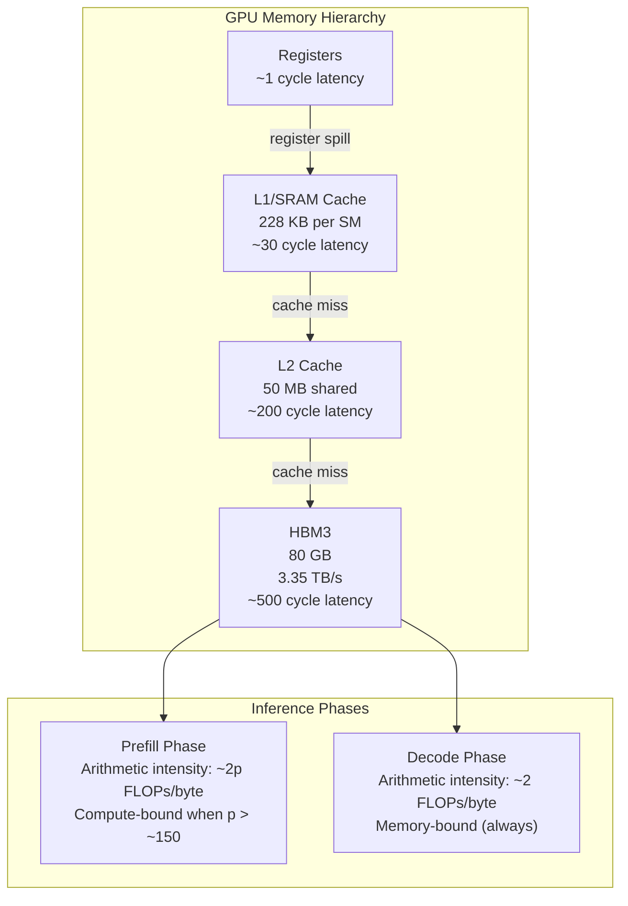
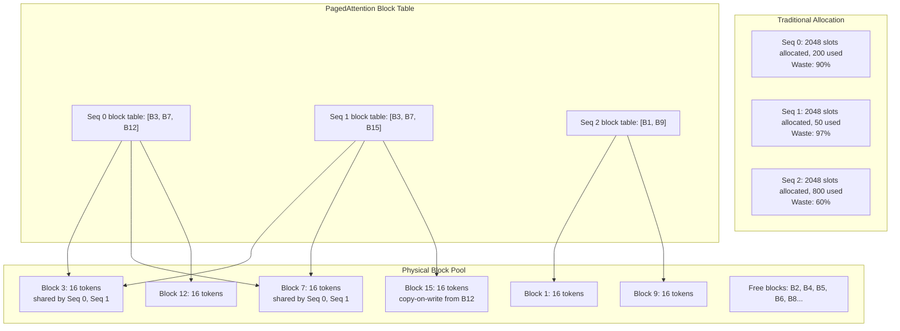
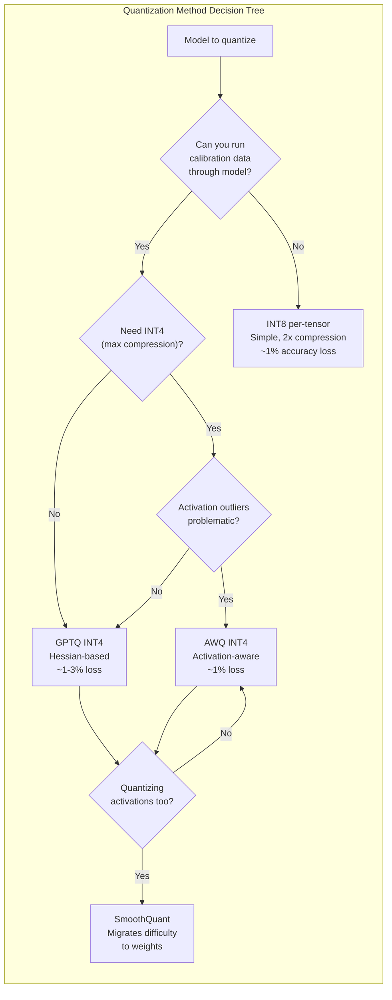

````markdown
# Lesson 3: Advanced Optimization, Serving & Failure Modes

## 1. Memory Bandwidth, KV-Cache Optimization & Quantization Bounds

### 1.1 The Roofline Model: Why LLM Inference Is Memory-Bound

The dominant constraint in autoregressive LLM inference is memory bandwidth, not compute throughput. Understanding why requires the roofline model, which characterizes whether a workload is memory-bound or compute-bound by comparing its arithmetic intensity (FLOPs per byte of memory traffic) against the GPU's operational intensity threshold.

For an NVIDIA H100 SXM GPU, peak FP16 tensor core throughput is approximately 989 TFLOPS and HBM3 bandwidth is 3.35 TB/s, yielding a ridge point at roughly 295 FLOPs/byte. Workloads with arithmetic intensity below this knee are memory-bound; above it, compute-bound.

During the **decode phase** (generating one token at a time), each weight parameter is read from HBM exactly once per token but contributes roughly two FLOPs (one multiply-accumulate). This gives an arithmetic intensity of approximately 2 FLOPs/byte for weight access—three orders of magnitude below the ridge point. The decode phase is deeply memory-bound, and tensor core utilization is irrelevant because the GPU cannot feed data fast enough to saturate compute units. This is why a 70B model generates tokens at a rate bounded by total_weight_bytes / HBM_bandwidth, regardless of how powerful the tensor cores are.

During the **prefill phase** (processing the entire prompt in parallel), each weight is reused across all prompt tokens. For a prompt of length *p*, arithmetic intensity rises to approximately 2p FLOPs/byte, which exceeds the ridge point for *p* > ~150. Prefill is compute-bound and benefits from tensor core optimization. This prefill-decode asymmetry is why modern inference engines use different execution strategies for each phase.

The practical implication is that optimizing inference throughput requires minimizing memory traffic—reading each weight fewer times—rather than maximizing FLOPs. Techniques like quantization (reducing bytes per weight), weight sharing across requests (batching), and speculative decoding all target this memory bandwidth bottleneck.



### 1.2 KV-Cache: Architecture and Growth Analysis

The key-value cache eliminates redundant computation during autoregressive decoding by storing the projected key and value tensors from all preceding tokens. Without it, generating the *n*-th token would require recomputing attention over all previous tokens in O(n) time per layer, giving O(n²) total cost for a sequence of length *n*. With the cache, each new token only computes attention against the stored keys and values, reducing per-step cost to O(n) and total cost to O(n²) as well—but with a constant factor reduction of approximately n/1 by avoiding full recomputation.

The KV-cache memory footprint is **linear** in sequence length, not quadratic. The attention *compute* is O(n²), but the *storage* is O(n × d) where *d* is the model's hidden dimension. The total KV-cache size follows:

```
KV_cache = 2 × n_layers × batch_size × seq_len × d_model × bytes_per_element
```

The factor of 2 accounts for separate key and value tensors. For LLaMA-7B (32 layers, d_model=4096) in FP16 (2 bytes per element), the per-token KV-cache footprint is 2 × 32 × 4096 × 2 = 512 KB. At a 4096-token context with batch size 1, the total KV-cache is approximately 2 GB. The model weights occupy approximately 14 GB in FP16, so the KV-cache represents ~14% of model memory at this context length.

The picture changes dramatically with larger batch sizes or longer contexts. At batch size 32 with 4096-token context, the KV-cache grows to 64 GB—4.6× the model weight footprint. At batch size 1 with 32K context (LLaMA's maximum), the KV-cache reaches 16 GB, exceeding the model weights. This is the source of the "3-5× model memory" observation: it applies under high-batch or long-context serving conditions, not single-request short-context inference.

```python
def kv_cache_bytes(n_layers, d_model, seq_len, batch_size, bytes_per_element=2):
    """
    Compute KV-cache memory for a transformer decoder.

    The cache stores projected key and value tensors for every layer across
    all attention heads. Since d_model = n_heads * d_head, the total per-layer
    storage is batch * seq * d_model for each of K and V.

    Args:
        n_layers: Number of transformer decoder blocks
        d_model: Hidden dimension (n_heads * d_head)
        seq_len: Sequence length (context window in use)
        batch_size: Number of concurrent sequences
        bytes_per_element: 2 for FP16/BF16, 1 for INT8, 4 for FP32
    """
    return 2 * n_layers * batch_size * seq_len * d_model * bytes_per_element

# LLaMA-7B: 32 layers, d_model=4096, FP16
configs = [
    (1, 4096,  "batch=1,  seq=4K"),
    (32, 4096, "batch=32, seq=4K"),
    (1, 32768, "batch=1,  seq=32K"),
    (8, 8192,  "batch=8,  seq=8K"),
]
model_weights_gb = 7e9 * 2 / 1e9  # 7B params * 2 bytes (FP16)

for batch, seq, label in configs:
    cache_gb = kv_cache_bytes(32, 4096, seq, batch, 2) / 1e9
    ratio = cache_gb / model_weights_gb
    print(f"{label}: KV-cache={cache_gb:.1f} GB, "
          f"weights={model_weights_gb:.1f} GB, ratio={ratio:.2f}x")
```

### 1.3 PagedAttention: Virtual Memory for KV-Cache

Traditional KV-cache allocation reserves contiguous memory blocks sized for the maximum possible sequence length per request. This causes severe internal fragmentation: a request that generates 50 tokens from a 2048-token context window wastes 97% of its allocated cache. vLLM's PagedAttention (Kwon et al., 2023) addresses this by borrowing the operating system's virtual memory paging concept.

PagedAttention divides the KV-cache into fixed-size blocks (typically 16 tokens per block) and maintains a block table per sequence that maps logical token positions to physical block locations. Blocks are allocated on demand as sequences grow and freed immediately when sequences complete. This reduces memory waste from 60-80% to under 4% and enables dynamic memory sharing across sequences.

A critical feature is **copy-on-write block sharing**: when multiple outputs share a common prefix (as in beam search or parallel sampling), their block tables initially point to the same physical blocks. When a sequence diverges and writes new KV pairs, only the modified block is copied. This can reduce KV-cache memory for multi-output generation by 50% or more depending on prefix overlap.



### 1.4 FlashAttention: Tiling for O(n) Memory

Standard attention computes the full n×n attention score matrix in HBM, requiring O(n²) memory. For a 4096-token sequence with 32 heads, this matrix alone consumes 4096 × 4096 × 32 × 2 bytes ≈ 2 GB in FP16—per layer. Across 32 layers, that is 64 GB just for attention scores.

FlashAttention (Dao et al., 2022; Dao, 2023) eliminates this by tiling the computation across SRAM. Instead of materializing the full score matrix, it loads Q, K, V in blocks, computes partial softmax statistics within SRAM using the online softmax algorithm (which maintains a running maximum and normalization sum), and writes only the output back to HBM. This reduces attention memory from O(n²) to O(n) at the cost of recomputing attention scores during the backward pass (which is typically faster than reading them back from HBM anyway).

The practical impact: FlashAttention-2 achieves 2-4× speedup over PyTorch's native attention and reduces HBM reads from O(n²) to O(n²d/M) where M is SRAM size, making long-context inference feasible without prohibitive memory overhead.

### 1.5 Quantization: Theory and Practice

Quantization reduces the memory footprint of model weights (and optionally activations) by representing them in lower precision formats. The fundamental tradeoff is between memory savings and numerical fidelity.

**Symmetric per-tensor quantization** maps FP16 weights to INT8 using a single scale factor:

```python
import numpy as np

def quantize_symmetric_int8(weights: np.ndarray) -> tuple[np.ndarray, float]:
    """
    Symmetric INT8 quantization: maps real values to [-127, 127].
    
    The quantization step size is determined by the maximum absolute weight.
    Per-tensor granularity uses one scale for the entire weight matrix,
    which is simple but suboptimal when weight magnitudes vary across channels.
    """
    max_abs = np.max(np.abs(weights))
    scale = max_abs / 127.0
    if scale == 0:
        return np.zeros_like(weights, dtype=np.int8), 1.0
    quantized = np.clip(np.round(weights / scale), -127, 127).astype(np.int8)
    return quantized, scale

def dequantize_int8(quantized: np.ndarray, scale: float) -> np.ndarray:
    return quantized.astype(np.float32) * scale

# Demonstrate on a realistic weight matrix
rng = np.random.default_rng(42)
weights = rng.standard_normal((4096, 4096)).astype(np.float32) * 0.1
q_weights, scale = quantize_symmetric_int8(weights)
deq = dequantize_int8(q_weights, scale)

# Quantization error analysis
# For uniform symmetric quantization with step size delta = 2*max_abs/255,
# the per-element error is uniformly distributed in [-delta/2, delta/2].
delta = 2 * scale / 255
mse = np.mean((weights - deq) ** 2)
theoretical_mse = delta ** 2 / 12  # Variance of uniform distribution U[-delta/2, delta/2]

print(f"Scale factor: {scale:.6f}")
print(f"Quantization step delta: {delta:.8f}")
print(f"Empirical MSE: {mse:.2e}")
print(f"Theoretical MSE (uniform noise): {theoretical_mse:.2e}")
print(f"Memory: {weights.nbytes / 1e6:.1f} MB -> {q_weights.nbytes / 1e6:.1f} MB (4x reduction)")
```

The per-element quantization error for uniform quantization follows a uniform distribution U[-Δ/2, Δ/2], not a Gaussian. The mean squared error is Δ²/12. This error does not simply compound across layers as the original material claims. Instead, quantization sensitivity varies significantly by layer: embedding layers, the final output projection, and layers near the input/output are typically more sensitive, while middle layers are more robust. This motivates **mixed-precision quantization**, which keeps sensitive layers in higher precision.

### 1.6 Advanced Quantization Methods

Post-training quantization (PTQ) methods go beyond naive per-tensor scaling:

**GPTQ** (Frantar et al., 2023) uses second-order information from the Hessian of the layer's output with respect to its weights to determine optimal quantization order. It quantizes weights column by column, updating remaining unquantized weights to compensate for the error introduced by each quantization step. This achieves INT4 quantization with minimal accuracy loss on models like LLaMA, OPT, and BLOOM.

**AWQ** (Lin et al., 2023) observes that not all weight channels are equally important—protecting the top 1% of salient channels (determined by activation magnitude) preserves most of the model's performance. It applies per-channel scaling factors that enlarge salient weight values before quantization, reducing their relative quantization error.

**SmoothQuant** (Xiao et al., 2023) addresses the difficulty of quantizing activations by migrating quantization difficulty from activations to weights. It uses a smoothing factor that scales down outlier activation channels and correspondingly scales up the weights, making both more uniform and thus easier to quantize to INT8.

The practical memory and throughput improvements from these methods:

| Method | Precision | Memory Reduction (from FP16) | Typical Accuracy Loss |
|--------|-----------|-----------------------------|----------------------|
| FP16 baseline | 16-bit | 1× | 0% |
| INT8 per-tensor | 8-bit | 2× | 0.5-1% |
| GPTQ INT4 | 4-bit | 4× | 1-3% |
| AWQ INT4 | 4-bit | 4× | <1% |
| INT4 + KV-cache INT8 | mixed | ~3-4× weights, 2× cache | 1-2% |



## 2. Distributed Inference: Parallelism Strategies & Communication

### 2.1 Tensor Parallelism

Tensor parallelism (Megatron-LM, Shoeybi et al., 2019) splits individual weight matrices across GPUs so that each GPU computes a portion of the same logical operation. For a linear layer Y = XW^T where W is [out_features, in_features]:

**Column parallelism** partitions W along the output dimension: each GPU *i* holds W_i of shape [out_features/N, in_features] and computes Y_i = X W_i^T. Each GPU independently produces a slice of the output. For the attention mechanism, this means each GPU handles a subset of attention heads, requiring no inter-GPU communication during the attention computation itself.

**Row parallelism** partitions W along the input dimension: each GPU *i* holds W_i of shape [out_features, in_features/N] and computes a partial sum Y_i = X_i W_i^T. The full output requires an all-reduce across GPUs to combine partial sums.

Megatron-LM pairs column-parallel for the first linear layer with row-parallel for the second in each MLP block and attention output projection. This design ensures that the all-reduce from row-parallelism coincides with the end of the transformer block, requiring exactly two all-reduce operations per layer (one for attention output, one for MLP output
