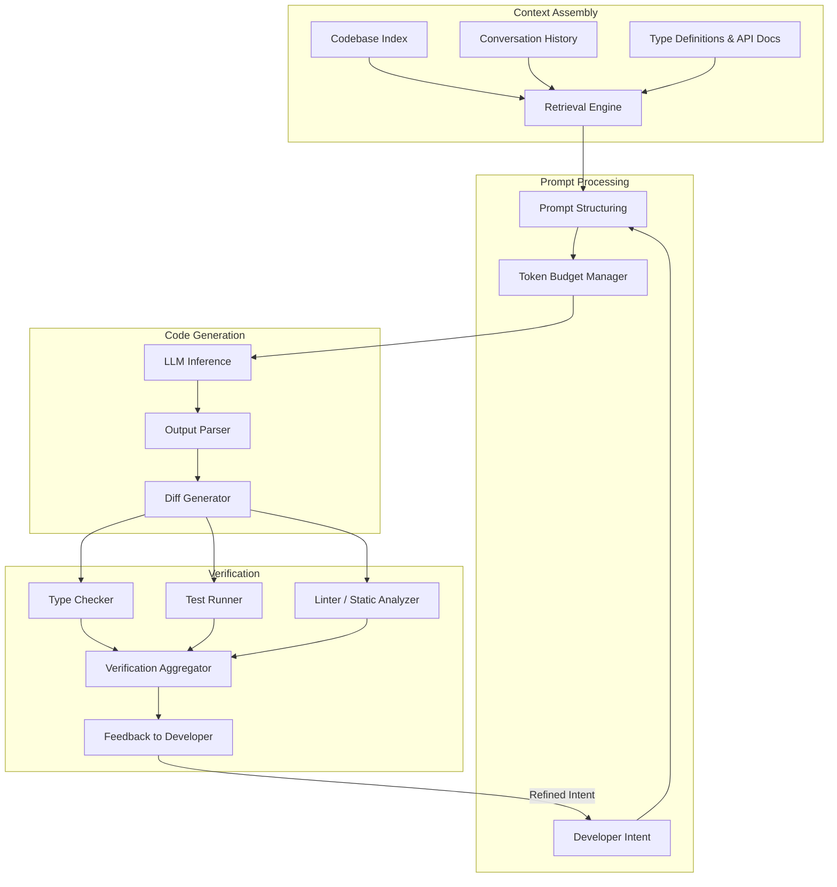
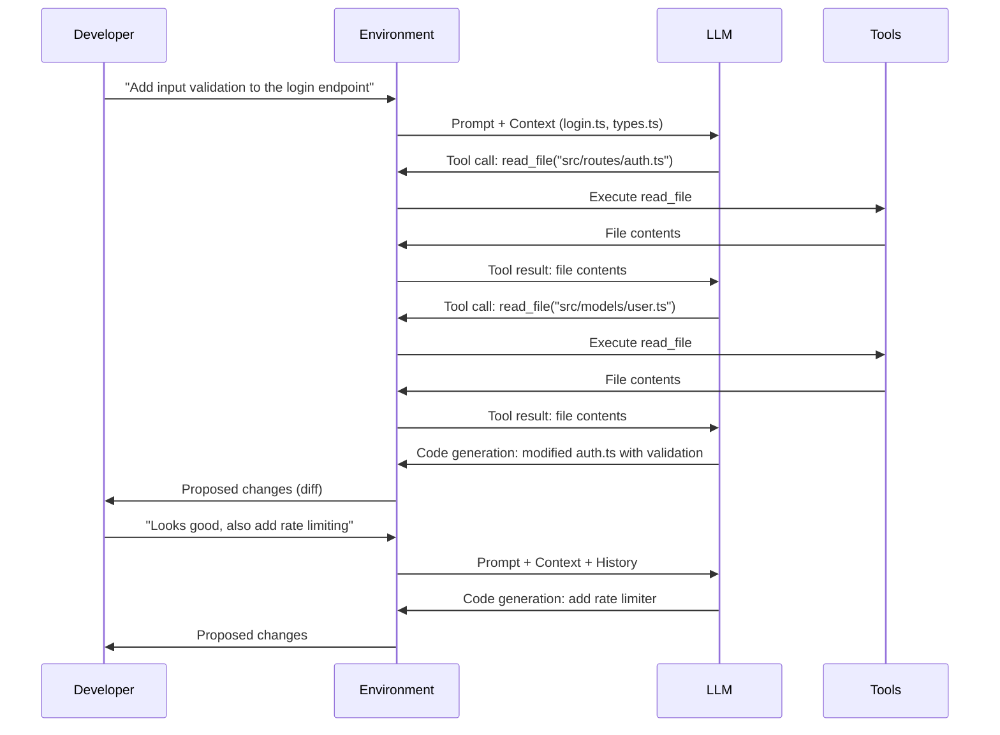
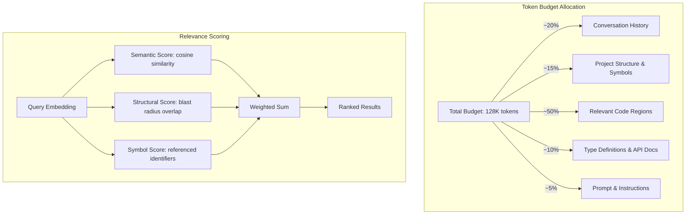
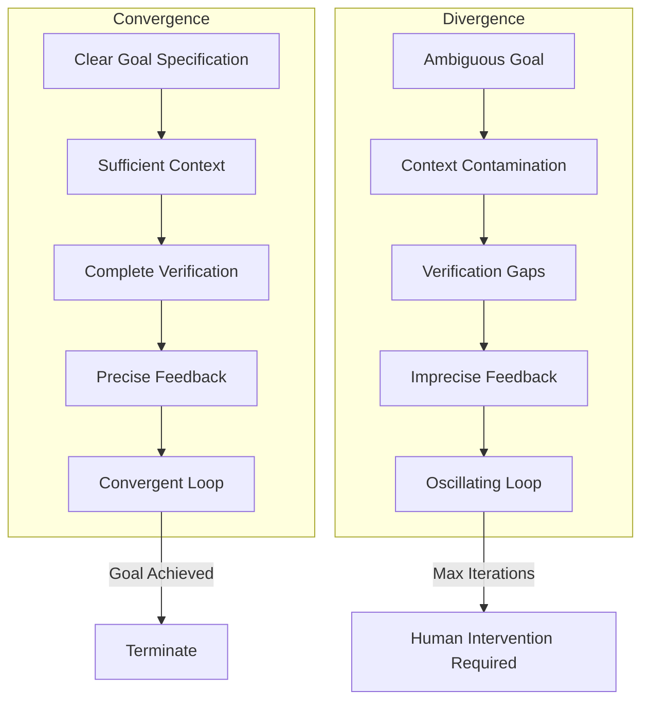

# Lesson 4: Integration with AI

## First-Principles Intuition & Invariants

Vibe coding is a development paradigm in which the developer communicates intent through natural language and an AI system translates that intent into executable code. The integration between human and AI is not a convenience layer over a traditional IDE — it is a shift in the abstraction level at which programming operates. Instead of manipulating syntax trees through keystrokes, the developer manipulates a semantic model through prompts, and the AI system compiles those prompts into code.

### The Semantic Compilation Model

Traditional compilation transforms source code into machine code through deterministic phases: lexing, parsing, type checking, optimization, and code generation. Each phase is a pure function — given the same input, it always produces the same output. Vibe coding introduces a probabilistic compilation stage: the transformation of natural language intent into source code via a large language model (LLM). The LLM is a function $f_\theta$ parameterized by weights $\theta$ that, given a context $c$ and a prompt $p$, produces a distribution over token sequences:

$$P(\text{output} \mid c, p) = \prod_{t=1}^{T} P(w_t \mid w_{<t}, c, p; \theta)$$

The non-determinism is the defining characteristic. The same prompt can yield different code on different invocations, and the quality of the output depends critically on the context $c$ — the code, type signatures, API documentation, and conversation history provided to the model. This makes context management, not prompt crafting, the primary lever for output quality.

### The Cybernetic Feedback Loop

Norbert Wiener formalized feedback control in *Cybernetics: Or Control and Communication in the Animal and the Machine* (1948): a system measures its output, compares it against a target, and adjusts its input to reduce the error signal. In vibe coding, this loop operates at the semantic level:

1. The developer encodes intent as a prompt (input signal)
2. The LLM generates code (system output)
3. The developer or automated verifier evaluates the code against the goal (error detection)
4. The developer refines the prompt based on the evaluation (feedback signal)
5. The loop repeats until the error signal falls below an acceptable threshold

Unlike a thermostat's proportional control, the feedback in vibe coding is discrete and semantic. The error signal is not a scalar but a set of verification results: type errors, test failures, behavioral mismatches, and architectural violations. The convergence properties of the loop depend on the developer's ability to diagnose failures and communicate corrections precisely.

### Markov Decision Process Formulation

The vibe coding loop can be modeled as a Markov Decision Process (MDP) defined by the tuple $(S, A, T, R, \gamma)$:

- **State** $s_t \in S$: The tuple $(B_t, H_t, C_t, G)$ where $B_t$ is the current codebase state, $H_t$ is the conversation history, $C_t$ is the available context, and $G$ is the goal specification.
- **Action** $a_t \in A$: The prompt formulated by the developer, including referenced files, constraints, and examples.
- **Transition** $T(s_{t+1} \mid s_t, a_t)$: Deterministic given the LLM's output, but the LLM's output itself is stochastic. The effective transition is $T(s_{t+1} \mid s_t, a_t) = \mathbb{E}_{o \sim f_\theta(\cdot \mid c_t, a_t)}[\delta(s_t, o)]$ where $\delta$ applies the LLM output $o$ to the current state.
- **Reward** $R(s_t, a_t, s_{t+1})$: A composite signal — $R = \alpha \cdot \mathbb{1}_{\text{tests pass}} + \beta \cdot \mathbb{1}_{\text{types check}} + \chi \cdot \mathbb{1}_{\text{linter clean}} + \delta \cdot \mathbb{1}_{\text{build succeeds}} - \lambda \cdot \text{iterations}$
- **Discount factor** $\gamma \in [0, 1)$: Reflects the preference for fewer iterations.

The developer's prompting strategy is the policy $\pi(a \mid s)$. An optimal policy minimizes the number of iterations while maximizing verification scores. This formulation makes two things explicit: (1) the cost of each iteration matters, so prompt quality directly affects development velocity, and (2) the reward is multi-objective, meaning trade-offs between type safety, test coverage, and build success must be managed.

### Invariants

Three invariants must hold for the vibe coding loop to converge:

1. **Context Sufficiency**: The available context $C_t$ must contain enough information for the LLM to generate correct code. Missing type signatures, absent API documentation, or omitted dependency code will cause the LLM to hallucinate plausible but incorrect implementations.

2. **Semantic Preservation**: Each iteration must not break existing behavior unless explicitly intended. This requires a verification oracle — tests, type checkers, or runtime assertions — that can detect regressions.

3. **Goal Monotonicity**: Each iteration must reduce the distance to the goal. If the developer's feedback introduces contradictory constraints or oscillates between incompatible designs, the loop diverges. This is the semantic analog of non-convergent gradient descent.

## Core Architecture & Mechanics

An AI-integrated development environment for vibe coding is not a monolith. It is a pipeline of specialized components, each addressing a specific failure mode in the human-AI collaboration loop. The architecture separates context assembly, prompt processing, code generation, and verification into distinct stages with well-defined interfaces.

### Pipeline Architecture



The pipeline is a feedback loop, not a linear process. Each stage feeds information back to earlier stages. Verification failures generate specific, actionable feedback that the developer uses to refine the prompt. Context assembly updates its index as the codebase changes.

### Context Management

The LLM has a fixed context window — a maximum number of tokens it can process in a single inference call. For a codebase of any meaningful size, the entire codebase will not fit. Context management is the process of selecting which files, code regions, and metadata to include in the context window for a given task.

The retrieval engine uses semantic search over code embeddings. Each file or code region is encoded as a dense vector using an embedding model. When the developer issues a prompt, the prompt is also embedded, and cosine similarity retrieves the most relevant code regions:

```python
import numpy as np
from dataclasses import dataclass, field
from typing import List, Dict, Optional

@dataclass
class CodeRegion:
    """A unit of code that can be retrieved for context."""
    file_path: str
    start_line: int
    end_line: int
    content: str
    embedding: np.ndarray
    symbols: List[str]  # exported functions, classes, types

    @property
    def token_estimate(self) -> int:
        """Rough token estimate: ~4 characters per token for code."""
        return len(self.content) // 4

@dataclass
class ContextManager:
    """
    Manages code context for LLM-based code generation.

    Selects the most relevant code regions within a token budget
    using a combination of semantic similarity and dependency tracking.
    """
    regions: List[CodeRegion] = field(default_factory=list)
    token_budget: int = 32_000  # conservative budget for context window
    conversation_tokens: int = 0

    def add_region(self, region: CodeRegion) -> None:
        self.regions.append(region)

    def retrieve(
        self,
        query_embedding: np.ndarray,
        query_symbols: Optional[List[str]] = None,
    ) -> List[CodeRegion]:
        """
        Retrieve code regions relevant to the query.

        Combines cosine similarity with symbol-based matching:
        - Semantic similarity finds code that does similar things
        - Symbol matching finds code that the query explicitly references
        """
        scored: List[tuple[float, CodeRegion]] = []

        for region in self.regions:
            # Cosine similarity between query and region embedding
            sim = float(
                np.dot(query_embedding, region.embedding)
                / (np.linalg.norm(query_embedding)
                   * np.linalg.norm(region.embedding) + 1e-8)
            )

            # Boost score if query references symbols defined in this region
            if query_symbols:
                symbol_overlap = len(
                    set(query_symbols) & set(region.symbols)
                )
                sim += 0.3 * symbol_overlap

            scored.append((sim, region))

        # Greedy selection: highest-scoring regions that fit in budget
        scored.sort(key=lambda x: x[0], reverse=True)

        selected: List[CodeRegion] = []
        used_tokens = self.conversation_tokens

        for score, region in scored:
            if used_tokens + region.token_estimate <= self.token_budget:
                selected.append(region)
                used_tokens += region.token_estimate

        return selected

    def format_context(self, regions: List[CodeRegion]) -> str:
        """Format selected regions into a context string for the LLM."""
        parts: List[str] = []
        for region in regions:
            header = (f"File: {region.file_path} "
                      f"(lines {region.start_line}-{region.end_line})")
            parts.append(f"{header}\n```\n{region.content}\n```")
        return "\n\n".join(parts)
```

The token budget must account for both the retrieved context and the conversation history. As the conversation grows, less room remains for code context, which degrades generation quality. Effective vibe coding sessions either periodically summarize conversation history or start fresh sessions for distinct tasks.

### Tool Integration and Function Calling

Modern LLMs support function calling — a structured mechanism where the model can invoke external tools rather than only generating text. In a vibe coding environment, this is how the AI reads files, executes commands, and searches the codebase. The LLM is provided with a schema of available functions and decides when to call them based on the task.

```python
import json
import subprocess
from typing import Any, Callable, Dict
from dataclasses import dataclass

@dataclass
class ToolSpec:
    """Schema declaration for an LLM-callable tool."""
    name: str
    description: str
    parameters: Dict[str, Any]  # JSON Schema
    handler: Callable[..., str]

# Tool registry: the set of capabilities available to the AI agent
TOOL_REGISTRY: Dict[str, ToolSpec] = {}

def tool(name: str, description: str, params: Dict[str, Any]):
    """Decorator to register a function as an LLM-callable tool."""
    def decorator(fn: Callable[..., str]) -> ToolSpec:
        spec = ToolSpec(
            name=name,
            description=description,
            parameters={"type": "object", "properties": params},
            handler=fn,
        )
        TOOL_REGISTRY[name] = spec
        return spec
    return decorator

@tool(
    name="read_file",
    description="Read the contents of a file at the given path.",
    params={
        "path": {"type": "string", "description": "Absolute or relative file path"}
    },
)
def read_file(path: str) -> str:
    try:
        with open(path, "r", encoding="utf-8") as f:
            return f.read()
    except FileNotFoundError:
        return f"Error: file not found: {path}"
    except Exception as e:
        return f"Error reading {path}: {e}"

@tool(
    name="run_command",
    description="Execute a shell command and return stdout, stderr, and exit code.",
    params={
        "command": {"type": "string", "description": "Shell command to execute"},
        "cwd": {"type": "string", "description": "Working directory", "default": "."},
    },
)
def run_command(command: str, cwd: str = ".") -> str:
    try:
        result = subprocess.run(
            command,
            shell=True,
            cwd=cwd,
            capture_output=True,
            text=True,
            timeout=30,
        )
        return json.dumps({
            "stdout": result.stdout,
            "stderr": result.stderr,
            "exit_code": result.returncode,
        })
    except subprocess.TimeoutExpired:
        return json.dumps({"error": "command timed out after 30s"})
    except Exception as e:
        return json.dumps({"error": str(e)})

def format_tools_for_llm() -> list[Dict[str, Any]]:
    """Generate the function schemas that the LLM uses for tool calling."""
    return [
        {
            "type": "function",
            "function": {
                "name": spec.name,
                "description": spec.description,
                "parameters": spec.parameters,
            },
        }
        for spec in TOOL_REGISTRY.values()
    ]
```

The function calling loop works as follows: the developer sends a prompt, the LLM responds with either text (an answer or code) or a function call (a request to use a tool). If it calls a function, the environment executes the tool, feeds the result back to the LLM, and the LLM continues reasoning. This loop continues until the LLM produces a final response.



### Multi-File Coordination

When a change spans multiple files, the AI must understand the dependency graph of the codebase. A change to a type definition ripples to every file that imports it. Without this awareness, the AI will generate code that compiles in isolation but fails when integrated.

```typescript
// project_graph.ts — Build a dependency graph for multi-file code generation

interface FileNode {
  path: string;
  imports: string[];        // paths this file depends on
  exports: string[];        // symbols this file provides
  importers: string[];      // files that depend on this file (reverse edges)
}

class ProjectGraph {
  private nodes: Map<string, FileNode> = new Map();

  addFile(path: string, imports: string[], exports: string[]): void {
    this.nodes.set(path, { path, imports, exports, importers: [] });
  }

  buildReverseEdges(): void {
    // For each file, find all files that import it
    for (const [path, node] of this.nodes) {
      for (const imp of node.imports) {
        const dep = this.nodes.get(imp);
        if (dep) {
          dep.importers.push(path);
        }
      }
    }
  }

  /**
   * Compute the blast radius: all files affected by a change to the given files.
   * Uses BFS over reverse edges (importers) to find transitive dependents.
   */
  blastRadius(changedFiles: string[]): Set<string> {
    const affected = new Set<string>(changedFiles);
    const queue: string[] = [...changedFiles];

    while (queue.length > 0) {
      const current = queue.shift()!;
      const node = this.nodes.get(current);
      if (!node) continue;

      for (const importer of node.importers) {
        if (!affected.has(importer)) {
          affected.add(importer);
          queue.push(importer);
        }
      }
    }

    return affected;
  }

  /**
   * Generate the context set for a multi-file change.
   * Includes the changed files, their direct dependencies,
   * and their direct dependents.
   */
  contextSet(changedFiles: string[]): string[] {
    const affected = this.blastRadius(changedFiles);
    const context = new Set<string>();

    for (const path of changedFiles) {
      const node = this.nodes.get(path);
      if (!node) continue;

      // Include the file itself
      context.add(path);

      // Include direct dependencies (to understand types/APIs used)
      for (const imp of node.imports) {
        context.add(imp);
      }

      // Include direct dependents (to understand usage patterns)
      for (const importer of node.importers) {
        context.add(importer);
      }
    }

    // Also include all affected files
    for (const path of affected) {
      context.add(path);
    }

    return Array.from(context);
  }
}
```

The blast radius computation is critical for verification. When the AI modifies a shared type definition, every file in the blast radius must be type-checked, not just the modified file. Without this, type errors in dependent files will go undetected until runtime.

### Verification Pipeline

Verification is the error signal in the cybernetic feedback loop. Without it, the loop cannot converge — there is no way to distinguish progress from regression. The pipeline must run multiple verification stages, each catching different classes of errors that AI-generated code commonly contains:

```python
from dataclasses import dataclass, field
from enum import Enum
from typing import List
import ast
import subprocess

class VerificationLevel(Enum):
    SYNTAX = 1      # Does the code parse?
    TYPES = 2       # Are types correct?
    LINT = 3        # Does the code follow style rules?
    UNIT = 4        # Do functions behave correctly in isolation?
    INTEGRATION = 5 # Do components work together?
    BUILD = 6       # Does the project compile and bundle?

@dataclass
class VerificationResult:
    level: VerificationLevel
    passed: bool
    errors: List[str] = field(default_factory=list)
    warnings: List[str] = field(default_factory=list)

class VerificationPipeline:
    """
    Runs verification stages in order of cost (cheapest first).
    Stops early on failure to avoid wasted computation.

    Each stage maps to a specific class of AI-generated code error:
    - SYNTAX: catches malformed code from incomplete generation
    - TYPES: catches hallucinated APIs, wrong argument counts, type mismatches
    - LINT: catches style violations, unused variables, dead code
    - UNIT: catches incorrect algorithmic behavior
    - INTEGRATION: catches interface mismatches between modules
    - BUILD: catches missing dependencies, configuration errors
    """

    def __init__(self, project_root: str):
        self.project_root = project_root

    def verify(
        self,
        changed_files: List[str],
        stop_on_failure: bool = True,
    ) -> List[VerificationResult]:
        results: List[VerificationResult] = []

        stages = [
            (VerificationLevel.SYNTAX, self._check_syntax),
            (VerificationLevel.TYPES, self._check_types),
            (VerificationLevel.LINT, self._run_linter),
            (VerificationLevel.UNIT, self._run_tests),
            (VerificationLevel.INTEGRATION, self._run_integration_tests),
            (VerificationLevel.BUILD, self._run_build),
        ]

        for level, checker in stages:
            result = checker(changed_files)
            results.append(result)

            if not result.passed and stop_on_failure:
                break

        return results

    def _check_syntax(self, files: List[str]) -> VerificationResult:
        """Parse each file to detect syntax errors."""
        errors: List[str] = []

        for path in files:
            try:
                with open(path, "r", encoding="utf-8") as f:
                    source = f.read()
                ast.parse(source, filename=path)
            except SyntaxError as e:
                errors.append(f"{path}:{e.lineno}: {e.msg}")

        return VerificationResult(
            level=VerificationLevel.SYNTAX,
            passed=len(errors) == 0,
            errors=errors,
        )

    def _check_types(self, files: List[str]) -> VerificationResult:
        """Run the type checker (mypy for Python)."""
        result = subprocess.run(
            ["mypy", "--no-error-summary", *files],
            capture_output=True,
            text=True,
            cwd=self.project_root,
        )

        errors = [
            line for line in result.stdout.splitlines()
            if line.strip() and "error:" in line
        ]

        return VerificationResult(
            level=VerificationLevel.TYPES,
            passed=result.returncode == 0,
            errors=errors,
        )

    def _run_linter(self, files: List[str]) -> VerificationResult:
        """Run the linter (ruff for Python)."""
        result = subprocess.run(
            ["ruff", "check", "--output-format=concise", *files],
            capture_output=True,
            text=True,
            cwd=self.project_root,
        )

        errors = [
            line for line in result.stdout.splitlines()
            if line.strip()
        ]

        return VerificationResult(
            level=VerificationLevel.LINT,
            passed=result.returncode == 0,
            errors=errors,
        )

    def _run_tests(self, files: List[str]) -> VerificationResult:
        """Run unit tests for the changed files."""
        # Derive test file paths from source paths
        test_files = [
            path.replace("/src/", "/tests/").replace(".py", "_test.py")
            for path in files
        ]

        result = subprocess.run(
            ["pytest", "-x", "--tb=short", *test_files],
            capture_output=True,
            text=True,
            cwd=self.project_root,
        )

        errors = [
            line for line in result.stdout.splitlines()
            if "FAILED" in line or "ERROR" in line
        ]

        return VerificationResult(
            level=VerificationLevel.UNIT,
            passed=result.returncode == 0,
            errors=errors,
        )

    def _run_integration_tests(self, files: List[str]) -> VerificationResult:
        """Run the full integration test suite."""
        result = subprocess.run(
            ["pytest", "-x", "--tb=short", "tests/integration/"],
            capture_output=True,
            text=True,
            cwd=self.project_root,
        )

        errors = [
            line for line in result.stdout.splitlines()
            if "FAILED" in line or "ERROR" in line
        ]

        return VerificationResult(
            level=VerificationLevel.INTEGRATION,
            passed=result.returncode == 0,
            errors=errors,
        )

    def _run_build(self, files: List[str]) -> VerificationResult:
        """Run the project build to verify it compiles end-to-end."""
        result = subprocess.run(
            ["python", "-m", "build"],
            capture_output=True,
            text=True,
            cwd=self.project_root,
        )

        errors = [
            line for line in result.stderr.splitlines()
            if "error" in line.lower()
        ]

        return VerificationResult(
            level=VerificationLevel.BUILD,
            passed=result.returncode == 0,
            errors=errors,
        )
```

The pipeline runs stages in order of increasing cost. Syntax checking is nearly free (parse the AST). Type checking is moderately expensive. Full integration tests are the most expensive. Stopping on failure avoids wasted computation running integration tests when the code does not even type-check.

## High-Performance Optimization & Failure Modes

### Context Window Optimization

The context window is the scarce resource in vibe coding. A 128K-token window sounds large, but a mid-size codebase can easily exceed it. The goal is to maximize the information density of the context — every token included should contribute to the LLM's ability to generate correct code.

Three strategies improve context utilization:

**Progressive disclosure** starts with a high-level view (file tree, exported symbols, type signatures) and only includes full implementations when the developer's prompt references them directly. This lets the LLM understand the project structure without consuming tokens on implementation details it does not need.

**Conversation compression** periodically summarizes the conversation history rather than including it verbatim. After several iterations, earlier exchanges about already-resolved issues contribute nothing but consume tokens. A summarization pass replaces them with a compact description of decisions made and constraints established.

**Relevance scoring** combines semantic similarity (embedding cosine distance) with structural relevance (is this file in the blast radius of the change?). Pure semantic search can retrieve code that is conceptually similar but structurally irrelevant, while pure structural search misses code that implements related logic in different modules.



### Failure Modes and Mitigations

Each failure mode in vibe coding has a specific cause and a specific mitigation. Understanding the mechanism of failure is more valuable than memorizing a list of best practices, because it allows the developer to diagnose novel failure modes in real time.

**Hallucinated APIs.** The LLM generates calls to functions, methods, or modules that do not exist. This occurs when the context does not include the actual API signatures, and the LLM falls back on its training data, which may contain outdated or fictional APIs. The mitigation is to always include the actual type definitions and API documentation for any module the generated code will import. The type checker catches this failure mode if it runs before the code is executed.

**Context overflow.** When the context window is filled with irrelevant code, the LLM's attention is diluted across too many tokens, and it generates lower-quality output. This manifests as code that is syntactically correct but semantically wrong — it ignores constraints stated in the prompt because those tokens are buried in noise. The mitigation is aggressive context pruning: include only files in the blast radius, only symbols referenced by the prompt, and only recent conversation history.

**Semantic drift.** Across multiple iterations of the feedback loop, the codebase accumulates small changes that are each individually correct but collectively inconsistent. A type defined in iteration 3 is used differently in iteration 7 because the developer forgot the earlier decision. This is the semantic analog of gradient descent overshooting the minimum. The mitigation is to maintain a decision log — a structured record of constraints, naming conventions, and architectural decisions that persists across iterations and is included in the context.

**Integration failures.** The AI generates correct code for one file but does not account for how other files use the modified interface. This occurs when the context does not include the dependent files. The blast radius computation from the project graph mitigates this by ensuring all dependent files are included in the context and type-checked.

**Security vulnerabilities.** LLMs trained on public codebases have seen both secure and insecure patterns. Without explicit security constraints in the prompt, the LLM may generate code with SQL injection, path traversal, or insecure cryptographic operations. The mitigation is to include security requirements in the prompt (e.g., "use parameterized queries") and to run static security analysis (e.g., Bandit for Python, Semgrep for multi-language) as part of the verification pipeline.

**Circular dependencies.** In multi-file changes, the AI may create import cycles that were not present before. This occurs because the AI generates each file's imports based on what that file needs, without checking whether the imported module already imports this file. The mitigation is to run a dependency cycle check as part of the verification pipeline:

```rust
// dependency_cycle.rs — Detect circular imports in a project graph

use std::collections::{HashMap, HashSet, VecDeque};

#[derive(Debug)]
pub struct DependencyGraph {
    /// Maps a file path to the set of files it imports
    edges: HashMap<String, HashSet<String>>,
}

impl DependencyGraph {
    pub fn new() -> Self {
        Self { edges: HashMap::new() }
    }

    pub fn add_import(&mut self, from: &str, to: &str) {
        self.edges
            .entry(from.to_string())
            .or_default()
            .insert(to.to_string());
    }

    /// Detect cycles using iterative DFS with a tri-color marking scheme:
    /// - White (0): unvisited
    /// - Gray  (1): currently on the DFS stack (in-progress)
    /// - Black (2): fully processed
    ///
    /// A cycle exists if we encounter a Gray node during traversal.
    pub fn detect_cycles(&self) -> Vec<Vec<String>> {
        let mut cycles: Vec<Vec<String>> = [];
        let mut color: HashMap<&str, u8> = HashMap::new();

        for node in self.edges.keys() {
            if *color.get(node.as_str()).unwrap_or(&0) == 0 {
                self.dfs_cycle(node, &mut color, &mut Vec::new(), &mut cycles);
            }
        }

        cycles
    }

    fn dfs_cycle(
        &self,
        node: &str,
        color: &mut HashMap<&str, u8>,
        path: &mut Vec<String>,
        cycles: &mut Vec<Vec<String>>,
    ) {
        color.insert(node, 1); // Mark as gray (on stack)
        path.push(node.to_string());

        if let Some(neighbors) = self.edges.get(node) {
            for neighbor in neighbors {
                let neighbor_color = *color.get(neighbor.as_str()).unwrap_or(&0);

                match neighbor_color {
                    0 => {
                        // White: recurse
                        self.dfs_cycle(neighbor, color, path, cycles);
                    }
                    1 => {
                        // Gray: found a cycle
                        let cycle_start = path
                            .iter()
                            .position(|n| n == neighbor)
                            .unwrap_or(0);
                        let cycle: Vec<String> = path[cycle_start..].to_vec();
                        cycles.push(cycle);
                    }
                    _ => {} // Black: already processed, skip
                }
            }
        }

        color.insert(node, 2); // Mark as black (done)
        path.pop();
    }

    /// Verify that adding a new import edge would not create a cycle.
    /// Returns true if the edge is safe to add.
    pub fn would_create_cycle(&self, from: &str, to: &str) -> bool {
        // Check if there is already a path from `to` back to `from`
        let mut visited: HashSet<&str> = HashSet::new();
        let mut queue: VecDeque<&str> = VecDeque::new();
        queue.push_back(to);

        while let Some(current) = queue.pop_front() {
            if current == from {
                return true; // Path exists: adding edge creates cycle
            }

            if visited.contains(current) {
                continue;
            }
            visited.insert(current);

            if let Some(neighbors) = self.edges.get(current) {
                for neighbor in neighbors {
                    queue.push_back(neighbor.as_str());
                }
            }
        }

        false
    }
}

#[cfg(test)]
mod tests {
    use super::*;

    #[test]
    fn test_detects_simple_cycle() {
        let mut graph = DependencyGraph::new();
        graph.add_import("a.ts", "b.ts");
        graph.add_import("b.ts", "c.ts");
        graph.add_import("c.ts", "a.ts");

        let cycles = graph.detect_cycles();
        assert_eq!(cycles.len(), 1);
        assert!(cycles[0].contains(&"a.ts".to_string()));
        assert!(cycles[0].contains(&"b.ts".to_string()));
        assert!(cycles[0].contains(&"c.ts".to_string()));
    }

    #[test]
    fn test_no_cycle_in_dag() {
        let mut graph = DependencyGraph::new();
        graph.add_import("a.ts", "b.ts");
        graph.add_import("a.ts", "c.ts");
        graph.add_import("b.ts", "d.ts");
        graph.add_import("c.ts", "d.ts");

        let cycles = graph.detect_cycles();
        assert!(cycles.is_empty());
    }

    #[test]
    fn test_would_create_cycle_prevents_circular_import() {
        let mut graph = DependencyGraph::new();
        graph.add_import("a.ts", "b.ts");
        graph.add_import("b.ts", "c.ts");

        // Adding c.ts -> a.ts would create cycle: a -> b -> c -> a
        assert!(graph.would_create_cycle("c.ts", "a.ts"));

        // Adding c.ts -> d.ts is safe
        assert!(!graph.would_create_cycle("c.ts", "d.ts"));
    }
}
```

### Test-Driven Vibe Coding

The most effective strategy for mitigating all failure modes simultaneously is to invert the generation order: generate tests first, then generate implementation. This is not merely TDD applied to vibe coding — it exploits a structural property of LLMs. Tests are executable specifications. If the AI generates tests that encode the desired behavior, and then generates implementation that passes those tests, the verification loop has a deterministic oracle. The tests define the reward function for the MDP.

```python
from dataclasses import dataclass
from typing import Callable, List, Optional

@dataclass
class TDDCycle:
    """
    Test-driven vibe coding cycle.

    1. RED:      Developer describes desired behavior -> AI generates tests
    2. GREEN:    Developer asks AI to implement -> AI generates code -> tests run
    3. REFACTOR: Developer asks AI to improve code -> tests must still pass

    The tests serve as the verification oracle (reward function in MDP terms).
    """
    phase: str  # "RED" | "GREEN" | "REFACTOR"
    test_results: Optional[List[str]] = None
    implementation_results: Optional[List[str]] = None

def tdd_red_step(
    behavior_description: str,
    generate: Callable[[str], str],
) -> str:
    """
    RED phase: Generate tests from a natural language behavior description.

    The prompt explicitly asks for tests, not implementation.
    This constrains the LLM to produce verifiable specifications
    rather than plausible-looking but incorrect implementations.
    """
    prompt = f"""Write comprehensive unit tests for the following behavior.
Do NOT write the implementation. Only write tests.

Behavior: {behavior_description}

Requirements:
- Test normal cases, edge cases, and error cases
- Use descriptive test names that document the expected behavior
- Include type annotations
- Tests should fail without an implementation (import the module,
  expect it to raise or return incorrect results initially)
"""
    return generate(prompt)

def tdd_green_step(
    test_code: str,
    existing_implementation: Optional[str],
    generate: Callable[[str], str],
) -> str:
    """
    GREEN phase: Generate implementation that passes the tests.

    The context includes the test code and any existing implementation.
    The prompt asks for the minimal implementation that passes all tests.
    """
    context = f"Tests:\n{test_code}"
    if existing_implementation:
        context += f"\n\nExisting implementation:\n{existing_implementation}"

    prompt = f"""{context}

Write the implementation that makes all tests pass.
Follow the interface defined by the tests exactly.
Do not modify the tests.
"""
    return generate(prompt)

def tdd_refactor_step(
    test_code: str,
    implementation: str,
    generate: Callable[[str], str],
) -> str:
    """
    REFACTOR phase: Improve the implementation while keeping tests green.

    The tests act as a regression oracle: if refactoring breaks
    behavior, the tests fail immediately.
    """
    prompt = f"""Tests (must not change):
{test_code}

Current implementation:
{implementation}

Refactor the implementation for:
- Readability
- Performance
- Simplicity

The behavior must not change. All tests must still pass.
"""
    return generate(prompt)
```

The test-first approach solves the reward specification problem in the MDP formulation. Without explicit tests, the reward function is implicit and subjective — the developer must manually evaluate whether the code is correct. With explicit tests, the reward is automated and deterministic: tests pass or they do not. This reduces the iteration cost (the $\lambda$ penalty in the MDP) because the developer does not need to manually verify each generation.

### Convergence and Divergence

The vibe coding loop converges when the verification signal stabilizes — all tests pass, the type checker is clean, the build succeeds, and the developer's intent is satisfied. It diverges when the loop oscillates: the AI fixes one problem but introduces another, the developer's feedback contradicts earlier constraints, or the context window fills with noise.

Divergence has three root causes, each with a specific fix:

1. **Ambiguous goals.** The prompt does not precisely specify the desired behavior, so the AI's interpretation shifts between iterations. Fix: encode the goal as tests or a formal specification, not just natural language.

2. **Context contamination.** Earlier conversation turns contain incorrect assumptions or outdated constraints that the AI still considers. Fix: start a fresh session for each distinct task, or periodically prune conversation history.

3. **Verification gaps.** The verification pipeline does not cover all behaviors, so regressions go undetected. Fix: ensure the test suite has full coverage of the changed code paths before starting the generation loop.



The maximum iteration count is a practical safeguard. If the loop has not converged after a reasonable number of iterations (typically 5–10 for a well-scoped task), the developer should stop, diagnose the root cause of divergence, and either reformulate the goal, clean the context, or expand the test suite before resuming. Continuing to iterate on a divergent loop wastes tokens and time without making progress.
