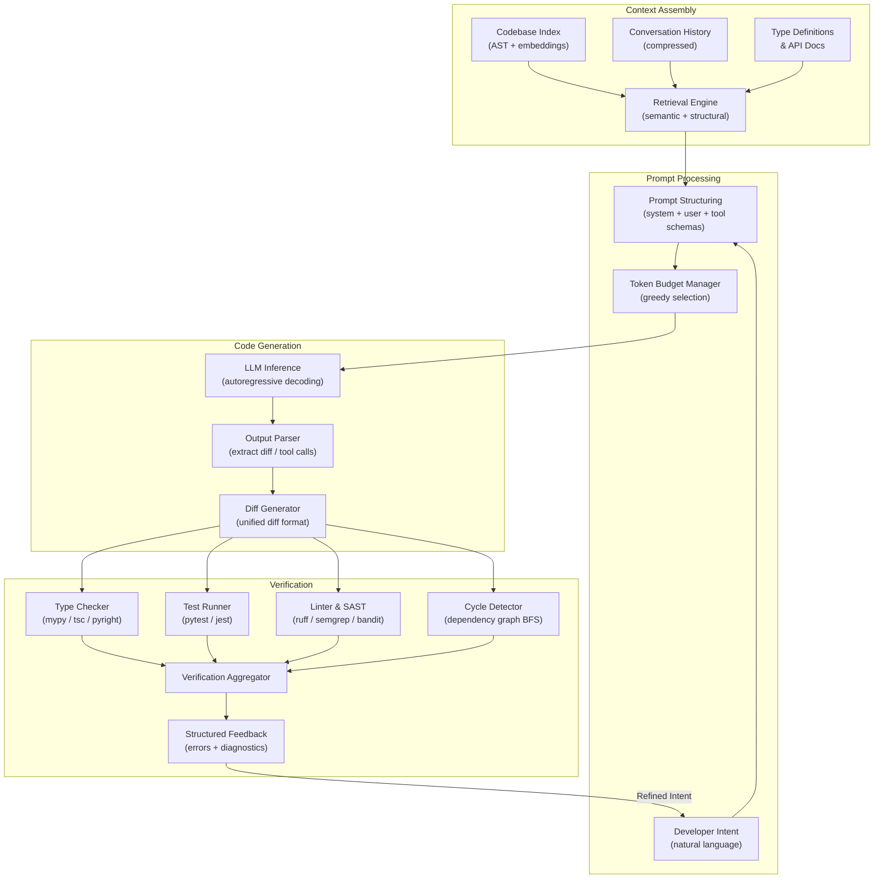

# Lesson 4: Integration with AI — Vibe Coding

## First-Principles Intuition & Invariants

Vibe coding is a development paradigm in which the developer communicates intent through natural language and an AI system translates that intent into executable code. The integration between human and AI is not a convenience layer over a traditional IDE — it is a shift in the abstraction level at which programming operates. Instead of manipulating syntax trees through keystrokes, the developer manipulates a semantic model through prompts, and the AI system compiles those prompts into code.

### The Semantic Compilation Model

Traditional compilation transforms source code into machine code through deterministic phases: lexing, parsing, type checking, optimization, and code generation. Each phase is a pure function — given the same input, it always produces the same output. Vibe coding introduces a probabilistic compilation stage: the transformation of natural language intent into source code via a large language model (LLM).

An autoregressive LLM is a function $f_\theta$ parameterized by learned weights $\theta$ that, given a context $c$ (the system prompt, retrieved code, conversation history) and a developer prompt $p$, models a distribution over token sequences via the chain rule of probability:

$$P(\text{output} \mid c, p) = \prod_{t=1}^{T} P(w_t \mid w_{1}, w_{2}, \ldots, w_{t-1}, c, p;\, \theta)$$

Each $w_t$ is sampled from the vocabulary distribution produced by the final linear layer (logits) followed by softmax. At temperature $\tau > 0$, the sampling distribution is:

$$P(w_t = k) = \frac{\exp(\text{logit}_k / \tau)}{\sum_j \exp(\text{logit}_j / \tau)}$$

At $\tau \to 0$ the model becomes greedy (argmax decoding); at $\tau = 1$ it samples from the raw softmax distribution. This means two identical prompts submitted at $\tau = 1$ can produce structurally different code, because each token choice is a random draw that conditions all subsequent draws. The non-determinism is not a bug — it is an intrinsic property of the softmax-based next-token prediction objective used to train the model.

The practical consequence is that **context management, not prompt phrasing, is the primary lever for output quality.** The model's attention mechanism assigns relevance weights across all tokens in the context window; the signal-to-noise ratio of that context determines whether the model's attention concentrates on the information needed to generate correct code or diffuses across irrelevant tokens.

### The Architecture of a Transformer Inference Pass

Understanding why context quality matters requires understanding the attention mechanism at a computational level. Each transformer layer computes multi-head self-attention:

$$\text{Attention}(Q, K, V) = \text{softmax}\!\left(\frac{QK^\top}{\sqrt{d_k}}\right)V$$

where $Q = XW^Q$, $K = XW^K$, $V = XW^V$, and $X$ is the sequence of token embeddings. The attention scores $QK^\top / \sqrt{d_k}$ measure pairwise token relevance across the entire context. With $n$ tokens in context, this is an $O(n^2)$ operation in both time and memory (for standard dense attention). For a 128K-token context window, this requires holding a $128{,}000 \times 128{,}000$ attention matrix, which is why long-context inference is significantly more expensive than short-context inference, and why filling the context window with low-relevance tokens degrades both quality and latency.

Modern LLM inference systems (vLLM, TensorRT-LLM, llama.cpp) use KV-caching to avoid recomputing attention for previously processed tokens. The key-value projections for each layer are stored in a KV cache, so incremental generation appends only the new token's KV entry. For tool-calling loops in vibe coding environments (described in the next section), KV-cache hit rate is a significant determinant of inference speed.

### The Cybernetic Feedback Loop

Norbert Wiener formalized feedback control in *Cybernetics: Or Control and Communication in the Animal and the Machine* (1948): a system measures its output, compares it against a target, and adjusts its input to reduce the error signal. In vibe coding, this loop operates at the semantic level:

1. The developer encodes intent as a prompt (input signal).
2. The LLM generates code (system output).
3. The developer or automated verifier evaluates the code against the goal (error detection).
4. The developer refines the prompt based on the evaluation (feedback signal).
5. The loop repeats until the error signal falls below an acceptable threshold.

Unlike a thermostat's proportional control, the feedback in vibe coding is discrete and semantic. The error signal is not a scalar but a structured set of verification results: type errors, test failures, behavioral mismatches, and architectural violations. The convergence properties of the loop depend on the developer's ability to diagnose failures and communicate corrections precisely — this is the human skill that vibe coding elevates above raw syntax knowledge.

### Markov Decision Process Formulation

The vibe coding loop is formally modeled as a Markov Decision Process (MDP) defined by the tuple $(S, A, T, R, \gamma)$:

**State** $s_t \in S$: The tuple $(B_t, H_t, C_t, G)$ where $B_t$ is the current codebase state, $H_t$ is the conversation history, $C_t$ is the assembled context window, and $G$ is the goal specification (which may be tests, a formal spec, or natural language).

**Action** $a_t \in A$: The prompt formulated by the developer, including referenced files, explicit constraints, and examples.

**Transition** $T(s_{t+1} \mid s_t, a_t)$: The LLM output $o \sim f_\theta(\cdot \mid C_t, a_t)$ is stochastic; the state transition applies that output to the codebase. The effective transition integrates out the LLM's randomness:

$$T(s_{t+1} \mid s_t, a_t) = \mathbb{E}_{o \sim f_\theta(\cdot \mid C_t, a_t)}\!\left[\delta(s_t, o)\right]$$

where $\delta$ applies the generated diff $o$ to codebase $B_t$.

**Reward** $R(s_t, a_t, s_{t+1})$: A composite multi-objective signal:

$$R = \alpha \cdot \mathbb{1}_{\text{tests pass}} + \beta \cdot \mathbb{1}_{\text{types check}} + \chi \cdot \mathbb{1}_{\text{linter clean}} + \delta \cdot \mathbb{1}_{\text{build succeeds}} - \lambda \cdot \text{iterations}$$

The $-\lambda \cdot \text{iterations}$ penalty makes the cost of each iteration explicit: prompt quality directly determines development velocity. The weights $\alpha, \beta, \chi, \delta, \lambda$ encode the developer's priorities; a security-critical system might assign high weight to static analysis results.

**Discount factor** $\gamma \in [0, 1)$: Reflects the preference for solutions that converge in fewer iterations.

The developer's prompting strategy is the **policy** $\pi(a \mid s)$. Expert vibe coders have internalized a high-quality policy: they can read a type error or test failure and immediately formulate a prompt that corrects the specific failure without introducing regressions. This is a learnable skill with the same structure as debugging proficiency in conventional programming.

### Invariants

Three invariants must hold for the vibe coding loop to converge:

**Context Sufficiency.** The assembled context $C_t$ must contain enough information for the LLM to generate correct code. Missing type signatures, absent API documentation, or omitted dependency code cause the LLM to hallucinate plausible but incorrect implementations. The LLM cannot reference what it cannot see; its training weights may contain outdated or never-correct API knowledge.

**Semantic Preservation.** Each iteration must not break existing behavior unless explicitly intended. This requires a verification oracle — tests, type checkers, or runtime assertions — that can detect regressions. Without an oracle, there is no error signal and the feedback loop is open.

**Goal Monotonicity.** Each iteration must reduce the distance to the goal. If the developer's feedback introduces contradictory constraints or oscillates between incompatible designs, the loop diverges. This is the semantic analog of non-convergent gradient descent caused by an oscillating learning rate.

---

## Core Architecture & Mechanics

An AI-integrated development environment for vibe coding is not a monolith. It is a pipeline of specialized components, each addressing a specific failure mode in the human-AI collaboration loop. The architecture separates context assembly, prompt processing, code generation, and verification into distinct stages with well-defined interfaces.

### Pipeline Architecture



The pipeline is a feedback loop, not a linear process. The verification aggregator produces structured diagnostics (file, line, error code, message) that map precisely to the LLM's ability to locate and fix the problem in the next iteration. Free-form error messages are less useful than structured ones because the LLM can correlate structured diagnostics with specific lines in the code regions in its context.

### Context Management

The LLM's context window is a fixed-size buffer measured in tokens — not characters, not lines. GPT-4o supports 128K tokens; Claude 3.5 Sonnet supports 200K tokens; Gemini 1.5 Pro supports 1M tokens. Despite these sizes, a mature codebase with documentation can easily exhaust even a 1M-token window, and long-context quality degrades for retrieval tasks before the hard limit is reached (the "lost in the middle" phenomenon documented in Liu et al., 2023, where information at the center of a long context is retrieved less reliably than information at the edges).

The retrieval engine uses semantic search over dense code embeddings. Each file or code region is encoded as a fixed-dimension vector using an embedding model specialized for code (e.g., `text-embedding-3-large`, Voyage Code 2, or a locally hosted `nomic-embed-code`). When the developer issues a prompt, the prompt is embedded and cosine similarity retrieves the most relevant code regions within the token budget:

```python
import numpy as np
from dataclasses import dataclass, field
from typing import List, Optional
import heapq

@dataclass
class CodeRegion:
    """
    A contiguous unit of code that can be independently retrieved for context.

    Granularity is typically at the function or class level, not the file level.
    Fine granularity allows tighter token budgets because only relevant functions
    are included, not entire files containing many irrelevant functions.
    """
    file_path: str
    start_line: int
    end_line: int
    content: str
    embedding: np.ndarray          # shape: (D,), unit-norm preferred
    symbols: List[str]             # exported names: functions, classes, types
    language: str = "python"

    @property
    def token_estimate(self) -> int:
        """
        Conservative token estimate.
        
        Code averages ~3.5 characters per token (denser than prose).
        Using integer division by 3 gives a ~15% safety margin.
        Over-estimating is safer than under-estimating: truncation
        in the middle of a function is worse than excluding the region.
        """
        return len(self.content) // 3

    @property
    def line_count(self) -> int:
        return self.end_line - self.start_line + 1


@dataclass
class ContextManager:
    """
    Selects code regions for LLM context using a knapsack-style budget allocator.

    The selection problem is: given a set of code regions each with a relevance
    score and a token cost, select a subset that maximizes total relevance
    subject to the token budget constraint. This is NP-hard (0/1 knapsack),
    but the greedy approximation (sort by score/cost density, take greedily)
    produces good practical results and runs in O(n log n).
    """
    regions: List[CodeRegion] = field(default_factory=list)
    token_budget: int = 32_000      # conservative: leaves room for generation
    conversation_tokens: int = 0    # tokens consumed by conversation history
    system_prompt_tokens: int = 500 # tokens consumed by system instructions

    def available_tokens(self) -> int:
        return (
            self.token_budget
            - self.conversation_tokens
            - self.system_prompt_tokens
        )

    def add_region(self, region: CodeRegion) -> None:
        self.regions.append(region)

    def retrieve(
        self,
        query_embedding: np.ndarray,
        pinned_paths: Optional[List[str]] = None,
        query_symbols: Optional[List[str]] = None,
    ) -> List[CodeRegion]:
        """
        Retrieve code regions relevant to the query within the token budget.

        Scoring combines three signals:
        1. Semantic similarity  — cosine distance in embedding space
        2. Symbol overlap       — explicit references in the prompt
        3. Pinned paths         — files the developer explicitly mentioned

        The greedy selection uses a max-heap over the density metric
        (score / token_cost) to approximate the fractional relaxation
        of the 0/1 knapsack optimum.
        """
        pinned: set[str] = set(pinned_paths or [])
        budget = self.available_tokens()
        # Pre-normalise query embedding to avoid repeated division
        q_norm = query_embedding / (np.linalg.norm(query_embedding) + 1e-9)

        # Build (negative_score, region) heap for max-heap simulation
        heap: list[tuple[float, int, CodeRegion]] = []

        for idx, region in enumerate(self.regions):
            r_norm = region.embedding / (
                np.linalg.norm(region.embedding) + 1e-9
            )
            semantic_score = float(np.dot(q_norm, r_norm))

            symbol_score = 0.0
            if query_symbols:
                overlap = len(set(query_symbols) & set(region.symbols))
                # Each symbol match contributes an additive boost capped at 0.4
                symbol_score = min(0.4, 0.15 * overlap)

            pin_score = 0.3 if region.file_path in pinned else 0.0

            total_score = semantic_score + symbol_score + pin_score
            # Density: score per token (knapsack approximation)
            density = total_score / max(1, region.token_estimate)
            heapq.heappush(heap, (-density, idx, region))

        selected: List[CodeRegion] = []
        used = 0

        while heap:
            neg_density, _, region = heapq.heappop(heap)
            if used + region.token_estimate <= budget:
                selected.append(region)
                used += region.token_estimate

        # Preserve textual order (file, then line) for LLM readability
        selected.sort(key=lambda r: (r.file_path, r.start_line))
        return selected

    def format_context(self, regions: List[CodeRegion]) -> str:
        """
        Render selected regions as a fenced code block per region.

        The header line includes enough metadata for the LLM to understand
        file ownership and location, which is critical for generating correct
        relative imports and understanding architectural boundaries.
        """
        parts: List[str] = []
        for region in regions:
            header = (
                f"// File: {region.file_path} "
                f"[lines {region.start_line}–{region.end_line}]"
            )
            fence = region.language
            parts.append(f"{header}\n```{fence}\n{region.content}\n```")
        return "\n\n".join(parts)
```

The token budget must account for conversation history, system instructions, the generated output budget, and the retrieved code. As the conversation grows, available context shrinks and generation quality degrades gradually — this degradation is not signaled to the developer, making it a silent failure mode. Effective practice is to either periodically summarize conversation history (replacing verbatim turns with a compact decisions-and-constraints summary) or start a fresh session per distinct task.

### Tool Integration and Function Calling

Modern LLMs expose a structured tool-calling interface: the model is provided with a JSON Schema declaration of available functions and may respond with a structured function-call object instead of free-form text. The calling environment executes the function, appends the result to the conversation as a `tool` role message, and re-invokes the model. This continues until the model produces a final text or code response.

Under the hood, tool call support is implemented via fine-tuning the model to produce special tokens (e.g., `<tool_call>` delimiters) or via constrained decoding that forces the model's output to conform to the JSON Schema of the declared functions. The model never directly executes code; it only produces a JSON object describing which function to call and with what arguments. The environment is responsible for execution and sandboxing.

```python
import json
import subprocess
import os
from typing import Any, Callable, Dict, TypedDict
from dataclasses import dataclass

class JSONSchema(TypedDict, total=False):
    type: str
    properties: Dict[str, Any]
    required: list[str]
    description: str


@dataclass
class ToolSpec:
    """Schema declaration for an LLM-callable tool."""
    name: str
    description: str
    parameters: JSONSchema
    handler: Callable[..., str]

    def to_llm_schema(self) -> Dict[str, Any]:
        """Render the OpenAI-compatible function schema for this tool."""
        return {
            "type": "function",
            "function": {
                "name": self.name,
                "description": self.description,
                "parameters": self.parameters,
            },
        }


TOOL_REGISTRY: Dict[str, ToolSpec] = {}


def register_tool(
    name: str,
    description: str,
    params: JSONSchema,
) -> Callable[[Callable[..., str]], ToolSpec]:
    """Decorator that registers a function as an LLM-callable tool."""
    def decorator(fn: Callable[..., str]) -> ToolSpec:
        spec = ToolSpec(
            name=name,
            description=description,
            parameters={"type": "object", "properties": params},
            handler=fn,
        )
        TOOL_REGISTRY[name] = spec
        return spec
    return decorator


@register_tool(
    name="read_file",
    description=(
        "Read the UTF-8 text contents of a file. "
        "Returns the contents, or an error message if the file does not exist."
    ),
    params={
        "path": {
            "type": "string",
            "description": "Path to the file, relative to the project root.",
        },
    },
)
def read_file(path: str) -> str:
    root = os.path.realpath(os.getcwd())
    full = os.path.realpath(os.path.join(root, path))
    # Sandboxing is the environment's job: refuse paths outside the project
    if os.path.commonpath([root, full]) != root:
        return f"Error: {path} is outside the project root"
    if not os.path.isfile(full):
        return f"Error: {path} does not exist"
    with open(full, encoding="utf-8") as f:
        return f.read()


@register_tool(
    name="run_tests",
    description="Run the project's test suite and return the last lines of its output.",
    params={},
)
def run_tests() -> str:
    proc = subprocess.run(["pytest", "-q"], capture_output=True, text=True, timeout=600)
    return "\n".join((proc.stdout + proc.stderr).splitlines()[-40:])


def dispatch_tool_call(name: str, arguments_json: str) -> str:
    """Execute one tool call from the model; errors go back to the model as text."""
    spec = TOOL_REGISTRY.get(name)
    if spec is None:
        return f"Error: unknown tool '{name}'"
    try:
        arguments = json.loads(arguments_json or "{}")
        return spec.handler(**arguments)
    except Exception as e:  # report to the model instead of crashing the loop
        return f"Error: {type(e).__name__}: {e}"
```
