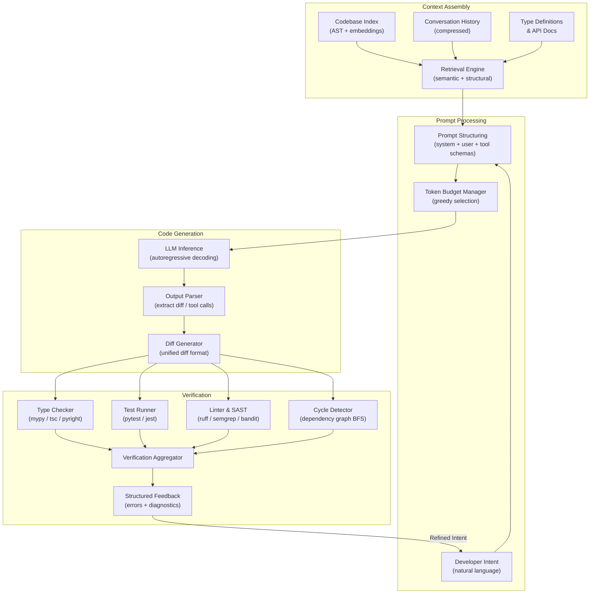

# Lesson 4: Integration with AI — Vibe Coding

## First-Principles Intuition & Invariants

Vibe coding is a development paradigm in which the developer communicates intent through natural language and an AI system translates that intent into executable code. The integration between human and AI is not a convenience layer over a traditional IDE — it is a shift in the abstraction level at which programming operates. Instead of manipulating syntax trees through keystrokes, the developer manipulates a semantic model through prompts, and the AI system compiles those prompts into code.

### The Semantic Compilation Model

Traditional compilation transforms source code into machine code through deterministic phases: lexing, parsing, type checking, optimization, and code generation. Each phase is a pure function — given the same input, it always produces the same output. Vibe coding introduces a probabilistic compilation stage: the transformation of natural language intent into source code via a large language model (LLM).

An autoregressive LLM is a function $f_\theta$ parameterized by learned weights $\theta$ that, given a context $c$ (the system prompt, retrieved code, conversation history) and a developer prompt $p$, models a distribution over token sequences via the chain rule of probability:

$$P(\text{output} \mid c, p) = \prod_{t=1}^{T} P(w_t \mid w_{1}, w_{2}, \ldots, w_{t-1}, c, p;\, \theta)$$

Each $w_t$ is sampled from the vocabulary distribution produced by the final linear layer (logits) followed by softmax. At temperature $\tau > 0$, the sampling distribution is:

$$P(w_t = k) = \frac{\exp(\text{logit}_k / \tau)}{\sum_j \exp(\text{logit}_j / \tau)}$$

At $\tau \to 0$ the model becomes greedy (argmax decoding); at $\tau = 1$ it samples from the raw softmax distribution. This means two identical prompts submitted at $\tau = 1$ can produce structurally different code, because each token choice is a random draw that conditions all subsequent draws. The non-determinism is not a bug — it is an intrinsic property of the softmax-based next-token prediction objective used to train the model.

The practical consequence is that **context management, not prompt phrasing, is the primary lever for output quality.** The model's attention mechanism assigns relevance weights across all tokens in the context window; the signal-to-noise ratio of that context determines whether the model's attention concentrates on the information needed to generate correct code or diffuses across irrelevant tokens.

### The Architecture of a Transformer Inference Pass

Understanding why context quality matters requires understanding the attention mechanism at a computational level. Each transformer layer computes multi-head self-attention:

$$\text{Attention}(Q, K, V) = \text{softmax}\!\left(\frac{QK^\top}{\sqrt{d_k}}\right)V$$

where $Q = XW^Q$, $K = XW^K$, $V = XW^V$, and $X$ is the sequence of token embeddings. The attention scores $QK^\top / \sqrt{d_k}$ measure pairwise token relevance across the entire context. With $n$ tokens in context, this is an $O(n^2)$ operation in both time and memory (for standard dense attention). For a 128K-token context window, this requires holding a $128{,}000 \times 128{,}000$ attention matrix, which is why long-context inference is significantly more expensive than short-context inference, and why filling the context window with low-relevance tokens degrades both quality and latency.

Modern LLM inference systems (vLLM, TensorRT-LLM, llama.cpp) use KV-caching to avoid recomputing attention for previously processed tokens. The key-value projections for each layer are stored in a KV cache, so incremental generation appends only the new token's KV entry. For tool-calling loops in vibe coding environments (described in the next section), KV-cache hit rate is a significant determinant of inference speed.

### The Cybernetic Feedback Loop

Norbert Wiener formalized feedback control in *Cybernetics: Or Control and Communication in the Animal and the Machine* (1948): a system measures its output, compares it against a target, and adjusts its input to reduce the error signal. In vibe coding, this loop operates at the semantic level:

1. The developer encodes intent as a prompt (input signal).
2. The LLM generates code (system output).
3. The developer or automated verifier evaluates the code against the goal (error detection).
4. The developer refines the prompt based on the evaluation (feedback signal).
5. The loop repeats until the error signal falls below an acceptable threshold.

Unlike a thermostat's proportional control, the feedback in vibe coding is discrete and semantic. The error signal is not a scalar but a structured set of verification results: type errors, test failures, behavioral mismatches, and architectural violations. The convergence properties of the loop depend on the developer's ability to diagnose failures and communicate corrections precisely — this is the human skill that vibe coding elevates above raw syntax knowledge.

### Markov Decision Process Formulation

The vibe coding loop is formally modeled as a Markov Decision Process (MDP) defined by the tuple $(S, A, T, R, \gamma)$:

**State** $s_t \in S$: The tuple $(B_t, H_t, C_t, G)$ where $B_t$ is the current codebase state, $H_t$ is the conversation history, $C_t$ is the assembled context window, and $G$ is the goal specification (which may be tests, a formal spec, or natural language).

**Action** $a_t \in A$: The prompt formulated by the developer, including referenced files, explicit constraints, and examples.

**Transition** $T(s_{t+1} \mid s_t, a_t)$: The LLM output $o \sim f_\theta(\cdot \mid C_t, a_t)$ is stochastic; the state transition applies that output to the codebase. The effective transition integrates out the LLM's randomness:

$$T(s_{t+1} \mid s_t, a_t) = \mathbb{E}_{o \sim f_\theta(\cdot \mid C_t, a_t)}\!\left[\delta(s_t, o)\right]$$

where $\delta$ applies the generated diff $o$ to codebase $B_t$.

**Reward** $R(s_t, a_t, s_{t+1})$: A composite multi-objective signal:

$$R = \alpha \cdot \mathbb{1}_{\text{tests pass}} + \beta \cdot \mathbb{1}_{\text{types check}} + \chi \cdot \mathbb{1}_{\text{linter clean}} + \delta \cdot \mathbb{1}_{\text{build succeeds}} - \lambda \cdot \text{iterations}$$

The $-\lambda \cdot \text{iterations}$ penalty makes the cost of each iteration explicit: prompt quality directly determines development velocity. The weights $\alpha, \beta, \chi, \delta, \lambda$ encode the developer's priorities; a security-critical system might assign high weight to static analysis results.

**Discount factor** $\gamma \in [0, 1)$: Reflects the preference for solutions that converge in fewer iterations.

The developer's prompting strategy is the **policy** $\pi(a \mid s)$. Expert vibe coders have internalized a high-quality policy: they can read a type error or test failure and immediately formulate a prompt that corrects the specific failure without introducing regressions. This is a learnable skill with the same structure as debugging proficiency in conventional programming.

### Invariants

Three invariants must hold for the vibe coding loop to converge:

**Context Sufficiency.** The assembled context $C_t$ must contain enough information for the LLM to generate correct code. Missing type signatures, absent API documentation, or omitted dependency code cause the LLM to hallucinate plausible but incorrect implementations. The LLM cannot reference what it cannot see; its training weights may contain outdated or never-correct API knowledge.

**Semantic Preservation.** Each iteration must not break existing behavior unless explicitly intended. This requires a verification oracle — tests, type checkers, or runtime assertions — that can detect regressions. Without an oracle, there is no error signal and the feedback loop is open.

**Goal Monotonicity.** Each iteration must reduce the distance to the goal. If the developer's feedback introduces contradictory constraints or oscillates between incompatible designs, the loop diverges. This is the semantic analog of non-convergent gradient descent caused by an oscillating learning rate.

---

## Core Architecture & Mechanics

An AI-integrated development environment for vibe coding is not a monolith. It is a pipeline of specialized components, each addressing a specific failure mode in the human-AI collaboration loop. The architecture separates context assembly, prompt processing, code generation, and verification into distinct stages with well-defined interfaces.

### Pipeline Architecture



The pipeline is a feedback loop, not a linear process. The verification aggregator produces structured diagnostics (file, line, error code, message) that map precisely to the LLM's ability to locate and fix the problem in the next iteration. Free-form error messages are less useful than structured ones because the LLM can correlate structured diagnostics with specific lines in the code regions in its context.

### Context Management

The LLM's context window is a fixed-size buffer measured in tokens — not characters, not lines. GPT-4o supports 128K tokens; Claude 3.5 Sonnet supports 200K tokens; Gemini 1.5 Pro supports 1M tokens. Despite these sizes, a mature codebase with documentation can easily exhaust even a 1M-token window, and long-context quality degrades for retrieval tasks before the hard limit is reached (the "lost in the middle" phenomenon documented in Liu et al., 2023, where information at the center of a long context is retrieved less reliably than information at the edges).

The retrieval engine uses semantic search over dense code embeddings. Each file or code region is encoded as a fixed-dimension vector using an embedding model specialized for code (e.g., `text-embedding-3-large`, Voyage Code 2, or a locally hosted `nomic-embed-code`). When the developer issues a prompt, the prompt is embedded and cosine similarity retrieves the most relevant code regions within the token budget:

```python
import numpy as np
from dataclasses import dataclass, field
from typing import List, Optional
import heapq

@dataclass
class CodeRegion:
    """
    A contiguous unit of code that can be independently retrieved for context.

    Granularity is typically at the function or class level, not the file level.
    Fine granularity allows tighter token budgets because only relevant functions
    are included, not entire files containing many irrelevant functions.
    """
    file_path: str
    start_line: int
    end_line: int
    content: str
    embedding: np.ndarray          # shape: (D,), unit-norm preferred
    symbols: List[str]             # exported names: functions, classes, types
    language: str = "python"

    @property
    def token_estimate(self) -> int:
        """
        Conservative token estimate.
        
        Code averages ~3.5 characters per token (denser than prose).
        Using integer division by 3 gives a ~15% safety margin.
        Over-estimating is safer than under-estimating: truncation
        in the middle of a function is worse than excluding the region.
        """
        return len(self.content) // 3

    @property
    def line_count(self) -> int:
        return self.end_line - self.start_line + 1


@dataclass
class ContextManager:
    """
    Selects code regions for LLM context using a knapsack-style budget allocator.

    The selection problem is: given a set of code regions each with a relevance
    score and a token cost, select a subset that maximizes total relevance
    subject to the token budget constraint. This is NP-hard (0/1 knapsack),
    but the greedy approximation (sort by score/cost density, take greedily)
    produces good practical results and runs in O(n log n).
    """
    regions: List[CodeRegion] = field(default_factory=list)
    token_budget: int = 32_000      # conservative: leaves room for generation
    conversation_tokens: int = 0    # tokens consumed by conversation history
    system_prompt_tokens: int = 500 # tokens consumed by system instructions

    def available_tokens(self) -> int:
        return (
            self.token_budget
            - self.conversation_tokens
            - self.system_prompt_tokens
        )

    def add_region(self, region: CodeRegion) -> None:
        self.regions.append(region)

    def retrieve(
        self,
        query_embedding: np.ndarray,
        pinned_paths: Optional[List[str]] = None,
        query_symbols: Optional[List[str]] = None,
    ) -> List[CodeRegion]:
        """
        Retrieve code regions relevant to the query within the token budget.

        Scoring combines three signals:
        1. Semantic similarity  — cosine distance in embedding space
        2. Symbol overlap       — explicit references in the prompt
        3. Pinned paths         — files the developer explicitly mentioned

        The greedy selection uses a max-heap over the density metric
        (score / token_cost) to approximate the fractional relaxation
        of the 0/1 knapsack optimum.
        """
        pinned: set[str] = set(pinned_paths or [])
        budget = self.available_tokens()
        # Pre-normalise query embedding to avoid repeated division
        q_norm = query_embedding / (np.linalg.norm(query_embedding) + 1e-9)

        # Build (negative_score, region) heap for max-heap simulation
        heap: list[tuple[float, int, CodeRegion]] = []

        for idx, region in enumerate(self.regions):
            r_norm = region.embedding / (
                np.linalg.norm(region.embedding) + 1e-9
            )
            semantic_score = float(np.dot(q_norm, r_norm))

            symbol_score = 0.0
            if query_symbols:
                overlap = len(set(query_symbols) & set(region.symbols))
                # Each symbol match contributes an additive boost capped at 0.4
                symbol_score = min(0.4, 0.15 * overlap)

            pin_score = 0.3 if region.file_path in pinned else 0.0

            total_score = semantic_score + symbol_score + pin_score
            # Density: score per token (knapsack approximation)
            density = total_score / max(1, region.token_estimate)
            heapq.heappush(heap, (-density, idx, region))

        selected: List[CodeRegion] = []
        used = 0

        while heap:
            neg_density, _, region = heapq.heappop(heap)
            if used + region.token_estimate <= budget:
                selected.append(region)
                used += region.token_estimate

        # Preserve textual order (file, then line) for LLM readability
        selected.sort(key=lambda r: (r.file_path, r.start_line))
        return selected

    def format_context(self, regions: List[CodeRegion]) -> str:
        """
        Render selected regions as a fenced code block per region.

        The header line includes enough metadata for the LLM to understand
        file ownership and location, which is critical for generating correct
        relative imports and understanding architectural boundaries.
        """
        parts: List[str] = []
        for region in regions:
            header = (
                f"// File: {region.file_path} "
                f"[lines {region.start_line}–{region.end_line}]"
            )
            fence = region.language
            parts.append(f"{header}\n```{fence}\n{region.content}\n```")
        return "\n\n".join(parts)
```

The token budget must account for conversation history, system instructions, the generated output budget, and the retrieved code. As the conversation grows, available context shrinks and generation quality degrades gradually — this degradation is not signaled to the developer, making it a silent failure mode. Effective practice is to either periodically summarize conversation history (replacing verbatim turns with a compact decisions-and-constraints summary) or start a fresh session per distinct task.

### Tool Integration and Function Calling

Modern LLMs expose a structured tool-calling interface: the model is provided with a JSON Schema declaration of available functions and may respond with a structured function-call object instead of free-form text. The calling environment executes the function, appends the result to the conversation as a `tool` role message, and re-invokes the model. This continues until the model produces a final text or code response.

Under the hood, tool call support is implemented via fine-tuning the model to produce special tokens (e.g., `<tool_call>` delimiters) or via constrained decoding that forces the model's output to conform to the JSON Schema of the declared functions. The model never directly executes code; it only produces a JSON object describing which function to call and with what arguments. The environment is responsible for execution and sandboxing.

```python
import json
import subprocess
import os
from typing import Any, Callable, Dict, TypedDict
from dataclasses import dataclass

class JSONSchema(TypedDict, total=False):
    type: str
    properties: Dict[str, Any]
    required: list[str]
    description: str


@dataclass
class ToolSpec:
    """Schema declaration for an LLM-callable tool."""
    name: str
    description: str
    parameters: JSONSchema
    handler: Callable[..., str]

    def to_llm_schema(self) -> Dict[str, Any]:
        """Render the OpenAI-compatible function schema for this tool."""
        return {
            "type": "function",
            "function": {
                "name": self.name,
                "description": self.description,
                "parameters": self.parameters,
            },
        }


TOOL_REGISTRY: Dict[str, ToolSpec] = {}


def register_tool(
    name: str,
    description: str,
    params: JSONSchema,
) -> Callable[[Callable[..., str]], ToolSpec]:
    """Decorator that registers a function as an LLM-callable tool."""
    def decorator(fn: Callable[..., str]) -> ToolSpec:
        spec = ToolSpec(
            name=name,
            description=description,
            parameters={"type": "object", "properties": params},
            handler=fn,
        )
        TOOL_REGISTRY[name] = spec
        return spec
    return decorator


@register_tool(
    name="read_file",
    description=(
        "Read the UTF-8 text contents of a file. "
        "Returns the contents, or an error message if the file does not exist."
    ),
    params={
        "path": {
            "type": "string",
            "description": "Path to the file, relative to the project root.",
        },
    },
)
def read_file(path: str) -> str:
    root = os.path.realpath(os.getcwd())
    full = os.path.realpath(os.path.join(root, path))
    # Sandboxing is the environment's job: refuse paths outside the project
    if os.path.commonpath([root, full]) != root:
        return f"Error: {path} is outside the project root"
    if not os.path.isfile(full):
        return f"Error: {path} does not exist"
    with open(full, encoding="utf-8") as f:
        return f.read()


@register_tool(
    name="run_tests",
    description="Run the project's test suite and return the last lines of its output.",
    params={},
)
def run_tests() -> str:
    proc = subprocess.run(["pytest", "-q"], capture_output=True, text=True, timeout=600)
    return "\n".join((proc.stdout + proc.stderr).splitlines()[-40:])


def dispatch_tool_call(name: str, arguments_json: str) -> str:
    """Execute one tool call from the model; errors go back to the model as text."""
    spec = TOOL_REGISTRY.get(name)
    if spec is None:
        return f"Error: unknown tool '{name}'"
    try:
        arguments = json.loads(arguments_json or "{}")
        return spec.handler(**arguments)
    except Exception as e:  # report to the model instead of crashing the loop
        return f"Error: {type(e).__name__}: {e}"
```


## Failure Modes & Production Practice

### Hallucinated APIs and Semantic Drift

The single most common failure in LLM-assisted code generation is the model emitting a call to a function, class, or module that does not exist in the target codebase or in the standard library version the project pins. This is not a random error; it is a predictable consequence of the training distribution. The model has seen millions of code snippets across many library versions, and when the prompt context does not contain the exact signature, the model reconstructs a *plausible* signature from its parametric memory rather than from the provided context.

Three sub-cases dominate:

1. **Library or version drift.** The model writes `httpx.get(url, allow_redirects=True)`, mixing in the `requests` keyword; `httpx` calls it `follow_redirects`, so the call fails with a `TypeError`. The same happens across versions of one library, such as pandas code that still calls `DataFrame.append()`, removed in pandas 2.0. The call *looks* correct because it was correct somewhere.
2. **Invented symbols.** The model writes `from myproject.utils import deep_merge` when no such function exists. It has seen `deep_merge` in a third-party library and assumes the project has it.
3. **Signature mismatch.** The model calls `engine.submit(job, priority=5)` but the actual signature is `engine.submit(job, *, priority: int = 0, queue: str = "default")` — the keyword-only enforcement is lost.

The mitigation is not "prompt harder." It is to make the ground truth *visible* in the context window. The `ContextManager` from the previous section must be fed the actual symbol table of the target module, not just a prose description. In practice this means running a lightweight AST extraction pass before the LLM call:

```python
import ast
import sys
from pathlib import Path
from typing import Dict, List, Set


def extract_public_symbols(source_path: Path) -> Dict[str, str]:
    """
    Return a mapping of public symbol name -> one-line signature string.

    Uses the stdlib `ast` module so no third-party parser is required.
    Only top-level and class-level definitions are captured; nested
    functions are intentionally excluded to keep the symbol table small
    enough to fit in a few hundred tokens.
    """
    tree = ast.parse(source_path.read_text(encoding="utf-8"))
    symbols: Dict[str, str] = {}

    for node in tree.body:
        if isinstance(node, (ast.FunctionDef, ast.AsyncFunctionDef)):
            if node.name.startswith("_"):
                continue
            # ast.unparse keeps *args, keyword-only markers, defaults and annotations
            sig = f"{node.name}({ast.unparse(node.args)})"
            doc = ast.get_docstring(node)
            first_line = doc.splitlines()[0] if doc else ""
            symbols[node.name] = f"{sig}  # {first_line}"

        elif isinstance(node, ast.ClassDef):
            if node.name.startswith("_"):
                continue
            methods: List[str] = []
            for item in node.body:
                if isinstance(item, (ast.FunctionDef, ast.AsyncFunctionDef)) and not item.name.startswith("_"):
                    methods.append(f"{item.name}({ast.unparse(item.args)})")
            symbols[node.name] = f"class {node.name}: {', '.join(methods)}"

    return symbols


def build_symbol_index(project_root: Path) -> Dict[str, Dict[str, str]]:
    """
    Walk the project tree and build a per-module symbol table.

    The resulting dict maps module dotted-path -> {symbol: signature}.
    This is injected into the LLM context as a compact reference so the
    model can verify that a name it is about to call actually exists.
    """
    index: Dict[str, Dict[str, str]] = {}
    for py_file in project_root.rglob("*.py"):
        rel = py_file.relative_to(project_root)
        module = ".".join(rel.with_suffix("").parts)
        try:
            index[module] = extract_public_symbols(py_file)
        except (SyntaxError, UnicodeDecodeError):
            # Skip files that do not parse; the model will not reference them
            continue
    return index
```

The symbol index is then rendered as a compact block and prepended to the system prompt or the retrieved context. For a medium project this is a few thousand tokens, so in practice you inject only the modules relevant to the task, which keeps it to a few hundred tokens within the budget the `ContextManager` allocates. Without this, the model's parametric memory fills the gap, and the gap is where hallucination lives.

### Tool-Call Divergence and Non-Termination

The tool-calling loop described in the previous section is, in the worst case, unbounded. A model that is uncertain about the state of the codebase may issue a `read_file` call, receive the contents, issue another `read_file` call for a different file, and so on, never converging on a final text response. In a production agent this manifests as a runaway token bill and a multi-minute latency spike.

The standard guard is a **hard iteration cap** combined with a **no-progress detector**. The no-progress detector tracks whether the set of files read (or the set of test outcomes) has changed between consecutive iterations. If the model reads the same file twice in a row, or if `run_tests` returns the identical failure set for two consecutive calls, the loop is forced to terminate and the partial result is returned to the developer with a warning.

```python
import json
from collections import deque
from dataclasses import dataclass, field
from typing import Any, Deque, Dict, List, Optional, Set

MAX_TOOL_ITERATIONS = 12  # hard cap; ~4 minutes of wall-clock at 20 s/iter
NO_PROGRESS_WINDOW = 3    # consecutive identical states before forcing stop


@dataclass
class ToolCallRecord:
    name: str
    arguments: Dict[str, Any]
    result_hash: str  # hash of the first 512 chars of the result string


@dataclass
class AgentLoopState:
    """
    Mutable state carried across tool-call iterations.

    `history` is a bounded deque so memory does not grow unbounded in a
    pathological loop. `consecutive_hashes` tracks the last N result hashes
    to detect no-progress stagnation.
    """
    history: Deque[ToolCallRecord] = field(
        default_factory=lambda: deque(maxlen=NO_PROGRESS_WINDOW * 2)
    )
    files_read: Set[str] = field(default_factory=set)
    test_outcomes: List[str] = field(default_factory=list)
    iteration: int = 0

    def record(self, name: str, args: Dict[str, Any], result: str) -> None:
        import hashlib
        h = hashlib.sha256(result[:512].encode()).hexdigest()[:16]
        self.history.append(ToolCallRecord(name, args, h))
        if name == "read_file" and "path" in args:
            self.files_read.add(args["path"])
        if name == "run_tests":
            self.test_outcomes.append(result)
        self.iteration += 1

    def has_stalled(self) -> bool:
        """
        Return True if the last NO_PROGRESS_WINDOW results are identical,
        indicating the model is re-reading the same state without making
        progress.
        """
        if len(self.history) < NO_PROGRESS_WINDOW:
            return False
        recent = [r.result_hash for r in list(self.history)[-NO_PROGRESS_WINDOW:]]
        return len(set(recent)) == 1

    def should_terminate(self) -> bool:
        return (
            self.iteration >= MAX_TOOL_ITERATIONS
            or self.has_stalled()
        )
```

The loop driver checks `state.should_terminate()` after every `dispatch_tool_call` return. When the cap is hit, the agent emits a structured message to the developer:

```text
[Agent stopped after 12 tool calls. Last 3 calls were identical
 read_file("src/auth.py") with no intervening mutation.
 Suggested next step: provide the missing dependency or narrow the task.]
```

This is preferable to a silent timeout because it gives the developer a *diagnosis*, not just a failure.

### Context Erosion and Silent Degradation

The `ContextManager` from the previous section allocates a fixed `token_budget` (32 000 in the example) and subtracts conversation history and system-prompt tokens. As the conversation grows, `available_tokens()` shrinks. The knapsack allocator then selects fewer and lower-density regions. The model still produces output, but the output quality degrades *gradually and silently*: it starts omitting edge cases, it references symbols that were in the context three turns ago but have since been evicted, and it produces code that compiles but violates project conventions that were stated in an early system-prompt turn.

The degradation is silent because the model has no mechanism to say "I am missing context." It will confidently generate plausible-looking code from its parametric memory, which is exactly the hallucination channel described above.

Two production mitigations:

**Periodic summarisation.** Every *k* turns (typically 8–12), the agent issues a meta-prompt to itself: "Summarise the decisions made, constraints stated, and open questions in the conversation so far in under 400 tokens." The verbatim turns are replaced by the summary. This compresses the conversation history by roughly 5–10× while preserving the *decisions* that matter for subsequent code generation.

```python
from typing import List, Tuple

SUMMARY_INTERVAL = 10  # summarise every 10 user/assistant turns


def compress_history(
    turns: List[Tuple[str, str]],
    summarise_fn,  # Callable[[str], str] — wraps the LLM call
) -> List[Tuple[str, str]]:
    """
    Replace the first (len - SUMMARY_INTERVAL) turns with a single
    (system, summary) pair. The most recent SUMMARY_INTERVAL turns are
    kept verbatim so the model retains immediate conversational context.

    `summarise_fn` takes the concatenated text of the old turns and
    returns a compact summary string. It is injected rather than
    hard-coded so the caller controls which model and prompt template
    is used.
    """
    if len(turns) <= SUMMARY_INTERVAL:
        return turns

    old, recent = turns[:-SUMMARY_INTERVAL], turns[-SUMMARY_INTERVAL:]
    old_text = "\n".join(
        f"[{role}] {content}" for role, content in old
    )
    summary = summarise_fn(old_text)
    return [("system", f"[Conversation summary]\n{summary}")] + recent
```

**Task-scoped sessions.** A distinct task (add a feature, fix a bug, refactor a module) gets a fresh conversation. The developer or the IDE plugin starts a new session, re-injecting the symbol index and the relevant file regions. This avoids the accumulation of stale context from a previous, unrelated task.

### Security and Sandboxing Boundaries

The `read_file` tool in the previous section performs a path-traversal check via `os.path.commonpath`. This is necessary but insufficient. A production agent that can execute `run_tests` (which shells out to `pytest`) or a hypothetical `run_command` tool is a code-execution surface. The threat model is not a malicious user; it is a *prompt injection* in a file the agent reads. A README or a comment in a third-party dependency can contain text that, once ingested into the context, causes the model to issue a tool call the developer did not intend.

The defence is layered:

1. **Sandbox the execution environment.** `run_tests` and any shell-out tool must run in a container or a restricted subprocess with no network access, no write access outside a designated scratch directory, and a wall-clock timeout. The `subprocess.run` call in the previous section should be wrapped:

```python
import subprocess
import resource
import signal
import os
from typing import Optional


def run_in_sandbox(
    cmd: list[str],
    *,
    timeout: int = 600,
    max_memory_mb: int = 512,
    cwd: Optional[str] = None,
) -> subprocess.CompletedProcess:
    """
    Execute a command in a restricted subprocess.

    On Linux, `resource.setrlimit` caps virtual memory and CPU time.
    The process is placed in its own process group so that a SIGTERM
    to the group kills child processes (e.g., pytest spawning workers).
    Network access is not blocked here; that must be handled at the
    container or cgroup level.
    """
    def _set_limits() -> None:
        # Cap virtual memory to prevent OOM of the host
        mem_bytes = max_memory_mb * 1024 * 1024
        resource.setrlimit(resource.RLIMIT_AS, (mem_bytes, mem_bytes))
        # Cap CPU time to 2× the wall-clock timeout
        resource.setrlimit(resource.RLIMIT_CPU, (timeout * 2, timeout * 2))

    proc = subprocess.run(
        cmd,
        capture_output=True,
        text=True,
        timeout=timeout,
        cwd=cwd,
        preexec_fn=_set_limits if os.name == "posix" else None,
        start_new_session=True,  # new process group on POSIX
    )
    return proc
```

2. **Allowlist the tool set.** The agent should not have a generic `run_command` tool. It should have a fixed, audited set: `read_file`, `write_file` (to a scratch directory only), `run_tests`, `list_directory`. Each tool's schema is reviewed in code review before the agent is deployed.

3. **Treat all file contents as untrusted input.** The model's context is a concatenation of developer instructions and file contents. A code comment asking the agent to run `rm -rf /` is not a command; it is data. The system prompt must state explicitly that file contents are data, not instructions. This is a soft guard: it makes injection less likely but does not prevent it, which is why the sandbox and the allowlist above must hold even when the model is fooled.

### The Review Bottleneck

The economic model of vibe coding assumes that the developer's time is the scarce resource and that the LLM's token budget is cheap. This inverts the traditional software-economics model, where developer time is expensive and compute is cheap. The inversion is real but bounded: the developer must still *read* the diff, *understand* the change, and *decide* whether to accept it. For a 200-line diff, that is roughly 5–10 minutes of focused reading. For a 2 000-line diff, it is an hour.

The practical implication is that the agent should be constrained to produce *small, reviewable diffs*. A 40-line change to a single file is reviewable in under two minutes. A 400-line change across six files is not. The agent's system prompt should include a directive: "Prefer a sequence of small, independently reviewable changes over a single large change. If the task requires more than ~80 lines of diff, split it into sub-tasks and present them one at a time."

This is not a model limitation; it is a *process* limitation. The model can produce a 400-line diff in one shot. The constraint is on the human reviewer's attention span and error-detection rate. Industry studies of code review (for example SmartBear's analysis of reviews at Cisco) found that defect detection falls off sharply once a review exceeds about 200–400 lines.

### Production Guardrails

The following checklist consolidates the mitigations above into a deployable set of invariants that a production agent must satisfy:

| Invariant | Mechanism | Failure if violated |
|---|---|---|
| Symbol ground-truth in context | AST symbol index injected per call | Hallucinated APIs |
| Hard iteration cap on tool loop | `AgentLoopState.should_terminate()` | Runaway token cost, latency spike |
| No-progress detection | Consecutive-hash comparison in `AgentLoopState` | Infinite loop on ambiguous state |
| Periodic history compression | `compress_history()` every *k* turns | Silent context erosion |
| Task-scoped sessions | New conversation per distinct task | Stale context from prior task |
| Sandboxed execution | `run_in_sandbox()` with rlimits | Host compromise, OOM |
| Tool allowlist | Fixed `TOOL_REGISTRY`, no generic shell | Prompt-injection escalation |
| Diff size cap | System-prompt directive, ~80 lines | Review bottleneck, undetected defects |
| File contents as data | System-prompt instruction | Prompt injection via file content |

No single guard is sufficient. The security and reliability of the system is the *intersection* of all guards. Removing any one row from the table opens a specific, predictable failure channel.

## Summary

This lesson traced the signal chain from a natural-language prompt to a code edit on disk, decomposing it into the transformer inference pass that produces tokens, the context-management layer that selects which code regions enter the model's window, and the tool-calling loop that lets the model interact with the filesystem and test runner.

The first-principles framing established three invariants that survive across model generations and vendor changes:

- **The model is a stochastic function from a token sequence to a token sequence.** It does not "understand" code; it produces a next-token distribution conditioned on the context window. All downstream behaviour — code generation, tool calling, summarisation — is a specialisation of this single operation.
- **The context window is a hard, finite budget.** Everything the model "knows" at inference time is the concatenation of the system prompt, the conversation history, and the retrieved code regions, all competing for the same token budget. The knapsack allocator is the mechanism that makes this competition explicit.
- **The feedback loop is cybernetic, not causal.** The model does not observe the effect of its code on the running system unless the environment feeds test output back into the next turn. Without that loop, the model is a one-shot generator; with it, the model is a controller that can correct its own errors.

The failure modes section showed that each invariant, when violated, produces a specific and predictable failure: hallucinated APIs when the symbol ground-truth is absent, runaway loops when the iteration cap is missing, silent degradation when context erodes without summarisation, and security exposure when the sandbox boundary is porous. The production guardrails table is the operational checklist that keeps all invariants satisfied simultaneously.

The lesson deliberately stopped at the boundary of the agent loop. What happens *after* the agent produces a diff — the human review, the CI pipeline, the merge decision — is the domain of software engineering process, not of the model. The model's job ends at the diff. The developer's job begins there.

## Key Terms

| Term | Definition |
|---|---|
| **Semantic compilation** | The process by which an LLM maps a natural-language specification to a sequence of code tokens, analogous to a compiler mapping source to object code but operating in a probabilistic, lossy regime. |
| **Context window** | The fixed maximum number of tokens (input + output) that a single transformer inference pass can attend to. Determined by the model's architecture and the serving configuration. |
| **Token budget** | The portion of the context window allocated to retrieved code regions after subtracting system-prompt and conversation-history tokens. Managed by the `ContextManager`. |
| **Knapsack approximation** | The greedy density-based selection (score ÷ token cost) used to choose which code regions fit within the token budget. A polynomial-time approximation to the NP-hard 0/1 knapsack problem. |
| **Tool call / function calling** | A structured output from the model (a JSON object naming a function and its arguments) that the execution environment interprets and executes. The model never executes code directly. |
| **Sandbox** | A restricted execution environment (container, restricted subprocess, or VM) that limits the side effects of code the agent runs. Enforced via OS-level resource limits and filesystem isolation. |
| **Prompt injection** | An attack in which untrusted text (file contents, web pages, user input) is ingested into the model's context and causes the model to act on instructions embedded in that text rather than on the developer's original intent. |
| **No-progress detection** | A loop-termination heuristic that compares the hash of consecutive tool-call results; if *k* consecutive results are identical, the loop is forced to stop. |
| **Context erosion** | The gradual degradation of generation quality as conversation history consumes an increasing fraction of the token budget, leaving fewer tokens for retrieved code. Silent because the model does not signal the degradation. |
| **Diff size cap** | A process constraint (typically ~80 lines) on the maximum size of a single code change the agent should produce, motivated by the human reviewer's attention span and defect-detection rate. |
| **Symbol index** | A per-module mapping of public symbol names to their signatures, extracted via AST parsing and injected into the LLM context to ground the model's API references in the actual codebase. |
| **Task-scoped session** | A conversation that is started fresh for each distinct development task, avoiding the accumulation of stale context from prior, unrelated tasks. |
| **Constrained decoding** | A decoding strategy (e.g., grammar-constrained or JSON-Schema-constrained) that forces the model's output tokens to conform to a specified structure, used to guarantee that tool-call outputs are valid JSON. |
| **Cybernetic feedback loop** | The closed-loop structure in which the model's output (code) is executed, the result (test output, error message) is fed back into the next inference pass, and the model adjusts its subsequent output. Analogous to a PID controller in classical control theory. |
| **Markov Decision Process (MDP) formulation** | The formal framing of the agent loop as a sequence of (state, action, reward, next-state) transitions, where the state is the conversation + codebase, the action is a tool call or code edit, and the reward is a heuristic (tests pass, diff accepted). |