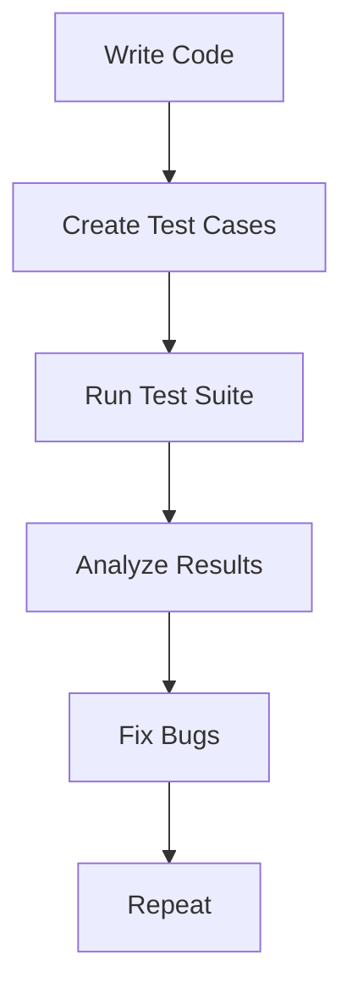

# Beginner Foundation: Test
## 1. Everyday Intuition & First Principles
Imagine you're building a toy car. You want to make sure it rolls smoothly and doesn't fall apart. Testing is like checking your toy car to ensure it works as expected. Just as you'd test your toy car by rolling it down a ramp, developers test their code to ensure it performs correctly and handles different situations smoothly.

## 2. Foundational Vocabulary & Glossary
- **Test:** A process to verify that a piece of software works as intended.
- **Unit Test:** A test that checks the smallest parts of an application, like individual functions or methods.
- **Integration Test:** A test that checks how different parts of an application work together.
- **Test Case:** A specific scenario used to test a particular aspect of the software.
- **Test Suite:** A collection of test cases that are run together.
- **Test Environment:** The setup in which tests are run, often mimicking the production environment.
- **Test Automation:** The use of software tools to run tests automatically.
- **Test Coverage:** The degree to which the source code of a program is executed when a particular test suite runs.

## 3. Visual System Flow
### ASCII Diagram
```
+-------------------+
|   Write Code      |
+-------------------+
          |
          v
+-------------------+
|   Create Test     |
|     Cases         |
+-------------------+
          |
          v
+-------------------+
|   Run Test Suite  |
+-------------------+
          |
          v
+-------------------+
|   Analyze Results |
+-------------------+
          |
          v
+-------------------+
|   Fix Bugs        |
+-------------------+
          |
          v
+-------------------+
|   Repeat          |
+-------------------+
```

### Mermaid Flowchart


## 4. Common Beginner Misconceptions & Mental Traps
- **Misconception:** Testing is only for finding bugs. **Reality:** Testing is also about verifying that the software meets its requirements and behaves as expected.
- **Misconception:** Testing is time-consuming and slows down development. **Reality:** Testing can save time in the long run by catching issues early, reducing the need for extensive debugging later.
- **Misconception:** Only developers need to write tests. **Reality:** Everyone involved in the software development process, including testers and project managers, can contribute to testing.

## 5. Socratic Discussion Starters
- What is the purpose of testing in software development?
- Can you explain the difference between unit testing and integration testing?
- Why is it important to have a test suite?
- How does test automation benefit the development process?
- What are some common mistakes to avoid when writing test cases?
