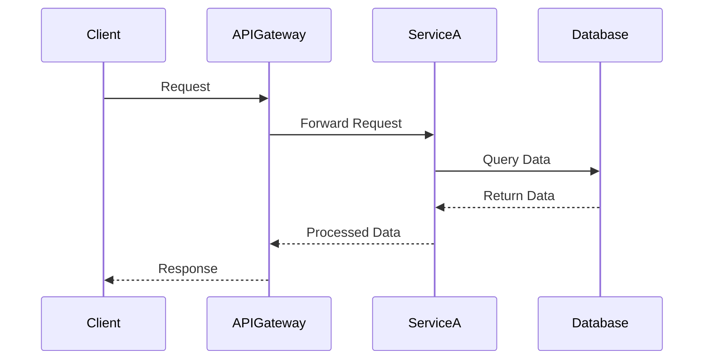

# Intermediate Foundation: Test
## 1. Architectural Mental Model

### Overview
In the realm of computing, testing is not just about verifying that individual components work as expected but about ensuring that the entire system behaves correctly under various conditions. This involves understanding how different components interact, how data flows through the system, and how failures are handled.

### Key Concepts
- **Unit Testing:** Testing individual units or components of the software in isolation.
- **Integration Testing:** Testing the interaction between different units or components.
- **System Testing:** Testing the entire system to ensure it meets the specified requirements.
- **Acceptance Testing:** Testing the system to ensure it meets the user's requirements and expectations.

### Production Architecture
In production environments, testing is integrated into the CI/CD pipeline. This ensures that every change is tested automatically before deployment. Key components include:
- **Continuous Integration (CI):** Automates the process of integrating code changes from multiple contributors.
- **Continuous Deployment (CD):** Automates the deployment of code changes to production.
- **Test Environments:** Mirrors production environments to ensure tests are representative of real-world conditions.

## 2. Systems Taxonomy & Component Protocols

### Standard Interfaces
- **RESTful APIs:** Standardized interface for communication between components using HTTP methods.
- **gRPC:** High-performance RPC framework that uses HTTP/2 for transport.
- **Message Queues:** Protocols like AMQP (Advanced Message Queuing Protocol) and MQTT (Message Queuing Telemetry Transport) for asynchronous communication.

### Protocols
- **HTTP/HTTPS:** Protocols for transferring data over the web.
- **TCP/IP:** Protocol suite for communication over networks.
- **WebSocket:** Protocol enabling full-duplex communication channels over a single TCP connection.

### Data Models
- **JSON:** Lightweight data-interchange format.
- **XML:** Markup language for storing and transporting data.
- **Protocol Buffers:** Binary format for serializing structured data.

## 3. Multi-Component Interaction Flow

### ASCII Sequence Diagram
```
Client ->> API Gateway: Request
API Gateway ->> Service A: Forward Request
Service A ->> Database: Query Data
Database -->> Service A: Return Data
Service A -->> API Gateway: Processed Data
API Gateway -->> Client: Response
```

### Mermaid Sequence Diagram


## 4. Architectural Trade-offs & Production Pitfalls

### Trade-offs
- **Performance vs. Reliability:** Optimizing for speed may sometimes compromise reliability.
- **Scalability vs. Complexity:** Designing for scalability can increase system complexity.
- **Security vs. Usability:** Enhancing security features can sometimes reduce user experience.

### Production Pitfalls
- **Flaky Tests:** Tests that pass or fail intermittently can lead to false positives/negatives.
- **Test Coverage Gaps:** Incomplete test coverage can miss critical bugs.
- **Environment Mismatches:** Differences between test and production environments can lead to undetected issues.

## 5. Socratic Discussion Starters

### Questions Bridging Architecture to Low-Level Implementation
- How does the choice of testing framework impact system architecture?
- What are the implications of using synchronous vs. asynchronous communication in a distributed system?
- How can we ensure that tests are representative of real-world usage patterns?
- What strategies can be employed to minimize the impact of environment mismatches on testing?
- How do you balance the need for comprehensive testing with the constraints of time and resources?

---

This guide aims to provide a deeper understanding of testing in the context of system architecture, emphasizing the importance of robust testing practices in production environments.
