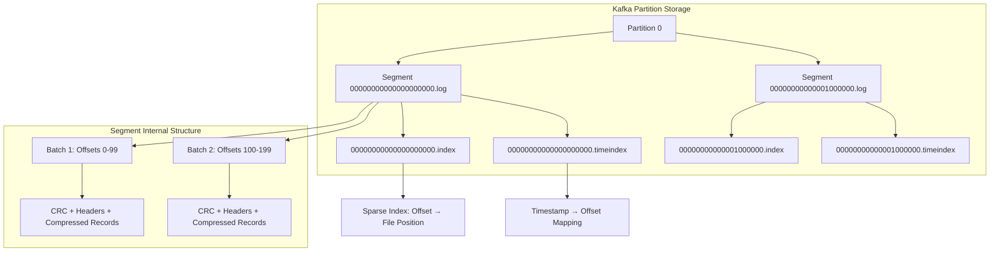
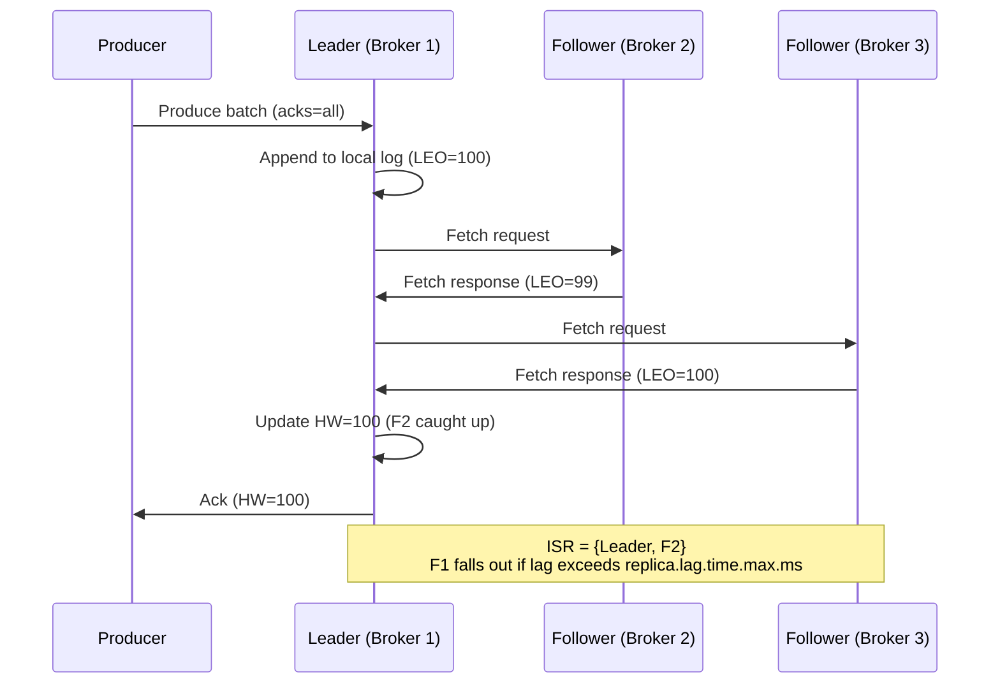
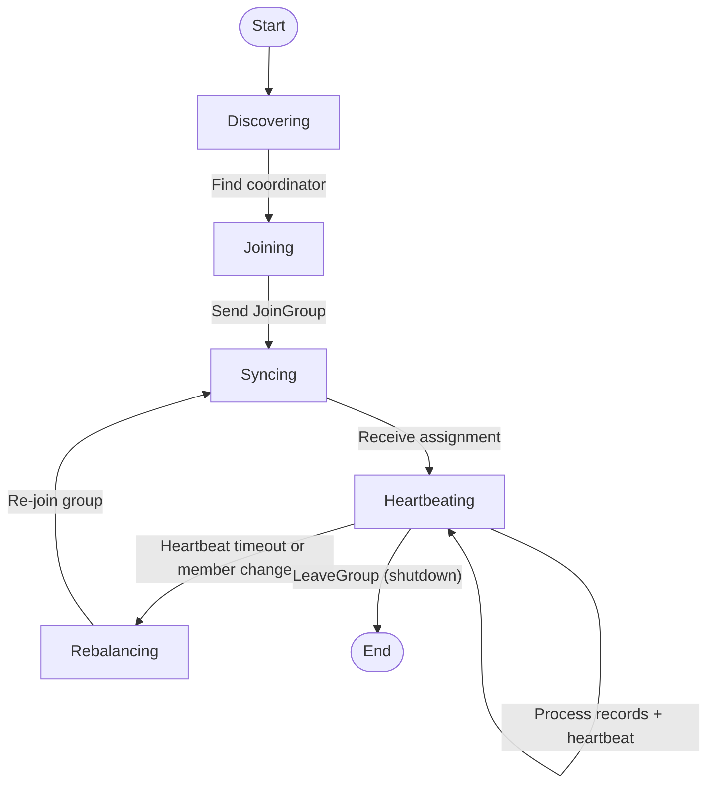
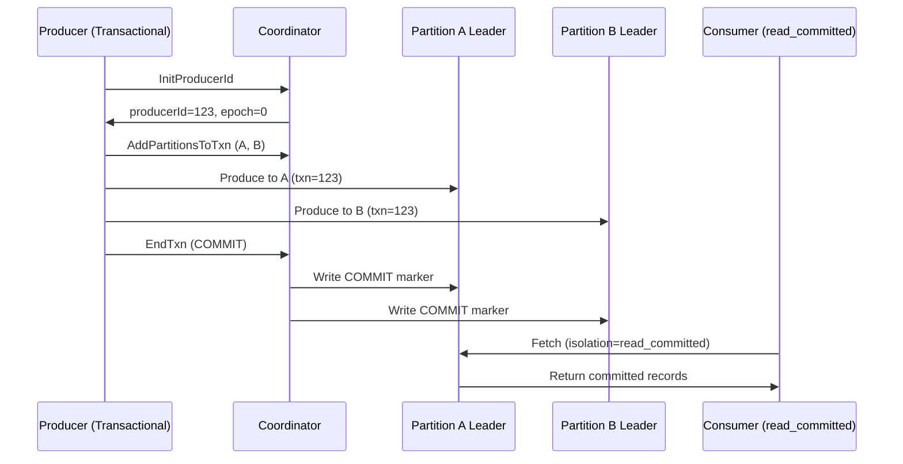
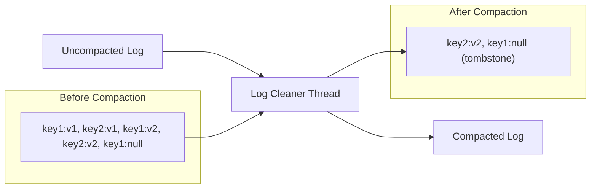

# Operational Verification Labs: Apache Kafka Internals

## Objective & Environment Setup

This lab guide enables distributed systems engineers, platform operators, and SREs to verify Apache Kafka's internal mechanisms through direct inspection of log segments, replication protocols, consumer group coordination, and partition leadership election. Unlike application-level tutorials, these exercises focus on the underlying storage engine, network protocol behavior, and cluster coordination primitives that govern Kafka's distributed commit log architecture.

The verification environment requires a multi-broker Kafka cluster (minimum 3 nodes) running version 3.6+, ZooKeeper or KRaft mode for metadata management, and direct filesystem access to inspect log segments, index files, and snapshot metadata. All exercises assume familiarity with distributed consensus algorithms (Raft for KRaft, ZAB for ZooKeeper), the producer/consumer protocol semantics, and LSM-tree storage principles.

### Required Tools and Configuration

- **Apache Kafka 3.6+** – distributed streaming platform with KRaft or ZooKeeper
- **kafka-dump-log.sh** – inspects log segment internals, index structures, and record batches
- **kafka-consumer-groups.sh** – queries consumer group state, lag, and partition assignments
- **kafka-topics.sh** – manages topic metadata and partition distribution
- **kafka-reassign-partitions.sh** – triggers partition reassignment and replication
- **kafka-log-dirs.sh** – displays replica distribution across broker filesystems
- **JMX metrics** – exposes broker, producer, and consumer performance counters
- **tcpdump/Wireshark** – captures Kafka wire protocol traffic for protocol analysis

### Environment Setup

1. **Deploy a 3-broker Kafka cluster with KRaft**:
   ```bash
   # Generate cluster UUID
   KAFKA_CLUSTER_ID="$(bin/kafka-storage.sh random-uuid)"
   
   # Format log directories for each broker
   bin/kafka-storage.sh format -t $KAFKA_CLUSTER_ID -c config/kraft/server-1.properties
   bin/kafka-storage.sh format -t $KAFKA_CLUSTER_ID -c config/kraft/server-2.properties
   bin/kafka-storage.sh format -t $KAFKA_CLUSTER_ID -c config/kraft/server-3.properties
   
   # Start brokers (adjust node.id and advertised.listeners per broker)
   bin/kafka-server-start.sh config/kraft/server-1.properties &
   bin/kafka-server-start.sh config/kraft/server-2.properties &
   bin/kafka-server-start.sh config/kraft/server-3.properties &
   ```

2. **Configure `server.properties` for observability**:
   ```properties
   # Broker identification
   node.id=1
   process.roles=broker,controller
   controller.quorum.voters=1@localhost:9093,2@localhost:9094,3@localhost:9095
   
   # Storage and retention
   log.dirs=/var/kafka-logs-1
   log.segment.bytes=1073741824
   log.retention.hours=168
   log.retention.check.interval.ms=300000
   
   # Replication and durability
   min.insync.replicas=2
   default.replication.factor=3
   unclean.leader.election.enable=false
   
   # Performance tuning
   num.network.threads=8
   num.io.threads=8
   socket.send.buffer.bytes=102400
   socket.receive.buffer.bytes=102400
   
   # JMX metrics
   JMX_PORT=9999
   ```

3. **Verify cluster metadata**:
   ```bash
   bin/kafka-metadata.sh --snapshot /var/kafka-logs-1/__cluster_metadata-0/00000000000000000000.log --print
   ```

4. **Enable consumer group observability**:
   ```bash
   # Create test topic with 3 partitions
   bin/kafka-topics.sh --create --topic verification-topic \
     --partitions 3 --replication-factor 3 \
     --bootstrap-server localhost:9092
   ```

---

## Exercise 1: Log Segment Structure & Index Internals

Kafka's storage layer is a distributed, immutable log where each partition is an ordered sequence of log segments. Each segment consists of a `.log` file (containing batched records), a `.index` file (offset-to-physical-position mapping), and a `.timeindex` file (timestamp-to-offset mapping). Understanding this structure is critical for diagnosing storage issues, compaction behavior, and data retention mechanics.

### Architectural Context: Kafka Storage Engine

Kafka partitions are append-only logs. Each partition is divided into segments (default 1GB or 7 days). Within a segment, records are grouped into batches for compression and network efficiency. The batch format includes:
- **Base offset**: First record offset in the batch
- **Batch length**: Total byte size of the batch
- **CRC32C checksum**: Verifies batch integrity
- **Magic byte**: Protocol version (2 for Kafka 2.0+)
- **Compression type**: None, GZIP, Snappy, LZ4, or ZSTD
- **Timestamp**: Producer-provided or broker-assigned timestamp
- **Records**: Array of key-value pairs with headers

The `.index` file is a sparse index mapping offsets to physical byte positions in the `.log` file. It is not a complete index—Kafka uses binary search on the index, then scans the log file to locate the exact record. The `.timeindex` provides timestamp-based lookups for log retention and consumer seek operations.



### Step 1: Produce Records with Known Structure

```bash
# Produce 1000 records with controlled key distribution
for i in {1..1000}; do
  echo "key-$((i % 10)):value-$i:$(date +%s%3N)" | \
  bin/kafka-console-producer.sh --topic verification-topic \
    --property "parse.key=true" --property "key.separator=:" \
    --bootstrap-server localhost:9092
done
```

### Step 2: Locate Log Segments on Disk

```bash
# Identify the broker's log directory for partition 0
bin/kafka-log-dirs.sh --bootstrap-server localhost:9092 \
  --topic-list verification-topic --describe | jq .

# Navigate to the partition directory
cd /var/kafka-logs-1/verification-topic-0

# List segment files
ls -lh
# Expected output:
# 00000000000000000000.log
# 00000000000000000000.index
# 00000000000000000000.timeindex
# 00000000000000000000.snapshot
```

### Step 3: Inspect Log Segment Internals

```bash
# Dump the entire log segment with record-level details
bin/kafka-dump-log.sh --files /var/kafka-logs-1/verification-topic-0/00000000000000000000.log \
  --deep-iteration --print-data-log

# Output includes:
# - baseOffset: Starting offset of the batch
# - lastOffset: Ending offset of the batch
# - count: Number of records in the batch
# - baseSequence: Producer idempotence sequence number
# - lastSequence: Final sequence in the batch
# - producerId: Transactional producer ID
# - producerEpoch: Producer generation number
# - partitionLeaderEpoch: Leadership generation
# - isTransactional: Whether batch is part of a transaction
# - compression: Compression codec used (none, gzip, snappy, lz4, zstd)
# - timestampType: CreateTime or LogAppendTime
# - CRC: Checksum for batch integrity
```

### Step 4: Analyze Index File Structure

```bash
# Dump the offset index
bin/kafka-dump-log.sh --files /var/kafka-logs-1/verification-topic-0/00000000000000000000.index

# Output format:
# offset: 0 position: 0
# offset: 50 position: 4096
# offset: 100 position: 8192
# ...
# Each entry maps an offset to a physical byte position in the .log file
```

The index is sparse—only every Nth record (default: 4KB of log data) gets an index entry. This reduces index size while maintaining O(log n) lookup performance via binary search followed by linear scan.

### Step 5: Verify Timestamp Index

```bash
# Dump the timestamp index
bin/kafka-dump-log.sh --files /var/kafka-logs-1/verification-topic-0/00000000000000000000.timeindex

# Output format:
# timestamp: 1704067200000 offset: 0
# timestamp: 1704067260000 offset: 50
# timestamp: 1704067320000 offset: 100
```

This index enables time-based log retention (`log.retention.ms`) and consumer seeks to specific timestamps (`KafkaConsumer.offsetsForTimes()`).

### Step 6: Measure Compression Efficiency

```bash
# Compare compressed vs uncompressed batch sizes
bin/kafka-dump-log.sh --files /var/kafka-logs-1/verification-topic-0/00000000000000000000.log \
  --deep-iteration | grep -E "compression|size"

# Calculate compression ratio:
# compression_ratio = uncompressed_size / compressed_size
```

Kafka supports per-batch compression. Producers compress batches before sending; brokers store compressed data without recompression unless the broker's `compression.type` differs from the producer's.

---

## Exercise 2: Replication Protocol & ISR Verification

Kafka's replication protocol ensures fault tolerance by maintaining in-sync replicas (ISR) for each partition. The ISR set includes replicas that have caught up to the leader's high watermark—the offset of the last committed record. Understanding ISR dynamics, leader election, and replication lag is essential for capacity planning and failure recovery.

### Architectural Context: Replication & Consistency

Kafka uses a leader-follower replication model. Each partition has:
- **Leader**: Handles all reads and writes
- **Followers**: Replicate from the leader and serve as failover candidates
- **ISR (In-Sync Replica) set**: Replicas within `replica.lag.time.max.ms` of the leader

Producers can configure acknowledgment semantics via `acks`:
- `acks=0`: Fire-and-forget (no broker acknowledgment)
- `acks=1`: Leader acknowledgment only
- `acks=all` or `acks=-1`: ISR quorum acknowledgment (most durable)

The high watermark (HW) is the offset up to which all ISR members have replicated. Consumers only see records below the HW, ensuring read-after-write consistency across replicas.



### Step 1: Create a Replicated Topic

```bash
bin/kafka-topics.sh --create --topic replication-test \
  --partitions 1 --replication-factor 3 \
  --config min.insync.replicas=2 \
  --bootstrap-server localhost:9092
```

### Step 2: Inspect Initial Partition Assignment

```bash
bin/kafka-topics.sh --describe --topic replication-test \
  --bootstrap-server localhost:9092

# Output:
# Topic: replication-test  Partition: 0  Leader: 1  Replicas: 1,2,3  Isr: 1,2,3
# All replicas are in-sync initially
```

### Step 3: Produce Data with ISR Quorum Acknowledgment

```bash
# Produce 100 records with acks=all
for i in {1..100}; do
  echo "replication-test-$i" | bin/kafka-console-producer.sh \
    --topic replication-test \
    --bootstrap-server localhost:9092 \
    --producer-property acks=all
done
```

### Step 4: Monitor Replication Lag via JMX

```bash
# Query UnderReplicatedPartitions metric (should be 0)
curl -s http://localhost:9999/jolokia/read/kafka.server:type=ReplicaManager,name=UnderReplicatedPartitions | jq .

# Query ReplicaMaxLag metric for each partition
curl -s http://localhost:9999/jolokia/read/kafka.server:type=ReplicaFetcherManager,name=MaxLag,clientId=Replica | jq .
```

### Step 5: Simulate Follower Failure

```bash
# Stop broker 2 to remove one ISR member
kill -9 $(pgrep -f "server-2.properties")

# Wait 10 seconds, then check ISR
bin/kafka-topics.sh --describe --topic replication-test \
  --bootstrap-server localhost:9092

# Output:
# Topic: replication-test  Partition: 0  Leader: 1  Replicas: 1,2,3  Isr: 1,3
# Broker 2 has been removed from ISR
```

### Step 6: Verify Minimum ISR Enforcement

```bash
# Stop broker 3 to violate min.insync.replicas=2
kill -9 $(pgrep -f "server-3.properties")

# Attempt to produce (should fail)
echo "test-fail" | bin/kafka-console-producer.sh \
  --topic replication-test \
  --bootstrap-server localhost:9092 \
  --producer-property acks=all

# Expected error:
# org.apache.kafka.common.errors.NotEnoughReplicasException: 
# Messages are rejected since there are fewer in-sync replicas than required.
```

This confirms that Kafka enforces `min.insync.replicas` to prevent data loss during quorum failures.

### Step 7: Observe Leader Election

```bash
# Restart broker 2
bin/kafka-server-start.sh config/kraft/server-2.properties &

# Monitor partition metadata for leader changes
watch -n 1 "bin/kafka-topics.sh --describe --topic replication-test --bootstrap-server localhost:9092"

# Broker 2 rejoins ISR after catching up
# If broker 1 fails, KRaft controller elects a new leader from ISR (broker 2 or 3)
```

---

## Exercise 3: Consumer Group Coordination & Partition Rebalancing

Kafka's consumer group protocol enables horizontal scalability by distributing partitions among group members. The group coordinator (a broker) manages membership, partition assignment, and offset commits. Understanding rebalancing, offset management, and consumer lag is critical for building resilient streaming applications.

### Architectural Context: Consumer Group Protocol

Consumer groups operate via a coordination protocol:
1. **Join Phase**: Consumers send `JoinGroup` requests to the coordinator. The first consumer becomes the leader.
2. **Sync Phase**: The leader computes partition assignments (via `RangeAssignor`, `RoundRobinAssignor`, or `StickyAssignor`) and sends them to the coordinator. All members receive their assignments via `SyncGroup` responses.
3. **Heartbeat Phase**: Consumers send periodic heartbeats. Missing heartbeats trigger rebalancing.
4. **Leave Phase**: Consumers send `LeaveGroup` requests during shutdown.

Offset commits are stored in the internal `__consumer_offsets` topic (default 50 partitions, compacted). Each consumer group-partition pair has a committed offset representing the last successfully processed record.



### Step 1: Create a Consumer Group

```bash
# Start consumer 1
bin/kafka-console-consumer.sh --topic verification-topic \
  --bootstrap-server localhost:9092 \
  --group verification-group \
  --from-beginning &

# Start consumer 2
bin/kafka-console-consumer.sh --topic verification-topic \
  --bootstrap-server localhost:9092 \
  --group verification-group \
  --from-beginning &
```

### Step 2: Inspect Consumer Group Metadata

```bash
bin/kafka-consumer-groups.sh --bootstrap-server localhost:9092 \
  --group verification-group --describe

# Output:
# GROUP            TOPIC            PARTITION  CURRENT-OFFSET  LOG-END-OFFSET  LAG  CONSUMER-ID                                HOST        CLIENT-ID
# verification-group verification-topic 0     500             1000            500  consumer-1-abc123                          /127.0.0.1  consumer-1
# verification-group verification-topic 1     450             1000            550  consumer-2-def456                          /127.0.0.1  consumer-2
# verification-group verification-topic 2     480             1000            520  consumer-1-abc123                          /127.0.0.1  consumer-1
```

This shows:
- **CURRENT-OFFSET**: Last committed offset for each partition
- **LOG-END-OFFSET**: Highest offset in the partition (producer's latest write)
- **LAG**: Number of records the consumer is behind

### Step 3: Trigger Partition Rebalancing

```bash
# Start consumer 3 to trigger rebalance
bin/kafka-console-consumer.sh --topic verification-topic \
  --bootstrap-server localhost:9092 \
  --group verification-group \
  --from-beginning &

# Monitor rebalance events in broker logs
tail -f /var/kafka-logs/server.log | grep -i rebalance

# Expected logs:
# [GroupCoordinator 1]: Preparing to rebalance group verification-group
# [GroupCoordinator 1]: Assignment received from leader for group verification-group
# [GroupCoordinator 1]: Group verification-group generation 2 completed rebalance
```

### Step 4: Analyze Offset Commits in `__consumer_offsets`

```bash
# Dump the __consumer_offsets topic to inspect commits
bin/kafka-console-consumer.sh --topic __consumer_offsets \
  --bootstrap-server localhost:9092 \
  --formatter "kafka.coordinator.group.GroupMetadataManager\$OffsetsMessageFormatter" \
  --from-beginning | grep verification-group

# Output format:
# [verification-group,verification-topic,0]::OffsetAndMetadata(offset=500, leaderEpoch=Optional[0], metadata=, commitTimestamp=1704067200000)
```

This confirms that offsets are stored as compacted key-value pairs in the internal topic.

### Step 5: Simulate Consumer Failure

```bash
# Kill consumer 2 abruptly (no graceful shutdown)
kill -9 $(pgrep -f "consumer-2")

# Wait for session.timeout.ms (default 45s) to elapse
sleep 50

# Check for rebalance
bin/kafka-consumer-groups.sh --bootstrap-server localhost:9092 \
  --group verification-group --describe

# Partition 1 is now reassigned to consumer 1 or 3
```

### Step 6: Measure Consumer Lag Over Time

```bash
# Produce records continuously
for i in {1..10000}; do
  echo "lag-test-$i" | bin/kafka-console-producer.sh \
    --topic verification-topic --bootstrap-server localhost:9092
done &

# Poll lag every 5 seconds
while true; do
  bin/kafka-consumer-groups.sh --bootstrap-server localhost:9092 \
    --group verification-group --describe | grep "LAG"
  sleep 5
done
```

High lag indicates:
- Slow consumer processing
- Network bottlenecks
- Insufficient consumer parallelism (add more consumers up to partition count)

---

## Exercise 4: Transactional Semantics & Exactly-Once Delivery

Kafka's transactional API enables exactly-once semantics (EOS) by coordinating producer writes and consumer offset commits within atomic transactions. This requires idempotent producers, transactional coordinators, and the `read_committed` isolation level for consumers.

### Architectural Context: Kafka Transactions

Kafka transactions provide atomicity across:
- Multiple topic partitions (write to multiple topics as a single unit)
- Producer writes and consumer offset commits (consume-process-produce pattern)

The transaction protocol involves:
1. **Producer registration**: Producer sends `InitProducerId` to get a `producerId` and epoch.
2. **Begin transaction**: Producer sends `BeginTxn` to the transaction coordinator.
3. **Produce records**: Records are marked with `isTransactional=true` and the `producerId`.
4. **Commit transaction**: Producer sends `EndTxn`, causing the coordinator to write transaction markers (COMMIT or ABORT) to each affected partition.

Consumers with `isolation.level=read_committed` only see records from committed transactions. Aborted records remain in the log but are filtered during consumption.



### Step 1: Configure a Transactional Producer

```python
from kafka import KafkaProducer

producer = KafkaProducer(
    bootstrap_servers='localhost:9092',
    transactional_id='txn-producer-1',  # Required for transactions
    enable_idempotence=True,             # Required for EOS
    max_in_flight_requests_per_connection=5,
    acks='all',
    retries=2147483647  # Infinite retries for idempotence
)

producer.init_transactions()

try:
    producer.begin_transaction()
    
    # Produce to multiple partitions atomically
    producer.send('txn-topic-a', key=b'key1', value=b'value1')
    producer.send('txn-topic-b', key=b'key2', value=b'value2')
    
    # Commit the transaction
    producer.commit_transaction()
    print("Transaction committed successfully")
    
except Exception as e:
    producer.abort_transaction()
    print(f"Transaction aborted: {e}")
finally:
    producer.close()
```

### Step 2: Verify Transactional Markers in Log Segments

```bash
# Dump log segments to find COMMIT/ABORT markers
bin/kafka-dump-log.sh --files /var/kafka-logs-1/txn-topic-a-0/00000000000000000000.log \
  --deep-iteration | grep -E "isControl|isTransactional"

# Output:
# isTransactional: true
# isControl: false
# ...
# isControl: true (COMMIT marker)
```

Transaction markers are control records with `isControl=true`. They signal the end of a transaction to consumers.

### Step 3: Configure a Read-Committed Consumer

```python
from kafka import KafkaConsumer

consumer = KafkaConsumer(
    'txn-topic-a',
    bootstrap_servers='localhost:9092',
    group_id='txn-consumer-group',
    isolation_level='read_committed',  # Filter aborted transactions
    auto_offset_reset='earliest'
)

for message in consumer:
    print(f"Received: {message.key}: {message.value}")
    # Only committed records are returned
```

### Step 4: Simulate a Transaction Abort

```python
producer.init_transactions()

try:
    producer.begin_transaction()
    producer.send('txn-topic-a', key=b'abort-key', value=b'abort-value')
    
    # Simulate an error before commit
    raise Exception("Simulated failure")
    
    producer.commit_transaction()  # Never reached
    
except Exception as e:
    producer.abort_transaction()
    print(f"Transaction aborted: {e}")
```

```bash
# Verify abort marker in log
bin/kafka-dump-log.sh --files /var/kafka-logs-1/txn-topic-a-0/00000000000000000000.log \
  --deep-iteration | grep -B 5 "isControl: true"

# Should show an ABORT marker instead of COMMIT
```

### Step 5: Measure Transaction Latency

```bash
# Produce 1000 transactional messages and measure latency
time python3 -c "
from kafka import KafkaProducer
import time

producer = KafkaProducer(
    bootstrap_servers='localhost:9092',
    transactional_id='txn-bench',
    enable_idempotence=True,
    acks='all'
)
producer.init_transactions()

start = time.time()
for i in range(1000):
    producer.begin_transaction()
    producer.send('txn-topic-a', value=f'txn-{i}'.encode())
    producer.commit_transaction()
end = time.time()

print(f'Avg latency: {(end - start) / 1000 * 1000:.2f} ms per txn')
"
```

Transactional overhead includes:
- Coordinator communication (2 RTTs per transaction: BeginTxn, EndTxn)
- Marker record writes (1 per partition)
- ISR quorum acknowledgment (`acks=all`)

For high-throughput scenarios, batch multiple records per transaction rather than one record per transaction.

---

## Exercise 5: Log Compaction & Tombstone Verification

Kafka's log compaction retains only the latest value for each key within a partition, enabling changelog-style semantics for stateful applications. Compaction is triggered asynchronously by the log cleaner thread, which rewrites log segments to remove obsolete records.

### Architectural Context: Log Compaction

Compaction operates on the tail of the log (active segment is never compacted). The cleaner thread:
1. Reads a dirty section of the log (segments eligible for compaction).
2. Builds a hash map of `key → latest offset`.
3. Rewrites segments, retaining only the latest value per key.
4. Deletes tombstone records (null values) after `delete.retention.ms`.

Compaction guarantees:
- All keys in the log have at least their latest value.
- Ordering within a key is preserved.
- Compaction is transparent to producers and consumers.



### Step 1: Create a Compacted Topic

```bash
bin/kafka-topics.sh --create --topic compacted-topic \
  --partitions 1 --replication-factor 3 \
  --config cleanup.policy=compact \
  --config min.cleanable.dirty.ratio=0.01 \
  --config delete.retention.ms=100 \
  --bootstrap-server localhost:9092
```

### Step 2: Produce Records with Duplicate Keys

```bash
# Produce records with overlapping keys
echo -e "key1:value1\nkey2:value2\nkey1:value3\nkey2:value4\nkey1:" | \
bin/kafka-console-producer.sh --topic compacted-topic \
  --bootstrap-server localhost:9092 \
  --property "parse.key=true" --property "key.separator=:"
```

The final `key1:` (empty value) is a tombstone—a delete marker.

### Step 3: Inspect Pre-Compaction Log Segment

```bash
bin/kafka-dump-log.sh --files /var/kafka-logs-1/compacted-topic-0/00000000000000000000.log \
  --deep-iteration --print-data-log

# Output shows all records:
# offset: 0 key: key1 value: value1
# offset: 1 key: key2 value: value2
# offset: 2 key: key1 value: value3
# offset: 3 key: key2 value: value4
# offset: 4 key: key1 value: null (tombstone)
```

### Step 4: Force Compaction

```bash
# Trigger log compaction by rolling the active segment
bin/kafka-topics.sh --alter --topic compacted-topic \
  --config segment.ms=1 --bootstrap-server localhost:9092

# Wait for compaction to complete
sleep 10

# Check broker logs for compaction events
tail -f /var/kafka-logs/server.log | grep -i "Log cleaner"

# Expected log:
# Log cleaner thread 0 cleaned segment 0 in log compacted-topic-0
```

### Step 5: Verify Post-Compaction State

```bash
bin/kafka-dump-log.sh --files /var/kafka-logs-1/compacted-topic-0/00000000000000000000.log.cleaned \
  --deep-iteration --print-data-log

# Output shows only latest values:
# offset: 3 key: key2 value: value4
# (key1 tombstone is deleted after delete.retention.ms)
```

### Step 6: Consume Compacted Log

```bash
bin/kafka-console-consumer.sh --topic compacted-topic \
  --bootstrap-server localhost:9092 \
  --from-beginning --property print.key=true

# Output:
# key2    value4
# (key1 has been removed due to tombstone)
```

Consumers reading from a compacted log see a snapshot of the latest state, not the full history.

---

## Production Diagnostic Cheat Sheet & Verification Checklist

| Task | Command/Tool | Purpose |
|------|--------------|---------|
| Inspect log segment internals | `kafka-dump-log.sh --files <log-file> --deep-iteration --print-data-log` | Analyze record batches, compression, and batch metadata |
| Check partition leadership | `kafka-topics.sh --describe --topic <topic> --bootstrap-server <broker>` | Verify leader, replicas, and ISR status |
| Monitor consumer lag | `kafka-consumer-groups.sh --describe --group <group> --bootstrap-server <broker>` | Track committed offsets vs log-end-offsets |
| Dump offset commits | `kafka-console-consumer.sh --topic __consumer_offsets --formatter kafka.coordinator.group.GroupMetadataManager\$OffsetsMessageFormatter` | Inspect consumer group metadata |
| Trigger partition reassignment | `kafka-reassign-partitions.sh --execute --reassignment-json-file <plan>` | Move partitions across brokers |
| Measure replication lag | JMX metric: `kafka.server:type=ReplicaFetcherManager,name=MaxLag` | Detect under-replicated partitions |
| Inspect KRaft metadata | `kafka-metadata.sh --snapshot <metadata-log> --print` | Debug controller state and quorum metadata |
| Verify transaction markers | `kafka-dump-log.sh --files <log-file> | grep isControl` | Locate COMMIT/ABORT markers |
| Force log compaction | Set `segment.ms=1`, wait for cleaner thread | Test compaction behavior |
| Check broker JMX metrics | `curl http://<broker>:9999/jolokia/read/<mbean>` | Query UnderReplicatedPartitions, BytesInPerSec, etc. |
| Capture Kafka protocol traffic | `tcpdump -i lo -s 0 -w kafka.pcap port 9092` | Analyze wire protocol for debugging |
| Validate cluster health | `kafka-broker-api-versions.sh --bootstrap-server <broker>` | Verify broker reachability and API compatibility |

This checklist provides rapid diagnostics for Kafka cluster operations, enabling engineers to verify internal state, debug replication issues, and validate transaction semantics in production environments.
