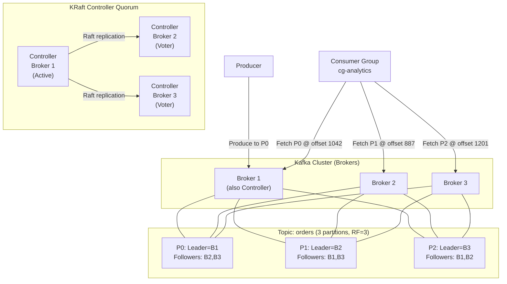
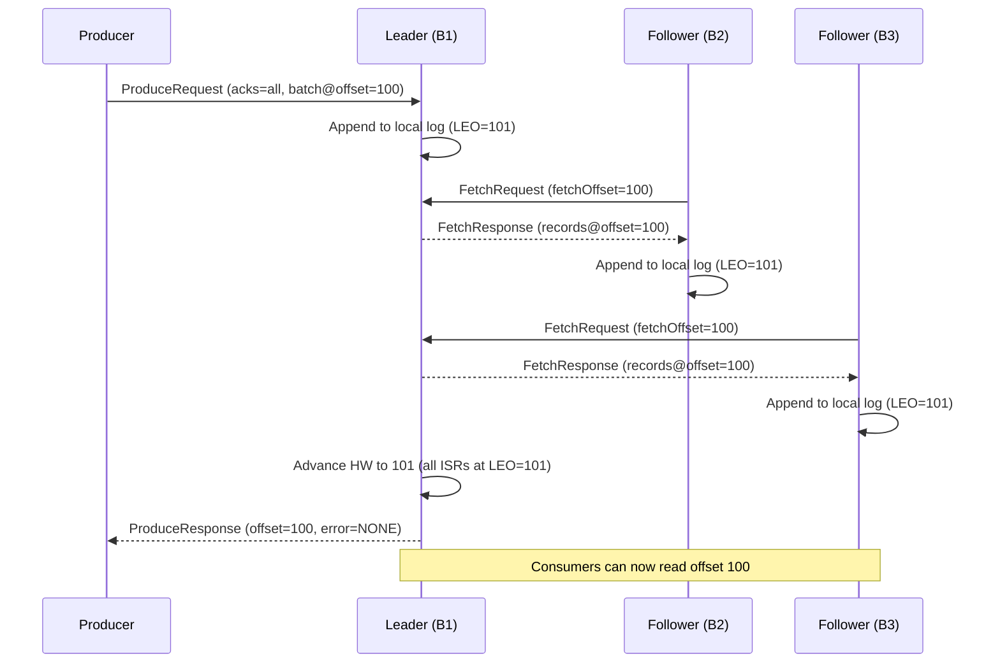
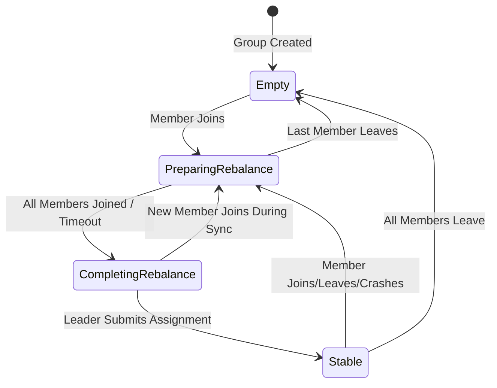
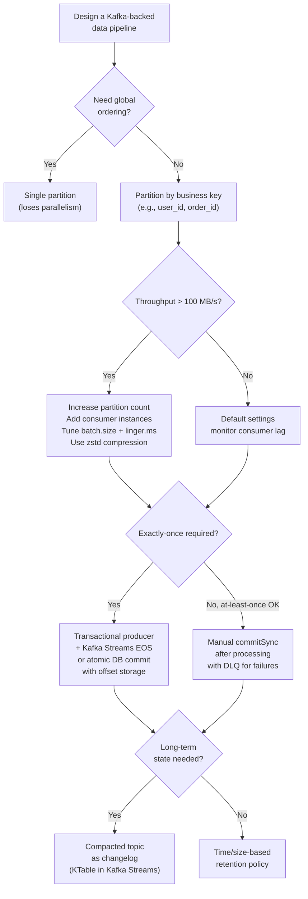

# Lesson 1: Kafka Architecture — A First-Principles Deep Dive

## 1. First-Principles Intuition & Invariants

### The Core Problem: Why Kafka Exists

Before 2011, LinkedIn's data infrastructure was a tangle of point-to-point pipelines. Each system that needed to consume activity data — the newsfeed, recommendations, analytics — required a custom integration with every upstream producer. With `N` producers and `M` consumers, the organization was managing O(N×M) integrations. This combinatorial explosion is the fundamental problem Kafka was designed to solve.

The solution is to insert a **durable, ordered, replayable log** as the universal integration layer. Every producer writes to this log once; every consumer reads from it independently, at its own pace, potentially replaying historical data. The complexity collapses to O(N+M).

This is not merely an architectural preference — it is grounded in the **State Machine Replication** principle from distributed systems theory: if every replica starts from the same initial state and applies the same sequence of operations in the same order, all replicas will converge to the same final state. Kafka's immutable, ordered, partitioned log is a direct instantiation of this principle at infrastructure scale.

### The Commit Log as the Fundamental Abstraction

The central data structure in Kafka is the **commit log** (also called the write-ahead log, or WAL, in database literature). A commit log has three invariant properties:

1. **Append-only**: Records are written sequentially to the end of the log. No in-place mutation occurs.
2. **Ordered**: Each record receives a monotonically increasing, integer **offset**. Within a single partition, offset ordering is total and permanent.
3. **Durable by definition**: A write is not acknowledged until it has been persisted (and replicated, depending on `acks` configuration).

These properties have profound architectural consequences. Because the log is append-only and immutable, reads never contend with writes for locks. Because ordering is encoded in the offset (a simple integer), no distributed coordination is needed to determine the sequence of events within a partition — consumers track their position using a single counter. Because old records are never deleted on a per-record basis but instead expire by time or size policy (or via compaction), Kafka can support arbitrary replay without burdening the write path.

### Key Architectural Invariants

**Invariant 1: Partitioned parallelism.** A topic is the logical name; a partition is the physical unit of parallelism and ordering. Order is guaranteed *within* a partition, never *across* partitions. This is not a limitation but a deliberate trade: global ordering would require a single-threaded serial log, which cannot scale. Designers must encode ordering requirements into their partition key strategy.

**Invariant 2: Consumer groups are a distributed cursor.** A consumer group is not a load balancer in the traditional sense. It is a protocol for distributing the cursors (offsets) of all partitions across a set of readers such that each partition is owned by exactly one reader at a time. This gives consumer groups the semantics of a queue (each message processed once) while retaining the semantics of a log (independent groups each see all messages).

**Invariant 3: The broker is a dumb pipe.** Unlike traditional message brokers (RabbitMQ, ActiveMQ), Kafka brokers hold no routing logic, no message transformation, and no subscriber state beyond partition leadership. All intelligence sits at the edges — in producers (which partition) and consumers (which offset to read). This is the Unix philosophy applied to distributed messaging: do one thing well, and let the clients compose behavior.

**Invariant 4: Replication is the durability contract.** A write is only as durable as its in-sync replica (ISR) set. The `min.insync.replicas` configuration and producer `acks=all` together define the minimum number of brokers that must acknowledge a write before it is considered committed. Data cannot be "lost" so long as at least one ISR member survives, because no consumer can read a record until it has been committed — i.e., written to all ISRs.

---

## 2. Core Architecture & Mechanics

### Cluster Topology

A Kafka cluster consists of one or more **brokers** (JVM processes) coordinated by either **Apache ZooKeeper** (the legacy model, deprecated as of Kafka 3.x) or **KRaft** (the native Raft-based consensus engine, GA in Kafka 3.3+, mandatory in Kafka 4.0). Every broker holds a subset of partition replicas and may also serve as the **active KRaft controller** (in KRaft mode) or as a follower controller.



### ZooKeeper vs. KRaft: Why the Migration Matters

The ZooKeeper-based architecture had a critical architectural flaw: the **controller epoch** and partition metadata were stored in ZooKeeper, but the brokers maintained their own in-memory metadata state. Any full cluster restart required brokers to re-read all partition state from ZooKeeper, which at millions of partitions could take tens of minutes. This was the primary barrier to operating Kafka at extreme partition counts.

KRaft eliminates the external ZooKeeper dependency. Cluster metadata is stored in a Kafka-internal topic (`__cluster_metadata`), replicated via the Raft consensus algorithm among a designated set of **controller nodes**. The active controller propagates metadata changes to brokers via a push model (the `MetadataRecord` API), and brokers maintain a local image of cluster state updated incrementally. Startup time for large clusters drops from minutes to seconds.

### Brokers: Storage Engine Internals

A Kafka broker is fundamentally a **log segment manager**. Each partition replica maps to a directory on disk containing a series of **segment files**.

```
/kafka-logs/
└── orders-0/                        # Topic "orders", partition 0
    ├── 00000000000000000000.log      # Raw record data (message set format)
    ├── 00000000000000000000.index    # Sparse offset-to-physical-position index
    ├── 00000000000000000000.timeindex # Sparse timestamp-to-offset index
    ├── 00000000000001048576.log      # Next segment (after roll)
    ├── 00000000000001048576.index
    ├── 00000000000001048576.timeindex
    └── leader-epoch-checkpoint       # Leader epoch file for fencing
```

The filename prefix is the **base offset** of the first record in that segment. When a consumer seeks to offset `N`, the broker performs a binary search over the `.index` file (a memory-mapped array of `(relativeOffset, physicalPosition)` pairs) to find the nearest indexed entry, then scans forward linearly in the `.log` file from that physical position. This is O(log S) where S is the number of index entries, which is bounded by `log.index.interval.bytes` (default 4096 bytes of data per index entry).

**Zero-copy transfer** is the key I/O optimization. Rather than copying data from disk into the broker's heap and then into a socket buffer, the broker invokes the OS `sendfile(2)` system call (exposed in Java as `FileChannel.transferTo`), which transfers data directly from the page cache to the network interface buffer via DMA, entirely bypassing the JVM heap. This is why Kafka's read throughput scales with network bandwidth rather than CPU speed.

```
Traditional copy path:
Disk → Kernel page cache → User space (broker heap) → Kernel socket buffer → NIC

Kafka zero-copy path:
Disk → Kernel page cache → NIC   (via sendfile/transferTo)
```

The broker's write path is similarly optimized. Producers batch records into **record batches** (the `RecordBatch` format introduced in Kafka 0.11, also called the "magic byte 2" format), which are written to the partition log file as a single sequential append. Sequential disk writes on modern SSDs approach the theoretical throughput limit of the storage medium; random writes do not. This is why Kafka can sustain millions of writes per second on commodity hardware.

### Topics and Partitions: Partitioning Strategy

Partition count is a **permanent** architectural decision for a topic (you can increase it, but you cannot decrease it, and increasing it breaks key-based ordering for existing keys because the mapping `hash(key) % numPartitions` changes). Choosing the right partition count requires reasoning about:

- **Desired throughput**: A single partition can sustain roughly 10–100 MB/s depending on hardware and record size. Divide your target throughput by this figure.
- **Consumer parallelism**: The maximum useful consumers in a consumer group equals the partition count. Adding consumers beyond the partition count leaves some idle.
- **Replication overhead**: Each partition is replicated RF times. 1000 partitions with RF=3 means 3000 partition replicas, each of which the leader must maintain in sync.

A common rule of thumb for initial sizing is `max(throughput / per_partition_throughput, desired_consumer_parallelism) × 2` as a headroom buffer.

**Partition assignment in producers** follows this logic:

1. If the record has a non-null key: `partition = murmur2(key) % numPartitions` (the default `DefaultPartitioner`).
2. If the record has no key: Kafka 2.4+ uses the **sticky partitioner**, which batches keyless records to a single partition until the batch is full or `linger.ms` expires, then switches to another partition. This improves batching efficiency versus the old round-robin approach.
3. A custom `Partitioner` implementation can override this entirely.

### The Replication Protocol: ISR and Leader Epoch

Kafka's replication protocol is not Paxos or Raft — it is a custom **ISR (In-Sync Replica) protocol** designed to optimize for the common case (no failures) while remaining correct during failures.

**ISR definition**: A follower replica is "in sync" with the leader if it has fetched all committed records from the leader within `replica.lag.time.max.ms` (default 30 seconds). The ISR is tracked by the partition leader and recorded in the cluster metadata.

**Write path**:

1. The producer sends a `ProduceRequest` to the partition leader.
2. The leader appends the record batch to its local log (write to OS page cache; optionally `fsync`-ed depending on `flush.messages` and `flush.ms` config).
3. Follower replicas issue `FetchRequest`s to the leader and replicate the data to their own logs.
4. Once all ISR members have written the data to their logs (up to the **high watermark**), the leader advances the high watermark and acknowledges the producer.
5. No consumer can read a record with offset > high watermark. This is the **committed data invariant**: consumers only see records that have been replicated to all ISRs.



**Leader Epoch** is a critical correctness mechanism added in Kafka 0.11. When a new leader is elected, its epoch number increments. Each log entry is tagged with the epoch of the leader that wrote it. When a former leader (which crashed and lost some writes) rejoins as a follower, it uses the leader epoch to identify and **truncate** any uncommitted records it wrote that were never replicated to the new leader. This prevents the "log divergence" scenario where a broker replays stale writes as if they had been committed.

### Consumer Groups: The Rebalance Protocol

Consumer group membership is managed by a **Group Coordinator** broker (the broker that owns the `__consumer_offsets` partition for that group, determined by `abs(hash(groupId)) % numPartitions`). The rebalance protocol has evolved through three generations:

- **Eager rebalance (original)**: On any membership change (consumer join, leave, or crash), all consumers in the group revoke their current partition assignments and re-join. This causes a full "stop the world" processing pause.
- **Cooperative rebalance / Incremental rebalance (Kafka 2.4+)**: The group coordinator computes a new assignment delta. Only consumers that need to give up or receive new partitions are involved in the handoff. Consumers that retain their current partitions never stop processing. This reduces the rebalance impact dramatically in large groups.
- **Static membership (Kafka 2.3+)**: Assigning consumers a `group.instance.id` causes the Group Coordinator to hold their partition assignment for a configurable `session.timeout.ms` before triggering a rebalance, allowing a consumer to restart (e.g., during a rolling deploy) without triggering rebalance churn.



**Offset commit semantics** determine exactly-once vs. at-least-once processing:

- `enable.auto.commit=true` (default): The consumer commits the offset of the last polled record periodically (`auto.commit.interval.ms`, default 5 seconds). If the consumer crashes after processing but before the commit, records will be reprocessed. This gives **at-least-once** delivery.
- Manual commit with `commitSync()` or `commitAsync()` after processing gives **at-least-once** with explicit control.
- **Exactly-once** requires either: (a) using Kafka Streams with `processing.guarantee=exactly_once_v2`, which uses the transactional producer and atomic offset commits; or (b) writing consumed data and committing the offset atomically in the same external transaction (e.g., consuming from Kafka and writing to a database in a single JDBC transaction with offset stored in the DB).

---

## 3. Data Flow: End-to-End Message Lifecycle

```mermaid
flowchart LR
    subgraph Producer Side
        App["Application\nThread"]
        Interceptor["Producer\nInterceptor"]
        Serializer["Key/Value\nSerializer"]
        Partitioner["Partitioner\n(murmur2 / sticky)"]
        RecordAccumulator["RecordAccumulator\n(per-partition deque\nof ProducerBatch)"]
        Sender["Sender Thread\n(async I/O)"]
    end

    subgraph Broker Side
        NetworkLayer["Network Layer\n(Acceptor + Processor\nthreads)"]
        RequestQueue["Request Queue"]
        IOThread["I/O Thread\n(KafkaRequestHandler)"]
        LogManager["LogManager\n(append to segment)"]
        ReplicaManager["ReplicaManager\n(ISR tracking, HW update)"]
        ResponseQueue["Response Queue"]
    end

    subgraph Consumer Side
        Fetcher["Fetcher\n(background thread)"]
        ConsumerQueue["Completed Fetches\nQueue"]
        ConsumerApp["Consumer\nApplication Thread\npoll()"]
        OffsetStore["__consumer_offsets\ntopic"]
    end

    App --> Interceptor --> Serializer --> Partitioner --> RecordAccumulator
    RecordAccumulator -->|"batch.size or linger.ms reached"| Sender
    Sender -->|"ProduceRequest (compressed batch)"| NetworkLayer
    NetworkLayer --> RequestQueue --> IOThread --> LogManager --> ReplicaManager
    ReplicaManager -->|"HW advanced, acks=all met"| ResponseQueue
    ResponseQueue -->|"ProduceResponse"| Sender

    LogManager -->|"FetchRequest from follower"| Fetcher
    Fetcher -->|"FetchRequest"| NetworkLayer
    NetworkLayer --> RequestQueue --> IOThread
    IOThread -->|"zero-copy sendfile"| Fetcher
    Fetcher --> ConsumerQueue --> ConsumerApp
    ConsumerApp -->|"commitSync/Async"| OffsetStore
```



### Compression and Batching

Kafka supports four compression codecs: `gzip`, `snappy`, `lz4`, and `zstd` (recommended for best compression ratio vs. speed tradeoff). Compression is applied at the **batch** level, not per-record. This means that larger batches yield better compression ratios because the codec can exploit cross-record redundancy. The broker stores the compressed batch verbatim and decompresses it only when needed (e.g., for log compaction or for older consumers that cannot handle server-side compression). Fetching consumers receive the compressed batch and decompress client-side, saving both broker CPU and network bandwidth.

The `linger.ms` and `batch.size` producer configuration knobs directly trade latency for throughput: a higher `linger.ms` allows more records to accumulate per batch, improving both compression ratio and per-record write amortization, at the cost of additional end-to-end latency.

---

## 4. High-Performance Optimizations: Mechanism-Level Analysis

### Sequential I/O and the Page Cache

Kafka deliberately avoids managing its own read/write cache. Instead, it relies entirely on the **Linux page cache** — the kernel's unified buffer for file I/O. This is an architectural decision with significant consequences:

- When producers write, data goes to the page cache (memory) and is acknowledged immediately if `fsync` is not forced. The OS flushes dirty pages to disk asynchronously via `pdflush`/`kflush`.
- When consumers read data that was just produced, the data is served directly from the page cache (a hot read), never touching disk. This is the "zero disk I/O for recent data" property that enables Kafka to sustain write and read throughput at nearly the speed of the network.
- Because Kafka's data structures are stored as simple files, the page cache is JVM-heap-independent. A broker JVM GC pause does not evict data from the page cache. This is a key reason Kafka's tail latency is far more predictable than heap-managed caching systems.

The implication for capacity planning: Kafka brokers should be provisioned with as much RAM as possible, since it all becomes usable page cache. The standard guidance is that the page cache should comfortably hold the **active working set** — typically the last few hours of data — to keep consumer reads hot.

### Zero-Copy in Detail

The `sendfile` optimization, implemented in Java via `FileChannel.transferTo(position, count, socketChannel)`, allows the kernel to perform this transfer:

```
           Traditional                              Zero-Copy (sendfile)
          ┌──────────┐                             ┌──────────┐
          │  Disk    │                             │  Disk    │
          └────┬─────┘                             └────┬─────┘
               │ read()                                 │ sendfile()
          ┌────▼─────┐                            ┌────▼──────────────┐
          │ Page     │                            │ Page Cache (kernel)│
          │ Cache    │                            └────────┬──────────┘
          └────┬─────┘                                     │ DMA transfer
               │ copy to user space                  ┌─────▼──────┐
          ┌────▼─────┐                               │    NIC     │
          │ JVM Heap │                               └────────────┘
          └────┬─────┘
               │ write to socket buffer
          ┌────▼─────┐
          │  Socket  │
          │  Buffer  │
          └────┬─────┘
               │
          ┌────▼─────┐
          │   NIC    │
          └──────────┘
```

The traditional path involves four copies and two context switches. The `sendfile` path involves two copies (page cache → socket buffer via DMA, socket buffer → NIC) and one context switch. For a broker serving millions of records per second, this reduction in CPU overhead per byte transferred is what makes the throughput possible.

### Log Compaction

Log compaction is a retention policy alternative to time/size-based deletion. For topics with `cleanup.policy=compact`, the broker's **log cleaner** (a background thread pool) periodically rewrites log segments, retaining only the **last** value for each key. Records with a `null` value (tombstones) are retained briefly to allow consumers to observe the deletion, then removed.

```
Before compaction (partition P0, offsets 0-7):
Offset: 0     1     2     3     4     5     6     7
Key:    K1    K2    K1    K3    K2    K1    K4    K3
Value:  v1a   v2a   v1b   v3a   v2b   v1c   v4a   null

After compaction:
Offset: 1     4     5     6
Key:    K2    K2    K1    K4
Value:  v2a   v2b   v1c   v4a

(K1@0, K1@2 removed; K3 removed because tombstone at offset 7 was applied)
```

Note that offsets are **never renumbered**. The compacted log has gaps in the offset sequence. Consumers must handle this correctly — `seekToBeginning()` after compaction will start from the lowest available offset, not necessarily offset 0.

Compacted topics are the foundation of Kafka's use as a **distributed changelog** or **event-sourced state store**. Kafka Streams uses compacted changelog topics to back its `KTable` state stores, allowing the state to be rebuilt by any consumer that replays the compacted log from the beginning.

---

## 5. Failure Modes and Operational Resilience

### Broker Failure and Leader Election

When a partition leader broker fails (or becomes unreachable), the **KRaft active controller** (or in legacy mode, the **Kafka controller** elected via ZooKeeper) detects the failure via the absence of heartbeats and initiates **preferred leader election** for the affected partitions. The controller picks the first replica in the ISR list as the new leader, updates the cluster metadata, and propagates the new partition state to all brokers via `LeaderAndIsrRequest`.

This process is fast — typically sub-second for single broker failures — but the speed depends on `zookeeper.session.timeout.ms` (legacy) or the KRaft heartbeat timeout. During the election window, the partition is briefly **unavailable for new writes** (producers receive `NOT_LEADER_OR_FOLLOWER` and must retry). Consumers can continue reading up to the high watermark from the old leader's last known state if they have a cached connection, but new fetches require rediscovering the new leader via metadata refresh.

### Unclean Leader Election: The Durability vs. Availability Tradeoff

If all ISR members fail simultaneously, Kafka faces a choice:

- **Wait for an ISR member to come back** (`unclean.leader.election.enable=false`, the default since Kafka 0.11): This prioritizes **durability** at the cost of availability. The partition is offline until an ISR member recovers.
- **Elect an out-of-sync replica** (`unclean.leader.election.enable=true`): This restores **availability** at the cost of **potential data loss**, since the out-of-sync replica may not have the latest committed records. Any records between the out-of-sync replica's last known LEO and the previous leader's high watermark are permanently lost.

This is a direct application of the **CAP theorem** tradeoff: you cannot have both consistency and availability in the face of a partition/failure. Kafka's default is to choose consistency (CP behavior) over availability for committed writes.

### Consumer Lag: The Canary Metric

Consumer lag — the difference between the partition's **log end offset** (LEO) and the consumer group's **committed offset** for that partition — is the most important operational metric in a Kafka deployment. Rising lag indicates that consumers are falling behind producers, which eventually leads to unbounded memory/disk pressure (if the topic's `retention.bytes` is large) and increasing end-to-end processing latency.

```
Lag = LEO - CommittedOffset

For partition P0:
  LEO = 1,500,000
  CommittedOffset = 1,499,200
  Lag = 800   ← healthy

One hour later:
  LEO = 2,100,000
  CommittedOffset = 1,499,200
  Lag = 600,800  ← consumer is severely behind
```

The correct response to sustained consumer lag depends on the root cause: insufficient consumer parallelism (increase partition count or consumer count), slow processing logic (profile the consumer application), or under-provisioned downstream systems (I/O, database, network bottleneck).

### Network Partitioning and Split-Brain Prevention

Kafka uses **leader epochs** as a fencing mechanism to prevent split-brain writes. Consider: broker B1 is the partition leader with epoch 3. It suffers a GC pause long enough to be declared dead by the controller. The controller elects B2 as the new leader with epoch 4. B1 recovers from its GC pause and believes it is still the leader. When B1 receives a produce request and attempts to replicate to followers, the followers check the leader epoch: they see epoch 3 < 4 and reject B1's replication request with `FENCED_LEADER_EPOCH`. B1's subsequent produce response to the client is also rejected. B1 must demote itself and re-join as a follower under the epoch-4 leader. No data is written twice.

---

## 6. Production-Grade Code Examples

### Python Producer with Transactions (Exactly-Once Semantics)

```python
# pip install confluent-kafka==2.4.0
from confluent_kafka import Producer, KafkaException
import json
import logging

logging.basicConfig(level=logging.INFO)
logger = logging.getLogger(__name__)

PRODUCER_CONFIG = {
    "bootstrap.servers": "broker1:9092,broker2:9092,broker3:9092",
    # Idempotence: assigns a PID and sequence number to each batch;
    # the broker deduplicates retried batches within a producer epoch.
    "enable.idempotence": True,
    # Transactions: atomic multi-partition writes + atomic offset commits.
    "transactional.id": "order-processor-txn-1",
    # Required by enable.idempotence
    "acks": "all",
    # Must be <= max.in.flight.requests.per.connection (5) with idempotence
    "max.in.flight.requests.per.connection": 5,
    "retries": 2147483647,  # INT_MAX — retry until transaction timeout
    "compression.type": "zstd",
    "linger.ms": 5,
    "batch.size": 65536,  # 64 KB
    "delivery.timeout.ms": 120000,
}

def delivery_report(err, msg):
    if err is not None:
        logger.error("Delivery failed for record %s: %s", msg.key(), err)
    else:
        logger.debug(
            "Record delivered to %s [%d] @ offset %d",
            msg.topic(), msg.partition(), msg.offset()
        )

class TransactionalOrderProducer:
    def __init__(self):
        self.producer = Producer(PRODUCER_CONFIG)
        self.producer.init_transactions()

    def publish_order_events(self, orders: list[dict]) -> None:
        """
        Atomically publish a batch of order events. Either all records
        are committed and visible to consumers, or none are.
        """
        try:
            self.producer.begin_transaction()
            for order in orders:
                key = order["order_id"].encode("utf-8")
                value = json.dumps(order).encode("utf-8")
                self.producer.produce(
                    topic="orders",
                    key=key,
                    value=value,
                    headers={"content-type": b"application/json"},
                    on_delivery=delivery_report,
                )
            # flush() ensures all queued records are sent before commit
            self.producer.flush()
            self.producer.commit_transaction()
            logger.info("Transaction committed: %d records", len(orders))
        except KafkaException as exc:
            logger.error("Transaction aborted: %s", exc)
            self.producer.abort_transaction()
            raise

    def close(self):
        self.producer.flush()

if __name__ == "__main__":
    producer = TransactionalOrderProducer()
    sample_orders = [
        {"order_id": "ORD-001", "user_id": "U-42", "amount": 199.99, "status": "CREATED"},
        {"order_id": "ORD-002", "user_id": "U-17", "amount": 49.00, "status": "CREATED"},
    ]
    producer.publish_order_events(sample_orders)
    producer.close()
```

### Go Consumer with Manual Offset Commits and Graceful Shutdown

```go
// go get github.com/confluentinc/confluent-kafka-go/v2/kafka@v2.4.0
package main

import (
    "context"
    "encoding/json"
    "fmt"
    "log"
    "os"
    "os/signal"
    "syscall"
    "time"

    "github.com/confluentinc/confluent-kafka-go/v2/kafka"
)

type OrderEvent struct {
    OrderID string  `json:"order_id"`
    UserID  string  `json:"user_id"`
    Amount  float64 `json:"amount"`
    Status  string  `json:"status"`
}

func main() {
    consumer, err := kafka.NewConsumer(&kafka.ConfigMap{
        "bootstrap.servers":        "broker1:9092,broker2:9092,broker3:9092",
        "group.id":                 "order-processor-v2",
        "auto.offset.reset":        "earliest",
        // Disable auto-commit: we commit manually after processing
        "enable.auto.commit":       false,
        // Static membership: prevents rebalance during rolling restarts
        "group.instance.id":        fmt.Sprintf("order-processor-%s", mustHostname()),
        "session.timeout.ms":       45000,
        "heartbeat.interval.ms":    3000,
        // Use cooperative sticky rebalance to minimize processing interruptions
        "partition.assignment.strategy": "cooperative-sticky",
        "fetch.min.bytes":          1024,
        "fetch.wait.max.ms":        500,
        "max.poll.interval.ms":     300000,
    })
    if err != nil {
        log.Fatalf("Failed to create consumer: %v", err)
    }
    defer consumer.Close()

    if err := consumer.SubscribeTopics([]string{"orders"}, nil); err != nil {
        log.Fatalf("Failed to subscribe: %v", err)
    }

    ctx, cancel := context.WithCancel(context.Background())
    sigChan := make(chan os.Signal, 1)
    signal.Notify(sigChan, syscall.SIGINT, syscall.SIGTERM)

    go func() {
        <-sigChan
        log.Println("Shutdown signal received, stopping consumer...")
        cancel()
    }()

    var pendingOffsets []kafka.TopicPartition

    for {
        select {
        case <-ctx.Done():
            // Commit any remaining offsets before exit
            if len(pendingOffsets) > 0 {
                if _, err := consumer.CommitOffsets(pendingOffsets); err != nil {
                    log.Printf("Final commit failed: %v", err)
                }
            }
            return
        default:
        }

        // Poll with a 200ms timeout to remain responsive to shutdown
        msg, err := consumer.ReadMessage(200 * time.Millisecond)
        if err != nil {
            if kafkaErr, ok := err.(kafka.Error); ok && kafkaErr.Code() == kafka.ErrTimedOut {
                continue // normal timeout, no message available
            }
            log.Printf("Consumer error: %v", err)
            continue
        }

        var event OrderEvent
        if err := json.Unmarshal(msg.Value, &event); err != nil {
            log.Printf("Failed to deserialize record at offset %d: %v", msg.TopicPartition.Offset, err)
            // For a dead-letter queue pattern, produce this to a DLQ topic here.
            // We still commit to avoid being stuck on a bad record.
        } else {
            if err := processOrder(ctx, event); err != nil {
                log.Printf("Processing failed for order %s: %v", event.OrderID, err)
                // Decide: retry (don't commit), skip (commit), or DLQ
                continue // at-least-once: will re-fetch this offset on next poll
            }
        }

        // Store the offset+1 for the next poll (commit semantics: "processed up to here")
        pendingOffsets = append(pendingOffsets, kafka.TopicPartition{
            Topic:     msg.TopicPartition.Topic,
            Partition: msg.TopicPartition.Partition,
            Offset:    msg.TopicPartition.Offset + 1,
        })

        // Commit in batches of 100 or periodically
        if len(pendingOffsets) >= 100 {
            if _, err := consumer.CommitOffsets(pendingOffsets); err != nil {
                log.Printf("Batch commit failed: %v", err)
            } else {
                pendingOffsets = pendingOffsets[:0]
            }
        }
    }
}

func processOrder(ctx context.Context, order OrderEvent) error {
    // Simulate processing; replace with real business logic
    log.Printf("Processing order %s for user %s: $%.2f", order.OrderID, order.UserID, order.Amount)
    return nil
}

func mustHostname() string {
    h, err := os.Hostname()
    if err != nil {
        return "unknown"
    }
    return h
}
```

### Rust Producer Using the `rdkafka` Crate (High-Throughput Path)

```rust
// Cargo.toml:
// rdkafka = { version = "0.36", features = ["cmake-build"] }
// tokio = { version = "1", features = ["full"] }
// serde = { version = "1", features = ["derive"] }
// serde_json = "1"

use rdkafka::config::ClientConfig;
use rdkafka::producer::{FutureProducer, FutureRecord};
use rdkafka::util::Timeout;
use serde::Serialize;
use std::time::Duration;
use tokio::task::JoinSet;

#[derive(Serialize)]
struct OrderEvent<'a> {
    order_id: &'a str,
    user_id: &'a str,
    amount: f64,
    status: &'a str,
}

fn build_producer() -> FutureProducer {
    ClientConfig::new()
        .set("bootstrap.servers", "broker1:9092,broker2:9092,broker3:9092")
        .set("enable.idempotence", "true")
        .set("acks", "all")
        .set("compression.type", "zstd")
        .set("linger.ms", "5")
        .set("batch.size", "65536")
        .set("max.in.flight.requests.per.connection", "5")
        .set("delivery.timeout.ms", "120000")
        .create()
        .expect("Failed to create Kafka producer")
}

#[tokio::main]
async fn main() {
    let producer = build_producer();
    let mut join_set = JoinSet::new();

    let orders = vec![
        ("ORD-001", "U-42", 199.99),
        ("ORD-002", "U-17", 49.00),
        ("ORD-003", "U-99", 7.50),
    ];

    for (order_id, user_id, amount) in orders {
        let producer_clone = producer.clone();
        join_set.spawn(async move {
            let event = OrderEvent {
                order_id,
                user_id,
                amount,
                status: "CREATED",
            };
            let payload = serde_json::to_string(&event).unwrap();

            let record = FutureRecord::to("orders")
                .key(order_id)
                .payload(payload.as_str());

            match producer_clone.send(record, Timeout::After(Duration::from_secs(5))).await {
                Ok((partition, offset)) => {
                    println!("Delivered {order_id} → partition {partition} @ offset {offset}");
                }
                Err((err, _)) => {
                    eprintln!("Delivery failed for {order_id}: {err}");
                }
            }
        });
    }

    while let Some(result) = join_set.join_next().await {
        if let Err(e) = result {
            eprintln!("Task panicked: {e}");
        }
    }
}
```

---

## 7. Operational Configuration Reference

The following table covers the most impactful configuration parameters, grouped by their primary effect:

| Parameter | Default | Effect | Tuning Guidance |
|---|---|---|---|
| `num.partitions` | 1 | Default partition count for auto-created topics | Set to expected consumer parallelism × 2; never rely on auto-creation in production |
| `default.replication.factor` | 1 | Default RF for auto-created topics | Minimum 3 in production |
| `min.insync.replicas` | 1 | Minimum ISRs that must ack a write | Set to RF-1 (e.g., 2 for RF=3) |
| `unclean.leader.election.enable` | false | Allow out-of-sync replica to become leader | Keep false unless availability outweighs durability |
| `log.retention.ms` | 604800000 (7d) | Time-based log retention | Size-based (`log.retention.bytes`) may be more predictable |
| `log.segment.bytes` | 1 GB | Max size of a single log segment file | Smaller segments = faster log-cleaner; larger = fewer files |
| `compression.type` | `producer` | Broker-side re-compression | Keep `producer` to preserve client-chosen codec |
| `replica.lag.time.max.ms` | 30000 | Follower max lag before ISR removal | Lower values = tighter ISR, more frequent ISR thrash under load |
| `producer: acks` | `1` | Durability level (0, 1, all/-1) | Use `all` with `min.insync.replicas=2` for durability |
| `producer: linger.ms` | 0 | Time to wait for batch accumulation | 5–20ms for high-throughput; 0 for latency-sensitive |
| `consumer: max.poll.records` | 500 | Records returned per poll() | Tune based on per-record processing time vs. `max.poll.interval.ms` |
| `consumer: fetch.min.bytes` | 1 | Min data the broker should send | Increase (e.g., 65536) to improve throughput at cost of latency |

---

## 8. Putting It Together: Architecture Decision Map



---

## Summary

Kafka's design is a coherent set of tradeoffs derived from first principles: an append-only, partitioned, replicated commit log that makes the write path maximally fast (sequential I/O, zero-copy transfer, OS page cache delegation) while encoding correctness guarantees in a simple integer (the offset) and a small distributed protocol (ISR + leader epoch). Its most common misunderstandings — global ordering, exactly-once delivery being "free," and partition count being freely adjustable — all dissolve when the underlying mechanics are understood. The architectural invariants (immutable log, ISR-committed high watermark, leader epoch fencing) are not arbitrary constraints; they are the minimum sufficient structure needed to provide the durability and consistency guarantees the system makes to its clients.
