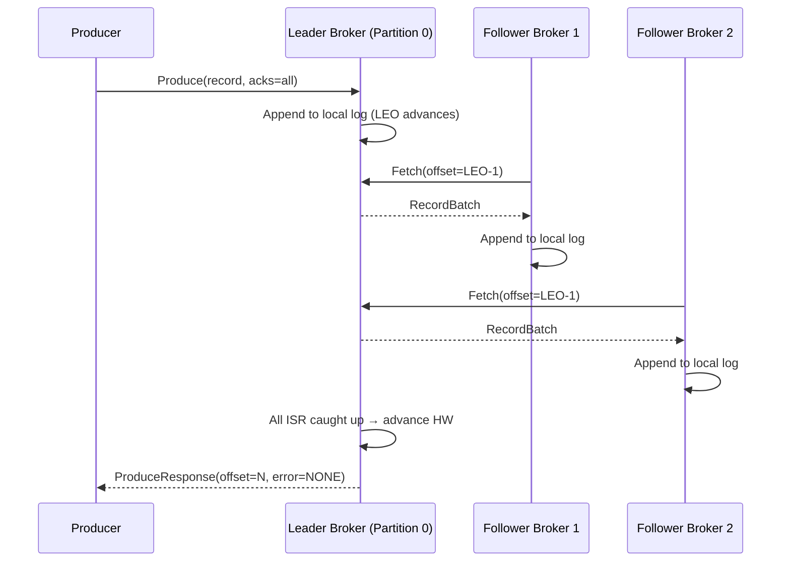

# Lesson 2: Producers and Consumers

## 1. First-Principles Intuition & Invariants

Distributed systems face a fundamental tension: data must move between processes that share no memory, across networks that can drop packets, on hardware that can fail at any moment. The naive solution — a shared database — collapses under write contention at scale. The naive alternative — direct point-to-point messaging — creates brittle coupling between producers and consumers, since both must be live simultaneously and both must agree on failure semantics.

Kafka resolves this tension by separating the act of *writing* data from the act of *reading* it, using a durable, ordered, partitioned log as the intermediary. This is not a queue in the traditional sense. A queue destroys a message once consumed; a Kafka log retains messages for a configurable retention window, allowing multiple independent consumer groups to read the same data at different rates and different offsets. The log is the foundational data structure — an append-only sequence of records where older records are never mutated and each record is addressable by a monotonically increasing integer called an **offset**.

The invariants that every Kafka practitioner must internalize:

**Within a single partition, total ordering is guaranteed.** Records are appended in the order the partition leader receives them and are read in that same order. This is the strongest ordering guarantee Kafka makes. Across partitions of the same topic, ordering is *not* guaranteed — a design choice that is the direct source of Kafka's horizontal scalability.

**A record written to a partition and acknowledged is durable.** Once a producer receives an acknowledgment (`acks=all`) from the broker, that record has been replicated to all in-sync replicas (ISR). No single broker failure — or combination of failures up to the replication factor minus one — can cause that record to be lost.

**Consumer position is externalized.** Unlike traditional message brokers that track delivery state internally, Kafka consumers maintain their own read position (the **committed offset**). This means a consumer can re-read old data, replay a topic from the beginning, or skip forward — entirely at the consumer's discretion. The broker is stateless with respect to consumer progress except when consumers use the `__consumer_offsets` internal topic for coordination.

**At-least-once delivery is the default; exactly-once is opt-in.** Without idempotent producers and transactional APIs, a producer that retries after a network timeout may write the same record twice. The system is designed so that applications must explicitly request stronger semantics rather than assuming them.

These invariants define the contract on which everything else — rebalancing, offset management, transactional producers, stream processing — is built.

---

## 2. Core Architecture & Mechanics

### 2.1 The Partition Log

A Kafka topic is a logical namespace sharded into one or more **partitions**. Each partition is an ordered, immutable sequence of records stored as a set of **log segment files** on the broker's filesystem. A partition directory contains:

- **Segment files** (`.log`): Raw binary records, each consisting of a fixed-length header (CRC, magic byte, attributes, timestamp, key length, value length) followed by the key and value bytes.
- **Offset index files** (`.index`): A sparse index mapping logical offsets to physical byte positions within the segment file, enabling O(log n) seeks.
- **Timestamp index files** (`.timeindex`): Maps timestamps to offsets, used for time-based offset lookup (`offsetsForTimes`).

Kafka does not write records one at a time. It accumulates records into a **batch** (a `RecordBatch` in the binary protocol), which is the atomic unit of both network transfer and disk I/O. This batching is what allows Kafka to exploit sequential disk writes and achieve throughput that often saturates the network before saturating the disk.

The active segment is kept open for appending. Kafka uses the OS page cache as its primary read cache — data written to disk is typically served from the page cache without a system call overhead on subsequent reads. This is why Kafka brokers benefit enormously from large amounts of RAM even though they store data on disk.

### 2.2 Replication and the ISR Protocol

Each partition has one **leader** replica and zero or more **follower** replicas spread across distinct brokers. All writes go to the leader; followers fetch from the leader using the same internal Fetch API that consumers use, maintaining a replication factor of `replication.factor`.

The **In-Sync Replica set (ISR)** is the set of replicas that are considered "caught up" with the leader. A follower is in the ISR if it has fetched up to the leader's log end offset within `replica.lag.time.max.ms` milliseconds. If a follower falls behind, the leader removes it from the ISR. A new **high watermark (HW)** is advanced only when all ISR members have replicated the record. Consumers can only read up to the high watermark — this is the read isolation boundary that prevents consumers from reading uncommitted data.

The **Log End Offset (LEO)** is the next offset to be written; the **High Watermark (HW)** is the offset up to which all ISR members have replicated. The gap `LEO - HW` represents records that are written but not yet replicated to all ISR members.

### 2.3 The Producer: Batching, Partitioning, and Acknowledgment

A Kafka producer is not a simple socket writer. It contains a sophisticated internal pipeline:

1. **Serialization**: The key and value are serialized to byte arrays using configurable `Serializer` implementations.
2. **Partitioning**: The target partition is determined. If a key is provided, the default partitioner applies `murmur2(key) % numPartitions`. Kafka 2.4+ introduced the **Sticky Partitioner** for keyless records: rather than round-robining per record (which creates small batches), it accumulates records into a single partition's batch until a batch is full or `linger.ms` elapses, then switches. This significantly improves batching efficiency at the cost of short-term partition imbalance.
3. **Record Accumulator**: Records destined for the same partition are accumulated into a `ProducerBatch` in an in-memory buffer (`buffer.memory` bytes total). Batches are grouped by their target broker (the partition leader).
4. **Sender Thread**: A background thread drains batches from the accumulator and sends them to brokers. The `linger.ms` setting introduces an artificial delay to allow more records to accumulate, increasing batch sizes. `batch.size` caps
