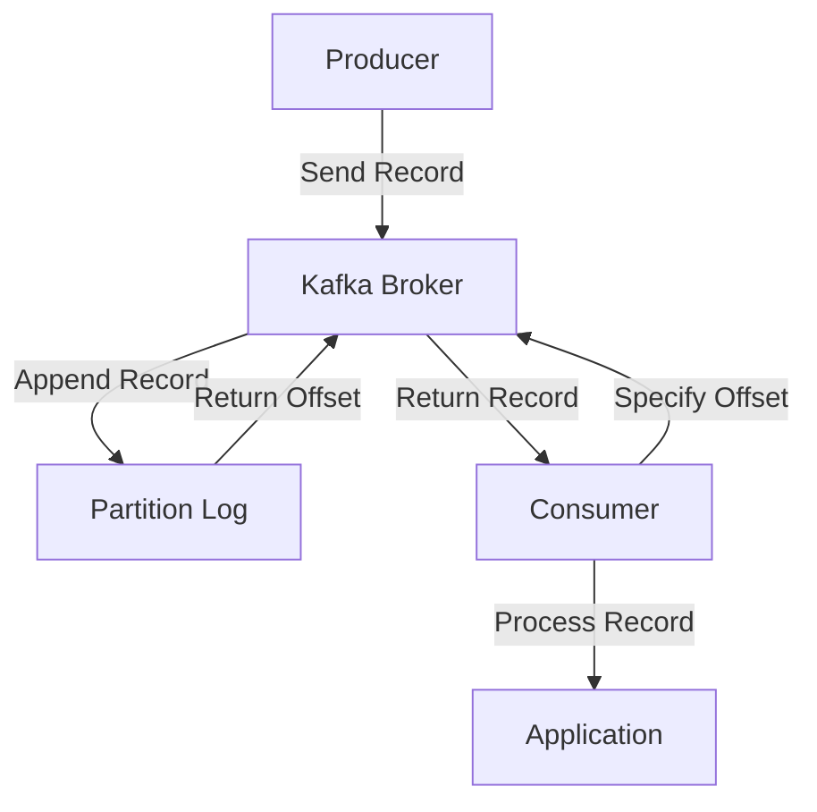

# Lesson 2: Producers and Consumers

## 1. First-Principles Intuition & Invariants

In the realm of distributed systems, the challenge of reliably producing and consuming data is paramount. Apache Kafka, a distributed streaming platform, addresses this challenge by providing robust mechanisms for producers to publish data and consumers to process it. At its core, Kafka operates as a publish-subscribe system, but it extends this model with powerful features such as fault tolerance, scalability, and durability. To understand the mechanisms of data production and consumption in Kafka, we must delve into the fundamental principles that govern its operation.

The problem space Kafka addresses is the need for a system that can handle high-throughput data streams while ensuring data is reliably stored and processed. This requires a deep understanding of distributed systems, including concepts such as consensus, fault tolerance, and data replication. Kafka achieves these goals through a combination of brokers, topics, partitions, and replication factors. Each topic is divided into partitions, which are distributed across the Kafka brokers. This partitioning allows Kafka to scale horizontally, as more brokers can be added to the cluster to handle increased load. Replication factors ensure that data is stored across multiple brokers, providing fault tolerance in case of broker failures.

The invariants of Kafka's producer-consumer model are rooted in its architecture. Producers send data to Kafka brokers, which store the data in partitions. Consumers, on the other hand, read data from these partitions. The key invariant is that data is written to a partition in the order it is received by the broker, and consumers read data from a partition in the same order. This ordering guarantee is crucial for many applications that rely on the sequence of events. Additionally, Kafka ensures that data is not lost by persisting it to disk and replicating it across multiple brokers. This durability is achieved through a combination of in-memory buffering and disk-based storage, with periodic flushes to disk to ensure data is not lost in the event of a failure.

## 2. Core Architecture & Mechanics

To understand the mechanics of Kafka's producer and consumer APIs, we must examine the internal data structures and algorithms that power the system. At the heart of Kafka's architecture are the brokers, which are responsible for storing and serving data. Each broker maintains a set of partitions for each topic it hosts. A partition is a logical sequence of records that are stored in a log file on disk. Each record in the log file is assigned a unique offset, which serves as a unique identifier for the record within the partition.

Producers in Kafka are responsible for sending data to the Kafka brokers. When a producer sends a record to a topic, it specifies the topic and optionally a partition key. The partition key is used to determine which partition the record should be sent to. Kafka uses a hash-based partitioning strategy to distribute records across partitions. If no partition key is specified, Kafka uses a round-robin strategy to distribute records evenly across partitions. Once a producer sends a record to a partition, the broker appends the record to the end of the log file and returns the offset of the record to the producer. This offset can be used by consumers to read the record from the partition.

Consumers in Kafka are responsible for reading data from the Kafka brokers. Consumers are organized into consumer groups, which are logical groups of consumers that work together to read data from a topic. Each consumer group is responsible for reading data from a subset of the partitions in a topic. Kafka ensures that each partition is read by exactly one consumer in the group, which allows consumers to process data in parallel. When a consumer reads a record from a partition, it specifies the offset of the record it wants to read. The broker returns the record to the consumer, and the consumer processes the record. Consumers can also specify a starting offset, which allows them to read records from a specific point in the partition.

To illustrate the architecture and mechanics of Kafka's producer and consumer APIs, we can use a simple Mermaid diagram:

In this diagram, a producer sends a record to a Kafka broker, which appends the record to a partition log and returns the offset of the record to the producer. A consumer then reads the record from the partition log using the offset and processes the record in an application. This cycle continues as producers send records to the broker and consumers read and process records from the broker.

## 3. High-Performance Optimization & Failure Modes

To achieve high performance and reliability, Kafka employs a variety of optimizations and failure modes. One of the key optimizations is the use of in-memory buffering. When a producer sends a record to a broker, the broker buffers the record in memory and periodically flushes the buffer to disk. This reduces the overhead of writing to disk and increases the throughput of the system. Additionally, Kafka uses a combination of compression and batching to further optimize the performance of the system. Compression reduces the size of the data that needs to be written to disk, while batching reduces the number of writes to disk.

Another key optimization is the use of parallelism. Kafka allows multiple producers and consumers to operate in parallel, which increases the throughput of the system. Producers can send records to multiple partitions in parallel, and consumers can read records from multiple partitions in parallel. This parallelism is achieved through the use of consumer groups, which allow multiple consumers to read data from a topic in parallel.

Kafka also employs a variety of failure modes to ensure the reliability of the system. One of the key failure modes is the use of replication. Kafka replicates data across multiple brokers, which ensures that data is not lost in the event of a broker failure. Each partition in Kafka has a leader and a set of replicas. The leader is responsible for handling all writes to the partition, while the replicas are responsible for replicating the data from the leader. If the leader fails, one of the replicas is elected as the new leader, which ensures that the system remains available.

Another key failure mode is the use of idempotence. Kafka provides idempotent producers, which ensure that each record is written to the partition exactly once, even in the event of a failure. This is achieved through the use of a sequence number, which is assigned to each record by the producer. The broker uses the sequence number to ensure that each record is written to the partition exactly once, even if the producer sends the record multiple times.

In summary, Kafka's producer and consumer APIs are designed to provide high performance and reliability. Producers send records to Kafka brokers, which store the records in partitions. Consumers read records from the partitions and process them in applications. Kafka employs a variety of optimizations and failure modes to ensure the performance and reliability of the system, including in-memory buffering, parallelism, replication, and idempotence. By understanding the architecture and mechanics of Kafka's producer and consumer APIs, we can build robust and scalable distributed systems that can handle high-throughput data streams.
