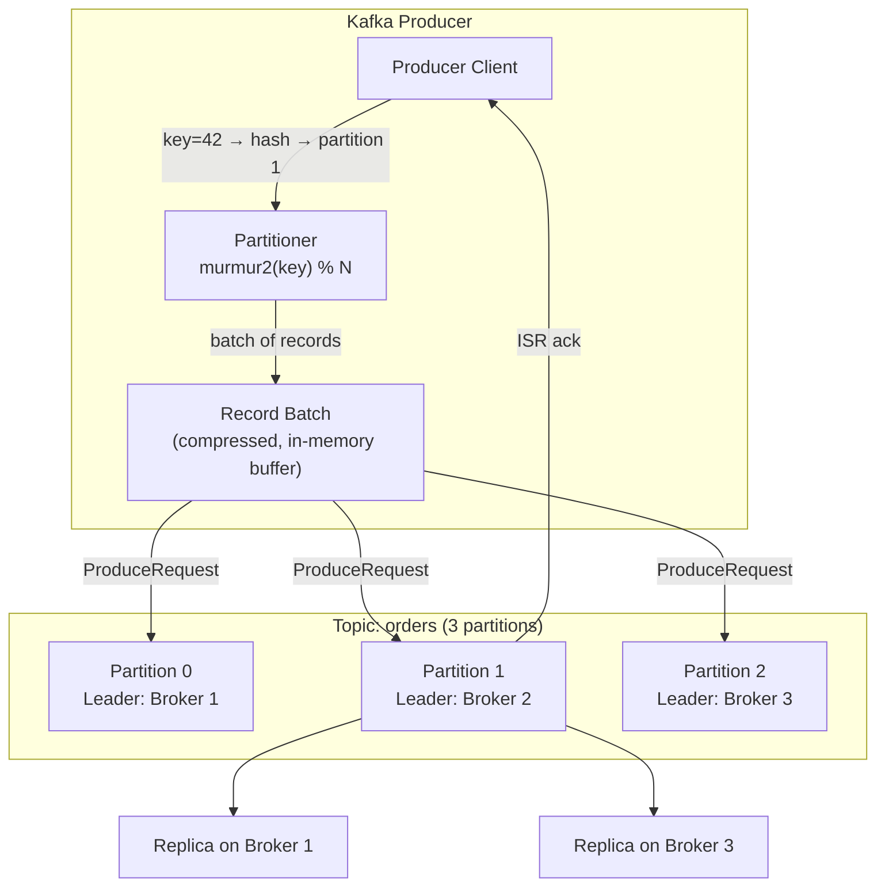
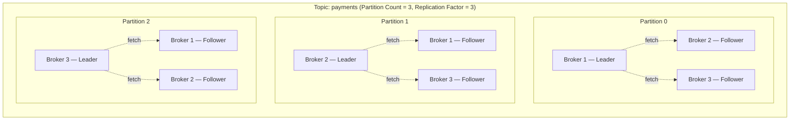
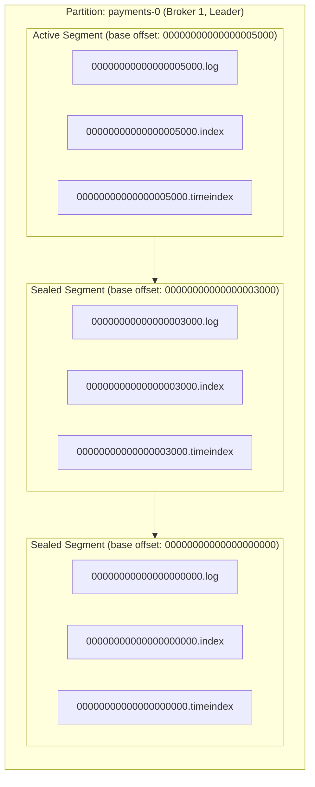
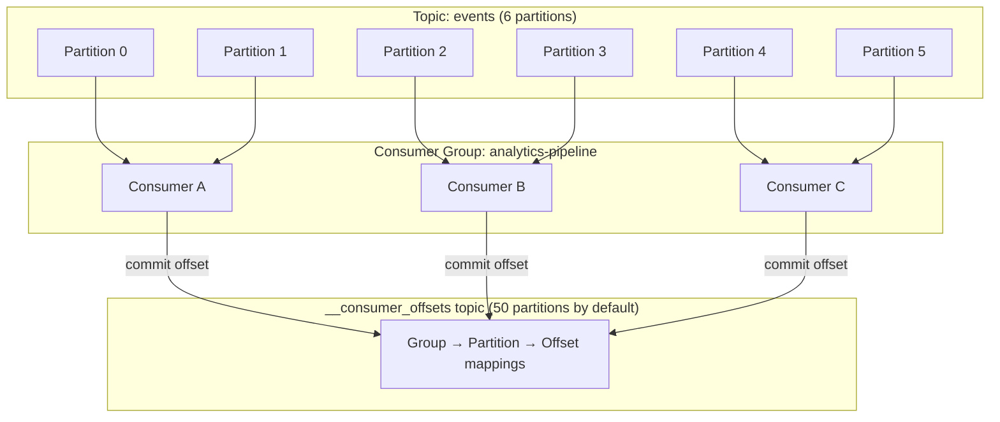
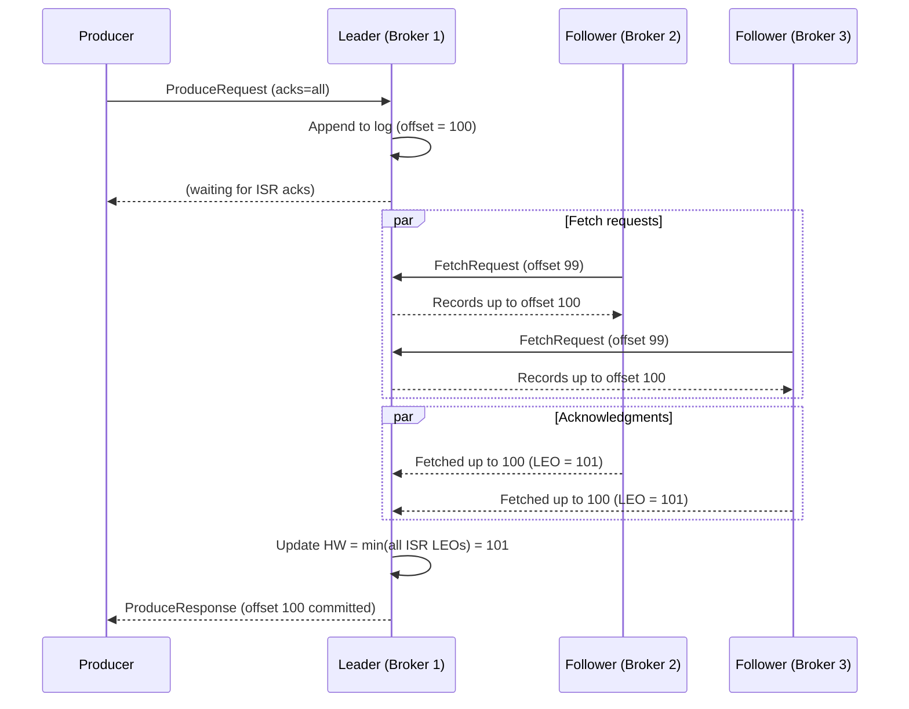
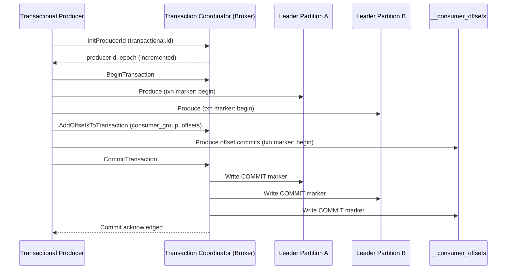
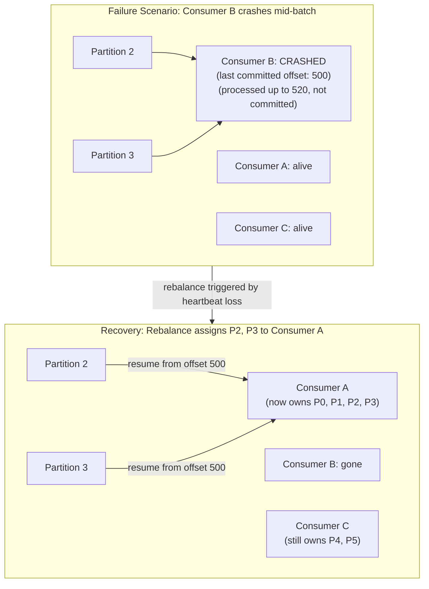

# Apache Kafka: The Distributed Log and Its Data Model

## 1. First-Principles Intuition & Invariants

Apache Kafka is built on a single, deceptively simple abstraction: the **append-only log**. A log is a totally ordered sequence of records where new entries are always appended to the tail and reads proceed sequentially from any point toward the tail. This is not a novel invention — the write-ahead log (WAL) has been a foundational structure in database internals, filesystem journaling, and distributed consensus for decades. What Kafka does is distribute this abstraction across a cluster of commodity servers and make it the primary interface for data movement rather than an internal implementation detail.

The reason the log is powerful is that it reduces the problem of distributed data consistency to the problem of **ordering**. In a system with random-access mutable state, every concurrent write raises the question of "which value wins?" — requiring locks, compare-and-swap loops, conflict resolution, or CRDTs. The append-only log sidesteps this entirely: every write has a unique, deterministic position. There is no conflict because there is no mutation. The position itself — called the **offset** in Kafka — is the source of truth for ordering.

### Core Invariants

Kafka guarantees the following invariants, each with precise scope:

1. **Per-partition offset ordering.** Within a single partition, a message with offset N was written before a message with offset N+1. This ordering is preserved for all consumers of that partition. Kafka does **not** guarantee ordering across partitions — it does not provide linearizability or total ordering. If you need total ordering, you must use a single partition, which sacrifices parallelism.

2. **Durability via ISR replication.** A message is considered committed only when it has been written to a quorum of In-Sync Replicas (ISR). The producer's `acks` setting controls the trade-off between latency and durability. With `acks=all`, the leader waits for all ISRs to acknowledge before responding to the producer, providing the strongest durability guarantee. This is **not** synchronous replication in the sense of two-phase commit — the leader does not block all followers; it tracks high-watermark asynchronously.

3. **Immutability.** Once a record is appended to a partition log at a given offset, its content and position never change. Records are not updated in place. The only removal mechanism is retention-based deletion (time or size) or log compaction, both of which remove entire segments or obsolete keys — they never modify individual records in place.

4. **At-least-once by default, exactly-once optionally.** The base delivery model is at-least-once: producers retry on failure (potentially causing duplicates), and consumers commit offsets after processing (potentially reprocessing on crash). Exactly-once semantics (EOS) requires enabling idempotent producers (`enable.idempotence=true`) and, for cross-partition atomic writes, the transactional API introduced in Kafka 0.11. EOS is not free — it adds overhead in the form of transaction coordination, extra round trips, and tighter fencing.

### The Record: Key, Value, Headers, and Offset

A Kafka record (message) consists of:

- **Offset** — assigned by the broker at write time, not by the producer. The producer does not know the offset until the produce response returns.
- **Timestamp** — either `CreateTime` (set by the producer) or `LogAppendTime` (set by the broker when it appends to the log), controlled by the topic's `message.timestamp.type` configuration.
- **Key** — an optional byte array used by the partitioner to determine the target partition. If the key is null, a round-robin (or sticky partitioning) strategy is used.
- **Value** — the payload, also a byte array. Kafka is schema-agnostic at the broker level; serialization is the producer's and consumer's responsibility.
- **Headers** — a set of key-value pairs (added in Kafka 0.11) for application-level metadata. These are distinct from the protocol-level fields above.

The key determines partitioning via a deterministic hash: `partition = hash(key) % num_partitions` (using murmur2 hashing in the default partitioner). This means that all records with the same key always land on the same partition, preserving their relative order. This is the mechanism by which Kafka provides ordering for a logical entity (e.g., all events for `customer_id=42` are ordered) without requiring a single global partition.



### Why the Offset Is Central

The offset is not just an identifier — it is the consumer's cursor, the broker's replication checkpoint, and the source of truth for committed progress. Consumers store their current offset in a Kafka internal topic (`__consumer_offsets`), not in ZooKeeper (this was the case prior to Kafka 0.9, which the original material incorrectly implies by not clarifying). This offset commit model is what enables:

- **Replay** — a consumer can seek to any earlier offset and re-read the stream.
- **Checkpointing** — periodic offset commits allow recovery from crashes without reprocessing everything.
- **Partition rebalancing** — when consumers join or leave a group, partitions are reassigned and new consumers resume from the last committed offset.

## 2. Core Architecture & Mechanics

### Topics, Partitions, and the Distributed Log

A **topic** is a logical channel. Each topic is divided into one or more **partitions**, and each partition is an independent, ordered, append-only log stored on a single broker (the **leader**) and replicated to zero or more **followers** on other brokers. The partition is the unit of parallelism: a topic with N partitions can be consumed by up to N consumers in a single consumer group, with each consumer owning one or more partitions.



This diagram shows the critical design decision: **leadership is distributed across brokers**. Broker 1 leads partition 0 but is a follower for partition 1. This avoids a single broker becoming a bottleneck for all writes.

### Log Segments: The On-Disk Structure

Each partition on a broker is a directory (e.g., `/var/lib/kafka/data/payments-0/`). Inside that directory are multiple **log segments**. A partition always has one **active segment** (the one being written to) and zero or more **sealed segments** (older, immutable segments that have been rolled).

Each segment consists of three files:

| File | Extension | Purpose |
|------|-----------|---------|
| Log | `.log` | The actual record data, written sequentially. Records are stored in the Kafka v2 record-batch format. |
| Offset index | `.index` | Sparse index mapping logical offsets to physical file positions. Entries are added every `index.interval.bytes` (default 4096 bytes). |
| Timestamp index | `.timeindex` | Sparse index mapping timestamps to offsets, used for timestamp-based seeks. |

Kafka does **not** use memory-mapped I/O (`mmap`) for the `.log` data files. It uses standard Java NIO `FileChannel` with buffered sequential writes and relies on the **OS page cache** for read-side performance. Memory-mapped I/O is used only for the index files (`.index` and `.timeindex`), which are small and benefit from random access patterns. This distinction matters: the page cache approach means Kafka's read performance depends on the OS buffer allocator, not on JVM heap. Kafka is designed to run with a relatively small JVM heap and let the OS manage file caching.

A segment is rolled (sealed) when it reaches `log.segment.bytes` (default 1 GB) or `log.roll.hours` (default 168 hours / 7 days), whichever comes first. Once sealed, a segment is never appended to.



### Record Batch Format (v2)

Since Kafka 0.11, the on-disk and on-wire format is the **record batch** (v2). A single produce request contains one or more batches, each of which contains one or more records. This nesting is important for understanding compression and atomicity:

```text
RecordBatch
├── Header
│   ├── baseOffset (int64)       — offset of the first record in the batch
│   ├── batchLength (int32)       — total size of the batch (excluding this field and baseOffset)
│   ├── partitionLeaderEpoch (int32)
│   ├── magic (int8)              — format version (2)
│   ├── crc (int32)               — CRC32C of the entire batch
│   ├── attributes (int16)       — compression type, timestamp type, transactional flag, control batch flag
│   ├── lastOffsetDelta (int32)  — difference between last and base offset
│   ├── baseTimestamp (int64)
│   ├── maxTimestamp (int64)
│   ├── producerId (int64)       — for idempotent/transactional producers
│   ├── producerEpoch (int16)
│   ├── baseSequence (int32)     — for idempotent deduplication
│   └── recordCount (int32)
├── Records[]
│   ├── length (varint)
│   ├── attributes (int8)
│   ├── timestampDelta (varlong)
│   ├── offsetDelta (varint)
│   ├── keyLength (varint) + key (bytes)
│   ├── valueLength (varint) + value (bytes)
│   └── Headers[]
│       ├── headerKeyLength (varint) + headerKey (string)
│       └── headerValueLength (varint) + headerValue (bytes)
```

Compression is applied at the **batch level**, not the individual record level. The entire batch (all records) is compressed together using the algorithm specified in the `attributes` field. This is more efficient than per-message compression because it allows the compressor to find redundancy across records. Supported codecs: `none`, `gzip`, `snappy`, `lz4`, and `zstd` (added in Kafka 2.1, KIP-110).

### Consumer Groups and Offset Management

A **consumer group** is a set of consumers that jointly consume a topic. Each partition is assigned to exactly one consumer within the group at any given time. This is a **many-to-one** mapping: one partition, one consumer. But one consumer can consume multiple partitions. This is the core scaling mechanism — adding consumers to a group (up to the partition count) increases parallelism.



When a consumer joins or leaves a group, a **rebalance** occurs. The group coordinator (a broker) reassigns partitions to consumers and signals them to begin consuming from their new partitions. During a rebalance, consumers stop processing and may need to flush state. Kafka 2.4+ introduced **incremental cooperative rebalancing** (KIP-429), which only revokes partitions that need to move, reducing the disruption.

Offsets are committed to the `__consumer_offsets` internal topic, which is itself a compacted Kafka topic with 50 partitions by default. The key is a tuple of `(group_id, topic, partition)` and the value is the committed offset plus metadata. This design means offset storage inherits all of Kafka's durability and replication guarantees.

### Serialization

Kafka treats keys and values as opaque `byte[]`. The broker never inspects payload contents. Serialization happens entirely on the producer side (via `Serializer<T>`) and deserialization on the consumer side (via `Deserializer<T>`). Common choices:

- **String/JSON** — simple, human-readable, but verbose and slow to parse.
- **Avro** — compact binary format with a schema registry. Supports schema evolution (backward/forward/breaking compatibility). The de facto standard in the Kafka ecosystem, supported by Confluent Schema Registry.
- **Protobuf** — compact, widely used in gRPC ecosystems. Protobuf 3 with Confluent's schema registry support is an alternative to Avro.
- **Thrift** — less common but functionally similar to Protobuf.

The choice of serialization format has long-term consequences. In production pipelines running for years, schemas will evolve — fields will be added, renamed, or deprecated. A schema registry (Confluent, Apicurio, AWS Glue) manages schema versions and enforces compatibility rules at produce time, preventing producers from publishing incompatible records that would crash consumers.

### Log Compaction

Log compaction is a retention strategy distinct from time-based or size-based deletion. For topics configured with `cleanup.policy=compact` (or `compact,delete` for both), Kafka retains only the latest value for each key. Older records with the same key are eventually removed during compaction.

```mermaid
flowchart LR
    subgraph Before["Before Compaction (Segment)"]
        B1["offset 0: key=A, value=v1"]
        B2["offset 1: key=B, value=v1"]
        B3["offset 2: key=A, value=v2"]
        B4["offset 3: key=C, value=v1"]
        B5["offset 4: key=B, value=v2"]
        B6["offset 5: key=A, value=v3"]
    end

    subgraph After["After Compaction"]
        A1["offset 4: key=B, value=v2"]
        A2["offset 5: key=A, value=v3"]
        A3["offset 3: key=C, value=v1"]
    end

    Before -->|"log cleaner"| After
```



Compaction is implemented by the **log cleaner** — background threads that read sealed segments, build an offset map (a hash table from key to latest offset), and rewrite segments with only the latest value per key. The active segment is never compacted. Keys with null values act as tombstones — they are retained for a configurable period (`delete.retention.ms`, default 24 hours) to ensure consumers see the deletion, then removed.

Compaction is essential for:
- **State stores** in Kafka Streams (changelog topics).
- **Event sourcing** patterns where the current state is derived from the latest event per key.
- **Configuration/lookup topics** where the latest value per key is the current state.

## 3. Replication, Consistency, and ISR

### Leader-Follower Replication

Each partition has one **leader** replica and zero or more **follower** replicas (total replicas = replication factor). All produce and fetch requests for a partition go to the leader. Followers fetch from the leader sequentially, maintaining a replica of the log.

The leader maintains the **high watermark (HW)** — the highest offset that has been replicated to all ISRs. Consumers can only read up to the HW. This ensures that if the leader fails, any message below the HW is guaranteed to exist on at least one ISR, preventing data loss on leader failover.



### ISR (In-Sync Replicas)

The ISR is the set of replicas whose log end offset (LEO) is within `replica.lag.time.max.ms` (default 30 seconds) of the leader's LEO. If a follower falls behind beyond this threshold, it is removed from the ISR. If it catches up, it is re-added.

The ISR concept is the crux of Kafka's consistency model:
- With `acks=all`, the leader waits for all ISRs to acknowledge before responding to the producer. This means a committed message exists on all current ISRs.
- If `unclean.leader.election.enable=true` (default: false since Kafka 0.11), a follower not in the ISR can become leader if all ISRs are down, potentially losing data. With `false` (recommended), the partition becomes unavailable until an ISR replica recovers — trading availability for durability.

The original content incorrectly described replication as configurable between "synchronous" and "asynchronous." Kafka replication is always **asynchronous** in the fetch model — followers pull, the leader does not push. The `acks` setting controls acknowledgment semantics, not whether replication is synchronous. With `acks=1`, the leader responds after writing locally (no ISR wait). With `acks=all` (or `-1`), the leader waits for all ISRs. With `acks=0`, the producer fire-and-forgets.

### Controller and Metadata Management

The **controller** is a single broker (elected via ZooKeeper or, in KRaft mode, via the KRaft quorum) responsible for:
- Partition leader election on broker failure.
- Partition reassignment during rebalancing.
- Topic creation and deletion.

The original content references Raft for controller management without distinguishing the ZooKeeper era from KRaft. The accurate state:

- **ZooKeeper mode** (Kafka < 2.8 default, still supported): Kafka stores cluster metadata (brokers, topics, partitions, ISRs, controller epoch) in ZooKeeper znodes. The controller watches for broker ephemeral node changes and triggers leader elections when brokers fail. ZooKeeper uses the ZAB protocol (not Raft) for its own consensus.
- **KRaft mode** (Kafka 2.8+ preview, production-ready in 3.3+): Kafka replaces ZooKeeper with an internal Raft-based metadata quorum. A subset of brokers act as **controllers** and maintain the metadata log via the Raft consensus algorithm. This reduces external dependencies, improves metadata throughput, and scales to more partitions.

## 4. High-Performance Optimization

### The Page Cache Strategy

Kafka's read path does not maintain an application-level cache in JVM heap. Instead, it relies entirely on the OS page cache. When a consumer requests data:
1. The broker checks the page cache. If the data is resident (common for recently written data being read by near-real-time consumers), it is copied directly to the network socket via `sendfile()` (zero-copy), bypassing user space entirely.
2. If the data is not in the page cache (e.g., a consumer replaying old data), the OS reads from disk into the page cache, then transfers to the socket.

The `sendfile()` zero-copy path eliminates two kernel-to-user-space copies (read into user buffer, write from user buffer to socket). Data moves from disk → kernel page cache → kernel socket buffer → NIC. This is a significant throughput win for high-volume reads.

Kafka also uses `mmap()` for index files, which allows the JVM to access index entries as if they were in-process memory, with the OS handling page faults transparently.

### Batching and Compression

Batching is the single most impactful performance lever in Kafka. The producer batches records in memory before sending, controlled by two settings:

- `linger.ms` — the maximum time to wait for additional records before sending a batch (default 0, meaning send immediately). Setting this to 5–20 ms allows more records to accumulate, increasing batch size and compression effectiveness.
- `batch.size` — the maximum batch size in bytes (default 16 KB). If the batch fills before `linger.ms` expires, it is sent immediately.

```python
from kafka import KafkaProducer
import json

producer = KafkaProducer(
    bootstrap_servers=['broker1:9092', 'broker2:9092'],
    # Idempotent producer — enables deduplication via producerId + sequence numbers
    # Required for exactly-once semantics
    enable_idempotence=True,
    # Wait for all ISRs to acknowledge before considering a write committed
    acks='all',
    # Batching: wait up to 20ms for records to accumulate, up to 256KB per batch
    linger_ms=20,
    batch_size=262144,
    # Compression at the batch level — all records in a batch are compressed together
    # zstd offers the best ratio in practice; lz4 is a good lower-latency alternative
    compression_type='zstd',
    # Retries with exponential backoff for transient failures
    retries=2147483647,
    max_in_flight_requests_per_connection=5,
    # Serialize keys as UTF-8 strings, values as JSON-encoded bytes
    key_serializer=lambda k: k.encode('utf-8'),
    value_serializer=lambda v: json.dumps(v).encode('utf-8'),
)

# Sending is asynchronous; .get() blocks until the broker acknowledges
future = producer.send('orders', key='customer-42', value={'item': 'widget', 'qty': 10})
metadata = future.get(timeout=10)
print(f"Written to partition {metadata.partition} at offset {metadata.offset}")
```

The trade-off: larger batches reduce per-record overhead (network requests, compression headers, CRC computation) but increase latency. For latency-sensitive workloads, `linger.ms=0` with smaller batches may be appropriate. For throughput-oriented pipelines (log aggregation, ETL), `linger.ms=50` with large batches and `zstd` compression can improve throughput by an order of magnitude.

### Compression Codec Comparison

| Codec | Compression Ratio | CPU Cost | Notes |
|-------|------------------|----------|-------|
| none | 1:1 | none | No overhead, but maximum network/disk usage |
| gzip | ~3-4:1 | high | Good ratio but slow; rarely the right choice for streaming |
| snappy | ~2-2.5:1 | low | Fast, good for latency-sensitive workloads |
| lz4 | ~2.5:1 | low | Faster than snappy with similar ratios; good default |
| zstd | ~3-3.5:1 | medium | Best balance of ratio and speed; recommended for most workloads |

### Partition Count and Scalability

Partition count is the primary scaling knob in Kafka. Each partition:
- Can be led by one broker, distributing write load.
- Is the unit of parallelism for consumers (one consumer per partition per group).
- Has its own log segment files and indexes, consuming file descriptors, memory for index loading, and broker CPU for replication fetch.

The original content incorrectly claims Kafka provides "automatic partitioning." Kafka does **not** auto-scale partitions. The partition count is set at topic creation time and can only be increased (not decreased) afterward via `kafka-topics.sh --alter --partitions N`. Choosing the right count upfront is a capacity planning exercise:

```text
Target throughput / Per-partition throughput ≈ required partitions

Example: 100 MB/s target, ~10 MB/s per partition (conservative for typical workloads)
→ 10 partitions minimum, with headroom for consumer scaling → 20-30 partitions
```

Too many partitions (e.g., thousands per broker) can degrade performance due to:
- Increased leader election time during failover.
- More open file handles and memory for index segments.
- Longer rebalance times for consumer groups.
- More metadata overhead in the controller.

A common guideline: stay below ~4,000 partitions per broker and below ~200,000 partitions per cluster.

## 5. Exactly-Once Semantics (EOS)

The original material mentions exactly-once semantics without explaining the mechanism. Here is the precise architecture:

Kafka provides exactly-once through three layered features:

### 5.1 Idempotent Producer

When `enable.idempotence=true`, the broker assigns the producer a `producerId` and `epoch`. Each batch includes a `sequenceNumber` that is monotonically increasing per partition. The broker tracks `(producerId, partition) → lastSequence` and deduplicates batches:

- If a batch arrives with a sequence number that has already been seen (a retry), the broker returns a successful response but does not re-append the data.
- If a batch arrives with a sequence number that is higher than expected (a gap), the broker returns an `OutOfOrderSequenceException` and fences the producer.

This guarantees that retries do not produce duplicates within a single partition. Idempotent producers require `acks=all` and `max.in.flight.requests.per.connection <= 5` (with Kafka 2.5+, up to 5 is safe; with older versions, the limit was effectively 1 for strict ordering).

### 5.2 Transactions

For atomic writes across multiple partitions, the transactional API coordinates a two-phase commit:



Consumers with `isolation.level=read_committed` will only see records from committed transactions. Records from aborted or incomplete transactions are filtered out. The transaction log is stored in the `__transaction_state` internal topic.

### 5.3 Consumer-Side Deduplication (Kafka Streams)

Kafka Streams extends EOS to the processing layer via the **consume-transform-produce** loop. For each input record:
1. The consumer reads a record.
2. The processor transforms it and writes to an output topic (within the same transaction).
3. The consumer commits the input offset (within the same transaction).

If the transaction commits, both the output records and the input offset are committed atomically. If it aborts, neither is. This is the `exactly_once_v2` processing mode (KIP-447), which uses a single transaction coordinator per thread, reducing overhead compared to the original implementation.

### EOS Code Example (Python with confluent-kafka)

```python
from confluent_kafka import Producer, Consumer, KafkaException, KafkaError
import json

# Transactional producer — writes are atomic across partitions
producer = Producer({
    'bootstrap.servers': 'broker1:9092',
    'transactional.id': 'order-processor-tx-1',  # stable, unique ID per app instance
    'enable.idempotence': True,
    'acks': 'all',
})

# Initialize transactions — must be called once before any produce
producer.init_transactions(60)

# Consumer configured for read_committed isolation
consumer = Consumer({
    'bootstrap.servers': 'broker1:9092',
    'group.id': 'order-processor-group',
    'enable.auto.commit': False,  # offsets committed within the transaction
    'isolation.level': 'read_committed',  # skip records from uncommitted transactions
    'auto.offset.reset': 'earliest',
})

consumer.subscribe(['raw-orders'])

try:
    while True:
        msg = consumer.poll(timeout=1.0)
        if msg is None:
            continue
        if msg.error():
            raise KafkaException(msg.error())

        order = json.loads(msg.value())

        # Begin atomic transaction
        producer.begin_transaction()

        try:
            # Transform and write to output topic
            enriched = {**order, 'processed_at': time.time()}
            producer.produce(
                'processed-orders',
                key=msg.key(),
                value=json.dumps(enriched).encode('utf-8'),
            )

            # Commit input offset within the same transaction
            producer.send_offsets_to_transaction(
                consumer.get_consumer_group_metadata(),
                [(msg.topic(), msg.partition(), msg.offset() + 1)],
            )

            # Commit both the output records and the offset atomically
            producer.commit_transaction(60)

        except Exception as e:
            # Abort — neither output records nor offset commit take effect
            producer.abort_transaction(60)
            print(f"Transaction aborted: {e}")

except KeyboardInterrupt:
    pass
finally:
    producer.flush(30)
    consumer.close()
```

## 6. Failure Modes and Recovery

### Broker Failure

When a broker crashes, the controller detects the failure (via ZooKeeper session expiry or KRaft quorum heartbeat loss) and:
1. Identifies all partitions where the failed broker was leader.
2. Selects a new leader from the ISR of each partition (the most advanced follower).
3. Updates metadata and notifies producers/consumers of the new leader.

Producers with `acks=all` will buffer or retry messages for partitions whose leader is being elected (controlled by `request.timeout.ms` and `delivery.timeout.ms`). Consumers automatically reconnect to the new leader and resume from their last committed offset.

If `unclean.leader.election.enable=false` (the default since 0.11) and no ISR is available, the partition remains unavailable until an ISR replica recovers. This prioritizes durability over availability. Setting it to `true` allows a non-ISR replica to become leader, accepting potential data loss to restore availability.

### Disk Failure

Kafka does not use RAID or JBOD-level redundancy. Each broker uses local disks (preferably multiple, configured via `log.dirs`). If a single disk fails on a multi-disk broker, Kafka (since 1.1) can handle it gracefully via KIP-113, which allows the broker to stay alive and serve partitions on healthy disks. Before this, a disk failure would bring down the entire broker.

Data durability is provided by **cross-broker replication**, not disk-level redundancy. A replication factor of 3 with `acks=all` and `min.insync.replicas=2` means data survives the simultaneous loss of one broker.

### Network Partition

Network partitions in Kafka's context mean some brokers can reach the controller and others cannot:
- Brokers that lose contact with the controller cannot report ISR changes or participate in leader election.
- The controller (in ZK mode) depends on ZooKeeper's ZAB quorum to remain the controller. If the controller itself is partitioned away from the ZK quorum, it loses leadership and a new controller is elected.
- In KRaft mode, the controller quorum uses Raft, which handles network partitions via the standard Raft leader election protocol.

Producers and consumers experience partitions as timeouts and will retry against available brokers. The `client.id`-level metrics track connection churn, which spikes during partitions.

### Consumer Failure and Offset Management

If a consumer crashes without committing its offset, the next consumer in the group that takes over its partitions will start from the last committed offset, reprocessing any records consumed but not committed. This is the at-least-once default. Strategies to manage this:

- **Auto-commit** (`enable.auto.commit=true`, `auto.commit.interval.ms=5000`): convenient but dangerous — commits happen on a timer regardless of whether processing succeeded, risking data loss if the consumer crashes mid-batch.
- **Manual commit after processing**: commit offsets only after successfully processing records, reducing the risk of data loss but requiring careful handling of partial batch failures.
- **Transactional consume-process-produce**: as described above, the strongest guarantee but with the highest overhead.



## 7. Production-Grade Consumer Example (Go)

```go
package main

import (
	"context"
	"encoding/json"
	"fmt"
	"log"
	"os"
	"os/signal"
	"syscall"
	"time"

	"github.com/segmentio/kafka-go"
)

type OrderEvent struct {
	OrderID   string  `json:"order_id"`
	CustomerID string `json:"customer_id"`
	Amount    float64 `json:"amount"`
	Timestamp int64   `json:"timestamp"`
}

func main() {
	r := kafka.NewReader(kafka.ReaderConfig{
		Brokers:        []string{"broker1:9092", "broker2:9092"},
		Topic:          "orders",
		GroupID:        "order-consumer-group",
		MinBytes:       10e3,         // 10KB minimum per fetch
		MaxBytes:       10e6,         // 10MB maximum per fetch
		MaxWait:        2 * time.Second,
		CommitInterval: 0,            // disable auto-commit; we commit manually
		StartOffset:    kafka.FirstOffset,
	})

	// Graceful shutdown on SIGINT/SIGTERM
	ctx, cancel := context.WithCancel(context.Background())
	sigchan := make(chan os.Signal, 1)
	signal.Notify(sigchan, syscall.SIGINT, syscall.SIGTERM)
	go func() {
		<-sigchan
		log.Println("Shutting down consumer...")
		cancel()
	}()

	defer r.Close()

	for {
		select {
		case <-ctx.Done():
			return
		default:
		}

		// FetchMessage does not auto-commit; we control offset commits explicitly
		m, err := r.FetchMessage(ctx, kafka.FetchMessage{})
		if err != nil {
			if err == context.Canceled {
				return
			}
			log.Printf("fetch error: %v", err)
			continue
		}

		var order OrderEvent
		if err := json.Unmarshal(m.Value, &order); err != nil {
			log.Printf("unmarshal error (offset %d): %v — skipping", m.Offset, err)
			// Commit the offset even on parse failure to avoid getting stuck
			if err := r.CommitMessages(ctx, m); err != nil {
				log.Printf("commit error: %v", err)
			}
			continue
		}

		if err := processOrder(order); err != nil {
			log.Printf("processing error (offset %d): %v — not committing, will retry", m.Offset, err)
			// Do NOT commit — the message will be re-delivered on next poll.
			// In production, implement a dead-letter queue pattern here.
			continue
		}

		// Commit only after successful processing — at-least-once semantics
		if err := r.CommitMessages(ctx, m); err != nil {
			log.Printf("commit error (offset %d): %v", m.Offset, err)
		}
	}
}

func processOrder(order OrderEvent) error {
	// Simulate business logic
	if order.Amount <= 0 {
		return fmt.Errorf("invalid amount: %f", order.Amount)
	}
	log.Printf("processed order %s for customer %s, amount %.2f",
		order.OrderID, order.CustomerID, order.Amount)
	return nil
}
```

This example implements manual offset commits with at-least-once semantics. Records that fail to parse are committed (poison pill handling), while records that fail processing are not committed and will be retried. In a production system, the retry path should include a dead-letter queue (DLQ) to avoid infinite retry loops on permanently unprocessable records.

## Summary

Kafka's data model rests on a single architectural choice: the distributed, partitioned, append-only log with monotonically increasing offsets. Every feature — ordering, durability, replay, consumer parallelism, exactly-once semantics — derives from this foundation. The partition is the unit of parallelism, the offset is the unit of progress, and the ISR is the unit of durability. Batching, compression, and zero-copy transfer are the performance mechanisms layered on top. The system trades cross-partition ordering for horizontal scalability, and offers configurable trade-offs between latency, throughput, and durability through the `acks`, `linger.ms`, and replication settings.
