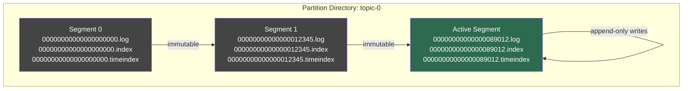
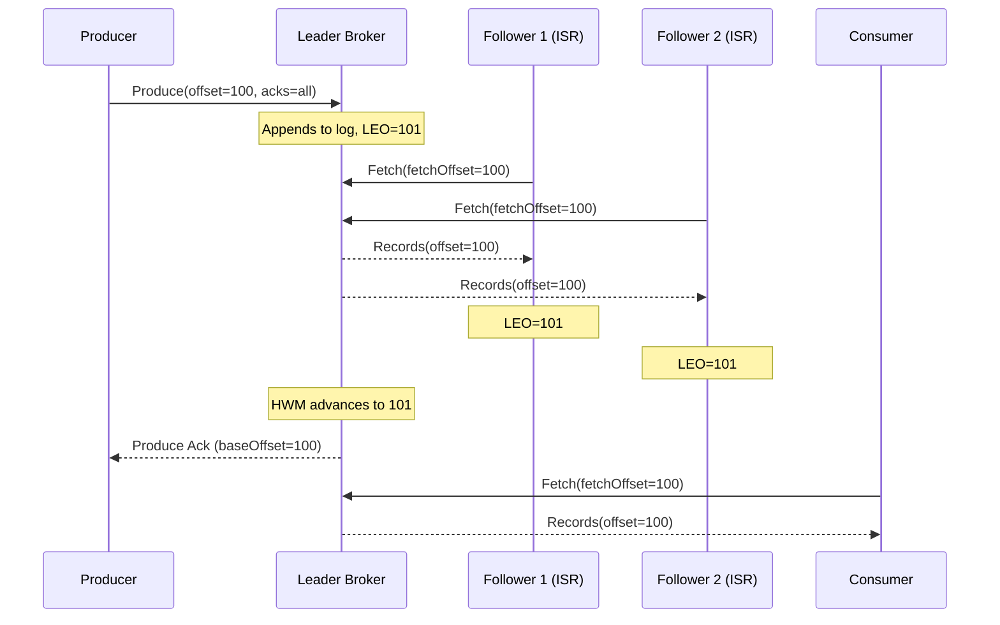
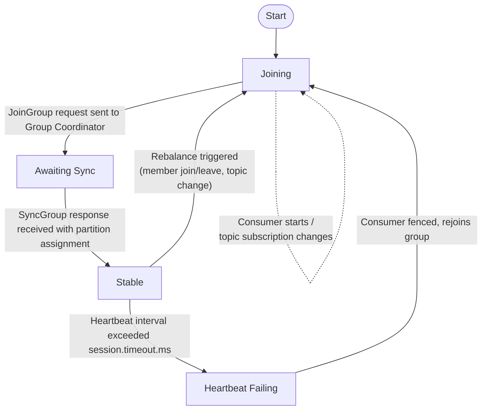
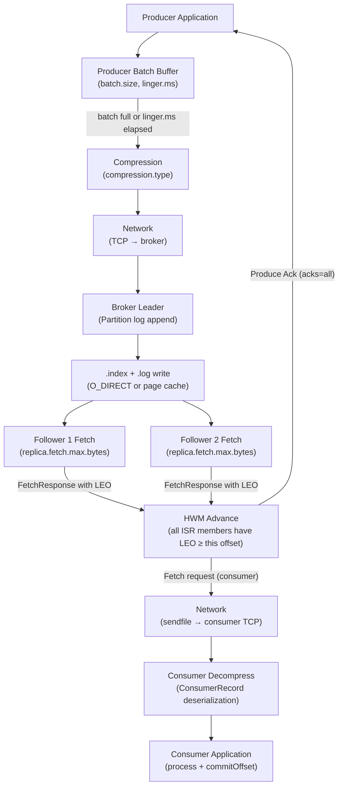
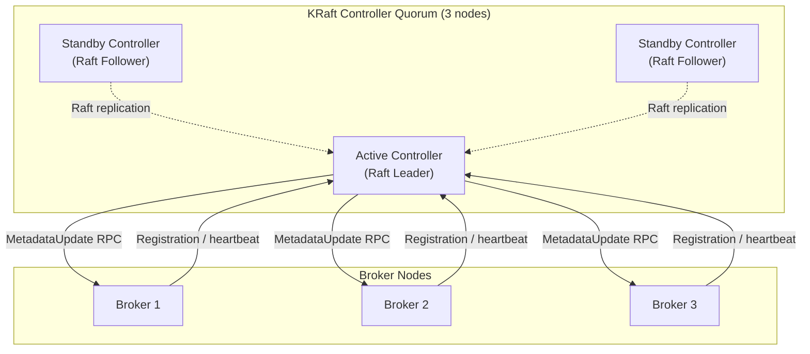
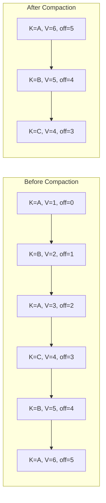

# Lesson 4: Optimizing Kafka Performance and Throughput

## 1. First-Principles Intuition & Invariants

Apache Kafka's performance characteristics are inextricably bound to its log-structured storage engine. Understanding where the system's performance ceiling lies requires tracing the data from the moment a producer writes a byte to the moment a consumer reads it.

At its core, Kafka trades random access for sequential access. A traditional database indexes into a B-tree to find a record by primary key, paying the cost of random I/O and page cache misses on every read. Kafka instead appends records sequentially to a log file, achieving write throughput that scales linearly with disk bandwidth because the write head (whether a physical actuator on spinning media or the internal scheduler on an NVMe device) never needs to seek between scattered locations. On a modern HDD, sequential throughput can reach 200–300 MB/s while random writes may fall below 1 MB/s due to seek and rotational latency. On NVMe SSDs the gap is smaller but the sequential advantage remains due to internal parallelism across flash channels.

This design creates a powerful throughput characteristic but also introduces a hard constraint: once a record is written, it cannot be efficiently updated or deleted without rewriting the entire segment file. This is why Kafka's retention model is append-only, and why the system relies on log compaction and time/size-based retention policies to reclaim space rather than in-place mutation.

**The five invariants that govern Kafka performance:**

1. **Throughput is bounded by the slowest stage in the pipeline.** A producer that batches ten thousand records into a single network packet can achieve near-wire-speed throughput, but only if the broker can sustain the ingestion rate and the consumer can sustain the deserialization rate. Optimizing one stage without auditing its neighbors displaces the bottleneck rather than eliminating it.

2. **Batching is the primary lever for amortizing fixed costs.** Every network round-trip, every system call, and every compression operation carries a fixed overhead. Batching spreads that overhead across many records, reducing per-record cost asymptotically. The relationship is sublinear: doubling the batch size does not double the throughput gain, but the gains remain significant up to the point where batch assembly latency dominates.

3. **Replication factor and ISR size directly trade throughput for durability.** When a producer writes to a partition with `acks=all`, the broker must receive acknowledgments from every replica in the In-Sync Replica (ISR) set before confirming the write. Each additional ISR member adds a network round-trip in the critical path. A replication factor of 3 with `min.insync.replicas=2` is the conventional balance: it tolerates one broker failure without data loss while keeping the replication fan-out bounded.

4. **Page cache residency determines read latency.** Kafka's brokers do not maintain an internal read cache. All read I/O goes through the operating system's page cache. If consumers are reading recently produced data (the common tail-read pattern), those pages are almost certainly still in RAM and no disk I/O occurs. If consumers fall behind and begin reading cold data, they cause page cache evictions that degrade throughput for all other consumers reading from the same broker.

5. **Partition count governs maximum parallelism but introduces coordination overhead.** Throughput scales linearly with the number of partitions up to the point where the broker's replication overhead, the consumer group rebalance cost, and the ZooKeeper/KRaft metadata load become limiting factors. Each partition is an independent ordered log, so there is no cross-partition coordination during normal writes or reads. However, each partition requires open file descriptors, maintains its own ISR, and participates in leader election, all of which scale with partition count.

---

## 2. Storage Architecture: Segments, Indexes, and the Log

### 2.1 Segment File Structure

Each Kafka partition is stored as a directory on the broker's filesystem. Within that directory, the data is organized into a sequence of segment files. Each logical segment consists of three physical files:

| File suffix | Purpose |
|---|---|
| `.log` | The data file. A contiguous sequence of variable-length record batches. |
| `.index` | A sparse offset index mapping logical offsets to byte positions in the `.log` file. |
| `.timeindex` | A sparse timestamp index mapping wall-clock timestamps to logical offsets, used for time-based offset lookup. |

The `.index` and `.timeindex` files use a fixed entry size (8 bytes and 12 bytes respectively), which means they can be memory-mapped with `mmap(2)` and searched with binary search in O(log n) time. The index is *sparse*: not every record has an index entry. The broker writes a new index entry every `index.interval.bytes` (default: 4096 bytes) of data written to the `.log` file. At read time, the broker binary-searches the index to find the largest indexed offset less than or equal to the target, then scans forward through the `.log` file from that position.

**The original material incorrectly referred to these files as "zero files" and "deck files." These are not Kafka terms. The correct names are `.index` (or offset index) and `.log` (the data/segment file). There are no "zero" or "deck" files in Kafka's storage layer.**

The active segment is the one currently being written. All other segments are immutable. When the active segment reaches `log.segment.bytes` (default: 1 GiB) or its age reaches `log.roll.ms`, it is closed and a new active segment is opened.



### 2.2 Record Batch Format (Kafka Wire Format v2)

Since Kafka 0.11, the on-disk format uses the RecordBatch structure (magic byte = 2). Understanding this format is prerequisite to understanding compression efficiency and consumer parse overhead.

```text
RecordBatch {
    baseOffset:           int64   // offset of the first record in this batch
    batchLength:          int32   // total byte length of the batch from partitionLeaderEpoch onward
    partitionLeaderEpoch: int32   // used for fencing stale leaders
    magic:                int8    // = 2 for the current format
    crc:                  uint32  // CRC32-C of all fields from attributes onward
    attributes:           int16   // compression codec, timestamp type, transactional flag, control flag
    lastOffsetDelta:      int32   // (lastOffset - baseOffset), enables skipping to end of batch
    baseTimestamp:        int64   // timestamp of the first record
    maxTimestamp:         int64   // max timestamp across all records in the batch
    producerId:           int64   // used for idempotent and transactional producers
    producerEpoch:        int16
    baseSequence:         int32   // sequence number for idempotent delivery deduplication
    records:              ARRAY   // compressed as a unit when compression is enabled
}
```

Compression is applied to the `records` array as a whole, not to individual records. This is critical: compressing a batch of similar records (e.g., JSON events with the same schema) achieves substantially better ratios than compressing individual records, because the compressor can exploit cross-record redundancy. A batch of 1,000 JSON records with a repeated schema can compress to 5–10% of its original size under LZ4 or Snappy.

### 2.3 Zero-Copy I/O via `sendfile(2)`

Kafka's most important OS-level optimization is zero-copy transfer. When a consumer fetches data, the broker does not read bytes into JVM heap memory and then write them to a socket. Instead, the broker calls `sendfile(2)` (or `transferTo` in Java NIO, which maps to the same syscall), which instructs the kernel to transfer data directly from the page cache to the network socket buffer without any copy into user space.

```text
Traditional copy path (4 copies, 4 context switches):
  disk → kernel page cache → user buffer (JVM heap) → socket buffer → NIC

Zero-copy path via sendfile(2) (2 copies, 2 context switches):
  disk → kernel page cache → NIC DMA buffer
```

This optimization is the primary reason Kafka can saturate a 10 GbE network card from a single broker without hitting CPU limits. The implication for operators is that compression applied by the producer is preserved on disk and transmitted as-is to the consumer; the broker never decompresses data in the normal fetch path. The consumer decompresses. This means producer-side compression is free from the broker's perspective.

---

## 3. Replication Protocol: ISR, HWM, and Leader Epoch

### 3.1 Leader, Followers, and the In-Sync Replica Set

Every partition has one leader broker and zero or more follower brokers determined by the replication factor. All produces go to the leader. Followers replicate by continuously issuing Fetch requests to the leader, identical in wire format to consumer fetch requests. The leader maintains an In-Sync Replica (ISR) set: the set of replicas (including itself) whose replication lag is within `replica.lag.time.max.ms` (default: 30 seconds). A follower that falls more than this duration behind is removed from the ISR.

The High Watermark (HWM) is the offset of the last record that has been fully replicated to all replicas currently in the ISR. The consumer can only read records up to the HWM. Records above the HWM are written to the leader's log but not yet exposed to consumers — this is called the "log end offset" (LEO). The gap between the LEO and the HWM is the uncommitted tail.



### 3.2 `acks` Configuration and Durability Guarantees

The producer's `acks` setting is the most consequential single configuration for the throughput/durability trade-off:

- `acks=0`: Fire-and-forget. The producer does not wait for any broker acknowledgment. Maximum throughput, zero durability. Useful for metrics or high-volume logging where occasional loss is acceptable.
- `acks=1`: The leader acknowledges after writing to its local log, before replication to followers. Data is lost if the leader fails before followers replicate. This is the historical default.
- `acks=all` (or `acks=-1`): The leader acknowledges only after all ISR members have written the record to their local logs. When combined with `min.insync.replicas=2`, this guarantees that at least two brokers hold the data before acknowledgment. This is the production-safe default since Kafka 3.0.

**The "original content" claim that replication requires writing to all ISR members "before acknowledging the write to the producer" is correct for `acks=all`. It is incorrect for `acks=1`, which acknowledges after local write only.**

### 3.3 Leader Epoch and Fencing

Kafka 0.11 introduced the leader epoch, a monotonically increasing counter stored in the partition metadata. When a new leader is elected, its epoch is incremented. Every RecordBatch carries the epoch of the leader that produced it. This mechanism fences zombie leaders: a broker that was partitioned from the cluster, then rejoins while believing it is still the leader, will have its writes rejected by followers because the epoch on its writes is stale.

Before the leader epoch was introduced, Kafka suffered from a subtle data loss scenario during ISR shrinkage and leader failover that could result in divergent replicas. The leader epoch makes divergence detectable and resolvable during the recovery sequence.

---

## 4. Producer Optimization

### 4.1 Batching and Linger

The two primary producer parameters governing batching are `batch.size` and `linger.ms`.

- `batch.size` (default: 16,384 bytes = 16 KiB): The maximum number of bytes to include in a single batch for a given partition. The producer accumulates records into a batch until this limit is reached or `linger.ms` elapses, whichever comes first.
- `linger.ms` (default: 0 ms): The time the producer will wait for additional records to arrive before sending a batch that has not yet reached `batch.size`. A value of 0 means the producer sends a batch immediately when a record arrives, even if the batch is not full. Setting this to 5–50 ms dramatically improves batching efficiency at a small cost to tail latency.

The relationship between these parameters and throughput is not linear. At `linger.ms=0` with low producer concurrency, most batches contain a single record. At `linger.ms=10ms`, batches accumulate for 10ms and can contain hundreds of records. The per-record overhead of a network round-trip (typically 1–5ms on a LAN) is amortized across all records in the batch.

```python
from confluent_kafka import Producer
import json
import time

conf = {
    'bootstrap.servers': 'broker1:9092,broker2:9092,broker3:9092',

    # Batching: accumulate up to 512 KiB per partition-batch
    'batch.size': 524288,

    # Wait up to 20ms for additional records to fill the batch
    'linger.ms': 20,

    # Total memory for all in-flight batches (producer buffer pool)
    'buffer.memory': 67108864,  # 64 MiB

    # Compress batches with LZ4 (best throughput/CPU trade-off for most workloads)
    'compression.type': 'lz4',

    # Idempotent producer: exactly-once delivery at the producer level
    # Requires acks=all and max.in.flight.requests.per.connection <= 5
    'enable.idempotence': True,

    # With idempotent producer, acks=all is enforced automatically
    'acks': 'all',

    # Retry up to 5 times on transient failures (idempotence ensures no duplicates)
    'retries': 5,

    # Maximum unacknowledged requests per connection
    # Must be <= 5 when enable.idempotence=True to preserve ordering guarantees
    'max.in.flight.requests.per.connection': 5,

    # Request timeout: how long to wait for a broker response before retrying
    'request.timeout.ms': 30000,

    # Delivery timeout: total time budget for a single produce call including retries
    'delivery.timeout.ms': 120000,
}

producer = Producer(conf)

def delivery_report(err, msg):
    if err is not None:
        print(f'Delivery failed for record {msg.key()}: {err}')
    else:
        print(f'Record delivered to {msg.topic()} [{msg.partition()}] @ offset {msg.offset()}')

topic = 'events'
for i in range(100_000):
    record = {'event_id': i, 'ts': time.time(), 'payload': 'x' * 128}
    producer.produce(
        topic,
        key=str(i % 32).encode(),   # 32 distinct keys → distributes across partitions
        value=json.dumps(record).encode(),
        callback=delivery_report,
    )
    # poll() triggers delivery callbacks and keeps the internal queue drained
    # Calling it every N records prevents buffer exhaustion under high throughput
    if i % 1000 == 0:
        producer.poll(0)

# Flush blocks until all in-flight requests are complete or delivery.timeout.ms elapses
producer.flush()
```

### 4.2 Compression Codec Selection

Kafka supports four compression codecs: `none`, `gzip`, `snappy`, `lz4`, and `zstd`. The choice depends on the trade-off between CPU budget, compression ratio, and latency sensitivity.

| Codec | Ratio | Producer CPU | Broker CPU | Recommended Use |
|---|---|---|---|---|
| `none` | 1.0× | None | None | Already-compressed binary (Avro, Protobuf, images) |
| `snappy` | ~2–3× | Low | None (zero-copy) | Latency-sensitive, moderate throughput |
| `lz4` | ~2–3× | Very low | None (zero-copy) | High-throughput, latency-sensitive default |
| `gzip` | ~4–5× | High | None (zero-copy) | Bandwidth-constrained networks, cold data |
| `zstd` | ~4–6× | Medium | None (zero-copy) | Best ratio/CPU balance; preferred for new deployments |

**Compression is applied at the producer, stored compressed on the broker disk, transmitted compressed over the network, and decompressed at the consumer.** The broker never touches the compressed payload in the normal fetch path. This means compression is free in terms of broker CPU. The only broker-side decompression occurs during log compaction (the broker must inspect record keys) and during format conversion (when a consumer requests an older message format version).

For JSON workloads, `zstd` at level 3 (the default) typically achieves 5–8× compression ratios, reducing both network bandwidth consumption and disk I/O at the cost of moderate producer CPU.

### 4.3 Idempotent and Transactional Producers

Kafka's exactly-once semantics at the producer level are achieved through the idempotent producer protocol, introduced in Kafka 0.11.

Each producer instance is assigned a **Producer ID (PID)** by the broker cluster. The producer maintains a per-partition **sequence number** that increments with each RecordBatch. The leader broker tracks the last successfully written sequence number per (PID, partition) pair. If a batch is retried after a timeout and the broker has already committed it, the duplicate is detected by sequence number comparison and silently dropped. This eliminates the duplicate-on-retry problem that made `retries > 0` dangerous before 0.11.

Transactional producers extend this to atomic multi-partition writes. The producer begins a transaction, writes to multiple partitions, then commits or aborts. The broker uses a two-phase commit protocol with a **Transaction Coordinator** (a special partition of the internal `__transaction_state` topic) to ensure atomicity. Consumers configured with `isolation.level=read_committed` will only see records from committed transactions.

```python
from confluent_kafka import Producer, KafkaException

conf = {
    'bootstrap.servers': 'broker1:9092',
    'transactional.id': 'my-transactional-producer-1',  # unique per producer instance
    'enable.idempotence': True,  # implicitly enabled by transactional.id
}

p = Producer(conf)
p.init_transactions()

try:
    p.begin_transaction()
    p.produce('orders', key=b'order-1', value=b'{"amount": 99.99}')
    p.produce('order-events', key=b'order-1', value=b'{"event": "created"}')
    p.commit_transaction()
except KafkaException as e:
    print(f'Transaction failed: {e}')
    p.abort_transaction()
finally:
    p.flush()
```

---

## 5. Consumer Optimization

### 5.1 Fetch Parameters

Consumer throughput is governed by the interplay between fetch size, the number of partitions assigned, and the consumer's processing rate.

- `fetch.min.bytes` (default: 1 byte): The minimum amount of data the broker will return for a fetch request. The broker will wait until at least this many bytes are available. Increasing to 64 KiB or 1 MiB reduces fetch request rate and improves throughput at the cost of slightly higher latency.
- `fetch.max.wait.ms` (default: 500 ms): The maximum time the broker will wait before returning a fetch response if `fetch.min.bytes` has not been reached. This creates a floor on tail latency for low-volume topics.
- `max.partition.fetch.bytes` (default: 1,048,576 bytes = 1 MiB): The maximum data returned per partition per fetch request. Must be at least as large as the largest record batch to avoid starvation. If you send large batches (e.g., 10 MiB), set this accordingly.
- `fetch.max.bytes` (default: 52,428,800 bytes = 50 MiB): The maximum total data returned per fetch response across all partitions in the request. This is the ceiling on the entire fetch response size.

### 5.2 Consumer Group Mechanics and Rebalance

A consumer group is a set of consumer instances that collectively consume all partitions of a topic. Each partition is assigned to exactly one consumer instance at any given time. This invariant is enforced by the **Group Coordinator** (a broker elected to manage the group) and the **Group Leader** (the first consumer to join, which runs the partition assignment algorithm).

The assignment algorithm is configurable via `partition.assignment.strategy`:

- `RangeAssignor` (default): Assigns partitions in ranges per topic. Can create imbalanced assignments when multiple topics have different partition counts.
- `RoundRobinAssignor`: Distributes partitions round-robin across consumers. More balanced for multi-topic subscriptions.
- `StickyAssignor`: Minimizes partition movement during rebalances by preserving existing assignments where possible. Reduces rebalance-induced consumer lag spikes.
- `CooperativeStickyAssignor`: Implements incremental cooperative rebalancing (Kafka 2.4+), where only the partitions that need to move are revoked and reassigned, eliminating the stop-the-world pause of eager rebalancing.

**Production recommendation:** Use `CooperativeStickyAssignor` for any consumer group where rebalance-induced downtime is unacceptable (i.e., most production groups).



### 5.3 Offset Management and Commit Strategy

Consumer offsets are stored in the internal `__consumer_offsets` topic (a compacted topic with 50 partitions by default). The committed offset for a (group, topic, partition) triple represents the next offset the consumer will read on restart — it is the offset of the last successfully processed record plus one.

There are two commit strategies:

- **Auto-commit** (`enable.auto.commit=true`, `auto.commit.interval.ms=5000`): The consumer background thread periodically commits the current position. This can cause at-least-once redelivery (the consumer crashes after processing but before the auto-commit fires) or message loss (if the consumer commits before finishing processing, then crashes). For most production use, auto-commit is acceptable when downstream processing is idempotent.
- **Manual commit**: The application calls `commitSync()` or `commitAsync()` after processing each batch. This gives precise control over the at-least-once guarantee boundary. `commitAsync()` does not block the poll loop but failures require a retry strategy; `commitSync()` blocks but provides stronger guarantees on shutdown.

```python
from confluent_kafka import Consumer, KafkaError

conf = {
    'bootstrap.servers': 'broker1:9092',
    'group.id': 'analytics-consumer-group',
    'auto.offset.reset': 'earliest',    # start from beginning for new groups
    'enable.auto.commit': False,         # manual commit for precise at-least-once
    'max.poll.interval.ms': 300000,     # 5 min: max time between poll() calls before fencing
    'session.timeout.ms': 45000,        # broker declares consumer dead after 45s without heartbeat
    'heartbeat.interval.ms': 15000,     # heartbeat every 15s (must be < session.timeout.ms / 3)
    'fetch.min.bytes': 65536,           # 64 KiB: reduce fetch RPCs on low-volume partitions
    'fetch.max.wait.ms': 500,
    'max.partition.fetch.bytes': 10485760,  # 10 MiB: accommodate large batches
    'partition.assignment.strategy': 'cooperative-sticky',
}

consumer = Consumer(conf)
consumer.subscribe(['events'])

try:
    while True:
        # poll() returns a batch of up to 500 records (default max.poll.records)
        msg = consumer.poll(timeout=1.0)
        if msg is None:
            continue
        if msg.error():
            if msg.error().code() == KafkaError._PARTITION_EOF:
                continue
            raise KafkaException(msg.error())

        # Process the record
        process(msg)

        # Commit the offset of this specific message synchronously
        # In a batch loop, commit once after the entire batch is processed
        consumer.commit(message=msg, asynchronous=False)

finally:
    # Calling close() triggers a final synchronous commit of all current offsets
    # and sends a LeaveGroup request so the rebalance happens immediately
    consumer.close()
```

---

## 6. Broker Tuning

### 6.1 Operating System Configuration

Kafka brokers are I/O-bound processes. The most impactful OS-level tunings are:

**Virtual memory and swap:**
```bash
# Disable swap entirely or set swappiness very low.
# A swapping JVM produces unpredictable GC pauses and latency spikes.
sysctl -w vm.swappiness=1

# Reduce the tendency of the kernel to defer dirty page writeback.
# Default dirty_ratio=20 means up to 20% of RAM can be dirty before sync I/O blocks writes.
# For Kafka, lower values reduce the magnitude of writeback stalls.
sysctl -w vm.dirty_background_ratio=5
sysctl -w vm.dirty_ratio=60
```

**File descriptor limits:**
Each Kafka partition requires at least three open file descriptors (`.log`, `.index`, `.timeindex`). A broker with 2,000 partitions requires at least 6,000 FDs for data files alone, plus FDs for network sockets, the ZooKeeper/KRaft connection, and JVM internals.
```bash
# /etc/security/limits.conf
kafka soft nofile 128000
kafka hard nofile 128000
```

**Network stack:**
```bash
# Increase the TCP socket send/receive buffer sizes to accommodate high-throughput streams
sysctl -w net.core.rmem_max=134217728       # 128 MiB
sysctl -w net.core.wmem_max=134217728
sysctl -w net.ipv4.tcp_rmem="4096 87380 134217728"
sysctl -w net.ipv4.tcp_wmem="4096 65536 134217728"

# Enable TCP window scaling (should be on by default in modern kernels)
sysctl -w net.ipv4.tcp_window_scaling=1
```

**Filesystem:** Use `ext4` or `XFS` mounted with `noatime` to avoid inode access time updates on every read. XFS performs better than ext4 under heavy write loads due to its superior allocation algorithms and journal scalability.
```bash
# /etc/fstab entry for Kafka data directory
/dev/nvme0n1p1  /kafka/data  xfs  defaults,noatime  0  0
```

### 6.2 JVM Tuning

Kafka brokers run on the JVM (Java 17+ recommended as of Kafka 3.3). GC pause latency is the primary JVM concern.

**G1GC** is the recommended garbage collector for Kafka brokers. It provides predictable pause times and handles the large heap sizes common in broker deployments.

```bash
# KAFKA_HEAP_OPTS in kafka-server-start.sh or the systemd unit
# 6–8 GiB heap is typical; more than 8 GiB increases GC overhead without proportional benefit
# because Kafka relies on the OS page cache (outside the JVM heap) for most of its I/O
export KAFKA_HEAP_OPTS="-Xms6g -Xmx6g"

export KAFKA_JVM_PERFORMANCE_OPTS="
  -XX:+UseG1GC
  -XX:MaxGCPauseMillis=20
  -XX:InitiatingHeapOccupancyPercent=35
  -XX:+ExplicitGCInvokesConcurrent
  -XX:+DisableExplicitGC
  -XX:+ParallelRefProcEnabled
  -XX:G1HeapRegionSize=16m
  -Djava.awt.headless=true
  -Dcom.sun.jndi.rmiURLParsing=legacy
"
```

**Key insight:** Kafka's performance is determined more by OS page cache size than JVM heap size. A broker with 64 GiB of RAM should allocate 6–8 GiB to the JVM and leave the remaining ~56 GiB as page cache. The OS page cache is what allows the broker to serve tail reads (recently produced data) without disk I/O. Increasing JVM heap beyond 8 GiB reduces page cache and can degrade read performance.

### 6.3 Partition and Replication Configuration

```properties
# server.properties — broker-level defaults

# Number of threads for processing network requests
num.network.threads=8

# Number of threads for executing disk I/O (fetches from leader, log flushes)
num.io.threads=16

# Socket server buffer sizes — must be >= OS net.core.rmem_max
socket.send.buffer.bytes=104857600    # 100 MiB
socket.receive.buffer.bytes=104857600

# Maximum size of a request that the broker will accept
socket.request.max.bytes=104857600

# Log retention: delete segments older than 7 days or larger than 100 GiB per partition
log.retention.hours=168
log.retention.bytes=107374182400

# Segment roll: create a new active segment every 1 GiB or every day
log.segment.bytes=1073741824
log.roll.hours=24

# Log flush: rely on OS writeback (the default and recommended setting)
# Explicit log.flush.interval.messages is not recommended — it serializes writes
# and negates the batching benefits. OS fsync on crash recovery is Kafka's durability model.
log.flush.interval.messages=9223372036854775807  # effectively disabled

# Replication
default.replication.factor=3
min.insync.replicas=2

# Prevent replicas with potentially stale data from being elected as leaders
# (they may have records that were not committed before the previous leader failed)
unclean.leader.election.enable=false

# How long a follower can be absent from the ISR before being removed
replica.lag.time.max.ms=30000
```

---

## 7. End-to-End Data Flow and Bottleneck Identification

The following diagram traces the complete path of a single record from producer to consumer, annotating each stage with the configuration parameters that govern its behavior.



### 7.1 Identifying the Bottleneck Stage

Each stage in the pipeline exposes observable metrics via JMX (through tools like Prometheus + JMX Exporter, or Confluent Control Center):

| Metric | JMX MBean | What it indicates |
|---|---|---|
| `record-send-rate` | `kafka.producer:type=producer-metrics` | Producer throughput in records/sec |
| `batch-size-avg` | `kafka.producer:type=producer-metrics` | Average batch fill ratio; low values indicate under-batching |
| `request-latency-avg` | `kafka.producer:type=producer-metrics` | Round-trip latency to broker |
| `UnderReplicatedPartitions` | `kafka.server:type=ReplicaManager` | Partitions not fully replicated; indicates follower lag |
| `BytesInPerSec` / `BytesOutPerSec` | `kafka.server:type=BrokerTopicMetrics` | Network I/O per broker |
| `fetch-latency-avg` | `kafka.consumer:type=consumer-fetch-manager-metrics` | Latency of fetch requests; high values indicate broker I/O pressure |
| `records-lag-max` | `kafka.consumer:type=consumer-fetch-manager-metrics` | Consumer lag in records; indicates consumer is slower than producer |
| `ISRShrinkRate` | `kafka.server:type=ReplicaManager` | Rate of ISR shrinks; indicates follower instability |

---

## 8. KRaft: Eliminating ZooKeeper

As of Kafka 3.3, the KRaft (Kafka Raft Metadata) mode is production-ready and is the default for new clusters. As of Kafka 4.0, ZooKeeper support has been removed entirely. Understanding KRaft is essential for any new deployment.

### 8.1 ZooKeeper's Limitations

In the ZooKeeper-based architecture, all cluster metadata (broker registrations, topic configurations, partition assignments, ISR sets, ACLs) was stored in ZooKeeper. This created several constraints:

1. **Controller bottleneck:** A single broker acted as the Controller, responsible for watching ZooKeeper for changes and propagating them to other brokers. All metadata updates flowed through this single process.
2. **Slow failover:** When the Controller failed, electing a new Controller required all brokers to re-register with ZooKeeper and reload all partition metadata. For clusters with hundreds of thousands of partitions, this could take minutes.
3. **Partition count ceiling:** ZooKeeper's watch mechanism and the Controller's single-threaded metadata propagation imposed a practical ceiling of ~200,000 partitions per cluster.
4. **Operational complexity:** Running ZooKeeper as a separate distributed system alongside Kafka doubled the operational surface area.

### 8.2 KRaft Architecture

In KRaft mode, metadata is stored in a Kafka topic (`__cluster_metadata`) managed by a subset of brokers designated as **controllers**. These controllers form a Raft consensus group and elect a leader (the **active controller**) using the Raft protocol.



The active controller processes all metadata mutations and appends them to the `__cluster_metadata` log. Brokers maintain a local in-memory cache of all metadata and fetch updates from the controller incrementally using a Fetch-based replication protocol. Because brokers already have all metadata locally (pushed by the controller at startup and kept current via incremental updates), failover only requires electing a new Raft leader — there is no reload phase. Controller failover in KRaft drops from minutes (ZooKeeper) to under 30 seconds in typical deployments.

---

## 9. Production-Grade Configuration Reference

The following is a consolidated, annotated configuration suitable as a starting point for a production Kafka 3.x/4.x cluster with moderate throughput requirements (1–10 GB/s aggregate).

### 9.1 `server.properties` (Broker)

```properties
# --- KRaft Identity ---
process.roles=broker,controller       # Combined mode: same node is broker and controller
                                       # For large clusters, separate these roles
node.id=1
controller.quorum.voters=1@broker1:9093,2@broker2:9093,3@broker3:9093
listeners=PLAINTEXT://broker1:9092,CONTROLLER://broker1:9093
advertised.listeners=PLAINTEXT://broker1:9092
inter.broker.listener.name=PLAINTEXT
controller.listener.names=CONTROLLER

# --- Log Storage ---
log.dirs=/kafka/data
log.segment.bytes=1073741824          # 1 GiB segments
log.retention.hours=168               # 7 days
log.retention.bytes=107374182400      # 100 GiB per partition
log.cleanup.policy=delete             # or 'compact' for compacted topics
log.index.interval.bytes=4096         # sparse index granularity

# --- Replication ---
default.replication.factor=3
min.insync.replicas=2
unclean.leader.election.enable=false
replica.lag.time.max.ms=30000
replica.fetch.max.bytes=10485760      # 10 MiB: must be >= producer batch.size

# --- Network ---
num.network.threads=8
num.io.threads=16
socket.send.buffer.bytes=104857600
socket.receive.buffer.bytes=104857600
socket.request.max.bytes=104857600

# --- Producer Quotas (optional, prevents one producer from starving others) ---
# quota.producer.default=10485760     # 10 MiB/s per producer (uncomment to enable)

# --- Performance ---
num.replica.fetchers=4                # parallel fetch threads per broker for replication
background.threads=10
```

### 9.2 Producer Configuration

```properties
bootstrap.servers=broker1:9092,broker2:9092,broker3:9092
acks=all
enable.idempotence=true
compression.type=zstd
batch.size=524288          # 512 KiB
linger.ms=20
buffer.memory=67108864     # 64 MiB
max.in.flight.requests.per.connection=5
request.timeout.ms=30000
delivery.timeout.ms=120000
retries=2147483647         # effectively infinite; delivery.timeout.ms is the actual bound
```

### 9.3 Consumer Configuration

```properties
bootstrap.servers=broker1:9092,broker2:9092,broker3:9092
group.id=my-consumer-group
auto.offset.reset=earliest
enable.auto.commit=false
max.poll.interval.ms=300000
session.timeout.ms=45000
heartbeat.interval.ms=15000
fetch.min.bytes=65536
fetch.max.wait.ms=500
max.partition.fetch.bytes=10485760
partition.assignment.strategy=org.apache.kafka.clients.consumer.CooperativeStickyAssignor
```

---

## 10. Log Compaction

Log compaction is an alternative retention policy (enabled per-topic with `log.cleanup.policy=compact`) in which the broker retains only the last value for each record key, rather than all historical values. This transforms a partition into a key-value store where the log is the persistent representation of a snapshot.

Compaction is performed by background threads (`log.cleaner.threads`, default: 1) on immutable segments. The compaction algorithm uses an in-memory hash map (the **offset map**) to track the latest offset for each key within the segment being compacted. It then writes a new segment containing only the latest record for each key, and deletes the old segments.



**Tombstones:** A producer can delete a key from a compacted topic by producing a record with that key and a `null` value. This record is called a tombstone. The compaction process retains tombstones for `delete.retention.ms` (default: 24 hours) to give consumers time to observe the deletion before the tombstone itself is removed.

---

## 11. Summary

Kafka performance optimization is a multi-layer discipline that spans producer batching strategy, broker-side storage and OS configuration, replication protocol tuning, and consumer fetch behavior. No single parameter dominates; throughput is a product of the entire pipeline.

The most common production anti-patterns are:

- `linger.ms=0` on high-throughput producers, resulting in one-record-per-batch network traffic.
- `acks=1` on topics where data loss is unacceptable.
- Oversized JVM heaps that crowd out the OS page cache, causing unnecessary disk reads for tail consumers.
- Too many partitions on a single broker, saturating the broker's replication thread pool and increasing leader election time after failures.
- `enable.auto.commit=true` with non-idempotent consumer logic, risking message loss on consumer restart.

Applying the configurations and architectural patterns in this lesson in a staged, measurement-driven manner — using JMX metrics and consumer lag monitoring as the feedback signal — is the correct approach to Kafka performance engineering.
