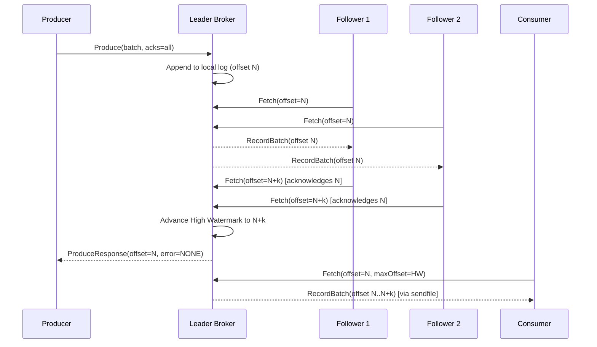
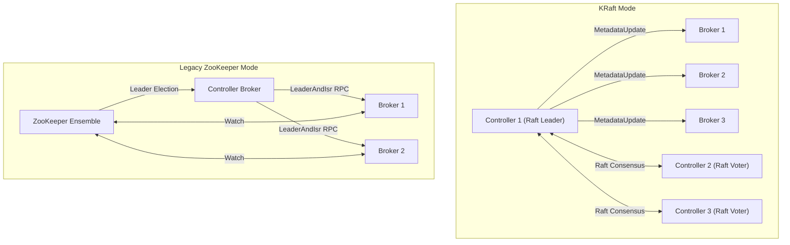
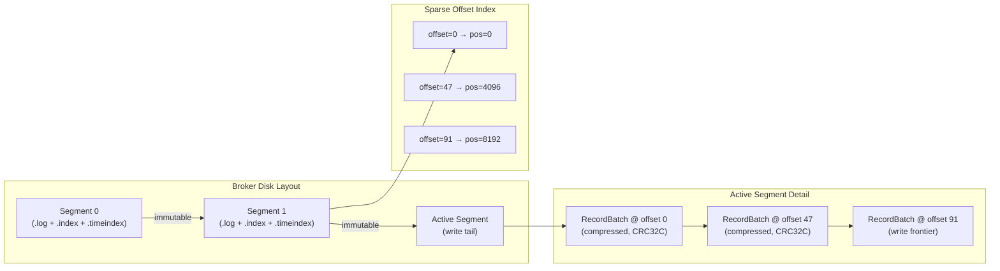
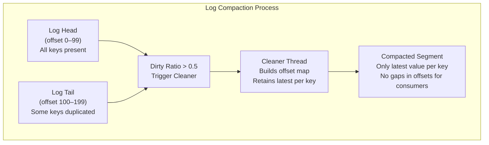
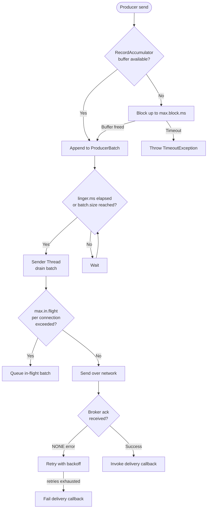
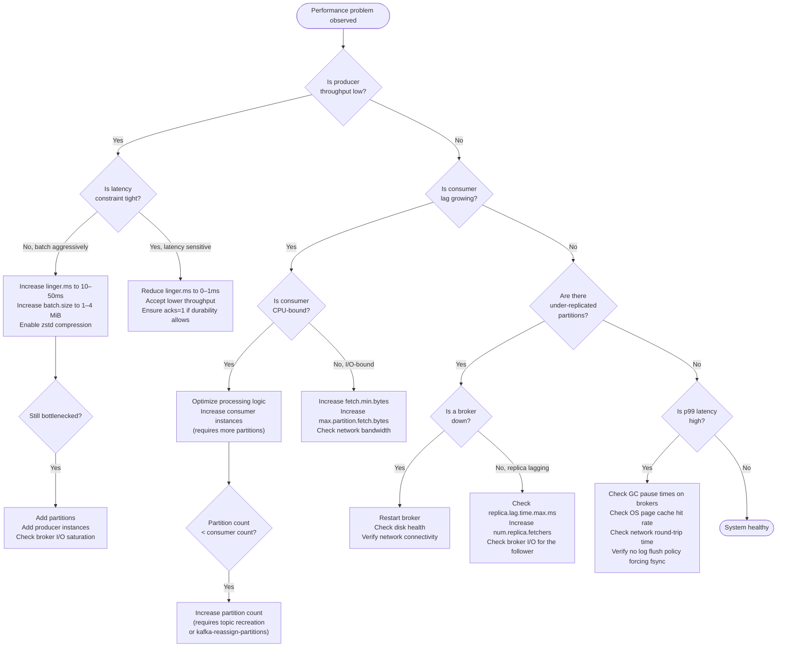

# Lesson 5: Performance Tuning

## 1. First-Principles Intuition & Invariants

Kafka's performance characteristics are not accidental — they emerge directly from a small set of architectural commitments made at the system's inception. Understanding these commitments at the invariant level is prerequisite to tuning the system correctly, because every configuration knob is ultimately a lever on one of these underlying properties.

### The Append-Only, Immutable Log

The foundational invariant is that a Kafka partition is an append-only, immutable, ordered log. Writes are always appended at the tail; no in-place updates exist. This single decision yields several performance properties simultaneously:

- **Sequential I/O dominance.** Modern storage hardware (both spinning disks and NVMe SSDs) achieves its peak throughput on sequential access patterns. By serializing all writes to a single append point per partition, Kafka converts what would otherwise be random writes (as in a B-tree storage engine) into purely sequential writes. On a 7200 RPM spinning disk, random write throughput is on the order of 100–200 IOPS, while sequential throughput can exceed 100 MB/s — a difference of two or three orders of magnitude. Kafka exploits this fully.

- **OS page cache leverage.** Because reads typically follow the write frontier (consumers are "catching up" to producers), the data being read is almost always already warm in the OS page cache. Kafka deliberately avoids maintaining its own application-level cache, delegating this responsibility entirely to the kernel. This means the JVM heap can be kept small (a few GB is typical), reducing GC pressure while the OS manages tens of gigabytes of cached log data with far greater efficiency.

- **Zero-copy transfer.** The immutability of log segments enables Kafka to serve consumer fetch requests via the `sendfile(2)` system call (exposed in Java as `FileChannel.transferTo()`). This transfers data directly from the page cache to the network socket without copying through user space — eliminating two memory copies and two context switches per message batch.

### Offset as the Universal Cursor

Every message in a partition is identified by a monotonically increasing 64-bit integer offset. Offset assignment is the partition leader's exclusive responsibility and is a strict invariant: once assigned, an offset is never reused, even after log compaction. This design decouples consumer position state from the broker entirely. The broker stores only the log; consumers maintain their own read position (offset) and commit it back to Kafka (the `__consumer_offsets` internal topic) at their own pace. The broker bears no per-consumer state beyond what the consumer itself commits, which is why a single Kafka cluster can serve tens of thousands of consumer instances without broker-side overhead scaling linearly with consumer count.

### The ISR Invariant and Durability

Kafka's replication model is built around the **In-Sync Replica set (ISR)**. The ISR is the set of replicas that are fully caught up with the leader — specifically, they have fetched all messages within the `replica.lag.time.max.ms` window. The ISR invariant is:

> A message is not considered committed until it has been written to the log of every replica in the current ISR.

The leader tracks the **High Watermark (HW)**: the offset of the last message replicated to all ISR members. Consumers may only read up to the HW, never beyond it. This ensures that no consumer ever reads a message that could be lost due to leader failure. The producer's `acks` parameter controls how strictly this invariant is enforced at write time:

| `acks` value | Semantics |
|---|---|
| `0` | Fire-and-forget. No durability guarantee. |
| `1` | Leader writes to its local log. No ISR guarantee; data can be lost on leader failure before replication. |
| `all` (or `-1`) | Leader waits for all ISR members to acknowledge. Combined with `min.insync.replicas`, this provides the strongest durability guarantee. |

The interaction between `acks=all` and `min.insync.replicas` is critical. If `min.insync.replicas=2` and `replication.factor=3`, the cluster tolerates one broker failure while still guaranteeing that every acknowledged write survives. Setting `min.insync.replicas` equal to `replication.factor` provides maximum durability but zero fault tolerance — any single broker outage makes the partition unwritable.

---

## 2. Core Architecture & Mechanics

### Physical Log Layout on Disk

Each Kafka partition maps to a directory on the broker's filesystem. Within that directory, the log is divided into **segments**. A segment is a pair of files:

- `{base_offset}.log` — the raw message data
- `{base_offset}.index` — a sparse offset-to-physical-position index
- `{base_offset}.timeindex` — a sparse timestamp-to-offset index (added in Kafka 0.10)

The `base_offset` in the filename is the offset of the first message in that segment. The active segment is the one currently being written to; all prior segments are immutable and eligible for direct `sendfile` transfer.

```text
/kafka-logs/my-topic-3/
├── 00000000000000000000.index
├── 00000000000000000000.log
├── 00000000000000000000.timeindex
├── 00000000000000012345.index
├── 00000000000000012345.log
├── 00000000000000012345.timeindex
└── leader-epoch-checkpoint
```

The `.index` file is a **sparse** index: not every message gets an entry. The broker writes an index entry every `log.index.interval.bytes` of data (default 4096 bytes). To fetch offset `N`, Kafka performs a binary search on the index file to find the largest indexed offset ≤ N, then scans forward in the `.log` file from that physical position. This bounds the worst-case scan to `log.index.interval.bytes` bytes — a constant-time operation irrespective of total log size.

### Message Batch Format (RecordBatch)

Kafka's on-disk and on-wire format since version 0.11 is the **RecordBatch** (also called the "magic byte 2" format). Understanding this format is essential for tuning because compression, checksums, and producer idempotency all operate at the batch level.

```text
RecordBatch
├── baseOffset          (int64)
├── batchLength         (int32)
├── partitionLeaderEpoch (int32)
├── magic               (int8)   -- value: 2
├── crc                 (int32)  -- CRC32C of everything below
├── attributes          (int16)  -- compression codec, timestamp type, transactional, etc.
├── lastOffsetDelta     (int32)
├── baseTimestamp       (int64)
├── maxTimestamp        (int64)
├── producerId          (int64)  -- for idempotent/transactional producers
├── producerEpoch       (int16)
├── baseSequence        (int32)
└── records[]
    └── Record
        ├── length          (varint)
        ├── attributes      (int8)
        ├── timestampDelta  (varint)
        ├── offsetDelta     (varint)
        ├── keyLength       (varint)
        ├── key             (bytes)
        ├── valueLength     (varint)
        ├── value           (bytes)
        └── headers[]
```

Compression is applied to the `records[]` array as a whole, not to individual messages. This is architecturally significant: the broker stores and forwards the compressed batch verbatim, performing decompression only when it needs to inspect individual record timestamps or perform log compaction. Consumer-side decompression happens after the entire batch is received, amortizing the decompression overhead across all records in the batch.

### Replication Data Flow

The leader-follower replication protocol is a pull model: followers issue `FetchRequest` RPCs to the leader, pulling new messages from the leader's log. The leader maintains a **fetch offset** per follower to track replication progress.



A follower is removed from the ISR if it fails to fetch within `replica.lag.time.max.ms` milliseconds (default 30 seconds). Once removed, the leader need not wait for it, allowing the cluster to continue making progress. The follower re-joins the ISR only after it has fully caught up.

### ZooKeeper vs. KRaft (KIP-500)

Historically, Kafka depended on Apache ZooKeeper for controller election, broker registration, topic metadata, and ISR tracking. This dependency imposed a hard scalability ceiling: ZooKeeper writes were synchronous and serialized, making metadata operations (partition reassignment, broker failover) slow at scale. With large clusters (thousands of partitions), controller failover could take minutes while the new controller loaded state from ZooKeeper.

**KRaft mode** (Kafka Raft Metadata, production-ready since Kafka 3.3, ZooKeeper removal target in Kafka 4.0) eliminates this dependency by embedding a Raft consensus group within Kafka itself. A dedicated set of controller nodes (which can be co-located with brokers or separated) maintains the cluster metadata log using the same Raft-based log replication that Kafka uses for data partitions. This yields:

- Metadata operations that are orders of magnitude faster during failover (seconds, not minutes).
- Elimination of a separate ZooKeeper operational dependency.
- A theoretical partition count ceiling increase from ~200,000 to millions.



### Partition Internals and the Log Architecture



---

## 3. High-Performance Optimization & Failure Modes

### Producer Throughput Tuning

The producer's throughput is primarily governed by three interacting parameters: `batch.size`, `linger.ms`, and `compression.type`.

**Batching mechanics.** The producer accumulates records in a `RecordAccumulator` — a per-partition deque of `ProducerBatch` objects. The `Sender` thread drains these batches and transmits them to the broker. A batch is dispatched when either (a) it reaches `batch.size` bytes or (b) `linger.ms` milliseconds elapse since the first record was added. The default `linger.ms=0` means batches are dispatched immediately, which maximizes latency at the cost of throughput. For high-throughput pipelines, `linger.ms=5` to `linger.ms=20` combined with `batch.size=1048576` (1 MB) is a typical starting point.

**Compression codec selection.** Kafka supports `none`, `gzip`, `snappy`, `lz4`, and `zstd`. The choice involves a CPU/bandwidth/latency tradeoff:

| Codec | Compression Ratio | CPU Cost | Recommended Use |
|---|---|---|---|
| `none` | 1.0× | None | Already-compressed data (images, video) |
| `snappy` | ~2–3× | Low | High-throughput, latency-sensitive |
| `lz4` | ~2–3× | Very low | Default high-throughput choice |
| `gzip` | ~3–5× | High | Bandwidth-constrained links |
| `zstd` | ~3–5× | Medium | Best ratio/CPU tradeoff; prefer for most new deployments |

`zstd` (Zstandard, added in Kafka 2.1) is the modern default for most production deployments: it achieves `gzip`-level compression ratios at `snappy`-level CPU cost and supports configurable compression levels (1–22).

**Producer idempotency.** Setting `enable.idempotence=true` (the default since Kafka 3.0) assigns the producer a `ProducerId` and a per-partition sequence number. The broker deduplicates retried batches using these identifiers, providing exactly-once delivery semantics at the producer level with zero additional latency cost. This is a strict improvement over non-idempotent producers and should always be enabled.

```python
from confluent_kafka import Producer
import socket

conf = {
    # Connection
    'bootstrap.servers': 'broker1:9092,broker2:9092,broker3:9092',
    'client.id': socket.gethostname(),

    # Durability: wait for all ISR members
    'acks': 'all',

    # Idempotency: exactly-once at producer level (requires acks=all)
    'enable.idempotence': True,

    # Batching: accumulate up to 1 MiB or 10 ms, whichever comes first
    'batch.size': 1_048_576,
    'linger.ms': 10,

    # Compression: zstd level 3 offers an excellent ratio/CPU tradeoff
    'compression.type': 'zstd',
    'compression.level': 3,

    # In-flight requests: max 5 per connection (required for idempotence)
    'max.in.flight.requests.per.connection': 5,

    # Retry behavior
    'retries': 10,
    'retry.backoff.ms': 100,
    'delivery.timeout.ms': 120_000,

    # Buffer: total memory for all buffered records
    'buffer.memory': 67_108_864,  # 64 MiB

    # Request timeout
    'request.timeout.ms': 30_000,
}

producer = Producer(conf)

def delivery_report(err, msg):
    if err is not None:
        print(f'Delivery failed for record {msg.key()}: {err}')
    else:
        print(f'Record delivered to {msg.topic()} '
              f'[partition {msg.partition()}] at offset {msg.offset()}')

# Produce a batch of records
for i in range(10_000):
    # Non-blocking: returns immediately, calls delivery_report asynchronously
    producer.produce(
        topic='events',
        key=str(i % 100).encode(),   # hash-based partition routing
        value=f'{{"event_id": {i}, "ts": 1700000000}}'.encode(),
        on_delivery=delivery_report,
    )
    # Poll to serve delivery callbacks and prevent buffer overflow
    producer.poll(0)

# Block until all outstanding messages are delivered
producer.flush(timeout=60)
```

### Consumer Throughput Tuning

Consumer performance is governed by fetch granularity, parallelism, and offset commit strategy.

**Fetch parameters.** The consumer issues `FetchRequest` RPCs to partition leaders. `fetch.min.bytes` (default 1 byte) causes the broker to return immediately as soon as any data is available. Increasing it to `fetch.min.bytes=65536` (64 KiB) or higher causes the broker to wait until that threshold is met, reducing round-trips at the cost of latency. `fetch.max.wait.ms` (default 500 ms) caps the maximum wait time. `max.partition.fetch.bytes` (default 1 MiB) caps the data returned per partition per fetch. `fetch.max.bytes` (default 50 MiB) caps the total data per fetch response.

**Consumer group mechanics.** A consumer group is a set of consumers that collectively consume a topic. Each partition is assigned to exactly one consumer in the group at any given time. Parallelism is bounded by the number of partitions: adding consumers beyond the partition count leaves the excess consumers idle. The coordinator broker manages group membership and triggers rebalances on join/leave/timeout events.

**Offset commit strategy.** `enable.auto.commit=true` (default) commits offsets every `auto.commit.interval.ms` (default 5000 ms) in the background. This can cause duplicate processing after a crash (the consumer processed records but the commit hadn't fired) or message loss (the commit fired before the application finished processing). For production workloads, `enable.auto.commit=false` with explicit `commitSync()` or `commitAsync()` after processing is the correct pattern.

```go
package main

import (
	"context"
	"fmt"
	"log"
	"os"
	"os/signal"
	"syscall"
	"time"

	"github.com/confluentinc/confluent-kafka-go/v2/kafka"
)

func main() {
	c, err := kafka.NewConsumer(&kafka.ConfigMap{
		"bootstrap.servers": "broker1:9092,broker2:9092,broker3:9092",
		"group.id":          "analytics-consumer-v2",
		"auto.offset.reset": "earliest",

		// Manual commit: application controls exactly-once processing semantics
		"enable.auto.commit": false,

		// Fetch tuning: wait for at least 64 KiB before returning
		"fetch.min.bytes":          65536,
		"fetch.max.wait.ms":        500,
		"max.partition.fetch.bytes": 1048576,
		"fetch.max.bytes":          52428800, // 50 MiB

		// Session and heartbeat: keep heartbeat well below session timeout
		"session.timeout.ms":    30000,
		"heartbeat.interval.ms": 3000,

		// Max records per poll cycle
		"max.poll.interval.ms": 300000,

		// Isolation level: only read committed messages (for transactional producers)
		"isolation.level": "read_committed",
	})
	if err != nil {
		log.Fatalf("Failed to create consumer: %v", err)
	}
	defer c.Close()

	topics := []string{"events"}
	if err := c.SubscribeTopics(topics, nil); err != nil {
		log.Fatalf("Failed to subscribe: %v", err)
	}

	sigchan := make(chan os.Signal, 1)
	signal.Notify(sigchan, syscall.SIGINT, syscall.SIGTERM)

	ctx, cancel := context.WithCancel(context.Background())
	go func() {
		<-sigchan
		cancel()
	}()

	const batchSize = 500
	batch := make([]*kafka.Message, 0, batchSize)

	flush := func() {
		if len(batch) == 0 {
			return
		}
		// --- process batch (write to sink, transform, etc.) ---
		fmt.Printf("Processing batch of %d records\n", len(batch))

		// Commit the offset of the last message in the batch synchronously.
		// This provides at-least-once delivery: if the commit fails, records
		// will be reprocessed on restart.
		last := batch[len(batch)-1]
		if _, err := c.CommitMessage(last); err != nil {
			log.Printf("Commit failed: %v — records will be reprocessed", err)
		}
		batch = batch[:0]
	}

	ticker := time.NewTicker(500 * time.Millisecond)
	defer ticker.Stop()

	for {
		select {
		case <-ctx.Done():
			flush()
			return
		case <-ticker.C:
			flush() // time-based flush to bound latency
		default:
			msg, err := c.ReadMessage(100 * time.Millisecond)
			if err != nil {
				if err.(kafka.Error).Code() == kafka.ErrTimedOut {
					continue
				}
				log.Printf("Consumer error: %v", err)
				continue
			}
			batch = append(batch, msg)
			if len(batch) >= batchSize {
				flush()
			}
		}
	}
}
```

### Broker Configuration Tuning

Broker-side performance is dominated by I/O configuration, network thread pools, and log retention settings.

**Thread pool sizing.** Kafka's broker network layer uses a Reactor pattern: `num.network.threads` (default 3) acceptor/selector threads read requests from sockets and pass them to `num.io.threads` (default 8) worker threads via a request queue. The request queue depth is bounded by `queued.max.requests` (default 500). Under heavy load, saturated I/O threads cause the request queue to fill, which causes `NetworkException` errors on clients. A starting point for high-throughput brokers is `num.network.threads=8` and `num.io.threads=16` on a 32-core machine, adjusted based on observed queue depth metrics.

**Log flush policy.** The default broker configuration commits writes to the OS page cache but does not call `fsync()` on every write (`log.flush.interval.messages` and `log.flush.interval.ms` default to "never force fsync"). This is deliberate and correct: Kafka's replication provides durability, so explicit `fsync` on every write would be redundant and severely degrade throughput. Only the replication ISR guarantees should be used for durability, not OS-level fsync policies.

**Log retention and compaction.** Two retention modes are mutually exclusive per topic:

- **Delete retention** (`log.cleanup.policy=delete`): Segments older than `log.retention.ms` (default 7 days) or larger than `log.retention.bytes` are deleted. The broker's log cleaner thread checks segment eligibility based on the segment's largest timestamp, not the current wall clock.
- **Compact retention** (`log.cleanup.policy=compact`): The log cleaner retains only the most recent message per key, discarding older messages with the same key. This provides a "changelog" or "snapshot" semantic. Compaction operates on segments that have crossed the `min.cleanable.dirty.ratio` threshold (default 0.5 — meaning at least 50% of log space is consumed by superseded records before the cleaner will compact that segment). Compaction does **not** guarantee real-time recency; there is an inherent lag between a message being written and its obsolete predecessors being cleaned.



**Key broker configuration parameters for production:**

```properties
# Networking
num.network.threads=8
num.io.threads=16
socket.send.buffer.bytes=1048576
socket.receive.buffer.bytes=1048576
socket.request.max.bytes=104857600

# Log storage
log.dirs=/data/kafka-logs
log.segment.bytes=1073741824          # 1 GiB segments
log.retention.hours=168               # 7 days
log.retention.bytes=-1                # No size-based retention (use time only)
log.index.interval.bytes=4096
log.index.size.max.bytes=10485760

# Replication
num.replica.fetchers=4                # Parallel replication threads per broker
replica.fetch.max.bytes=10485760      # 10 MiB max per replication fetch
replica.lag.time.max.ms=30000
min.insync.replicas=2                 # Cluster-wide default; override per topic

# Log flush (leave at defaults — rely on replication for durability)
# log.flush.interval.messages=Long.MAX_VALUE
# log.flush.interval.ms=Long.MAX_VALUE

# Log compaction
log.cleaner.threads=4
log.cleaner.io.max.bytes.per.second=524288000  # 500 MiB/s — throttle to avoid I/O saturation
min.cleanable.dirty.ratio=0.5

# Quota enforcement (prevents single producers from saturating broker)
quota.producer.default=104857600      # 100 MiB/s per producer
quota.consumer.default=104857600
```

### Partition Count and Throughput Modeling

The number of partitions is the primary horizontal scalability lever in Kafka. The relationship is:

```text
max_cluster_throughput ≈ min(
    num_partitions × per_partition_producer_throughput,
    num_brokers × per_broker_disk_throughput,
    num_consumers × per_consumer_processing_rate
)
```

Each partition is a linearized unit of work: only one consumer in a group reads it at a time, only one broker hosts its leader at a time, and writes to it are serialized. More partitions enable more parallelism, but each partition carries costs:

- Each partition requires an open file descriptor for the log and index files on the leader and each follower. A broker with 1,000 partitions × 3 replicas manages 6,000 file descriptors minimum. `ulimit -n` must be set accordingly (65536 or higher is typical).
- Controller failover time scales linearly with partition count under ZooKeeper mode (one ZooKeeper write per partition leadership transfer). Under KRaft, this cost is dramatically reduced.
- End-to-end latency increases with partition count because more partitions means more metadata the client must cache and refresh.

A practical formula for initial partition sizing (from the Confluent documentation and original LinkedIn engineering work) is:

```text
num_partitions = max(
    target_throughput / max_producer_throughput_per_partition,
    target_throughput / max_consumer_throughput_per_partition
)
```

Where per-partition throughput is empirically measured for the specific hardware and message schema in use. A conservative starting point for commodity hardware is 10–20 MiB/s per partition for producer throughput and 50 MiB/s for consumer throughput (sequential read is faster than write due to page cache).

### Zero-Copy and `sendfile(2)` Deep Dive

The zero-copy path is the most important I/O optimization in Kafka and is worth examining at the system call level.

**Without zero-copy (traditional path):**
1. `read()` syscall: kernel copies segment data from page cache → kernel buffer.
2. Kernel copies kernel buffer → JVM heap (`byte[]`).
3. JVM copies heap → socket send buffer (via `SocketChannel.write()`).
4. Kernel copies socket send buffer → NIC DMA buffer.

This path involves 4 memory copies and 2 context switches per batch.

**With zero-copy (`sendfile`):**
1. `sendfile()` syscall: kernel copies segment data from page cache → socket send buffer directly (using DMA).
2. NIC DMA reads from socket send buffer.

This path involves 1 memory copy (or 0 on hardware with scatter-gather DMA support) and 1 context switch. For a broker serving 1 GB/s of consumer traffic, this difference is the gap between feasibility and infeasibility on commodity hardware.

In Java, this is invoked as:

```java
// Inside Kafka's FileRecords.writeTo() — simplified
FileChannel fileChannel = segment.channel();
long transferred = fileChannel.transferTo(
    startPosition,     // physical byte offset in segment file
    length,            // number of bytes to transfer
    socketChannel      // destination: the consumer's socket
);
```

This path is only available when the data is unencrypted and uncompressed at the broker level. If SSL/TLS is enabled on the listener, the kernel cannot perform the zero-copy transfer because the data must pass through the JVM for encryption. For SSL-enabled clusters, minimizing per-message overhead (larger batches, `fetch.max.bytes` tuning) partially compensates.

### Failure Modes and Their Signatures

**Under-replicated partition storm.** When a broker restarts or a follower falls behind, its partitions become under-replicated (`UnderReplicatedPartitions` JMX metric > 0). If `min.insync.replicas=2` and `replication.factor=3`, losing two brokers simultaneously makes all partitions with leaders on the surviving broker unwritable (ISR shrinks to 1, below the minimum). The correct response is to increase `min.insync.replicas` to `replication.factor - 1` (tolerating one failure, not zero) for most workloads.

**Consumer lag accumulation.** Measured as `records-lag-max` in the consumer client metrics and `kafka.consumer_group.lag` in Kafka's admin metrics. Lag is the difference between the partition's log-end offset (LEO) and the consumer group's committed offset. Sustained lag growth indicates the consumer is processing slower than the producer is writing. The correct diagnostic sequence is: (1) check consumer CPU and GC metrics — is the consumer I/O-bound or CPU-bound? (2) check `fetch.min.bytes` — is the consumer making too many small fetches? (3) check whether adding consumer instances would help (requires more partitions if already at the partition count limit).

**Log compaction stall.** If `kafka.log.cleaner.cleaner-recopy-percent` approaches 1.0 and cleaner throughput stalls, the dirty ratio threshold is too low relative to write rate, causing the cleaner to work continuously without making progress. Increasing `log.cleaner.io.max.bytes.per.second` and `log.cleaner.threads`, or increasing `min.cleanable.dirty.ratio`, addresses this.

**Producer `TimeoutException` under back-pressure.** When `buffer.memory` is exhausted (all 64 MiB of the accumulator is full of unsent batches), `producer.send()` blocks for `max.block.ms` (default 60 seconds) and then throws `TimeoutException`. This is a signal that the producer is generating data faster than it can be delivered to the broker. The correct response is not to increase `buffer.memory` indefinitely, but to apply back-pressure upstream (slow the event source) or add broker/partition capacity.



### Transactions and Exactly-Once Semantics (EOS)

Kafka's transactional API (introduced in Kafka 0.11) enables atomic multi-partition writes — a batch of produce operations either all commit or all abort, as observed by consumers configured with `isolation.level=read_committed`. This is the foundation of exactly-once processing in Kafka Streams and is available to custom consumers as well.

The transaction protocol involves a **Transaction Coordinator** (a broker designated as coordinator based on the hash of the `transactional.id`) and two-phase commit:

1. **BeginTransaction:** Producer calls `initTransactions()` which registers the `transactional.id` with the coordinator and receives a `ProducerId` and `ProducerEpoch`. The epoch is incremented on each call, fencing zombie producers from prior epochs.
2. **Produce:** Records are written to partitions with the transaction flag set. They are visible in the partition log immediately but hidden from `read_committed` consumers (they are after the Last Stable Offset, LSO).
3. **CommitTransaction / AbortTransaction:** The producer sends `EndTxnRequest` to the coordinator. The coordinator writes a commit/abort marker to each involved partition's log via a two-phase protocol. Once the marker is written, the LSO advances past the transactional records, making them visible (or tombstoning them if aborted).

```python
from confluent_kafka import Producer

producer = Producer({
    'bootstrap.servers': 'broker1:9092',
    'transactional.id': 'my-transactional-producer-v1',
    'enable.idempotence': True,  # required for transactions
    'acks': 'all',
})

# Must be called once before any transactional operations
producer.init_transactions()

try:
    producer.begin_transaction()

    # Atomically produce to multiple partitions
    producer.produce('orders', key='order-123', value='{"status": "CREATED"}')
    producer.produce('inventory', key='item-456', value='{"reserved": 1}')
    producer.produce('audit-log', key='user-789', value='{"action": "ORDER_PLACED"}')

    # Commit: all three writes become visible atomically to read_committed consumers
    producer.commit_transaction()

except Exception as e:
    # Abort: all three writes are discarded
    producer.abort_transaction()
    raise
```

### Observability and JMX Metrics

Production Kafka deployments require continuous monitoring of a core set of JMX metrics. The following are the most diagnostically significant:

| Metric (MBean path abbreviated) | What it measures | Alert threshold |
|---|---|---|
| `kafka.server:type=BrokerTopicMetrics,name=BytesInPerSec` | Producer byte rate into broker | Capacity planning |
| `kafka.server:type=BrokerTopicMetrics,name=BytesOutPerSec` | Consumer byte rate from broker | Capacity planning |
| `kafka.server:type=ReplicaManager,name=UnderReplicatedPartitions` | Partitions with ISR < RF | Alert if > 0 |
| `kafka.server:type=ReplicaManager,name=IsrShrinksPerSec` | Rate of ISR shrink events | Alert if sustained > 0 |
| `kafka.controller:type=KafkaController,name=ActiveControllerCount` | Should be exactly 1 per cluster | Alert if != 1 |
| `kafka.network:type=RequestMetrics,name=RequestsPerSec,request=Produce` | Produce request rate | Capacity planning |
| `kafka.network:type=RequestMetrics,name=TotalTimeMs,request=FetchConsumer` | Consumer fetch latency (p99) | Alert > 1000 ms |
| `kafka.log:type=LogFlushStats,name=LogFlushRateAndTimeMs` | fsync rate and latency | Diagnose I/O saturation |
| `kafka.consumer:type=consumer-fetch-manager-metrics,name=records-lag-max` | Maximum consumer lag | Alert threshold is workload-dependent |

Expose these via a JMX exporter (Prometheus `jmx_exporter` agent is the standard approach) and alert on `UnderReplicatedPartitions > 0` and `ActiveControllerCount != 1` as priority-1 incidents.

---

## 4. End-to-End Tuning Decision Tree

The following decision tree provides a structured approach to diagnosing and resolving Kafka performance problems:



---

## 5. Summary of Critical Configuration Parameters

The following table consolidates the most impactful tuning parameters across producers, consumers, and brokers:

| Parameter | Component | Default | High-Throughput Setting | Notes |
|---|---|---|---|---|
| `linger.ms` | Producer | 0 | 10–50 | Trade latency for batch size |
| `batch.size` | Producer | 16384 | 1048576 | Bytes per batch per partition |
| `compression.type` | Producer | `none` | `zstd` | Always compress for non-binary payloads |
| `acks` | Producer | `all` (3.0+) | `all` | Never use `1` for important data |
| `enable.idempotence` | Producer | `true` (3.0+) | `true` | Zero cost, strong guarantee |
| `buffer.memory` | Producer | 33554432 | 67108864 | 64 MiB for high-throughput |
| `fetch.min.bytes` | Consumer | 1 | 65536 | Reduce fetch RPCs |
| `fetch.max.wait.ms` | Consumer | 500 | 500 | Upper bound on fetch latency |
| `enable.auto.commit` | Consumer | `true` | `false` | Manual commit for correctness |
| `isolation.level` | Consumer | `read_uncommitted` | `read_committed` | Required for transactional producers |
| `num.io.threads` | Broker | 8 | 16–32 | Scale with CPU core count |
| `num.replica.fetchers` | Broker | 1 | 4–8 | Parallel replication threads |
| `log.segment.bytes` | Broker | 1073741824 | 1073741824 | 1 GiB is generally optimal |
| `min.insync.replicas` | Broker/Topic | 1 | `RF - 1` | Set to 2 for RF=3 clusters |
| `log.cleaner.threads` | Broker | 1 | 2–4 | For compacted topics under heavy write load |
