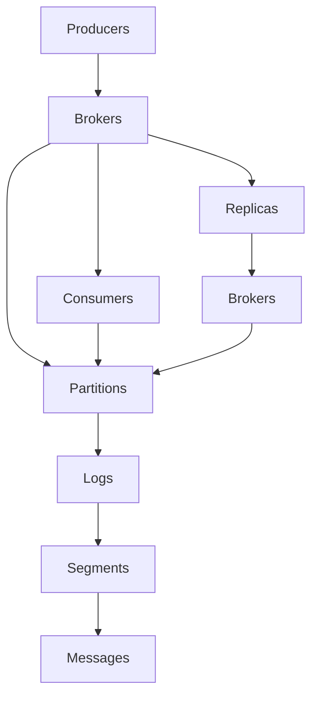

# Lesson 5: Performance Tuning

## 1. First-Principles Intuition & Invariants

In the realm of distributed streaming systems, Apache Kafka stands as a pillar of reliability and scalability, enabling real-time data pipelines and streaming applications. To harness Kafka's full potential, it is essential to delve into the foundational principles that govern its performance. At the heart of Kafka's architecture lies a series of invariants and theoretical constructs that dictate how data is produced, consumed, and stored. These principles are rooted in the system's ability to manage concurrency, ensure data durability, and maintain low-latency data processing.

Kafka's performance is fundamentally tied to its ability to handle high-throughput data streams while maintaining low latency and high availability. This requires a deep understanding of the system's internal mechanisms, including its use of partitions, replication, and the role of brokers and consumers. The system's design is built upon a series of invariants that ensure data integrity and system reliability. For instance, Kafka guarantees that messages are appended to a partition in the order they are received, and that once a message is written to a partition, it is immutable and durable. These invariants are critical to Kafka's performance, as they allow the system to scale horizontally while maintaining strong consistency guarantees.

Another key invariant in Kafka's architecture is the use of a distributed log. Each partition in Kafka is essentially a distributed log, where messages are appended in a sequential order. This log-based architecture is central to Kafka's performance, as it allows the system to efficiently manage data storage and retrieval. The log-based design also enables Kafka to provide strong durability guarantees, as messages are written to disk before they are acknowledged to producers. This ensures that data is not lost in the event of a broker failure, as the messages can be recovered from the log.

The performance of Kafka is also heavily influenced by the system's ability to manage concurrency. Kafka is designed to handle multiple producers and consumers simultaneously, and its architecture is optimized to support high levels of concurrency. This is achieved through the use of a series of locks and synchronization mechanisms that ensure that producers and consumers can access partitions without interfering with each other. The system's concurrency model is based on a series of invariants that ensure that producers and consumers can operate independently while maintaining data consistency.

In addition to these architectural invariants, Kafka's performance is also influenced by a series of configuration parameters that can be tuned to optimize the system's performance. These parameters control a wide range of system behaviors, including the size of message batches, the frequency of log compaction, and the number of replicas for each partition. By carefully tuning these parameters, it is possible to optimize Kafka's performance for a wide range of use cases, from high-throughput data pipelines to low-latency real-time applications.

## 2. Core Architecture & Mechanics

To understand how Kafka's performance can be optimized, it is essential to delve into the system's core architecture and mechanics. At the heart of Kafka's architecture lies the concept of a distributed log, where messages are appended to partitions in a sequential order. Each partition is essentially a distributed log, and the system is designed to manage these logs efficiently to support high-throughput data streams.

The architecture of Kafka is based on a series of brokers, which are responsible for managing the storage and retrieval of messages. Each broker is responsible for a set of partitions, and the system is designed to distribute these partitions across multiple brokers to ensure high availability and fault tolerance. The brokers are also responsible for managing the replication of partitions, ensuring that each partition has a set of replicas that can be used to recover the partition in the event of a broker failure.

The architecture of Kafka is also based on a series of producers and consumers, which are responsible for producing and consuming messages, respectively. Producers are responsible for sending messages to Kafka, and they can be configured to send messages to a specific partition or to a set of partitions based on a partitioning strategy. Consumers are responsible for reading messages from Kafka, and they can be configured to read messages from a specific partition or to read messages from a set of partitions based on a consumer group.

The architecture of Kafka is also based on a series of internal data structures and algorithms that are designed to manage the storage and retrieval of messages efficiently. One of the key data structures in Kafka is the log, which is used to store messages in a sequential order. The log is implemented as a series of segments, where each segment contains a set of messages. The segments are stored on disk, and the system is designed to manage these segments efficiently to support high-throughput data streams.

Another key data structure in Kafka is the index, which is used to manage the offsets of messages in the log. The index is implemented as a series of entries, where each entry contains the offset of a message and the position of the message in the log. The index is used to quickly locate messages in the log, and the system is designed to manage the index efficiently to support low-latency data retrieval.

The architecture of Kafka is also based on a series of internal algorithms that are designed to manage the storage and retrieval of messages efficiently. One of the key algorithms in Kafka is the log compaction algorithm, which is used to remove old messages from the log to free up space. The log compaction algorithm is based on a series of invariants that ensure that old messages are removed from the log without affecting the consistency of the log. Another key algorithm in Kafka is the log replication algorithm, which is used to replicate partitions across multiple brokers to ensure high availability and fault tolerance. The log replication algorithm is based on a series of invariants that ensure that partitions are replicated consistently across multiple brokers.

## 3. High-Performance Optimization & Failure Modes

Optimizing Kafka's performance requires a deep understanding of the system's internal mechanisms and the configuration parameters that control its behavior. One of the key factors that influence Kafka's performance is the size of message batches. Kafka is designed to handle high-throughput data streams, and the system is optimized to support large message batches to maximize throughput. By increasing the size of message batches, it is possible to reduce the overhead of message processing and improve the system's throughput.

Another key factor that influences Kafka's performance is the frequency of log compaction. Kafka is designed to store messages in a distributed log, and the system is optimized to manage these logs efficiently to support high-throughput data streams. However, as messages are appended to the log, the log can grow to a large size, which can affect the system's performance. To address this issue, Kafka provides a log compaction feature that allows old messages to be removed from the log to free up space. By configuring the frequency of log compaction, it is possible to optimize the system's performance and ensure that the log does not grow to an excessive size.

The performance of Kafka is also heavily influenced by the number of replicas for each partition. Kafka is designed to provide high availability and fault tolerance, and the system is optimized to support multiple replicas for each partition. By increasing the number of replicas, it is possible to improve the system's availability and fault tolerance. However, increasing the number of replicas can also increase the system's overhead, as each replica requires additional storage and processing resources. By carefully configuring the number of replicas, it is possible to optimize the system's performance and ensure that the system provides high availability and fault tolerance without excessive overhead.

Another key factor that influences Kafka's performance is the use of compression. Kafka is designed to handle high-throughput data streams, and the system is optimized to support message compression to reduce the size of messages and improve the system's throughput. By configuring the system to use compression, it is possible to reduce the size of messages and improve the system's throughput. However, compression can also increase the system's overhead, as the system requires additional processing resources to compress and decompress messages. By carefully configuring the system to use compression, it is possible to optimize the system's performance and ensure that the system provides high throughput without excessive overhead.

The performance of Kafka is also heavily influenced by the use of indexing. Kafka is designed to store messages in a distributed log, and the system is optimized to manage these logs efficiently to support high-throughput data streams. However, as messages are appended to the log, the log can grow to a large size, which can affect the system's performance. To address this issue, Kafka provides an indexing feature that allows messages to be located quickly in the log. By configuring the system to use indexing, it is possible to optimize the system's performance and ensure that messages can be located quickly in the log.

In addition to these configuration parameters, Kafka's performance is also influenced by a series of operational best practices. One of the key best practices is to ensure that the system is properly configured to handle the expected load. This includes configuring the system to use the appropriate number of brokers, partitions, and replicas, as well as configuring the system to use the appropriate size of message batches and the appropriate frequency of log compaction. Another key best practice is to ensure that the system is properly monitored and maintained. This includes monitoring the system's performance and resource usage, as well as performing regular maintenance tasks such as log compaction and log rotation.

In conclusion, optimizing Kafka's performance requires a deep understanding of the system's internal mechanisms and the configuration parameters that control its behavior. By carefully configuring the system and following a series of operational best practices, it is possible to optimize Kafka's performance and ensure that the system provides high throughput, low latency, and high availability.
