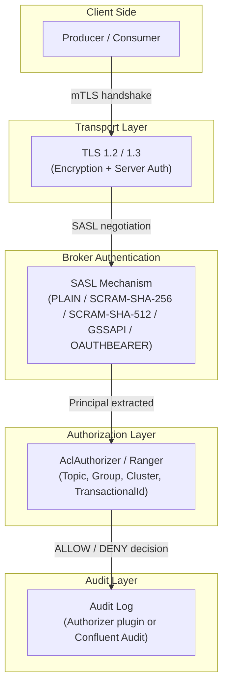
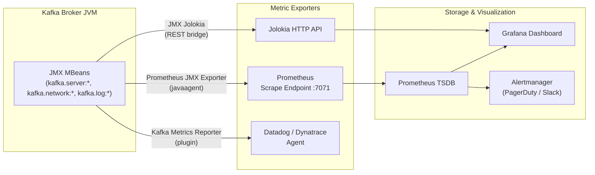
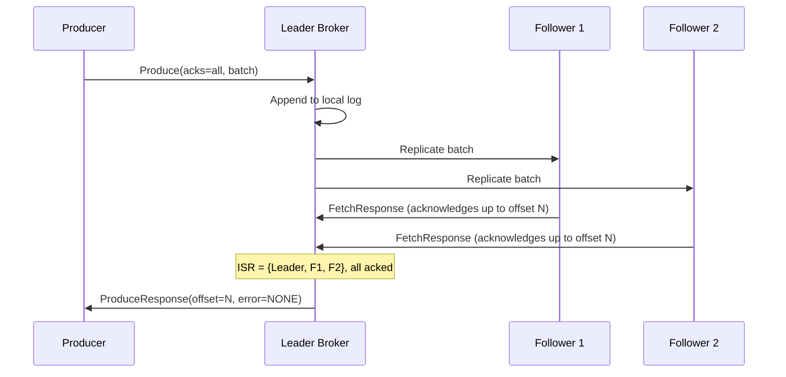
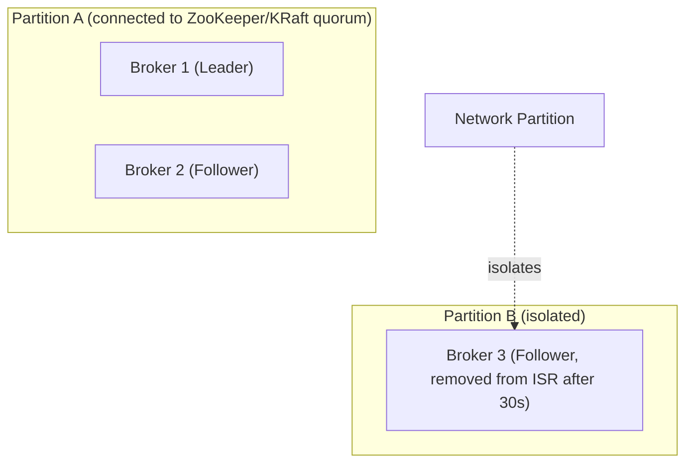
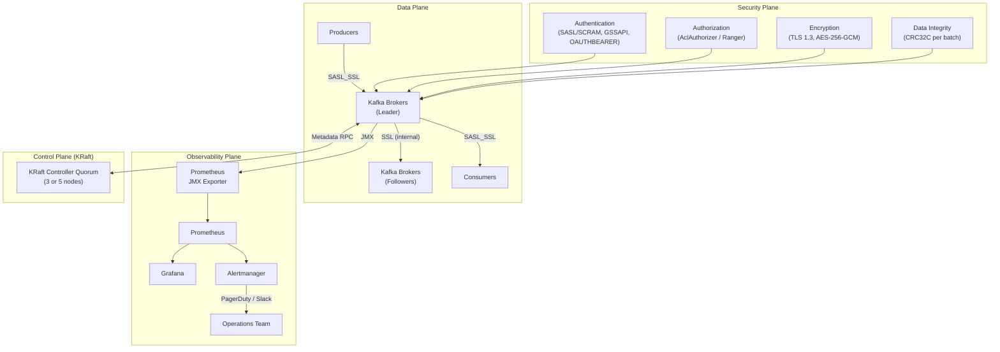

# Lesson 6: Security and Monitoring in Apache Kafka

## 1. First-Principles Intuition & Invariants

Apache Kafka is a distributed commit log—not merely a message queue. Every design decision in its security and monitoring stack flows from one structural reality: **data moves across a network of untrusted, failure-prone machines, and consumers must be able to trust both the provenance and integrity of every byte they read**.

Three invariants govern this space:

**Least privilege at every boundary.** A producer writing to `payments.raw` must not be able to read `payments.pii`. A consumer group serving a recommendation engine must not be able to delete topics. Kafka enforces these constraints through a combination of authentication (who are you?), authorization (what can you do?), and audit logging (what did you do?). The threat model is not purely external—insider threats and misconfigured service accounts are statistically the dominant risk in production Kafka clusters.

**Data integrity end-to-end.** Kafka's internal message format includes a CRC32C checksum over the message payload and attributes per record batch. This catches silent data corruption at the storage layer. For wire transport, TLS provides both confidentiality and integrity via authenticated encryption (AEAD ciphers). Note that these two mechanisms protect different attack surfaces: the checksum guards against storage-layer bit rot and broker-side corruption; TLS guards against network interception. Neither substitutes for application-level content validation.

**Observability is a first-class invariant, not an afterthought.** A Kafka cluster that is "running" but silently dropping messages, accumulating unbounded consumer lag, or experiencing under-replicated partitions is in a degraded state that produces no visible error. The only way to distinguish a healthy cluster from a silently failing one is continuous, structured metric collection. This lesson treats observability as a correctness property, not an operational convenience.

---

## 2. Core Architecture & Mechanics

### 2.1 The Kafka Security Stack

Kafka's security model has four independent but complementary layers. Each layer can be enabled or disabled independently, but production systems should enable all four.



#### 2.1.1 Transport Security: TLS

Kafka listens on named listeners defined in `server.properties`. Each listener can have an independent security protocol. The canonical production configuration exposes two listeners: one for internal broker-to-broker replication (using mTLS with internal CA-signed certificates) and one for client traffic (TLS with optional client certificates).

```properties
# server.properties — listener configuration
listeners=INTERNAL://0.0.0.0:9093,EXTERNAL://0.0.0.0:9092
listener.security.protocol.map=INTERNAL:SSL,EXTERNAL:SASL_SSL
inter.broker.listener.name=INTERNAL

# TLS keystore and truststore (JKS or PKCS12)
ssl.keystore.location=/etc/kafka/certs/broker.keystore.p12
ssl.keystore.password=${file:/etc/kafka/secrets/keystore.password}
ssl.keystore.type=PKCS12
ssl.truststore.location=/etc/kafka/certs/broker.truststore.p12
ssl.truststore.password=${file:/etc/kafka/secrets/truststore.password}
ssl.truststore.type=PKCS12

# Enforce TLS 1.2 minimum; prefer TLS 1.3
ssl.enabled.protocols=TLSv1.3,TLSv1.2
ssl.protocol=TLSv1.3

# Cipher suite hardening: exclude NULL, RC4, DES, 3DES, export grades
ssl.cipher.suites=TLS_AES_256_GCM_SHA384,TLS_CHACHA20_POLY1305_SHA256,TLS_AES_128_GCM_SHA256

# Require client authentication for the internal listener
ssl.client.auth=required
```

**Critical detail:** Kafka uses Java's `SSLEngine` and delegates cipher negotiation to the JVM's TLS implementation. The `ssl.cipher.suites` property accepts the JSSE cipher suite names, not the OpenSSL names. Confusion between these two naming conventions (`TLS_AES_256_GCM_SHA384` vs `TLS-AES-256-GCM-SHA384`) is a common source of misconfiguration. Verify negotiated ciphers with `openssl s_client -connect broker:9092 -starttls kafka` or the Confluent security plugin.

#### 2.1.2 Authentication: SASL Mechanisms

Kafka supports four SASL mechanisms. Each has distinct operational characteristics:

| Mechanism | Credential Storage | Channel Binding | Mutual Auth | Recommended Use |
|---|---|---|---|---|
| `SASL/PLAIN` | Cleartext in JAAS config | No | No | Dev/test only |
| `SASL/SCRAM-SHA-256` | Salted hash in ZooKeeper/KRaft | Optional | Yes | General production |
| `SASL/SCRAM-SHA-512` | Salted hash in ZooKeeper/KRaft | Optional | Yes | High-security production |
| `SASL/GSSAPI` (Kerberos) | Kerberos KDC | Yes (GSS channel binding) | Yes | Enterprise/Hadoop environments |
| `SASL/OAUTHBEARER` | External IdP (Okta, Keycloak) | No (token-bound) | Via token | Cloud-native / zero-trust |

**SCRAM credential bootstrap** — SCRAM credentials are stored in ZooKeeper (pre-KRaft) or the metadata quorum (KRaft). They must be provisioned using the `kafka-configs.sh` tool before the broker can authenticate that principal:

```bash
# Provision a SCRAM-SHA-512 credential for a service account
kafka-configs.sh \
  --bootstrap-server broker:9092 \
  --alter \
  --add-config 'SCRAM-SHA-512=[iterations=8192,password=s3cr3t!]' \
  --entity-type users \
  --entity-name payment-service

# Verify
kafka-configs.sh \
  --bootstrap-server broker:9092 \
  --describe \
  --entity-type users \
  --entity-name payment-service
```

**Client JAAS configuration for SCRAM** — the client's JAAS config must reference the mechanism and credentials. In containerized environments, inject this via the `KAFKA_OPTS` environment variable pointing to a file, never inline in a Dockerfile:

```java
// jaas-client.conf
KafkaClient {
  org.apache.kafka.common.security.scram.ScramLoginModule required
  username="payment-service"
  password="s3cr3t!";
};
```

```python
# Python producer using confluent-kafka with SCRAM-SHA-512
from confluent_kafka import Producer
import socket

conf = {
    'bootstrap.servers': 'broker1:9092,broker2:9092',
    'security.protocol': 'SASL_SSL',
    'sasl.mechanism': 'SCRAM-SHA-512',
    'sasl.username': 'payment-service',
    'sasl.password': 's3cr3t!',
    'ssl.ca.location': '/etc/ssl/certs/kafka-ca.pem',
    # Disable hostname verification only in test environments
    # 'ssl.endpoint.identification.algorithm': 'none',
    'client.id': socket.gethostname(),
    # Idempotent producer: exactly-once delivery semantics
    'enable.idempotence': True,
    'acks': 'all',
    'retries': 10,
    'retry.backoff.ms': 500,
}

producer = Producer(conf)

def delivery_report(err, msg):
    if err is not None:
        print(f'Delivery failed for record {msg.key()}: {err}')
    else:
        print(f'Record {msg.key()} delivered to {msg.topic()} '
              f'[{msg.partition()}] @ offset {msg.offset()}')

producer.produce(
    topic='payments.raw',
    key=b'txn-001',
    value=b'{"amount": 42.00, "currency": "USD"}',
    on_delivery=delivery_report
)
producer.flush()
```

#### 2.1.3 Authorization: ACLs and the Authorizer Interface

Kafka's authorization model is built around **ResourcePattern → Operation → Principal → Allow/Deny** tuples. The default authorizer (`AclAuthorizer`, previously `SimpleAclAuthorizer`) stores ACLs in ZooKeeper or the KRaft metadata log. For fine-grained attribute-based access control, Apache Ranger integrates via the same `Authorizer` interface.

**Resource types:**

| Resource Type | Examples |
|---|---|
| `Topic` | `payments.raw`, `user.events.*` (prefix wildcard) |
| `Group` | Consumer group IDs |
| `Cluster` | Cluster-wide admin operations |
| `TransactionalId` | Exactly-once transaction IDs |
| `DelegationToken` | Broker-issued short-lived tokens |

**Granting minimal ACLs for a producer:**

```bash
# Allow payment-service to Write and Describe topic payments.raw
kafka-acls.sh \
  --bootstrap-server broker:9092 \
  --command-config /etc/kafka/admin.properties \
  --add \
  --allow-principal User:payment-service \
  --operation Write \
  --operation Describe \
  --topic payments.raw

# Allow payment-service to Create its own transactional producer
kafka-acls.sh \
  --bootstrap-server broker:9092 \
  --command-config /etc/kafka/admin.properties \
  --add \
  --allow-principal User:payment-service \
  --operation Write \
  --operation Describe \
  --transactional-id payment-txn-\*
```

**Granting minimal ACLs for a consumer:**

```bash
# Allow analytics-service to Read from payments.raw and manage its own group
kafka-acls.sh \
  --bootstrap-server broker:9092 \
  --command-config /etc/kafka/admin.properties \
  --add \
  --allow-principal User:analytics-service \
  --operation Read \
  --operation Describe \
  --topic payments.raw

kafka-acls.sh \
  --bootstrap-server broker:9092 \
  --command-config /etc/kafka/admin.properties \
  --add \
  --allow-principal User:analytics-service \
  --operation Read \
  --group analytics-group
```

**Deny ACLs take precedence over Allow ACLs** in Kafka's default authorizer. This is not obvious from the documentation and differs from many RBAC systems where the most specific rule wins. A Deny on `Cluster:*` will block even explicitly allowed topic operations for the same principal.

#### 2.1.4 Data Integrity: Checksums in the Record Batch Format

Kafka's binary record format (Magic byte = 2, introduced in Kafka 0.11) uses CRC32C over the record batch. The checksum covers the entire batch header and payload:

```
RecordBatch:
  baseOffset         int64
  batchLength        int32
  partitionLeaderEpoch int32
  magic              int8  (= 2)
  crc                int32  ← CRC32C of [attributes..records]
  attributes         int16
  lastOffsetDelta    int32
  baseTimestamp      int64
  maxTimestamp       int64
  producerId         int64
  producerEpoch      int16
  baseSequence       int32
  records            [Record...]
```

The broker recomputes this CRC on ingestion and again when serving fetch requests. A mismatch raises `InvalidRecordException` on the broker side and `KafkaException` with error code `CORRUPT_MESSAGE` on the client side. This is not a cryptographic integrity guarantee—CRC32C does not protect against adversarial tampering. For cryptographic message authentication, sign message payloads at the application layer (e.g., HMAC-SHA256 keyed on a shared secret or asymmetric signatures).

---

### 2.2 The Kafka Monitoring Stack

Kafka exposes metrics through **JMX** (Java Management Extensions). Every meaningful operational metric—from bytes-in rate per broker to ISR shrink events per partition—is available as a JMX MBean. The standard production observability stack exports these metrics via one of three paths:



#### 2.2.1 Tier-1 Metrics: The Minimal Viable Alert Set

The following metrics form the irreducible set for production Kafka alerting. Alert thresholds are guidelines; calibrate against your specific cluster baseline.

**Broker-level metrics (MBean prefix: `kafka.server:type=BrokerTopicMetrics`)**

| Metric | MBean Attribute | Alert Threshold | Meaning |
|---|---|---|---|
| `BytesInPerSec` | `OneMinuteRate` | >80% of NIC bandwidth | Network saturation |
| `BytesOutPerSec` | `OneMinuteRate` | >80% of NIC bandwidth | Network saturation |
| `MessagesInPerSec` | `OneMinuteRate` | Sudden drop to 0 | Producer failure |
| `FailedFetchRequestsPerSec` | `OneMinuteRate` | >0 sustained | Consumer connectivity issue |
| `FailedProduceRequestsPerSec` | `OneMinuteRate` | >0 sustained | Producer ACL or quota violation |

**Replication health (MBean: `kafka.server:type=ReplicaManager`)**

| Metric | Attribute | Alert Threshold | Meaning |
|---|---|---|---|
| `UnderReplicatedPartitions` | `Value` | >0 for >30s | ISR shrinkage; durability at risk |
| `UnderMinIsrPartitionCount` | `Value` | >0 | Writes will fail if `min.insync.replicas` is not met |
| `OfflinePartitionsCount` | `Value` | >0 | Data unavailability; requires immediate action |
| `IsrShrinksPerSec` | `OneMinuteRate` | Sustained increase | Network instability or slow follower |

**Consumer lag (computed by `kafka.consumer:type=consumer-fetch-manager-metrics`)**

Consumer lag is not directly exposed as a broker JMX metric—it must be computed as `log-end-offset − committed-consumer-offset`. Tools like Burrow (LinkedIn), `kminion`, or the Confluent Control Center implement this computation. The `kafka-consumer-groups.sh` CLI provides a point-in-time snapshot:

```bash
kafka-consumer-groups.sh \
  --bootstrap-server broker:9092 \
  --command-config /etc/kafka/admin.properties \
  --describe \
  --group analytics-group
```

**Request latency (MBean: `kafka.network:type=RequestMetrics,name=TotalTimeMs,request=Produce`)**

```
Percentiles: 50th, 95th, 99th, 999th
Alert: p99 > 500ms sustained for Produce requests
Alert: p999 > 2000ms for any request type
```

#### 2.2.2 Prometheus JMX Exporter Configuration

The Prometheus JMX exporter runs as a Java agent inside the broker JVM. A well-structured rules file selects only the metrics you care about to avoid cardinality explosion:

```yaml
# kafka-jmx-exporter.yml
startDelaySeconds: 0
ssl: false
lowercaseOutputName: true
lowercaseOutputLabelNames: true

rules:
  # Broker topic metrics
  - pattern: 'kafka.server<type=BrokerTopicMetrics, name=(\w+), topic=(\w+)><>(Count|OneMinuteRate|FiveMinuteRate)'
    name: kafka_server_brokertopicmetrics_$1_$3
    labels:
      topic: "$2"
    type: GAUGE

  # ReplicaManager
  - pattern: 'kafka.server<type=ReplicaManager, name=(\w+)><>(Value)'
    name: kafka_server_replicamanager_$1
    type: GAUGE

  # Request latency percentiles
  - pattern: 'kafka.network<type=RequestMetrics, name=TotalTimeMs, request=(\w+)><>(\d+)thPercentile'
    name: kafka_network_request_total_time_ms
    labels:
      request: "$1"
      quantile: "0.$2"
    type: GAUGE

  # Log size per partition
  - pattern: 'kafka.log<type=Log, name=Size, topic=(\w+), partition=(\d+)><>(Value)'
    name: kafka_log_size_bytes
    labels:
      topic: "$1"
      partition: "$2"
    type: GAUGE

  # Controller metrics
  - pattern: 'kafka.controller<type=KafkaController, name=(\w+)><>(Value)'
    name: kafka_controller_$1
    type: GAUGE
```

Launch the broker with the agent:

```bash
export KAFKA_OPTS="-javaagent:/opt/jmx_exporter/jmx_prometheus_javaagent-0.20.0.jar=7071:/etc/kafka/jmx-exporter.yml"
```

#### 2.2.3 Grafana Alert Rules (PromQL)

```promql
# Alert: Under-replicated partitions exist
kafka_server_replicamanager_underreplicatedpartitions > 0

# Alert: Active controller count is not exactly 1 (split-brain or leaderless)
sum(kafka_controller_activecontrollercount) != 1

# Alert: Consumer lag exceeds 100k messages for more than 5 minutes
# (requires kminion or Burrow exporting kafka_consumergroup_lag)
kafka_consumergroup_lag{consumergroup="analytics-group"} > 100000

# Alert: Produce request p99 latency exceeds 500ms
histogram_quantile(0.99,
  sum(rate(kafka_network_request_total_time_ms_bucket{request="Produce"}[5m]))
  by (le)
) > 500
```

#### 2.2.4 End-to-End Observability: Consumer Lag Deep Dive

Consumer lag is the single most important operational metric for a Kafka-backed pipeline. It measures accumulated work, not just instantaneous throughput. The correct mental model is:

```
lag(t) = log_end_offset(t) - committed_offset(t)
```

A lag of zero means the consumer is at parity with the producer. A growing lag means the consumer cannot keep up—either the consumer is too slow, the producer accelerated, or the consumer is paused/failed. A lag that is constant but non-zero is acceptable if the consumer is healthy and processing at steady state just behind the producer.

The following Go snippet uses the `kafka-go` library to programmatically fetch and report lag for a consumer group, suitable for a custom exporter or health check endpoint:

```go
package main

import (
	"context"
	"fmt"
	"log"
	"time"

	"github.com/segmentio/kafka-go"
)

type PartitionLag struct {
	Topic     string
	Partition int
	Lag       int64
}

// FetchConsumerGroupLag returns per-partition lag for a consumer group.
// It computes: lag = log_end_offset - committed_offset
func FetchConsumerGroupLag(
	ctx context.Context,
	brokers []string,
	groupID string,
	topic string,
) ([]PartitionLag, error) {
	// Fetch committed offsets for the group
	client := &kafka.Client{
		Addr:    kafka.TCP(brokers...),
		Timeout: 10 * time.Second,
	}

	offsetResp, err := client.OffsetFetch(ctx, &kafka.OffsetFetchRequest{
		GroupID: groupID,
		Topics: map[string][]int{
			topic: nil, // nil = all partitions
		},
	})
	if err != nil {
		return nil, fmt.Errorf("offset fetch: %w", err)
	}

	// Build a list of partitions to query for log-end offset
	var partitions []kafka.TopicPartition
	committedOffsets := make(map[int]int64)

	for _, partition := range offsetResp.Topics[topic] {
		partitions = append(partitions, kafka.TopicPartition{
			Topic:     topic,
			Partition: partition.Partition,
		})
		committedOffsets[partition.Partition] = partition.CommittedOffset
	}

	// Fetch log-end offsets (ListOffsets with timestamp=-1 means latest)
	listOffsetResp, err := client.ListOffsets(ctx, &kafka.ListOffsetsRequest{
		Topics: map[string][]kafka.OffsetRequest{
			topic: func() []kafka.OffsetRequest {
				reqs := make([]kafka.OffsetRequest, len(partitions))
				for i, p := range partitions {
					reqs[i] = kafka.OffsetRequest{
						Partition: p.Partition,
						Timestamp: kafka.LastOffset, // -1
					}
				}
				return reqs
			}(),
		},
	})
	if err != nil {
		return nil, fmt.Errorf("list offsets: %w", err)
	}

	var lags []PartitionLag
	for _, offsetInfo := range listOffsetResp.Topics[topic] {
		committed := committedOffsets[offsetInfo.Partition]
		logEnd := offsetInfo.LastOffset
		lag := logEnd - committed
		if lag < 0 {
			lag = 0 // committed offset can transiently exceed log-end after compaction
		}
		lags = append(lags, PartitionLag{
			Topic:     topic,
			Partition: offsetInfo.Partition,
			Lag:       lag,
		})
	}

	return lags, nil
}

func main() {
	ctx, cancel := context.WithTimeout(context.Background(), 30*time.Second)
	defer cancel()

	brokers := []string{"broker1:9092", "broker2:9092", "broker3:9092"}
	lags, err := FetchConsumerGroupLag(ctx, brokers, "analytics-group", "payments.raw")
	if err != nil {
		log.Fatalf("failed to fetch lag: %v", err)
	}

	totalLag := int64(0)
	for _, l := range lags {
		fmt.Printf("partition=%d lag=%d\n", l.Partition, l.Lag)
		totalLag += l.Lag
	}
	fmt.Printf("total lag: %d\n", totalLag)
}
```

---

## 3. High-Performance Optimization & Failure Modes

### 3.1 TLS Performance Overhead and Mitigation

TLS introduces latency and CPU cost. On modern x86 hardware with AES-NI instructions, TLS 1.3 with `TLS_AES_256_GCM_SHA384` adds approximately 0.5–2% CPU overhead for typical Kafka workloads (high-throughput, large batch sizes). The handshake cost (key exchange) dominates for short-lived connections. Mitigate this by:

1. **Connection reuse.** Kafka clients maintain persistent TCP connections per broker. TLS handshake overhead is amortized across the lifetime of the connection. The pathological case is a client that reconnects frequently (e.g., due to `connections.max.idle.ms` misconfiguration).

2. **TLS session resumption.** Kafka's Java SSL implementation supports session resumption via session tickets (TLS 1.3) and session IDs (TLS 1.2). This reduces handshake latency from a full key exchange to a session ticket decryption for reconnecting clients.

3. **Cipher selection.** Use AES-GCM (hardware-accelerated on AES-NI CPUs) rather than ChaCha20-Poly1305 on x86. Reserve ChaCha20 for ARM clients without AES hardware acceleration (mobile, embedded). The JVM automatically selects AES-GCM when AES-NI is available through the `SunJCE` provider.

4. **Separate internal and external listeners.** Inter-broker replication traffic is high-volume and already on a trusted internal network. Using `SSL` on the `INTERNAL` listener provides mTLS for broker identity verification without the external attack surface. Using `PLAINTEXT` for internal traffic is a common pragmatic choice that trades some security for performance, acceptable when the internal network is physically isolated.

### 3.2 ACL Authorization Latency

The default `AclAuthorizer` caches ACL rules in memory and refreshes from ZooKeeper/KRaft on a configurable interval (`authorizer.cache.duration.ms`, default: unspecified—it uses ZooKeeper watchers for immediate propagation). ACL evaluation is O(n) in the number of rules matching the principal and resource. For clusters with thousands of ACL entries, the per-request authorization overhead can become measurable. Apache Ranger solves this at scale by maintaining a local policy cache with O(1) lookups via pre-compiled policy index structures.

### 3.3 Replication, ISR, and Durability Tradeoffs

The relationship between replication configuration and durability/availability is a classic distributed systems tradeoff captured in Kafka through three configuration parameters that must be set coherently:

```
replication.factor = R        (topic-level: number of replicas)
min.insync.replicas = M       (topic-level: minimum ISR size for acks=all)
acks = all                    (producer-level: wait for all ISR to acknowledge)
```

The durability guarantee is: **a message acknowledged with `acks=all` will survive the failure of any `R - M` brokers**. The availability guarantee is: **writes fail if fewer than `M` replicas are in the ISR**.

| Configuration | Durability | Availability |
|---|---|---|
| `R=3, M=1, acks=all` | Survives 0 failures (leader acks immediately) | High |
| `R=3, M=2, acks=all` | Survives 1 broker failure | Medium |
| `R=3, M=3, acks=all` | Survives 0 failures (all must be in ISR) | Low |
| `R=3, M=2, acks=1` | No durability guarantee beyond leader | High |

**The recommended production default for financial or audit-critical topics is `R=3, M=2, acks=all`.** This tolerates one broker failure without data loss and without blocking writes (as long as 2 of 3 replicas are healthy).



**ISR shrinkage mechanism:** A follower is removed from the ISR when it has not sent a FetchRequest within `replica.lag.time.max.ms` (default: 30,000ms) or when its fetch offset falls more than `replica.lag.max.messages` behind (this parameter was removed in Kafka 0.9; the time-based threshold is now the sole criterion). When a follower is removed from the ISR, the `UnderReplicatedPartitions` metric increments. Writes continue as long as the remaining ISR size ≥ `min.insync.replicas`.

### 3.4 Network Partitions and the STONITH Problem

Kafka does not implement STONITH (Shoot The Other Node In The Head), which means split-brain scenarios require careful reasoning. Consider a 3-broker cluster with `R=3, M=2`:



In this scenario:
- After `replica.lag.time.max.ms` (30s), Broker 3 is removed from the ISR.
- The partition leader (Broker 1) continues accepting writes with ISR = {B1, B2}, satisfying `M=2`.
- Broker 3 continues serving stale reads to any consumer that has a connection to it.
- Kafka's consumer protocol redirects consumers to the leader for fetch requests, so stale reads from followers do not occur in the standard consumer client (which always reads from the leader). **Exception:** followers can serve reads when `fetch.min.bytes` and `replica.selector.class` are configured for rack-aware follower fetching (Kafka 2.4+), which introduces the possibility of reading uncommitted data from an isolated follower.

### 3.5 Log Retention, Disk Full, and the `LogDirOfflineException`

Kafka's most operationally dangerous failure mode is a full disk on a broker. When a broker's log directory disk fills to 100%, the broker will:

1. Mark all log directories on that disk as `OFFLINE`.
2. Move all partitions whose log directory is on that disk to an offline state.
3. These partitions will show as `OfflinePartitions` in the ReplicaManager metrics.
4. Writes to those partitions will fail with `NOT_LEADER_OR_FOLLOWER` from the client's perspective.

The broker **does not crash**; it continues serving other partitions whose log directories are on other disks. This is the motivation for Kafka's `log.dirs` (plural) configuration—distributing log directories across multiple independent mount points means a full disk affects only the partitions on that mount point.

**Preventive configuration:**

```properties
# Log retention by time (delete segments older than 7 days)
log.retention.hours=168

# Log retention by size per partition (cap at 10GB per partition)
log.retention.bytes=10737418240

# Trigger deletion of old segments when disk usage exceeds 85%
# (not a native Kafka parameter; implement via external automation)

# Log segment size: smaller segments = more frequent deletion opportunities
log.segment.bytes=536870912  # 512MB

# Minimum free space before leader reassignment (not natively enforced; use monitoring)
```

---

## 4. Production Hardening: A Prescriptive Checklist

This section translates the architectural principles above into concrete, actionable configuration decisions.

### 4.1 Security Hardening

```properties
# Disable unauthenticated access — ensure no PLAINTEXT listener is exposed externally
# listeners must NOT contain PLAINTEXT for external-facing brokers
listeners=SASL_SSL://0.0.0.0:9092,SSL://0.0.0.0:9093

# Enforce authorization — deny all actions not explicitly allowed
authorizer.class.name=kafka.security.authorizer.AclAuthorizer
allow.everyone.if.no.acl.found=false   # CRITICAL: default is false, but verify

# Restrict ZooKeeper access to brokers only (pre-KRaft)
zookeeper.set.acl=true

# Disable auto topic creation — prevents accidental topic proliferation
auto.create.topics.enable=false

# Disable unclean leader election — prevents data loss during leader failover
unclean.leader.election.enable=false   # false is the default since Kafka 2.0
```

### 4.2 Alerting Configuration: Complete Alertmanager Rules

```yaml
# prometheus/kafka_alerts.yml
groups:
  - name: kafka_critical
    rules:
      - alert: KafkaOfflinePartitions
        expr: kafka_controller_offlinepartitionscount > 0
        for: 1m
        labels:
          severity: critical
        annotations:
          summary: "Kafka has {{ $value }} offline partitions"
          description: "Data unavailability detected. Immediate broker investigation required."

      - alert: KafkaActiveControllerCount
        expr: sum(kafka_controller_activecontrollercount) != 1
        for: 2m
        labels:
          severity: critical
        annotations:
          summary: "Kafka active controller count is {{ $value }}, expected 1"
          description: "Cluster may be in split-brain or leaderless state."

      - alert: KafkaUnderReplicatedPartitions
        expr: kafka_server_replicamanager_underreplicatedpartitions > 0
        for: 5m
        labels:
          severity: warning
        annotations:
          summary: "{{ $value }} under-replicated partitions on {{ $labels.instance }}"
          description: "ISR has shrunk. Check for slow followers or network issues."

  - name: kafka_performance
    rules:
      - alert: KafkaProducerLatencyHigh
        expr: >
          histogram_quantile(0.99,
            sum(rate(kafka_network_request_total_time_ms_bucket{request="Produce"}[5m]))
            by (le, instance)
          ) > 500
        for: 5m
        labels:
          severity: warning
        annotations:
          summary: "Produce request p99 latency > 500ms on {{ $labels.instance }}"

      - alert: KafkaDiskUsageHigh
        expr: >
          (1 - (node_filesystem_avail_bytes{mountpoint=~"/var/kafka.*"}
                / node_filesystem_size_bytes{mountpoint=~"/var/kafka.*"})) > 0.85
        for: 10m
        labels:
          severity: critical
        annotations:
          summary: "Kafka log disk > 85% full on {{ $labels.instance }}"
          description: "Disk will fill. Increase retention deletion frequency or expand storage."
```

### 4.3 Operational Runbook Fragments

**Scenario: UnderReplicatedPartitions alert fires**

```bash
# 1. Identify which partitions are under-replicated
kafka-topics.sh \
  --bootstrap-server broker:9092 \
  --command-config /etc/kafka/admin.properties \
  --describe \
  --under-replicated-partitions

# 2. Identify which brokers are lagging
kafka-topics.sh \
  --bootstrap-server broker:9092 \
  --command-config /etc/kafka/admin.properties \
  --describe \
  --topics-with-overrides

# 3. Check broker logs for replication errors
grep -E "ReplicaFetcherThread|LEADER_NOT_AVAILABLE|UnknownTopicOrPartitionException" \
  /var/log/kafka/server.log | tail -100

# 4. If a broker is permanently failed, trigger preferred leader election
kafka-preferred-replica-election.sh \
  --bootstrap-server broker:9092 \
  --command-config /etc/kafka/admin.properties
```

**Scenario: Consumer lag growing unboundedly**

```bash
# 1. Confirm current lag
kafka-consumer-groups.sh \
  --bootstrap-server broker:9092 \
  --command-config /etc/kafka/admin.properties \
  --describe \
  --group analytics-group

# 2. Check consumer group state (Stable / Rebalancing / Dead / Empty)
kafka-consumer-groups.sh \
  --bootstrap-server broker:9092 \
  --command-config /etc/kafka/admin.properties \
  --describe \
  --group analytics-group \
  --state

# 3. If consumer is Dead/Empty, check consumer application logs
# 4. If consumer is Rebalancing continuously, increase session.timeout.ms
#    and check for processing latency exceeding max.poll.interval.ms

# 5. As a last resort, reset offsets to skip irrecoverable poison pill messages
# WARNING: This results in data loss for the consumer group
kafka-consumer-groups.sh \
  --bootstrap-server broker:9092 \
  --command-config /etc/kafka/admin.properties \
  --group analytics-group \
  --topic payments.raw \
  --reset-offsets \
  --to-offset 1000000 \
  --execute
```

---

## 5. KRaft Mode: Security and Monitoring Implications

Kafka's KRaft (Kafka Raft) mode, which removes the ZooKeeper dependency (GA since Kafka 3.3.1), changes several security and operational details that are important to understand.

**Security changes in KRaft:**
- SCRAM credentials are now stored in the KRaft metadata log rather than ZooKeeper. The provisioning commands (`kafka-configs.sh`) remain the same, but credentials replicate through the Raft quorum.
- The `zookeeper.set.acl=true` hardening parameter is irrelevant; ZooKeeper ACLs are replaced by the security of the KRaft controller quorum itself.
- Controller nodes now require the same TLS/SASL configuration as broker nodes. Controller-to-controller and broker-to-controller channels are configured via `controller.listener.names` and the corresponding security protocol map.
- The KRaft controller exposes its own JMX metrics under `kafka.controller:type=KafkaController` (same namespace as the previous ZooKeeper-based controller), with the addition of KRaft-specific metrics like `kafka.raft:type=KafkaRaftMetrics`.

**New KRaft metrics:**

| MBean | Attribute | Meaning |
|---|---|---|
| `kafka.raft:type=KafkaRaftMetrics,name=CurrentLeader` | `Value` | Node ID of current Raft leader |
| `kafka.raft:type=KafkaRaftMetrics,name=CurrentEpoch` | `Value` | Current Raft epoch (monotonically increasing) |
| `kafka.raft:type=KafkaRaftMetrics,name=LogEndOffset` | `Value` | Metadata log end offset |
| `kafka.raft:type=KafkaRaftMetrics,name=NumUnknownVoterConnections` | `Value` | Should be 0; >0 indicates quorum membership issue |

```properties
# KRaft-specific server.properties additions
process.roles=broker,controller   # or separate broker/controller nodes
node.id=1
controller.quorum.voters=1@controller1:9093,2@controller2:9093,3@controller3:9093
controller.listener.names=CONTROLLER

listeners=BROKER://0.0.0.0:9092,CONTROLLER://0.0.0.0:9093
listener.security.protocol.map=BROKER:SASL_SSL,CONTROLLER:SSL

# Controller-specific TLS (uses same ssl.* parameters, optionally overridden per listener)
listener.name.controller.ssl.client.auth=required
```

---

## 6. Architectural Summary



This architecture reflects the production-grade separation of concerns: the security plane intercepts every connection before it reaches the data plane; the observability plane passively mirrors JVM metrics without affecting the data path; and the control plane (KRaft) manages cluster topology with its own secured communication channel distinct from both producer/consumer traffic and monitoring infrastructure.
