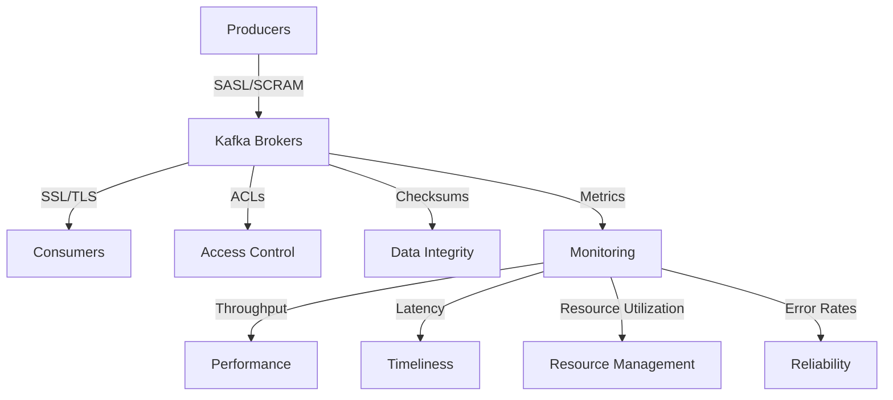

# Lesson 6: Security and Monitoring

## 1. First-Principles Intuition & Invariants

In the realm of distributed systems, Apache Kafka stands as a pillar of data streaming, enabling real-time data ingestion, transformation, and consumption at scale. However, the very nature of distributed systems introduces a myriad of challenges, particularly in ensuring data integrity and system health. Security and monitoring are thus paramount, forming a robust defense against unauthorized access and ensuring the reliability and performance of Kafka clusters.

At the heart of Kafka's security and monitoring lies the principle of least privilege. This principle mandates that each component of the system should have only the access necessary to perform its function, thereby minimizing the potential impact of security breaches. In Kafka, this translates to fine-grained access control over topics, consumers, and producers, ensuring that only authorized entities can read from or write to specific data streams.

Another critical invariant is the integrity of data in transit and at rest. Kafka must ensure that data is not tampered with during transmission and that it remains secure when stored in Kafka's distributed log system. This involves employing strong encryption mechanisms and secure authentication protocols to protect data from unauthorized access and manipulation.

Monitoring, on the other hand, is essential for maintaining system health and performance. It involves the continuous collection and analysis of metrics related to Kafka's operation, such as throughput, latency, and resource utilization. By monitoring these metrics, administrators can detect anomalies and take proactive measures to prevent failures and optimize performance.

## 2. Core Architecture & Mechanics

To understand how security and monitoring are implemented in Kafka, it is essential to delve into the core architecture and mechanics of the system. Kafka is built around the concept of a distributed log, where data is stored in topics, which are partitioned into segments. Each partition is a log file that is appended to as new data arrives. Consumers read data from these partitions, and producers write data to them.

### Security Mechanisms

Kafka provides several mechanisms to ensure the security of data and system components. These mechanisms include:

- **Authentication**: Kafka supports multiple authentication mechanisms, including SASL/PLAIN, SASL/SCRAM, SASL/SSL, and OAuthBearer. These mechanisms allow Kafka to authenticate clients and brokers, ensuring that only authorized entities can communicate with the Kafka cluster.

- **Authorization**: Once clients are authenticated, Kafka can authorize their access to specific topics and operations. This is achieved through the use of ACLs (Access Control Lists), which define the permissions that each user or group has on a particular topic or cluster resource.

- **Encryption**: Kafka supports encryption of data in transit using SSL/TLS. This ensures that data is encrypted when it is transmitted between clients and brokers, protecting it from interception and tampering.

- **Data Integrity**: Kafka uses checksums to ensure the integrity of data stored in its logs. Each message in a Kafka log is accompanied by a checksum, which is used to verify that the message has not been altered during transmission or storage.

### Monitoring Mechanisms

Monitoring in Kafka is achieved through the collection and analysis of various metrics. These metrics provide insights into the performance and health of the Kafka cluster, allowing administrators to detect and address issues proactively. Some of the key metrics that Kafka provides include:

- **Throughput**: The rate at which data is produced and consumed in the Kafka cluster. This metric is crucial for understanding the performance of the system and identifying bottlenecks.

- **Latency**: The time it takes for data to be produced and consumed in the Kafka cluster. Latency is an important metric for real-time applications, where timely data processing is critical.

- **Resource Utilization**: Metrics related to the utilization of system resources, such as CPU, memory, and disk I/O. These metrics help administrators to identify resource constraints and optimize resource allocation.

- **Error Rates**: Metrics related to the rate of errors in the Kafka cluster, such as failed message deliveries or consumer errors. These metrics are important for identifying and addressing issues that may affect the reliability of the system.

### Diagrammatic Representation

To illustrate the architecture and mechanics of Kafka's security and monitoring mechanisms, consider the following diagram:

In this diagram, producers and consumers communicate with Kafka brokers using SASL/SCRAM for authentication and SSL/TLS for encryption. The brokers enforce access control using ACLs and ensure data integrity using checksums. Metrics related to performance, timeliness, resource management, and reliability are collected and analyzed to monitor the health and performance of the Kafka cluster.

## 3. High-Performance Optimization & Failure Modes

High-performance optimization and failure modes are critical considerations in the implementation of security and monitoring in Kafka. Kafka is designed to handle high-throughput data streams, and ensuring that security and monitoring mechanisms do not introduce performance bottlenecks is essential.

### Concurrency and Resource Scaling

Kafka is designed to scale horizontally, with multiple brokers forming a cluster that can handle large volumes of data. To ensure high performance, Kafka employs several concurrency and resource scaling mechanisms:

- **Partitioning**: Kafka topics are partitioned into multiple segments, allowing data to be distributed across multiple brokers. This enables parallel processing of data, improving throughput and reducing latency.

- **Replication**: Kafka replicates data across multiple brokers to ensure fault tolerance and high availability. This replication is managed by Kafka's leader-follower model, where each partition has a leader broker and one or more follower brokers.

- **Load Balancing**: Kafka uses a load balancer to distribute incoming data evenly across the brokers in the cluster. This ensures that no single broker becomes a bottleneck, improving overall performance.

### Boundary Edge Cases and Failure Mitigations

Despite its robust architecture, Kafka is not immune to failure. Several boundary edge cases and failure modes can affect the performance and reliability of the system. Some of the key failure modes in Kafka include:

- **Network Partitions**: Network partitions can occur when brokers become isolated from each other due to network failures. Kafka's leader-follower model helps to mitigate the impact of network partitions by ensuring that data is replicated across multiple brokers.

- **Broker Failures**: Broker failures can occur due to hardware failures or software errors. Kafka's replication mechanism helps to mitigate the impact of broker failures by ensuring that data is available on multiple brokers.

- **Resource Contention**: Resource contention can occur when multiple brokers compete for limited system resources, such as CPU, memory, and disk I/O. Kafka's load balancer helps to mitigate the impact of resource contention by distributing incoming data evenly across the brokers.

In conclusion, implementing security and monitoring in Kafka is essential for ensuring data integrity and system health. By understanding the core architecture and mechanics of Kafka, and employing high-performance optimization and failure mitigation strategies, administrators can build robust and reliable Kafka clusters that meet the demands of modern data streaming applications.
