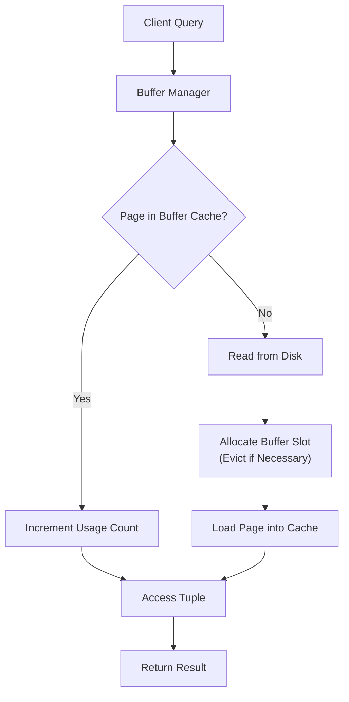
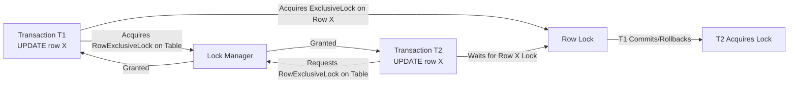
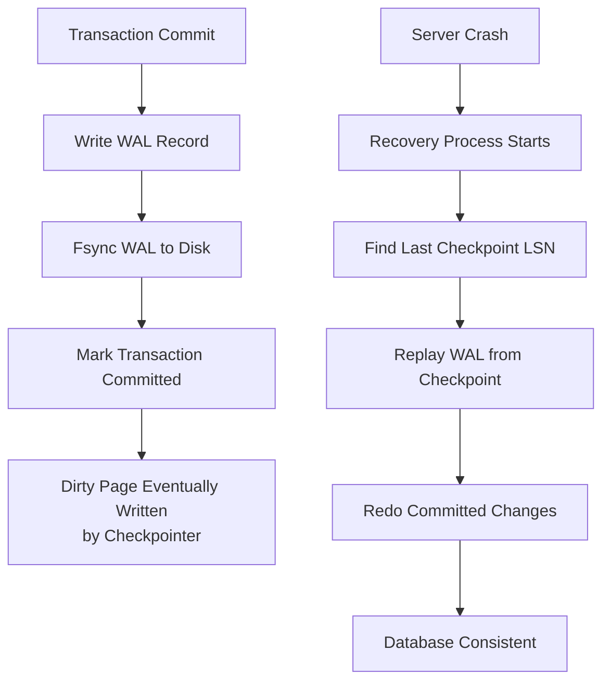

# Operational Verification Labs: Database System Internals

## Objective & Database Environment Setup

### Objective

This laboratory provides hands-on operational verification of production-grade database systems. You will interrogate storage subsystems at the page level, analyze concurrency control primitives (lock modes, wait-for graphs, deadlock detection), and validate crash recovery semantics through Write-Ahead Logging (WAL). These exercises use real client tools, kernel-level inspection utilities, and benchmark suites to diagnose performance bottlenecks, lock contention, and durability guarantees in live database workloads.

Operational verification differs from black-box testing: you will examine internal data structures—buffer pools, lock tables, transaction logs—to validate that the database behaves correctly under concurrent load, resource contention, and abrupt failure.

### Database Environment Setup

We use **PostgreSQL 16** as the reference implementation. PostgreSQL implements Multi-Version Concurrency Control (MVCC), a write-ahead log (WAL) for durability, and a shared buffer cache managed by the buffer manager. Its extensible architecture exposes internal state through system catalogs, extensions, and administrative functions.

#### Required Database Engines
- **PostgreSQL 16** (or 13+)

#### Client CLI Tools
- **psql**: Interactive SQL shell with meta-commands for introspection.
- **pgbench**: Multi-client benchmark tool supporting TPC-B-like workloads and custom scripts.

#### Inspection Utilities
- **pg_stat_statements**: Tracks execution statistics (query count, total time, mean time, buffer hits/misses) for all SQL statements. Requires `shared_preload_libraries = 'pg_stat_statements'` in `postgresql.conf`.
- **pg_buffercache**: Exposes the contents of the shared buffer cache, showing which pages are cached, their usage count, and pin state.
- **pg_locks**: System view displaying lock grants and waits across all active backends. Includes lock mode (AccessShareLock, RowExclusiveLock, etc.), granted/waiting status, and process IDs.
- **pageinspect**: Allows low-level inspection of heap pages, B-tree index pages, and visibility map pages.

### Installation Steps

#### PostgreSQL Installation (Ubuntu/Debian)

```bash
# Add PostgreSQL APT repository
sudo sh -c 'echo "deb http://apt.postgresql.org/pub/repos/apt $(lsb_release -cs)-pgdg main" > /etc/apt/sources.list.d/pgdg.list'
wget --quiet -O - https://www.postgresql.org/media/keys/ACCC4CF8.asc | sudo apt-key add -
sudo apt-get update

# Install PostgreSQL 16 and contrib modules
sudo apt-get install -y postgresql-16 postgresql-contrib-16

# Enable and start the PostgreSQL service
sudo systemctl enable postgresql
sudo systemctl start postgresql
sudo systemctl status postgresql
```

#### Enable Extensions

```bash
# Connect as superuser
sudo -u postgres psql

-- Enable pg_stat_statements
ALTER SYSTEM SET shared_preload_libraries = 'pg_stat_statements';
-- Restart is required for shared_preload_libraries changes
\q

sudo systemctl restart postgresql

# Reconnect and create extensions in target database
sudo -u postgres psql -c "CREATE EXTENSION IF NOT EXISTS pg_stat_statements;"
sudo -u postgres psql -c "CREATE EXTENSION IF NOT EXISTS pg_buffercache;"
sudo -u postgres psql -c "CREATE EXTENSION IF NOT EXISTS pageinspect;"
```

#### Verify Installation

```bash
sudo -u postgres psql -c "SELECT version();"
sudo -u postgres psql -c "SELECT name FROM pg_available_extensions WHERE name IN ('pg_stat_statements', 'pg_buffercache', 'pageinspect');"
```

---

## Exercise 1: Storage Page & Internal Memory Inspection

### Objective

Inspect PostgreSQL's internal heap page structure and buffer cache state. You will understand how tuples are stored on disk, how the buffer manager decides which pages to cache, and how the visibility map and free space map coordinate with heap pages.

### Background: Heap Page Structure

PostgreSQL stores table rows (tuples) in 8 KB heap pages. Each page contains:
- **Page header** (24 bytes): LSN (log sequence number), checksum, flags, lower/upper pointers for free space.
- **Item pointers** (4 bytes each): Array of (offset, length) pairs pointing to tuples within the page.
- **Tuples**: Actual row data, stored bottom-up from the end of the page.
- **Special space**: Reserved for index-specific data (not used in heap pages).

The buffer cache holds recently accessed pages in shared memory. The buffer manager uses a clock-sweep (approximation of LRU) algorithm to evict pages when the cache is full. Each buffer has a usage count incremented on access and decremented by the clock sweep.



### Steps

#### 1. Create Test Database and Table

```bash
sudo -u postgres psql -c "CREATE DATABASE testdb;"
sudo -u postgres psql -d testdb -c "CREATE TABLE test_table (
    id SERIAL PRIMARY KEY,
    data TEXT,
    created_at TIMESTAMP DEFAULT NOW()
);"
```

#### 2. Insert Sample Data

```bash
# Insert 10,000 rows to span multiple pages
sudo -u postgres psql -d testdb -c "
INSERT INTO test_table (data)
SELECT 'Sample data ' || generate_series(1, 10000);
"
```

#### 3. Inspect the Buffer Cache

```bash
sudo -u postgres psql -d testdb -c "
SELECT
    c.relname,
    pg_size_pretty(count(*) * 8192) AS buffered,
    count(*) AS num_buffers,
    round(100.0 * count(*) / (SELECT setting::int FROM pg_settings WHERE name='shared_buffers')::numeric, 2) AS percent_cached
FROM pg_buffercache b
JOIN pg_class c ON b.relfilenode = pg_relation_filenode(c.oid)
WHERE b.reldatabase = (SELECT oid FROM pg_database WHERE datname = 'testdb')
GROUP BY c.relname
ORDER BY num_buffers DESC;
"
```

**Interpretation**: This query shows which relations (tables/indexes) occupy the buffer cache and what percentage of the cache they consume. High `usagecount` (visible in raw `pg_buffercache` output) indicates frequently accessed pages.

#### 4. Inspect Storage Pages

```bash
# Get the relation file node for test_table
sudo -u postgres psql -d testdb -c "
SELECT pg_relation_filepath('test_table');
"

# Inspect the first heap page (page 0)
sudo -u postgres psql -d testdb -c "
SELECT * FROM heap_page_items(get_raw_page('test_table', 0));
"
```

**Output Explanation**:
- `lp`: Line pointer index (item pointer array offset).
- `lp_off`: Byte offset of the tuple within the page.
- `lp_len`: Length of the tuple in bytes.
- `t_xmin`: Transaction ID that inserted the tuple.
- `t_xmax`: Transaction ID that deleted the tuple (0 if not deleted).
- `t_ctid`: Current tuple identifier (page, offset). Points to itself if current version, or to a newer version if updated.

#### 5. Inspect Visibility Map

The visibility map tracks which pages contain only tuples visible to all transactions (allowing vacuum and index-only scans to skip them).

```bash
sudo -u postgres psql -d testdb -c "
SELECT * FROM pg_visibility_map('test_table');
"
```

### Expected Observations

- Pages containing recently modified tuples will not have `all_visible = true` in the visibility map.
- The buffer cache will prioritize pages accessed by recent queries (observable via `usagecount` in `pg_buffercache`).
- Each tuple's `t_xmin` reflects the inserting transaction's XID; `t_xmax` is 0 unless the tuple has been deleted or updated (creating a new version).

---

## Exercise 2: Concurrency Contention & Lock Graph Analysis

### Objective

Simulate concurrent transactions that conflict on shared resources, observe lock escalation and wait-for graphs, and diagnose deadlocks using PostgreSQL's lock manager.

### Background: MVCC and Locking

PostgreSQL uses MVCC to allow concurrent readers and writers. Tuples carry transaction IDs (`t_xmin`, `t_xmax`) to determine visibility. However, certain operations require locks:

- **Relation-level locks**: Acquired by DDL (e.g., `ALTER TABLE` takes `AccessExclusiveLock`).
- **Row-level locks**: Acquired by DML (e.g., `UPDATE` takes `RowExclusiveLock` on the table and `ExclusiveLock` on the row).

Lock modes form a compatibility matrix. `AccessShareLock` (used by `SELECT`) conflicts with `AccessExclusiveLock` but not with other read locks. `RowExclusiveLock` (used by `INSERT`/`UPDATE`/`DELETE`) conflicts with `ShareLock` and `AccessExclusiveLock`.



### Steps

#### 1. Create Test Table

```bash
sudo -u postgres psql -d testdb -c "
CREATE TABLE concurrent_table (
    id SERIAL PRIMARY KEY,
    value INT NOT NULL,
    version INT DEFAULT 1
);
INSERT INTO concurrent_table (value) VALUES (100), (200), (300);
"
```

#### 2. Simulate Lock Contention

Open three terminal sessions:

**Session 1 (Transaction T1)**:
```bash
sudo -u postgres psql -d testdb
```
```sql
BEGIN;
UPDATE concurrent_table SET value = value + 1 WHERE id = 1;
-- Do NOT commit yet
```

**Session 2 (Transaction T2)**:
```bash
sudo -u postgres psql -d testdb
```
```sql
BEGIN;
UPDATE concurrent_table SET value = value + 10 WHERE id = 1;
-- This will block waiting for T1 to release the row lock
```

**Session 3 (Observer)**:
```bash
sudo -u postgres psql -d testdb
```
```sql
-- Observe locks held and waited for
SELECT
    l.locktype,
    l.database,
    l.relation::regclass AS relation,
    l.page,
    l.tuple,
    l.transactionid,
    l.mode,
    l.granted,
    l.pid,
    a.query,
    a.state
FROM pg_locks l
JOIN pg_stat_activity a ON l.pid = a.pid
WHERE l.database = (SELECT oid FROM pg_database WHERE datname = 'testdb')
ORDER BY l.granted, l.pid;
```

**Interpretation**:
- T1 holds `RowExclusiveLock` on `concurrent_table` and `ExclusiveLock` on the tuple.
- T2 holds `RowExclusiveLock` on the table but waits for the tuple lock (visible as `granted = false` for the tuple lock).

#### 3. Analyze Wait-For Graph

```sql
-- Identify blocking PIDs
SELECT
    blocked_locks.pid AS blocked_pid,
    blocked_activity.usename AS blocked_user,
    blocking_locks.pid AS blocking_pid,
    blocking_activity.usename AS blocking_user,
    blocked_activity.query AS blocked_query,
    blocking_activity.query AS blocking_query
FROM pg_catalog.pg_locks blocked_locks
JOIN pg_catalog.pg_stat_activity blocked_activity ON blocked_activity.pid = blocked_locks.pid
JOIN pg_catalog.pg_locks blocking_locks ON blocking_locks.locktype = blocked_locks.locktype
    AND blocking_locks.database IS NOT DISTINCT FROM blocked_locks.database
    AND blocking_locks.relation IS NOT DISTINCT FROM blocked_locks.relation
    AND blocking_locks.page IS NOT DISTINCT FROM blocked_locks.page
    AND blocking_locks.tuple IS NOT DISTINCT FROM blocked_locks.tuple
    AND blocking_locks.transactionid IS NOT DISTINCT FROM blocked_locks.transactionid
    AND blocking_locks.pid != blocked_locks.pid
JOIN pg_catalog.pg_stat_activity blocking_activity ON blocking_activity.pid = blocking_locks.pid
WHERE NOT blocked_locks.granted;
```

#### 4. Simulate Deadlock

Open two sessions:

**Session 1**:
```sql
BEGIN;
UPDATE concurrent_table SET value = value + 1 WHERE id = 1;
-- Wait 5 seconds, then:
UPDATE concurrent_table SET value = value + 1 WHERE id = 2;
```

**Session 2**:
```sql
BEGIN;
UPDATE concurrent_table SET value = value + 1 WHERE id = 2;
-- Immediately:
UPDATE concurrent_table SET value = value + 1 WHERE id = 1;
```

**Expected Result**: PostgreSQL's deadlock detector (runs every `deadlock_timeout`, default 1s) will abort one transaction with:
```text
ERROR:  deadlock detected
DETAIL:  Process X waits for ShareLock on transaction Y; blocked by process Z.
Process Z waits for ShareLock on transaction X; blocked by process X.
```

#### 5. Resolve Contention

In Session 1:
```sql
COMMIT;
```

Session 2's blocked `UPDATE` will now proceed.

### Expected Observations

- `pg_locks` shows both granted and waiting locks.
- Deadlock detection aborts one transaction to break the cycle.
- Lock wait queues are visible via `pg_stat_activity.wait_event = 'Lock'`.

---

## Exercise 3: Crash Simulation & WAL Recovery Replay

### Objective

Simulate an abrupt database server crash, inspect Write-Ahead Log (WAL) records, and validate that PostgreSQL's ARIES-style recovery protocol restores the database to a consistent state.

### Background: Write-Ahead Logging and Recovery

PostgreSQL implements WAL to ensure durability (the D in ACID). Before modifying a data page in memory, the database writes a log record describing the change to the WAL. WAL records are written sequentially to disk and synced (via `fsync`) before the transaction commits. This guarantees that committed transactions are never lost, even if the server crashes.

Recovery proceeds in three phases:
1. **Analysis**: Read the WAL from the last checkpoint to identify dirty pages and active transactions.
2. **Redo**: Replay WAL records from the checkpoint LSN to restore the database to its state at the crash.
3. **Undo**: (Not used in PostgreSQL's MVCC model; aborted transactions are cleaned up lazily.)



### Steps

#### 1. Configure WAL Archiving and Logging

Edit `postgresql.conf`:

```bash
sudo nano /etc/postgresql/16/main/postgresql.conf
```

Add or modify:

```ini
# WAL configuration
wal_level = replica                     # Minimum for archiving
archive_mode = on                       # Enable archiving
archive_command = 'test ! -f /var/lib/postgresql/16/main/archive/%f && cp %p /var/lib/postgresql/16/main/archive/%f'
archive_timeout = 60                    # Force segment switch every 60s

# Checkpoint tuning for observability
checkpoint_timeout = 5min               # More frequent checkpoints
checkpoint_completion_target = 0.9

# Logging for recovery analysis
log_checkpoints = on
log_destination = 'stderr'
logging_collector = on
log_directory = 'log'
log_filename = 'postgresql-%Y-%m-%d_%H%M%S.log'
```

Create archive directory:

```bash
sudo mkdir -p /var/lib/postgresql/16/main/archive
sudo chown postgres:postgres /var/lib/postgresql/16/main/archive
```

Restart PostgreSQL:

```bash
sudo systemctl restart postgresql
```

#### 2. Generate WAL Records

```bash
sudo -u postgres psql -d testdb -c "
CREATE TABLE crash_test (
    id SERIAL PRIMARY KEY,
    data TEXT,
    timestamp TIMESTAMPTZ DEFAULT NOW()
);

-- Insert data to generate WAL records
INSERT INTO crash_test (data)
SELECT 'Pre-crash data ' || generate_series(1, 1000);
"

# Force a checkpoint to establish a known recovery point
sudo -u postgres psql -d testdb -c "CHECKPOINT;"

# Insert more data after checkpoint
sudo -u postgres psql -d testdb -c "
INSERT INTO crash_test (data)
SELECT 'Post-checkpoint data ' || generate_series(1001, 2000);
"

# Verify count before crash
sudo -u postgres psql -d testdb -c "SELECT COUNT(*) FROM crash_test;"
# Expected: 2000
```

#### 3. Simulate Crash

Abruptly terminate PostgreSQL (simulates power loss or kernel panic):

```bash
# Get the postmaster PID
POSTMASTER_PID=$(sudo -u postgres psql -t -c "SELECT pg_backend_pid();" | xargs)

# Send SIGKILL to the postmaster (immediate, unclean shutdown)
sudo kill -9 $(pgrep -f "^postgres.*main")
```

Verify PostgreSQL is stopped:

```bash
sudo systemctl status postgresql
```

#### 4. Inspect WAL Records

Use `pg_waldump` to examine WAL contents:

```bash
# Find the latest WAL file
WAL_DIR="/var/lib/postgresql/16/main/pg_wal"
LATEST_WAL=$(sudo ls -t $WAL_DIR/0* | head -1)

# Dump WAL records
sudo -u postgres /usr/lib/postgresql/16/bin/pg_waldump $LATEST_WAL | head -50
```

**Sample Output**:
```text
rmgr: Heap        len (rec/tot):     59/    59, tx:        750, lsn: 0/01001A28, prev 0/010019F0, desc: INSERT off 3, blkref #0: rel 1663/16384/16385 blk 0
rmgr: Transaction len (rec/tot):     34/    34, tx:        750, lsn: 0/01001A68, prev 0/01001A28, desc: COMMIT 2024-01-15 10:23:45.123456 UTC
```

**Interpretation**:
- `rmgr`: Resource manager (Heap for table operations, Transaction for commits).
- `tx`: Transaction ID.
- `lsn`: Log sequence number (monotonically increasing offset in WAL).
- `desc`: Human-readable description of the operation.

#### 5. Start Recovery

Start PostgreSQL to trigger automatic crash recovery:

```bash
sudo systemctl start postgresql
```

Monitor recovery in logs:

```bash
sudo tail -f /var/lib/postgresql/16/main/log/postgresql-*.log
```

**Expected Log Messages**:
```text
LOG:  database system was interrupted; last known up at 2024-01-15 10:23:44 UTC
LOG:  database system was not properly shut down; automatic recovery in progress
LOG:  redo starts at 0/01000028
LOG:  consistent recovery state reached at 0/01001B00
LOG:  database system is ready to accept connections
```

#### 6. Validate Database Consistency

```bash
# Verify data count
sudo -u postgres psql -d testdb -c "SELECT COUNT(*) FROM crash_test;"
# Expected: 2000 (all committed data restored)

# Verify no corruption
sudo -u postgres psql -d testdb -c "
SELECT COUNT(*) FROM crash_test WHERE data LIKE 'Post-checkpoint%';
"
# Expected: 1000
```

#### 7. Verify Archive Directory

```bash
sudo ls -lh /var/lib/postgresql/16/main/archive/
```

You should see archived WAL segments. These can be used for point-in-time recovery (PITR).

### Expected Observations

- All committed transactions are recovered.
- Uncommitted transactions (if any existed at crash time) are discarded.
- The database reaches a consistent state without manual intervention.
- Recovery time depends on the amount of WAL to replay from the last checkpoint.

---

## Exercise 4: Lock Escalation and Query Performance Diagnosis

### Objective

Use `pg_stat_statements` to identify slow queries and correlate them with lock contention and buffer cache misses.

### Steps

#### 1. Reset Statistics

```bash
sudo -u postgres psql -d testdb -c "SELECT pg_stat_statements_reset();"
```

#### 2. Run Benchmark Workload

```bash
# Initialize pgbench schema
sudo -u postgres pgbench -i -s 10 testdb

# Run concurrent benchmark (50 clients, 1000 transactions each)
sudo -u postgres pgbench -c 50 -j 4 -t 1000 testdb
```

#### 3. Analyze Query Performance

```bash
sudo -u postgres psql -d testdb -c "
SELECT
    query,
    calls,
    total_exec_time,
    mean_exec_time,
    stddev_exec_time,
    shared_blks_hit,
    shared_blks_read,
    shared_blks_hit::float / NULLIF(shared_blks_hit + shared_blks_read, 0) AS cache_hit_ratio
FROM pg_stat_statements
WHERE query NOT LIKE '%pg_stat_statements%'
ORDER BY total_exec_time DESC
LIMIT 10;
"
```

**Interpretation**:
- `cache_hit_ratio < 0.95`: Query is reading from disk frequently (consider increasing `shared_buffers` or indexing).
- High `stddev_exec_time`: Inconsistent performance, possibly due to lock waits or I/O variability.

#### 4. Identify Lock-Induced Slowness

Run a long-running query and observe its impact:

**Session 1**:
```sql
BEGIN;
SELECT pg_sleep(30);  -- Simulate long transaction
UPDATE pgbench_accounts SET abalance = abalance + 1 WHERE aid = 1;
```

**Session 2**:
```sql
-- This will wait for Session 1
UPDATE pgbench_accounts SET abalance = abalance - 1 WHERE aid = 1;
```

**Session 3 (Observer)**:
```sql
SELECT
    a.pid,
    a.usename,
    a.state,
    a.wait_event_type,
    a.wait_event,
    now() - a.query_start AS query_duration,
    a.query
FROM pg_stat_activity a
WHERE a.state != 'idle' AND a.pid != pg_backend_pid()
ORDER BY query_duration DESC;
```

---

## Production Diagnostic Cheat Sheet

### Essential SQL Inspection Queries

#### Buffer Cache Hit Ratio (Target: > 95%)

```sql
SELECT
    sum(heap_blks_hit) / NULLIF(sum(heap_blks_hit) + sum(heap_blks_read), 0) AS heap_hit_ratio,
    sum(idx_blks_hit) / NULLIF(sum(idx_blks_hit) + sum(idx_blks_read), 0) AS index_hit_ratio
FROM pg_statio_user_tables;
```

#### Top 10 Slowest Queries

```sql
SELECT
    substring(query, 1, 100) AS query_short,
    calls,
    round(total_exec_time::numeric, 2) AS total_time_ms,
    round(mean_exec_time::numeric, 2) AS mean_time_ms,
    round((100.0 * shared_blks_hit / NULLIF(shared_blks_hit + shared_blks_read, 0))::numeric, 2) AS hit_ratio
FROM pg_stat_statements
ORDER BY total_exec_time DESC
LIMIT 10;
```

#### Active Locks and Blockers

```sql
SELECT
    blocked.pid AS blocked_pid,
    blocked.query AS blocked_query,
    blocker.pid AS blocker_pid,
    blocker.query AS blocker_query,
    now() - blocked.query_start AS blocked_duration
FROM pg_stat_activity blocked
JOIN pg_locks blocked_locks ON blocked.pid = blocked_locks.pid
JOIN pg_locks blocker_locks ON blocked_locks.locktype = blocker_locks.locktype
    AND blocked_locks.database IS NOT DISTINCT FROM blocker_locks.database
    AND blocked_locks.relation IS NOT DISTINCT FROM blocker_locks.relation
    AND blocked_locks.page IS NOT DISTINCT FROM blocker_locks.page
    AND blocked_locks.tuple IS NOT DISTINCT FROM blocker_locks.tuple
    AND blocked_locks.transactionid IS NOT DISTINCT FROM blocker_locks.transactionid
    AND blocked_locks.pid != blocker_locks.pid
JOIN pg_stat_activity blocker ON blocker.pid = blocker_locks.pid
WHERE NOT blocked_locks.granted AND blocker_locks.granted;
```

#### Table and Index Bloat (Estimate)

```sql
SELECT
    schemaname,
    tablename,
    pg_size_pretty(pg_total_relation_size(schemaname||'.'||tablename)) AS total_size,
    pg_size_pretty(pg_relation_size(schemaname||'.'||tablename)) AS table_size,
    pg_size_pretty(pg_total_relation_size(schemaname||'.'||tablename) - pg_relation_size(schemaname||'.'||tablename)) AS indexes_size,
    n_dead_tup,
    n_live_tup,
    round(100.0 * n_dead_tup / NULLIF(n_live_tup + n_dead_tup, 0), 2) AS dead_ratio
FROM pg_stat_user_tables
WHERE n_live_tup > 0
ORDER BY pg_total_relation_size(schemaname||'.'||tablename) DESC
LIMIT 20;
```

#### WAL Generation Rate

```sql
SELECT
    pg_size_pretty(pg_wal_lsn_diff(pg_current_wal_lsn(), '0/0')) AS total_wal_generated,
    pg_size_pretty(pg_wal_lsn_diff(pg_current_wal_lsn(), pg_stat_reset_time)) AS wal_since_reset
FROM (SELECT pg_stat_reset_time FROM pg_stat_bgwriter) sr;
```

### CLI Flags and Tools

#### pgbench

```bash
# Initialize with scale factor 50 (50x base size, ~750 MB)
pgbench -i -s 50 testdb

# Run read-write benchmark: 100 clients, 10 threads, 60 seconds
pgbench -c 100 -j 10 -T 60 -P 5 testdb

# Custom script (file-based)
cat > benchmark.sql << 'EOF'
\set aid random(1, 100000 * :scale)
SELECT abalance FROM pgbench_accounts WHERE aid = :aid;
EOF
pgbench -c 50 -j 4 -T 30 -f benchmark.sql testdb

# TPC-B-like benchmark with detailed latency stats
pgbench -c 50 -j 4 -T 60 --latency-limit=10 --report-latencies testdb
```

#### psql

```bash
# Connect with auto-commit off
psql -d testdb -c "SET autocommit=off;"

# Execute query and output to CSV
psql -d testdb -c "COPY (SELECT * FROM test_table) TO STDOUT WITH CSV HEADER;" > output.csv

# Timing and explain analyze
psql -d testdb -c "\timing on" -c "EXPLAIN ANALYZE SELECT * FROM test_table WHERE id < 1000;"
```

#### pg_waldump

```bash
# Dump all records in a WAL segment
pg_waldump /var/lib/postgresql/16/main/pg_wal/000000010000000000000001

# Filter by transaction ID
pg_waldump -x 750 /var/lib/postgresql/16/main/pg_wal/000000010000000000000001

# Filter by resource manager (e.g., Heap operations)
pg_waldump -r Heap /var/lib/postgresql/16/main/pg_wal/000000010000000000000001
```

### Operational Verification Checklist

#### Pre-Production Validation
- [ ] Buffer cache hit ratio > 95% under load
- [ ] Checkpoint intervals do not cause I/O spikes (monitor `log_checkpoints`)
- [ ] No long-running transactions blocking vacuuming (`SELECT * FROM pg_stat_activity WHERE state != 'idle' AND now() - xact_start > interval '1 hour';`)
- [ ] Table bloat < 20% (use query above)
- [ ] No deadlocks in `pg_stat_database` (`deadlocks` column)
- [ ] WAL archiving functional (`archive_command` exit code 0)

#### Post-Crash Validation
- [ ] Recovery completed without errors (`grep -i error /var/lib/postgresql/16/main/log/*.log`)
- [ ] All committed transactions restored
- [ ] No data corruption (`SELECT COUNT(*) FROM critical_table;` matches expected)
- [ ] Indexes valid (`REINDEX CONCURRENTLY` if uncertain)

#### Lock Contention Diagnosis
- [ ] Identify top lock waiters (`pg_stat_activity` with `wait_event = 'Lock'`)
- [ ] Correlate with slow queries (`pg_stat_statements` high `mean_exec_time`)
- [ ] Check for missing indexes on foreign keys (common source of lock escalation)

---

## Advanced Topics

### Point-in-Time Recovery (PITR)

Restore the database to a specific timestamp using WAL archives.

```bash
# Stop PostgreSQL
sudo systemctl stop postgresql

# Backup current data directory
sudo cp -a /var/lib/postgresql/16/main /var/lib/postgresql/16/main.backup

# Create recovery.signal file
sudo -u postgres touch /var/lib/postgresql/16/main/recovery.signal

# Configure recovery target
sudo -u postgres bash -c "cat >> /var/lib/postgresql/16/main/postgresql.auto.conf << EOF
restore_command = 'cp /var/lib/postgresql/16/main/archive/%f %p'
recovery_target_time = '2024-01-15 10:25:00'
recovery_target_action = 'promote'
EOF"

# Start PostgreSQL to begin recovery
sudo systemctl start postgresql
```

### Lock Modes and Compatibility

| Lock Mode                | Conflicts With                                                 |
|--------------------------|---------------------------------------------------------------|
| AccessShareLock          | AccessExclusiveLock                                           |
| RowShareLock             | ExclusiveLock, AccessExclusiveLock                            |
| RowExclusiveLock         | ShareLock, ShareRowExclusiveLock, ExclusiveLock, AccessExclusiveLock |
| ShareLock                | RowExclusiveLock, ShareRowExclusiveLock, ExclusiveLock, AccessExclusiveLock |
| ShareRowExclusiveLock    | RowExclusiveLock, ShareLock, ShareRowExclusiveLock, ExclusiveLock, AccessExclusiveLock |
| ExclusiveLock            | RowShareLock, RowExclusiveLock, ShareLock, ShareRowExclusiveLock, ExclusiveLock, AccessExclusiveLock |
| AccessExclusiveLock      | All lock modes                                                |

### Vacuum and Autovacuum Tuning

Dead tuples (from updates/deletes) accumulate due to MVCC. Vacuum reclaims space and prevents transaction ID wraparound.

```sql
-- Manual vacuum (blocks writes)
VACUUM FULL concurrent_table;

-- Analyze for query planner
ANALYZE concurrent_table;

-- Check autovacuum status
SELECT
    relname,
    last_vacuum,
    last_autovacuum,
    vacuum_count,
    autovacuum_count,
    n_dead_tup,
    n_live_tup
FROM pg_stat_user_tables
ORDER BY n_dead_tup DESC;
```

Tune `autovacuum_vacuum_scale_factor` and `autovacuum_vacuum_threshold` in `postgresql.conf` for high-churn tables.

---

## Summary

This lab provided operational verification of PostgreSQL's storage, concurrency, and recovery subsystems. You inspected heap pages and buffer cache state, diagnosed lock contention and deadlocks, and validated crash recovery through WAL replay. These techniques extend to debugging production incidents: identifying slow queries, resolving lock escalation, and recovering from unexpected failures. Mastery of these tools enables you to operate databases at scale with confidence in their correctness and durability guarantees.
