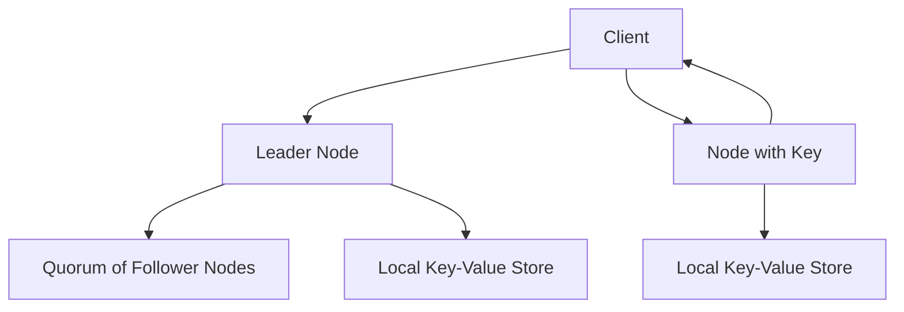

# Lesson 1: Distributed Systems Architecture

## 1. First-Principles Intuition & Invariants

Distributed systems represent a paradigm shift in the architecture of computing systems, transcending the limitations of single-node machines to harness the power of multiple interconnected nodes. This transformation is driven by the need to manage vast datasets, provide high availability, and ensure scalability in the face of growing computational demands. At the heart of distributed systems lies the principle of partitioning, where data and processing are distributed across a network of nodes, each operating independently but collaborating to achieve a common goal. This partitioning introduces a myriad of challenges, including data consistency, fault tolerance, and efficient communication, which must be meticulously addressed to ensure the reliability and performance of the system.

The theoretical grounding of distributed systems is deeply rooted in the principles of fault tolerance and data consistency. Fault tolerance is the ability of a system to continue operating correctly in the presence of hardware or software failures. In distributed systems, where nodes can fail independently, achieving fault tolerance requires sophisticated mechanisms to detect, isolate, and recover from failures. Data consistency, on the other hand, ensures that all nodes in the system have a coherent view of the data, despite concurrent updates and network delays. The CAP theorem, formulated by Eric Brewer and later proven by Seth Gilbert and Nancy Lynch, provides a fundamental understanding of the trade-offs between consistency, availability, and partition tolerance in distributed systems. According to the CAP theorem, in the presence of network partitions, a distributed system can only guarantee two of the three properties: consistency, availability, and partition tolerance. This theorem serves as a cornerstone for designing distributed systems, guiding architects in making informed decisions about the trade-offs that are acceptable for their specific use cases.

Another critical invariant in distributed systems is the concept of eventual consistency. Unlike strong consistency, where all nodes see the same data at the same time, eventual consistency allows nodes to temporarily diverge in their views of the data, with the guarantee that they will converge to a consistent state over time. This relaxation of consistency requirements enables distributed systems to achieve higher availability and scalability, as nodes can continue to operate and serve requests even in the presence of network partitions or node failures. The challenge lies in designing mechanisms that ensure eventual consistency while minimizing the window of inconsistency and providing mechanisms for conflict resolution.

## 2. Core Architecture & Mechanics

The architecture of a distributed system is intricately designed to balance the principles of fault tolerance, data consistency, and performance. At the heart of this architecture is the concept of a declarative state machine, where the desired state of the system is specified, and the system continuously reconciles its current state with the desired state through a series of level-triggered reconciliation loops. This approach ensures that the system remains resilient to failures and can recover to a consistent state even in the face of transient errors.

One of the key components of a distributed system is the consensus mechanism, which ensures that all nodes agree on a single value or state. In the context of distributed systems, consensus is critical for maintaining data consistency and ensuring that all nodes have a coherent view of the system's state. The Raft consensus algorithm, developed by Diego Ongaro and John Ousterhout, provides a robust and understandable approach to achieving consensus in distributed systems. Raft is designed to be easy to understand and implement, making it a popular choice for many distributed systems. The algorithm operates in a leader-follower model, where a single leader node is responsible for coordinating the consensus process, while follower nodes replicate the leader's state. Raft uses a quorum-based approach to ensure that a majority of nodes agree on a value before it is committed. The size of the quorum, denoted as \( Q = \lfloor N/2 \rfloor + 1 \), ensures that the system can tolerate up to \( \lfloor N/2 \rfloor \) node failures without losing consensus.

Another critical component of distributed systems is the use of Multi-Version Concurrency Control (MVCC) to manage concurrent access to shared data. MVCC allows multiple versions of a data item to exist simultaneously, enabling concurrent reads and writes without the need for locks. Each version of a data item is associated with a unique revision number, which is incremented with each update. When a node reads a data item, it retrieves the most recent version available at that time. When a node writes to a data item, it creates a new version with an incremented revision number. This approach ensures that reads and writes can proceed concurrently without blocking, improving the performance and scalability of the system. The use of MVCC is particularly prevalent in distributed databases, where it enables efficient handling of concurrent transactions and ensures data consistency across multiple nodes.

To illustrate the architecture of a distributed system, consider the example of a distributed key-value store. In this system, data is partitioned across multiple nodes, each responsible for a subset of the key-value pairs. The system uses a consensus mechanism, such as Raft, to ensure that all nodes agree on the state of the key-value store. When a client writes a key-value pair to the system, the leader node replicates the write to a quorum of follower nodes. Once the write is committed, the leader node updates its local copy of the key-value store and notifies the client of the successful write. When a client reads a key-value pair, the node responsible for the key retrieves the most recent version of the value from its local copy of the key-value store and returns it to the client. This architecture ensures that the system remains highly available and scalable, while maintaining data consistency and fault tolerance.

## 3. High-Performance Optimization & Failure Modes

Optimizing the performance of distributed systems is a complex challenge that requires careful consideration of concurrency, resource scaling, and failure modes. One of the key challenges in distributed systems is ensuring efficient communication between nodes. Network latency and bandwidth limitations can significantly impact the performance of a distributed system, particularly in large-scale deployments. To mitigate these challenges, distributed systems often use techniques such as batching, pipelining, and asynchronous communication to improve the efficiency of network communication.

Concurrency is another critical aspect of distributed systems, as it enables multiple nodes to operate independently and perform tasks in parallel. However, concurrency introduces the risk of race conditions and data inconsistencies, which can lead to incorrect results and system failures. To address these challenges, distributed systems use a variety of concurrency control mechanisms, such as locks, semaphores, and transactional memory, to ensure that concurrent operations are performed safely and consistently. In addition, distributed systems often use techniques such as load balancing and sharding to distribute workloads evenly across nodes, ensuring that no single node becomes a bottleneck.

Resource scaling is a critical aspect of distributed systems, as it enables the system to handle growing workloads and data volumes. Distributed systems often use techniques such as horizontal scaling, where additional nodes are added to the system to increase its capacity, and vertical scaling, where the resources of existing nodes are increased. Horizontal scaling is particularly prevalent in distributed systems, as it allows the system to scale out by adding more nodes to the system. This approach is well-suited for handling large-scale workloads and data volumes, as it enables the system to distribute workloads evenly across multiple nodes.

Failure modes are an inevitable aspect of distributed systems, as nodes can fail independently due to hardware or software issues. To ensure fault tolerance, distributed systems use a variety of mechanisms to detect, isolate, and recover from failures. One of the key mechanisms is the use of heartbeats, where nodes periodically send messages to each other to indicate that they are alive and functioning correctly. If a node fails to receive a heartbeat from another node, it can assume that the node has failed and take appropriate action, such as electing a new leader or redistributing the node's workload to other nodes. In addition, distributed systems often use techniques such as replication and checkpointing to ensure that data is not lost in the event of a node failure. Replication involves creating multiple copies of data across different nodes, ensuring that data is available even if some nodes fail. Checkpointing involves periodically saving the state of the system to a stable storage medium, allowing the system to recover from failures by restoring the state from the checkpoint.

In conclusion, distributed systems represent a powerful paradigm for building scalable, fault-tolerant, and high-performance computing systems. By understanding the principles of fault tolerance, data consistency, and performance optimization, architects can design distributed systems that meet the demands of modern computing environments. The architecture of a distributed system is intricately designed to balance these principles, using mechanisms such as consensus, MVCC, and concurrency control to ensure data consistency and fault tolerance. By optimizing the performance of distributed systems through techniques such as batching, pipelining, and load balancing, architects can build systems that are capable of handling large-scale workloads and data volumes. Through a deep understanding of the principles and mechanics of distributed systems, architects can build systems that are reliable, scalable, and efficient, enabling them to meet the demands of modern computing environments.
