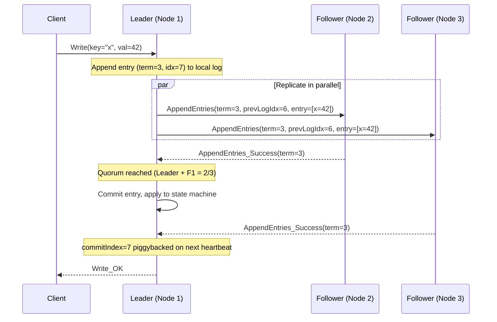
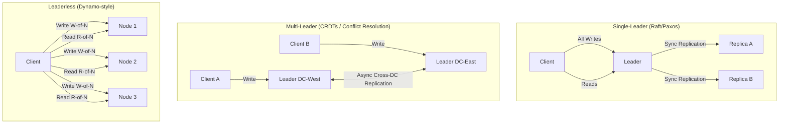
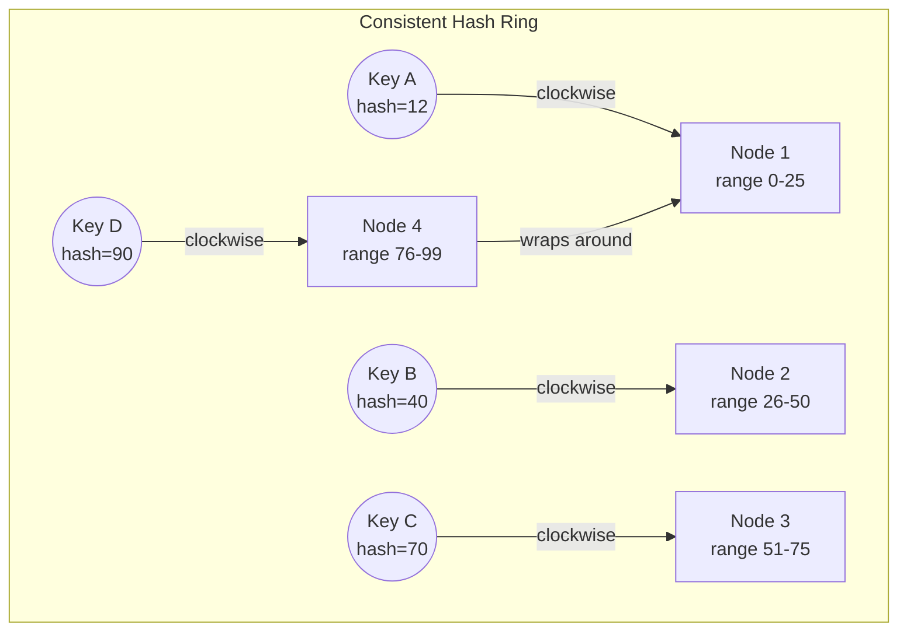

```markdown
# Lesson 1: Distributed Systems Architecture

## 1. First-Principles Intuition & Invariants

A single machine is bounded by the speed of light across its bus, the capacity of its RAM, and the rotational latency of its disks. When the working set of a problem exceeds these physical limits — or when the cost of downtime is unacceptable — you must partition the problem across multiple cooperating machines. That act of partitioning is the genesis of every challenge in distributed systems: the moment data lives on more than one machine, those machines can disagree, and the moment they can disagree, you need a formal model for what "correct" means.

### The Fundamental Tension: Partial Failure

A single-node system either works or it does not. A distributed system introduces a third state: **partial failure**, where some nodes are working, some are dead, and some are alive but cannot communicate with the others. Peter Deutsch's eight fallacies of distributed computing (documented at Sun Microsystems in 1994, later expanded by James Gosling) enumerate the assumptions that break in this environment: the network is not reliable, latency is not zero, bandwidth is not infinite, the network is not secure, topology does not change, there is not one administrator, transport cost is not zero, and the network is not homogeneous. Every architecture decision in distributed systems is ultimately a response to one or more of these broken assumptions.

### The CAP Theorem: Precision over Folklore

Eric Brewer conjectured the CAP theorem at PODC 2000; Seth Gilbert and Nancy Lynch provided the formal proof in their 2002 ACM SIGACT paper. The theorem proves that in an asynchronous network model where message loss is possible, **no distributed data store can simultaneously guarantee all three of**:

- **Consistency (C)**: Every read receives the most recent write or an error (linearizability in the formal sense).
- **Availability (A)**: Every request to a non-failed node receives a non-error response.
- **Partition Tolerance (P)**: The system continues operating when an arbitrary number of messages between nodes are dropped.

The common misreading is that you "choose two of three." In reality, **partition tolerance is not optional** — network partitions occur in any real deployment, so the actual choice is between CP (sacrifice availability during a partition) and AP (sacrifice linearizability during a partition). Systems like ZooKeeper and etcd choose CP; systems like Cassandra and DynamoDB choose AP with tunable consistency.

Brewer himself acknowledged in a 2012 IEEE Computer article that CAP is often over-applied. The more nuanced framework is **PACELC** (Daniel Abadi, 2012): even when there is no partition, there is a latency–consistency trade-off. PACELC asks: in the case of Partition (P), choose Availability (A) or Consistency (C); Else (E, no partition), choose Latency (L) or Consistency (C). This gives a richer two-axis characterization of system behavior.

### Consistency Models as a Partial Order

Consistency models form a strict hierarchy. Understanding where your system sits determines what application-level invariants you must enforce yourself:

```
Linearizability (Strict Serializability)
    └── Sequential Consistency
            └── Causal Consistency
                    └── PRAM / Monotonic Reads + Writes
                            └── Eventual Consistency
```

**Linearizability** (Herlihy & Wing, 1990) is the gold standard: operations appear to execute atomically at some point between their invocation and their response, and that point is consistent with real time. This requires coordination on every operation and is expensive to achieve at scale.

**Causal consistency** (Lamport's happens-before relation, 1978) requires that causally related operations be seen in order by all nodes, while concurrent operations may be seen in any order. Lamport clocks provide a logical clock sufficient to track causality in the absence of physical clock synchronization; vector clocks (Fidge/Mattern, 1988) generalize this to track the causal history of each node independently, enabling detection of concurrent writes and meaningful conflict resolution.

**Eventual consistency** (Vogels, 2009) guarantees only that, absent new writes, all replicas converge to the same value. The gap between "absent new writes" and real workloads is bridged by **Conflict-free Replicated Data Types (CRDTs)**, which define merge functions that are commutative, associative, and idempotent, ensuring convergence regardless of the order in which updates are received.

---

## 2. Core Architecture & Mechanics

### Consensus: The Engine of Replication

Consensus is the problem of getting a set of processes to agree on a single value, even when some processes fail. The **FLP impossibility result** (Fischer, Lynch, Paterson, 1985) proves that in a purely asynchronous system where even one process may crash, deterministic consensus is impossible. Real systems escape FLP by introducing timing assumptions (Paxos, Raft use timeouts) or randomness (Ben-Or's algorithm).

#### Raft Consensus

Raft (Ongaro & Ousterhout, USENIX ATC 2014) decomposes consensus into three sub-problems: leader election, log replication, and safety. Its design constraint is understandability, achieved by decomposing state into only three roles: **Leader**, **Follower**, and **Candidate**.

**Leader Election**: Each server starts as a Follower. If a Follower receives no `AppendEntries` heartbeat within an election timeout (typically 150–300 ms, randomized to break symmetry), it converts to Candidate, increments its current term, votes for itself, and broadcasts `RequestVote` RPCs. A Candidate becomes Leader if it receives votes from a strict majority ⌊N/2⌋ + 1 of servers. A server grants a vote only if the candidate's log is at least as up-to-date as its own (defined by comparing the last log entry's term, then index), and it has not voted for a different candidate in this term.

**Log Replication**: The Leader accepts client commands, appends them to its log as new entries with the current term, and broadcasts `AppendEntries` RPCs to all Followers in parallel. An entry is **committed** once the Leader has replicated it to a majority. The Leader then applies the entry to its state machine, returns the result to the client, and piggybacks the commit index on subsequent `AppendEntries` so Followers learn of the commit.

**Safety Invariant**: Raft guarantees the **Log Matching Property**: if two entries in different logs have the same index and term, all preceding entries are identical. The `AppendEntries` RPC includes a consistency check (the term and index of the entry immediately preceding the new entries), and Followers reject the RPC if this does not match, forcing the Leader to send earlier entries until a consistent prefix is found.

The quorum size for N nodes:

```
Q = ⌊N/2⌋ + 1
```

This tolerates ⌊N/2⌋ simultaneous failures. With N=3 (Q=2), the system tolerates 1 failure. With N=5 (Q=3), it tolerates 2 failures. Adding nodes beyond 7 provides diminishing fault-tolerance returns while increasing write latency linearly due to the extra round-trip to a larger quorum.



#### Paxos and Multi-Paxos

Paxos (Lamport, 1989/1998) is the foundational algorithm from which Raft derives. Single-decree Paxos agrees on a single value in two phases: Prepare/Promise and Accept/Accepted. Multi-Paxos extends this by electing a distinguished proposer (leader) who can skip the Prepare phase for subsequent slots, reducing the common case to a single round trip. Raft is essentially a re-engineering of Multi-Paxos with clearly defined leader election, log structure, and membership change protocols. Production systems using Paxos variants include Google Chubby, Google Spanner, and Apache Zookeeper (which uses ZAB, a variant closely related to Paxos).

### Replication Topologies

The choice of replication topology directly determines the latency, throughput, and durability trade-offs of a distributed system.



In **leaderless replication** (Dynamo, Cassandra, Riak), quorum reads and writes are configured via parameters W (write quorum) and R (read quorum) over N replicas. When R + W > N, at least one node participates in both read and write, guaranteeing that a read returns the most recent write — but only probabilistically so, since the overlapping node might not have the latest version if a write is in flight. **Read repair** and **anti-entropy** background processes converge diverged replicas.

### Partitioning Strategies

Partitioning (sharding) distributes data across nodes to enable horizontal scaling. The partitioning scheme determines hotspot likelihood, rebalancing complexity, and query routing.

**Range partitioning** assigns contiguous key ranges to shards (e.g., HBase regions). Range scans are efficient, but monotonically increasing keys (e.g., timestamps) cause write hotspots on the last shard.

**Hash partitioning** applies a deterministic hash to the key and assigns the result modulo the number of shards. This distributes writes uniformly but destroys key ordering, making range scans expensive.

**Consistent hashing** (Karger et al., 1997) places both keys and nodes on a virtual ring. Each key is owned by the first node clockwise from its hash position. When a node is added or removed, only K/N keys are remapped (K total keys, N nodes), minimizing rebalancing. Virtual nodes (vnodes), used in Cassandra and DynamoDB, assign each physical node multiple positions on the ring to improve load distribution and handle heterogeneous hardware.



### Multi-Version Concurrency Control (MVCC)

MVCC enables concurrent readers to see a consistent snapshot of the database without blocking writers, and writers to proceed without blocking readers. Each row (or key-value pair) stores multiple versions tagged with a transaction ID or timestamp. Readers see the most recent version whose commit timestamp is less than or equal to the reader's snapshot timestamp.

The core invariant of MVCC is that a transaction T at snapshot timestamp `ts_read` can only see writes committed at `ts_commit ≤ ts_read`. Writes create new versions; they do not overwrite existing ones. Garbage collection (vacuum in PostgreSQL, compaction in RocksDB) reclaims old versions no longer visible to any active snapshot.

In PostgreSQL, every row has hidden system columns `xmin` (the transaction ID that inserted it) and `xmax` (the transaction ID that deleted or updated it, or zero if live). A tuple is visible to transaction `xid` if `xmin` is committed and `xmin ≤ xid`, and either `xmax` is zero or `xmax` is not committed or `xmax > xid`.

In distributed databases like Google Spanner, MVCC is combined with **TrueTime** — a globally synchronized clock with bounded uncertainty — to assign commit timestamps. Spanner waits out the clock uncertainty interval before committing, guaranteeing that the commit timestamp is in the past relative to any future transaction, achieving external consistency (a form of linearizability) across globally distributed shards.

The following example shows how RocksDB (used as the storage engine for TiKV, CockroachDB, and others) stores MVCC versions using a composite key encoding:

```python
# RocksDB MVCC key encoding (simplified from TiKV's implementation)
# Key format: <user_key> | <timestamp_descending>
# Timestamps are stored in descending order so that the latest version
# is always the first key returned by a forward scan.

import struct
import rocksdb  # pip install python-rocksdb

MAX_TS = (1 << 64) - 1  # u64::MAX

def encode_key(user_key: bytes, ts: int) -> bytes:
    """Encode a user key with a descending timestamp for MVCC."""
    # Encode timestamp in big-endian, then XOR with MAX to invert ordering
    ts_encoded = struct.pack(">Q", MAX_TS - ts)
    return user_key + b"\x00" + ts_encoded

def decode_key(encoded: bytes) -> tuple[bytes, int]:
    """Decode an MVCC-encoded key back to (user_key, timestamp)."""
    sep = encoded.rfind(b"\x00")
    user_key = encoded[:sep]
    ts_inv = struct.unpack(">Q", encoded[sep + 1:])[0]
    ts = MAX_TS - ts_inv
    return user_key, ts

def mvcc_get(db: rocksdb.DB, user_key: bytes, read_ts: int) -> bytes | None:
    """
    Retrieve the value of user_key as of read_ts.
    Scans forward from the encoded key; the first version whose timestamp
    is <= read_ts is the correct snapshot version.
    """
    seek_key = encode_key(user_key, read_ts)
    it = db.iteritems()
    it.seek(seek_key)
    for raw_key, value in it:
        decoded_key, version_ts = decode_key(raw_key)
        if decoded_key != user_key:
            break  # moved past all versions of this key
        if version_ts <= read_ts:
            return value  # first visible version
    return None  # key does not exist at this snapshot

def mvcc_put(db: rocksdb.DB, user_key: bytes, value: bytes, commit_ts: int):
    """Write a new version of user_key at commit_ts."""
    encoded = encode_key(user_key, commit_ts)
    db.put(encoded, value)
```

### Lamport Clocks and Vector Clocks

Physical clocks drift and cannot be perfectly synchronized across machines (NTP provides only millisecond-level accuracy under good conditions; GPS-disciplined clocks reach nanoseconds but are expensive). Logical clocks provide a causal ordering without requiring clock synchronization.

**Lamport timestamps**: Each process maintains a counter. Before a local event, increment the counter. When sending a message, include the counter. On receiving a message, set the counter to `max(local, received) + 1`. This guarantees: if event A causally precedes event B, then `L(A) < L(B)`. The converse is not true — a higher Lamport timestamp does not imply causality.

**Vector clocks**: Each process `i` maintains a vector `V` of N counters, one per process. Increment `V[i]` on a local event or send. On receiving a message with vector `V'`, set `V[j] = max(V[j], V'[j])` for all j, then increment `V[i]`. Two events are concurrent if neither `V(A) ≤ V(B)` nor `V(B) ≤ V(A)` component-wise. Amazon DynamoDB originally used vector clocks for conflict detection (described in the 2007 Dynamo paper), though later versions shifted to last-write-wins with server-side timestamps due to operational complexity.

```python
from dataclasses import dataclass, field
from typing import Dict

@dataclass
class VectorClock:
    node_id: str
    clock: Dict[str, int] = field(default_factory=dict)

    def tick(self) -> "VectorClock":
        """Increment own component before a local event or send."""
        self.clock[self.node_id] = self.clock.get(self.node_id, 0) + 1
        return self

    def merge(self, other: "VectorClock") -> "VectorClock":
        """Merge on receive: take component-wise maximum, then tick."""
        for node, ts in other.clock.items():
            self.clock[node] = max(self.clock.get(node, 0), ts)
        self.tick()
        return self

    def happened_before(self, other: "VectorClock") -> bool:
        """Return True if self causally precedes other."""
        return (
            all(self.clock.get(n, 0) <= other.clock.get(n, 0)
                for n in set(self.clock) | set(other.clock))
            and self.clock != other.clock
        )

    def concurrent(self, other: "VectorClock") -> bool:
        return (
            not self.happened_before(other)
            and not other.happened_before(self)
        )
```

---

## 3. High-Performance Optimization & Failure Modes

### Write Path Optimization: LSM-Trees vs. B-Trees

The two dominant storage structures in distributed databases reflect different optimization targets.

**B-Trees** (Bayer & McCreight, 1972) maintain sorted data in fixed-size pages (typically 4–16 KB). An update is an in-place write to a page. Random writes to spinning disks are expensive because the disk head must seek; on SSDs, random writes cause write amplification through the flash translation layer. B-Trees are optimal for read-heavy workloads with large individual records.

**Log-Structured Merge-Trees (LSM-Trees)** (O'Neil et al., 1996) convert random writes into sequential writes by buffering mutations in a memory-resident structure (MemTable in RocksDB/LevelDB) and flushing it to immutable sorted files (SSTables) on disk. Background **compaction** merges SSTables, reclaims space from deleted/updated records, and maintains the invariant that files are sorted and non-overlapping within a level. LSM-Trees dominate write-heavy workloads (Cassandra, RocksDB, HBase, InfluxDB).

Write amplification in LSM-Trees is the ratio of bytes written to disk versus bytes of user data written. In level-based compaction (LevelDB/RocksDB default), write amplification is O(L × R) where L is the number of levels and R is the size ratio between levels. With R=10 and L=6, write amplification can reach 30–50×, which matters for SSD endurance. **FIFO compaction** and **TWCS** (Time-Window Compaction Strategy in Cassandra) reduce write amplification for time-series workloads by exploiting TTL patterns.

```mermaid
graph TD
    subgraph "LSM-Tree Write Path"
        W[Client Write] --> WAL[Write-Ahead Log\nsequential append]
        WAL --> MT[MemTable\nin-memory sorted skip list]
        MT -->|flush when full ~64MB| L0[Level-0 SSTables\nsorted, possibly overlapping]
        L0 -->|compaction| L1[Level-1 SSTables\n≤10MB total, non-overlapping]
        L1 -->|compaction| L2[Level-2 SSTables\n≤100MB total]
        L2 -->|compaction| L
