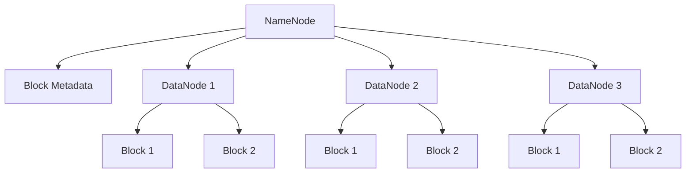
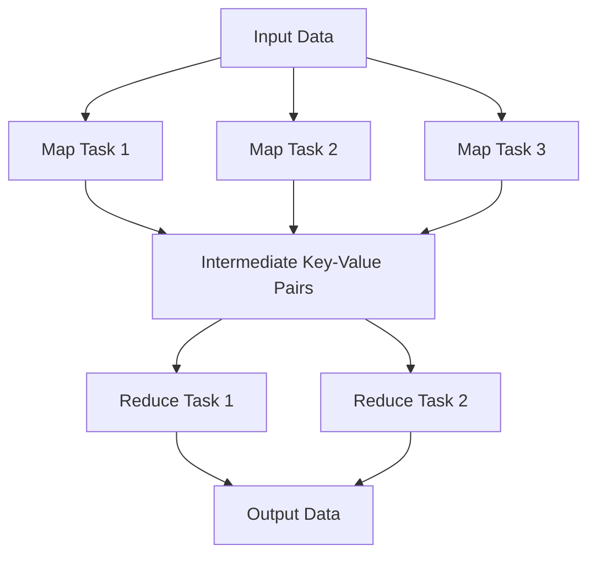
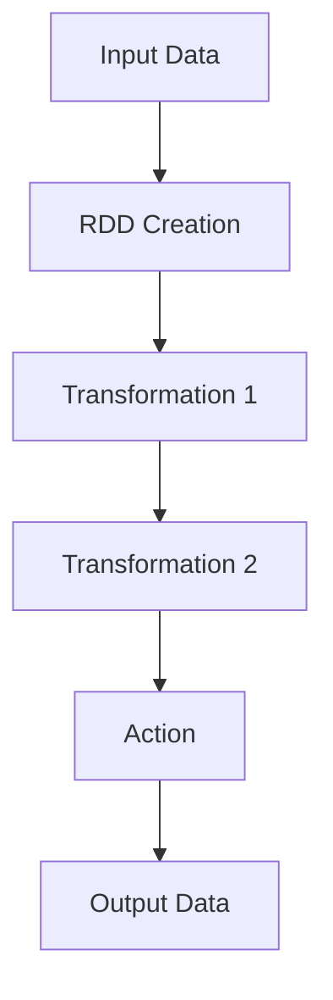

# Lesson 2: Big Data Ecosystem

## 1. First-Principles Intuition & Invariants

The advent of big data has fundamentally transformed the landscape of data processing and analysis, enabling organizations to derive actionable insights from vast and diverse datasets. At its core, big data is characterized by the threeVs—volume, velocity, and variety—which pose significant challenges to traditional data processing systems. Volume refers to the sheer size of datasets, velocity to the speed at which data is generated and must be processed, and variety to the diverse formats and sources of data. To address these challenges, the big data ecosystem has evolved to encompass a wide array of technologies and frameworks designed to handle large-scale data processing efficiently and effectively.

At the heart of the big data ecosystem lies the need for distributed computing, which allows data to be processed across multiple nodes in a cluster. This distributed architecture is essential for scaling to handle the massive datasets typical of big data applications. The distributed nature of these systems introduces complexities in terms of data consistency, fault tolerance, and resource management, which must be carefully managed to ensure reliable and efficient data processing.

One of the key invariants in the big data ecosystem is the separation of storage and computation. This separation allows for independent scaling of storage and computational resources, optimizing the use of hardware and improving overall system performance. Another invariant is the use of fault-tolerant storage systems that can handle node failures without data loss, ensuring data availability and integrity.

## 2. Core Architecture & Mechanics

### Hadoop

Hadoop is a foundational framework in the big data ecosystem, designed to provide a distributed storage and processing system for large datasets. At its core, Hadoop consists of two primary components: the Hadoop Distributed File System (HDFS) and the MapReduce programming model.

#### Hadoop Distributed File System (HDFS)

HDFS is a distributed file system designed to store large files across a cluster of machines. It is built on the principle of data locality, which aims to minimize data transfer across the network by processing data on the nodes where it is stored. HDFS is organized into blocks, which are typically 128 MB or 256 MB in size, and are replicated across multiple nodes to ensure fault tolerance. The NameNode manages the metadata of the filesystem, including the mapping of blocks to nodes, while the DataNodes store the actual data blocks and handle read and write requests.

#### MapReduce

MapReduce is a programming model and execution framework for processing large datasets in parallel. It consists of two main phases: the Map phase and the Reduce phase. In the Map phase, data is processed in parallel across multiple nodes, and the results are partitioned into intermediate key-value pairs. In the Reduce phase, these intermediate results are combined to produce the final output. MapReduce is designed to be fault-tolerant, automatically handling node failures and re-executing tasks as necessary.

### Apache Spark

Apache Spark is a modern big data processing framework that addresses some of the limitations of Hadoop's MapReduce model. Spark is designed for in-memory processing, allowing for faster data processing and iterative algorithms. It provides a high-level API for distributed data processing, with support for multiple programming languages, including Scala, Java, Python, and R.

#### Core Components

Spark consists of several core components, including the Spark Core, Spark SQL, Spark Streaming, and MLlib. Spark Core provides the basic functionality for distributed data processing, including the ability to create and manipulate distributed datasets. Spark SQL provides a SQL-like interface for querying structured data, while Spark Streaming enables real-time data processing. MLlib is a machine learning library that provides a variety of algorithms for data analysis and modeling.

#### Execution Model

Spark's execution model is based on the concept of resilient distributed datasets (RDDs), which are immutable, distributed collections of data. RDDs can be created from various data sources, including HDFS, local files, and external databases. RDDs support a variety of transformations and actions, which can be used to process and analyze data. Spark's in-memory processing capabilities allow for efficient execution of iterative algorithms, which are common in machine learning and graph processing.

### NoSQL Databases

NoSQL databases are designed to handle large volumes of unstructured and semi-structured data, providing flexibility and scalability beyond traditional relational databases. NoSQL databases come in various types, including key-value stores, document stores, column-family stores, and graph databases.

#### Key-Value Stores

Key-value stores store data as a collection of key-value pairs, allowing for fast data retrieval based on the key. Examples of key-value stores include Redis and Amazon DynamoDB. Key-value stores are well-suited for applications that require fast read and write operations, such as caching and session management.

#### Document Stores

Document stores store data as documents, typically in JSON or XML format. Examples of document stores include MongoDB and Couchbase. Document stores provide flexibility in data modeling, allowing for complex nested structures and schema evolution.

#### Column-Family Stores

Column-family stores store data in columns rather than rows, allowing for efficient data retrieval based on specific columns. Examples of column-family stores include Apache Cassandra and HBase. Column-family stores are well-suited for applications that require fast read and write operations on specific columns, such as time-series data and log analysis.

#### Graph Databases

Graph databases store data as a graph of nodes and relationships, allowing for efficient traversal and querying of complex data relationships. Examples of graph databases include Neo4j and Amazon Neptune. Graph databases are well-suited for applications that require complex relationship analysis, such as social networks and recommendation systems.

## 3. High-Performance Optimization & Failure Modes

### Concurrency

Concurrency is a critical aspect of big data processing, allowing for parallel execution of tasks across multiple nodes. In Hadoop, the MapReduce framework provides a distributed execution model that allows for parallel processing of data. In Spark, the in-memory processing capabilities allow for efficient execution of iterative algorithms, which are common in machine learning and graph processing.

### Resource Scaling

Resource scaling is essential for handling large-scale data processing, allowing for efficient use of hardware resources. In Hadoop, the HDFS and MapReduce frameworks provide a distributed architecture that allows for independent scaling of storage and computational resources. In Spark, the in-memory processing capabilities allow for efficient execution of iterative algorithms, which can be resource-intensive.

### Boundary Edge Cases

Boundary edge cases are critical for ensuring the reliability and robustness of big data processing systems. In Hadoop, the MapReduce framework provides fault-tolerant execution, automatically handling node failures and re-executing tasks as necessary. In Spark, the in-memory processing capabilities allow for efficient execution of iterative algorithms, which can be sensitive to resource constraints.

### Failure Mitigations

Failure mitigations are essential for ensuring the reliability and robustness of big data processing systems. In Hadoop, the HDFS and MapReduce frameworks provide fault-tolerant execution, automatically handling node failures and re-executing tasks as necessary. In Spark, the in-memory processing capabilities allow for efficient execution of iterative algorithms, which can be sensitive to resource constraints.

In conclusion, the big data ecosystem is a complex and dynamic landscape, encompassing a wide array of technologies and frameworks designed to handle large-scale data processing efficiently and effectively. By understanding the core architecture and mechanics of frameworks like Hadoop and Spark, as well as the principles of NoSQL databases, senior software engineers, systems programmers, and domain architects can design and implement robust big data solutions that meet the demands of modern data processing applications.
