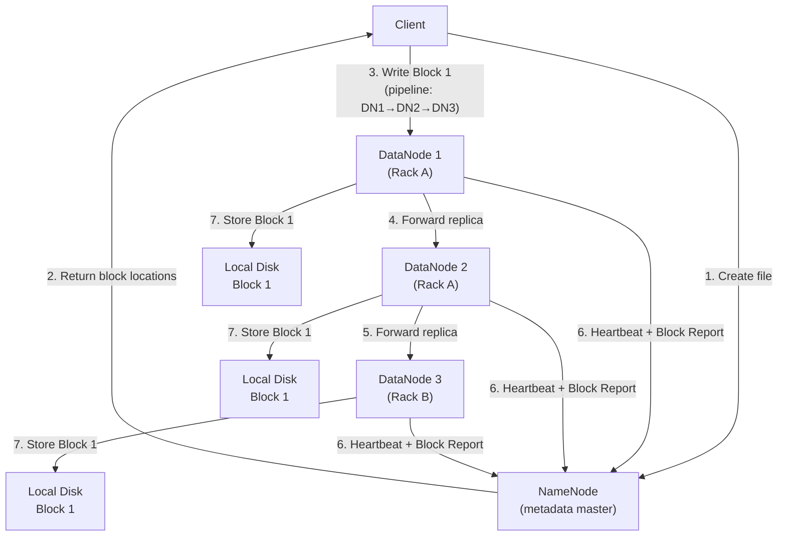
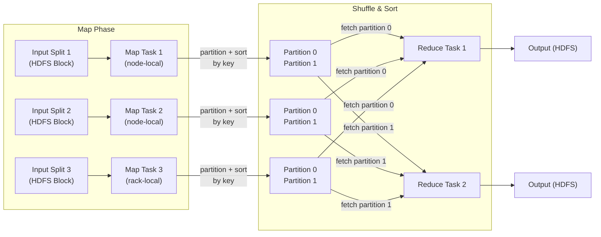
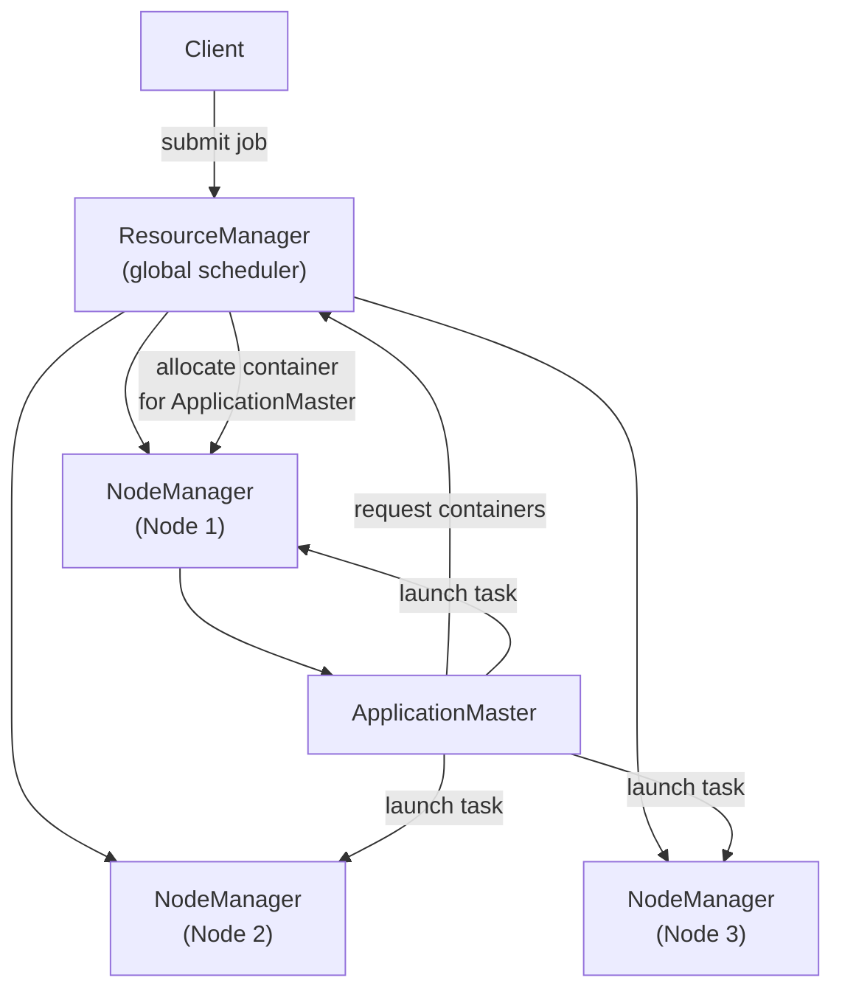
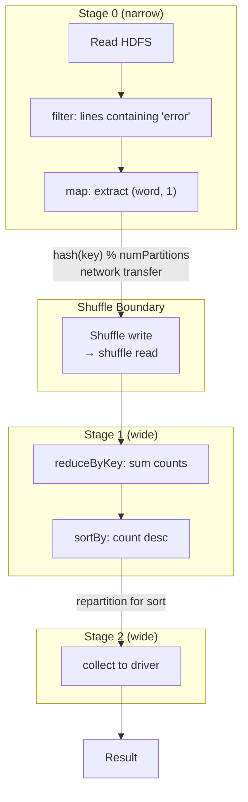
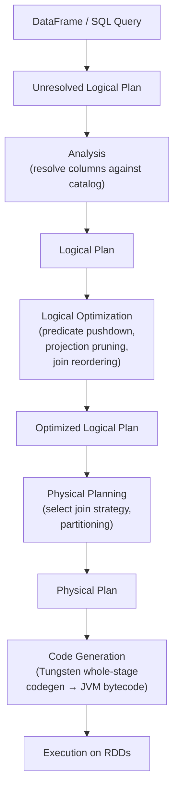
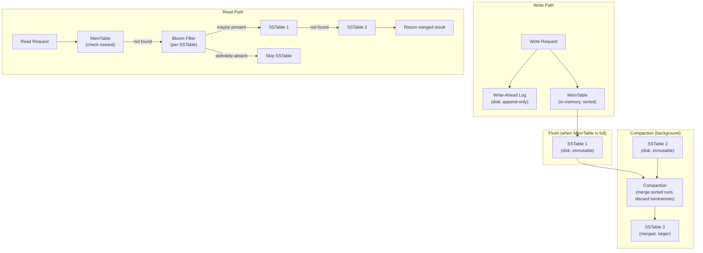
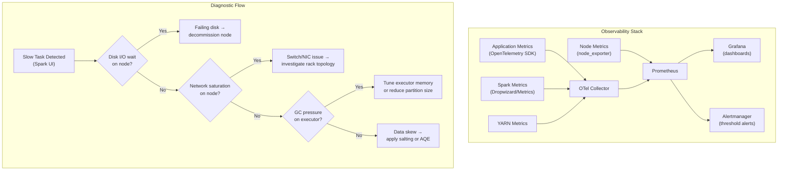

# Lesson 2: Big Data Ecosystem

## 1. First-Principles Intuition & Invariants

Big data systems exist because single-machine processing hits a fundamental physical wall: memory capacity, disk throughput, and CPU cycles are bounded by one machine's hardware. The solution—distribute work across many machines—introduces a new class of problems that do not exist on a single node: partial failure, network partitions, inconsistent state, and stragglers. Every architectural decision in the big data ecosystem is a direct response to these distributed-systems constraints.

The conventional "three V's" framework (Volume, Velocity, Variety) is a useful shorthand but obscures the real engineering drivers:

- **Volume** forces horizontal partitioning of data, which in turn forces network-aware computation (data locality) and fault-tolerant replication (because the probability of at least one node failing grows linearly with cluster size).
- **Velocity** forces pipeline architectures that decouple producers from consumers, enabling buffering, backpressure, and replay. This is the root distinction between batch and stream processing.
- **Variety** forces schema-on-read semantics and flexible storage models, because imposing a rigid schema at ingestion time creates a bottleneck that defeats the scalability goal.

### Fundamental Invariants

**Invariant 1: The Network is the Bottleneck.** In a 10 Gbps network, moving 1 TB of data between nodes takes a minimum of ~800 seconds. Reading that same 1 TB from a local NVMe drive takes ~500 seconds, and from local HDD ~5,000 seconds. This gap is why data locality—scheduling computation on the node that holds the data—is a first-class architectural concern. Hadoop's MapReduce was designed around this invariant; Spark mitigates it through in-memory caching but cannot eliminate it for initial data loads or wide transformations (shuffles).

**Invariant 2: Failure is Statistical, Not Exceptional.** In a 1,000-node cluster with a 99.9% individual node uptime, the expected number of simultaneously failed nodes at any given time is ~1. Over a 24-hour period, the probability of experiencing at least one node failure approaches certainty. Systems must treat failure as the normal operating condition, not an edge case. This is why HDFS replicates blocks (default replication factor 3), why Spark tracks RDD lineage for reconstruction, and why stream processors maintain offset checkpoints.

**Invariant 3: Consistency Models Are Explicit Tradeoffs.** The CAP theorem (Brewer's conjecture, formalized by Gilbert and Lynch, 2002) states that a distributed system can provide at most two of: Consistency (all nodes see the same data), Availability (every request receives a response), and Partition tolerance (the system operates despite network failures). Since partitions are inevitable in geographically distributed systems, the real choice is between CP (consistency + partition tolerance) and AP (availability + partition tolerance). HDFS is CP—it blocks writes if the NameNode cannot reach a quorum of DataNodes for replication. Cassandra is configurable on a per-operation basis but defaults toward AP.

**Invariant 4: Sequential I/O Dominates Random I/O.** Hard drives deliver ~100–200 MB/s sequential reads but only ~1–10 MB/s random reads. SSDs narrow this gap but do not eliminate it. This is why HDFS uses large block sizes (128 MB default), why LSM-tree-based stores (Cassandra, HBase) batch writes into sequential append-only files, and why MapReduce sorts intermediate data before the reduce phase.

## 2. Core Architecture & Mechanics

### Hadoop: HDFS and MapReduce

#### Hadoop Distributed File System (HDFS)

HDFS implements a write-once, read-many file system semantics across a cluster. The architecture splits responsibilities between a NameNode (metadata master) and DataNodes (block storage workers).

**NameNode:** Maintains the filesystem namespace tree, file-to-block mapping, and block-to-DataNode locations in memory (the `fsimage` checkpoint on disk plus the `edit log` for changes since the last checkpoint). The NameNode does not store file data—it stores metadata only. On startup, it replays the edit log against the fsimage to reconstruct the in-memory namespace, then waits for DataNode block reports before exiting safe mode.

**DataNode:** Stores blocks as plain files on the local filesystem, sends a heartbeat to the NameNode every 3 seconds (default `dfs.heartbeat.interval`), and sends a full block report every 6 hours (default `dfs.blockreport.interval`). If the NameNode does not receive a heartbeat within 10 minutes and 30 seconds (`dfs.namenode.heartbeat.recheck-interval` × `dfs.heartbeat.interval`), it considers the DataNode dead and triggers re-replication of under-replicated blocks.

**Block Placement (Rack Awareness):** HDFS default replication factor is 3. The placement policy is: replica 1 on the local node, replica 2 on a different node in the same rack, replica 3 on a node in a different rack. This balances fault tolerance (surviving rack-level failures) with write performance (the second replica avoids an inter-rack network hop).



**HDFS High Availability:** The single NameNode is a single point of failure. Hadoop 2+ introduced HA using a pair of active/standby NameNodes backed by a quorum of JournalNodes (typically 3) using a shared edit log via the Quorum Journal Manager (QJM). If the active NameNode fails, ZooKeeper-based failover detects the failure and promotes the standby.

**HDFS Federation:** The NameNode holds all metadata in RAM, which limits the total filesystem size to roughly 1 billion objects (files + blocks) per NameNode heap. Federation addresses this by running multiple independent NameNodes, each managing a distinct namespace volume, sharing the same pool of DataNodes.

#### MapReduce Programming Model

MapReduce is a constrained programming model that forces the developer to express computation as two functions:

- **Map:** `(k1, v1) → list(k2, v2)` — processes one input record at a time, emitting zero or more intermediate key-value pairs.
- **Reduce:** `(k2, list(v2)) → list(k3, v3)` — receives all values for a given key and produces output records.

The framework handles everything else: input splitting, task scheduling, data shuffling, sorting, fault tolerance, and speculative execution. This constraint is deliberate—by restricting the programming model, the framework can provide automatic parallelization and fault tolerance without developer effort.

**Execution Pipeline:**



The shuffle phase is the most expensive operation in MapReduce. It involves:
1. Each Map task writes intermediate output to local disk, partitioned by reducer number using a hash of the intermediate key (`hash(key) % numReducers`).
2. Each Reduce task fetches its partition from all Map tasks across the network.
3. The Reduce task merges and sorts the fetched segments by key before invoking the reduce function.

**Combiner Function:** A combiner is an optional optimization that runs locally on each Map task's output before the shuffle, performing partial aggregation to reduce the volume of data transferred over the network. The combiner must be commutative and associative (e.g., sum, min, max) because the framework may apply it zero or multiple times.

**Speculative Execution:** If the framework detects that a task is running significantly slower than other tasks of the same type (a "straggler"), it launches a duplicate task on another node and takes the output of whichever finishes first. This handles the long-tail latency problem caused by failing hardware, congested networks, or overloaded nodes.

**YARN (Yet Another Resource Negotiator):** Hadoop 2 decoupled resource management from MapReduce by introducing YARN. The ResourceManager runs on a master node and manages global resource scheduling. Each NodeManager runs on worker nodes and manages container lifecycle. ApplicationMaster is per-application, negotiating resources with the ResourceManager and managing task execution. This allows non-MapReduce frameworks (including Spark) to run on the same cluster.



#### MapReduce Code Example: WordCount in Java

```java
import java.io.IOException;
import org.apache.hadoop.conf.Configuration;
import org.apache.hadoop.fs.Path;
import org.apache.hadoop.io.IntWritable;
import org.apache.hadoop.io.Text;
import org.apache.hadoop.mapreduce.Job;
import org.apache.hadoop.mapreduce.Mapper;
import org.apache.hadoop.mapreduce.Reducer;
import org.apache.hadoop.mapreduce.lib.input.FileInputFormat;
import org.apache.hadoop.mapreduce.lib.output.FileOutputFormat;

public class WordCount {

    public static class TokenizerMapper
            extends Mapper<Object, Text, Text, IntWritable> {

        private final static IntWritable one = new IntWritable(1);
        private Text word = new Text();

        @Override
        protected void map(Object key, Text value, Context context)
                throws IOException, InterruptedException {
            // Split on non-word characters; value is one line of input
            String[] tokens = value.toString().split("\\W+");
            for (String token : tokens) {
                if (!token.isEmpty()) {
                    word.set(token.toLowerCase());
                    context.write(word, one);
                }
            }
        }
    }

    public static class IntSumReducer
            extends Reducer<Text, IntWritable, Text, IntWritable> {

        private IntWritable result = new IntWritable();

        @Override
        protected void reduce(Text key, Iterable<IntWritable> values, Context context)
                throws IOException, InterruptedException {
            int sum = 0;
            for (IntWritable val : values) {
                sum += val.get();
            }
            result.set(sum);
            context.write(key, result);
        }
    }

    public static void main(String[] args) throws Exception {
        Configuration conf = new Configuration();
        Job job = Job.getInstance(conf, "word count");
        job.setJarByClass(WordCount.class);
        job.setMapperClass(TokenizerMapper.class);
        job.setCombinerClass(IntSumReducer.class);  // reuse reducer as combiner
        job.setReducerClass(IntSumReducer.class);
        job.setOutputKeyClass(Text.class);
        job.setOutputValueClass(IntWritable.class);
        FileInputFormat.addInputPath(job, new Path(args[0]));
        FileOutputFormat.setOutputPath(job, new Path(args[1]));
        System.exit(job.waitForCompletion(true) ? 0 : 1);
    }
}
```

The `IntSumReducer` is used as both the combiner and the reducer. This is valid because summation is both commutative and associative: `(a + b) + c == a + (b + c)` and `a + b == b + a`. The combiner reduces network traffic by partially aggregating word counts on the map side before shuffling.

### Apache Spark

Spark was designed to address MapReduce's core limitation: every job reads from disk, processes, and writes back to disk. Iterative algorithms (gradient descent, graph traversals) that require multiple passes over the same data suffer because each iteration re-reads from HDFS. Spark solves this by keeping intermediate data in memory across iterations.

#### RDDs: Resilient Distributed Datasets

An RDD is an immutable, partitioned, fault-tolerant collection of records. Fault tolerance is achieved through **lineage**: each RDD maintains a reference to its parent RDD(s) and the transformation that produced it. If a partition is lost, Spark replays the lineage chain from the last checkpoint or cached partition to reconstruct only the lost data—not the entire dataset.

**Narrow vs. Wide Transformations:**

| Transformation Type | Examples | Shuffle Required | Recovery Cost |
|---|---|---|---|
| Narrow | `map`, `filter`, `flatMap`, `union` | No—data stays on same partition | Low—replay one parent partition |
| Wide | `groupByKey`, `reduceByKey`, `join`, `repartition` | Yes—data must be redistributed | High—replay all parent partitions |

Narrow transformations can be pipelined within a single stage (no network I/O). Wide transformations introduce a **stage boundary** because they require a shuffle: data must be repartitioned across the network so that all records with the same key land on the same reducer partition.



#### Catalyst Optimizer and Tungsten Engine

Modern Spark development uses the DataFrame/Dataset API rather than raw RDDs. DataFrames provide a structured table abstraction that enables the Catalyst query optimizer:

1. **Analysis:** Resolves column references against the catalog schema (e.g., does column `user_id` exist in table `events`?).
2. **Logical Optimization:** Applies rule-based transformations—predicate pushdown (push `WHERE` clauses close to the data source), constant folding, projection pruning (skip reading columns that aren't referenced), and join reordering.
3. **Physical Planning:** Converts the optimized logical plan into one or more physical plans and selects the least-cost plan. This is where the optimizer decides between a sort-merge join and a broadcast hash join based on table size estimates.
4. **Code Generation:** The Tungsten engine compiles the physical plan into Java bytecode at runtime using whole-stage code generation, fusing multiple operators into single JVM methods to eliminate virtual function call overhead and improve CPU cache locality.

**Predicate Pushdown Example:** If a Parquet file has row groups and the query filters on a column with min/max statistics, Spark skips row groups where the min/max range does not satisfy the predicate entirely—no I/O needed for those groups.



#### Structured Streaming

Spark Structured Streaming treats a stream as an unbounded DataFrame. The engine processes data in micro-batches (default) or continuously (experimental as of Spark 3.x). Source connectors (Kafka, file sources, rate) generate new data periodically; the engine appends new rows to the unbounded DataFrame and executes the same Catalyst-optimized plan as it would on a bounded DataFrame. Stateful operations (windowed aggregations, joins with static data) are managed through a fault-tolerant state store backed by HDFS-compatible storage. Exactly-once semantics are achieved through write-ahead logs and idempotent sinks.

#### Spark Code Example: Log Analysis Pipeline in Python

```python
from pyspark.sql import SparkSession
from pyspark.sql.functions import col, count, desc, window, from_json
from pyspark.sql.types import StructType, StringType, TimestampType

spark = SparkSession.builder \
    .appName("log-analysis") \
    .config("spark.sql.adaptive.enabled", "true") \
    .config("spark.sql.adaptive.coalescePartitions.enabled", "true") \
    .config("spark.sql.shuffle.partitions", "200") \
    .getOrCreate()

# Define schema for JSON log entries
log_schema = StructType() \
    .add("timestamp", TimestampType()) \
    .add("level", StringType()) \
    .add("service", StringType()) \
    .add("message", StringType())

# Read from Kafka stream (Structured Streaming)
raw_stream = spark \
    .readStream \
    .format("kafka") \
    .option("kafka.bootstrap.servers", "broker1:9092,broker2:9092") \
    .option("subscribe", "application-logs") \
    .option("startingOffsets", "latest") \
    .load()

# Parse JSON, filter ERROR-level logs, aggregate by service in 5-minute windows
parsed = raw_stream.selectExpr("CAST(value AS STRING) as json_str") \
    .select(from_json(col("json_str"), log_schema).alias("log")) \
    .select("log.*")

error_windowed = parsed \
    .filter(col("level") == "ERROR") \
    .withWatermark("timestamp", "10 minutes") \
    .groupBy(
        window(col("timestamp"), "5 minutes"),
        col("service")
    ) \
    .agg(count("*").alias("error_count"))

# Write to console for demo (in production: write to Parquet on S3 or Delta Lake)
query = error_windowed \
    .writeStream \
    .outputMode("append") \
    .format("console") \
    .option("truncate", "false") \
    .trigger(processingTime="30 seconds") \
    .start()

query.awaitTermination()
```

The `withWatermark("timestamp", "10 minutes")` declaration tells the engine that log entries arriving more than 10 minutes late relative to the current event-time watermark can be dropped. This bounds the state size for windowed aggregations: the engine can discard state for windows older than the watermark, preventing unbounded memory growth.

#### Adaptive Query Execution (AQE)

Introduced in Spark 3.0, AQE re-optimizes the query plan at runtime based on actual statistics gathered during execution. Key benefits:

- **Dynamic coalescing of shuffle partitions:** If the initial 200 shuffle partitions produce too many small files, AQE merges adjacent small partitions post-shuffle to reduce overhead in the next stage.
- **Dynamic join strategy switching:** If a table that was estimated to be large at planning time turns out to be small after filtering, AQE can switch from a sort-merge join to a broadcast hash join at runtime.
- **Dynamic skew join handling:** AQE detects skewed partitions (significantly larger than the median) and splits them into multiple sub-partitions, distributing the load across more tasks.

### NoSQL Databases

NoSQL databases abandon the relational model's strict schema and ACID guarantees to achieve horizontal scalability and high write throughput. The fundamental architectural shift is from shared-nothing clusters with partition-aware data placement, replacing the scale-up model of traditional RDBMS.

#### Consistency Models and the CAP Theorem

The CAP theorem is widely misunderstood. Gilbert and Lynch's formal proof shows that a system cannot simultaneously provide all three guarantees during a network partition. Since partitions are unavoidable, the practical choice is:

- **CP systems** (e.g., HBase, MongoDB with majority reads/writes): reject requests that cannot reach a quorum, trading availability for consistency.
- **AP systems** (e.g., Cassandra with default settings, DynamoDB): serve requests from any replica, trading consistency for availability. Stale reads are possible; eventual consistency means replicas converge over time.

Cassandra allows per-query consistency level tuning: `ONE` (fastest, may return stale data), `QUORUM` (majority of replicas must respond, stronger consistency), `ALL` (all replicas must respond, strongest but most fragile).

#### Key-Value Stores

Key-value stores expose the simplest possible data model: `put(key, value)` and `get(key) → value`. Internally, they typically use a hash table or LSM-tree for storage.

**Redis** is an in-memory key-value store with optional durability via RDB snapshots and append-only file (AOF) logging. It supports additional data structures (lists, sets, sorted sets, hashes) with O(1) or O(log N) operations. Redis uses a single-threaded event loop, which eliminates lock contention but limits throughput to what one CPU core can handle. Redis Cluster partitions data across nodes using 16,384 hash slots, with each key mapped via `CRC16(key) % 16384`.

**Amazon DynamoDB** is a managed key-value and document store built on the principles of the original Dynamo paper (DeCandia et al., 2007). It uses consistent hashing for partition assignment, with partition keys hashed to determine which storage node handles a given key. DynamoDB provisions throughput per table in terms of read and write capacity units, with automatic partition splitting when throughput exceeds a partition's capacity. Write-ahead logs ensure durability, and synchronous replication across three availability zones provides fault tolerance.

#### Document Stores

Document stores (MongoDB, Couchbase, Amazon DocumentDB) store semi-structured documents (typically JSON/BSON) without requiring a fixed schema. This enables schema evolution without migrations: different documents in the same collection can have different fields.

**MongoDB** uses a storage engine called WiredTiger (default since MongoDB 3.2). WiredTiger uses B-tree indexes for point queries and an LSM-tree option for write-heavy workloads. MongoDB provides document-level locking (not table-level), allowing concurrent operations on different documents within the same collection. Replica sets provide high availability: a primary node accepts all writes, and secondary nodes replicate via an oplog (a capped collection of operations). If the primary fails, an election determines the new primary. Write concern `w: "majority"` ensures data is replicated to a majority of nodes before acknowledging the write; read preference can target secondaries for read scaling at the cost of potentially stale reads.

#### Column-Family Stores

Column-family stores (Apache Cassandra, HBase) are optimized for write-heavy workloads and queries that select specific columns across many rows. They descend from Google's Bigtable design (Chang et al., 2006).

**Storage Model:** Data is stored in an LSM-tree (Log-Structured Merge-tree). Writes go to an in-memory structure called a `MemTable` and are appended to a write-ahead log (WAL) on disk for durability. When the MemTable fills, it is flushed to disk as an immutable `SSTable` (Sorted String Table). Reads merge data from the MemTable and all relevant SSTables. Background compaction merges multiple SSTables into larger ones, discarding deleted and overwritten data.



**Bloom Filters** in the read path are critical for performance: each SSTable has a Bloom filter that can definitively say "this key is not in this SSTable" without reading the file. This avoids O(N) SSTable scans for point lookups, where N is the number of SSTables.

**Apache Cassandra** uses consistent hashing for data distribution. Each node owns a range of tokens on a virtual ring (the "token ring"). A partition key is hashed (Murmur3 by default) to determine which token range (and thus which node) owns the data. Replication strategies determine which additional nodes receive replicas: `SimpleStrategy` places replicas on the next N nodes in ring order; `NetworkTopologyStrategy` places one replica per data center, then additional replicas on different racks within the same data center.

```sql
-- Cassandra CQL: time-series log storage with TTL-based expiry
CREATE TABLE IF NOT EXISTS logs.service_events (
    service_name  text,
    event_time    timestamp,
    event_id      uuid,
    severity      text,
    message       text,
    metadata      map<text, text>,
    PRIMARY KEY ((service_name), event_time, event_id)
) WITH CLUSTERING ORDER BY (event_time DESC, event_id ASC)
  AND compaction = {
    'class': 'TimeWindowCompactionStrategy',
    'compaction_window_unit': 'DAYS',
    'compaction_window_size': '1'
  }
  AND default_time_to_live = 604800;  -- 7 days TTL

-- The composite partition key (service_name) ensures all events for a
-- given service are co-located on the same partition for efficient
-- time-range scans. The clustering columns (event_time, event_id)
-- determine on-disk sort order within each partition.
-- TimeWindowCompactionStrategy groups SSTables by time window, which
-- is optimal for time-series data with TTL expiry.

INSERT INTO logs.service_events
    (service_name, event_time, event_id, severity, message, metadata)
VALUES
    ('payment-svc', '2024-01-15 10:30:00',
     550e8400-e29b-41d4-a716-446655440000,
     'ERROR',
     'Database connection timeout',
     {'host': 'db-prod-1', 'port': '5432'});

SELECT event_time, severity, message
FROM logs.service_events
WHERE service_name = 'payment-svc'
  AND event_time >= '2024-01-15 00:00:00'
  AND event_time <  '2024-01-16 00:00:00'
ALLOW FILTERING;
```

The `PRIMARY KEY ((service_name), event_time, event_id)` design is deliberate: `service_name` is the partition key (parenthesized alone), ensuring all events for one service live on the same partition. `event_time` and `event_id` are clustering columns, which determine the on-disk sort order. `CLUSTERING ORDER BY (event_time DESC)` stores newest events first, making recent-event queries efficient.

**Apache HBase** is a direct implementation of the Bigtable model. It stores data in a sorted, distributed, multi-dimensional map indexed by row key, column family, and column qualifier with a timestamp dimension. HBase runs on top of HDFS for storage, meaning it inherits HDFS's CP consistency model. The HBase architecture includes an HMaster (metadata and region assignment), RegionServers (serve read/write requests for assigned regions), and ZooKeeper (coordination and master failover). Data is automatically sharded into regions: when a region grows beyond a configurable threshold (default 256 MB), it splits into two. RegionServer failure triggers ZooKeeper-based detection and reassignment of regions to surviving servers.

#### Graph Databases

Graph databases (Neo4j, Amazon Neptune, JanusGraph) store data as nodes and relationships (edges), with first-class support for graph traversal queries. The key advantage over relational databases is that join-heavy queries that would require multiple table scans in SQL become O(depth) pointer traversals in a native graph store.

**Neo4j** uses an adjacency-list storage format where each node stores pointers to its relationships. This makes multi-hop traversals (e.g., "find friends-of-friends within 2 hops") efficient without the O(N²) cost of SQL self-joins. Neo4j implements property graph semantics: both nodes and edges can hold arbitrary key-value properties. The Cypher query language provides declarative pattern matching:

```cypher
// Find products purchased by users who share interests with a target user
MATCH (target:User {id: $userId})-[:INTERESTED_IN]->(interest:Topic)
MATCH (similar:User)-[:INTERESTED_IN]->(interest)
MATCH (similar)-[:PURCHASED]->(product:Product)
WHERE similar.id <> target.id
WITH product, count(*) AS recommendationScore
ORDER BY recommendationScore DESC
LIMIT 10
RETURN product.name, product.price, recommendationScore
```

In a relational database, this query would require at least 3 joins and potentially a self-join on the users table. In Neo4j, the engine follows stored relationship pointers directly, with no join planning overhead.

## 3. High-Performance Optimization & Failure Modes

### Data Skew

Data skew is the single most common performance killer in distributed data processing. When one partition contains significantly more data than others, the task processing that partition becomes a straggler, and the overall job latency is bounded by that one task.

**Detection:** In Spark, check the Spark UI's Stage detail page. If the "Duration" column shows one task taking 10x longer than the median, or if the "Shuffle Read Size" for one task is orders of magnitude larger than others, skew is present.

**Mitigations:**

- **Salting:** Add a random suffix to the skewed key to distribute it across multiple partitions. For example, if key `"user_12345"` produces 80% of the records, transform it to `"user_12345_0"` through `"user_12345_9"` before the shuffle, then aggregate the salted results in a second pass.
- **Broadcast Join:** If one side of a join is small enough to fit in memory (default threshold 10 MB, configurable via `spark.sql.autoBroadcastJoinThreshold`), Spark broadcasts the small table to all executors, eliminating the shuffle entirely. No shuffle means no skew problem.
- **Adaptive Query Execution (AQE):** Spark 3.x can automatically detect and handle skew at runtime. `spark.sql.adaptive.skewJoin.enabled` splits skewed partitions into sub-partitions for parallel processing.

```python
# Salting pattern to mitigate data skew in Spark
from pyspark.sql.functions import col, concat, lit, rand, floor, explode, collect_list, sum as _sum

# Problem: user_id "user_12345" has 100x more records than any other user
df = spark.read.parquet("s3://bucket/events/")

# Solution: salt the skewed key across N buckets
N_SALT_BUCKETS = 16

salted = df.withColumn(
    "salted_key",
    concat(col("user_id"), lit("_"), floor(rand() * N_SALT_BUCKETS).cast("int"))
)

# First pass: aggregate on salted keys (distributes load across partitions)
partial = salted.groupBy("salted_key", "user_id") \
    .agg(_sum("amount").alias("partial_sum"))

# Second pass: final aggregation on original keys (each key now has N partials,
# not millions of raw records)
final = partial.groupBy("user_id") \
    .agg(_sum("partial_sum").alias("total_amount"))

final.write.mode("overwrite").parquet("s3://bucket/aggregated/")
```

### Memory Management in Spark

Spark divides executor memory into three regions:

1. **Reserved Memory:** 300 MB, reserved for Spark internal overhead. Cannot be configured.
2. **User Memory:** Used for user data structures, UDFs, and internal metadata. Default is 40% of `(Total Heap - Reserved Memory)`.
3. **Spark Memory:** Split into Storage Memory (cached RDD/DataFrame blocks, broadcast variables) and Execution Memory (shuffles, joins, aggregations). Default split is 50/50.

When execution memory is insufficient for a shuffle, Spark spills to disk. When storage memory is full, Spark evicts cached blocks using an LRU policy. The key insight is that execution memory can borrow from unused storage memory, but not vice versa—execution operations cannot spill without correctness issues, while cached blocks can always be recomputed from lineage.

**Common Failure Mode: OOM During Shuffle.** `groupByKey` loads all values for a key into memory at once. If one key has millions of values, this causes OOM. The fix is to use `reduceByKey` or `aggregateByKey`, which perform map-side combining before the shuffle, reducing the per-key data volume that arrives at the reducer.

### Fault Tolerance and Recovery

**HDFS Block Loss:** If a DataNode fails permanently and its blocks are lost, the NameNode identifies under-replicated blocks from block reports and schedules re-replication on healthy DataNodes. This is transparent to applications reading from HDFS, though throughput may degrade during re-replication.

**Spark Task Failure:** When a task fails, Spark retries it up to `spark.task.maxFailures` times (default 4). If a stage fails entirely (all task attempts for one partition fail), Spark aborts the job. If a task fails because its executor died (OOM, hardware failure), Spark reassigns the task to a different executor and replays the lineage from the last cached partition.

**Spark Executor Loss:** When an executor is lost, all in-progress tasks on that executor are reassigned. If the executor held cached RDD partitions, those partitions are marked as lost and will be recomputed on demand from lineage. If the lost executor was running a shuffle map task, the shuffle output is lost, and downstream reduce tasks that need that output will fail and trigger re-execution of the map stage. This is expensive—it can cause an entire stage to re-run.

**Checkpointing:** For jobs with long lineage chains (deep iterative algorithms), `RDD.checkpoint()` saves the RDD to HDFS, truncating the lineage. Subsequent failures replay from the checkpoint rather than from the original source, reducing recovery time from minutes to seconds.

### Network and I/O Bottlenecks

**Shuffle Spill:** When shuffle data exceeds the `spark.shuffle.file.buffer` (default 32 KB per buffer) or when the sort buffer fills, Spark spills to disk. Each spill creates a temporary file; the final shuffle output merges all spills. Excessive spills degrade performance because they require additional disk I/O and merge operations. Monitoring the "Spill (Memory)" and "Spill (Disk)" columns in the Spark UI identifies this.

**Small File Problem:** HDFS and Spark both perform poorly with many small files. Each file is an HDFS block with NameNode metadata overhead (~150 bytes per file in the namespace). A directory with 100,000 small files of 1 KB each wastes 99.2% of each 128 MB block and places 100,000 objects in the NameNode. The solution is to batch writes into larger files (target 128 MB–1 GB per file) or use compaction jobs that merge small files.

**Network Saturation During Shuffle:** A shuffle of 1 TB across 200 executors generates 1 TB of network traffic. On a 10 Gbps network, the theoretical minimum time is ~800 seconds. In practice, TCP overhead, congestion, and shared bandwidth make it 2–3x worse. Reducing shuffle volume through map-side aggregation, broadcast joins, or repartitioning before the shuffle can cut this dramatically.

### Monitoring and Observability

Effective big data operations require instrumentation at multiple layers:

- **Resource Level:** CPU utilization, memory pressure, disk I/O, network throughput per node. Tools: Prometheus + node_exporter, Ganglia.
- **Framework Level:** YARN resource usage, Spark stage timelines, task durations, shuffle sizes, spill counts. Tools: Spark History Server, YARN ResourceManager UI.
- **Application Level:** End-to-end pipeline latency, data quality metrics, record counts per stage. Tools: custom metrics emitted via Dropwizard Metrics library, OpenTelemetry.

The most useful diagnostic pattern is correlating Spark UI task durations with resource-level metrics. A task taking 10x longer than its peers that coincides with high disk I/O wait on one node points to a failing disk; the same pattern with high network utilization points to a switch port issue. Speculative execution masks these problems but does not diagnose them—both are needed.



### Common Anti-Patterns

**`collect()` on Large Datasets:** Calling `df.collect()` pulls the entire distributed dataset into the driver's memory. This causes OOM on datasets larger than driver RAM. Use `df.write()` to persist to distributed storage, or `df.take(n)` / `df.limit(n)` if only a sample is needed.

**Using `groupByKey` for Aggregations:** `groupByKey` shuffles all values per key without any pre-aggregation, then loads them all into memory at the reducer. `reduceByKey` applies the reduce function on the map side first, dramatically reducing shuffle volume. For the same word-count job on 1 TB of text, `groupByKey` shuffles ~1 TB of `(word, 1)` pairs; `reduceByKey` with a combiner shuffles only the unique words with their counts, potentially just a few MB.

**Reading Many Small Files:** `spark.read.parquet("s3://bucket/logs/2024/01/*/*/*")` with hourly partitioning can create thousands of tiny Parquet files. Each file requires a separate HDFS open operation and a separate Spark task. Solution: configure the writer to use `coalesce` or `repartition` to target 128 MB+ files, or use the `mergeSmallFiles` compaction strategy.

**Ignoring SerDe Overhead:** The default Java serialization is 3–10x slower and produces 2–5x larger payloads than Kryo. Always register Kryo: `spark.serializer = org.apache.spark.serializer.KryoSerializer` and register the classes you serialize for best performance.

### Summary

The big data ecosystem addresses a fundamental physical constraint: no single machine can process petabyte-scale datasets. The solution—distribute across clusters—introduces partial failure, network bottlenecks, data skew, and consistency tradeoffs that do not exist in single-machine systems. Hadoop's HDFS + MapReduce established the foundational architecture (data locality, replication, shuffle-based parallelism). Spark improved on it through in-memory computation, a unified DataFrame API with a cost-based optimizer, and adaptive query execution. NoSQL databases (Cassandra, HBase, MongoDB) provide different consistency/availability tradeoffs for operational workloads, using LSM-trees for write throughput and consistent hashing for horizontal scalability. The performance and reliability of these systems depend on understanding and mitigating their failure modes: data skew, shuffle spill, memory pressure, and network saturation—all of which are direct consequences of the distributed computing invariants that define the problem space.
