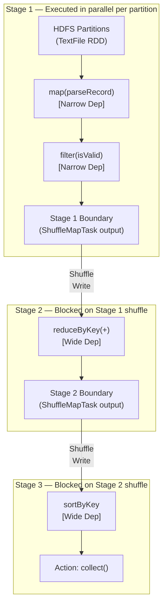
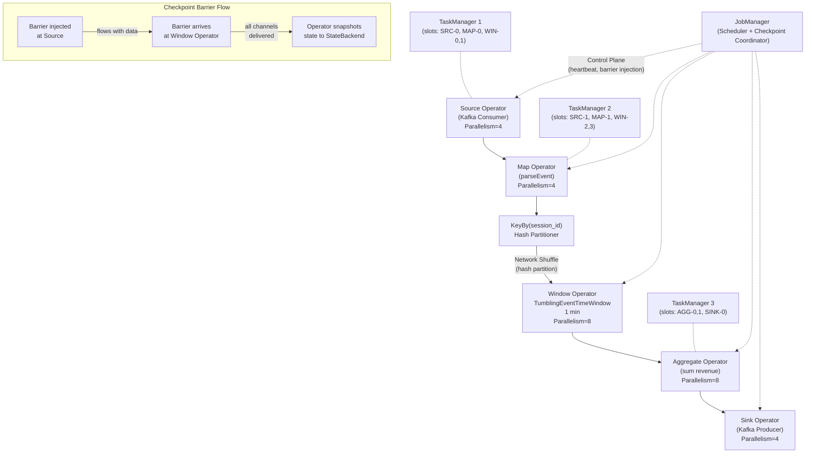

```markdown
# Lesson 3: Data Processing Frameworks

## 1. First-Principles Intuition & Invariants

Data processing frameworks are not convenience wrappers around MapReduce—they are formal computational models that encode specific answers to unsolvable problems in distributed systems: how do you define consistency when clocks drift, how do you bound recovery cost when any node can fail at any moment, and how do you schedule work across thousands of heterogeneous machines without a global view of state?

The problem space emerges from a hard physical reality: a modern data center's bisection bandwidth is roughly 1–10 Gbps per rack, while a single NVMe SSD delivers ~7 GB/s sequential read throughput locally. Network I/O is therefore 1–7× slower than local disk, and local disk is 10–50× slower than DRAM. Any framework that ignores these numbers will fail at scale. The entire design of Spark, Flink, and their predecessors is a consequence of this latency hierarchy.

### 1.1 The Three Structural Invariants

**Invariant 1 — Computation Locality.** The fundamental cost model of distributed data processing is dominated by data movement, not computation. This is quantified by Amdahl's Law and reinforced by the actual numbers: a network round-trip at 100µs latency means that moving 1 GB over a 10 Gbps link takes ~800ms, while a CPU can execute ~2.4 × 10⁹ simple operations in the same window. The architectural consequence is data-local scheduling: the scheduler must place task execution on the node that already holds the data partition, degrading gracefully to rack-local and then cluster-wide only when data-local slots are unavailable. Spark encodes this in its `TaskScheduler` as `NODE_LOCAL > RACK_LOCAL > ANY`, waiting a configurable `spark.locality.wait` duration at each tier before relaxing.

**Invariant 2 — Fault Tolerance as a First-Class Citizen.** In a cluster of 10,000 nodes with a mean time between failures (MTBF) of 3 years per node, the expected inter-failure interval is approximately 3 hours. Fault tolerance is therefore not an edge case—it is the common case. Frameworks must define a *recovery protocol* that bounds both the amount of work lost and the cost of recomputation. This leads to two distinct philosophical choices: *lineage-based recovery* (Spark RDDs), where lost partitions are recomputed by re-executing their transformation chain, and *checkpoint-based recovery* (Flink), where the full operator state is periodically snapshotted to durable storage. The former is cheap for narrow transformations (map, filter) but catastrophic for wide transformations involving shuffles (groupBy, join); the latter has a fixed periodic overhead but bounded recovery cost regardless of the job's transformation depth.

**Invariant 3 — The Time Domain Problem.** Streaming systems must distinguish between three notions of time: *event time* (when the event occurred, embedded in the payload), *ingestion time* (when the event entered the system), and *processing time* (when the system processes the event). The gap between event time and processing time—called *out-of-order lag* or skew—arises from network delay, mobile client buffering, and retry logic. A framework that ignores this gap will produce incorrect aggregations: a window summing events from 12:00–12:01 that uses processing time will include late-arriving events from 11:59 and exclude early-arriving events from 12:01. Flink resolves this through *watermarks*, which are monotonically increasing timestamps injected into the stream that assert "all events with event time ≤ W have been observed." Spark Structured Streaming approximates this with a *watermark threshold* that controls how late data is tolerated before state is purged.

### 1.2 The CAP Theorem in Practice

The CAP theorem (Brewer, 2000; formally proved by Gilbert & Lynch, 2002) states that a distributed system cannot simultaneously guarantee Consistency, Availability, and Partition Tolerance. Data processing frameworks are partition-tolerant by design—they must continue operating when network partitions occur. The practical choice is therefore between CP (halt and wait for consistency) and AP (continue processing with potentially stale reads). Flink's exactly-once semantics under Chandy-Lamport snapshotting is a CP choice: during a checkpoint barrier alignment, some downstream operators block until all upstream channels deliver their barrier, trading a brief availability reduction for state consistency. Spark's micro-batch model is effectively AP during batch execution—it processes what is available and handles stragglers by recomputation.

---

## 2. Core Architecture & Mechanics

### 2.1 Apache Spark: The Batch-First Execution Engine

Spark's data model is the **Resilient Distributed Dataset (RDD)**, introduced in Zaharia et al. (NSDI 2012). An RDD is a read-only, partitioned collection of records defined by five properties:

1. A list of partitions
2. A function for computing each partition from parent partitions
3. A list of dependencies on parent RDDs
4. (Optionally) a Partitioner for key-value RDDs
5. (Optionally) a list of preferred locations for each partition (data locality hints)

RDDs are *lazy*: defining a transformation does not trigger computation. Only an *action* (`count`, `collect`, `saveAsTextFile`) forces materialization. This laziness enables the DAG Scheduler to optimize the full computation graph before executing any work.



The DAG Scheduler cuts the RDD dependency graph into *stages* at *wide dependency* boundaries (operations that require a shuffle, such as `groupByKey`, `join`, `repartition`). Within a stage, transformations are *pipelined* into a single task per partition, eliminating intermediate materialization. This is the core throughput optimization: a chain of `map → filter → map` on a 200-partition dataset becomes 200 tasks, each processing their local data in memory without writing to disk.

**The Catalyst Optimizer (Spark SQL).** When the user employs the DataFrame or Dataset API, queries are compiled through the Catalyst optimizer, a functional rule-based query planner implemented in Scala using algebraic data types (ADTs). The pipeline is:

```
Unresolved Logical Plan
    → Analysis (resolve attributes via catalog)
    → Logical Optimization (predicate pushdown, constant folding, column pruning)
    → Physical Planning (enumerate physical strategies, cost-model selection)
    → Code Generation (Whole-Stage CodeGen via Janino JVM bytecode emitter)
```

Whole-Stage CodeGen is particularly significant: rather than interpreting a Volcano-model iterator tree at runtime (one `next()` call per row per operator), Spark generates a single tight loop in JVM bytecode that fuses all operators, achieving performance comparable to hand-written code and dramatically reducing virtual dispatch overhead.

**Tungsten Memory Engine.** Tungsten (Spark 1.5+) introduced three mechanisms for bypassing JVM overhead:

1. *Unsafe memory operations* using `sun.misc.Unsafe` to manage off-heap or directly-addressed on-heap memory without garbage collector pressure.
2. *Cache-aware algorithms*: sort and hash algorithms redesigned around 64-byte CPU cache lines, with compact binary row representations.
3. *Runtime code generation* for expression evaluation, eliminating polymorphic dispatch in hot loops.

The binary row format stores fixed-width fields by value and variable-width fields (strings, arrays) by offset+length pointer, with a null bitfield packed at the start. This format enables vectorized operations and direct `memcpy` semantics across the network.

```python
# Production-grade Spark job: computing session-level revenue aggregates
# with proper resource configuration, error handling, and schema enforcement

from pyspark.sql import SparkSession
from pyspark.sql import functions as F
from pyspark.sql.types import (
    StructType, StructField, StringType,
    DoubleType, TimestampType, LongType
)
import logging

logging.basicConfig(level=logging.INFO)
logger = logging.getLogger(__name__)

# Schema enforcement prevents silent type coercion errors at scale
EVENT_SCHEMA = StructType([
    StructField("event_id",    StringType(),    nullable=False),
    StructField("session_id",  StringType(),    nullable=False),
    StructField("user_id",     StringType(),    nullable=False),
    StructField("event_time",  TimestampType(), nullable=False),
    StructField("revenue",     DoubleType(),    nullable=True),
    StructField("event_type",  StringType(),    nullable=False),
])

def build_session(spark: SparkSession) -> None:
    return (
        SparkSession.builder
        .appName("SessionRevenueAggregator")
        # Adaptive Query Execution: dynamically coalesces shuffle partitions
        # based on actual data size, avoiding the fixed spark.sql.shuffle.partitions trap
        .config("spark.sql.adaptive.enabled", "true")
        .config("spark.sql.adaptive.coalescePartitions.enabled", "true")
        .config("spark.sql.adaptive.coalescePartitions.minPartitionNum", "1")
        # Tungsten off-heap: reduces GC pauses for large aggregations
        .config("spark.memory.offHeap.enabled", "true")
        .config("spark.memory.offHeap.size", "4g")
        # Speculative execution: mitigates stragglers at the cost of duplicate work
        .config("spark.speculation", "true")
        .config("spark.speculation.quantile", "0.90")
        .config("spark.speculation.multiplier", "1.5")
        .getOrCreate()
    )

def compute_session_revenue(
    spark: SparkSession,
    input_path: str,
    output_path: str,
    partition_date: str,
) -> None:
    logger.info("Reading events from %s for partition %s", input_path, partition_date)

    raw_df = (
        spark.read
        .schema(EVENT_SCHEMA)
        .parquet(input_path)
        .where(F.col("event_time").cast("date") == partition_date)
        # Repartition on session_id to co-locate all session events before aggregation,
        # converting a wide shuffle-per-aggregation into a single planned shuffle.
        .repartition(200, F.col("session_id"))
    )

    # Cache after the shuffle-inducing repartition so downstream aggregations
    # reuse the already-shuffled data without re-reading Parquet.
    raw_df.cache()

    session_metrics = (
        raw_df
        .where(F.col("revenue").isNotNull())
        .groupBy("session_id", "user_id")
        .agg(
            F.sum("revenue").alias("total_revenue"),
            F.count("*").alias("event_count"),
            F.min("event_time").alias("session_start"),
            F.max("event_time").alias("session_end"),
            # Window functions execute within the grouped partition — no second shuffle
            F.collect_set("event_type").alias("event_types"),
        )
        .withColumn(
            "session_duration_seconds",
            F.unix_timestamp("session_end") - F.unix_timestamp("session_start")
        )
    )

    logger.info("Writing session metrics to %s", output_path)
    (
        session_metrics
        .write
        .mode("overwrite")
        # Z-ordering by user_id improves downstream filter pushdown
        # when queries filter by user. Use Delta Lake for this in practice.
        .partitionBy("user_id")
        .parquet(output_path)
    )

    raw_df.unpersist()
    logger.info("Job complete.")

if __name__ == "__main__":
    spark = build_session()
    compute_session_revenue(
        spark,
        input_path="s3a://datalake/events/",
        output_path="s3a://datalake/session_metrics/",
        partition_date="2024-01-15",
    )
    spark.stop()
```

### 2.2 Apache Flink: The Streaming-First Execution Engine

Flink's architectural premise is the inverse of Spark's: *batch processing is a degenerate case of stream processing with a bounded input*. This is not a philosophical statement—it has concrete architectural consequences. Where Spark materializes intermediate results between shuffle stages, Flink pipelines data through a *continuous dataflow graph* where operators run persistently and exchange data through typed, back-pressure-aware network buffers.



**The Chandy-Lamport Distributed Snapshot Algorithm.** Flink's checkpointing is a direct implementation of the Chandy-Lamport algorithm (1985), adapted for cyclic dataflows. The JobManager's Checkpoint Coordinator periodically injects *checkpoint barriers* into each source operator. Each barrier carries a checkpoint ID and flows downstream with the data. When an operator receives a barrier on *all* input channels, it:

1. Snapshots its current state to the configured StateBackend.
2. Acknowledges the checkpoint to the Checkpoint Coordinator.
3. Forwards the barrier to all output channels.

The critical subtlety is *barrier alignment*: if an operator has multiple input channels (e.g., after a keyBy shuffle), it must buffer data arriving from faster channels after their barrier until all channels deliver the same barrier. This alignment guarantees that the snapshot is globally consistent—no event is counted twice or missed. The cost is added latency during checkpointing, which is why Flink 1.11+ introduced *unaligned checkpoints* that persist the buffered in-flight data as part of the checkpoint itself, eliminating alignment latency at the cost of larger checkpoint size.

**State Backends.** Flink's state is not implicit—operators explicitly declare keyed state (scoped per key within a KeyedStream) or operator state (scoped to the operator instance). Three state backends are available:

| Backend | Storage | Heap Usage | Latency | Recovery Cost | Use Case |
|---|---|---|---|---|---|
| `HashMapStateBackend` | JVM heap | High | Sub-ms | Full in-memory replay | Small state, latency-critical |
| `EmbeddedRocksDBStateBackend` | Off-heap / local disk | Low | 0.1–1ms | Incremental checkpoints | Large state (100 GB+) |
| `EmbeddedRocksDBStateBackend` (incremental) | RocksDB + SST delta files | Low | 0.1–1ms | Only changed SST files | Very large state, slow checkpoint |

RocksDB's LSM-tree structure trades write amplification for high write throughput, which suits state updates (frequent small writes) well. However, its compaction process can cause latency spikes; Flink exposes `state.backend.rocksdb.compaction.style` and rate-limit configurations to manage this.

```java
// Production Flink job: session revenue aggregation with event-time windows,
// watermarks, late data handling, and RocksDB state backend

import org.apache.flink.api.common.eventtime.WatermarkStrategy;
import org.apache.flink.api.common.functions.AggregateFunction;
import org.apache.flink.api.common.state.ValueState;
import org.apache.flink.api.common.state.ValueStateDescriptor;
import org.apache.flink.api.java.tuple.Tuple2;
import org.apache.flink.contrib.streaming.state.EmbeddedRocksDBStateBackend;
import org.apache.flink.streaming.api.datastream.DataStream;
import org.apache.flink.streaming.api.environment.StreamExecutionEnvironment;
import org.apache.flink.streaming.api.functions.windowing.ProcessWindowFunction;
import org.apache.flink.streaming.api.windowing.assigners.TumblingEventTimeWindows;
import org.apache.flink.streaming.api.windowing.time.Time;
import org.apache.flink.streaming.api.windowing.windows.TimeWindow;
import org.apache.flink.util.Collector;

import java.time.Duration;

public class SessionRevenueJob {

    public static void main(String[] args) throws Exception {
        StreamExecutionEnvironment env =
            StreamExecutionEnvironment.getExecutionEnvironment();

        // RocksDB for large state; incremental checkpoints reduce checkpoint size
        // by only persisting changed RocksDB SST files since the last checkpoint.
        env.setStateBackend(new EmbeddedRocksDBStateBackend(/*incrementalCheckpoints=*/true));
        env.getCheckpointConfig().setCheckpointStorage("s3://checkpoints/revenue-job/");
        env.enableCheckpointing(60_000L); // 60-second checkpoint interval

        // Unaligned checkpoints: eliminate barrier alignment blocking.
        // Trade-off: checkpoint includes in-flight data, increasing size.
        env.getCheckpointConfig()
           .enableUnalignedCheckpoints();

        DataStream<RevenueEvent> events = env
            .fromSource(
                KafkaSourceFactory.build("revenue-events"),
                // BoundedOutOfOrdernessWatermarks: advances watermark to
                // (max observed event time - maxOutOfOrderness).
                // Events arriving more than 10s late are routed to the side output.
                WatermarkStrategy
                    .<RevenueEvent>forBoundedOutOfOrderness(Duration.ofSeconds(10))
                    .withTimestampAssigner((e, ts) -> e.eventTimeMs),
                "KafkaRevenueSource"
            );

        events
            .keyBy(e -> e.sessionId)
            .window(TumblingEventTimeWindows.of(Time.minutes(1)))
            // allowedLateness: keep window state alive for an extra 5s after
            // the watermark passes the window end, to absorb stragglers.
            .allowedLateness(Time.seconds(5))
            .aggregate(
                new RevenueAccumulator(),
                new EnrichWithWindowMetadata()
            )
            .print();

        env.execute("SessionRevenueAggregation");
    }

    // AggregateFunction is preferred over ReduceFunction for windows because
    // it maintains an intermediate accumulator, never materializing all events.
    static class RevenueAccumulator
            implements AggregateFunction<RevenueEvent, Tuple2<Double, Long>, Tuple2<Double, Long>> {

        @Override
        public Tuple2<Double, Long> createAccumulator() {
            return Tuple2.of(0.0, 0L);
        }

        @Override
        public Tuple2<Double, Long> add(RevenueEvent e, Tuple2<Double, Long> acc) {
            return Tuple2.of(acc.f0 + e.revenue, acc.f1 + 1);
        }

        @Override
        public Tuple2<Double, Long> getResult(Tuple2<Double, Long> acc) {
            return acc;
        }

        @Override
        public Tuple2<Double, Long> merge(Tuple2<Double, Long> a, Tuple2<Double, Long> b) {
            return Tuple2.of(a.f0 + b.f0, a.f1 + b.f1);
        }
    }

    // ProcessWindow
