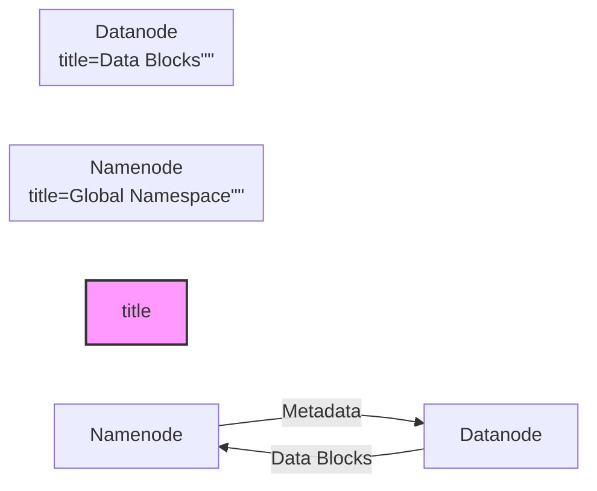
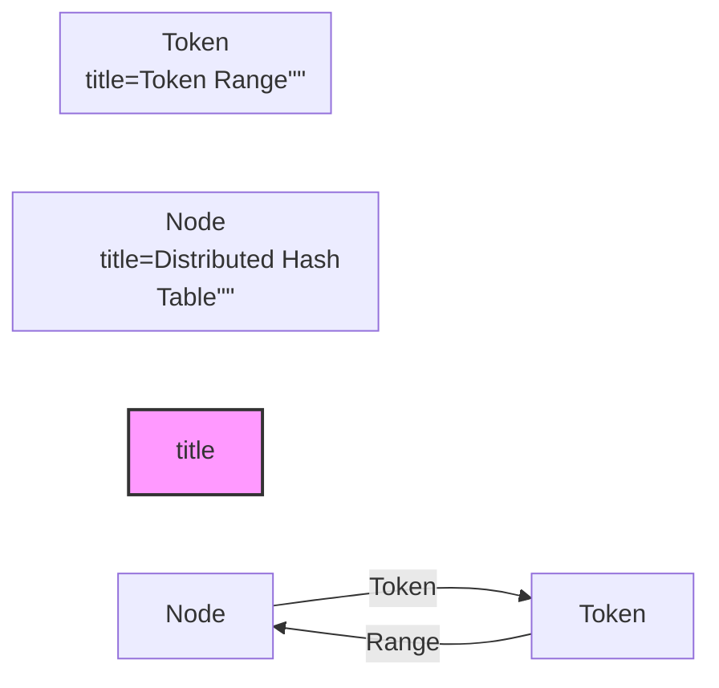
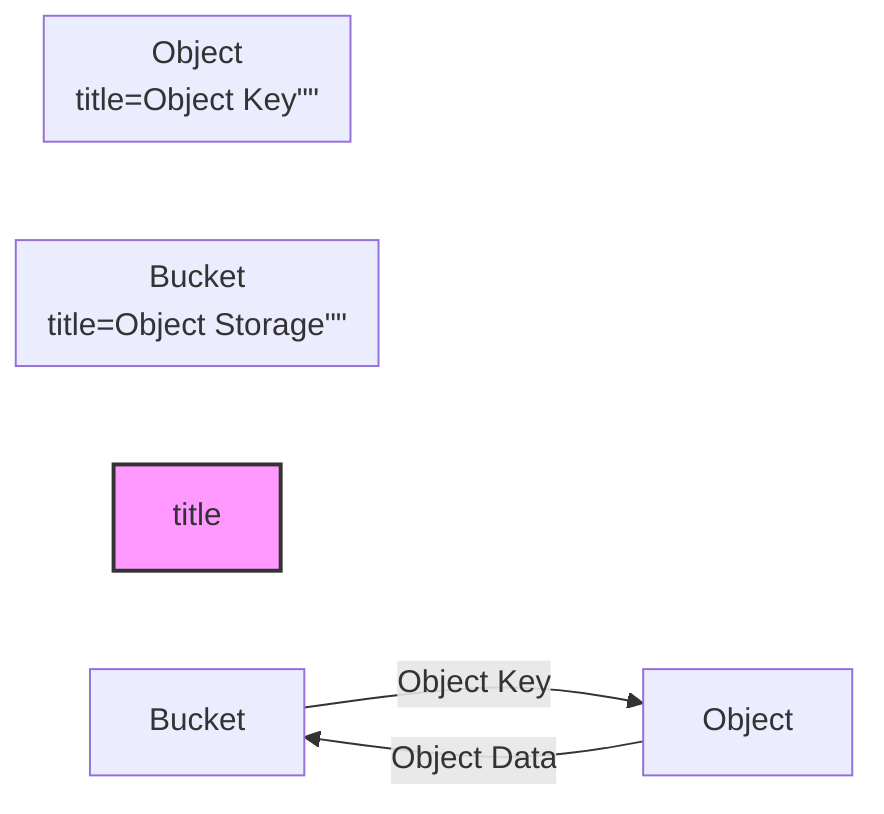

# Lesson 4: Data Storage Solutions

## 1. First-Principles Intuition & Invariants

Data storage solutions have become the backbone of modern computing, enabling the efficient and scalable management of vast amounts of data. At their core, these systems rely on fundamental principles of computer science, including data structures, algorithms, and concurrency control. In this lesson, we'll delve into the theoretical underpinnings of popular storage solutions, including HDFS, Cassandra, and Amazon S3.

To begin, let's consider the problem space of data storage. As data volumes grow exponentially, traditional storage solutions become increasingly inefficient. This is where distributed storage systems come into play, leveraging the collective power of multiple nodes to provide scalable, fault-tolerant, and high-performance storage. The key invariant in these systems is the ability to distribute data across multiple nodes while maintaining data consistency and integrity.

Mathematically, we can represent the data storage problem as a graph, where nodes represent storage devices and edges represent data transfer between nodes. The goal is to minimize the number of edges (data transfer) while maximizing data availability and consistency. This is achieved through the use of distributed hash tables (DHTs), which enable efficient data distribution and retrieval.

## 2. Core Architecture & Mechanics

Let's dissect the internal architecture of each storage solution, highlighting key data structures, algorithms, and execution models.

### HDFS (Hadoop Distributed File System)

HDFS is a distributed storage system designed for large-scale data processing. At its core lies the concept of a Namenode, which maintains a global namespace and metadata for the entire cluster. The DataNode, on the other hand, is responsible for storing and retrieving data blocks.

HDFS uses a simple replication strategy, where each data block is replicated across multiple DataNodes. This ensures data availability and fault tolerance.

### Cassandra

Cassandra is a NoSQL database designed for high availability and scalability. Its architecture revolves around the concept of a distributed hash table (DHT), which enables efficient data distribution and retrieval.

Cassandra uses a token-based approach to distribute data across nodes. Each node is responsible for a specific range of tokens, ensuring that data is evenly distributed across the cluster.

### Amazon S3

Amazon S3 is a cloud-based object storage solution designed for high scalability and availability. Its architecture revolves around the concept of a distributed hash table (DHT), which enables efficient data distribution and retrieval.

S3 uses a simple replication strategy, where each object is replicated across multiple Availability Zones (AZs). This ensures data availability and fault tolerance.

## 3. High-Performance Optimization & Failure Modes

In this section, we'll explore high-performance optimization techniques and failure modes for each storage solution.

### HDFS

HDFS uses a simple replication strategy to ensure data availability and fault tolerance. However, this comes at the cost of increased storage overhead. To optimize performance, HDFS uses a technique called "block caching," which caches frequently accessed data blocks in memory.

### Cassandra

Cassandra uses a token-based approach to distribute data across nodes. However, this can lead to hotspots and uneven data distribution. To optimize performance, Cassandra uses a technique called "ring placement strategy," which ensures that data is evenly distributed across nodes.

### Amazon S3

S3 uses a simple replication strategy to ensure data availability and fault tolerance. However, this can lead to increased storage overhead. To optimize performance, S3 uses a technique called "object versioning," which enables efficient data retrieval and caching.

In conclusion, data storage solutions have become the backbone of modern computing, enabling the efficient and scalable management of vast amounts of data. By understanding the theoretical underpinnings of popular storage solutions, including HDFS, Cassandra, and Amazon S3, we can optimize performance and ensure high availability and fault tolerance.
