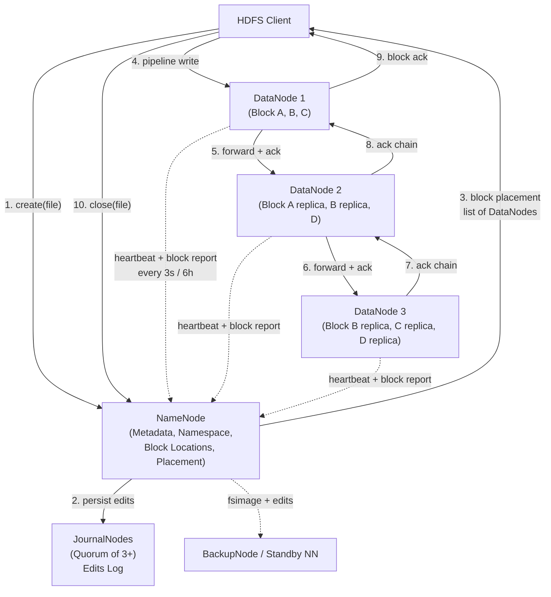
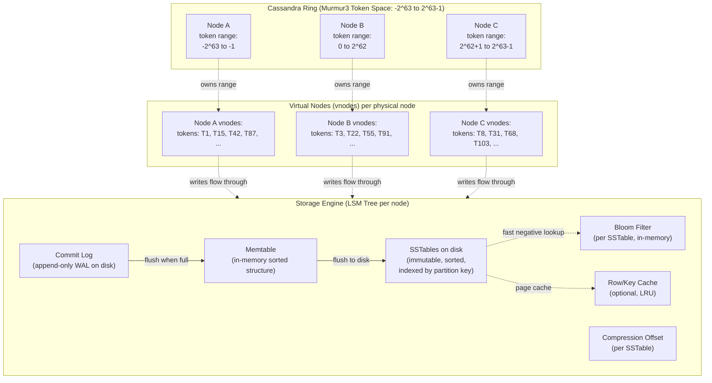
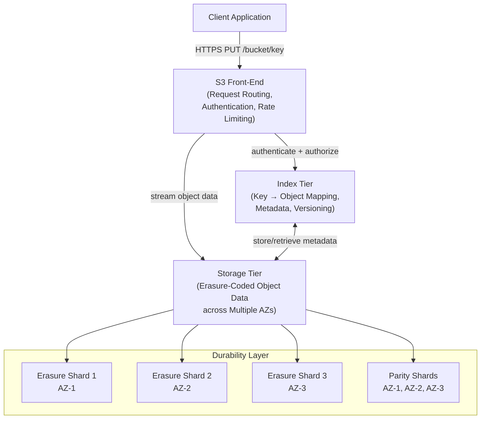
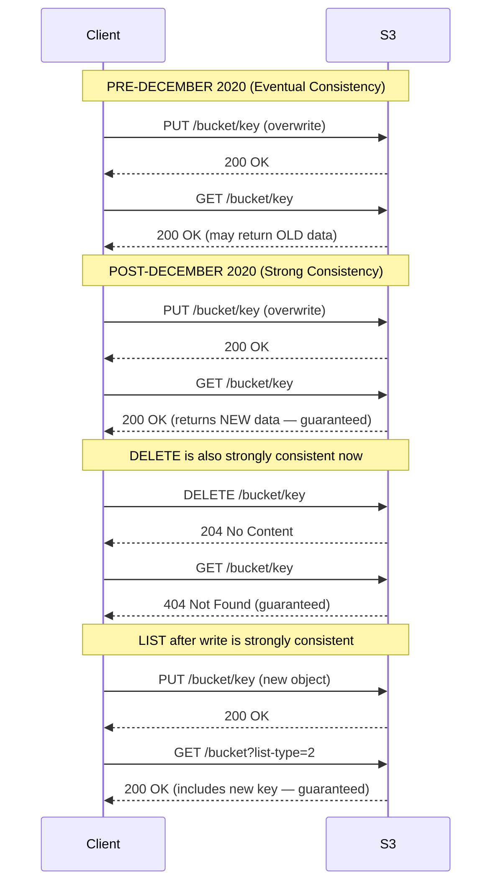
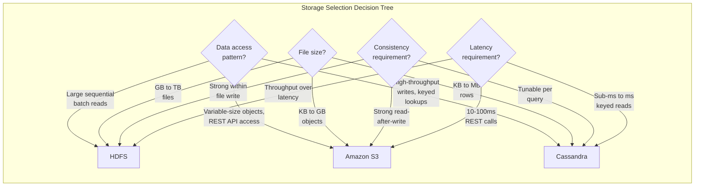

# Lesson 4: Data Storage Solutions for Big Data

## 1. First-Principles Intuition & Invariants

### The Fundamental Problem

A single machine has finite storage, finite memory, and finite bandwidth. When data exceeds these limits, we must distribute it across multiple machines. This introduces a combinatorial explosion of failure modes: network partitions, disk failures, silent data corruption, clock skew, and partial writes. Every distributed storage system is an exercise in managing these failure modes under specific workload constraints.

The core tension in distributed storage is captured by the **CAP theorem** (Brewer's conjecture, proved by Gilbert and Lynch, 2002): a distributed system can provide at most two of three guarantees simultaneously — **consistency** (all nodes see the same data), **availability** (every request receives a non-error response), and **partition tolerance** (the system operates despite network failures between nodes). Since network partitions are unavoidable in physically distributed systems, partition tolerance is non-negotiable. This means real systems choose between **CP** (sacrifice availability during partitions) and **AP** (sacrifice consistency during partitions).

The systems examined here make different choices:

| System | CAP Classification | Consistency Model | Partitioning Strategy |
|--------|-------------------|-------------------|----------------------|
| HDFS | CP (strong within a file) | Read-after-write for writes, eventual for replica convergence | Block-based, rack-aware placement |
| Cassandra | AP (tunable) | Tunable consistency (ONE to ALL) | Hash partitioning with vnodes |
| Amazon S3 | AP (strong read-after-write since 2020) | Strong read-after-write, strong consistency for list operations | Object-based, erasure-coded across AZs |

### The Invariants

Three invariants govern distributed storage design:

1. **Durability invariant**: Once a write is acknowledged to a client, it survives across N simultaneous disk or node failures, where N is determined by the replication or erasure-coding parameters. This requires writing data to independent failure domains before acknowledging.

2. **Consistency invariant**: A read returns either the latest acknowledged write or a value that is causally consistent with the client's observed history. The strictness of this invariant is tunable in systems like Cassandra via consistency levels.

3. **Locality invariant**: Data is placed physically close to the computation that processes it, minimizing network I/O. This is why HDFS co-locates MapReduce tasks with data blocks, and why Cassandra's token-aware driver routes requests to the replica owning the data.

### Replication vs. Erasure Coding

Two strategies provide fault tolerance:

**Replication** stores K identical copies of data across K failure domains. Storage overhead is K×. Read latency is minimized (any single replica can serve a read). This is the dominant strategy for systems requiring low-latency reads.

**Erasure coding** splits data into N data shards and M parity shards (RS(N+M, N)). Storage overhead is (N+M)/N. It tolerates M simultaneous failures. Reconstruction of a lost shard requires reading N surviving shards — a read amplification of N×. Erasure coding trades read latency and CPU cost for storage efficiency.

```text
Replication (3x):     [A][A][A]           Storage: 300%, Fail tolerance: 2
Erasure coding (10+4): [A1][A2]...[A10][P1][P2][P3][P4]  Storage: 140%, Fail tolerance: 4
```

HDFS uses replication by default (factor 3) but supports Reed-Solomon erasure coding (e.g., RS-6-3) since Hadoop 3.0. S3 uses erasure coding internally across multiple availability zones, achieving 11 nines of durability at roughly 1.5× storage overhead rather than 3×.

## 2. Core Architecture & Mechanics

### HDFS (Hadoop Distributed File System)

HDFS is a write-once, read-many-times distributed file system optimized for sequential access to large files (gigabytes to terabytes). It trades low-latency random access for high-throughput batch processing.

#### Architecture

The system has a single-writer metadata architecture and a multi-reader data architecture:



#### NameNode Internals

The NameNode holds the entire filesystem namespace in RAM. This is the central architectural constraint of HDFS: the total number of files, directories, and blocks is bounded by the NameNode's heap size. Each block reference consumes approximately 300 bytes of heap. A NameNode with 64GB of heap can manage roughly 200 million blocks.

The NameNode persists two data structures:

- **fsimage**: A checkpoint snapshot of the entire namespace and block-to-DataNode mapping. Written periodically (every hour by default or when the edits log exceeds a threshold).
- **edits log**: A write-ahead journal of every namespace mutation (file creation, deletion, replication changes). This is written to a quorum of JournalNodes (typically 3 or 5) using a Paxos-like consensus protocol to ensure the NameNode's metadata survives a NameNode failure.

On restart, the NameNode replays the edits log on top of the latest fsimage to reconstruct the current namespace state. High Availability (HA) configurations use a Standby NameNode that continuously applies the edits log and maintains an up-to-date fsimage, enabling failover in seconds rather than minutes.

#### DataNode Internals

DataNodes store blocks as files on the local filesystem. The default block size is 128 MB (Hadoop 2+). A block is the unit of replication, the unit of checksum verification, and the unit of report to the NameNode.

Each block has an associated CRC32 checksum file. On read, the DataNode verifies the checksum; on failure, it reports a corrupt block to the NameNode, which schedules re-replication from a healthy replica.

DataNodes send heartbeats every 3 seconds to the NameNode. A DataNode is declared dead after 10 minutes (configurable via `dfs.namenode.heartbeat.recheck-interval`) without a heartbeat, and its blocks are re-replicated to restore the target replication factor.

#### Block Placement Policy

HDFS uses a rack-aware block placement strategy to balance fault tolerance and read bandwidth:

- **Replica 1**: Placed on the client's local DataNode (write locality).
- **Replica 2**: Placed on a DataNode in a different rack.
- **Replica 3**: Placed on a different DataNode in the same rack as Replica 2.
- **Additional replicas**: Random placement across racks.

This placement ensures that a single rack failure does not destroy all replicas (Replica 1 and at least one other are on different racks), while keeping a rack-local replica for fast reads within a rack. The client reads from the nearest replica, preferring rack-local over rack-remote.

#### HDFS Code Example: File Read with Block Locality

```java
import org.apache.hadoop.conf.Configuration;
import org.apache.hadoop.fs.FileSystem;
import org.apache.hadoop.fs.Path;
import org.apache.hadoop.fs.FSDataInputStream;
import org.apache.hadoop.fs.BlockLocation;
import org.apache.hadoop.fs.LocatedFileStatus;
import org.apache.hadoop.fs.RemoteIterator;

import java.io.IOException;
import java.io.OutputStream;

/**
 * Demonstrates HDFS file operations with block locality awareness.
 * Shows how to inspect block locations — critical for data-locality-aware
 * computation (e.g., MapReduce, Spark).
 */
public class HdfsBlockInspection {

    public static void main(String[] args) throws IOException {
        Configuration conf = new Configuration();
        // NameNode URI — set in core-site.xml or programmatically
        conf.set("fs.defaultFS", "hdfs://namenode:8020");

        try (FileSystem fs = FileSystem.get(conf)) {
            Path filePath = new Path("/data/large_dataset.parquet");

            // Inspect block locations before launching computation
            RemoteIterator<LocatedFileStatus> iter = fs.listFiles(filePath, false);
            while (iter.hasNext()) {
                LocatedFileStatus status = iter.next();
                BlockLocation[] blocks = status.getBlockLocations();

                for (BlockLocation block : blocks) {
                    System.out.printf("Block offset: %d, length: %d%n",
                        block.getOffset(), block.getLength());
                    System.out.printf("  Hosts: %s%n",
                        String.join(", ", block.getHosts()));
                    System.out.printf("  Names (DataNode Xfer ports): %s%n",
                        String.join(", ", block.getNames()));
                    System.out.printf("  Rack: %s%n",
                        String.join(", ", block.getTopologyPaths()));
                }
            }

            // Read with explicit seek to block boundary
            try (FSDataInputStream in = fs.open(filePath)) {
                // seek to a specific offset — HDFS supports random read within a block
                in.seek(1024 * 1024 * 128); // skip first block (128 MB)
                byte[] buffer = new byte[4096];
                int bytesRead = in.read(buffer);
                System.out.printf("Read %d bytes from block 2%n", bytesRead);
            }
        }
    }
}
```

#### Write Pipeline Mechanics

HDFS writes follow a pipeline pattern. For replication factor 3, the client writes to DataNode A, which forwards to DataNode B, which forwards to DataNode C. Acknowledgments flow in reverse: C acks to B, B acks to A, A acks to the client. This pipeline approach provides durability without the client needing to write to all replicas independently. The pipeline is transparent to the client — it sees a single stream.

The client maintains a write buffer (default 64 KB) and flushes packets to the pipeline. Each packet includes a sequence number and data checksum. DataNodes verify the checksum on receipt. If a DataNode in the pipeline fails, the pipeline is reconstructed without it, and the NameNode marks the failed DataNode for re-replication.

### Cassandra

Apache Cassandra is a decentralized, masterless, eventually consistent distributed database inspired by Amazon's Dynamo (partitioning, replication) and Google's Bigtable (storage engine, data model). It is classified as a wide-column store.

#### Architecture: Decentralized Ring

Cassandra has no master node. Every node is functionally equal and accepts both reads and writes. Data placement is determined by a **partitioner** that hashes the partition key to produce a **token**, which maps to a position on a 64-bit ring (Murmur3Partitioner is the default, using MurmurHash3).



#### Virtual Nodes (vnodes)

Early Cassandra assigned each physical node a single token range. Adding or removing a node required manual rebalancing. **vnodes** (default 256 per node since Cassandra 1.2) solve this: each physical node owns many small token ranges randomly distributed across the ring. Adding a node simply transfers a proportional number of vnode ranges from existing nodes, and removal distributes the departing node's vnodes across remaining nodes. vnodes also improve load balancing because data is statistically distributed more evenly across the cluster regardless of physical node capacity.

#### Replication Strategy

Cassandra uses a **replication factor (RF)** and a **replication strategy**:

- **SimpleStrategy**: Places replicas on the next N nodes in ring order, ignoring topology. Used only in development.
- **NetworkTopologyStrategy**: Places replicas across racks and data centers. Within a data center, it places one replica per rack (when possible), preventing rack-level correlated failures. Across data centers, it respects a per-DC replication factor, enabling multi-DC active-active deployments.

For a key K with RF=3 and NetworkTopologyStrategy in a single DC with 3 racks, the primary replica (determined by the token) and two additional replicas are placed on different racks. Any single rack failure leaves at least 2 of 3 replicas available.

#### Storage Engine: LSM Tree

Cassandra uses a Log-Structured Merge (LSM) tree, not a B-tree. This is the key architectural decision that gives Cassandra its high write throughput.

**Write path:**
1. The write is appended to the **commit log** (an append-only write-ahead log on disk) for durability.
2. The write is inserted into the **memtable** (an in-memory sorted structure keyed by partition key).
3. The client receives an acknowledgment. No synchronous disk write of the actual data is required — the commit log append is the only disk I/O on the write path (and can be batched/synced periodically).
4. When the memtable is full (configurable via `memtable_flush_writers` and `memtable_allocation_type`), it is flushed to an immutable **SSTable** (Sorted-String Table) on disk, and the corresponding commit log segment is discarded.

**Read path:**
1. Check the **row cache** (if enabled).
2. Check the active **memtable**.
3. Check all **SSTables** that may contain the key, using a **Bloom filter** to skip SSTables that definitively do not contain the key (fast negative lookup).
4. For SSTables that pass the Bloom filter, use the partition index to locate the key on disk.
5. Merge the results from memtable and all SSTables, resolving tombstones (deletion markers) and cell timestamps.

**Compaction:** As SSTables accumulate, read performance degrades (more files to check). Compaction merges multiple SSTables into fewer, larger ones, discarding overwritten and tombstoned data. Strategies include:

- **Size-Tiered Compaction Strategy (STCS)**: Triggers compaction when N (default 4) SSTables of similar size exist. Good for write-heavy workloads, but can cause read amplification due to many similarly-sized SSTables.
- **Leveled Compaction Strategy (LCS)**: Maintains levels where each level is 10× the size of the previous and SSTables within a level have non-overlapping key ranges. Minimizes read amplification but increases write amplification (each SSTable is compacted into the next level multiple times).
- **Time-Window Compaction Strategy (TWCS)**: Groups SSTables by time window (e.g., 1 day). Compacts within each window. Designed for time-series workloads where old data is rarely read.

#### Consistency Levels

Cassandra's tunable consistency is the mechanism by which clients trade latency for correctness on each individual operation:

| Consistency Level | Meaning | Reads | Writes |
|-------------------|---------|-------|--------|
| ONE | Nearest replica | Fastest, may return stale data | Fastest, may lose data on failure |
| LOCAL_ONE | Nearest replica in local DC | Same as ONE but DC-aware | Same |
| QUORUM | Majority (N/2 + 1) across all DCs | Stale read impossible if < RF/2 nodes fail | Durable if < RF/2 nodes fail |
| LOCAL_QUORUM | Majority in local DC | Stale read impossible within local DC | Durable within local DC |
| ALL | Every replica | Slowest, strongest | Slowest, strongest |
| SERIAL / LOCAL_SERIAL | Lightweight transaction (Paxos) | Linearizable reads | Linearizable writes |

The mathematical basis: with RF replicas, a quorum is ⌈(RF+1)/2⌉. For RF=3, quorum is 2. If a read and a write both use QUORUM, they must overlap in at least one replica, ensuring the read sees the write (strong consistency per-operation despite the system being AP overall).

#### Cassandra Code Example: Tunable Consistency with the DataStax Java Driver

```java
import com.datastax.oss.driver.api.core.CqlSession;
import com.datastax.oss.driver.api.core.cql.SimpleStatement;
import com.datastax.oss.driver.api.core.cql.PreparedStatement;
import com.datastax.oss.driver.api.core.cql.BoundStatement;
import com.datastax.oss.driver.api.core.ConsistencyLevel;
import com.datastax.oss.driver.api.core.cql.ResultSet;
import com.datastax.oss.driver.api.core.cql.Row;

import java.net.InetSocketAddress;
import java.util.UUID;

/**
 * Demonstrates Cassandra's tunable consistency model.
 * The same query can use different consistency levels depending on the
 * semantic requirements of the specific operation.
 */
public class CassandraConsistencyDemo {

    public static void main(String[] args) {
        try (CqlSession session = CqlSession.builder()
                .addContactPoint(new InetSocketAddress("cassandra-node1", 9042))
                .addContactPoint(new InetSocketAddress("cassandra-node2", 9042))
                .withKeyspace("store")
                .build()) {

            // Schema: partition key is user_id, clustering key is created_at
            // This allows efficient time-range scans within a user's partition
            session.execute("""
                CREATE TABLE IF NOT EXISTS store.orders (
                    user_id     UUID,
                    created_at  TIMESTAMP,
                    order_id    UUID,
                    amount      DECIMAL,
                    status      TEXT,
                    PRIMARY KEY ((user_id), created_at)
                ) WITH CLUSTERING ORDER BY (created_at DESC)
                  AND compaction = {
                      'class': 'TimeWindowCompactionStrategy',
                      'compaction_window_unit': 'DAYS',
                      'compaction_window_size': '1'
                  }
            """);

            // Write with LOCAL_QUORUM — durable within the local DC
            // This means 2 of 3 replicas (RF=3) must ack before client proceeds
            PreparedStatement writeStmt = session.prepare("""
                INSERT INTO store.orders (user_id, created_at, order_id, amount, status)
                VALUES (?, ?, ?, ?, ?)
            """);

            BoundStatement durableWrite = writeStmt.bind()
                .setUuid(0, UUID.randomUUID())
                .setInstant(1, java.time.Instant.now())
                .setUuid(2, UUID.randomUUID())
                .setBigDecimal(3, new java.math.BigDecimal("99.99"))
                .setString(4, "PENDING")
                .setConsistencyLevel(ConsistencyLevel.LOCAL_QUORUM);

            session.execute(durableWrite);

            // Read with ONE — fastest, accepts potential stale read
            // Appropriate for a dashboard that tolerates eventual consistency
            PreparedStatement readStmt = session.prepare("""
                SELECT * FROM store.orders
                WHERE user_id = ?
                ORDER BY created_at DESC
                LIMIT 10
            """);

            BoundStatement fastRead = readStmt.bind()
                .setUuid(0, durableWrite.getUuid(0))
                .setConsistencyLevel(ConsistencyLevel.ONE);

            ResultSet results = session.execute(fastRead);
            for (Row row : results) {
                System.out.printf("Order %s: %s %s%n",
                    row.getUuid("order_id"),
                    row.getBigDecimal("amount"),
                    row.getString("status"));
            }

            // Read with LOCAL_SERIAL — linearizable read using lightweight
            // transactions (Paxos consensus). Use only when correctness is
            // critical; this is ~4x slower than a normal read.
            SimpleStatement serialRead = SimpleStatement.builder(
                "SELECT status FROM store.orders WHERE user_id = ? AND created_at = ?")
                .addPositionalValue(durableWrite.getUuid(0))
                .addPositionalValue(durableWrite.getInstant(1))
                .setConsistencyLevel(ConsistencyLevel.LOCAL_SERIAL)
                .build();

            Row serialRow = session.execute(serialRead).one();
            if (serialRow != null) {
                System.out.println("Serial read status: " + serialRow.getString("status"));
            }
        }
    }
}
```

#### Cassandra Code Example: Token-Aware Routing in Go

```go
package main

import (
	"context"
	"fmt"
	"log"

	"github.com/gocql/gocql"
)

// Token-aware routing connects to the node that owns the data,
// eliminating a network hop through a coordinator node.
// The gocql driver computes the token for a partition key
// and routes directly to a replica, provided TokenAwareHostPolicy is set.

func main() {
	cluster := gocql.NewCluster("cassandra-node1", "cassandra-node2", "cassandra-node3")
	cluster.Keyspace = "store"
	cluster.Consistency = gocql.LocalQuorum
	cluster.NumConns = 2
	cluster.ReconnectInterval = 30 * 1e9 // 30s

	// Enable token-aware routing — the driver hashes partition keys
	// with the same partitioner (Murmur3) as the cluster, then opens
	// the connection to the replica owning that token range.
	cluster.PoolConfig.HostSelectionPolicy = gocql.TokenAwareHostPolicy(
		gocql.DCAwareRoundRobinPolicy("datacenter1"),
	)

	session, err := cluster.CreateSession()
	if err != nil {
		log.Fatalf("session creation failed: %v", err)
	}
	defer session.Close()

	ctx := context.Background()

	// Batched write with LOCAL_QUORUM — atomic across a single partition
	batch := session.NewBatch(gocql.UnloggedBatch)
	batch.SetConsistency(gocql.LocalQuorum)

	for i := 0; i < 1000; i++ {
		batch.Query(
			"INSERT INTO store.events (user_id, event_time, event_type, payload) VALUES (?, ?, ?, ?)",
			gocql.UUID{},     // user_id — partition key
			gocql.UUID{},     // event_time — clustering key
			"click",
			fmt.Sprintf(`{"x": %d, "y": %d}`, i, i*2),
		)
	}

	if err := session.ExecuteBatch(batch); err != nil {
		log.Fatalf("batch write failed: %v", err)
	}

	fmt.Println("Batch write completed with LOCAL_QUORUM consistency")
}
```

### Amazon S3

Amazon S3 is an object storage service with a flat namespace (bucket/key). It is not a filesystem — there are no directories, no partial writes, no file locks, and no append operations. Objects are immutable once written. S3 provides strong read-after-write consistency (since December 2020) for all operations: PUT, overwrite PUT, DELETE, and list-after-write.

#### Architecture and Internal Design

S3's internal architecture is not publicly documented in full, but Amazon has disclosed key design decisions through re:Invent talks, academic papers (specifically the Dynamo paper which influenced some internal components), and operational disclosures. The following reflects what is publicly known.



Key design properties:

- **Erasure coding**: S3 stores objects using erasure coding across multiple availability zones. This achieves 11 nines of durability (99.999999999%) at significantly lower storage overhead than 3× replication. The system can reconstruct objects even if multiple shards are lost.

- **Separation of metadata and data**: The index tier maps object keys to the physical location of erasure-coded shards and stores metadata (size, creation time, user metadata, versioning state). The storage tier holds the object data itself. This separation allows independent scaling of metadata lookup throughput and data storage capacity.

- **Flat namespace**: S3 has no real directory hierarchy. A key like `s3://bucket/year/2024/month/01/data.csv` is a single string. The "/" characters are lexical delators that the API uses for prefix-based listing, but there is no directory inode. Prefix-based listing is implemented via range scans on the sorted key space.

- **Strong consistency (post-2020)**: Before December 2020, S3 provided eventual consistency for overwrite PUTs and DELETEs. Amazon retrofitted strong read-after-write consistency by reordering internal operations: the index tier updates synchronously with the data tier commit, and reads consult the index tier for the latest version.

#### S3 Storage Classes and Lifecycle

S3 offers multiple storage classes that trade retrieval latency and cost for durability and availability guarantees:

| Storage Class | Use Case | Retrieval | Cost |
|--------------|----------|-----------|------|
| S3 Standard | Frequently accessed data | milliseconds | Highest |
| S3 Standard-IA | Infrequently accessed data | milliseconds | Lower storage, retrieval fee |
| S3 Intelligent-Tiering | Unknown access patterns | milliseconds (or delayed) | Auto-tiering with monitoring fee |
| S3 Glacier Instant Retrieval | Archive, accessed yearly | milliseconds | Very low storage |
| S3 Glacier Flexible Retrieval | Long-term archive | minutes to hours | Lowest storage |
| S3 Glacier Deep Archive | Compliance archive | hours | Absolute lowest |
| S3 One Zone-IA | Recreatable, non-critical data | milliseconds | Single AZ, lowest non-glacier |

Lifecycle policies automatically transition objects between classes based on age or prefix, reducing cost without manual intervention.

#### S3 Code Example: Multipart Upload with Retry and Range Read

```python
"""
Production-grade S3 operations: multipart upload for large objects,
range-based reads for partial data retrieval, and exponential backoff
retry logic.

Multipart upload is critical for objects > 100 MB and required for
objects > 5 GB. It enables parallel uploads and resumable transfers.
"""

import boto3
import os
import hashlib
import time
from botocore.config import Config
from botocore.exceptions import ClientError

# Configured for high-throughput, fault-tolerant operations
s3_client = boto3.client(
    "s3",
    config=Config(
        max_pool_connections=50,         # connection pool for concurrent parts
        retries={"max_attempts": 10, "mode": "adaptive"},
        tcp_keepalive=True,
        connect_timeout=5,
        read_timeout=60,
    ),
)

BUCKET = "my-data-lake"
PART_SIZE = 8 * 1024 * 1024  # 8 MB per part — balance between memory and API calls


def multipart_upload_with_retry(filepath: str, key: str) -> str:
    """
    Uploads a large file using multipart upload with per-part retry.
    Each part is uploaded independently and can be retried on failure.
    The upload is only finalized when all parts succeed, ensuring
    atomicity — either the complete file is in S3 or nothing is.
    """
    file_size = os.path.getsize(filepath)

    # Initiate multipart upload — returns an upload ID that ties all parts together
    response = s3_client.create_multipart_upload(Bucket=BUCKET, Key=key)
    upload_id = response["UploadId"]
    parts = []  # accumulates {"PartNumber": N, "ETag": "..."} for each part

    try:
        part_number = 1
        with open(filepath, "rb") as f:
            while True:
                data = f.read(PART_SIZE)
                if not data:
                    break

                # Retry each part with exponential backoff
                for attempt in range(5):
                    try:
                        part_response = s3_client.upload_part(
                            Bucket=BUCKET,
                            Key=key,
                            PartNumber=part_number,
                            UploadId=upload_id,
                            Body=data,
                        )
                        parts.append({
                            "PartNumber": part_number,
                            "ETag": part_response["ETag"],
                        })
                        break
                    except ClientError as e:
                        if attempt == 4:
                            raise
                        wait = 2 ** attempt
                        time.sleep(wait)

                part_number += 1

        # Complete the upload — S3 assembles parts in order
        s3_client.complete_multipart_upload(
            Bucket=BUCKET,
            Key=key,
            UploadId=upload_id,
            MultipartUpload={"Parts": parts},
        )

        # Compute checksum for verification
        with open(filepath, "rb") as f:
            local_md5 = hashlib.md5(f.read()).hexdigest()

        head = s3_client.head_object(Bucket=BUCKET, Key=key)
        print(f"Upload complete: {key}")
        print(f"  Size: {head['ContentLength']} bytes")
        print(f"  Local MD5:  {local_md5}")

        return upload_id

    except Exception as e:
        # Abort the multipart upload — S3 will delete uploaded parts
        # and charge nothing (within the 1-week orphan threshold)
        s3_client.abort_multipart_upload(Bucket=BUCKET, Key=key, UploadId=upload_id)
        raise


def range_read(key: str, start: int, end: int) -> bytes:
    """
    Reads a byte range from an S3 object without downloading the entire object.
    Critical for reading specific Parquet row groups or ORC stripes from
    large files without pulling terabytes of data over the network.
    """
    response = s3_client.get_object(
        Bucket=BUCKET,
        Key=key,
        Range=f"bytes={start}-{end}",  # inclusive on both ends
    )
    return response["Body"].read()


if __name__ == "__main__":
    # Upload a large file
    multipart_upload_with_retry("/data/huge_dataset.parquet", "datasets/huge.parquet")

    # Read only the first 1 KB (e.g., Parquet footer metadata)
    header = range_read("datasets/huge.parquet", 0, 1023)
    print(f"Read {len(header)} bytes from range read")
```

#### S3 Consistency Model: Before and After December 2020



## 3. Comparative Analysis: When to Use What



| Dimension | HDFS | Cassandra | Amazon S3 |
|-----------|------|-----------|-----------|
| Data model | Files and blocks | Wide-column (partition key + clustering key) | Flat key/object |
| Consistency | Strong for writes, eventual for replica sync | Tunable per operation (ONE to ALL) | Strong read-after-write |
| Write path | Pipeline to 3 DataNodes + commit log on NameNode | Commit log append + memtable insert | PUT to erasure-coded storage |
| Read path | Direct to nearest DataNode replica | Memtable + SSTables (Bloom filter + merge) | Direct GET from storage tier |
| Failure tolerance | Tolerates 2 DataNode failures (RF=3), 1 NameNode failure (HA) | Tolerates RF-1 node failures per partition | 11 nines via multi-AZ erasure coding |
| Scaling model | Scale DataNodes horizontally, NameNode is bottleneck | Scale all nodes horizontally (no master) | Transparent, fully managed |
| Latency | 10-100ms (network + disk) | Sub-ms to ms (with caching) | 10-100ms (REST API overhead) |
| Storage overhead | 3× (replication) or ~1.5× (erasure coding) | RF × data size | ~1.5× (erasure coding, internal) |
| Primary use case | Batch analytics (MapReduce, Spark, Hive) | Operational, high-write-throughput workloads | Data lake, backup, archival, content delivery |

## 4. High-Performance Optimization & Failure Modes

### HDFS

**Short-circuit reads**: When a reader is co-located on the same machine as a DataNode holding the target block, the reader can bypass TCP and read directly from the DataNode's local disk via a Unix domain socket. This eliminates a full TCP loopback round-trip and double-buffering. Enable via `dfs.client.read.shortcircuit = true`.

**Centralized cache management**: Hadoop 2.3+ introduced explicit in-memory caching at the DataNode level. The NameNode maintains a cache directive map — administrators can pin specific files or directories in DataNode memory. This is not OS page cache; it is an explicit off-heap memory reservation. Read requests for cached blocks are served from memory without disk I/O.

**Failure mode — NameNode memory exhaustion**: The NameNode holds all metadata in RAM. If the number of small files exceeds the heap capacity, the NameNode garbage-collects excessively, stalls, or crashes. This is called the "small files problem" and is the most common HDFS failure mode. Mitigation: combine small files into larger containers (e.g., Parquet, SequenceFile, HAR files), increase heap, or migrate to Hadoop Ozone (object storage on HDFS).

**Failure mode — corrupted block with insufficient replicas**: If all replicas of a block are on DataNodes that fail simultaneously (e.g., a rack power failure affecting replicas 2 and 3 while replica 1 was already marked corrupt), the block is permanently lost. HDFS reports this as an "under-replicated block" with a count of 0. This is rare with proper rack placement but possible. Mitigation: enable erasure coding for cold data, which provides higher failure tolerance at lower storage cost.

### Cassandra

**Compaction strategies and write amplification**: Leveled Compaction Strategy minimizes read amplification but increases write amplification dramatically. For a workload with a 10 TB dataset, LCS can produce 10× write amplification (each byte is rewritten ~10 times as it cascades through levels). This saturates disk I/O and reduces effective write throughput. Time-Window Compaction Strategy is the correct choice for time-series workloads because it limits compaction to SSTables within the same time window, preventing cross-day merges.

**Failure mode — tombstones and read amplification**: Cassandra does not immediately delete data. It writes a tombstone marker. Reads must merge live data and tombstones to determine the current state. If a partition accumulates many tombstones (e.g., frequent updates or deletes), reads become slow because the read path must scan all SSTables and merge tombstones. The threshold `tombstone_warn_threshold` (default 1000) and `tombstone_failure_threshold` (default 100,000) cause the node to log warnings or fail reads, respectively. Mitigation: use TTL (time-to-live) on writes so tombstones expire automatically and are purged during compaction. Avoid modeling frequently-updated entities as wide partitions.

**Failure mode — hotspots from bad partition key design**: If the partition key has low cardinality (e.g., a status column with 5 values), all writes for a given status land on a single node, creating a write hotspot. Conversely, if the partition key is a timestamp, writes distribute well but range scans become impossible. The correct partition key distributes writes evenly while grouping related data together. Use composite partition keys like `(user_id, bucket_date)` to balance distribution and query locality.

**Failure mode — hinted handoff backlog**: When a node is down, Cassandra stores writes destined for that node as "hints" on the coordinator nodes. When the node recovers, hints are replayed. If the node is down for a long time, hints accumulate and can exhaust coordinator disk space. The `max_hint_window_in_ms` (default 3 hours) limits how long hints are retained; writes beyond this window are simply dropped (the system remains available but data is lost for the unavailable node's partitions). For longer outages, use repair operations to reconcile differences.

### Amazon S3

**Multipart upload orphan cleanup**: If a multipart upload is initiated but never completed or aborted, S3 retains the uploaded parts and charges for their storage. The `AbortIncompleteMultipartUpload` lifecycle rule automatically aborts incomplete uploads after N days. Without this rule, abandoned multipart uploads can silently inflate storage costs.

**Failure mode — 503 Slow Down under high request rate**: S3 has per-prefix rate limits (historically 3,500 PUT/s and 5,500 GET/s per prefix, now much higher but still finite). If a workload writes millions of small objects to the same key prefix, S3 returns HTTP 503 Slow Down. Mitigation: distribute keys across prefixes by adding a hash prefix (e.g., `s3://bucket/{hash}/date/file`). This spreads writes across S3's internal partition space, which shards by key prefix.

**Failure mode — eventual consistency in cross-region replication**: S3 Cross-Region Replication (CRR) is asynchronous. A read in the destination region immediately after a write in the source region may not see the object. This is by design — CRR provides durability across regions, not synchronous consistency. Applications that require cross-region read-your-writes must use S3's newer replication features or implement application-level coordination.

**Optimization — S3 Select and Glacier Select**: For analytical workloads, S3 Select enables server-side filtering of CSV, JSON, or Parquet objects using SQL-like predicates. Only matching rows are transferred over the network, reducing data egress costs and read latency. Glacier Select applies the same principle to archived data, avoiding full retrieval.

## 5. Performance Benchmarking: Rust Example

```rust
//! Benchmarks sequential vs. concurrent S3 uploads to demonstrate
//! the impact of connection pooling and parallelism on throughput.
//! Uses the AWS SDK for Rust with tokio for async I/O.

use aws_config::load_from_env;
use aws_sdk_s3::Client as S3Client;
use aws_sdk_s3::primitives::ByteStream;
use std::time::Instant;
use tokio;

const BUCKET: &str = "benchmark-bucket";
const NUM_OBJECTS: usize = 100;
const OBJECT_SIZE: usize = 8 * 1024 * 1024; // 8 MB

#[tokio::main]
async fn main() {
    let config = load_from_env().await;
    let client = S3Client::new(&config);

    let payload = vec![0u8; OBJECT_SIZE];

    // Sequential upload baseline
    let start = Instant::now();
    for i in 0..NUM_OBJECTS {
        let key = format!("sequential/object_{}", i);
        client
            .put_object()
            .bucket(BUCKET)
            .key(&key)
            .body(ByteStream::from(payload.clone()))
            .send()
            .await
            .expect("upload failed");
    }
    let sequential_duration = start.elapsed();
    let sequential_throughput =
        (NUM_OBJECTS * OBJECT_SIZE) as f64 / sequential_duration.as_secs_f64() / 1_073_741_824.0;

    println!("Sequential: {} objects in {:.2}s ({:.2} GB/s)",
        NUM_OBJECTS,
        sequential_duration.as_secs_f64(),
        sequential_throughput,
    );

    // Concurrent upload — tokio tasks with bounded concurrency
    let start = Instant::now();
    let mut handles = Vec::new();

    for i in 0..NUM_OBJECTS {
        let client = client.clone();
        let key = format!("concurrent/object_{}", i);
        let payload = payload.clone();

        handles.push(tokio::spawn(async move {
            client
                .put_object()
                .bucket(BUCKET)
                .key(key)
                .body(ByteStream::from(payload))
                .send()
                .await
                .expect("upload failed");
        }));
    }

    for handle in handles {
        handle.await.expect("task panicked");
    }

    let concurrent_duration = start.elapsed();
    let concurrent_throughput =
        (NUM_OBJECTS * OBJECT_SIZE) as f64 / concurrent_duration.as_secs_f64() / 1_073_741_824.0;

    println!("Concurrent:  {} objects in {:.2}s ({:.2} GB/s)",
        NUM_OBJECTS,
        concurrent_duration.as_secs_f64(),
        concurrent_throughput,
    );

    let speedup = sequential_duration.as_secs_f64() / concurrent_duration.as_secs_f64();
    println!("Speedup:     {:.2}x", speedup);
}
```

## 6. Summary

HDFS, Cassandra, and S3 represent three distinct points in the distributed storage design space. HDFS optimizes for sequential throughput on large files with a centralized metadata architecture, accepting the NameNode as a scaling bottleneck. Cassandra optimizes for write throughput and multi-datacenter availability with a decentralized ring and LSM-tree storage engine, accepting compaction overhead and eventual consistency as the cost. S3 optimizes for massive-scale object storage with erasure coding and a flat namespace, accepting REST API latency and no partial-write semantics as the tradeoff.

The unifying principle across all three is that distributed storage is fundamentally about managing failure. Replication, erasure coding, commit logs, Bloom filters, and compaction are all mechanisms for maintaining the durability, consistency, and locality invariants in the face of disk failures, network partitions, and node crashes. The choice of which mechanisms to employ is determined by the workload's access patterns, latency requirements, and consistency guarantees.
