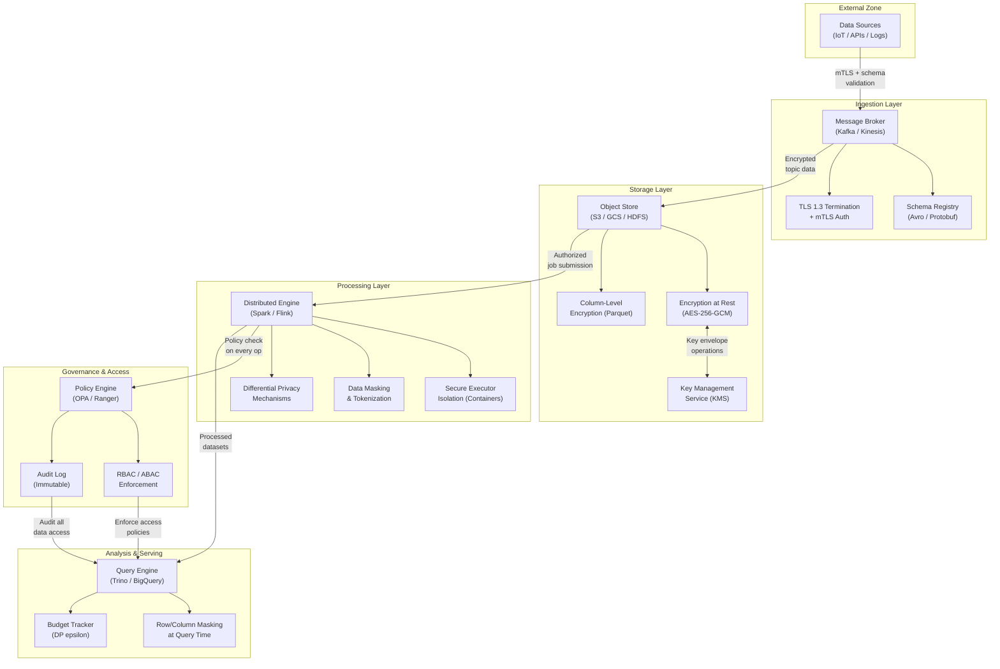
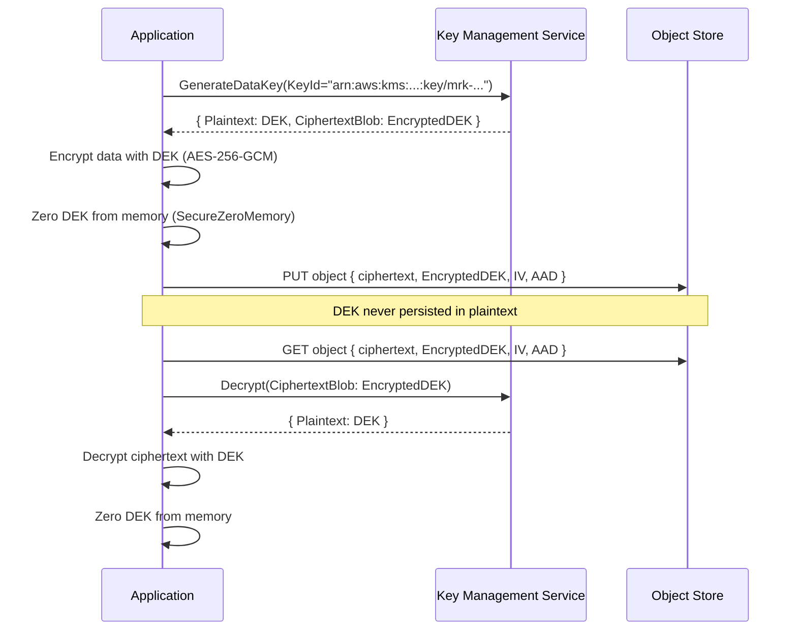
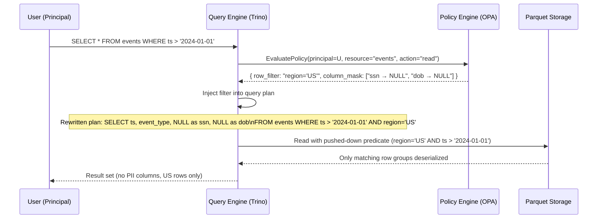
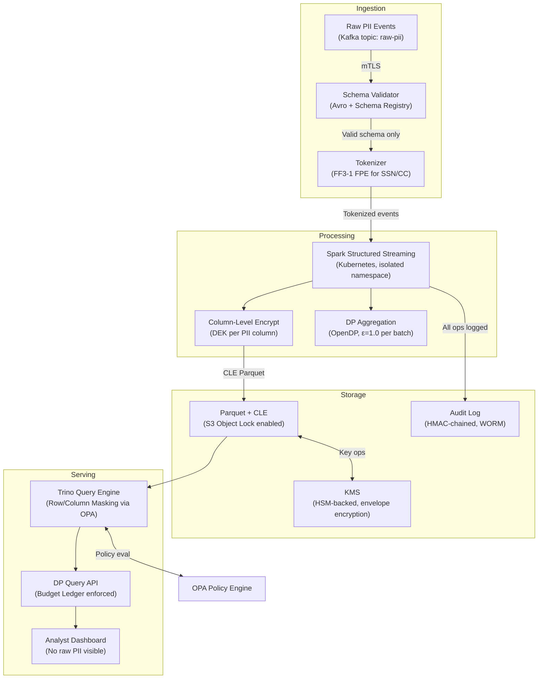

# Lesson 5: Data Security and Privacy in Big Data Systems

## 1. First-Principles Intuition & Invariants

Big data security is not simply "regular security at scale." The transition from gigabytes to petabytes introduces qualitative shifts in the threat model, the cost of cryptographic operations, and the statistical guarantees that privacy mechanisms can provide. Understanding *why* each invariant holds — not merely *that* it holds — is the prerequisite for designing systems that remain secure as data volumes grow by orders of magnitude.

### Information-Theoretic Foundations

Shannon entropy $H(X) = -\sum_{x} p(x) \log_2 p(x)$ quantifies the irreducible uncertainty in a random variable $X$. A system with high entropy requires an adversary to search a larger space to reconstruct secret information. This is not merely a heuristic — it is a hard lower bound. The source-coding theorem proves that no lossless compression scheme can represent $X$ with fewer than $H(X)$ bits per symbol on average, which means high-entropy keys resist brute-force search in a provable, information-theoretic sense.

The practical consequence for key management is direct: a 256-bit AES key drawn from a uniform distribution carries 256 bits of entropy. A "random" password derived from common English words may carry fewer than 40 bits of entropy even if its byte length exceeds 32. Key derivation functions (KDFs) like PBKDF2, bcrypt, Argon2id, and scrypt are specifically designed to consume attacker compute budget (via memory-hardness and iteration counts) to compensate for low-entropy human-chosen secrets.

### Cryptographic Invariants

**Confidentiality** is provided by symmetric ciphers. AES-256 in GCM mode (AES-256-GCM) is the canonical choice for data at rest and in transit because it simultaneously provides:

- Confidentiality via a 256-bit block cipher in counter mode
- Authenticity via a 128-bit GHASH-based MAC
- A single-pass construction that is SIMD-parallelizable on hardware supporting AES-NI

The architectural invariant is: *a ciphertext decrypts correctly if and only if both the key and the authentication tag match*. Any bit flip in the ciphertext causes decryption to fail with overwhelming probability ($1 - 2^{-128}$), not silently produce corrupt plaintext. This authenticated encryption with associated data (AEAD) property is non-negotiable for big data storage because silent data corruption at petabyte scale is statistically certain if MACs are omitted.

**Integrity without confidentiality** is served by cryptographic hash functions (SHA-256, SHA-3/BLAKE3) and HMACs. BLAKE3 is worth noting specifically: it is a Merkle tree construction that is natively parallelizable, achieving ~10 GB/s throughput on modern hardware versus SHA-256's ~0.5 GB/s without hardware acceleration, making it practical for integrity verification of large data blocks.

**Key exchange** in distributed big data systems relies on asymmetric cryptography. Elliptic Curve Diffie-Hellman Ephemeral (ECDHE) over Curve25519 is the modern standard. RSA is acceptable only with ≥2048-bit keys and OAEP padding; PKCS#1 v1.5 padding is vulnerable to Bleichenbacher's adaptive chosen-ciphertext attack and must not be used in new systems.

### Differential Privacy: The Formal Privacy Invariant

Differential privacy (DP) is the only mathematically rigorous definition of privacy for statistical databases. The formal definition: a randomized mechanism $\mathcal{M}$ satisfies $(\varepsilon, \delta)$-differential privacy if for all adjacent datasets $D$, $D'$ differing in exactly one record, and for all subsets $S$ of outputs:

$$\Pr[\mathcal{M}(D) \in S] \leq e^{\varepsilon} \cdot \Pr[\mathcal{M}(D') \in S] + \delta$$

The parameter $\varepsilon$ (epsilon, the "privacy budget") controls the privacy-utility tradeoff. When $\varepsilon = 0$, the mechanism's output distribution is identical regardless of any individual's data — perfect privacy but zero utility. When $\varepsilon$ is large, individual contributions become distinguishable. In practice, $\varepsilon \in [0.1, 10]$ with $\delta \leq 10^{-6}$ is considered acceptable, though the choice is domain-dependent.

The **Laplace mechanism** achieves $(\varepsilon, 0)$-DP for numeric queries by adding noise drawn from $\text{Lap}(0, \Delta f / \varepsilon)$, where $\Delta f$ is the $L_1$-sensitivity of the query function — the maximum change in query output caused by adding or removing one record. The **Gaussian mechanism** achieves $(\varepsilon, \delta)$-DP using $\mathcal{N}(0, \sigma^2)$ noise with $\sigma = \Delta_2 f \cdot \sqrt{2 \ln(1.25/\delta)} / \varepsilon$.

The **composition theorem** is critical for big data pipelines: running $k$ separate $(\varepsilon, \delta)$-DP mechanisms on the same dataset yields at most $(k\varepsilon, k\delta)$-DP. This means every query against a differentially private dataset draws down a finite privacy budget; once exhausted, the statistical guarantee no longer holds. This is not a theoretical concern — it is an engineering constraint that requires explicit budget tracking in production systems.

### The Principle of Least Privilege as an Invariant

Least privilege is not a guideline — it is an invariant whose violation creates a monotonically expanding attack surface. The formal framing: define the **access right set** $R$ as the union of all permissions held by all principals in the system. Every permission granted that is not strictly necessary increases $|R|$, increasing the probability that credential compromise leads to unauthorized data access. This is a direct consequence of the attack surface model: the probability of a successful breach through a given permission is nonzero, so unnecessary permissions contribute nonzero breach probability.

In big data systems this principle is operationalized through:

- **Role-Based Access Control (RBAC)**: Permissions assigned to roles, roles assigned to users. Scales well but cannot express context-dependent policies (e.g., "user can read their own records but not others'").
- **Attribute-Based Access Control (ABAC)**: Policies expressed as Boolean functions over subject attributes (clearance level, department), resource attributes (classification, owner), and environmental attributes (time, IP range). More expressive but computationally heavier to evaluate at query time.
- **Relationship-Based Access Control (ReBAC)**: Google Zanzibar's model, used in Google Drive and YouTube. Permissions derived from a graph of relationships between principals and objects. Appropriate when ownership and delegation relationships are the primary access control driver.

---

## 2. Core Architecture & Mechanics

A production big data security architecture is a layered system where each layer provides independent security guarantees. Compromise of one layer does not automatically compromise adjacent layers. The following diagram represents a realistic deployment:



### 2.1 Data Ingestion Security

The ingestion layer is the first point of trust establishment. Its security properties must be established before any data enters the system, because any contamination here propagates downstream.

**Transport Security.** TLS 1.3 must be enforced (not merely offered), with TLS 1.0/1.1 explicitly disabled. The handshake in TLS 1.3 requires only one round trip (versus two in TLS 1.2), reducing latency overhead in high-throughput streaming scenarios. For producer-to-broker authentication in Apache Kafka, mutual TLS (mTLS) is preferable to SASL/PLAIN because it eliminates password management; each producer presents an X.509 certificate whose public key is in the broker's trust store.

**Schema Enforcement and Injection Prevention.** An oft-overlooked ingestion attack vector is schema injection: a malicious producer sends a crafted record that, when parsed by a downstream consumer, triggers a code execution path (e.g., a Java deserialization gadget chain). The defense is a central Schema Registry (Confluent Schema Registry with Avro or Protobuf): all messages must conform to a registered schema before the broker accepts them. Avro's schema evolution rules (backward/forward compatibility) also prevent producers from adding fields that expose sensitive data to unauthorized consumers.

**Rate Limiting and Backpressure.** Producer quotas on Kafka (measured in bytes/second per client ID) prevent both accidental and intentional data flooding. At the ingestion tier, this serves double duty: it prevents resource exhaustion (a DoS concern) and prevents an adversary who has compromised one producer from overwhelming the audit log with millions of events designed to obscure a concurrent exfiltration attempt.

The following Kafka producer configuration demonstrates production-grade security settings:

```python
from confluent_kafka import Producer
import ssl

producer_config = {
    # Transport security
    "bootstrap.servers": "kafka-broker-1:9093,kafka-broker-2:9093",
    "security.protocol": "SSL",
    "ssl.ca.location": "/etc/kafka/certs/ca-cert.pem",
    "ssl.certificate.location": "/etc/kafka/certs/producer-cert.pem",
    "ssl.key.location": "/etc/kafka/certs/producer-key.pem",
    "ssl.key.password": "REPLACE_WITH_SECRET_FROM_VAULT",  # Loaded from HashiCorp Vault at runtime
    "ssl.endpoint.identification.algorithm": "https",  # Enforce hostname verification

    # Delivery guarantees
    "acks": "all",           # All in-sync replicas must acknowledge
    "enable.idempotence": True,
    "max.in.flight.requests.per.connection": 5,  # Safe upper bound for idempotence
    "retries": 2147483647,

    # Compression (reduces exfiltration surface of unencrypted logs)
    "compression.type": "zstd",

    # Batching
    "linger.ms": 5,
    "batch.size": 65536,
}

def deliver_report(err, msg):
    if err is not None:
        # Log to structured audit log, never to stdout
        raise RuntimeError(f"Message delivery failed: {err}")

producer = Producer(producer_config)

def produce_event(topic: str, key: bytes, value: bytes) -> None:
    """
    Produce a single event. Key and value should already be Avro-serialized
    and schema-validated by the calling code before reaching this function.
    """
    producer.produce(
        topic=topic,
        key=key,
        value=value,
        on_delivery=deliver_report,
    )
    producer.poll(0)  # Trigger delivery callbacks without blocking

producer.flush()  # Drain queue before process exit
```

### 2.2 Data Storage Security

Storage security operates at two orthogonal levels: **cryptographic protection** (ensuring data is unreadable without keys) and **access control** (ensuring principals cannot access data they are not authorized to read). Both are necessary; neither is sufficient alone.

**Envelope Encryption.** The standard pattern in cloud and on-premise systems is envelope encryption:

1. A **Data Encryption Key (DEK)** is generated per object (or per partition/column for structured data). The DEK encrypts the actual data.
2. The DEK is itself encrypted by a **Key Encryption Key (KEK)**, also called a Master Key, managed by a Hardware Security Module (HSM) or a KMS (AWS KMS, GCP Cloud KMS, HashiCorp Vault).
3. The encrypted DEK is stored alongside the ciphertext.

This design has a critical architectural advantage: rotating the master key requires only re-encrypting the DEKs, not re-encrypting petabytes of data. It also enables granular key access policies — different KEKs for different data classifications — without duplicating the data.



**Column-Level Encryption in Parquet.** Apache Parquet supports native column-level encryption (CLE) via the Parquet Modular Encryption specification. Individual columns (e.g., `ssn`, `credit_card`) are encrypted with column-specific DEKs, while other columns remain in plaintext. Query engines that support this (e.g., Spark with Parquet 1.12+, Trino with Hive connector) can decrypt only the columns that the requesting principal is authorized to read, enforcing column-level access control at the storage format level — an architectural property that cannot be bypassed by any query engine sitting above it.

```python
# PySpark with Parquet Modular Encryption (Hadoop 3.3+ with KMS integration)
from pyspark.sql import SparkSession

spark = (
    SparkSession.builder
    .appName("SecureParquetWriter")
    .config(
        "spark.hadoop.parquet.crypto.factory.class",
        "org.apache.parquet.crypto.keytools.PropertiesDrivenCryptoFactory",
    )
    .config(
        "spark.hadoop.parquet.encryption.kms.client.class",
        "org.apache.parquet.crypto.keytools.mocks.InMemoryKMS",  # Replace with VaultKMS in prod
    )
    .config("spark.hadoop.parquet.encryption.key.list",
            "keyA: AAECAwQFBgcICQoLDA0ODw==, keyB: AAECBAUGB...")
    .getOrCreate()
)

# Encrypt specific columns with per-column keys
encryption_config = {
    "parquet.encryption.column.keys": "keyA:ssn,credit_card;keyB:dob,medical_id",
    "parquet.encryption.footer.key": "keyA",
    "parquet.encryption.algorithm": "AES_GCM_V1",
}

df.write \
    .options(**encryption_config) \
    .mode("overwrite") \
    .parquet("s3a://secure-bucket/pii-dataset/")
```

### 2.3 Data Processing Security

**Executor Isolation.** In Apache Spark, executors are JVM processes. Without isolation, a compromised or malicious Spark job can read memory from co-located executors on the same physical host. The defense layers are:

1. **Container isolation**: Deploy executors in Kubernetes pods with `securityContext.runAsNonRoot: true`, `readOnlyRootFilesystem: true`, and `allowPrivilegeEscalation: false`.
2. **Network policy**: Pod-level `NetworkPolicy` restricting executor-to-executor communication to only Spark shuffle ports, blocking lateral movement.
3. **Secure shuffle**: Spark's `spark.authenticate` with a shared secret prevents unauthorized nodes from injecting shuffle data. For higher assurance, `spark.network.crypto.enabled = true` enables AES-encrypted shuffle transfers.

**Data Masking and Tokenization.** Masking replaces sensitive values with a visually similar but non-recoverable substitute (e.g., `4111-****-****-1111`). Tokenization replaces a sensitive value with a randomly generated token that maps back to the original value only through a secure token vault. The architectural distinction matters: masking is one-way and format-preserving; tokenization is reversible but requires a vault lookup.

Format-Preserving Encryption (FPE) with the FF3-1 algorithm (NIST SP 800-38G) achieves tokenization without a lookup table — the token is a deterministic encryption of the original value that preserves its domain (e.g., a 16-digit number encrypts to another 16-digit number). This is valuable for big data analytics because foreign key relationships across tables remain intact without exposing raw PII.

```python
import struct
from cryptography.hazmat.primitives.ciphers import Cipher, algorithms, modes
from cryptography.hazmat.backends import default_backend

# Production FPE would use a validated FF3-1 library such as mysto/ff3.
# This example demonstrates the structural pattern using a simplified model.
# NEVER implement cryptographic primitives from scratch in production;
# use a formally verified library.

def mask_credit_card(pan: str) -> str:
    """Format-preserving mask: preserve BIN (first 6) and last 4 digits."""
    if len(pan) < 10:
        raise ValueError("PAN too short to mask safely")
    return pan[:6] + "*" * (len(pan) - 10) + pan[-4:]

def pseudonymize_id(user_id: int, key: bytes, tweak: bytes) -> int:
    """
    Deterministic pseudonymization using AES in a counter-based construction.
    In production, replace with a certified FF3-1 implementation.
    
    key: 16, 24, or 32 bytes (AES-128/192/256)
    tweak: domain-specific constant (e.g., table name as bytes)
    """
    # Derive a per-call nonce from the tweak and user_id
    counter = struct.pack(">Q", user_id)
    nonce = (tweak + counter)[:16].ljust(16, b'\x00')
    
    cipher = Cipher(
        algorithms.AES(key),
        modes.CTR(nonce),
        backend=default_backend(),
    )
    encryptor = cipher.encryptor()
    encrypted = encryptor.update(struct.pack(">Q", user_id)) + encryptor.finalize()
    # Map output back to a valid unsigned 64-bit integer
    return struct.unpack(">Q", encrypted)[0]
```

### 2.4 Differential Privacy in Query Engines

A production differential privacy implementation requires three components: a **sensitivity analyzer** (computes $\Delta f$ for a given query), a **noise mechanism** (Laplace or Gaussian), and a **budget accountant** (tracks $\varepsilon$ consumption across queries).

Google's open-source **differential-privacy** library (C++/Go/Java/Python) and the **OpenDP** library are the two production-grade implementations. The following example uses the Python OpenDP bindings:

```python
import opendp.prelude as dp

dp.enable_features("contrib")

# Define the data domain: a CSV-like dataset where each row is an individual
# with an "age" column bounded in [0, 120].
input_domain = dp.vector_domain(dp.atom_domain(T=float, bounds=(0.0, 120.0)))
input_metric = dp.symmetric_distance()

# Build a DP mean query with Laplace noise
# epsilon=1.0, delta=0 (pure DP)
epsilon = 1.0

mean_query = (
    dp.t.make_mean(
        input_domain,
        input_metric,
        # Number of rows must be known or estimated with DP count
        # Using a known n here for illustration
    )
    >> dp.m.then_laplace(scale=dp.binary_search_param(
        lambda scale: dp.m.make_laplace(
            dp.atom_domain(T=float),
            dp.absolute_distance(T=float),
            scale=scale,
        ).map(1),
        d_in=1,
        d_out=epsilon,
    ))
)

# Execute on a Spark-collected partition
ages = [float(row["age"]) for row in partition]
dp_mean_age = mean_query(ages)

# Budget accounting: a simple epsilon ledger
class PrivacyBudgetLedger:
    def __init__(self, total_epsilon: float, total_delta: float):
        self.remaining_epsilon = total_epsilon
        self.remaining_delta = total_delta

    def consume(self, epsilon: float, delta: float = 0.0) -> None:
        if epsilon > self.remaining_epsilon or delta > self.remaining_delta:
            raise PermissionError(
                f"Privacy budget exhausted: requested ε={epsilon}, "
                f"remaining ε={self.remaining_epsilon}"
            )
        self.remaining_epsilon -= epsilon
        self.remaining_delta -= delta
        # Persist ledger state to durable store after each consumption
```

---

## 3. High-Performance Optimization & Failure Modes

Applying security controls naively in a big data system can reduce throughput by 10–100×. The engineering challenge is achieving the cryptographic and access-control invariants described above while sustaining the throughput and latency requirements of petabyte-scale processing. This section addresses the concrete failure modes and optimization strategies.

### 3.1 Cryptographic Throughput Bottlenecks

**AES-NI Hardware Acceleration.** Modern x86 processors expose the `AESENC` and `AESDEC` instructions, which execute one AES round in a single clock cycle. Without these instructions, AES-256 in software achieves ~200 MB/s. With AES-NI and GCM mode's parallelism, throughput exceeds 10 GB/s per core. All production JVM, Python (via OpenSSL), Go, and Rust cryptographic libraries automatically use AES-NI if available. The operational failure mode is deploying on a VM instance type that lacks AES-NI (common in older cloud instance families or ARM instances without Cryptographic Extension support) and observing a 50× throughput regression that is difficult to attribute without profiling.

Verify AES-NI availability before provisioning:

```bash
# Linux: check for AES-NI support
grep -m1 'aes' /proc/cpuinfo && echo "AES-NI available" || echo "AES-NI NOT available"

# macOS (Apple Silicon has hardware AES via ARMv8-A Crypto Extension)
sysctl -n hw.optional.arm.FEAT_AES
```

**GCM Nonce Reuse is Catastrophic.** AES-GCM's security guarantee collapses completely if the same (key, nonce) pair is ever reused. With a 96-bit nonce, random generation gives $2^{32}$ operations before birthday-bound collision probability exceeds $2^{-32}$ (the NIST SP 800-38D limit). In a distributed system writing billions of files, random nonce generation without a collision-resistant counter is a correctness failure waiting to happen. The engineering solution is a **deterministic nonce derived from the object's unique identifier** via HKDF, or a **distributed monotonic counter** (e.g., via Zookeeper or the KMS's nonce generation endpoint). AES-GCM-SIV (RFC 8452) provides nonce-misuse resistance at a ~15% performance cost, and is the correct choice when nonce uniqueness cannot be guaranteed by the application layer.

### 3.2 Access Control Evaluation Latency

Evaluating an ABAC policy on every row of a 10-billion-row scan is not feasible at the policy engine level. The architectural pattern for high-performance access control in query engines is **predicate pushdown with policy pre-compilation**:

1. At query planning time, the policy engine (OPA, Apache Ranger) evaluates the principal's attributes once and produces a filter predicate (e.g., `WHERE region = 'US' AND classification <= 2`).
2. This predicate is injected into the query plan as a pushed-down filter, executed by the storage layer (Parquet/ORC predicate pushdown).
3. The query engine never materializes unauthorized rows; they are excluded at the read path before deserialization.



This pattern reduces the access control overhead from $O(n)$ per-row evaluations to a single $O(1)$ policy evaluation at plan time, with the enforcement cost absorbed by the storage layer's native predicate pushdown (which runs in C++ and has zero per-row JVM overhead in Parquet).

### 3.3 Secure Multi-Tenancy and Data Isolation

In a shared big data platform, tenant isolation is both a security property and a performance property. The failure mode is **noisy neighbor attacks**: a tenant running a resource-intensive job degrades the security posture of co-located tenants by exhausting resources needed for audit logging, encryption, or policy evaluation.

**Namespace and Storage Isolation.** Each tenant's data must reside in a separate storage namespace (S3 bucket, HDFS directory, BigQuery dataset) with separate encryption keys. Cross-namespace access must be mediated exclusively through the policy engine — there must be no path in which a tenant's compute job can traverse a filesystem path to another tenant's data, even with a valid authentication token.

**Kubernetes Resource Quotas for Secure Isolation.** When running Spark on Kubernetes with multiple tenants:

```yaml
apiVersion: v1
kind: ResourceQuota
metadata:
  name: tenant-a-quota
  namespace: tenant-a
spec:
  hard:
    requests.cpu: "64"
    requests.memory: "256Gi"
    limits.cpu: "128"
    limits.memory: "512Gi"
    pods: "200"
---
apiVersion: networking.k8s.io/v1
kind: NetworkPolicy
metadata:
  name: tenant-a-isolation
  namespace: tenant-a
spec:
  podSelector: {}
  policyTypes:
    - Ingress
    - Egress
  ingress:
    - from:
        - namespaceSelector:
            matchLabels:
              name: tenant-a  # Only intra-tenant communication allowed
  egress:
    - to:
        - namespaceSelector:
            matchLabels:
              name: storage-layer  # Egress only to authorized storage namespace
      ports:
        - protocol: TCP
          port: 9000  # MinIO/S3-compatible endpoint
    - to:
        - namespaceSelector:
            matchLabels:
              name: kms-namespace  # Egress to KMS for key operations
      ports:
        - protocol: TCP
          port: 8200  # HashiCorp Vault
```

### 3.4 Failure Modes and Their Cryptographic Consequences

The following table enumerates the highest-consequence failure modes in big data security systems, their root causes, and their mitigations:

| Failure Mode | Root Cause | Cryptographic Consequence | Mitigation |
|---|---|---|---|
| GCM nonce reuse | Stateless nonce generation without collision resistance | Full plaintext recovery by attacker with ciphertext pairs | AES-GCM-SIV, or HKDF-derived nonces from unique object ID |
| KMS key deletion | No soft-delete / recovery window | Permanent data loss (data encrypted under deleted key is irrecoverable) | Enable KMS key deletion protection; minimum 30-day deletion window; backup DEK ciphertexts |
| Shuffle data exfiltration | Unencrypted Spark shuffle on shared network | Full dataset exposure to any network-adjacent attacker | `spark.network.crypto.enabled=true`; dedicated shuffle VLAN |
| DP budget exhaustion | No centralized budget accounting | Privacy guarantee void; individual data linkage possible | Per-dataset ledger persisted to durable store; queries rejected after $\varepsilon$ consumed |
| Audit log tampering | Mutable audit log store | Adversary covers tracks post-breach | Write-once storage (S3 Object Lock, WORM); cryptographic log chaining (each entry HMAC'd over previous entry's hash) |
| Deserialization gadget chain | Unvalidated schema at ingestion | Remote code execution on executor JVM | Schema Registry enforcement; `java.io.ObjectInputStream` blocked via JVM security manager or agent; use Avro/Protobuf instead of Java serialization |
| Side-channel in DP noise | Deterministic floating-point rounding | Noise reconstruction; privacy bound broken | Use integer arithmetic for DP mechanisms; Google's DP library uses exact integer Laplace/Gaussian sampling |

### 3.5 Immutable Audit Logging

Audit logging is not merely a compliance checkbox; it is the forensic foundation for breach detection and incident response. The architectural requirement is that an attacker who has compromised a data store must not be able to modify or delete audit records covering their actions.

The implementation is a **cryptographically chained audit log** stored in a write-once medium:

```python
import hashlib
import hmac
import json
import time
from dataclasses import dataclass, asdict
from typing import Optional

CHAIN_HMAC_KEY = b"REPLACE_WITH_32_BYTE_SECRET_FROM_VAULT"  # 256-bit HMAC key

@dataclass
class AuditEntry:
    timestamp: float
    principal: str
    action: str           # READ, WRITE, DELETE, SCHEMA_CHANGE
    resource: str         # e.g., "s3://bucket/path/partition=2024-01"
    query_hash: str       # SHA-256 of the executed query (not the query text, to avoid PII)
    row_count: Optional[int]
    prev_entry_hash: str  # Hash of the previous entry — creates the chain
    entry_hash: str = ""  # Computed after all other fields are set

    def compute_hash(self) -> str:
        payload = json.dumps({k: v for k, v in asdict(self).items() if k != "entry_hash"},
                             sort_keys=True).encode()
        return hmac.new(CHAIN_HMAC_KEY, payload, hashlib.sha256).hexdigest()

class AuditLogger:
    def __init__(self, durable_store):
        self._store = durable_store  # S3 with Object Lock, or Kafka with log compaction disabled
        self._last_hash = "genesis"  # Bootstrap hash for the first entry

    def log(self, principal: str, action: str, resource: str,
            query: str, row_count: Optional[int] = None) -> None:
        query_hash = hashlib.sha256(query.encode()).hexdigest()
        entry = AuditEntry(
            timestamp=time.time(),
            principal=principal,
            action=action,
            resource=resource,
            query_hash=query_hash,
            row_count=row_count,
            prev_entry_hash=self._last_hash,
        )
        entry.entry_hash = entry.compute_hash()
        serialized = json.dumps(asdict(entry)).encode()
        # Write to object store with WORM (Write Once Read Many) semantics
        self._store.put(
            key=f"audit/{entry.timestamp:.6f}-{entry.entry_hash[:8]}",
            value=serialized,
            object_lock_mode="COMPLIANCE",  # Cannot be overwritten or deleted even by root
            object_lock_retain_until_date="2027-01-01T00:00:00Z",
        )
        self._last_hash = entry.entry_hash

    def verify_chain(self, entries: list[AuditEntry]) -> bool:
        """Verify the HMAC chain is intact. Any gap or modification is detectable."""
        for i in range(1, len(entries)):
            if entries[i].prev_entry_hash != entries[i - 1].entry_hash:
                return False
            recomputed = entries[i].compute_hash()
            if recomputed != entries[i].entry_hash:
                return False
        return True
```

### 3.6 Replication, Availability, and the Security-Consistency Tradeoff

Replication improves availability but introduces a consistency window during which replicas may hold stale data. This creates a subtle security failure mode: a **TOCTOU (time-of-check/time-of-use) race** in access control. An administrator revokes a user's read access; the policy change propagates to 3 of 5 replicas within 100ms, but the user's query lands on one of the 2 stale replicas and returns data the user is no longer authorized to read.

The mitigation depends on the consistency model of the storage and policy systems:

- **Strong consistency** (via Raft consensus, as in etcd-backed OPA) ensures policy changes are visible globally before any node acknowledges them. This is the correct model for access control policy stores; the latency cost (~10ms per policy write) is acceptable.
- **Eventual consistency with fence tokens**: a policy change generates a monotonically increasing epoch number. Queries carry the minimum epoch they were authorized under; executors must refuse to serve queries against a replica whose policy epoch is behind the query's minimum epoch.
- **Read-your-writes for administrative operations**: the administrator's session always routes to the policy leader (or a replica that has observed the write), ensuring that immediately after revocation the administrator observes the revoked state when verifying.

---

## 4. Applied End-to-End Security Design: PII Pipeline Example

The following integrates the above components into a complete, production-grade PII data pipeline design:



The pipeline enforces privacy at multiple, independent layers:

1. **Tokenization at ingestion**: raw SSNs and credit card numbers never enter the streaming engine; FF3-1 tokens are substituted. The token-to-PII mapping is held exclusively in the token vault.
2. **Column-level encryption at rest**: even if the Parquet files are exfiltrated, columns are individually encrypted with separate DEKs, limiting blast radius of any single key compromise.
3. **Differential privacy at aggregation**: the statistical outputs served to analysts carry a formal $(\varepsilon, \delta)$ guarantee. The budget ledger ensures the guarantee is maintained across all historical queries.
4. **Policy-enforced column masking at query time**: analysts without PII clearance see `NULL` in sensitive columns, enforced by the query engine before result serialization.
5. **WORM audit log**: every data access is permanently recorded in a tamper-evident, cryptographically chained log stored in COMPLIANCE-mode Object Lock.

---

## 5. Key Takeaways

Big data security is a system property, not a feature. It emerges from the composition of correctly implemented invariants at every layer: information-theoretically sound key management, formally specified privacy mechanisms (differential privacy), hardware-accelerated cryptography applied with correct nonce management, access control evaluated at plan time rather than row time, and tamper-evident audit logs that survive an attacker with write access to the primary store.

The common failure mode across all these layers is not algorithmic weakness — AES-256-GCM and Laplace-mechanism DP are mathematically sound. The failure mode is **operational misconfiguration**: reused nonces, over-permissive IAM roles, absent privacy budget accounting, mutable audit logs, or unencrypted shuffle traffic. Senior engineers must therefore prioritize automated configuration auditing (AWS Config Rules, OPA policy-as-code, `kubesec` for Kubernetes manifests) over manual review, because at petabyte scale the gap between intended and actual security posture is never visible to human inspection alone.
