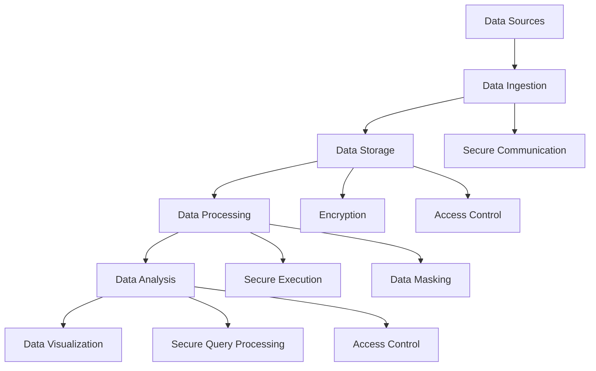

# Lesson 5: Data Security and Privacy

## 1. First-Principles Intuition & Invariants

In the realm of big data, the sheer volume, velocity, and variety of data pose significant challenges to both security and privacy. The problem space is multifaceted, encompassing data at rest, in transit, and in use. Security measures must ensure the confidentiality, integrity, and availability of data, while privacy considerations must protect individual data subjects from unauthorized access and misuse. The theoretical grounding for these challenges lies in information theory, cryptography, and formal methods.

At the heart of data security and privacy is the concept of information entropy, which quantifies the uncertainty or randomness in a dataset. High entropy data is more resistant to unauthorized access because it contains more unpredictable information. Cryptography, the science of secure communication, leverages this principle to transform plaintext data into ciphertext that is unreadable without the appropriate decryption key. Cryptographic algorithms, such as AES (Advanced Encryption Standard) and RSA (Rivest-Shamir-Adleman), provide the mathematical invariants necessary to ensure data confidentiality and integrity.

Privacy, on the other hand, is concerned with the protection of individual data subjects. The concept of differential privacy formalizes this concern by ensuring that the inclusion or exclusion of a single data record does not significantly alter the output of a data analysis. This mathematical invariant is crucial in big data environments, where large datasets often contain sensitive information about individuals. Differential privacy achieves this through the addition of controlled noise to query results, thereby preserving the utility of the data while protecting individual privacy.

Another critical invariant in data security and privacy is the principle of least privilege. This principle states that users and systems should have the minimum level of access necessary to perform their functions. In the context of big data, this means that data access should be tightly controlled and monitored to prevent unauthorized access and misuse. Role-based access control (RBAC) and attribute-based access control (ABAC) are two common mechanisms for implementing the principle of least privilege in big data environments.

## 2. Core Architecture & Mechanics

The architecture of a big data system plays a crucial role in ensuring data security and privacy. A typical big data architecture consists of data ingestion, storage, processing, and analysis components. Each of these components must be designed with security and privacy in mind.

### Data Ingestion

Data ingestion is the process of collecting and importing data from various sources into a big data system. This process must be secure to prevent unauthorized access and data tampering. One common approach to securing data ingestion is to use secure communication protocols, such as TLS (Transport Layer Security), to encrypt data in transit. Additionally, data validation and sanitization should be performed to ensure that only valid and trusted data is ingested into the system.

### Data Storage

Data storage is a critical component of any big data system, as it is where the data is stored and managed. To ensure data security and privacy, data storage systems must be designed with robust access control mechanisms. Encryption should be used to protect data at rest, and access to the storage system should be restricted to authorized users only. Multi-tenancy is another important consideration in data storage, as it allows multiple organizations to share a single storage system while maintaining data isolation and privacy.

### Data Processing

Data processing involves transforming and aggregating data to extract insights and value. This process must be secure to prevent unauthorized access and data tampering. One common approach to securing data processing is to use secure execution environments, such as containerization and virtualization, to isolate data processing tasks and prevent unauthorized access. Additionally, data masking and anonymization techniques can be used to protect sensitive data during processing.

### Data Analysis

Data analysis involves querying and visualizing data to extract insights and value. This process must be secure to prevent unauthorized access and data tampering. One common approach to securing data analysis is to use secure query processing techniques, such as differential privacy, to protect individual data subjects. Additionally, access to data analysis tools and interfaces should be restricted to authorized users only.

### Mermaid Diagram of Big Data Architecture

## 3. High-Performance Optimization & Failure Modes

High-performance optimization is critical in big data environments, as the volume and velocity of data can quickly overwhelm system resources. However, optimization must be balanced with security and privacy considerations to ensure that data remains protected. Concurrency, resource scaling, boundary edge cases, and failure mitigations are all important considerations in high-performance optimization.

### Concurrency

Concurrency is the ability of a system to perform multiple operations simultaneously. In big data environments, concurrency is critical for processing large datasets efficiently. However, concurrency can also introduce security and privacy risks if not managed properly. One common approach to managing concurrency is to use fine-grained locking mechanisms to ensure that only one thread or process can access a particular resource at a time. Additionally, atomic operations and transactional memory can be used to ensure data consistency and integrity in concurrent environments.

### Resource Scaling

Resource scaling is the ability of a system to dynamically allocate and deallocate resources based on demand. In big data environments, resource scaling is critical for handling the variable workload and resource requirements of data processing tasks. However, resource scaling can also introduce security and privacy risks if not managed properly. One common approach to managing resource scaling is to use resource pools and quotas to ensure that resources are allocated fairly and efficiently. Additionally, monitoring and logging can be used to detect and respond to resource misuse and abuse.

### Boundary Edge Cases

Boundary edge cases are the extreme conditions and edge cases that a system must handle correctly. In big data environments, boundary edge cases can introduce security and privacy risks if not managed properly. One common example of a boundary edge case is a denial-of-service (DoS) attack, which attempts to overwhelm a system with excessive requests or data. Another example is a buffer overflow attack, which attempts to exploit vulnerabilities in memory allocation and management. One common approach to managing boundary edge cases is to use robust error handling and validation mechanisms to ensure that the system can handle extreme conditions and edge cases correctly.

### Failure Mitigations

Failure mitigations are the strategies and techniques used to prevent and recover from system failures. In big data environments, failure mitigations are critical for ensuring data availability and reliability. However, failure mitigations can also introduce security and privacy risks if not managed properly. One common approach to managing failure mitigations is to use redundancy and replication to ensure that data is available and consistent even in the event of a failure. Additionally, backup and recovery mechanisms can be used to restore data and system state in the event of a failure.

In conclusion, data security and privacy are critical considerations in big data environments. The theoretical grounding for these challenges lies in information theory, cryptography, and formal methods. The architecture of a big data system plays a crucial role in ensuring data security and privacy, and high-performance optimization must be balanced with security and privacy considerations to ensure that data remains protected. By understanding the first-principles intuition and invariants, core architecture and mechanics, and high-performance optimization and failure modes, senior software engineers, systems programmers, and domain architects can design and implement secure and private big data systems.
