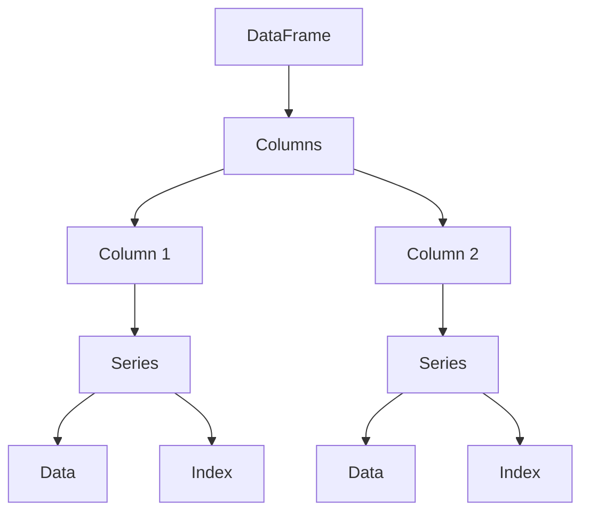

# Lesson 1: Introduction to Pandas

## 1. First-Principles Intuition & Invariants

Exploratory Data Analysis (EDA) is a critical phase in the data science lifecycle, serving as the bridge between raw data and actionable insights. It involves understanding the data's structure, identifying patterns, and uncovering anomalies. The Pandas library, developed by Wes McKinney and first released in 2008, has become the de facto standard for EDA in Python. Its design is rooted in the need for efficient, flexible, and expressive data manipulation, making it an indispensable tool for data scientists, engineers, and analysts alike.

At its core, Pandas provides two fundamental data structures: the `Series` and the `DataFrame`. These structures are built upon the NumPy library, which offers support for large, multi-dimensional arrays and matrices, along with a collection of mathematical functions to operate on these arrays. The `Series` can be thought of as a one-dimensional array with axis labels, while the `DataFrame` is a two-dimensional, size-mutable, potentially heterogeneous tabular data structure with labeled axes (rows and columns). These data structures are not merely containers for data; they encapsulate a rich set of operations that enable seamless data manipulation and analysis.

The theoretical grounding of Pandas is deeply intertwined with the principles of data indexing and alignment. Indexing allows for efficient data retrieval and manipulation, while alignment ensures that operations between different data structures are performed consistently and correctly. This alignment is particularly important in operations involving multiple `Series` or `DataFrame` objects, where the library automatically aligns data based on their indices, filling in missing values as necessary.

Another critical invariant in Pandas is its handling of missing data. Real-world datasets often contain missing or incomplete information, and Pandas provides robust mechanisms to handle such cases. Functions like `fillna()`, `dropna()`, and `isna()` allow for flexible and efficient management of missing values, ensuring that data analysis is not skewed by incomplete data.

## 2. Core Architecture & Mechanics

The architecture of Pandas is designed to provide a high-level interface for data manipulation while leveraging the low-level performance optimizations of NumPy. At the heart of Pandas are the `Series` and `DataFrame` data structures, which are built on top of NumPy arrays. The `Series` is essentially a one-dimensional array with an associated index, while the `DataFrame` is a two-dimensional array with labeled axes.

To illustrate the internal structure of a `DataFrame`, consider the following diagram:



In this diagram, a `DataFrame` consists of multiple `Series` objects, each representing a column. Each `Series` contains two main components: `Data`, which holds the actual data values, and `Index`, which provides the labels for the data points. The `Index` in a `DataFrame` is shared across all columns, ensuring that operations between columns are performed consistently.

The mechanics of data manipulation in Pandas are centered around these data structures and their associated methods. For example, the `DataFrame` provides a wide range of methods for data selection, filtering, and aggregation. These methods are designed to be intuitive and expressive, allowing users to perform complex data operations with minimal code. Consider the following example, which demonstrates the creation of a `DataFrame` and some basic operations:

```python
import pandas as pd

# Create a DataFrame
data = {
    'Name': ['Alice', 'Bob', 'Charlie'],
    'Age': [25, 30, 35],
    'City': ['New York', 'Los Angeles', 'Chicago']
}
df = pd.DataFrame(data)

# Display the DataFrame
print(df)

# Select a column
ages = df['Age']
print(ages)

# Filter rows based on a condition
young_people = df[df['Age'] < 30]
print(young_people)

# Aggregate data
average_age = df['Age'].mean()
print(average_age)
```

In this example, we create a `DataFrame` from a dictionary of lists, select a column, filter rows based on a condition, and compute the mean of a column. Each of these operations leverages the underlying data structures and methods provided by Pandas, ensuring efficient and expressive data manipulation.

## 3. High-Performance Optimization & Failure Modes

The performance of Pandas is a critical consideration, especially when working with large datasets. The library is optimized for both speed and memory usage, leveraging the performance of NumPy arrays and efficient indexing mechanisms. However, as with any software system, there are potential failure modes and performance bottlenecks that need to be addressed.

One of the key optimizations in Pandas is the use of vectorized operations. Instead of iterating over data points in a loop, Pandas provides vectorized methods that operate on entire arrays at once. This approach leverages the low-level optimizations of NumPy, resulting in significant performance improvements. For example, consider the following code snippet:

```python
# Vectorized operation to add 5 to each age
df['Age'] = df['Age'] + 5
print(df)
```

In this example, the operation `df['Age'] + 5` is performed on the entire `Age` column in a single step, rather than iterating over each element individually. This vectorized approach is not only more concise but also much faster.

Another important aspect of Pandas performance is memory management. The library is designed to handle large datasets efficiently, using techniques such as chunking and lazy evaluation. Chunking involves breaking large datasets into smaller, more manageable pieces, while lazy evaluation defers the execution of operations until the results are actually needed. These techniques help to minimize memory usage and improve performance.

However, there are also potential failure modes and performance bottlenecks in Pandas. One common issue is the use of non-vectorized operations, which can lead to significant performance degradation. For example, using a loop to iterate over rows in a `DataFrame` can be much slower than using vectorized methods. Consider the following code snippet:

```python
# Non-vectorized operation to add 5 to each age
for i in range(len(df)):
    df.at[i, 'Age'] = df.at[i, 'Age'] + 5
print(df)
```

In this example, the operation `df.at[i, 'Age'] = df.at[i, 'Age'] + 5` is performed in a loop, iterating over each row individually. This approach is much slower than the vectorized operation shown earlier.

Another potential failure mode is the use of inefficient data types. Pandas provides a wide range of data types, including `int64`, `float64`, `object`, and `category`. Choosing the appropriate data type can have a significant impact on performance and memory usage. For example, using the `category` data type for columns with a limited number of unique values can significantly reduce memory usage.

In summary, Pandas is a powerful and flexible library for exploratory data analysis, providing a high-level interface for data manipulation while leveraging the performance optimizations of NumPy. Its core data structures, `Series` and `DataFrame`, are designed to handle a wide range of data operations efficiently, while its performance optimizations and failure modes provide a robust framework for working with large datasets. By understanding the underlying architecture and mechanics of Pandas, users can harness its full potential to perform efficient and expressive data analysis.
