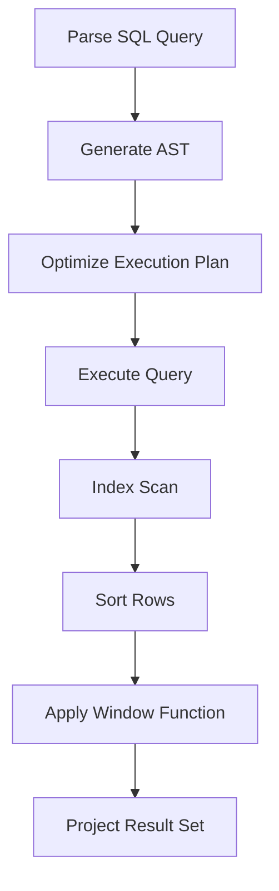

# Lesson 1: SQL Analytics Fundamentals

## 1. First-Principles Intuition & Invariants

SQL (Structured Query Language) is a powerful tool for managing and analyzing relational databases. At its core, SQL provides a declarative way to specify what data is needed, rather than how to obtain it. This abstraction allows database systems to optimize query execution, making SQL a cornerstone of data analysis and business intelligence. SQL analytics, a subset of SQL, focuses on deriving insights from data through advanced query techniques, including aggregation, filtering, and window functions.

The problem space addressed by SQL analytics is vast, encompassing everything from financial reporting and customer segmentation to predictive analytics and operational monitoring. The invariants in SQL analytics lie in the principles of set theory and relational algebra, which form the mathematical foundation of SQL. These principles ensure that operations on data are well-defined and consistent, allowing for reliable and reproducible results.

At the heart of SQL analytics is the concept of a relation, which is a set of tuples (rows) with a fixed schema (columns). Operations on relations, such as selection, projection, and join, are the building blocks of SQL queries. Aggregation functions, like `SUM`, `AVG`, `COUNT`, `MIN`, and `MAX`, allow us to compute summary statistics over groups of rows. These functions are essential for deriving insights from large datasets, enabling us to answer questions such as "What is the total revenue for each product category?" or "What is the average salary by department?"

Window functions, a more advanced feature of SQL, extend the capabilities of aggregation by allowing computations over a set of table rows that are somehow related to the current row. This is achieved through the specification of a window frame, which defines the subset of rows over which the function is applied. Window functions are particularly powerful for tasks such as ranking, moving averages, and cumulative sums, enabling us to analyze data in a more nuanced and dynamic way.

## 2. Core Architecture & Mechanics

To understand the mechanics of SQL analytics, it is essential to delve into the internal data structures and algorithms that power SQL query execution. At a high level, SQL queries are processed in several stages, including parsing, optimization, and execution. The parsing stage involves converting the SQL query into an abstract syntax tree (AST), which represents the query in a structured form. The optimization stage involves transforming the AST into an execution plan, which is a sequence of operations that the database engine will perform to retrieve the desired data. The execution plan is optimized to minimize resource usage and maximize performance, taking into account factors such as data distribution, indexing, and available memory.

One of the key data structures used in SQL query execution is the hash table, which is used to implement joins and aggregations. Hash tables allow for efficient lookups and insertions, making them ideal for operations that involve matching rows from multiple tables or grouping rows based on common attributes. Another important data structure is the B-tree, which is used to implement indexes. Indexes are crucial for improving query performance, as they allow the database engine to quickly locate the rows that match a given condition without scanning the entire table.

The execution of SQL queries involves a combination of algorithms, including sorting, filtering, and aggregation. Sorting is used to order rows based on one or more columns, which is essential for operations such as ranking and window functions. Filtering is used to select rows that match a given condition, which is achieved through the evaluation of predicates. Aggregation is used to compute summary statistics over groups of rows, which is achieved through the application of aggregation functions.

To illustrate the mechanics of SQL analytics, consider the following example query:

```sql
SELECT 
    department_id, 
    employee_id, 
    salary, 
    AVG(salary) OVER (PARTITION BY department_id) AS avg_salary
FROM 
    employees;
```

This query computes the average salary for each department and includes it as a new column in the result set. The `AVG` function is applied over a window frame defined by the `PARTITION BY` clause, which groups rows by `department_id`. The execution of this query involves several steps:

1. **Parsing**: The SQL query is converted into an AST, which represents the query in a structured form.
2. **Optimization**: The AST is transformed into an execution plan, which is optimized to minimize resource usage and maximize performance.
3. **Execution**: The execution plan is executed, involving the following operations:
   - **Index Scan**: The database engine scans the `employees` table using an index on the `department_id` column to quickly locate the rows that match the query condition.
   - **Sorting**: The rows are sorted based on the `department_id` column to prepare for the window function.
   - **Aggregation**: The `AVG` function is applied over the window frame defined by the `PARTITION BY` clause, computing the average salary for each department.
   - **Projection**: The result set is projected, including the `department_id`, `employee_id`, `salary`, and `avg_salary` columns.

The execution plan for this query can be visualized using a Mermaid diagram:



## 3. High-Performance Optimization & Failure Modes

To ensure high performance and reliability in SQL analytics, it is essential to consider several optimization techniques and failure modes. One of the key techniques is indexing, which allows the database engine to quickly locate the rows that match a given condition without scanning the entire table. Indexes can significantly improve query performance, especially for large datasets and complex queries. However, indexes also have a cost in terms of storage and maintenance, as they need to be updated whenever the underlying data changes.

Another important technique is query optimization, which involves transforming the AST into an execution plan that minimizes resource usage and maximizes performance. Query optimization is achieved through a combination of rule-based and cost-based techniques. Rule-based techniques involve applying a set of predefined rules to transform the AST into an execution plan. Cost-based techniques involve estimating the cost of different execution plans and selecting the one with the lowest cost. Cost estimation is based on factors such as data distribution, indexing, and available memory.

Concurrency is another critical aspect of SQL analytics, as it allows multiple queries to be executed simultaneously without interfering with each other. Concurrency is achieved through the use of locks, which prevent multiple transactions from modifying the same data at the same time. Locks can be acquired at different levels, including row-level, page-level, and table-level, depending on the granularity of the data being accessed. Concurrency control is essential for maintaining data consistency and integrity, but it can also introduce performance bottlenecks, especially in high-concurrency environments.

Resource scaling is another important consideration in SQL analytics, as it allows the database system to handle increasing amounts of data and queries. Resource scaling can be achieved through horizontal scaling, which involves adding more database instances to distribute the workload, or vertical scaling, which involves increasing the resources of a single database instance, such as CPU, memory, and storage. Horizontal scaling is generally more scalable and flexible, but it can also introduce complexity in terms of data distribution and replication.

Boundary edge cases and failure modes are also critical considerations in SQL analytics, as they can lead to incorrect results or system failures. Boundary edge cases include scenarios such as empty datasets, null values, and outliers, which can affect the accuracy and reliability of query results. Failure modes include scenarios such as deadlocks, lock contention, and resource exhaustion, which can lead to system failures and downtime. To mitigate these risks, it is essential to design queries and database schemas that are robust and resilient to edge cases and failures.

In summary, SQL analytics is a powerful tool for deriving insights from data through advanced query techniques, including aggregation and window functions. The mechanics of SQL analytics involve several stages, including parsing, optimization, and execution, and rely on data structures such as hash tables and B-trees, as well as algorithms such as sorting, filtering, and aggregation. To ensure high performance and reliability, it is essential to consider optimization techniques such as indexing and query optimization, as well as concurrency, resource scaling, and failure modes. By understanding the first-principles intuition and invariants of SQL analytics, senior software engineers, systems programmers, and domain architects can design and implement robust and efficient data analysis solutions.
