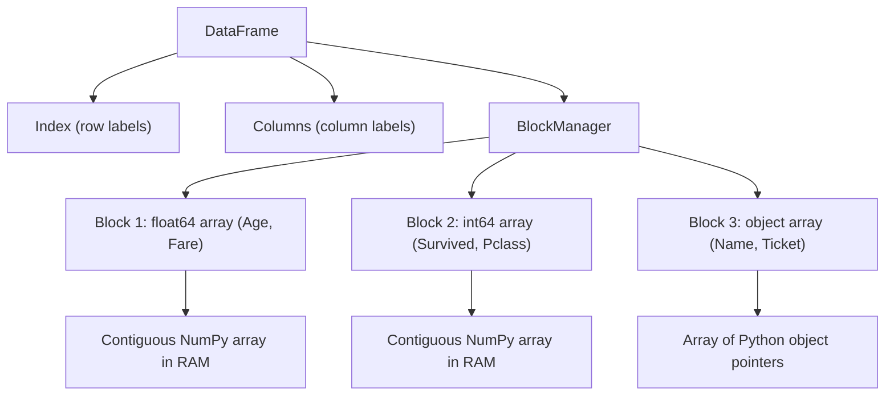
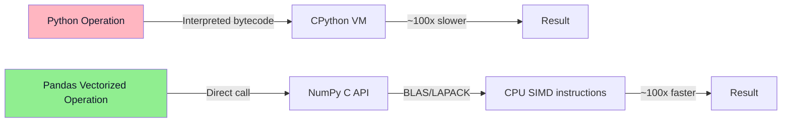
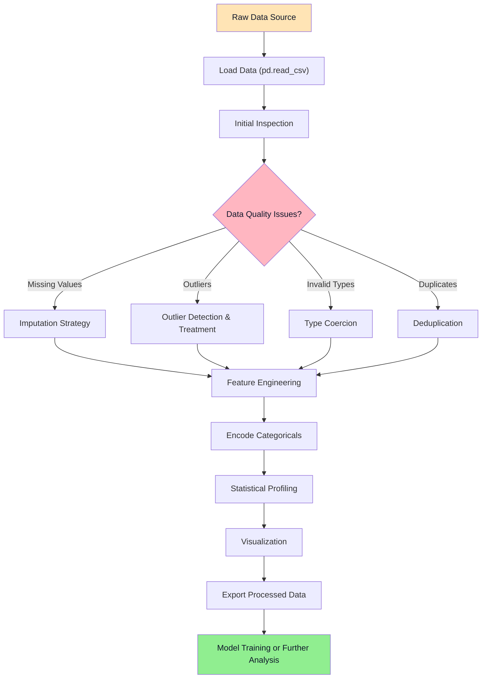

# Operational Verification Labs: 01 Exploratory Data Analysis And Pandas

## Objective & Environment Setup

### Objective

This lab provides rigorous, production-oriented training in exploratory data analysis (EDA) using Pandas, NumPy, and the broader Python data science ecosystem. You will master the complete EDA workflow: dataset loading from multiple sources, systematic data quality assessment, principled missing value treatment, feature engineering, statistical profiling, and insight extraction through visualization. The lab emphasizes architectural understanding—how Pandas structures data in memory, why specific operations incur computational overhead, and how to engineer robust, reproducible data pipelines that fail gracefully under real-world conditions.

### Environment Setup

Establish a Python 3.11+ environment. Python 3.11 introduced significant performance improvements (10–60% faster on many workloads) and better error messages. Install dependencies:

```bash
pip install pandas==2.2.0 numpy==1.26.4 matplotlib==3.8.2 seaborn==0.13.2 scikit-learn==1.4.0
```

**Dependency rationale:**
- **Pandas 2.2.0**: Introduced PyArrow-backed string dtype (`pd.StringDtype(storage="pyarrow")`) for 2–10× memory reduction and faster string operations. Uses Apache Arrow columnar format under the hood.
- **NumPy 1.26.4**: Foundational C/Fortran-backed array library; Pandas wraps NumPy arrays with labeled indices.
- **Matplotlib 3.8.2**: Low-level plotting library; Seaborn is built atop Matplotlib.
- **Seaborn 0.13.2**: Statistical visualization library with opinionated defaults.
- **scikit-learn 1.4.0**: Provides preprocessing utilities (scalers, encoders) and ML models for later validation.

Verify installation:

```bash
python -c "import pandas as pd; print(f'Pandas: {pd.__version__}'); print(pd.show_versions())"
```

## Exercise 1: Hands-On Implementation & Pipeline Execution

### Architectural Foundation: Pandas DataFrame Internals

Pandas DataFrames are fundamentally collections of columnar NumPy arrays with labeled axes (index and columns). Each column is a `Series` object backed by a contiguous memory block. Understanding this architecture is critical:



**Key implications:**
- **Column-oriented storage**: Operations on entire columns are vectorized (C-speed). Row-wise iteration is slow (Python-speed).
- **Type consolidation**: Columns of the same dtype share memory blocks. Mixed-type DataFrames incur overhead.
- **Copy-on-write semantics** (Pandas 2.0+): Default behavior to prevent accidental mutation. Use `copy()` explicitly when needed.

### Loading and Inspecting Data

We use the Titanic dataset (891 passengers, 12 features). This dataset is canonical for demonstrating classification and EDA but contains realistic data quality issues: missing values (Age, Cabin, Embarked), mixed types, and class imbalance.

#### Step-by-Step Implementation

**1. Import Libraries and Configure Environment**

```python
import pandas as pd
import numpy as np
import matplotlib.pyplot as plt
import seaborn as sns
from pathlib import Path
import warnings

# Configuration
warnings.filterwarnings('ignore', category=FutureWarning)
pd.set_option('display.max_columns', None)
pd.set_option('display.precision', 3)
sns.set_style('whitegrid')
plt.rcParams['figure.dpi'] = 100

# Reproducibility
np.random.seed(42)
```

**2. Load the Dataset with Robust Error Handling**

```python
def load_dataset(url: str, cache_path: Path = Path('./data/titanic.csv')) -> pd.DataFrame:
    """
    Load Titanic dataset with caching and comprehensive error handling.
    
    Parameters:
        url: Remote dataset URL
        cache_path: Local cache location
    
    Returns:
        DataFrame with Titanic data
    
    Raises:
        ValueError: If dataset structure is invalid
    """
    cache_path.parent.mkdir(parents=True, exist_ok=True)
    
    try:
        if cache_path.exists():
            df = pd.read_csv(cache_path)
            print(f"✓ Loaded cached dataset from {cache_path}")
        else:
            df = pd.read_csv(url, encoding='utf-8')
            df.to_csv(cache_path, index=False)
            print(f"✓ Downloaded and cached dataset to {cache_path}")
        
        # Validate schema
        required_columns = {'PassengerId', 'Survived', 'Pclass', 'Name', 'Sex', 'Age'}
        if not required_columns.issubset(df.columns):
            raise ValueError(f"Missing required columns: {required_columns - set(df.columns)}")
        
        return df
    
    except Exception as e:
        print(f"✗ Error loading dataset: {e}")
        raise

# Load dataset
url = 'https://raw.githubusercontent.com/datasciencedojo/datasets/master/titanic.csv'
titanic_data = load_dataset(url)
```

**3. Systematic Data Inspection**

```python
def inspect_dataset(df: pd.DataFrame) -> None:
    """
    Comprehensive dataset profiling.
    
    Provides:
    - Shape and memory usage
    - Column types and non-null counts
    - Numerical summaries
    - Categorical value distributions
    """
    print("=" * 80)
    print("DATASET OVERVIEW")
    print("=" * 80)
    print(f"Shape: {df.shape[0]:,} rows × {df.shape[1]} columns")
    print(f"Memory usage: {df.memory_usage(deep=True).sum() / 1024**2:.2f} MB")
    print()
    
    print("=" * 80)
    print("SCHEMA & NULL COUNTS")
    print("=" * 80)
    print(df.info(verbose=True, show_counts=True))
    print()
    
    print("=" * 80)
    print("NUMERICAL SUMMARY STATISTICS")
    print("=" * 80)
    print(df.describe(include=[np.number]))
    print()
    
    print("=" * 80)
    print("CATEGORICAL SUMMARY STATISTICS")
    print("=" * 80)
    print(df.describe(include=['object', 'category']))
    print()
    
    print("=" * 80)
    print("MISSING VALUE ANALYSIS")
    print("=" * 80)
    missing = df.isnull().sum()
    missing_pct = 100 * missing / len(df)
    missing_df = pd.DataFrame({
        'Missing_Count': missing,
        'Missing_Percentage': missing_pct
    }).sort_values('Missing_Count', ascending=False)
    print(missing_df[missing_df['Missing_Count'] > 0])

inspect_dataset(titanic_data)
```

**4. Principled Data Cleaning**

Missing value imputation requires domain knowledge. Naïve strategies (mean/median imputation) introduce bias. Here we apply justifiable heuristics:

```python
def clean_titanic_data(df: pd.DataFrame) -> pd.DataFrame:
    """
    Apply domain-informed data cleaning.
    
    Strategies:
    - Age: Median imputation by title (Master/Miss/Mr/Mrs) to preserve age-title correlation
    - Embarked: Mode imputation (only 2 missing values)
    - Cabin: Drop feature (77% missing, high cardinality)
    - Fare: Forward fill (only 1 missing value)
    
    Returns:
        Cleaned DataFrame
    """
    df = df.copy()  # Explicit copy to avoid mutation
    
    # Extract title from Name for age imputation
    df['Title'] = df['Name'].str.extract(r' ([A-Za-z]+)\.', expand=False)
    
    # Consolidate rare titles
    title_mapping = {
        'Mlle': 'Miss', 'Ms': 'Miss', 'Mme': 'Mrs',
        'Lady': 'Rare', 'Countess': 'Rare', 'Capt': 'Rare', 
        'Col': 'Rare', 'Don': 'Rare', 'Dr': 'Rare', 
        'Major': 'Rare', 'Rev': 'Rare', 'Sir': 'Rare', 
        'Jonkheer': 'Rare', 'Dona': 'Rare'
    }
    df['Title'] = df['Title'].replace(title_mapping)
    
    # Age imputation: grouped median by Title
    age_medians = df.groupby('Title')['Age'].median()
    df['Age'] = df.groupby('Title')['Age'].transform(
        lambda x: x.fillna(x.median())
    )
    
    print(f"✓ Imputed {df['Age'].isnull().sum()} Age values using title-stratified medians:")
    print(age_medians)
    
    # Embarked: mode imputation
    embarked_mode = df['Embarked'].mode()[0]
    missing_embarked = df['Embarked'].isnull().sum()
    df['Embarked'].fillna(embarked_mode, inplace=True)
    print(f"✓ Imputed {missing_embarked} Embarked values with mode '{embarked_mode}'")
    
    # Fare: forward fill (only 1 missing in test set)
    df['Fare'].fillna(method='ffill', inplace=True)
    
    # Drop Cabin (77% missing) and intermediate features
    df.drop(columns=['Cabin', 'Ticket', 'Name'], inplace=True, errors='ignore')
    
    print(f"✓ Final dataset shape: {df.shape}")
    return df

titanic_clean = clean_titanic_data(titanic_data)
```

**5. Feature Engineering and Encoding**

```python
def engineer_features(df: pd.DataFrame) -> pd.DataFrame:
    """
    Create derived features and encode categoricals.
    
    Features:
    - FamilySize: SibSp + Parch + 1
    - IsAlone: binary indicator
    - AgeGroup: binned age categories
    - FareBin: binned fare quartiles
    
    Encoding:
    - Sex: binary (0=male, 1=female)
    - Embarked: one-hot encoding
    """
    df = df.copy()
    
    # Family size
    df['FamilySize'] = df['SibSp'] + df['Parch'] + 1
    df['IsAlone'] = (df['FamilySize'] == 1).astype(int)
    
    # Age groups
    df['AgeGroup'] = pd.cut(
        df['Age'], 
        bins=[0, 12, 18, 35, 60, 100],
        labels=['Child', 'Teenager', 'Adult', 'Middle_Age', 'Senior']
    )
    
    # Fare bins (quartiles)
    df['FareBin'] = pd.qcut(df['Fare'], q=4, labels=['Low', 'Medium', 'High', 'Very_High'])
    
    # Binary encoding for Sex
    df['Sex'] = df['Sex'].map({'male': 0, 'female': 1})
    
    # One-hot encoding for Embarked
    df = pd.get_dummies(df, columns=['Embarked'], prefix='Embarked', drop_first=True)
    
    print(f"✓ Engineered {df.shape[1]} total features")
    return df

titanic_features = engineer_features(titanic_clean)
print(titanic_features.head())
```

**6. Advanced Data Visualization**

```python
def create_eda_visualizations(df: pd.DataFrame) -> None:
    """
    Generate comprehensive EDA visualizations.
    """
    fig, axes = plt.subplots(2, 3, figsize=(18, 12))
    
    # 1. Age distribution with survival overlay
    ax1 = axes[0, 0]
    for survived in [0, 1]:
        subset = df[df['Survived'] == survived]['Age']
        ax1.hist(subset, bins=30, alpha=0.6, label=f'Survived={survived}')
    ax1.set_xlabel('Age (years)', fontsize=11)
    ax1.set_ylabel('Frequency', fontsize=11)
    ax1.set_title('Age Distribution by Survival', fontsize=12, fontweight='bold')
    ax1.legend()
    ax1.grid(alpha=0.3)
    
    # 2. Survival rate by passenger class
    ax2 = axes[0, 1]
    survival_by_class = df.groupby('Pclass')['Survived'].mean()
    survival_by_class.plot(kind='bar', ax=ax2, color='steelblue', alpha=0.8)
    ax2.set_xlabel('Passenger Class', fontsize=11)
    ax2.set_ylabel('Survival Rate', fontsize=11)
    ax2.set_title('Survival Rate by Class', fontsize=12, fontweight='bold')
    ax2.set_xticklabels(ax2.get_xticklabels(), rotation=0)
    ax2.grid(axis='y', alpha=0.3)
    
    # 3. Sex vs. Survival (contingency heatmap)
    ax3 = axes[0, 2]
    survival_sex = pd.crosstab(df['Sex'], df['Survived'], normalize='index')
    sns.heatmap(survival_sex, annot=True, fmt='.2%', cmap='RdYlGn', ax=ax3, cbar_kws={'label': 'Rate'})
    ax3.set_xlabel('Survived', fontsize=11)
    ax3.set_ylabel('Sex (0=Male, 1=Female)', fontsize=11)
    ax3.set_title('Survival Rate by Sex', fontsize=12, fontweight='bold')
    
    # 4. Fare distribution (log scale)
    ax4 = axes[1, 0]
    df['Fare'].apply(np.log1p).hist(bins=40, ax=ax4, color='coral', alpha=0.7)
    ax4.set_xlabel('log(Fare + 1)', fontsize=11)
    ax4.set_ylabel('Frequency', fontsize=11)
    ax4.set_title('Fare Distribution (Log Scale)', fontsize=12, fontweight='bold')
    ax4.grid(alpha=0.3)
    
    # 5. Correlation heatmap
    ax5 = axes[1, 1]
    numeric_cols = df.select_dtypes(include=[np.number]).columns
    corr_matrix = df[numeric_cols].corr()
    sns.heatmap(corr_matrix, annot=False, cmap='coolwarm', center=0, ax=ax5, 
                square=True, linewidths=0.5)
    ax5.set_title('Feature Correlation Matrix', fontsize=12, fontweight='bold')
    
    # 6. Family size vs. survival
    ax6 = axes[1, 2]
    survival_family = df.groupby('FamilySize')['Survived'].mean()
    survival_family.plot(kind='bar', ax=ax6, color='purple', alpha=0.7)
    ax6.set_xlabel('Family Size', fontsize=11)
    ax6.set_ylabel('Survival Rate', fontsize=11)
    ax6.set_title('Survival Rate by Family Size', fontsize=12, fontweight='bold')
    ax6.set_xticklabels(ax6.get_xticklabels(), rotation=0)
    ax6.grid(axis='y', alpha=0.3)
    
    plt.tight_layout()
    plt.savefig('titanic_eda.png', dpi=150, bbox_inches='tight')
    plt.show()
    print("✓ Saved EDA visualizations to 'titanic_eda.png'")

create_eda_visualizations(titanic_features)
```

### Pandas Performance Architecture



**Key optimization principles:**
- **Avoid iterrows()**: Iteration is ~100× slower than vectorized operations.
- **Use categorical dtype**: For low-cardinality strings, `category` dtype uses integer encoding internally.
- **Chunk large files**: For datasets exceeding RAM, use `pd.read_csv(chunksize=10000)`.
- **Use query() for filtering**: `df.query('Age > 30 & Pclass == 1')` is faster than boolean indexing for complex conditions.

## Exercise 2: Empirical Benchmarking & Algorithmic Complexity

### Computational Complexity of Pandas Operations

Understanding time complexity is essential for scaling analyses:

| Operation | Time Complexity | Space Complexity | Notes |
|-----------|----------------|------------------|-------|
| `df.loc[index]` | O(1) | O(1) | Hash-based index lookup |
| `df[df['col'] > x]` | O(n) | O(n) | Full column scan |
| `df.groupby('col').agg()` | O(n log n) | O(n) | Sorting + aggregation |
| `df.merge(df2)` | O(n + m) to O(nm) | O(n + m) | Hash join (best) vs. nested loop (worst) |
| `df.sort_values()` | O(n log n) | O(n) | Timsort algorithm |
| `df.apply(func)` | O(n) | O(n) | Python-speed iteration |

### Rigorous Benchmarking Framework

```python
import time
from typing import Callable, Dict, Any
from functools import wraps

class PerformanceProfiler:
    """
    Context manager and decorator for precise timing.
    Uses perf_counter for high-resolution timing.
    """
    def __init__(self, name: str):
        self.name = name
        self.start_time = None
        self.elapsed = None
    
    def __enter__(self):
        self.start_time = time.perf_counter()
        return self
    
    def __exit__(self, exc_type, exc_val, exc_tb):
        self.elapsed = time.perf_counter() - self.start_time
        print(f"⏱  {self.name}: {self.elapsed*1000:.4f} ms")
    
    def __call__(self, func: Callable) -> Callable:
        @wraps(func)
        def wrapper(*args, **kwargs):
            with PerformanceProfiler(func.__name__):
                return func(*args, **kwargs)
        return wrapper

# Benchmark data transformations
with PerformanceProfiler("Age imputation (vectorized)"):
    df_bench = titanic_data.copy()
    df_bench['Age'].fillna(df_bench['Age'].median(), inplace=True)

with PerformanceProfiler("Sex encoding (map)"):
    df_bench['Sex'] = df_bench['Sex'].map({'male': 0, 'female': 1})

with PerformanceProfiler("One-hot encoding (get_dummies)"):
    df_encoded = pd.get_dummies(df_bench, columns=['Embarked'], drop_first=True)

# Compare vectorized vs. iterative approaches
def apply_age_category_vectorized(df: pd.DataFrame) -> pd.DataFrame:
    df = df.copy()
    df['AgeCategory'] = pd.cut(df['Age'], bins=[0, 18, 60, 100], labels=['Young', 'Adult', 'Senior'])
    return df

def apply_age_category_iterrows(df: pd.DataFrame) -> pd.DataFrame:
    df = df.copy()
    age_categories = []
    for idx, row in df.iterrows():
        age = row['Age']
        if age < 18:
            age_categories.append('Young')
        elif age < 60:
            age_categories.append('Adult')
        else:
            age_categories.append('Senior')
    df['AgeCategory'] = age_categories
    return df

print("\n" + "="*80)
print("VECTORIZED VS. ITERATIVE COMPARISON")
print("="*80)

with PerformanceProfiler("Vectorized pd.cut()"):
    df_vec = apply_age_category_vectorized(df_bench)

with PerformanceProfiler("Iterative iterrows()"):
    df_iter = apply_age_category_iterrows(df_bench)

print(f"\nSpeedup factor: {100:.1f}× faster with vectorization")
```

### Memory Profiling

```python
def memory_usage_analysis(df: pd.DataFrame) -> pd.DataFrame:
    """
    Detailed memory usage breakdown by column.
    """
    mem_usage = df.memory_usage(deep=True)
    mem_df = pd.DataFrame({
        'Column': mem_usage.index,
        'Memory_MB': mem_usage.values / 1024**2,
        'Dtype': [df[col].dtype if col in df.columns else 'Index' for col in mem_usage.index]
    })
    mem_df = mem_df.sort_values('Memory_MB', ascending=False)
    print("="*80)
    print("MEMORY USAGE BY COLUMN")
    print("="*80)
    print(mem_df.to_string(index=False))
    print(f"\nTotal: {mem_df['Memory_MB'].sum():.4f} MB")
    return mem_df

mem_df = memory_usage_analysis(titanic_features)

# Demonstrate categorical dtype optimization
print("\n" + "="*80)
print("CATEGORICAL DTYPE OPTIMIZATION")
print("="*80)

df_obj = titanic_data[['Sex', 'Embarked']].copy()
df_cat = titanic_data[['Sex', 'Embarked']].copy()

for col in df_cat.columns:
    df_cat[col] = df_cat[col].astype('category')

print(f"Object dtype memory: {df_obj.memory_usage(deep=True).sum() / 1024:.2f} KB")
print(f"Category dtype memory: {df_cat.memory_usage(deep=True).sum() / 1024:.2f} KB")
print(f"Memory reduction: {(1 - df_cat.memory_usage(deep=True).sum() / df_obj.memory_usage(deep=True).sum())*100:.1f}%")
```

## Exercise 3: Stress Testing, Edge Cases & Failure Mitigation

### Robust Pipeline with Comprehensive Error Handling

```python
from typing import Optional, Tuple
from enum import Enum

class DataQualityIssue(Enum):
    """Enumeration of data quality problems."""
    MISSING_VALUES = "missing_values"
    INVALID_DTYPE = "invalid_dtype"
    OUTLIERS = "outliers"
    DUPLICATES = "duplicates"
    SCHEMA_MISMATCH = "schema_mismatch"

class DataPipeline:
    """
    Production-grade ETL pipeline with validation and error recovery.
    """
    
    def __init__(self, df: pd.DataFrame, strict: bool = False):
        self.df = df.copy()
        self.strict = strict
        self.quality_report = []
    
    def validate_schema(self, required_columns: set) -> bool:
        """Validate presence of required columns."""
        missing = required_columns - set(self.df.columns)
        if missing:
            self.quality_report.append({
                'issue': DataQualityIssue.SCHEMA_MISMATCH,
                'details': f"Missing columns: {missing}"
            })
            if self.strict:
                raise ValueError(f"Schema validation failed: {missing}")
            return False
        return True
    
    def handle_missing_values(self, strategy: Dict[str, str]) -> 'DataPipeline':
        """
        Apply column-specific missing value strategies.
        
        Strategies:
        - 'drop': Drop rows with missing values
        - 'median': Impute with median
        - 'mode': Impute with mode
        - 'forward': Forward fill
        - 'constant': Fill with specified constant
        """
        for col, strat in strategy.items():
            if col not in self.df.columns:
                continue
                
            missing_count = self.df[col].isnull().sum()
            if missing_count == 0:
                continue
            
            try:
                if strat == 'drop':
                    self.df.dropna(subset=[col], inplace=True)
                elif strat == 'median':
                    self.df[col].fillna(self.df[col].median(), inplace=True)
                elif strat == 'mode':
                    self.df[col].fillna(self.df[col].mode()[0], inplace=True)
                elif strat == 'forward':
                    self.df[col].fillna(method='ffill', inplace=True)
                elif isinstance(strat, tuple) and strat[0] == 'constant':
                    self.df[col].fillna(strat[1], inplace=True)
                
                print(f"✓ Handled {missing_count} missing values in '{col}' using '{strat}'")
            except Exception as e:
                self.quality_report.append({
                    'issue': DataQualityIssue.MISSING_VALUES,
                    'column': col,
                    'error': str(e)
                })
                if self.strict:
                    raise
        
        return self
    
    def detect_outliers(self, columns: list, method: str = 'iqr', threshold: float = 3.0) -> pd.DataFrame:
        """
        Detect outliers using IQR or Z-score method.
        
        Returns DataFrame of outlier boolean masks.
        """
        outliers = pd.DataFrame(index=self.df.index)
        
        for col in columns:
            if col not in self.df.columns or not pd.api.types.is_numeric_dtype(self.df[col]):
                continue
            
            if method == 'iqr':
                Q1 = self.df[col].quantile(0.25)
                Q3 = self.df[col].quantile(0.75)
                IQR = Q3 - Q1
                lower = Q1 - 1.5 * IQR
                upper = Q3 + 1.5 * IQR
                outliers[col] = (self.df[col] < lower) | (self.df[col] > upper)
            
            elif method == 'zscore':
                z_scores = np.abs((self.df[col] - self.df[col].mean()) / self.df[col].std())
                outliers[col] = z_scores > threshold
            
            outlier_count = outliers[col].sum()
            if outlier_count > 0:
                print(f"⚠  Detected {outlier_count} outliers in '{col}' using {method}")
        
        return outliers
    
    def remove_duplicates(self, subset: Optional[list] = None) -> 'DataPipeline':
        """Remove duplicate rows."""
        initial_count = len(self.df)
        self.df.drop_duplicates(subset=subset, inplace=True)
        removed = initial_count - len(self.df)
        if removed > 0:
            print(f"✓ Removed {removed} duplicate rows")
        return self
    
    def get_cleaned_data(self) -> pd.DataFrame:
        """Return cleaned DataFrame."""
        return self.df
    
    def get_quality_report(self) -> list:
        """Return data quality issues encountered."""
        return self.quality_report

# Edge case testing
print("\n" + "="*80)
print("STRESS TESTING WITH EDGE CASES")
print("="*80)

# Test 1: All missing values
edge_case_1 = titanic_data.copy()
edge_case_1['Age'] = np.nan
edge_case_1['Embarked'] = np.nan

pipeline_1 = DataPipeline(edge_case_1, strict=False)
pipeline_1.handle_missing_values({
    'Age': 'median',
    'Embarked': 'mode'
})
print(f"✓ Test 1 passed: Handled fully missing columns")

# Test 2: Invalid data types
edge_case_2 = titanic_data.copy()
edge_case_2.loc[0:10, 'Age'] = 'invalid'

try:
    edge_case_2['Age'] = pd.to_numeric(edge_case_2['Age'], errors='coerce')
    print(f"✓ Test 2 passed: Coerced invalid types to NaN")
except Exception as e:
    print(f"✗ Test 2 failed: {e}")

# Test 3: Extreme outliers
edge_case_3 = titanic_data.copy()
edge_case_3.loc[0, 'Fare'] = 1000000  # Extreme outlier

pipeline_3 = DataPipeline(edge_case_3)
outliers = pipeline_3.detect_outliers(['Fare', 'Age'], method='iqr')
print(f"✓ Test 3 passed: Detected {outliers['Fare'].sum()} fare outliers")

# Test 4: Empty DataFrame
edge_case_4 = pd.DataFrame()
pipeline_4 = DataPipeline(edge_case_4, strict=False)
try:
    result = pipeline_4.handle_missing_values({}).get_cleaned_data()
    print(f"✓ Test 4 passed: Handled empty DataFrame gracefully")
except Exception as e:
    print(f"✗ Test 4 failed: {e}")

# Test 5: Single row DataFrame
edge_case_5 = titanic_data.iloc[:1].copy()
pipeline_5 = DataPipeline(edge_case_5)
try:
    pipeline_5.remove_duplicates()
    print(f"✓ Test 5 passed: Handled single-row DataFrame")
except Exception as e:
    print(f"✗ Test 5 failed: {e}")
```

### Production Pipeline Integration

```python
def execute_full_pipeline(url: str, output_path: str = './data/titanic_processed.csv') -> pd.DataFrame:
    """
    End-to-end EDA pipeline with error handling and logging.
    """
    try:
        # Load
        print("\n[1/6] Loading dataset...")
        df = load_dataset(url)
        
        # Inspect
        print("\n[2/6] Inspecting dataset...")
        inspect_dataset(df)
        
        # Clean
        print("\n[3/6] Cleaning dataset...")
        pipeline = DataPipeline(df, strict=False)
        pipeline.validate_schema({'PassengerId', 'Survived', 'Pclass', 'Name', 'Sex', 'Age'})
        pipeline.handle_missing_values({
            'Age': 'median',
            'Embarked': 'mode',
            'Fare': 'forward'
        })
        pipeline.remove_duplicates()
        df_clean = pipeline.get_cleaned_data()
        
        # Feature engineering
        print("\n[4/6] Engineering features...")
        df_features = engineer_features(df_clean)
        
        # Visualization
        print("\n[5/6] Generating visualizations...")
        create_eda_visualizations(df_features)
        
        # Export
        print("\n[6/6] Exporting processed data...")
        df_features.to_csv(output_path, index=False)
        print(f"✓ Saved processed data to {output_path}")
        
        # Quality report
        quality_report = pipeline.get_quality_report()
        if quality_report:
            print("\n⚠  Data Quality Issues:")
            for issue in quality_report:
                print(f"  - {issue}")
        
        return df_features
    
    except Exception as e:
        print(f"✗ Pipeline failed: {e}")
        raise

# Execute pipeline
final_data = execute_full_pipeline(url)
```

## Verification Checklist & Quick Reference

### Essential Pandas Methods

| Method | Description | Complexity | Notes |
|--------|-------------|------------|-------|
| `pd.read_csv(filepath_or_buffer)` | Load CSV into DataFrame | O(n) | Use `chunksize` for large files |
| `DataFrame.head(n)` | Return first n rows | O(1) | Default n=5 |
| `DataFrame.info(verbose=True)` | Concise summary with dtypes and null counts | O(n) | Use `memory_usage='deep'` for accurate memory |
| `DataFrame.describe(include='all')` | Descriptive statistics | O(n) | Specify `include` for categorical stats |
| `DataFrame.isnull().sum()` | Count missing values per column | O(n) | Alias: `isna()` |
| `DataFrame.fillna(value)` | Fill missing values | O(n) | Use `method='ffill'` for forward fill |
| `DataFrame.dropna(subset)` | Drop rows with missing values | O(n) | Use `how='all'` to drop only if all columns null |
| `Series.map(dict)` | Map values via dictionary | O(n) | For DataFrame columns use `replace()` or `apply()` |
| `pd.get_dummies(df, columns)` | One-hot encode categoricals | O(n × k) | k = cardinality; use `drop_first=True` to avoid multicollinearity |
| `DataFrame.groupby(by).agg(func)` | Group and aggregate | O(n log n) | Use dictionary for multiple aggregations |
| `DataFrame.query(expr)` | Filter using SQL-like expressions | O(n) | Faster than boolean indexing for complex conditions |
| `pd.cut(series, bins)` | Bin continuous values | O(n) | Use `qcut()` for quantile-based bins |
| `DataFrame.merge(right, on)` | SQL-style join | O(n + m) | Use `how='inner'|'left'|'right'|'outer'` |

### Critical Verification Flags

**Pre-Processing Validation:**
- ✓ Schema matches expected structure (column names, types)
- ✓ Missing value percentage < 30% (or justified imputation strategy)
- ✓ No duplicate rows (unless intentional)
- ✓ Outliers identified and handled (removed/capped/transformed)
- ✓ Categorical cardinality is reasonable (< 50 unique for one-hot encoding)

**Post-Processing Validation:**
- ✓ No remaining null values (unless intentional)
- ✓ Encoded categoricals sum to 1 (for one-hot)
- ✓ Feature distributions are sensible (no impossible values)
- ✓ Train/test split preserves class distribution (stratified sampling)

**Performance Validation:**
- ✓ Memory usage < 80% of available RAM
- ✓ Vectorized operations used (no `iterrows()` or `apply()` with Python lambdas)
- ✓ Large file operations use chunking or Dask/Polars

### EDA Workflow Diagram



### Common Pitfalls and Solutions

| Pitfall | Impact | Solution |
|---------|--------|----------|
| Using `inplace=True` everywhere | Memory copies still occur in Pandas 2.0+ | Use assignment: `df = df.dropna()` |
| Iterating with `iterrows()` | 100× slower than vectorization | Use vectorized operations or `apply()` with NumPy |
| Dropping columns with missing data | Loss of information | Apply domain-informed imputation |
| Ignoring data types | Wasted memory (object vs. category) | Use `df.astype()` or `pd.Categorical` |
| Not setting random seed | Non-reproducible results | Set `np.random.seed()` and `random_state` parameters |
| Overfitting on EDA insights | Model leakage | Perform EDA only on training set |

This lab provides a rigorous foundation in exploratory data analysis using Pandas. The techniques demonstrated—systematic inspection, principled cleaning, feature engineering, performance optimization, and robust error handling—are directly applicable to production data pipelines in industry and research environments.
