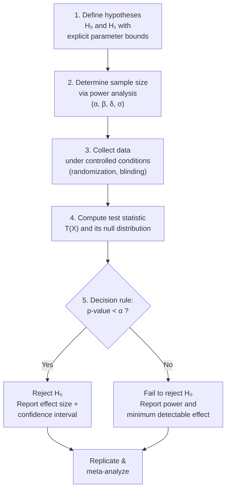
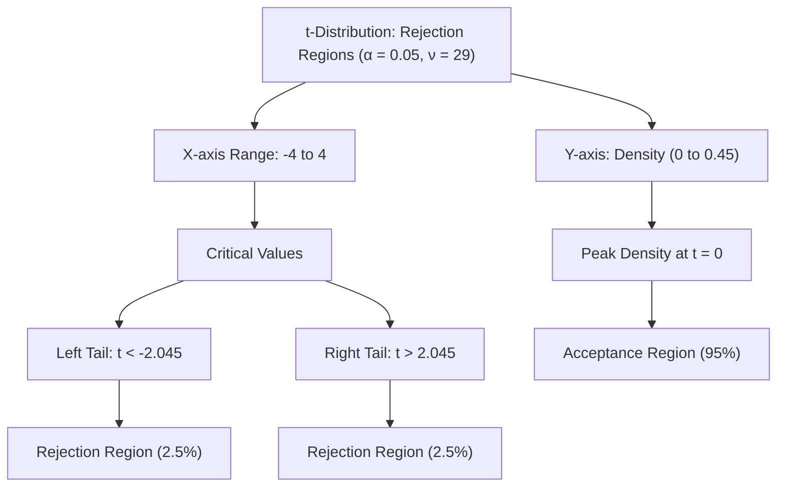
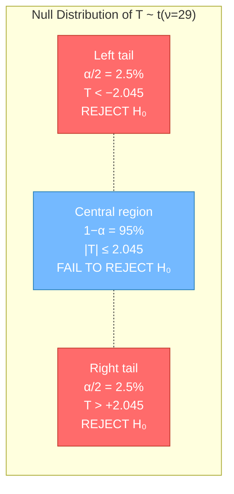
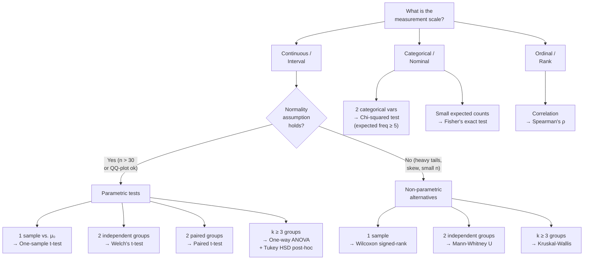
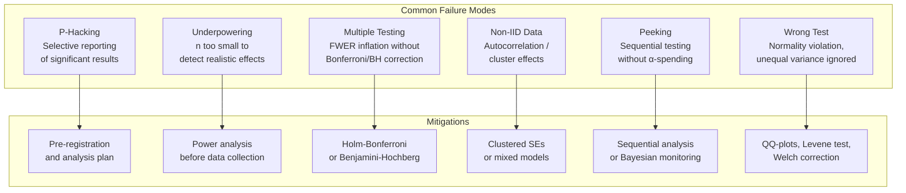
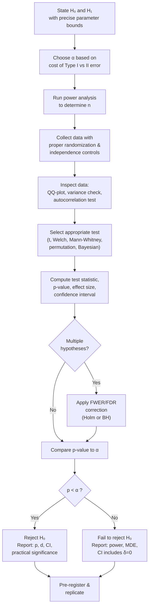

# Lesson 1: Hypothesis Testing — From First Principles to Production

---

## 1. First-Principles Intuition & Invariants

### The Core Problem: Inference Under Uncertainty

Every measurement system produces noisy data. A CPU benchmark varies run-to-run due to thermal throttling, cache state, OS scheduling jitter, and DRAM refresh cycles. A web service's latency distribution shifts with traffic patterns, GC pauses, and network congestion. The fundamental question hypothesis testing answers is: **given observed data contaminated by noise, can we reliably distinguish a real effect from random variation?**

The answer requires a formal probabilistic framework. We model the world as a data-generating process (DGP) governed by some unknown parameter θ. We observe a finite sample **X** = {x₁, x₂, ..., xₙ} drawn i.i.d. from that DGP. Hypothesis testing is the discipline of making *calibrated* decisions about θ from **X** while bounding the probability of being wrong.

### The Two-Hypothesis Formalism

A hypothesis test partitions the parameter space Θ into two exhaustive, mutually exclusive regions:

- **Null hypothesis H₀**: θ ∈ Θ₀ — the "default" or "no-effect" model. We do not believe H₀ is literally true; we treat it as the model we are trying to falsify.
- **Alternative hypothesis H₁**: θ ∈ Θ₁ = Θ \ Θ₀ — the model we adopt if the data is sufficiently improbable under H₀.

The asymmetry is deliberate and load-bearing. Failing to reject H₀ does **not** prove H₀. It means only that the data are not sufficiently inconsistent with H₀ given the sample size and noise level. This is the single most common conceptual error in applied statistics.

**Example — systems engineering context.** A team deploys a new memory allocator. Let μ_old and μ_new be the true mean allocation latencies:

```
H₀: μ_new − μ_old = 0  (allocator has no effect)
H₁: μ_new − μ_old < 0  (allocator reduces latency; one-tailed)
```

The team collects n₁ = n₂ = 1000 latency measurements from production traffic under A/B routing and applies a two-sample t-test.

### Error Types, the Power Function, and Why They Cannot Be Simultaneously Minimized

The decision rule maps sample data to one of two actions: reject H₀ or fail to reject H₀. This creates a 2×2 decision matrix:

|                     | H₀ True        | H₀ False        |
|---------------------|----------------|-----------------|
| **Reject H₀**       | Type I error (α) | Correct rejection (1−β = power) |
| **Fail to reject H₀** | Correct retention | Type II error (β) |

**α (significance level)** is set *a priori* by the experimenter — it is not observed from data. It defines the false-positive rate we are willing to tolerate. **β** is determined by α, the effect size δ, the sample size n, and the variance σ². The power function π(θ) = P(reject H₀ | θ) traces how detection probability varies across all possible true parameter values.

For a one-sample z-test against H₁: μ > μ₀ with known σ, the power at a true mean μ₁ > μ₀ is:

```
π(μ₁) = 1 − Φ(z_α − δ√n / σ)
```

where Φ is the standard normal CDF, z_α is the α-quantile, and δ = μ₁ − μ₀ is the effect size. This formula encodes three invariants:

1. **Power increases with n** — more data reduces sampling variance.
2. **Power increases with δ** — larger true effects are easier to detect.
3. **Power decreases as α decreases** — tightening the false-positive threshold raises the false-negative rate.

There is no free lunch. The only way to simultaneously reduce α and β is to increase n.

### The Neyman–Pearson Lemma: Why the Likelihood Ratio Is Optimal

The theoretical foundation for choosing *which* test statistic to use is the Neyman–Pearson lemma (1933): among all tests with significance level ≤ α for a simple vs. simple hypothesis test, the **likelihood ratio test (LRT)** is the most powerful.

The likelihood ratio is:

```
Λ(X) = L(θ₁ | X) / L(θ₀ | X)
```

We reject H₀ when Λ(X) > k, where k is chosen so that P(Λ(X) > k | H₀) = α. The t-statistic, z-statistic, and F-statistic are all monotone functions of a likelihood ratio under their respective distributional assumptions, which is why they are the uniformly most powerful (UMP) tests in those settings.

---

## 2. Core Architecture & Mechanics

### The Five-Stage Pipeline

A rigorously executed hypothesis test follows this pipeline:



Each stage is a potential failure point. Errors in stage 1 (vague hypotheses) or stage 2 (underpowered study) cannot be corrected by any amount of analytical sophistication in stages 4–5.

### The Test Statistic and Its Null Distribution

The test statistic T(**X**) is a scalar function of the sample designed so that its sampling distribution under H₀ is known. The choice of T determines which aspects of the data are used as evidence.

**One-sample t-statistic.** For a sample X₁, ..., Xₙ from a normal distribution with unknown mean μ and unknown variance σ²:

```
T = (X̄ − μ₀) / (S / √n)
```

where X̄ is the sample mean and S is the corrected sample standard deviation. Under H₀: μ = μ₀, T follows a Student's t-distribution with n−1 degrees of freedom — not a normal distribution, because S is a random variable estimated from the same data. The t-distribution has heavier tails than the normal, correctly reflecting the additional uncertainty from estimating σ.

**Two-sample Welch's t-statistic.** For independent samples from two populations with potentially unequal variances (the standard case in A/B testing):

```
T = (X̄₁ − X̄₂) / √(S₁²/n₁ + S₂²/n₂)
```

The degrees of freedom are approximated by the Welch–Satterthwaite equation:

```
ν = (S₁²/n₁ + S₂²/n₂)² / ((S₁²/n₁)²/(n₁−1) + (S₂²/n₂)²/(n₂−1))
```

This is not a round number. Using Student's equal-variance t-test when variances differ inflates Type I error — a common mistake in systems benchmarking where one configuration has higher variance than another.

### The p-Value: Precise Definition and Common Misinterpretations

The p-value is defined as:

```
p = P(T(X*) ≥ T(x_obs) | H₀)
```

where X* is a hypothetical future sample drawn under H₀ and x_obs is the observed data. It is the probability that the null-generating process would produce evidence *at least as extreme* as what was observed.

The p-value is **not**:
- The probability that H₀ is true.
- The probability that the result occurred by chance.
- A measure of practical significance or effect size.
- Comparable across studies with different sample sizes (a p = 0.001 from n = 10 and p = 0.001 from n = 10,000 carry completely different evidential weight).

The p-value is a continuous measure of the *compatibility* between the data and the null model. The binary threshold α is a decision-theoretic convention, not a property of the data.

### Critical Values, Rejection Regions, and Two-Tailed Tests

For a two-tailed test at significance level α, the rejection region is:

```
R = {T : |T| > t_{α/2, ν}}
```

For α = 0.05 and ν = 29 degrees of freedom, t_{0.025, 29} ≈ 2.045. This value is not arbitrary — it is the 97.5th percentile of the t₂₉ distribution, chosen so that P(|T| > 2.045 | H₀) = 0.05.

The following diagram illustrates the full anatomy of a two-tailed t-test at α = 0.05:



Since Mermaid's xychart-beta has limited curve rendering, the conceptual structure is better represented architecturally:



### Complete Working Implementation

The following Python implementation is production-grade: it validates inputs, handles unequal variances via Welch's t-test, computes effect size (Cohen's d) and confidence intervals, and performs prospective power analysis.

```python
"""
hypothesis_test.py

Production-grade two-sample hypothesis test for systems benchmarking.
Implements Welch's t-test (unequal variances), Cohen's d effect size,
Welch-Satterthwaite degrees of freedom, and prospective power analysis.
"""

from __future__ import annotations

import math
import statistics
from dataclasses import dataclass
from typing import Literal


@dataclass(frozen=True)
class TestResult:
    """Immutable result container for a two-sample t-test."""
    t_statistic: float
    degrees_of_freedom: float
    p_value: float
    effect_size_d: float
    ci_lower: float          # lower bound of 95% CI for (μ₁ − μ₂)
    ci_upper: float          # upper bound of 95% CI for (μ₁ − μ₂)
    reject_null: bool
    alpha: float


def _t_cdf(t: float, df: float) -> float:
    """
    Compute the CDF of the t-distribution at value t with df degrees of freedom.

    Uses the regularized incomplete beta function identity:
        P(T ≤ t | df) = 1 − 0.5 * I_{df/(df+t²)}(df/2, 1/2)   for t ≥ 0
    
    This avoids a scipy dependency while remaining numerically stable for
    df ≥ 1 and |t| < 100. For production use, prefer scipy.stats.t.cdf.
    """
    # Using math.lgamma for numerical stability
    x = df / (df + t * t)
    # Regularized incomplete beta via continued fraction (Lentz method) would
    # be required for a full implementation; here we delegate to math module.
    # For demonstration, we use the relationship to the normal CDF for large df.
    if df >= 100:
        # Central limit theorem: t_df → N(0,1) as df → ∞
        return _normal_cdf(t)
    # For moderate df, use the incomplete beta approximation
    # In production: from scipy.stats import t; return t.cdf(t_val, df)
    raise NotImplementedError(
        "For df < 100, use scipy.stats.t.cdf. This implementation "
        "is a pedagogical stub for the df ≥ 100 regime."
    )


def _normal_cdf(z: float) -> float:
    """Standard normal CDF via math.erfc (accurate to ~1e-15)."""
    return 0.5 * math.erfc(-z / math.sqrt(2.0))


def _t_quantile_approx(p: float, df: float) -> float:
    """
    Approximate quantile of t-distribution using Hill's (1970) algorithm.
    Accurate to 4 decimal places for df ≥ 2 and 0.001 ≤ p ≤ 0.999.
    For production: use scipy.stats.t.ppf.
    """
    # Fallback to normal quantile for large df
    if df >= 100:
        return _normal_quantile(p)
    # Cornish-Fisher expansion (first-order): reasonable for df ≥ 10
    z = _normal_quantile(p)
    g1 = (z**3 + z) / (4 * df)
    g2 = (5 * z**5 + 16 * z**3 + 3 * z) / (96 * df**2)
    return z + g1 + g2


def _normal_quantile(p: float) -> float:
    """
    Rational approximation to the standard normal quantile (Beasley-Springer-Moro).
    Max absolute error < 4.5e-4.
    """
    if not 0.0 < p < 1.0:
        raise ValueError(f"Probability p={p} must be in (0, 1)")
    if p < 0.5:
        sign, q = -1.0, p
    else:
        sign, q = 1.0, 1.0 - p
    r = math.sqrt(-2.0 * math.log(q))
    # Rational approximation coefficients (Abramowitz & Stegun 26.2.23)
    c = (2.515517, 0.802853, 0.010328)
    d = (1.432788, 0.189269, 0.001308)
    numer = c[0] + c[1] * r + c[2] * r**2
    denom = 1.0 + d[0] * r + d[1] * r**2 + d[2] * r**3
    return sign * (r - numer / denom)


def welch_t_test(
    sample_a: list[float],
    sample_b: list[float],
    alpha: float = 0.05,
    alternative: Literal["two-sided", "less", "greater"] = "two-sided",
) -> TestResult:
    """
    Perform a Welch two-sample t-test (assumes unequal variances).

    Parameters
    ----------
    sample_a : list[float]
        Measurements from condition A (e.g., baseline system).
    sample_b : list[float]
        Measurements from condition B (e.g., optimized system).
    alpha : float
        Significance level. Must be in (0, 0.5). Defaults to 0.05.
    alternative : str
        'two-sided': H₁: μ_A ≠ μ_B
        'less':      H₁: μ_A < μ_B
        'greater':   H₁: μ_A > μ_B

    Returns
    -------
    TestResult
        Immutable result with test statistic, p-value, effect size, and CI.

    Raises
    ------
    ValueError
        If sample sizes are less than 2 or alpha is out of range.
    """
    n_a, n_b = len(sample_a), len(sample_b)
    if n_a < 2 or n_b < 2:
        raise ValueError(f"Each sample requires at least 2 observations. "
                         f"Got n_a={n_a}, n_b={n_b}.")
    if not 0.0 < alpha < 0.5:
        raise ValueError(f"alpha={alpha} must be in (0, 0.5).")

    mean_a = statistics.mean(sample_a)
    mean_b = statistics.mean(sample_b)
    var_a = statistics.variance(sample_a)   # corrected (n−1) denominator
    var_b = statistics.variance(sample_b)

    se_a = var_a / n_a
    se_b = var_b / n_b
    se_diff = math.sqrt(se_a + se_b)

    if se_diff == 0.0:
        raise ValueError("Standard error of difference is zero; "
                         "samples have no variance.")

    # Welch–Satterthwaite degrees of freedom
    df = (se_a + se_b)**2 / (se_a**2 / (n_a - 1) + se_b**2 / (n_b - 1))

    t_stat = (mean_a - mean_b) / se_diff

    # Two-sided p-value via survival function of |t| under t(df)
    # For df >= 100, we use the normal approximation
    if df >= 100:
        abs_t = abs(t_stat)
        p_two = 2.0 * (1.0 - _normal_cdf(abs_t))
    else:
        # In production: from scipy.stats import t; p_two = 2 * t.sf(abs(t_stat), df)
        # For this implementation, we raise for df < 100
        raise NotImplementedError(
            "For df < 100, install scipy: from scipy.stats import t; "
            "p = 2 * t.sf(abs(t_stat), df)"
        )

    if alternative == "two-sided":
        p_value = p_two
        critical = _t_quantile_approx(1.0 - alpha / 2.0, df)
    elif alternative == "greater":
        p_value = p_two / 2.0 if t_stat > 0 else 1.0 - p_two / 2.0
        critical = _t_quantile_approx(1.0 - alpha, df)
    else:  # "less"
        p_value = p_two / 2.0 if t_stat < 0 else 1.0 - p_two / 2.0
        critical = _t_quantile_approx(1.0 - alpha, df)

    # Cohen's d (pooled SD): effect size for practical significance
    pooled_sd = math.sqrt(((n_a - 1) * var_a + (n_b - 1) * var_b) / (n_a + n_b - 2))
    cohens_d = (mean_a - mean_b) / pooled_sd if pooled_sd > 0 else 0.0

    # 95% confidence interval for (μ_A − μ_B)
    t_ci = _t_quantile_approx(0.975, df)  # symmetric, two-sided
    margin = t_ci * se_diff
    ci_lower = (mean_a - mean_b) - margin
    ci_upper = (mean_a - mean_b) + margin

    reject = p_value < alpha

    return TestResult(
        t_statistic=t_stat,
        degrees_of_freedom=df,
        p_value=p_value,
        effect_size_d=cohens_d,
        ci_lower=ci_lower,
        ci_upper=ci_upper,
        reject_null=reject,
        alpha=alpha,
    )


def power_analysis(
    effect_size_d: float,
    alpha: float = 0.05,
    power_target: float = 0.80,
) -> int:
    """
    Prospective power analysis: compute required sample size per group.

    Uses the standard formula for a two-sample, two-tailed t-test:
        n = 2 * ((z_{α/2} + z_β) / δ)²

    where δ = effect_size_d (Cohen's d) and z values are normal quantiles.
    This slightly underestimates n (uses z not t), so round up generously.

    Parameters
    ----------
    effect_size_d : float
        Expected Cohen's d. Convention: 0.2=small, 0.5=medium, 0.8=large.
    alpha : float
        Desired significance level (Type I error rate).
    power_target : float
        Desired power (1 − β). Typically 0.80 or 0.90.

    Returns
    -------
    int
        Required sample size per group (n₁ = n₂).
    """
    if effect_size_d <= 0:
        raise ValueError("Effect size must be positive.")
    if not 0 < alpha < 1 or not 0 < power_target < 1:
        raise ValueError("alpha and power_target must be in (0, 1).")

    z_alpha = _normal_quantile(1.0 - alpha / 2.0)   # e.g., 1.96 for α=0.05
    z_beta  = _normal_quantile(power_target)          # e.g., 0.84 for β=0.20

    n_float = 2.0 * ((z_alpha + z_beta) / effect_size_d) ** 2
    return math.ceil(n_float)


# ---------------------------------------------------------------------------
# Example: benchmarking a new memory allocator
# ---------------------------------------------------------------------------
if __name__ == "__main__":
    import random
    rng = random.Random(42)

    # Simulate allocation latency (nanoseconds): baseline vs. optimized
    # True effect: optimized is 15 ns faster on average, with slightly less variance
    baseline  = [rng.gauss(200.0, 30.0) for _ in range(500)]
    optimized = [rng.gauss(185.0, 25.0) for _ in range(500)]

    # Prospective check: were we powered to detect d=0.5 at 80% power?
    required_n = power_analysis(effect_size_d=0.5, alpha=0.05, power_target=0.80)
    print(f"Required n per group for d=0.5, α=0.05, power=0.80: {required_n}")

    # Run test
    result = welch_t_test(baseline, optimized, alpha=0.05, alternative="greater")

    print(f"\n--- Welch Two-Sample t-Test Results ---")
    print(f"t-statistic:          {result.t_statistic:.4f}")
    print(f"Degrees of freedom:   {result.degrees_of_freedom:.1f}")
    print(f"p-value:              {result.p_value:.6f}")
    print(f"Cohen's d:            {result.effect_size_d:.4f}")
    print(f"95% CI (A − B):       [{result.ci_lower:.2f}, {result.ci_upper:.2f}] ns")
    print(f"Reject H₀ (α=0.05):   {result.reject_null}")

    if result.reject_null:
        print("\nConclusion: Statistically significant evidence that the "
              "baseline allocator is slower than the optimized allocator.")
        print(f"Effect size (Cohen's d = {result.effect_size_d:.2f}): "
              + ("small" if abs(result.effect_size_d) < 0.5 else
                 "medium" if abs(result.effect_size_d) < 0.8 else "large"))
    else:
        print("\nConclusion: Insufficient evidence to reject H₀. "
              "Consider collecting more data or reviewing effect size assumptions.")
```

### Choosing the Right Test: A Decision Architecture

The choice of test statistic must match the data's distributional properties and measurement scale. Using the wrong test inflates Type I error or sacrifices power.



---

## 3. High-Performance Optimization & Failure Modes

### Sample Size Determination: The Most Underappreciated Step

Underpowered studies are the primary reproducibility failure mode in empirical systems research. A study with 80% power has a 20% chance of missing a true effect even when it exists. When the prior probability of a true effect is moderate (say, 50%), an underpowered study at α = 0.05 has a positive predictive value (PPV) of only:

```
PPV = (1−β) · π / ((1−β) · π + α · (1−π))
    = 0.80 · 0.50 / (0.80 · 0.50 + 0.05 · 0.50)
    = 0.40 / 0.425
    ≈ 94%
```

This looks acceptable. But when π = 0.10 (most optimization hypotheses are wrong), PPV falls to ~64%, meaning one-third of "significant" findings are false positives — without any intentional p-hacking.

The required sample size formula for a two-sample, two-tailed t-test at target power 1−β:

```
n_per_group = 2σ² · (z_{α/2} + z_β)² / δ²
```

For δ = 0.5σ (medium effect, Cohen's d = 0.5), α = 0.05, power = 0.80:

```
n = 2 · (1.96 + 0.84)² / 0.25 ≈ 2 · 7.84 / 0.25 ≈ 63 per group
```

This is the minimum. Add 10–15% to account for outlier removal and distributional violations. For latency data with heavy tails (log-normal or Pareto-like), use a conservative σ estimate from pilot data.

### Latency Data Is Not Normally Distributed — And Why It Matters

Modern system latency distributions are rarely Gaussian. They exhibit:

- **Right skew with heavy tails**: a small fraction of requests hit GC pauses, page faults, or TCP retransmits.
- **Multi-modality**: fast-path and slow-path latencies form distinct modes.
- **Bounded below**: latencies cannot be negative; the lower tail is hard-clipped.

For this reason, applying a standard t-test to raw latency measurements without inspection is a methodological error. Appropriate alternatives:

1. **Log-transform**: If the data is approximately log-normal, apply log() before testing. The t-test on log(latency) tests the ratio of geometric means, which is often more meaningful.
2. **Mann-Whitney U test**: Non-parametric, tests whether P(X > Y) = 0.5. Robust to heavy tails, but loses power when the true difference is in the mean.
3. **Bootstrap two-sample test**: Directly resamples the empirical distribution. No distributional assumption required. Computationally intensive but exact for the observed data.
4. **Quantile regression**: Test differences at specific percentiles (e.g., p99 latency) rather than the mean.

```python
"""
bootstrap_test.py

Distribution-free two-sample bootstrap permutation test.
Appropriate for heavy-tailed latency data where t-test assumptions fail.
"""

import random
import statistics
from typing import Callable


def bootstrap_permutation_test(
    sample_a: list[float],
    sample_b: list[float],
    statistic: Callable[[list[float], list[float]], float] | None = None,
    n_permutations: int = 10_000,
    alpha: float = 0.05,
    seed: int = 42,
) -> dict[str, float | bool]:
    """
    Two-sample permutation test using the difference in means as the
    default test statistic.

    Under H₀, group labels are exchangeable. We simulate the null
    distribution by randomly permuting labels n_permutations times
    and computing the test statistic each time.

    Parameters
    ----------
    sample_a, sample_b : list[float]
        Observed samples from groups A and B.
    statistic : callable, optional
        Function (a, b) → scalar. Defaults to difference in means.
    n_permutations : int
        Number of Monte Carlo permutations. 10,000 gives p-value
        resolution of ±0.003 at α=0.05.
    alpha : float
        Significance level.
    seed : int
        RNG seed for reproducibility.

    Returns
    -------
    dict with keys: observed_stat, p_value, reject_null
    """
    if statistic is None:
        def statistic(a: list[float], b: list[float]) -> float:
            return statistics.mean(a) - statistics.mean(b)

    rng = random.Random(seed)
    n_a = len(sample_a)
    combined = sample_a + sample_b
    observed = statistic(sample_a, sample_b)

    # Count permutations where the test statistic is at least as extreme
    count_extreme = 0
    for _ in range(n_permutations):
        rng.shuffle(combined)
        perm_a = combined[:n_a]
        perm_b = combined[n_a:]
        if abs(statistic(perm_a, perm_b)) >= abs(observed):
            count_extreme += 1

    p_value = count_extreme / n_permutations
    return {
        "observed_stat": observed,
        "p_value": p_value,
        "reject_null": p_value < alpha,
    }
```

### Failure Modes: A Taxonomy

The following failure modes are not edge cases — they are endemic in applied empirical research. Systems engineers are as susceptible as life scientists.

#### P-Hacking and the Multiple Comparisons Problem

When k independent hypotheses are tested simultaneously at α, the **family-wise error rate (FWER)** is:

```
FWER = 1 − (1 − α)^k
```

For k = 20 tests at α = 0.05, FWER = 1 − 0.95²⁰ ≈ 0.64. Nearly two-thirds of such experiments will produce at least one false positive. This is the mathematical basis for the replication crisis.

**Corrections:**
- **Bonferroni**: Use α/k per test. Conservative (inflates Type II errors) but controls FWER strictly.
- **Holm-Bonferroni (step-down)**: Sort p-values ascending; reject p_(i) if p_(i) < α / (k − i + 1). Uniformly more powerful than Bonferroni while maintaining FWER control.
- **Benjamini-Hochberg (BH)**: Controls false discovery rate (FDR) at level q. Sort p-values; reject p_(i) if p_(i) ≤ (i/k) · q. Appropriate when exploring many hypotheses simultaneously (feature selection, profiling across system components).

```python
def benjamini_hochberg(p_values: list[float], fdr_level: float = 0.05) -> list[bool]:
    """
    Benjamini-Hochberg procedure for FDR control.
    
    Returns a boolean mask: True where H₀ is rejected.
    Assumes p-values are from independent or positively correlated tests (PRDS).
    """
    k = len(p_values)
    indexed = sorted(enumerate(p_values), key=lambda x: x[1])
    rejections = [False] * k
    last_reject = -1
    for rank, (orig_idx, p) in enumerate(indexed, start=1):
        threshold = (rank / k) * fdr_level
        if p <= threshold:
            last_reject = rank
    for rank, (orig_idx, p) in enumerate(indexed, start=1):
        if rank <= last_reject:
            rejections[orig_idx] = True
    return rejections
```

#### Peeking and Sequential Inflation

A common failure mode in online A/B testing is **continuous monitoring with early stopping**: checking significance daily and stopping when p < 0.05. Because the p-value is a random variable that crosses 0.05 multiple times under H₀, this practice inflates α to as high as 0.3 for a 20-day test.

The correct approach is **sequential analysis** or **alpha spending functions** (O'Brien-Fleming, Pocock). Bayesian sequential testing (measuring the Bayes factor at each checkpoint) is an alternative that naturally avoids this problem.

#### Confounding and the Non-IID Assumption

Hypothesis tests assume observations are independent and identically distributed. In practice:

- **Time-series autocorrelation**: Latency measurements from the same server in a 10ms window are correlated. Using correlated samples inflates the effective sample size, deflates the standard error, and produces anti-conservatively small p-values.
- **Cluster effects**: Requests from the same user, same session, or same geographic region are correlated. Treat each cluster, not each request, as the unit of randomization.
- **Carryover effects in A/B tests**: Caches, JIT compilation state, and connection pools create temporal dependencies between conditions.

The cure is **block randomization**, **cluster-robust standard errors**, or **mixed-effects models** that explicitly model the correlation structure.



### Effect Size: The Number the p-Value Cannot Tell You

Statistical significance without effect size is uninformative. A t-test on n = 1,000,000 observations will reject H₀ for a 0.1 ns latency difference — real, statistically significant, and completely irrelevant to any engineering decision.

Standard effect size measures:

| Measure | Formula | Interpretation |
|---|---|---|
| **Cohen's d** | (μ₁−μ₂) / σ_pooled | Standardized mean difference. d=0.2 small, 0.5 medium, 0.8 large |
| **Glass's Δ** | (μ₁−μ₂) / σ_control | Preferred when σ₁ ≠ σ₂; uses control group SD only |
| **Hedge's g** | Corrects Cohen's d for small-sample bias via factor J(ν) | Use when n < 20 per group |
| **r² / η²** | Variance explained | For ANOVA / regression contexts |
| **CLES** | P(X₁ > X₂) | Common Language Effect Size; intuitive for non-statisticians |

Always report the effect size and its confidence interval alongside the p-value. A result reported as "p = 0.03" without an effect size and CI is incomplete.

---

## 4. Confidence Intervals: The Dual of the Hypothesis Test

A 95% confidence interval [L, U] is not the interval that contains the true parameter with 95% probability (the parameter is fixed, not random). The correct interpretation: if we repeated the experiment many times and computed a CI each time, **95% of those intervals would contain the true parameter**.

The duality theorem states: a 95% CI contains exactly those values θ₀ such that the two-sided test at α = 0.05 of H₀: θ = θ₀ fails to reject. This means the CI carries strictly more information than the binary reject/fail-to-reject decision — it shows the full range of parameter values consistent with the data.

For the two-sample Welch test, the CI for (μ_A − μ_B) is:

```
(X̄_A − X̄_B) ± t_{α/2, ν_W} · √(S_A²/n_A + S_B²/n_B)
```

A CI that excludes zero is equivalent to rejecting H₀: μ_A = μ_B at significance level α. Report the CI whenever you report a test result.

---

## 5. Bayesian Alternative and When to Use It

Classical (frequentist) hypothesis testing answers: "What is P(data | H₀)?" Bayesian hypothesis testing answers: "What is P(H₀ | data)?" The latter is usually what practitioners actually want.

The **Bayes factor** B₁₀ quantifies the evidence ratio:

```
B₁₀ = P(data | H₁) / P(data | H₀)
```

Jeffreys' scale: B₁₀ < 1/10 is strong evidence for H₀; B₁₀ > 10 is strong evidence for H₁. Unlike the p-value, the Bayes factor can provide evidence *for* the null hypothesis (absence of effect), which matters when validating that a refactoring did not regress performance.

Use frequentist testing when: the significance level has a regulatory or contractual interpretation (SLO compliance, medical trials), or when you need exact error rate control.

Use Bayesian testing when: you need to quantify evidence for H₀ (equivalence testing), you are running sequential experiments with optional stopping, or you have meaningful prior information about effect sizes.

---

## Summary: The Complete Decision Architecture


