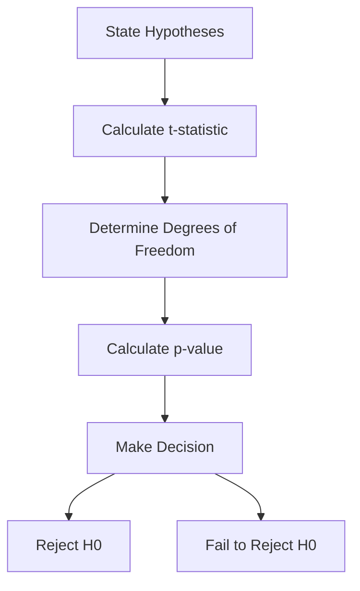

# Lesson 2: Statistical Significance

## 1. First-Principles Intuition & Invariants

In the realm of data analysis and hypothesis testing, statistical significance is a cornerstone concept that helps us determine whether the observed results are due to chance or to an actual effect. To fully grasp the nuances of statistical significance, we must delve into the foundational principles of probability and hypothesis testing.

At the heart of statistical significance lies the null hypothesis (\(H_0\)), which posits that there is no effect or no difference between groups being compared. The alternative hypothesis (\(H_1\)) suggests that there is an effect or a difference. The process of hypothesis testing involves collecting data and using statistical methods to assess the likelihood that the observed data could have occurred under the null hypothesis.

The p-value is a critical component of this process. It represents the probability of observing data as extreme as, or more extreme than, the observed data, assuming the null hypothesis is true. In other words, the p-value quantifies the strength of evidence against the null hypothesis. A small p-value indicates that the observed data are unlikely under the null hypothesis, suggesting that we should reject the null hypothesis in favor of the alternative hypothesis.

However, the interpretation of the p-value is not without its complexities. The significance level, often denoted as \(\alpha\), is a threshold set by the researcher to decide when to reject the null hypothesis. Commonly, \(\alpha\) is set to 0.05, meaning that if the p-value is less than 0.05, the result is considered statistically significant, and the null hypothesis is rejected. This threshold is arbitrary but widely adopted in many fields.

It is crucial to understand that a statistically significant result does not necessarily imply practical significance. A small p-value indicates that the observed effect is unlikely to be due to chance, but it does not provide information about the magnitude or importance of the effect. Conversely, a non-significant result does not mean that there is no effect; it simply means that the data do not provide strong enough evidence to reject the null hypothesis.

The concept of statistical power is also essential in this context. Power is the probability of correctly rejecting the null hypothesis when it is false. A high power is desirable because it increases the likelihood of detecting a true effect. Power is influenced by several factors, including the sample size, the effect size, and the significance level. Increasing the sample size or the effect size, or decreasing the significance level, can all increase the power of a test.

Another critical aspect of statistical significance is the potential for Type I and Type II errors. A Type I error occurs when the null hypothesis is rejected when it is actually true, leading to a false positive. A Type II error occurs when the null hypothesis is not rejected when it is actually false, leading to a false negative. The significance level \(\alpha\) controls the probability of a Type I error, while the power of the test controls the probability of a Type II error.

In summary, statistical significance is a fundamental concept in hypothesis testing that helps us determine whether observed results are due to chance or an actual effect. The p-value, significance level, and power are key components of this process, and understanding their interplay is crucial for making informed decisions based on data.

## 2. Core Architecture & Mechanics

To illustrate the mechanics of statistical significance, let us consider a simple example involving a t-test. A t-test is used to compare the means of two groups to determine whether there is a statistically significant difference between them.

Suppose we have two groups of software engineers, Group A and Group B, and we want to determine whether there is a significant difference in their average code quality scores. We collect data on the code quality scores for each group and perform a t-test to compare the means.

The t-test involves several steps:

1. **State the hypotheses:**
   - Null hypothesis (\(H_0\)): The mean code quality scores for Group A and Group B are equal.
   - Alternative hypothesis (\(H_1\)): The mean code quality scores for Group A and Group B are not equal.

2. **Calculate the t-statistic:**
   The t-statistic is calculated using the formula:
   \[
   t = \frac{\bar{X}_A - \bar{X}_B}{\sqrt{\frac{s_A^2}{n_A} + \frac{s_B^2}{n_B}}}
   \]
   where \(\bar{X}_A\) and \(\bar{X}_B\) are the sample means, \(s_A^2\) and \(s_B^2\) are the sample variances, and \(n_A\) and \(n_B\) are the sample sizes for Group A and Group B, respectively.

3. **Determine the degrees of freedom:**
   The degrees of freedom for the t-test are calculated using the formula:
   \[
   \text{df} = \frac{\left(\frac{s_A^2}{n_A} + \frac{s_B^2}{n_B}\right)^2}{\frac{\left(\frac{s_A^2}{n_A}\right)^2}{n_A-1} + \frac{\left(\frac{s_B^2}{n_B}\right)^2}{n_B-1}}
   \]

4. **Calculate the p-value:**
   The p-value is calculated using the t-distribution with the determined degrees of freedom. The p-value represents the probability of observing a t-statistic as extreme as, or more extreme than, the calculated t-statistic, assuming the null hypothesis is true.

5. **Make a decision:**
   If the p-value is less than the significance level \(\alpha\) (commonly 0.05), we reject the null hypothesis in favor of the alternative hypothesis. Otherwise, we fail to reject the null hypothesis.

To visualize the t-test process, we can use a Mermaid diagram:

In this diagram, each step of the t-test process is represented as a node, and the flow of the process is represented by directed edges. The final decision to reject or fail to reject the null hypothesis is based on the calculated p-value and the significance level.

## 3. High-Performance Optimization & Failure Modes

When performing hypothesis testing and interpreting statistical significance, several considerations are essential to ensure the accuracy and reliability of the results.

### Concurrency and Resource Scaling

In large-scale data analysis, concurrency and resource scaling can significantly impact the performance and accuracy of hypothesis testing. When dealing with large datasets, it is often necessary to parallelize the computation to improve efficiency. However, parallelization can introduce challenges such as race conditions and data consistency issues.

To mitigate these challenges, it is crucial to use robust data structures and synchronization mechanisms. For example, using thread-safe data structures and locks can help prevent race conditions. Additionally, using distributed computing frameworks such as Apache Spark can help scale the computation across multiple nodes, improving performance while maintaining data consistency.

### Boundary Edge Cases

In hypothesis testing, boundary edge cases can arise when dealing with small sample sizes, outliers, or non-normal distributions. These cases can significantly impact the validity of the results.

For example, when dealing with small sample sizes, the assumptions of the t-test may not hold, leading to inaccurate results. In such cases, non-parametric tests such as the Mann-Whitney U test can be used instead. Outliers can also impact the results, as they can skew the sample mean and variance. It is essential to identify and handle outliers appropriately, either by removing them or using robust statistical methods that are less sensitive to outliers.

### Failure Mitigations

To ensure the accuracy and reliability of hypothesis testing, several failure mitigations can be employed. These include:

1. **Data Validation:**
   Ensuring that the data is clean and free from errors is crucial. Data validation techniques such as data cleaning and outlier detection can help identify and address issues in the data.

2. **Robust Statistical Methods:**
   Using robust statistical methods that are less sensitive to violations of assumptions can help improve the accuracy of the results. For example, using non-parametric tests or robust regression methods can help mitigate the impact of outliers and non-normal distributions.

3. **Replication and Validation:**
   Replicating the analysis and validating the results using different datasets or methods can help ensure the reliability of the results. This can help identify any potential biases or errors in the analysis.

In summary, statistical significance is a fundamental concept in hypothesis testing that helps us determine whether observed results are due to chance or an actual effect. The p-value, significance level, and power are key components of this process, and understanding their interplay is crucial for making informed decisions based on data. When performing hypothesis testing, it is essential to consider concurrency, resource scaling, boundary edge cases, and failure mitigations to ensure the accuracy and reliability of the results.
