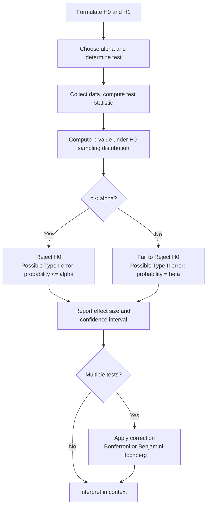
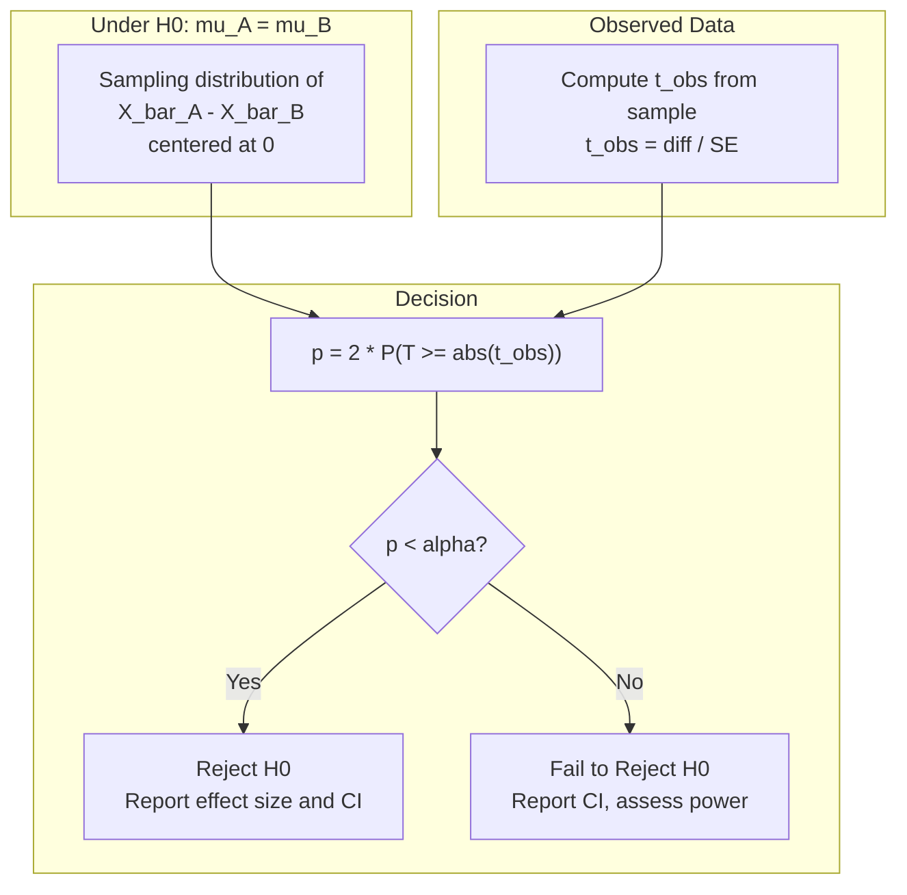

# Lesson 2: Statistical Significance

## 1. First-Principles Intuition & Invariants

Statistical significance is a decision procedure built on a probabilistic model of how data is generated. It answers a narrow question: given a model of "no effect" (the null hypothesis), how surprising is the data we observed? The answer is a probability, and we compare it against a pre-registered threshold to make a binary decision. Understanding the machinery beneath this procedure requires grounding in three pillars: the sampling distribution, the null model, and the decision framework that connects them.

### The Sampling Distribution and the Null Model

When we compute a statistic from a sample (a mean, a proportion, a regression coefficient), that statistic is itself a random variable. If we repeatedly drew samples of the same size from the same population, the statistic would vary from draw to draw. The distribution of these repeated values is the **sampling distribution**. The Central Limit Theorem tells us that for sufficiently large samples, the sampling distribution of the mean is approximately normal, regardless of the underlying population distribution, converging at a rate of $O(1/\sqrt{n})$.

The **null hypothesis** ($H_0$) specifies a particular value for the parameter of interest, typically "no effect" or "no difference." Under $H_0$, we can derive the exact sampling distribution of our test statistic. For a t-test comparing two group means, if $H_0$ states that $\mu_A = \mu_B$, then the difference $\bar{X}_A - \bar{X}_B$ should center at zero, and its spread is determined by the sample variances and sizes. The **test statistic** (e.g., the t-statistic) transforms the observed data into a single value on a known distribution, making the comparison tractable.

### The p-value as Tail Probability

The **p-value** is the probability of observing a test statistic at least as extreme as the one computed from our data, assuming $H_0$ is true. Formally:

$$p = P(T \geq t_{\text{obs}} \mid H_0 \text{ true})$$

for a one-sided test, or the two-tailed analog for a two-sided test. The p-value is **not** the probability that the null hypothesis is true, nor is it the probability that the result is due to chance. It is a conditional probability: conditional on $H_0$ being true, how extreme is our data?

### The Decision Threshold and Error Types

The **significance level** $\alpha$ is a pre-specified threshold that controls the long-run rate of false positives. If we set $\alpha = 0.05$, then across many independent tests where $H_0$ is true, we expect to falsely reject $H_0$ in 5% of cases. This is the **Type I error rate**:

| | $H_0$ True | $H_0$ False |
|---|---|---|
| **Reject $H_0$** | Type I Error ($\alpha$) | Correct (Power = $1 - \beta$) |
| **Fail to Reject $H_0$** | Correct ($1 - \alpha$) | Type II Error ($\beta$) |

The **Type II error rate** $\beta$ is the probability of failing to reject $H_0$ when it is false. **Statistical power** is $1 - \beta$, the probability of correctly detecting a true effect.

Power depends on four interrelated quantities:

- **Sample size ($n$)**: Larger samples narrow the sampling distribution, separating signal from noise.
- **Effect size**: The magnitude of the true difference. Larger effects are easier to detect.
- **Significance level ($\alpha$)**: Raising $\alpha$ increases power but also increases the Type I error rate. Lowering $\alpha$ decreases power. These trade off directly.
- **Variance ($\sigma^2$)**: Higher population variance widens the sampling distribution, reducing power.

These four quantities are linked by the power equation. For a two-sample t-test with equal group sizes and equal variance:

$$n = \frac{2(z_{1-\alpha/2} + z_{1-\beta})^2 \sigma^2}{\Delta^2}$$

where $\Delta = \mu_A - \mu_B$ is the minimum detectable effect size. This equation reveals the fundamental scaling law: to halve the detectable effect size, you need **four times** the sample size, not two times, because the relationship is quadratic.

### Practical vs. Statistical Significance

A p-value of 0.001 tells you the data is incompatible with $H_0$ in the direction of the observed effect. It says nothing about the **magnitude** of that effect. With a large enough sample, even trivially small differences become statistically significant. This is why **effect size** measures (Cohen's $d$, Pearson's $r$, odds ratios) must accompany p-values. A study with $n = 100{,}000$ will detect a 0.01-point difference in code quality scores with $p < 0.05$, but that 0.01-point difference may be meaningless in practice.

Conversely, a non-significant result does **not** prove the null. Absence of evidence is not evidence of absence. A confidence interval that includes zero but is wide (e.g., $[-5.2, 1.3]$) tells you the study lacked precision, not that the effect is zero. A narrow interval near zero (e.g., $[-0.1, 0.08]$) is much stronger evidence for the null.

### Multiple Testing and the False Discovery Rate

When performing $m$ independent tests at significance level $\alpha$, the probability of at least one false positive is $1 - (1 - \alpha)^m$. For $m = 20$ and $\alpha = 0.05$, this is $1 - 0.95^{20} \approx 0.64$. Nearly two-thirds chance of at least one spurious finding.

Two corrections dominate practice:

- **Bonferroni correction**: Reject $H_0$ for test $i$ only if $p_i < \alpha / m$. This controls the family-wise error rate (FWER) but is conservative, especially when tests are correlated.
- **Benjamini-Hochberg (FDR)**: Sort p-values $p_{(1)} \leq p_{(2)} \leq \cdots \leq p_{(m)}$. Reject all $H_{(i)}$ for $i \leq k$, where $k$ is the largest index such that $p_{(k)} \leq \frac{k}{m} \cdot q$, with $q$ being the desired false discovery rate (e.g., 0.05). This is less conservative and controls the expected proportion of false positives among rejected hypotheses.



### The Bayesian Critique

The frequentist framework treats parameters as fixed but unknown, and probabilities as long-run frequencies. The **Bayesian alternative** treats parameters as random variables with prior distributions. Instead of a p-value, a Bayesian computes the **posterior probability** $P(H_0 \mid \text{data})$ directly, and the **Bayes factor** quantifies how much the data shifts the odds in favor of $H_1$ over $H_0$.

The Bayes factor $BF_{10}$ is:

$$BF_{10} = \frac{P(\text{data} \mid H_1)}{P(\text{data} \mid H_0)}$$

A $BF_{10} > 1$ means the data is more likely under $H_1$ than $H_0$. Jeffreys' scale classifies $BF_{10}$ values: 3-10 is "substantial" evidence for $H_1$, 10-30 is "strong," and >100 is "decisive."

The key philosophical difference: p-values can only accumulate evidence against $H_0$, never in favor of it. A p-value of 0.20 might mean $H_0$ is true, or it might mean the study was underpowered. A Bayes factor can distinguish between "the data supports $H_0$" and "the data is inconclusive."

## 2. Core Mechanics: The Welch's t-Test End-to-End

The two-sample t-test compares whether two population means differ. Two variants exist:

- **Student's t-test**: Assumes equal population variances ($\sigma_A^2 = \sigma_B^2$). Pools the variance estimate.
- **Welch's t-test**: Does not assume equal variances. Uses separate variance estimates. This is the default in most modern software (R's `t.test`, SciPy's `scipy.stats.ttest_ind` with `equal_var=False`) because the equal-variance assumption is rarely justified, and Welch's test performs nearly identically when variances are equal while being far more robust when they are not.

### Welch's t-Test Step by Step

Given two independent samples $X_A = \{x_{A,1}, \dots, x_{A,n_A}\}$ and $X_B = \{x_{B,1}, \dots, x_{B,n_B}\}$:

**Step 1: State hypotheses.**

$$H_0: \mu_A = \mu_B \quad \text{vs.} \quad H_1: \mu_A \neq \mu_B$$

**Step 2: Compute the t-statistic.**

$$t = \frac{\bar{X}_A - \bar{X}_B}{\sqrt{\frac{s_A^2}{n_A} + \frac{s_B^2}{n_B}}}$$

where $s_A^2 = \frac{1}{n_A - 1}\sum_{i=1}^{n_A}(x_{A,i} - \bar{X}_A)^2$ is the unbiased sample variance. The denominator is the standard error of the difference in means. Under $H_0$, this statistic follows approximately a t-distribution.

**Step 3: Compute degrees of freedom (Welch-Satterthwaite equation).**

$$\text{df} = \frac{\left(\frac{s_A^2}{n_A} + \frac{s_B^2}{n_B}\right)^2}{\frac{\left(\frac{s_A^2}{n_A}\right)^2}{n_A - 1} + \frac{\left(\frac{s_B^2}{n_B}\right)^2}{n_B - 1}}$$

This is a fractional value, not an integer. It approximates the degrees of freedom of a t-distribution whose tail behavior matches the actual (unknown) distribution of the test statistic. The Welch-Satterthwaite approximation works by matching the first two moments of a chi-squared distribution to the linear combination of sample variances in the denominator.

**Step 4: Compute the p-value.**

For a two-tailed test:

$$p = 2 \cdot P(T_{\text{df}} \geq |t_{\text{obs}}|)$$

where $T_{\text{df}}$ is a random variable following the t-distribution with $\text{df}$ degrees of freedom. This integral has no closed form and is evaluated numerically (typically via the incomplete beta function).

**Step 5: Decision and effect size.**

If $p < \alpha$, reject $H_0$. Report Cohen's $d$:

$$d = \frac{\bar{X}_A - \bar{X}_B}{s_p}$$

where $s_p = \sqrt{\frac{s_A^2 + s_B^2}{2}}$ is the pooled standard deviation. Conventional interpretation: $d = 0.2$ is small, $d = 0.5$ is medium, $d = 0.8$ is large. These thresholds are domain-specific conventions, not universal laws.

### Confidence Interval for the Difference in Means

The $(1-\alpha)$ confidence interval for $\mu_A - \mu_B$ is:

$$\text{CI} = (\bar{X}_A - \bar{X}_B) \pm t_{\text{df}, \alpha/2} \cdot \sqrt{\frac{s_A^2}{n_A} + \frac{s_B^2}{n_B}}$$

If this interval excludes zero, the test is significant at level $\alpha$. The interval also communicates precision: a narrow CI around a small effect size is more informative than a wide CI around a large one.



### Production-Grade Python Implementation

```python
import numpy as np
from scipy import stats
from dataclasses import dataclass
from typing import Tuple


@dataclass
class TTestResult:
    t_statistic: float
    degrees_of_freedom: float
    p_value: float
    mean_difference: float
    cohens_d: float
    ci_lower: float
    ci_upper: float
    reject_null: bool


def welch_t_test(
    group_a: np.ndarray,
    group_b: np.ndarray,
    alpha: float = 0.05,
    alternative: str = "two-sided",
) -> TTestResult:
    """
    Perform Welch's two-sample t-test without assuming equal variances.

    Parameters
    ----------
    group_a, group_b : np.ndarray
        Independent samples (1-D arrays of numeric values).
    alpha : float
        Significance level (default 0.05).
    alternative : str
        'two-sided', 'less' (mu_A < mu_B), or 'greater' (mu_A > mu_B).

    Returns
    -------
    TTestResult containing the test statistic, degrees of freedom,
    p-value, effect size, confidence interval, and rejection decision.
    """
    n_a, n_b = len(group_a), len(group_b)
    if n_a < 2 or n_b < 2:
        raise ValueError("Each group must have at least 2 observations.")

    mean_a, mean_b = np.mean(group_a), np.mean(group_b)
    var_a, var_b = np.var(group_a, ddof=1), np.var(group_b, ddof=1)

    # Standard error of the difference in means
    se = np.sqrt(var_a / n_a + var_b / n_b)
    if se == 0:
        raise ValueError("Standard error is zero; groups have identical values.")

    # Welch's t-statistic
    t_stat = (mean_a - mean_b) / se

    # Welch-Satterthwaite degrees of freedom
    num = (var_a / n_a + var_b / n_b) ** 2
    denom = (var_a / n_a) ** 2 / (n_a - 1) + (var_b / n_b) ** 2 / (n_b - 1)
    df = num / denom

    # p-value via the survival function (1 - CDF)
    if alternative == "two-sided":
        p_value = 2 * stats.t.sf(np.abs(t_stat), df)
        t_crit = stats.t.ppf(1 - alpha / 2, df)
    elif alternative == "less":
        p_value = stats.t.cdf(t_stat, df)
        t_crit = stats.t.ppf(alpha, df)
    elif alternative == "greater":
        p_value = stats.t.sf(t_stat, df)
        t_crit = stats.t.ppf(1 - alpha, df)
    else:
        raise ValueError(
            f"alternative must be 'two-sided', 'less', or 'greater', got '{alternative}'"
        )

    # Cohen's d using pooled standard deviation
    pooled_sd = np.sqrt((var_a + var_b) / 2)
    cohens_d = (mean_a - mean_b) / pooled_sd if pooled_sd > 0 else 0.0

    # Confidence interval for the difference in means (two-sided only)
    if alternative == "two-sided":
        margin = t_crit * se
        ci_lower = (mean_a - mean_b) - margin
        ci_upper = (mean_a - mean_b) + margin
    else:
        # One-sided: bound on one side
        margin = t_crit * se
        if alternative == "greater":
            ci_lower = (mean_a - mean_b) + margin
            ci_upper = np.inf
        else:
            ci_lower = -np.inf
            ci_upper = (mean_a - mean_b) + margin

    return TTestResult(
        t_statistic=float(t_stat),
        degrees_of_freedom=float(df),
        p_value=float(p_value),
        mean_difference=float(mean_a - mean_b),
        cohens_d=float(cohens_d),
        ci_lower=float(ci_lower),
        ci_upper=float(ci_upper),
        reject_null=bool(p_value < alpha),
    )


# Example: comparing code quality scores
if __name__ == "__main__":
    np.random.seed(42)
    group_a = np.random.normal(loc=78.0, scale=5.0, size=35)
    group_b = np.random.normal(loc=82.0, scale=6.0, size=40)

    result = welch_t_test(group_a, group_b, alpha=0.05)
    print(f"t = {result.t_statistic:.4f}, df = {result.degrees_of_freedom:.2f}")
    print(f"p = {result.p_value:.6f}")
    print(f"Mean difference = {result.mean_difference:.4f}")
    print(f"Cohen's d = {result.cohens_d:.4f}")
    print(f"95% CI: [{result.ci_lower:.4f}, {result.ci_upper:.4f}]")
    print(f"Reject H0: {result.reject_null}")
```

### Power Analysis with Python

Before collecting data, you should compute the required sample size to achieve a target power. SciPy does not expose a direct power calculator, but `statsmodels` does:

```python
from statsmodels.stats.power import TTestIndPower
from statsmodels.stats.power import tt_ind_solve_power

# Parameters
effect_size = 0.5     # Cohen's d (medium effect)
alpha = 0.05          # Significance level
power = 0.80          # Desired power
ratio = 1.0           # n_B / n_A = 1 (equal group sizes)

# Solve for sample size per group
n_per_group = tt_ind_solve_power(
    effect_size=effect_size,
    alpha=alpha,
    power=power,
    ratio=ratio,
    alternative="two-sided",
)

print(f"Required n per group: {np.ceil(n_per_group):.0f}")
# Output: Required n per group: 64

# Power curve: how power changes with sample size
analysis = TTestIndPower()
for n in [20, 30, 40, 50, 64, 80, 100]:
    pwr = analysis.power(effect_size=effect_size, nobs1=n, alpha=alpha, ratio=1.0)
    print(f"n={n:3d} per group -> power={pwr:.3f}")
```

### SQL for Pre-Aggregation

When the raw data lives in a database, you can compute the necessary summary statistics in SQL and then perform the t-test in application code:

```sql
WITH group_stats AS (
    SELECT
        cohort,
        COUNT(*)            AS n,
        AVG(quality_score)  AS mean,
        VAR_SAMP(quality_score) AS var_samp
    FROM engineer_code_quality
    WHERE measurement_date >= '2024-01-01'
    GROUP BY cohort
)
SELECT
    a.cohort AS group_a,
    b.cohort AS group_b,
    a.n      AS n_a,
    b.n      AS n_b,
    a.mean   AS mean_a,
    b.mean   AS mean_b,
    a.var_samp AS var_a,
    b.var_samp AS var_b,
    (a.mean - b.mean) /
        SQRT(a.var_samp / a.n + b.var_samp / b.n) AS t_statistic,
    POWER(a.var_samp / a.n + b.var_samp / b.n, 2) /
    (
        POWER(a.var_samp / a.n, 2) / (a.n - 1) +
        POWER(b.var_samp / b.n, 2) / (b.n - 1)
    ) AS welch_df
FROM group_stats a
CROSS JOIN group_stats b
WHERE a.cohort < b.cohort;  -- avoid duplicate pairs
```

The final p-value requires evaluating the t-distribution's CDF, which is not a standard SQL function. Application code reads the t-statistic and degrees of freedom from this query and computes the p-value numerically.

## 3. Failure Modes, Edge Cases, and Robust Alternatives

### Violation of Assumptions

The t-test assumes:
1. **Independence**: Observations within and across groups are independent. Violated by clustered, repeated-measures, or time-series data.
2. **Normality**: The sampling distribution of the mean is approximately normal. For small samples, this requires the underlying data to be roughly normal. For $n > 30$ per group, the CLT provides robustness against non-normality for most practical distributions.
3. **Homogeneity of variance** (Student's version only): Welch's test relaxes this.

When assumptions fail:

| Violation | Diagnostic | Remedy |
|---|---|---|
| Non-normal, small $n$ | Shapiro-Wilk test, Q-Q plot | Mann-Whitney U test (non-parametric) |
| Outliers present | IQR rule, Cook's distance | Robust tests (trimmed means, Yuen's test) |
| Paired/repeated data | Study design review | Paired t-test or mixed-effects model |
| Unequal variances | Levene's test, Brown-Forsythe | Welch's t-test (already handled) |
| Very large $n$ | $n > 10{,}000$ | Effect size and CI matter more than p-value |

### The Mann-Whitney U Test

When the normality assumption is untenable, the Mann-Whitney U test (also called Wilcoxon rank-sum test) compares the **distributions** of two groups by ranking all observations and testing whether ranks are systematically higher in one group. It tests $H_0: P(X_A > X_B) = 0.5$, which is a statement about stochastic dominance, not means.

```python
from scipy.stats import mannwhitneyu

stat, p = mannwhitneyu(group_a, group_b, alternative="two-sided")
print(f"U = {stat:.2f}, p = {p:.6f}")
```

The Mann-Whitney U test has approximately 95% of the power of the t-test when data is normal, so the power loss from using it "just in case" is modest. For heavily skewed or discrete-ordinal data, it can be more powerful than the t-test.

### Multiple Testing in Practice

In A/B testing platforms, dozens of metrics are tracked simultaneously. Without correction, the false positive rate inflates rapidly:

```python
import numpy as np
from scipy.stats import ttest_ind

np.random.seed(0)
n_tests = 50
n_per_group = 100
true_effect = 0  # no real effect; all nulls are true

false_positives = 0
for _ in range(n_tests):
    a = np.random.normal(0, 1, n_per_group)
    b = np.random.normal(0, 1, n_per_group)
    _, p = ttest_ind(a, b)
    if p < 0.05:
        false_positives += 1

print(f"False positives: {false_positives}/{n_tests} (expected ~{n_tests * 0.05:.1f})")
# Typical output: False positives: 4/50 (expected ~2.5)

# Benjamini-Hochberg correction
from scipy.stats import false_discovery_control

# Generate p-values
p_values = [ttest_ind(np.random.normal(0, 1, 100),
                       np.random.normal(0, 1, 100)).pvalue
            for _ in range(50)]

# FDR correction at q = 0.05
adjusted = false_discovery_control(p_values, method="bh")
rejected = [i for i, adj in enumerate(adjusted) if adj < 0.05]
print(f"Tests surviving FDR correction: {len(rejected)}")
```

### p-Hacking and the Garden of Forking Paths

The most insidious failure mode is not statistical but procedural. **p-hacking** occurs when researchers make analysis decisions (which variables to include, which outliers to remove, which test to use, when to stop collecting data) contingent on achieving $p < 0.05$. The garden of forking paths refers to the many analytic choices available to a researcher, any of which might be defensible, but which collectively make achieving $p < 0.05$ nearly certain even under $H_0$.

Mitigations:

- **Pre-registration**: Specify the analysis plan before seeing the data.
- **Report all tests**: Including those that did not reach significance.
- **Use standardized effect sizes**: They are more stable across studies than p-values.
- **Replicate**: The strongest evidence is an independent replication with similar effect size.

### The Replication Crisis

A 2015 Open Science Collaboration study replicated 100 psychology experiments published in top journals. Only 36% had statistically significant results in the replication, and effect sizes were on average half the magnitude of the originals. This pattern reflects systematic issues: small sample sizes, p-hacking, publication bias, and the misuse of $p < 0.05$ as a publication threshold.

The lesson for data analysis in computing contexts (A/B testing, performance benchmarking, ML evaluation) is that single experiments with $p < 0.05$ should be treated as preliminary evidence, not conclusive proof. Practical significance, replication, and pre-registration of metrics are the safeguards.

## 4. Performance at Scale: Distributed Computation for Hypothesis Testing

### When Computation Becomes the Bottleneck

For a single t-test on arrays of a few thousand elements, computation is trivial (sub-millisecond). Performance concerns arise when:

- **Thousands of tests** run simultaneously (e.g., gene expression studies, feature selection across thousands of candidate features, or an A/B testing platform evaluating hundreds of variant combinations).
- **Streaming data** requires incremental updates to test statistics without reprocessing the full window.
- **Very large samples** ($n > 10^7$) make in-memory processing infeasible on a single machine.

### Parallelization Without Numerical Error

The key insight is that the t-test components are **associative and commutative**: sums, sums of squares, and counts can be computed in any order. This means we can partition the data, compute partial statistics on each partition, and combine them exactly, with no numerical error beyond floating-point accumulation order.

Given a partition of $n$ observations into $k$ chunks, each of size $n_j$:

$$\bar{X} = \frac{\sum_{j=1}^{k} n_j \bar{X}_j}{\sum_{j=1}^{k} n_j}, \quad s^2 = \frac{\sum_{j=1}^{k} (n_j - 1) s_j^2 + \sum_{j=1}^{k} n_j (\bar{X}_j - \bar{X})^2}{\sum_{j=1}^{k} n_j - 1}$$

This is the parallel variance formula. No approximation is involved; the result is identical (up to floating-point precision) to the single-pass computation.

### Go Implementation: Parallel Welch's t-Test

```go
package hypothesis

import (
	"math"
	"runtime"
	"sync"
)

// SummaryStats holds the sufficient statistics for a one-pass
// mean and variance computation.
type SummaryStats struct {
	N    float64
	Mean float64
	M2   float64 // sum of squared deviations from the mean
}

// Accumulate updates the summary using Welford's online algorithm.
func (s *SummaryStats) Accumulate(x float64) {
	s.N++
	delta := x - s.Mean
	s.Mean += delta / s.N
	s.M2 += delta * (x - s.Mean)
}

// Variance returns the unbiased sample variance.
func (s SummaryStats) Variance() float64 {
	if s.N < 2 {
		return 0
	}
	return s.M2 / (s.N - 1)
}

// Merge combines two summaries into one, using the parallel
// variance combination formula. This is exact, not approximate.
func Merge(a, b SummaryStats) SummaryStats {
	if a.N == 0 {
		return b
	}
	if b.N == 0 {
		return a
	}
	nTotal := a.N + b.N
	delta := b.Mean - a.Mean
	mergedMean := a.Mean + delta*b.N/nTotal
	mergedM2 := a.M2 + b.M2 + delta*delta*a.N*b.N/nTotal
	return SummaryStats{N: nTotal, Mean: mergedMean, M2: mergedM2}
}

// WelchTTest computes Welch's t-test in parallel over chunks.
type WelchTTestResult struct {
	TStatistic float64
	Df         float64
	PValue     float64 // computed externally; this struct returns the t-stat and df
}

func ParallelSummary(data []float64) SummaryStats {
	if len(data) == 0 {
		return SummaryStats{}
	}

	nWorkers := runtime.NumCPU()
	if len(data) < nWorkers*4 {
		nWorkers = 1
	}

	chunkSize := (len(data) + nWorkers - 1) / nWorkers
	results := make([]SummaryStats, nWorkers)

	var wg sync.WaitGroup
	for i := 0; i < nWorkers; i++ {
		wg.Add(1)
		go func(idx int) {
			defer wg.Done()
			start := idx * chunkSize
			end := start + chunkSize
			if end > len(data) {
				end = len(data)
			}
			if start >= end {
				return
			}
			s := SummaryStats{}
			for _, x := range data[start:end] {
				s.Accumulate(x)
			}
			results[idx] = s
		}(i)
	}
	wg.Wait()

	// Tree reduction for numerical stability
	for len(results) > 1 {
		next := make([]SummaryStats, 0, (len(results)+1)/2)
		for i := 0; i < len(results); i += 2 {
			if i+1 < len(results) {
				next = append(next, Merge(results[i], results[i+1]))
			} else {
				next = append(next, results[i])
			}
		}
		results = next
	}
	return results[0]
}

// WelchTTest computes the t-statistic and Welch-Satterthwaite df.
// The p-value must be computed using a t-distribution CDF
// (e.g., via the incomplete beta function), which is not
// implemented here for clarity.
func WelchTTest(groupA, groupB []float64) WelchTTestResult {
	sa := ParallelSummary(groupA)
	sb := ParallelSummary(groupB)

	seA := sa.Variance() / sa.N
	seB := sb.Variance() / sb.N
	se := math.Sqrt(seA + seB)
	if se == 0 {
		return WelchTTestResult{}
	}

	t := (sa.Mean - sb.Mean) / se

	// Welch-Satterthwaite degrees of freedom
	num := math.Pow(seA+seB, 2)
	denom := math.Pow(seA, 2)/(sa.N-1) + math.Pow(seB, 2)/(sb.N-1)
	df := num / denom

	return WelchTTestResult{TStatistic: t, Df: df}
}
```

The Go implementation uses Welford's online algorithm for numerically stable single-pass variance computation, then merges partial results via tree reduction. This avoids the catastrophic cancellation that can occur with the naive $\sum x^2 - (\sum x)^2 / n$ approach, which is algebraically equivalent but numerically unstable for large means or large datasets.

### Spark for Billion-Scale t-Tests

When data exceeds single-machine memory, Spark's RDD/DataFrame abstraction handles partitioning and aggregation:

```python
from pyspark.sql import SparkSession
from pyspark.sql import functions as F

spark = SparkSession.builder.appName("DistributedTTest").getOrCreate()

# Schema: group (string), value (double)
df = spark.read.parquet("s3://bucket/experiment-data/")

# Compute sufficient statistics per group in one pass
stats_df = df.groupBy("group").agg(
    F.count("value").alias("n"),
    F.mean("value").alias("mean"),
    F.stddev_samp("value").alias("std"),   # sample std dev
)

# Collect to driver (two rows, trivial)
pandas_stats = stats_df.toPandas()

row_a = pandas_stats[pandas_stats["group"] == "A"].iloc[0]
row_b = pandas_stats[pandas_stats["group"] == "B"].iloc[0]

n_a, n_b = row_a["n"], row_b["n"]
mean_a, mean_b = row_a["mean"], row_b["mean"]
var_a = row_a["std"] ** 2
var_b = row_b["std"] ** 2

se = (var_a / n_a + var_b / n_b) ** 0.5
t_stat = (mean_a - mean_b) / se

df_num = (var_a / n_a + var_b / n_b) ** 2
df_den = (var_a / n_a) ** 2 / (n_a - 1) + (var_b / n_b) ** 2 / (n_b - 1)
welch_df = df_num / df_den

from scipy.stats import t as t_dist
p_value = 2 * t_dist.sf(abs(t_stat), welch_df)

print(f"t = {t_stat:.4f}, df = {welch_df:.2f}, p = {p_value:.6f}")
```

Spark computes the sufficient statistics ($n$, $\bar{X}$, $s$) in a single distributed pass over partitions, aggregating via the same merge formula. The driver only needs to compute the final t-statistic, degrees of freedom, and p-value from the two summary rows. This scales to arbitrary data sizes because the shuffle cost is proportional to the number of groups (two), not the number of observations.

### Streaming/Incremental t-Test

For streaming data where you cannot store all observations, Welford's algorithm updates the mean and variance incrementally:

```python
class StreamingStats:
    """Online mean and variance via Welford's algorithm."""

    def __init__(self):
        self.n = 0
        self.mean = 0.0
        self.m2 = 0.0

    def update(self, x: float) -> None:
        self.n += 1
        delta = x - self.mean
        self.mean += delta / self.n
        self.m2 += delta * (x - self.mean)

    @property
    def variance(self) -> float:
        if self.n < 2:
            return 0.0
        return self.m2 / (self.n - 1)

    def merge(self, other: "StreamingStats") -> "StreamingStats":
        """Merge two StreamingStats objects (for parallel aggregation)."""
        if self.n == 0:
            return other
        if other.n == 0:
            return self
        merged = StreamingStats()
        merged.n = self.n + other.n
        delta = other.mean - self.mean
        merged.mean = self.mean + delta * other.n / merged.n
        merged.m2 = (
            self.m2
            + other.m2
            + delta * delta * self.n * other.n / merged.n
        )
        return merged


def streaming_welch_t(group_a: StreamingStats, group_b: StreamingStats) -> tuple:
    """Compute Welch's t-statistic and df from streaming statistics."""
    se = (group_a.variance / group_a.n + group_b.variance / group_b.n) ** 0.5
    t_stat = (group_a.mean - group_b.mean) / se
    df_num = (group_a.variance / group_a.n + group_b.variance / group_b.n) ** 2
    df_den = (
        (group_a.variance / group_a.n) ** 2 / (group_a.n - 1)
        + (group_b.variance / group_b.n) ** 2 / (group_b.n - 1)
    )
    return t_stat, df_num / df_den
```

This pattern supports sliding-window hypothesis testing (e.g., comparing the last hour's data to the previous hour's) with $O(1)$ memory per group, regardless of how many observations arrive.

## 5. Summary of Invariants

The Welch-Satterthwaite degrees of freedom is an approximation, not an exact result. Its accuracy depends on the balance of sample sizes and variances. When $n_A = n_B$ and variances are similar, the approximation is excellent. When one sample is much smaller and has much larger variance, the approximation can be liberal (actual Type I rate exceeds nominal $\alpha$). For robustness, bootstrap resampling provides a non-parametric alternative:

```python
from scipy.stats import bootstrap

# Bootstrap CI for the difference in means
rng = np.random.default_rng(42)
result = bootstrap(
    (group_a, group_b),
    statistic=lambda a, b: np.mean(a) - np.mean(b),
    n_resamples=10000,
    confidence_level=0.95,
    method="percentile",
    random_state=rng,
    paired=False,
)
print(f"Bootstrap 95% CI: [{result.confidence_interval.low:.4f}, "
      f"{result.confidence_interval.high:.4f}]")
```

The bootstrap makes no distributional assumptions and directly estimates the sampling distribution of the mean difference by resampling with replacement. Its cost is $O(B \cdot n)$ where $B$ is the number of resamples, but it is embarrassingly parallel and trivially distributed.
